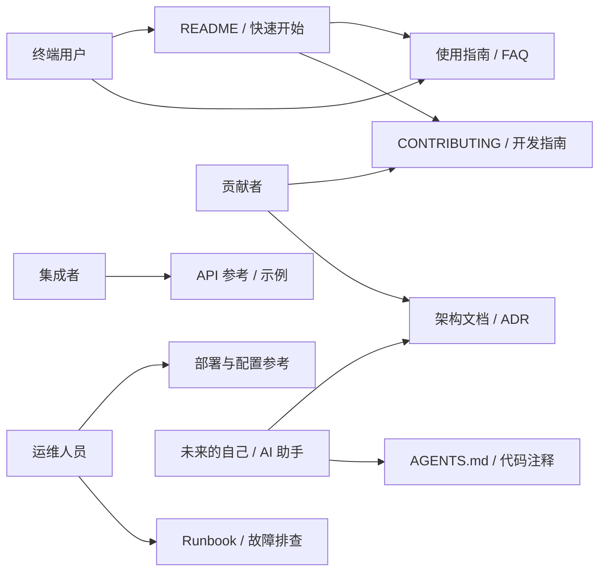
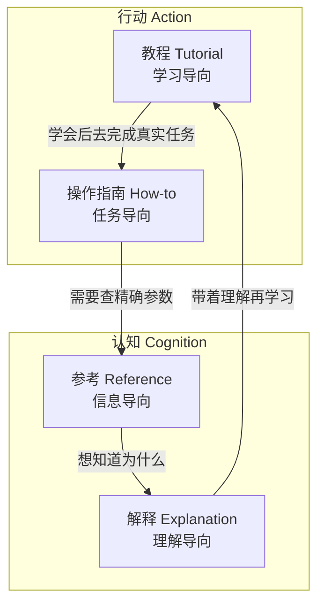
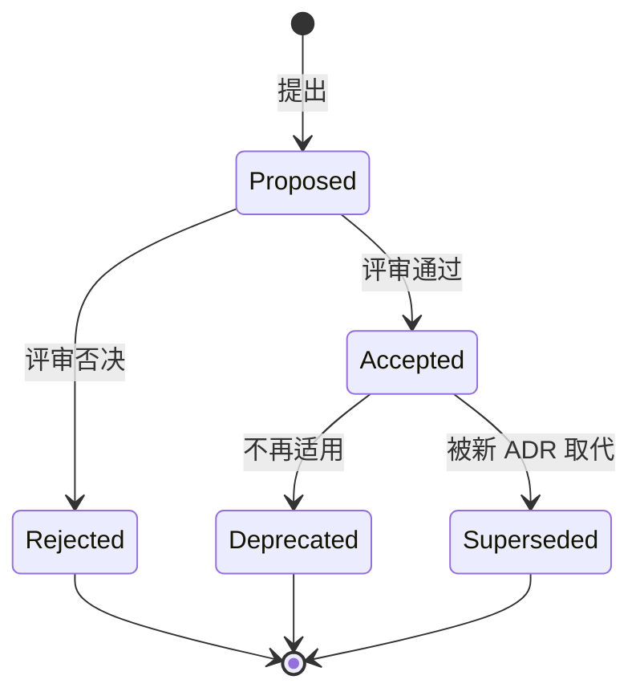
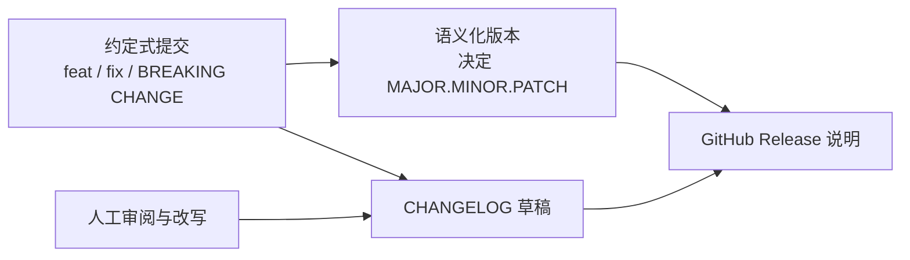
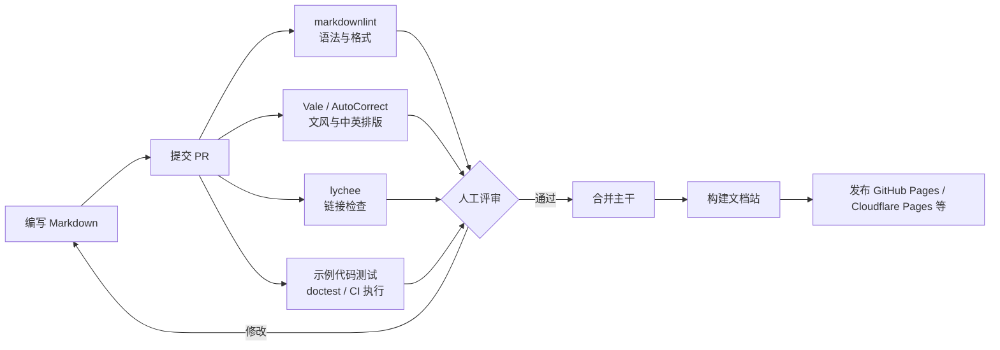
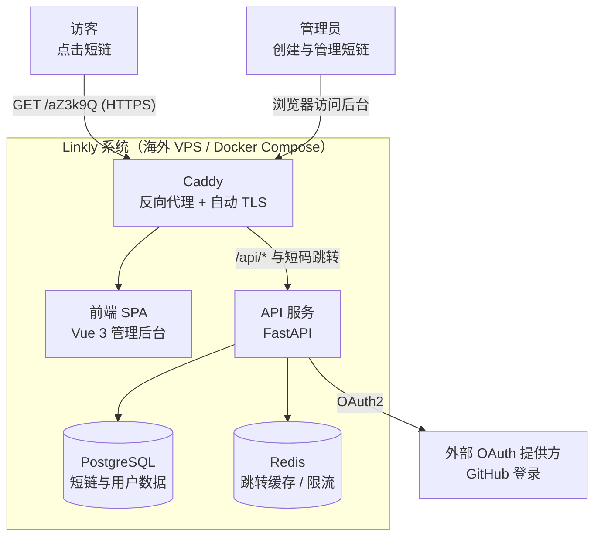
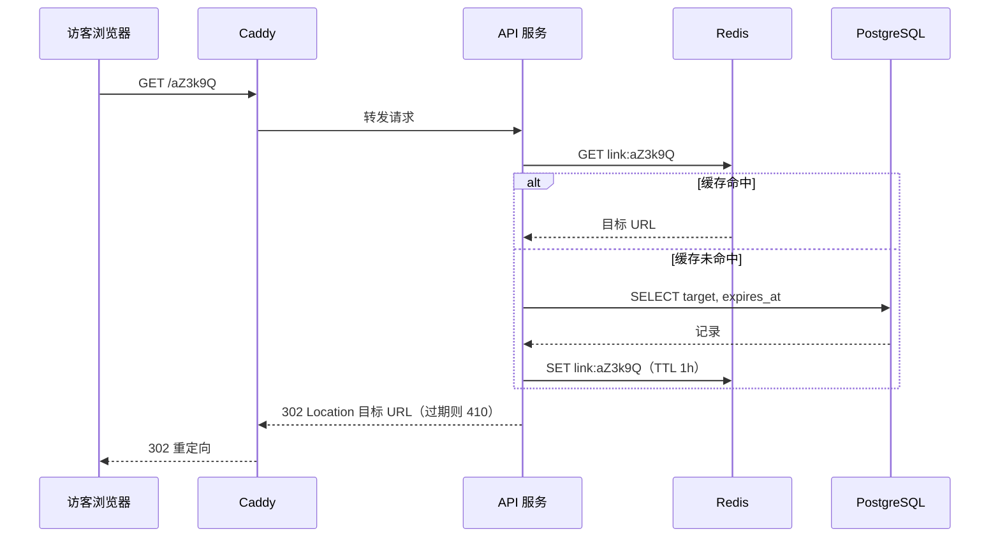

[toc]

## 先想清楚：文档写给谁，解决什么问题

文档的唯一目标是**让特定读者在特定情境下完成特定任务**。写之前先回答三个问题：**读者是谁？他此刻想干什么？读完要能做成什么事？**

一个项目的读者通常分成五类，关心的东西完全不同：

| 读者                                       | 典型问题                                   | 主要对应的文档                             |
| ------------------------------------------ | ------------------------------------------ | ------------------------------------------ |
| **终端用户**（User）                       | 这东西能干什么？怎么装？怎么用？           | README、快速开始、使用指南、FAQ            |
| **集成者**（Integrator，调你API或库的人）  | 接口参数是什么？出错怎么处理？             | API参考、SDK文档、示例代码                 |
| **贡献者**（Contributor）                  | 怎么搭开发环境？代码规范是什么？怎么提PR？ | `CONTRIBUTING.md`、开发指南、架构概览      |
| **维护/运维人员**（Maintainer / Operator） | 怎么部署、升级、回滚？出故障怎么排查？     | 部署文档、配置参考、运维手册（Runbook）    |
| **未来的自己和AI编码助手**                 | 当初为什么这样设计？约定是什么？           | 架构决策记录（ADR）、`AGENTS.md`、代码注释 |



图里README是所有人的**入口**，往外分流到各类专门文档。**README只负责"让人决定要不要用、并跑起来"，不要什么都塞进去。**

> **核心原则**：**按读者的任务组织文档，不要按作者脑子里的模块组织。**"我写了auth模块，所以有一篇auth.md"属于作者视角；"如何启用双因素登录"才是读者视角。

---

## 核心框架：Diátaxis四象限

如何给文档内容**分类**，目前业界最有影响力的方法论是**Diátaxis**（作者Daniele Procida，官网diataxis.fr）。Canonical（Ubuntu）在官方博客里宣布把它作为全公司文档体系的基础，Python文档社区也在使用。它把文档分成**四种类型**，每种对应用户在不同时刻的不同需求，**各自有独立的目的和写法，而且应该彼此分开**。

两条坐标轴是：**行动（Action）对比认知（Cognition）**、**学习（Acquisition/Study）对比工作（Application/Work）**。

| 类型             | 中文      | 读者状态           | 回答的问题            | 写作要点                                                   | 类比             |
| ---------------- | --------- | ------------------ | --------------------- | ---------------------------------------------------------- | ---------------- |
| **Tutorial**     | 教程      | 学习中的新手       | "带我走一遍"          | 一条确定能成功的路径，**不讲分支和原理**，每步都有可见结果 | 教小孩做第一道菜 |
| **How-to Guide** | 操作指南  | 有明确目标的使用者 | "我怎样做到X？"       | 面向目标、假定读者已有基础，可以列前提条件和变体           | 菜谱             |
| **Reference**    | 参考      | 工作中查资料的人   | "X的精确定义是什么？" | **准确、完整、结构统一**，像词典，不夹带教学和观点         | 食材营养成分表   |
| **Explanation**  | 解释/背景 | 想深入理解的人     | "为什么是这样？"      | 讲原理、权衡和历史，可以有观点，不要求步骤                 | 烹饪科学读物     |



这张图表示读者会**自然地在四类文档之间流转**：新手先走教程，上手后按指南完成任务，遇到细节查参考，想深入时读解释。**每类文档里都应该有通往其他类的链接。**

**用同一个功能举例**：假设你的项目有"定时备份"功能。

- **教程**：《10分钟完成第一次备份》，固定一个目录和参数，读者照着做必然成功，最后看到生成的`.tar.gz`文件。
- **操作指南**：《如何把备份推送到S3兼容存储》《如何从备份恢复单个文件》，每篇解决一个具体目标。
- **参考**：《备份配置项一览》，用表格列出`backup.schedule`、`backup.retention_days`等全部字段的类型、默认值和取值范围。
- **解释**：《备份策略的设计考量》，说明为什么用增量加全量、为什么默认保留14天、和快照方案相比有什么优劣。

**必须避免**的典型错误是**类型混写**：教程里插一大段原理（新手看不下去），参考文档里夹操作步骤（查资料的人找不到参数）。

> **补充**：Diátaxis的结构清晰，对AI助手和RAG（检索增强生成）检索也更友好，这是它最近又被热议的原因之一。

---

## 按项目规模分级：到底需要哪些文档

文档不是越多越好，**应该和项目复杂度、读者数量相称**。下表是我建议的分级（**必须**：没有就不合格；**推荐**：应该有；**可选**：有需要再加）。

| 文档                 | 单文件脚本             | 进阶工具/库          | 前后端完整项目     | 复杂/多人/长期项目 |
| -------------------- | ---------------------- | -------------------- | ------------------ | ------------------ |
| 文件头注释和`--help` | **必须**               | **必须**             | 必须（CLI部分）    | 必须               |
| README               | 推荐（可以就是文件头） | **必须**             | **必须**           | **必须**           |
| LICENSE              | 推荐（要公开时必须）   | **必须**（公开时）   | 必须（公开时）     | 必须               |
| CHANGELOG            | 可选                   | **推荐**             | **必须**           | **必须**           |
| 安装/部署文档        | —                      | 推荐                 | **必须**           | **必须**           |
| 配置参考             | 可选（写在`--help`里） | 推荐                 | **必须**           | **必须**           |
| API参考              | —                      | 必须（库的公共接口） | **必须**           | **必须**           |
| 架构概览             | —                      | 可选                 | **推荐**           | **必须**           |
| ADR                  | —                      | 可选                 | 推荐               | **必须**           |
| `CONTRIBUTING.md`    | —                      | 推荐（接受贡献时）   | 推荐               | **必须**           |
| Runbook/故障排查     | —                      | —                    | 推荐（自己部署时） | **必须**           |
| `SECURITY.md`        | —                      | 推荐                 | 推荐               | **必须**           |
| 独立文档站           | —                      | 可选                 | 可选               | 推荐               |
| `AGENTS.md`          | —                      | 可选                 | 推荐（用AI编码时） | 推荐               |

**判断口诀**：

- **有人要用**：写README和用法。
- **会升级**：写CHANGELOG。
- **要部署**：写部署、配置和运维文档。
- **有人协作**：写CONTRIBUTING和架构说明。
- **会后悔**：写ADR。

---

## 文档组织：仓库布局与导航

### 推荐的仓库布局

以一个前后端分离项目为例（目录用列表表示）：

- 仓库根目录
  - `README.md`：入口，项目是什么、快速开始、文档导航
  - `CHANGELOG.md`：版本变更记录
  - `LICENSE`：许可证
  - `CONTRIBUTING.md`：贡献指南
  - `SECURITY.md`：漏洞报告方式
  - `CODE_OF_CONDUCT.md`：行为准则（开源社区项目）
  - `AGENTS.md`：给AI编码助手看的项目约定（可选）
  - `.env.example`：环境变量样例，**本身就是一份文档**
  - `docs/`
    - `index.md`：文档首页和导航
    - `tutorials/`：教程，如`getting-started.md`
    - `how-to/`：操作指南，如`deploy-docker.md`、`restore-backup.md`
    - `reference/`：参考，如`config.md`、`cli.md`、`api/openapi.yaml`、`error-codes.md`
    - `explanation/`：解释，如`architecture.md`、`security-model.md`
    - `adr/`：架构决策记录，如`0001-use-postgresql.md`
    - `runbooks/`：运维手册，如`high-latency.md`、`db-failover.md`
    - `assets/`：图片等静态资源
  - `frontend/README.md`、`backend/README.md`：**子项目的局部README**，只写这一部分怎么开发和测试

### 组织原则

- **必须**：**单一信息源**（Single Source of Truth）。同一事实只写在一处，其他地方链接过去。端口号如果在五个文件里各写一遍，改的时候必然漏掉。
- **必须**：**文档和代码放在同一个仓库**，在同一个PR里一起修改（即"文档即代码"，Docs as Code）。
- **推荐**：目录按Diátaxis分类，文件名用**小写短横线英文**（`deploy-docker.md`），避免中文和空格造成URL编码及跨平台问题。标题可以用中文。
- **推荐**：**渐进披露**（Progressive Disclosure）。README只放最常用的20%，其余放进`docs/`。
- **推荐**：每篇文档开头写明**适用读者、前提条件、适用版本**。
- **避免**：按时间堆文件（`notes-2024-05.md`）、按作者分文件、一个无限增长的`README.md`。

---

## 逐类详解

### 代码内文档：注释、Docstring和命令行帮助

**这是离代码最近、最不容易过时的文档，也是脚本类项目的主力文档。**

**注释原则**：

- **必须**：注释写**为什么**（Why），不写代码已经表达清楚的**是什么**（What）。
  - 差：`i += 1  # i 加 1`
  - 好：`retry += 1  # 上游网关偶发 502，重试 3 次可覆盖 99% 的场景（见 ADR-0007）`
- **必须**：公共函数、类、模块写Docstring（文档字符串），说明用途、参数、返回值、异常和示例。
- **推荐**：遵循语言社区约定。Python参照**PEP 257**，格式选**Google风格**或**NumPy风格**之一并全项目统一；JS/TS用**JSDoc/TSDoc**；Go用紧贴声明的`// FuncName ...`注释；Rust用`///`。这样才能被Sphinx、TypeDoc、godoc、rustdoc自动生成参考文档。
- **避免**：注释掉的大段死代码（交给Git历史）、没有负责人和期限的`TODO`、和代码不一致的过期注释（**比没有注释更糟**）。

**Python Google风格Docstring示例**：

```python
def shorten(url: str, *, ttl_days: int | None = None, alias: str | None = None) -> str:
    """为长链接生成短码并持久化。

    同一 URL 重复提交时返回已有短码，不会重复创建（幂等）。

    Args:
        url: 待缩短的完整 URL，必须以 http:// 或 https:// 开头。
        ttl_days: 过期天数；None 表示永不过期。取值范围 1-3650。
        alias: 自定义短码，仅允许 [A-Za-z0-9_-]，长度 4-32。

    Returns:
        生成的短码，例如 "aZ3k9Q"。

    Raises:
        ValueError: url 格式非法或 alias 不符合规则。
        AliasConflictError: alias 已被占用。

    Example:
        >>> shorten("https://example.com/a/very/long/path", ttl_days=7)
        'aZ3k9Q'
    """
```

**命令行用法语法约定**：写`--help`和CLI参考时，大家默认遵循POSIX/docopt风格的符号约定，**必须统一使用并在文档里说明一次**：

- `[ ... ]`：**可选**项，例如`[-k <days>]`表示`-k`可以不给。
- `< ... >`：**占位符**，需要替换成实际值，例如`<dest_dir>`替换成`/data/backup`。
- `...`：**可重复**，例如`<source_dir>...`表示可以给一个或多个目录。
- `a | b`：**互斥**，二选一，例如`--json | --yaml`。
- `{a | b}`：**必选其一**，例如`{start | stop | status}`。
- 不加括号的字面量：**原样输入**，例如`-o`、`backup`。

**脚本文档完整示例**：下面这个备份脚本演示了"文件头加`--help`就是文档"的写法。头注释写清用途、用法、依赖、平台、退出码和示例；`usage()`的输出遵循上面的符号约定；参数错误返回退出码2，和运行时错误（1）区分开。

```bash
#!/usr/bin/env bash
#
# snapbak.sh - 将目录打包为带时间戳的 tar.gz 备份，并按保留天数清理旧备份。
#
# 用法:    snapbak.sh [-o <dest_dir>] [-k <days>] [-n] [-h] <source_dir>...
# 依赖:    bash >= 4, tar, gzip, find (GNU 或 BSD 均可)
# 平台:    Linux / macOS / Windows(Git Bash 或 WSL)
# 退出码:  0 成功; 1 运行时错误; 2 参数错误
# 示例:    snapbak.sh -o /data/backup -k 7 ~/notes ~/projects/blog
#
set -euo pipefail

readonly VERSION="1.2.0"
DEST_DIR="${SNAPBAK_DEST:-$HOME/backups}" # 可被环境变量 SNAPBAK_DEST 覆盖
KEEP_DAYS=14
DRY_RUN=0

usage() {
	cat <<USAGE
snapbak ${VERSION} - 目录快照备份工具

用法:
  snapbak.sh [-o <dest_dir>] [-k <days>] [-n] [-h] <source_dir>...

参数:
  <source_dir>...   要备份的一个或多个目录(必填)

选项:
  -o <dest_dir>     备份输出目录 (默认: \$SNAPBAK_DEST 或 ~/backups)
  -k <days>         保留最近 <days> 天的备份, 0 表示不清理 (默认: 14)
  -n                演练模式(dry run): 只打印将执行的操作, 不落盘
  -h                显示本帮助并退出

示例:
  snapbak.sh ~/notes
  snapbak.sh -o /mnt/nas/backup -k 30 ~/notes ~/photos
USAGE
}

log() { printf '[%s] %s\n' "$(date '+%F %T')" "$*" >&2; }
die() {
	log "ERROR: $1"
	exit "${2:-1}"
}

run() {
	if ((DRY_RUN)); then
		log "DRY-RUN: $*"
	else
		"$@"
	fi
}

while getopts ':o:k:nh' opt; do
	case "$opt" in
	o) DEST_DIR="$OPTARG" ;;
	k) [[ "$OPTARG" =~ ^[0-9]+$ ]] || die "-k 需要非负整数: $OPTARG" 2
		KEEP_DAYS="$OPTARG" ;;
	n) DRY_RUN=1 ;;
	h) usage; exit 0 ;;
	:) die "选项 -$OPTARG 缺少参数" 2 ;;
	*) die "未知选项 -$OPTARG (使用 -h 查看帮助)" 2 ;;
	esac
done
shift $((OPTIND - 1))
(($# > 0)) || { usage >&2; exit 2; }

run mkdir -p "$DEST_DIR"
stamp="$(date '+%Y%m%d-%H%M%S')"

for src in "$@"; do
	[[ -d "$src" ]] || die "源目录不存在: $src" 2
	name="$(basename "$src")"
	out="$DEST_DIR/${name}-${stamp}.tar.gz"
	log "备份 $src -> $out"
	run tar -czf "$out" -C "$(dirname "$src")" "$name"
done

if ((KEEP_DAYS > 0)); then
	log "清理 $KEEP_DAYS 天前的备份"
	run find "$DEST_DIR" -maxdepth 1 -name '*.tar.gz' -type f -mtime "+$KEEP_DAYS" -delete
fi
log "完成"
```

这个脚本体现的**文档化设计**有几点：

- **自描述**：`-h`输出就是完整的参考文档，没参数时自动把帮助打到stderr。
- **可预演**：`-n`演练模式让用户执行前先看清会做什么，这对带删除动作的脚本尤其重要。
- **可诊断**：日志带时间戳并写到stderr，不污染stdout。
- **契约明确**：退出码和环境变量覆盖（`SNAPBAK_DEST`）都写在头注释里。
- **推荐**：提交前跑`shellcheck`（静态检查）和`shfmt -d`（格式检查），并放进CI。

### README：项目的门面

README要在**30秒内**回答"这是什么、对我有没有用"，在**5分钟内**让人跑起来。

**推荐章节顺序**（按读者决策路径排列）：

| 章节                    | 必要性             | 内容要点                                                     |
| ----------------------- | ------------------ | ------------------------------------------------------------ |
| 项目名和一句话简介      | **必须**           | 用一句话说清"为谁解决什么问题"，不要写"一个强大的工具"       |
| 徽章（Badges）          | 可选               | CI状态、版本、许可证，**不超过一行**，避免装饰过度           |
| 截图/演示               | 推荐（有UI时）     | 一张图胜过千言，GIF控制体积                                  |
| 特性（Features）        | 推荐               | 3到7条，突出差异化                                           |
| 快速开始（Quick Start） | **必须**           | 前提条件、安装、最小可运行示例，**每条命令都能复制粘贴直接跑通** |
| 用法（Usage）           | **必须**           | 最常见的2到3个场景，更多内容链接到`docs/`                    |
| 配置                    | 推荐               | 最关键的几项，完整内容链接到配置参考                         |
| 文档导航                | 推荐               | 链接到教程、指南、参考、架构                                 |
| 常见问题/已知限制       | 推荐               | **主动写明不支持什么**，节省所有人的时间                     |
| 贡献                    | 推荐               | 链接`CONTRIBUTING.md`                                        |
| 许可证                  | **必须**（公开时） | 写明许可证名称并链接`LICENSE`                                |

**要点**：

- **必须**：快速开始里写明**前提条件的具体版本**（"Node.js >= 20"，而不是"安装Node.js"）。
- **必须**：命令和输出分开展示，明确告诉读者"成功时你会看到什么"。
- **推荐**：中文项目可以提供`README.md`（中文）和`README.en.md`（英文）并在顶部互相链接；国际化项目一般以英文为主。
- **避免**：README里堆完整API参考、几十个徽章、"TODO: 待补充"之类的空章节。

### 安装、部署与配置参考

运维人员最怕"在我机器上能跑"。部署文档要做到**可复现**。

- **必须**：列出**运行环境矩阵**（操作系统、运行时版本、数据库版本），以及**端口、目录、权限要求**。
- **必须**：提供**完整的环境变量和配置项参考表**，并与`.env.example`保持一致（最好由同一份schema生成）。
- **必须**：写清**升级步骤和回滚步骤**，包括数据库迁移是否可逆。
- **推荐**：提供一条最短部署路径（如`docker compose up -d`）和一条生产部署路径（反向代理、TLS、备份、监控），分开写。
- **推荐**：说明**健康检查**接口和**验证部署成功**的方法。

**配置参考表模板**（每个字段都要逐项说明，不能只靠名字自解释）：

| 变量名                | 必填 | 类型 | 默认值                     | 说明                                           | 示例                                   |
| --------------------- | ---- | ---- | -------------------------- | ---------------------------------------------- | -------------------------------------- |
| `LINKLY_DATABASE_URL` | 是   | URL  | 无                         | PostgreSQL连接串，**包含密码，不得提交到仓库** | `postgres://linkly:***@db:5432/linkly` |
| `LINKLY_REDIS_URL`    | 否   | URL  | `redis://localhost:6379/0` | 缓存与限流使用的Redis                          | `redis://cache:6379/1`                 |
| `LINKLY_BASE_URL`     | 是   | URL  | 无                         | 对外生成短链时使用的域名，**不带结尾斜杠**     | `https://s.example.com`                |
| `LINKLY_RATE_LIMIT`   | 否   | 整数 | `60`                       | 每个IP每分钟最多创建的短链数，`0`表示不限      | `120`                                  |
| `LINKLY_LOG_LEVEL`    | 否   | 枚举 | `info`                     | 可选`debug`、`info`、`warn`、`error`           | `debug`                                |

这张表的列含义如下：

- "**必填**"指不设置时服务**拒绝启动**。
- "**默认值**"必须和代码里的真实默认值一致。
- "**说明**"里要写**副作用和安全注意事项**。

### API文档

前后端项目的API文档，首要读者是**前端开发者（包括你自己）和第三方集成者**。

- **必须**：采用**机器可读的规范**描述HTTP API，事实标准是**OpenAPI**（广泛使用的版本是3.0和3.1；据我所知**3.2已于2025年发布，需核实**，工具链支持情况也要先确认）。事件驱动或消息类接口用**AsyncAPI**，gRPC用`.proto`文件加注释。
- **推荐**：**从代码生成规范或从规范生成代码**，二选一，保证一致。比如FastAPI、NestJS、springdoc会自动生成OpenAPI；Go常用swag。再用Swagger UI、Redoc、Scalar之类的工具渲染。
- **必须**：每个接口写清**认证方式、请求参数、响应结构、错误码、示例请求和示例响应**。
- **必须**：维护统一的**错误码参考表**（错误码、HTTP状态码、含义、客户端应对方式）。
- **推荐**：写明**版本策略**（如URL里带`/v1`）、**分页、限流、幂等**等全局约定。
- **避免**：只给接口列表不给示例、示例数据和真实字段不一致、文档里出现真实令牌。

**OpenAPI片段示例**：

```yaml
openapi: 3.1.0
info:
  title: Linkly API
  version: 1.4.0
paths:
  /api/v1/links:
    post:
      summary: 创建短链
      description: 同一 URL 重复提交返回已存在的短链（幂等）。
      security:
        - bearerAuth: []
      requestBody:
        required: true
        content:
          application/json:
            schema:
              $ref: "#/components/schemas/CreateLinkRequest"
            example:
              url: https://example.com/a/very/long/path
              ttl_days: 7
      responses:
        "201":
          description: 创建成功
          content:
            application/json:
              example:
                code: aZ3k9Q
                short_url: https://s.example.com/aZ3k9Q
                expires_at: "2025-06-08T00:00:00Z"
        "409":
          description: 自定义短码已被占用（错误码 LINK_ALIAS_CONFLICT）
components:
  securitySchemes:
    bearerAuth:
      type: http
      scheme: bearer
  schemas:
    CreateLinkRequest:
      type: object
      required: [url]
      properties:
        url:
          type: string
          format: uri
          description: 以 http:// 或 https:// 开头的完整 URL
        ttl_days:
          type: integer
          minimum: 1
          maximum: 3650
          description: 过期天数，不传表示永不过期
```

### 架构文档与架构决策记录（ADR）

**架构文档**回答"系统由什么组成、怎么协作"，**ADR**回答"当初为什么这样选"。

**架构文档推荐用两个成熟框架**：

- **C4模型**（Simon Brown提出）：按缩放层级画图。**Context**（系统上下文：系统和外部用户、外部系统的关系）、**Container**（容器：可独立部署运行的单元，如前端SPA、API服务、数据库，**不是Docker容器的意思**，注意区分）、**Component**（组件：容器内部的主要模块）、**Code**（代码级，通常不需要手画）。**个人和中小项目画前两层就够了。**
- **arc42**：一个按章节组织的架构文档模板，包括引言与目标、约束、上下文、解决方案策略、构建块视图、运行时视图、部署视图、横切概念、架构决策、质量需求、风险与技术债、术语表。**复杂项目可以按需裁剪使用**，不必每章都填。

**ADR要点**：

- 一个ADR只记录**一个**架构上重要的决策。"Markdown Architectural Decision Records"（MADR）把它定义为：针对具有架构意义的需求做出的、有理由的设计选择。
- **推荐模板**：**MADR 4.0.0**（2024年9月发布，有完整版、"bare"版和"minimal"版）；更早的是**Michael Nygard模板**（背景、决策、后果三段式）。
- **必须**：ADR**只追加不修改**。决策变了就新写一篇，把旧的标记为"已被ADR-00xx取代"。
- **推荐**：编号递增，文件名如`0003-use-redis-for-rate-limiting.md`。



这张状态图说明，ADR一旦被接受（Accepted）就不再改正文，只改**状态**。被取代（Superseded）时，要在新旧两篇里**互相链接**，保留完整的决策演进轨迹。

### 变更记录：CHANGELOG、语义化版本、约定式提交

这三者配合起来，构成**版本沟通体系**：



约定式提交的类型可以推导出版本号的升级幅度，也可以生成CHANGELOG草稿；但**草稿必须经过人工审阅改写**，最后再派生出发布说明。

**语义化版本（SemVer 2.0.0）**：版本号格式是`MAJOR.MINOR.PATCH`。

- `MAJOR`：做了**不兼容**的API变更时递增。
- `MINOR`：**向后兼容**地新增功能时递增。
- `PATCH`：**向后兼容**地修复缺陷时递增。
- `0.y.z`表示初始开发阶段，公共API随时可能变化，不承诺兼容。
- 应用类项目（不是库）也可以用日历版本（CalVer，如`2025.06`），但**必须在CHANGELOG里声明用的是哪种版本方案**。

**约定式提交（Conventional Commits 1.0.0）**：一种轻量的提交信息约定，让提交历史明确、方便在上面构建自动化工具，并且和SemVer衔接。格式是`<type>[optional scope]: <description>`，后面可以跟空行加可选正文（body），再跟可选脚注（footer）。字段含义：

- `<type>`：变更类型。`feat`（新功能，对应MINOR）、`fix`（修复，对应PATCH），以及常用但规范不强制的`docs`、`refactor`、`test`、`chore`、`ci`、`perf`等。
- `[optional scope]`：影响范围，可选，写在括号里，如`feat(api):`。
- `<description>`：简短描述，用祈使语气，不加句号。
- body：说明动机和与之前行为的差异。
- footer：如`BREAKING CHANGE: ...`（破坏性变更，对应MAJOR），或在type后加`!`（如`feat(api)!:`）；也可以写`Refs: #123`。

示例：`fix(redirect): 过期短链返回 410 而非 404`，以及`feat(api)!: 移除 /api/v0 接口`。

**CHANGELOG（Keep a Changelog）**：本轮核实到它**已发布2.0.0版本**。指导原则包括：

- 变更日志是**写给人看的**，不是给机器的。
- 每个版本都要有条目，同类变更归在一起，版本和章节可链接。
- 最新版本在最前，标明每个版本的发布日期，注明使用的版本方案。
- 措辞平实，因为很多读者不是母语使用者。

2.0.0版还特别强调了以下几点：

- **以CHANGELOG为准，从它派生发布说明**，不要维护两份。
- **弃用要先公告再执行**：先在某个版本标记Deprecated，后续版本再Removed，并写明计划在哪个版本移除。
- **即使别的都不写，也一定要记录弃用、移除和破坏性变更。**
- 用工具或LLM起草时，要像给贡献者布置任务一样给出要求：只总结面向用户的显著变更，**不要直接贴git log**，按六种类型归类，说明原因，标出破坏性变更；发布前必须自己读一遍。

六种类型是`Added`（新增）、`Changed`（变更）、`Deprecated`（弃用）、`Removed`（移除）、`Fixed`（修复）、`Security`（安全）。

```markdown
# Changelog

本项目的所有显著变更都记录在此文件中。
格式基于 Keep a Changelog，版本号遵循语义化版本 2.0.0。

## [Unreleased]

### Added
- 管理后台支持按标签筛选短链。

## [1.4.0] - 2025-06-01

### Added
- 创建短链时可指定 `ttl_days` 过期天数 (#142)。

### Changed
- 默认限流从每分钟 30 次放宽到 60 次，可通过 `LINKLY_RATE_LIMIT` 调整。

### Deprecated
- `/api/v0/*` 接口已弃用，将于 2.0.0 移除，请迁移到 `/api/v1`（见迁移指南）。

### Fixed
- 过期短链现在返回 410 Gone 而不是 404，便于客户端区分 (#150)。

### Security
- 升级 JWT 依赖以修复签名校验绕过问题，**建议所有用户升级**。

[Unreleased]: https://github.com/you/linkly/compare/v1.4.0...HEAD
[1.4.0]: https://github.com/you/linkly/compare/v1.3.2...v1.4.0
```

### 贡献者与开发者指南（CONTRIBUTING）

目标是让一个新人（包括半年后的你）**在一小时内搭好环境、跑通测试、提交第一个PR**。

- **必须**：开发环境搭建（依赖版本、一键启动命令，如`make dev`或`docker compose -f compose.dev.yml up`）。
- **必须**：怎么运行测试、lint、格式化，以及CI会检查什么。
- **推荐**：分支策略、提交信息规范（如约定式提交）、PR模板和评审标准。
- **推荐**：**"文档也是完成定义的一部分"**（Definition of Done）：改了行为、配置或接口，必须同步更新文档和CHANGELOG。
- **推荐**：常见开发问题（端口冲突、Windows下的换行和路径问题、国内依赖下载慢怎么办）。

### 运维手册（Runbook）与故障排查

Runbook写给**凌晨三点被告警叫醒、脑子不清醒的值班人员**，所以要求**可以照着执行，不需要思考**。

- **必须**：每篇对应一个**告警或故障场景**，固定结构为：现象、影响、诊断步骤、处置步骤、验证恢复、升级路径（联系谁）。
- **必须**：命令可以直接复制，**危险操作要醒目标注**并给出回滚办法。
- **推荐**：告警消息里直接附上对应Runbook的链接。
- **推荐**：每次事故复盘（Postmortem）后更新Runbook。

````markdown
# Runbook：短链跳转延迟过高

- **告警**：`linkly_redirect_p99_seconds > 0.5` 持续 5 分钟
- **影响**：用户点击短链等待明显变长，严重时超时
- **适用版本**：>= 1.3.0

## 诊断
1. 检查 Redis 是否可达：`docker compose exec api linkly doctor --check redis`
2. 查看缓存命中率面板（Grafana → Linkly → Cache Hit Ratio），低于 80% 视为异常
3. 检查数据库慢查询：`docker compose exec db psql -U linkly -c "SELECT * FROM pg_stat_activity WHERE state='active';"`

## 处置
- Redis 不可达：`docker compose restart cache`，预计 30 秒内恢复
- 缓存命中率低且刚发布过新版本：**回滚**到上一个版本（见 how-to/rollback.md）

## 验证
- p99 回落到 0.2 秒以下并持续 10 分钟

## 升级
- 15 分钟内未恢复：联系项目负责人 @you（Telegram / 邮箱见内部通讯录）
````

### 社区健康与合规文件

GitHub会识别一组"**社区健康文件**"（Community Health Files），放在仓库根目录、`docs/`或`.github/`下都能被识别。

| 文件                                                  | 作用           | 要点                                                         |
| ----------------------------------------------------- | -------------- | ------------------------------------------------------------ |
| `LICENSE`                                             | 许可证         | **没有LICENSE等于保留所有权利**，别人在法律上不能使用；推荐MIT、Apache-2.0、GPL系列等OSI认可的许可证 |
| `SECURITY.md`                                         | 漏洞报告方式   | 写明**私下报告渠道**（邮箱或GitHub私有漏洞报告）、支持的版本、响应时限 |
| `CONTRIBUTING.md`                                     | 贡献指南       | 见上文                                                       |
| `CODE_OF_CONDUCT.md`                                  | 行为准则       | 常用Contributor Covenant                                     |
| `SUPPORT.md`                                          | 获取帮助的渠道 | 区分"提问去讨论区"和"报Bug去Issue"                           |
| `.github/ISSUE_TEMPLATE/`、`PULL_REQUEST_TEMPLATE.md` | 模板           | Bug模板要求填写版本、操作系统、复现步骤、期望结果和实际结果  |
| `CODEOWNERS`                                          | 代码负责人     | 也可以用来指定文档的负责人                                   |

### 面向AI编码助手的文档

这是近一两年新出现的文档类型（来自我的训练知识，**需核实最新进展**）：

- **`AGENTS.md`**：放在仓库根目录，被多种AI编码代理识别的开放约定，用来告诉AI**构建和测试命令、代码风格、目录约定、禁止事项**。可以理解为"写给机器协作者的CONTRIBUTING"。
- **`llms.txt`**：2024年提出的一项提案，在网站根目录提供一份精简的Markdown索引，方便大模型获取文档。
- **推荐**：`AGENTS.md`**引用**现有文档，不要复制一份（单一信息源），保持简短、具体、可执行。

---

## 写作规范：必须、推荐、可以、避免

### 总体规则

| 级别     | 规则                             | 说明或示例                                                   |
| -------- | -------------------------------- | ------------------------------------------------------------ |
| **必须** | **准确且可验证**                 | 每条命令、每段代码都在当前版本真实运行过；能自动化验证的放进CI |
| **必须** | **标明适用版本和日期**           | "适用于v1.4+"，避免读者用旧文档操作新版本                    |
| **必须** | **术语一致**                     | 全文统一用"短链"就不要混用"短网址""短链接"；建立术语表（Glossary） |
| **必须** | **敏感信息脱敏**                 | 令牌、密码、内网地址一律用占位符，如`<your-token>`、`***`    |
| **必须** | **主动说明限制和风险**           | 不支持的平台、破坏性操作、数据丢失风险                       |
| **推荐** | **结论先行**（倒金字塔）         | 先给答案或命令，再解释                                       |
| **推荐** | **一段一个主题、一句一个意思**   | 长句拆短，复杂条件用列表                                     |
| **推荐** | **主动语态、第二人称、祈使句**   | "运行以下命令"，而不是"以下命令可以被运行"                   |
| **推荐** | **步骤用有序列表，每步一个动作** | 并标明每步的预期结果                                         |
| **推荐** | **参照成熟的风格指南**           | 英文参照*Google developer documentation style guide*、*Microsoft Writing Style Guide*；中文参照阮一峰的《中文技术文档的写作规范》 |
| **可以** | 规范类文档使用RFC 2119关键词     | 英文MUST、SHOULD、MAY，对应中文"必须、应该、可以"，并在文首声明其含义 |
| **可以** | 用提示块区分注意事项             | GitHub支持`> [!NOTE]`、`> [!WARNING]`等Alerts语法            |
| **避免** | **"简单地""只需""显然"**         | 对读者来说未必简单，出了错还会让人沮丧                       |
| **避免** | **模糊指代**                     | "这个""上面那个配置"，应直接写出名称                         |
| **避免** | **截图代替文本**                 | 截图无法搜索、复制和翻译，也容易过时；命令和报错一律用文本   |
| **避免** | **未来时态和营销腔**             | "即将支持""业界领先"，没有承诺能力就不要写                   |

### 中文技术写作要特别注意的地方

- **中英文混排的空格**：《中文文案排版指北》等规范主张中英文之间加空格，也有不少团队（包括你的偏好）选择不加。**两种都可以，关键是全项目统一**，并用工具强制执行（见下文AutoCorrect的配置说明）。
- **标点**：中文语境用全角标点；英文句子、代码、命令里用半角。**代码和命令永远不要出现全角符号**，复制后会直接报错。
- **术语**：首次出现时写成"中文（English）"，如"架构决策记录（ADR）"，后文统一使用一种写法。
- **数字和单位**：阿拉伯数字加单位，如"5分钟""512MB"；版本号保持原样，如`v1.4.0`。
- **非ASCII字符风险**：部分工具（老版本终端、某些PDF导出器、表格对齐工具）对中文显示不友好。**文件名、锚点、配置键尽量用ASCII**，中文只用于正文和标题。

### 代码示例与命令的规范

- **必须**：代码块**标注语言**（`bash`、`powershell`、`yaml`、`python`），以便高亮和工具识别。
- **必须**：**命令和输出分开**，或用提示符区分（`$`表示普通用户，`#`表示root，`PS>`表示PowerShell）；推荐命令块不带提示符，方便复制。
- **必须**：**示例完整**，包括必要的import、前置变量和工作目录，不要只给一个无法运行的片段。
- **推荐**：跨平台差异分别给出\*nix和Windows写法（下一节有示例）。
- **推荐**：长命令按行续写（bash用`\`，PowerShell用反引号），每个参数单独一行，并说明每个参数的含义。
- **避免**：`curl ... | sudo bash`这种不加说明的危险操作。如果确实要提供，同时给出"先下载审阅再执行"的方式。

### 图表

- **推荐**：**图即代码**（Diagrams as Code）。GitHub、GitLab以及主流文档站都能直接渲染Mermaid，可以和文字一起review、diff和维护。
- **必须**：**每张图都要配文字说明**，图不能替代文字，也要考虑读屏用户。图片要写有意义的`alt`文本。
- **推荐**：系统结构用C4风格的flowchart，交互用sequenceDiagram，状态用stateDiagram，数据模型用erDiagram。
- **避免**：一张图塞进所有细节。**一张图只回答一个问题。**

---

## 跨平台与国内网络环境的文档要点

### 跨平台

- **必须**：在仓库里放`.gitattributes`，**统一换行符**，并在CONTRIBUTING里说明原因。否则Windows用户在`core.autocrlf=true`下检出的Shell脚本会变成CRLF，执行时报`/usr/bin/env: 'bash\r': No such file or directory`。

```gitattributes
# 默认由 Git 自动判断文本文件并在仓库中统一存储为 LF
* text=auto eol=lf
# Shell 脚本必须是 LF
*.sh text eol=lf
# Windows 专用脚本保持 CRLF
*.bat text eol=crlf
*.cmd text eol=crlf
*.ps1 text eol=crlf
# 二进制文件不做换行转换
*.png binary
*.jpg binary
```

- **推荐**：路径示例同时给出两种写法（`~/backups`对应`%USERPROFILE%\backups`），或者干脆推荐Windows用户用WSL或Git Bash，并**写明测试过的平台**。
- **推荐**：环境变量写法分平台展示。bash/zsh用`export LINKLY_LOG_LEVEL=debug`，PowerShell用`$env:LINKLY_LOG_LEVEL = "debug"`，CMD用`set LINKLY_LOG_LEVEL=debug`。

### 国内网络环境

面向国内读者的安装文档，**应该主动提供网络受限时的方案**，不要假设读者能直接访问GitHub、Docker Hub、npm、PyPI。

- **推荐**：说明如何为工具配置代理（假设本地代理（如mihomo）监听`127.0.0.1:7890`）：

```bash
# Linux / macOS（当前 shell 会话有效）
export HTTP_PROXY=http://127.0.0.1:7890
export HTTPS_PROXY=http://127.0.0.1:7890
export NO_PROXY=localhost,127.0.0.1
# 仅为 Git 设置代理
git config --global http.proxy http://127.0.0.1:7890
```

```powershell
# Windows PowerShell（当前会话有效）
$env:HTTP_PROXY  = "http://127.0.0.1:7890"
$env:HTTPS_PROXY = "http://127.0.0.1:7890"
$env:NO_PROXY    = "localhost,127.0.0.1"
git config --global http.proxy http://127.0.0.1:7890
```

- **推荐**：没有代理时，给出包管理器镜像的配置方式（npm、PyPI、Go模块代理、容器镜像加速）。GitHub Release文件可以用你提到的gh-proxy类"链接包裹"加速服务。**这类第三方镜像的可用性变化很快，本轮没能核实，文档里应写成"示例，可用性请自行确认"，并且永远保留官方原始链接。**
- **推荐**：生产环境部署在海外服务器时，文档里要**区分"开发者本地（国内）"和"服务器（海外）"两套网络说明**，服务器上通常不需要镜像。

---

## 文档即代码：工具链与自动化

**文档即代码**（Docs as Code）是指用对待代码的方式对待文档：纯文本（Markdown）、版本控制、PR评审、CI检查、自动发布。



PR触发四类并行检查（格式、文风、链接、示例），都通过后再人工评审，合并后自动构建发布。**能交给机器检查的规则就不要靠人记**，人工评审集中在准确性和可读性上。

### 检查工具

| 工具                                            | 作用                                             | 备注                                                         |
| ----------------------------------------------- | ------------------------------------------------ | ------------------------------------------------------------ |
| **markdownlint-cli2**                           | Markdown语法和风格检查                           | 用`.markdownlint-cli2.yaml`配置规则                          |
| **Vale**                                        | 文风检查（禁用词、术语一致、被动语态等）         | 可以加载Google、Microsoft风格包，也可以自定义中文词表        |
| **AutoCorrect**（国内开发者huacnlee的开源项目） | **中英文混排**检查与自动修正（空格、全半角标点） | 默认规则会**加空格**；不喜欢加空格的团队可以在配置里关闭`space-word`等规则（**规则名需按官方文档核实**） |
| **lychee**                                      | 检查失效链接                                     | 适合放进CI定时运行                                           |
| **typos** / **cspell**                          | 拼写检查                                         | 对代码标识符也有效                                           |
| **shellcheck** / **shfmt**                      | Shell脚本静态检查和格式化                        | 文档里的脚本示例同样适用                                     |

**GitHub Actions示例**（action版本号写的是我所知的主版本，**使用前请到各项目页面确认最新版**）：

```yaml
name: docs-check
on:
  pull_request:
    paths:
      - "**/*.md"
      - "docs/**"
      - ".github/workflows/docs-check.yml"
  schedule:
    - cron: "0 3 * * 1" # 每周一检查一次外链是否失效

jobs:
  lint:
    runs-on: ubuntu-latest
    steps:
      - uses: actions/checkout@v4
      - uses: actions/setup-node@v4
        with:
          node-version: 22
      - name: Markdown 格式检查
        run: npx --yes markdownlint-cli2 "**/*.md" "#node_modules"
      - name: 链接检查
        uses: lycheeverse/lychee-action@v2
        with:
          args: --no-progress "./**/*.md"
          fail: true
```

### 文档站生成器怎么选

| 工具                                      | 技术栈   | 适合                                         | 说明                                                         |
| ----------------------------------------- | -------- | -------------------------------------------- | ------------------------------------------------------------ |
| **MkDocs + Material**                     | Python   | 通用项目、Python项目、追求开箱即用           | 搜索和中文支持好、主题成熟。据我所知团队在2025年底推出了后继项目Zensical，Material进入维护期（**需核实**） |
| **Docusaurus**                            | React    | 需要**多版本文档**、国际化、博客             | Meta出品，版本化能力强                                       |
| **VitePress**                             | Vue/Vite | 前端项目、Vue生态，追求速度                  | 配置简单，中文社区活跃                                       |
| **Starlight**                             | Astro    | 现代静态站点，重视性能和无障碍               | 默认体验好                                                   |
| **Sphinx**（加MyST）                      | Python   | 需要从Docstring**自动生成API参考**的Python库 | 学术和科学计算领域的事实标准                                 |
| **mdBook**                                | Rust     | 书籍式线性文档                               | 轻量                                                         |
| **Rspress**（字节跳动）、**dumi**（蚂蚁） | React    | 国内团队、组件库文档                         | **国内方案**，中文文档完善                                   |

**选型建议**：

- **个人或中小项目**：直接用仓库里的Markdown加GitHub渲染就够了，**不要过早建文档站**。
- 需要文档站时，Python项目选MkDocs（关注Zensical的进展），前端项目选VitePress，需要多版本的选Docusaurus。

---

## 可参照的规范与标准一览

| 规范或标准                                                   | 类型           | 适用内容                                                 | 个人或中小项目建议                                           |
| ------------------------------------------------------------ | -------------- | -------------------------------------------------------- | ------------------------------------------------------------ |
| **Diátaxis**                                                 | 方法论         | 文档分类与组织                                           | **强烈推荐**                                                 |
| **Google** / **Microsoft写作风格指南**                       | 风格指南       | 英文技术写作                                             | 推荐参照                                                     |
| **阮一峰《中文技术文档的写作规范》**、**《中文文案排版指北》** | 风格指南       | 中文写作与排版                                           | 推荐参照（空格问题自定）                                     |
| **CommonMark / GFM**                                         | 语法规范       | Markdown语法                                             | **必须遵守**                                                 |
| **SemVer 2.0.0**                                             | 版本规范       | 版本号                                                   | **推荐**                                                     |
| **Keep a Changelog（2.0.0）**                                | 格式约定       | 变更日志                                                 | **推荐**                                                     |
| **Conventional Commits 1.0.0**                               | 提交约定       | 提交信息、自动化                                         | 推荐                                                         |
| **MADR 4.0.0 / Nygard ADR**                                  | 模板           | 架构决策                                                 | 中大型项目推荐                                               |
| **C4模型 / arc42**                                           | 架构文档       | 架构描述                                                 | 前后端项目推荐C4前两层                                       |
| **OpenAPI / AsyncAPI**                                       | 接口规范       | HTTP API / 异步消息                                      | **有API就必须用**                                            |
| **RFC 2119 / RFC 8174**                                      | 关键词约定     | MUST/SHOULD/MAY的含义                                    | 写规范类文档时使用                                           |
| **SPDX许可证标识**                                           | 标识规范       | 许可证声明                                               | 推荐在源文件头写`SPDX-License-Identifier: MIT`               |
| **OpenSSF Best Practices Badge**                             | 开源成熟度标准 | 包含文档、安全报告等条目                                 | 开源项目可以作为自查清单                                     |
| **ISO/IEC/IEEE 26514**（用户文档设计）、**ISO/IEC/IEEE 42010**（架构描述）、**IEEE 1016**（软件设计说明） | 国际标准       | 正式工程文档                                             | 了解即可，**甲方或合规场景才需要**                           |
| **GB/T 8567-2006《计算机软件文档编制规范》**                 | 国家标准       | 规定需求规格、设计说明、用户手册等多种软件文档的编制格式 | 政企项目、软著申请、验收场景可能被要求，**个人项目不必套用** |

---

## 综合示例：Linkly短链服务的文档体系

下面用一个虚构但贴近现实的项目，把前面的知识点串起来。

**项目背景**：Linkly是一个自部署的短链服务。前端Vue 3 SPA（管理后台），后端Python FastAPI，PostgreSQL存数据，Redis做缓存和限流，Caddy做反向代理并自动签发TLS证书，用Docker Compose部署在**海外VPS**上，开发者在**国内**本地开发。

### 系统上下文与容器视图（C4前两层）



这张图放在`docs/explanation/architecture.md`里。它告诉新贡献者：所有流量经过Caddy；短码跳转由API服务处理，**优先读Redis缓存**；数据的唯一权威来源是PostgreSQL。图下面的文字还要补充每个容器的职责、技术选型的ADR链接，以及部署视图（哪些端口对外暴露）。

### 跳转请求的运行时视图



这张时序图解释了"为什么Redis挂了跳转会变慢但不会中断"：缓存未命中时退回数据库查询。它和前面的Runbook《短链跳转延迟过高》呼应，**架构文档负责解释原理，Runbook负责给出操作**，正好是Diátaxis的分工。

### README示例

````markdown
# Linkly

自部署的短链服务：一条命令部署，自带管理后台、过期控制与访问统计。

[English](README.en.md) | 中文


## 特性

- 自定义短码与过期时间
- 基于 Redis 的跳转缓存，单机 p99 < 20ms（测试条件见 docs/explanation/performance.md）
- GitHub OAuth 登录
- 完整 OpenAPI 文档

## 快速开始

前提条件：Docker >= 24、Docker Compose v2、一个已解析到服务器的域名。

```bash
git clone https://github.com/you/linkly.git
cd linkly
cp .env.example .env   # 编辑 .env，至少设置 LINKLY_BASE_URL 与数据库密码
docker compose up -d
```

验证：访问 `https://<你的域名>/healthz`，应返回 `{"status":"ok"}`。

> 国内网络拉取镜像较慢？见 [网络受限环境安装](docs/how-to/install-behind-gfw.md)。

## 文档

- 教程：[10 分钟部署并创建第一条短链](docs/tutorials/getting-started.md)
- 操作指南：[备份与恢复](docs/how-to/restore-backup.md) · [升级与回滚](docs/how-to/upgrade.md)
- 参考：[配置项](docs/reference/config.md) · [API](docs/reference/api/openapi.yaml) · [错误码](docs/reference/error-codes.md)
- 解释：[架构概览](docs/explanation/architecture.md) · [架构决策记录](docs/adr/)

## 已知限制

- 暂不支持多实例水平扩展（限流状态依赖单 Redis）
- 不提供点击者 IP 的地理位置解析

## 参与贡献

请阅读 [CONTRIBUTING.md](CONTRIBUTING.md)。安全问题请按 [SECURITY.md](SECURITY.md) 私下报告。

## 许可证

[MIT](LICENSE)
````

这份README的几处设计：

- 一句话简介点明目标读者（想自部署的人）和差异化（一条命令、自带后台）。
- 性能数字**附带测试条件的链接**，不写空洞的"高性能"。
- 快速开始给了**验证方法**和**国内网络的入口**。
- 文档导航按Diátaxis四类排列。
- **主动写出已知限制。**

### ADR示例（MADR精简格式）

```markdown
# 0003. 使用 Redis 做跳转缓存与限流

- 状态：已接受（Accepted）
- 日期：2025-03-12
- 决策者：@you

## 背景与问题

跳转是最高频的请求（读写比约 1000:1）。直接查询 PostgreSQL 时，p99 在高峰期超过 200ms；
同时需要按 IP 限制创建频率，防止被滥用。

## 考虑的选项

1. Redis（缓存 + 限流共用）
2. 进程内缓存（如 cachetools） + 数据库计数限流
3. 不加缓存，仅优化数据库索引

## 决策结果

选择选项 1，因为一个组件同时解决缓存与限流，且部署成本可接受（Compose 内一个容器）。

### 后果

- 好处：跳转 p99 降到 20ms 以下；限流计数可原子递增。
- 代价：多一个需要运维的组件；Redis 不可用时跳转退化为查库（见 runbooks/high-latency.md）。
- 后续：若将来需要多实例部署，选项 2 不可行，此决策仍然成立。

## 其他选项的优缺点

- 选项 2：零依赖，但多实例下缓存与计数不一致。
- 选项 3：最简单，但无法满足限流需求。
```

### 这个项目的文档如何随一次发布流转

以"新增过期时间功能"为例，一次完整变更涉及的文档如下：

- 提交信息：`feat(api): 创建短链支持 ttl_days 参数`。
- 同一个PR里修改：OpenAPI规范（新字段）、`docs/reference/config.md`（如果有相关配置）、`docs/how-to/`里新增《设置短链过期时间》、`CHANGELOG.md`的`[Unreleased]`下加一条`Added`。
- 过期返回码从404改成410属于行为变更，在CHANGELOG的`Fixed`里说明，并评估是否破坏兼容性（客户端是否依赖404）。
- 发布时把`[Unreleased]`改成`[1.4.0] - 日期`，版本号按SemVer升MINOR，GitHub Release说明从CHANGELOG派生。
- 如果这次改动涉及架构取舍（比如过期清理用定时任务还是惰性删除），新写一篇ADR。

---

## 常见反模式

| 反模式                               | 后果                               | 正确做法                             |
| ------------------------------------ | ---------------------------------- | ------------------------------------ |
| **文档和代码分离**（放在Wiki或网盘） | 迅速过期，没人知道哪份是对的       | 文档放进同一仓库，同一PR更新         |
| **README写成百科全书**               | 新人找不到快速开始                 | README只做入口，详情放`docs/`        |
| **把git log直接当CHANGELOG**         | 噪音淹没关键信息，破坏性变更被埋没 | 按六类整理面向用户的变更             |
| **只有"是什么"没有"为什么"**         | 后人不敢改，或者改出历史上踩过的坑 | 写ADR和解释类文档                    |
| **示例跑不通**                       | 读者对整个项目失去信任             | 示例纳入CI测试，或标注测试版本       |
| **截图代替命令和报错**               | 无法复制、搜索，很快过时           | 用文本，截图只用于UI                 |
| **默认读者和你环境相同**             | Windows用户、国内用户卡在第一步    | 写明平台矩阵、换行配置、网络方案     |
| **到处复制同一段内容**               | 改一处漏五处                       | 单一信息源加链接                     |
| **只写成功路径**                     | 读者出错后无从下手                 | 写验证步骤、常见错误和排查方法       |
| **文档里出现真实密钥**               | 安全事故                           | 用占位符，加上密钥扫描（如gitleaks） |

---

## 发布前自查清单

- [ ] **README**：30秒能看懂项目是什么，5分钟能跑起来，快速开始的命令在**干净环境**里实测过。
- [ ] **版本**：CHANGELOG已更新，版本号符合SemVer，弃用和破坏性变更已经醒目标出并附迁移指南。
- [ ] **参考**：配置表、CLI帮助、OpenAPI和代码实际行为一致（最好是自动生成或自动校验的）。
- [ ] **部署**：升级和回滚步骤齐全，健康检查和验证方法明确。
- [ ] **跨平台**：`.gitattributes`已配置，\*nix和Windows的差异已说明。
- [ ] **网络**：国内网络受限时有替代路径，第三方镜像标注了"可用性自行确认"。
- [ ] **安全**：没有真实密钥和内网地址，`SECURITY.md`写明了报告渠道。
- [ ] **自动化**：markdownlint、链接检查、中英排版检查都在CI里通过。
- [ ] **可维护**：每篇文档标了适用版本，新的决策有ADR，过期文档已删除或标注。

---

## 信息来源与说明

| 来源                       | 内容                                      | 链接                                                         |
| -------------------------- | ----------------------------------------- | ------------------------------------------------------------ |
| Canonical官方博客          | Diátaxis被采纳为文档基础，四类文档的定义  | https://ubuntu.com/blog/diataxis-a-new-foundation-for-canonical-documentation |
| Diátaxis官方仓库           | 框架作者与定义                            | https://github.com/evildmp/diataxis-documentation-framework （官网diataxis.fr） |
| BSSw                       | Diátaxis的两条坐标轴说明                  | https://bssw.io/items/diataxis-a-systematic-approach-to-technical-documentation-authoring |
| Keep a Changelog 2.0.0     | 指导原则、弃用流程、关于自动化和LLM的建议 | https://keepachangelog.com/en/2.0.0/                         |
| Conventional Commits 1.0.0 | 提交信息格式和它与SemVer的关系            | https://www.conventionalcommits.org/en/v1.0.0/               |
| MADR                       | ADR定义、MADR 4.0.0（2024-09-17发布）     | https://adr.github.io/madr/                                  |

## 简化版本核心要点总结

**一句话原则**：文档是项目的用户界面；它同时写给三类读者——用户（能不能跑起来）、维护者（不读全部源码能不能安全修改，包括六个月后的你自己）、AI编码代理（`AGENTS.md`）。

### 组织框架：Diátaxis四分法

| 类型         | 回答的问题         | 典型载体             | 不要混入           |
| ------------ | ------------------ | -------------------- | ------------------ |
| **教程**     | 带我走一遍         | 快速开始             | 原理解释、多种选择 |
| **操作指南** | 我要完成X怎么做    | `docs/how-to/`       | 从零教概念         |
| **参考**     | 这个参数到底是什么 | 配置表、CLI、OpenAPI | 叙述与观点         |
| **解释**     | 为什么这样设计     | 架构文档、ADR        | 操作步骤           |

每一段内容都应能说出自己属于哪一类；README本身是四类的微缩版。

### 按规模的最小集合

- **简单脚本**：文件头注释（用途、用法、选项、环境变量、依赖、退出码、示例）+ `--help` + 十几行README + `LICENSE`。
- **CLI工具/库**：再加安装（含国内镜像）、快速开始、参数参考、`CHANGELOG.md`、`CONTRIBUTING.md`、`.editorconfig`/`.gitattributes`。
- **完整前后端项目**：再加`.env.example`与配置表、OpenAPI驱动的API文档、架构文档（C4前两层图+文字）、ADR、部署与运维Runbook、`SECURITY.md`、文档站点。

### 必须做到

- README**首行说清是什么、给谁用**；正文不超过一屏半，其余拆到`docs/`并做导航。
- 快速开始的每条命令**在干净环境中验证过**，有预期输出，标注最低版本，区分Linux/macOS与Windows。
- 每个配置项、参数、占位符都有**表格**：名称、类型、默认值、是否必填、说明。
- **API文档由OpenAPI规范生成**，不手写；能从代码生成的参考文档一律生成。
- `CHANGELOG.md`给人读：Unreleased在顶部、最新版本在前、按Added/Changed/Fixed等分组、标日期、遵循SemVer。
- **ADR记录"为什么"**：一条决策一个文件，含备选方案与后果，只追加不改写。
- **docs-as-code**：文档与代码同仓库、同PR、同CI（链接检查、markdownlint、`mkdocs build --strict`、文档中代码可测试）。
- 写作：第二人称、祈使句、术语唯一、具体值代替抽象描述、代码块标语言、命令与输出分开、图必配文字、标注适用版本。

### 避免

- 文档漂移（改接口不改文档）；README万字长文；只有参数表没有完整例子，或只有步骤没有参考。
- "众所周知"、内部黑话、假设读者的平台和网络环境、隐藏前提条件。
- 截图代替可复制文本；变更日志直接倾倒`git log`；真实密钥出现在文档。
- 给小工具画十张架构图；文档放在Wiki/网盘与代码版本脱节。

### 一句话标准

好文档是**正确、完整、可发现、结构清晰、最新、可维护、包容**的；检验方法是让一个陌生人在不问你的情况下，5分钟跑起来、3次点击找到任意配置项、不读全部源码能定位要改的模块。
