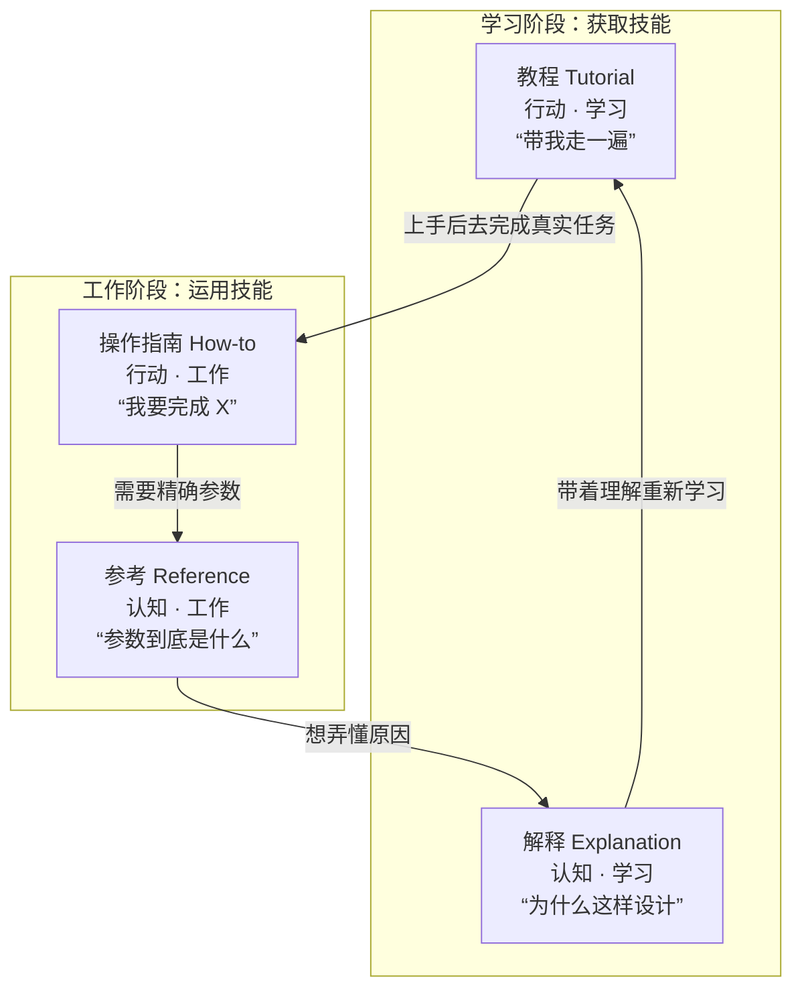
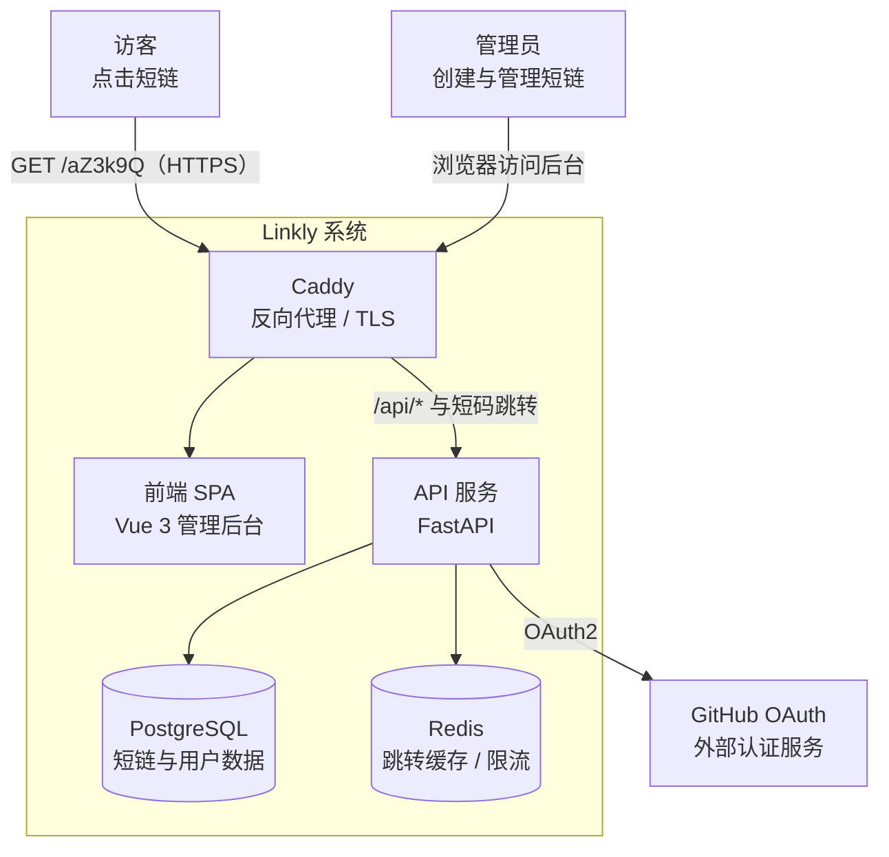
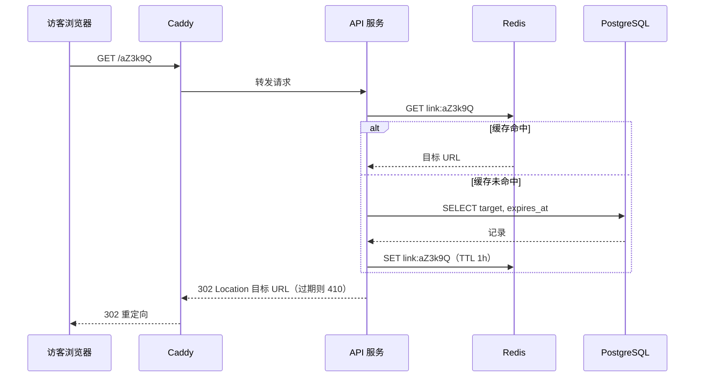
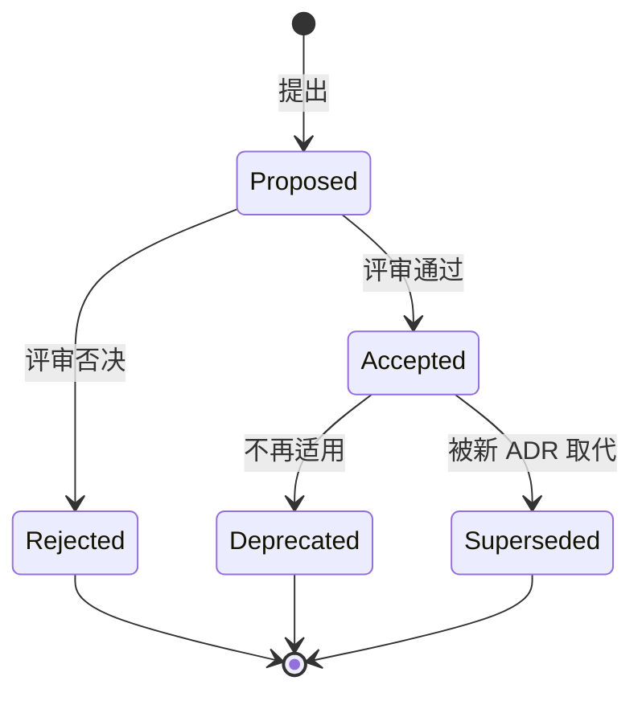
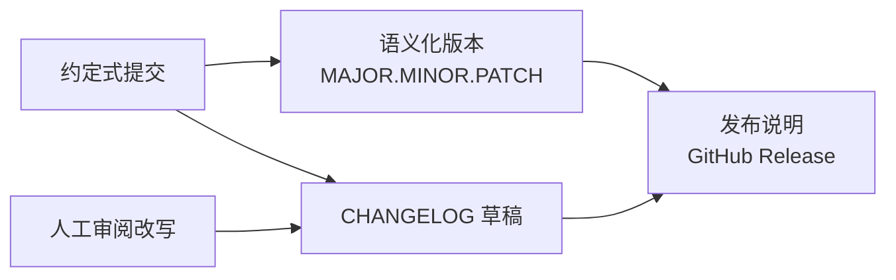
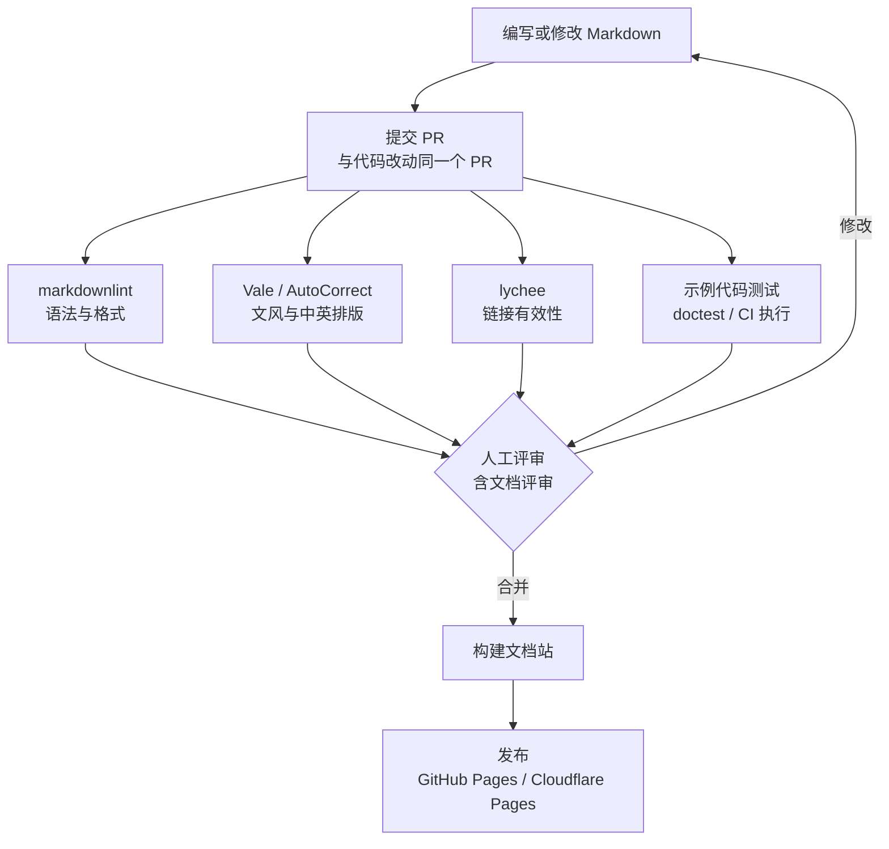

[toc]

**核心原则：文档要让目标读者不依赖作者，也能判断它是否适合自己、正确使用它、排查问题，并接手维护。衡量标准是读者能否完成任务，而不是文档写得多长。**

软件文档是项目的用户界面之一：读者往往先读文档，再决定要不要读代码。写之前先回答三个问题：**读者是谁？他此刻想完成什么？读完要能做成什么？**

## 读者决定写法

一个项目的读者通常分五类，诉求几乎不重叠：

| 读者 | 核心诉求 | 典型问题 | 主要对应文档 | 缺失的代价 |
| --- | --- | --- | --- | --- |
| **终端用户**（User） | 用最少的时间判断"是否适合我"，并把它跑起来 | 它做什么？怎么装？怎么用？出错了怎么办？ | `README.md`、快速开始、使用指南、FAQ | 看 30 秒就离开，项目失去采用者 |
| **集成者**（Integrator，调 API 或库的人） | 按契约正确调用，出错时知道怎么处理 | 参数是什么？错误码含义？怎么重试、分页、判断幂等？ | API 参考（OpenAPI）、SDK 文档、示例代码、错误码表 | 反复回答同样的接口问题，接入方各自写兼容层 |
| **贡献者**（Contributor） | 不读完全部源码也能安全地改代码 | 怎么搭开发环境？怎么跑测试？提交规范是什么？ | `CONTRIBUTING.md`、开发指南、架构概览 | 改错、重复造轮子、评审反复返工 |
| **维护与运维人员**（Maintainer / Operator） | 部署、升级、回滚、排障时有据可依 | 怎么部署？需要什么资源？出故障第一步做什么？ | 部署文档、配置参考、运维手册（Runbook） | 凌晨被叫醒后凭记忆操作，事故扩大 |
| **未来的你与 AI 编码代理** | 快速恢复当时的设计上下文与约定 | 当初为什么这样设计？哪些地方不能动？ | 架构决策记录（ADR）、`AGENTS.md`、代码注释 | 半年后没人敢改，或者改回踩过的坑 |

其中一类读者最容易被忽略：**六个月后的你自己就是一个陌生维护者**。个人项目的文档首先是写给未来的自己的。

2024 年以来还多了一类机器读者：**AI 编码代理**。`AGENTS.md` 这类约定的定位是"给代理看的 README"，承载构建步骤、测试命令、目录约定与禁止事项——这些内容塞进 README 会让人类读者觉得杂乱。它不能替代 README，具体做法见《面向 AI 编码代理的文档》。

> **核心原则：按读者的任务组织文档，不要按作者脑子里的模块组织。**"我写了 auth 模块，于是有一篇 `auth.md`"属于作者视角；"如何启用双因素登录"才是读者视角。

README 是所有读者的入口，向外分流到各类专门文档，因此它只承担"让人判断要不要用、并把它跑起来"，其余内容链接出去。

文档质量可以用一个具体动作检验：**请一个没参与开发的人，在干净环境里只凭文档完成"安装—运行—验证—排障"；再让维护者只凭文档完成"测试—修改—发布—恢复"。卡住的每一步，就是文档该优先补齐的地方。**

## 用 Diátaxis 把内容分成四类

目前技术写作领域被最广泛采纳的内容组织框架是 **Diátaxis**（Daniele Procida 提出，官网 diataxis.fr），已被 Canonical（Ubuntu）等项目的文档体系采用。它的主张是：文档本质上只有四种，对应四种读者需要，写法各不相同——**教程（Tutorials）、操作指南（How-to guides）、参考（Reference）、解释（Explanation）**。



判断类型的两条坐标轴是：**行动（Action）与认知（Cognition）**——教程、操作指南关心读者**做什么**，参考、解释关心读者**知道什么**；**学习（Study）与工作（Work）**——教程、解释服务于**技能获取**，操作指南、参考服务于**技能运用**。图中实线表示读者会在四类文档之间自然流转，因此每类文档里都应有通往其他三类的链接。

| 类型 | 读者状态 | 回答的问题 | 写法要点 | 必须避免 | 类比 | 典型位置 |
| --- | --- | --- | --- | --- | --- | --- |
| **教程**（Tutorials） | 新手，还不知道自己缺什么 | 带我走一遍 | 由作者掌控路线，每一步可复现、有可见结果，只做最小解释 | 大段原理、给出多个分支选择 | 教人做第一道菜 | `docs/tutorials/getting-started.md` |
| **操作指南**（How-to） | 有经验，带着明确目标来 | 我要完成 X，怎么做 | 以任务命名（"如何配置 HTTPS"），假定读者有基础，列清前提与步骤 | 从零教概念 | 菜谱 | `docs/how-to/deploy-with-docker.md` |
| **参考**（Reference） | 工作中查阅资料 | 这个参数到底是什么 | 结构与描述对象一致（像地图），准确、完整、一致、克制 | 夹带教学叙事和观点 | 食材营养成分表 | `docs/reference/cli.md`、`config.md`、OpenAPI |
| **解释**（Explanation） | 想理解设计与取舍 | 为什么是这样 | 讲背景、权衡、备选方案与历史 | 变成操作步骤 | 烹饪科学读物 | `docs/explanation/architecture.md`、ADR |

官方给出过一个直观例子：教程里涉及 HTTPS，只需一句"这里用 HTTPS，因为更安全"，然后链接到深入文章，等读者准备好了再读。**不要在教程里讲原理，也不要在参考里讲故事**，这是初学者写文档最常犯的混杂错误。

同一个功能按四类拆开，读者才不会迷路。以"定时备份"为例：

- **教程**：《10 分钟完成第一次备份》——固定一个目录和一组参数，照着做必然成功，最后能看到生成的 `.tar.gz` 文件。
- **操作指南**：《如何把备份推送到 S3 兼容存储》《如何从备份中恢复单个文件》——每篇解决一个具体目标。
- **参考**：《备份配置项一览》——用表格列出 `backup.schedule`、`backup.retention_days` 等全部字段的类型、默认值、取值范围。
- **解释**：《备份策略的设计考量》——为什么全量加增量、为什么默认保留 14 天、与快照方案相比的优劣。

**实际应用原则**：小项目不必建四个目录，但每一段内容都应该能回答"我这段属于哪一类"。README 本身就是四类内容的微缩版：简介（解释）、快速开始（教程）、常见用法（操作指南）、参数表（参考）。Diátaxis 是**组织框架**，不是必须套用的模板；文档少的时候优先保证内容准确，而不是先搭目录。

## 按项目规模决定最小集合

文档量和项目规模必须匹配：给 80 行的脚本写 arc42 风格的架构文档是浪费，给前后端分离的系统只写一个 README 是失职。下表是分级最小集合，**加粗项为该级别"必须有"**，其余为"推荐""可选"或"不需要"。

| 文档项 | 单文件脚本 | 进阶 CLI 工具或库 | 完整前后端项目 | 多服务、多人、长期项目 |
| --- | --- | --- | --- | --- |
| 文件头注释 / `--help` / docstring | **必须** | **必须** | 推荐 | 推荐 |
| `README.md` | **必须**（十几行即可） | **必须** | **必须**（入口与导航） | **必须**（入口与导航） |
| `LICENSE` | **必须**（公开时） | **必须** | **必须** | **必须** |
| 安装 / 快速开始 | README 内一节 | **必须** | **必须** | **必须** |
| 配置参考 / `.env.example` | 可选 | 推荐 | **必须** | **必须** |
| CLI / API / 配置参考 | `--help` 即可 | **必须** | **必须**（OpenAPI） | **必须** |
| `CHANGELOG.md` | 可选 | **必须** | **必须** | **必须** |
| `CONTRIBUTING.md` | 可选 | 推荐（接受贡献时） | **必须** | **必须** |
| 架构文档（图 + 说明） | 不需要 | 可选 | **必须** | **必须**（C4 多层） |
| ADR（架构决策记录） | 不需要 | 可选 | 推荐 | **必须** |
| 部署手册 / Runbook | 不需要 | 可选 | **必须** | **必须** |
| 故障排查 / FAQ | 可选 | 推荐 | 推荐 | **必须** |
| `SECURITY.md` | 不需要 | 推荐 | 推荐 | **必须** |
| `SUPPORT.md` | 不需要 | 可选 | 推荐 | 推荐 |
| `CODE_OF_CONDUCT.md` | 不需要 | 可选 | 可选（社区型项目推荐） | 推荐 |
| `AGENTS.md` | 可选 | 推荐 | 推荐 | 推荐 |
| 文档站（MkDocs 等） | 不需要 | 可选 | 推荐 | **必须** |

**判断口诀**：

- **有人要用**：写 README 与用法。
- **会升级**：写 CHANGELOG。
- **要部署**：写部署、配置与运维文档。
- **有人协作**：写 CONTRIBUTING 与架构说明。
- **会后悔**：写 ADR。

## 各类文档写什么

先把内容清单铺开，再逐类展开。下表可以当作"某个项目缺什么"的对照检查：

| 内容 | 应回答的问题 |
| --- | --- |
| **项目说明** | 做什么、解决什么问题、适合谁、不适合什么场景、当前是否稳定 |
| **快速开始** | 需要什么系统、依赖版本与权限？如何安装、配置、运行？**怎样确认成功** |
| **使用参考** | 参数、配置项、环境变量、输入输出的含义、类型、必填性、默认值与示例 |
| **限制与排障** | 有哪些已知限制和危险操作？常见错误如何判断、看哪份日志、怎么处理？如何求助 |
| **开发维护** | 如何搭环境、测试、构建、发布？模块如何协作？**关键设计为什么这样选** |
| **部署运维** | 如何部署、监控、升级、迁移数据、备份恢复与回滚？生产服务还需要故障处理指引 |

举例来说，**备份脚本的文档不能只写运行命令**，还要说明：备份哪些文件、保存到哪里、是否覆盖旧备份、如何判断成功、以及如何恢复。

### README：项目的门面与导航

README 被阅读最多，也最影响第一印象。共识是：**第一行就要说清"这是什么、给谁用"**——"一个把 Markdown 转成 PDF 的轻量 CLI 工具"远胜过"欢迎来到 ProjectX"。目标是 30 秒内让人判断"对我有没有用"，5 分钟内让人跑起来。

| 区块 | 必要性 | 内容要点 |
| --- | --- | --- |
| 标题 + 一句话定位 | **必须** | 做什么、解决什么问题、面向谁；不要写"一个强大的工具" |
| 徽章（Badges） | 可选 | CI、版本、许可证，不超过一行，避免装饰过度 |
| 特性 / 适用与不适用场景 | 推荐 | 3 到 7 条要点；**明确写出不支持什么**，能省掉大量无效 issue |
| 截图 / 演示 | 有 UI 或终端输出时推荐 | 一张图或一段短 GIF；终端工具给 `asciinema` 或纯文本输出样例 |
| 安装（前置条件 + 命令） | **必须** | 运行时最低版本、系统依赖、各平台命令；有 Docker 方式要提 |
| 快速开始 / 用法 | **必须** | 最常见的 2 到 3 个场景，**可复制、可运行、有预期输出** |
| 配置 | 推荐 | 最关键的几项与环境变量位置，完整内容链接到配置参考 |
| 文档导航 | 中大型项目**必须** | 指向 `docs/` 中的教程、指南、参考、架构，可按 Diátaxis 四类排列 |
| 开发与贡献 | 推荐 | 如何跑测试、代码风格、PR 流程；细节放 `CONTRIBUTING.md`，基础留在 README |
| 路线图 / 已知限制 | 推荐 | 诚实地列出未完成与不支持的东西 |
| 许可证 | **必须**（公开时） | 写明许可证名称并链接 `LICENSE`；没有许可证的项目在多数企业环境中法律上不可用 |
| 致谢 / 相关项目 | 可选 | 引用上游项目、数据来源或灵感来源 |

**必须做到**：

- 快速开始中每条命令都在干净环境（最好是新建容器）里实测过；
- 说明最低版本（"Node.js >= 20"而不是"安装 Node.js"）；
- 命令与输出分开展示，明确告诉读者"成功时你会看到什么"；
- 不假设读者使用你的操作系统，也不假设读者能直连 GitHub。

**避免**：

- 把 README 写成全部文档（超过一屏半就该拆到 `docs/`）；
- 只有徽章和一句话，没有用法；
- `TODO: write docs` 之类的空章节占位；
- 把内部开发流水账（"今天修了 bug"）写进 README。

中文项目可以提供 `README.md`（中文）与 `README.en.md`（英文），在顶部互相链接；面向国际用户的项目一般以英文为主。

### 代码内文档：注释、docstring 与 `--help`

这是离代码最近、也最不容易过时的文档，通常是脚本类项目的主力文档。原则是：**任何人拿到这个文件，不看别的东西也能知道它做什么、怎么用、有什么前提。**

**注释**：

- **必须**写**为什么**，不写代码已经表达清楚的**是什么**。

  ```python
  i += 1  # i 加 1  ← 无信息增量
  retry += 1  # 上游网关偶发 502，重试 3 次可覆盖 99% 的场景（见 ADR-0007）
  ```

- **必须**为公共模块、类、函数写 docstring，说明用途、参数、返回值、异常与示例。
- **推荐**遵循语言社区约定：Python 参照 PEP 257，格式在 Google 风格与 NumPy 风格中选一种并在全项目统一；JS/TS 用 JSDoc/TSDoc；Go 用紧贴声明的 `// FuncName ...`；Rust 用 `///`。这样才能被 Sphinx、TypeDoc、godoc、rustdoc 自动抽成参考文档。
- **避免**：注释掉的大段死代码（交给 Git 历史）、没有负责人和期限的 `TODO`、与代码不一致的过期注释（**比没有注释更糟**）。

**命令行用法语法约定**：写 `--help` 和 CLI 参考时，业界默认遵循 POSIX/docopt 风格的符号，**统一使用并在文档里说明一次**：

| 符号 | 含义 | 示例 |
| --- | --- | --- |
| `[ ... ]` | 可选项 | `[-k <days>]` 表示 `-k` 可以不给 |
| `< ... >` | 占位符，需替换为实际值 | `<dest_dir>` 替换为 `/data/backup` |
| `...` | 可重复 | `<source_dir>...` 表示一个或多个目录 |
| `a \| b` | 互斥，二选一 | `--json \| --yaml` |
| `{a \| b}` | 必选其一 | `{start \| stop \| status}` |
| 不加括号的字面量 | 原样输入 | `-o`、`backup` |

**完整的脚本示例**：下面这个备份脚本演示"文件头加 `--help` 就是文档"的写法。头注释写清用途、用法、选项、依赖、平台、退出码与示例；`usage()` 直接把头注释打印出来，**保证帮助文本与文件头只维护一份**；参数错误返回退出码 2，与运行时错误（1）区分开。

```bash
#!/usr/bin/env bash
#
# snapbak.sh - 把若干目录打包为带时间戳的 tar.gz，并按保留天数清理旧备份。
#
# 用法:    snapbak.sh [-o <dest_dir>] [-k <days>] [-n] [-V] [-h] <source_dir>...
# 参数:    <source_dir>...  要备份的一个或多个目录（必填）
# 选项:    -o <dest_dir>    备份输出目录（默认: $SNAPBAK_DEST 或 ~/backups）
#          -k <days>        保留最近 <days> 天的备份，0 表示不清理（默认: 14）
#          -n               演练：只打印将执行的操作，不落盘
#          -V               显示版本并退出
#          -h               显示本帮助并退出
# 依赖:    bash >= 4, tar, gzip, find（GNU 或 BSD 均可）
# 平台:    Linux / macOS / Windows（Git Bash 或 WSL）
# 退出码:  0 成功；1 运行时错误；2 参数错误
# 示例:    snapbak.sh -o /mnt/nas/backup -k 30 ~/notes ~/photos
#
set -euo pipefail

readonly VERSION="1.2.0"
DEST_DIR="${SNAPBAK_DEST:-$HOME/backups}"
KEEP_DAYS=14
DRY_RUN=0

# 帮助文本直接取自本文件注释头，保证只有一份需要维护。
usage() { sed -n '2,/^set -euo pipefail/p' "$0" | sed '$d' | sed 's/^# \{0,1\}//'; }

log() { printf '[%s] %s\n' "$(date '+%F %T')" "$*" >&2; }
die() {
	log "ERROR: $1"
	exit "${2:-1}"
}

run() {
	if ((DRY_RUN)); then
		log "DRY-RUN: $*"
	else
		"$@"
	fi
}

while getopts ':o:k:nhV' opt; do
	case "$opt" in
	o) DEST_DIR="$OPTARG" ;;
	k) [[ "$OPTARG" =~ ^[0-9]+$ ]] || die "-k 需要非负整数: $OPTARG" 2
		KEEP_DAYS="$OPTARG" ;;
	n) DRY_RUN=1 ;;
	V) printf 'snapbak %s\n' "$VERSION"; exit 0 ;;
	h) usage; exit 0 ;;
	:) die "选项 -$OPTARG 缺少参数" 2 ;;
	*) die "未知选项 -$OPTARG（用 -h 查看帮助）" 2 ;;
	esac
done
shift $((OPTIND - 1))
(($# > 0)) || { usage >&2; exit 2; }

stamp="$(date '+%Y%m%d-%H%M%S')"
run mkdir -p "$DEST_DIR"

for src in "$@"; do
	[[ -d "$src" ]] || die "源目录不存在: $src" 2
	out="$DEST_DIR/$(basename "$src")-$stamp.tar.gz"
	log "备份 $src -> $out"
	run tar -czf "$out" -C "$(dirname "$src")" "$(basename "$src")"
done

if ((KEEP_DAYS > 0)); then
	log "清理 $KEEP_DAYS 天前的备份"
	run find "$DEST_DIR" -maxdepth 1 -name '*.tar.gz' -type f -mtime "+$KEEP_DAYS" -delete
fi
log "完成"
```

这段脚本体现的文档化设计：

- **自描述**：`-h` 输出即完整参考；不带参数时把帮助打到 stderr 并以 2 退出，避免被误当成成功。
- **可预演**：`-n` 演练模式让带删除动作的脚本可以在执行前核对影响范围。
- **可诊断**：日志带时间戳并写 stderr，不污染 stdout。
- **契约明确**：退出码、环境变量覆盖（`SNAPBAK_DEST`）都写进头注释。
- **可检查**：提交前跑 `shellcheck`（静态检查）与 `shfmt -d`（格式检查），并纳入 CI。

Python 脚本用**模块 docstring + `argparse`** 承担同样职责，docstring 面向调用者，说明行为、参数、返回值与异常：

```python
def shorten(url: str, *, ttl_days: int | None = None, alias: str | None = None) -> str:
    """为长链接生成短码并持久化。

    同一 URL 重复提交时返回已有短码，不会重复创建（幂等）。

    Args:
        url: 待缩短的完整 URL，必须以 http:// 或 https:// 开头。
        ttl_days: 过期天数；None 表示永不过期，取值范围 1-3650。
        alias: 自定义短码，仅允许 [A-Za-z0-9_-]，长度 4-32。

    Returns:
        生成的短码，例如 "aZ3k9Q"。

    Raises:
        ValueError: url 格式非法，或 alias 不符合规则。
        AliasConflictError: alias 已被占用。

    Example:
        >>> shorten("https://example.com/a/very/long/path", ttl_days=7)
        'aZ3k9Q'
    """
```

`argparse` 的 `description` 与各选项 `help` 就是 `--help` 的内容，默认值用 `%(default)s` 自动带出，不再手写一遍：

```python
import argparse

def build_parser() -> argparse.ArgumentParser:
    p = argparse.ArgumentParser(
        prog="snapbak",
        description=__doc__.splitlines()[0],
        epilog="更多文档: https://example.com/snapbak/docs",
        formatter_class=argparse.RawDescriptionHelpFormatter,
    )
    p.add_argument("--dest", default="./backups", help="备份输出目录（默认: %(default)s）")
    p.add_argument("--keep", type=int, default=14, help="保留天数，0 表示不清理（默认: %(default)s）")
    p.add_argument("-n", "--dry-run", action="store_true", help="只打印将执行的操作")
    return p
```

**任何 CLI 的 `--help` 都应满足**：

- 第一行是一句话用途；
- 每个选项写明默认值、取值范围与单位；
- 至少给一个完整示例；
- 退出码有定义（脚本被别的脚本调用时尤其重要）；
- 错误信息告诉用户**怎么修**，而不只是"错了"。

### 安装与快速开始

这一节在 Diátaxis 里属于"教程"，目标是**让用户在 5 分钟内看到第一个成功结果**。

**必须**：

- 列出前置条件：运行时版本、系统包、账号或密钥、可用端口；
- 按平台分别给命令，至少覆盖 Linux/macOS 与 Windows PowerShell，差异大时分开写；
- 给出"如何验证安装成功"的命令及预期输出；
- 面向国内读者的网络现实：对 `pip`、`npm`、`go`、Docker 镜像给出**镜像源或代理说明**，对 GitHub Release 下载给出加速方案，并注明第三方加速服务的可用性需自行确认；同时保留官方原始链接。

**避免**：

- "按常规方法安装即可"这类空话；
- 只给 `curl ... | sh`，不给"先下载审阅再执行"的替代路径；
- 在安装步骤中间插入长篇原理。

### 配置参考：环境变量、配置文件、命令行

配置是用户最常查、也最容易写漏的部分。**每个配置项都应有一行**，字段固定如下，并在表格旁说明"必填"指不设置时程序拒绝启动、"默认值"必须与代码中的真实默认值一致。

| 变量 | 类型 | 默认值 | 必填 | 说明 | 示例 |
| --- | --- | --- | --- | --- | --- |
| `LINKLY_DATABASE_URL` | URL | 无 | 是 | PostgreSQL 连接串，**含密码，不得提交到仓库** | `postgres://linkly:***@db:5432/linkly` |
| `LINKLY_REDIS_URL` | URL | `redis://localhost:6379/0` | 否 | 跳转缓存与限流使用的 Redis | `redis://cache:6379/1` |
| `LINKLY_BASE_URL` | URL | 无 | 是 | 对外生成短链时使用的域名，**不带结尾斜杠** | `https://s.example.com` |
| `LINKLY_RATE_LIMIT` | 整数 | `60` | 否 | 每个 IP 每分钟最多创建的短链数，`0` 表示不限 | `120` |
| `LINKLY_TTL_DAYS` | 整数 | `7` | 否 | 新建短链的默认过期天数，`0` 表示永不过期 | `30` |
| `LINKLY_LOG_LEVEL` | 枚举 | `info` | 否 | `debug`、`info`、`warn`、`error` 之一 | `debug` |

**说明**列要写副作用与安全注意事项，而不仅是把名字展开成一句话。

同时在仓库根目录放一份 **`.env.example`**，每个变量带一行注释，用户复制为 `.env` 即可。**绝不要**把真实密钥写进示例或文档；示例值要一眼能看出是假的。

### API 文档：以机器可读规范为单一真相来源

有后端接口的项目，**API 文档应由 OpenAPI 规范驱动**，而不是手写 Markdown 表格——手写的接口文档必然过期。事实标准是 **OpenAPI**（主流版本 3.0 与 3.1，采用前先确认所用工具链支持的版本），事件驱动或消息类接口用 **AsyncAPI**，gRPC 用 `.proto` 文件加注释。

- **必须**：从代码生成规范（FastAPI、NestJS 的 `@nestjs/swagger`、Spring 的 springdoc、Go 的 swag 或 huma）或采用设计优先（先写 `openapi.yaml` 再生成代码），二选一并保持单向。
- **必须**：用 Swagger UI、Redoc 或 Scalar 渲染为可交互页面，规范文件纳入版本控制。
- **必须**：每个端点写清认证方式、请求参数、响应结构、错误码、示例请求与示例响应。
- **必须**：维护统一的**错误码参考表**（错误码、HTTP 状态码、含义、客户端应对方式），错误响应体格式统一，建议遵循 RFC 9457 Problem Details。
- **推荐**：写明版本策略（如 URL 带 `/v1`）与弃用策略（如何通知、保留多久），以及分页、限流、幂等这些全局约定。
- **避免**：只给接口列表不给示例、示例字段与真实字段不一致、文档里出现真实令牌。

```yaml
openapi: 3.1.0
info:
  title: Linkly API
  version: 1.4.0
paths:
  /api/v1/links:
    post:
      summary: 创建短链
      description: 同一 URL 重复提交返回已存在的短链（幂等）。
      security:
        - bearerAuth: []
      requestBody:
        required: true
        content:
          application/json:
            schema:
              $ref: "#/components/schemas/CreateLinkRequest"
            example:
              url: https://example.com/a/very/long/path
              ttl_days: 7
      responses:
        "201":
          description: 创建成功
          content:
            application/json:
              example:
                code: aZ3k9Q
                short_url: https://s.example.com/aZ3k9Q
                expires_at: "2025-06-08T00:00:00Z"
        "409":
          description: 自定义短码已被占用（错误码 LINK_ALIAS_CONFLICT）
components:
  securitySchemes:
    bearerAuth:
      type: http
      scheme: bearer
  schemas:
    CreateLinkRequest:
      type: object
      required: [url]
      properties:
        url:
          type: string
          format: uri
          description: 以 http:// 或 https:// 开头的完整 URL
        ttl_days:
          type: integer
          minimum: 1
          maximum: 3650
          description: 过期天数，不传表示永不过期
```

前端组件库用 Storybook 之类工具让"文档即运行示例"；类型化语言用 TypeDoc/JSDoc、rustdoc、godoc、Sphinx autodoc 或 mkdocstrings 从源码注释生成参考文档，而不是另抄一份。

### 架构文档：让维护者不读全部源码也能定位

架构文档回答"系统由什么组成、怎么协作"。推荐按 **C4 模型**（Simon Brown 提出）的思路画图，但**轻量化使用**：个人与小团队项目通常只需要前两层。

| C4 层级 | 回答的问题 | 小项目是否需要 |
| --- | --- | --- |
| **系统上下文**（Context） | 系统与哪些用户、外部系统交互 | 需要，一张图 |
| **容器**（Container） | 系统由哪些可独立部署的单元组成（前端、API、数据库、队列）。**容器不等于 Docker 容器** | 需要，一张图 + 每个容器一段说明 |
| 组件（Component） | 某个容器内部的主要模块 | 仅复杂容器需要 |
| 代码（Code） | 类图等 | 基本不需要，交给代码与 IDE |



这张图说明三件事：所有流量先经过 Caddy，TLS 与路由都在这一层收口；短码跳转由 API 服务处理，**优先读 Redis 缓存**；数据的唯一权威来源是 PostgreSQL。图中系统部署在一台海外 VPS 上，用 Docker Compose 编排。图之外**必须配文字**：每个容器一段话，说明技术选型、职责、对外接口、数据存放在哪、启动顺序依赖。

再补一张关键流程的时序图，把"为什么 Redis 挂了跳转变慢但不会中断"讲清楚：



缓存未命中时退回数据库查询，这就是降级路径；它与 Runbook《短链跳转延迟过高》呼应——**架构文档负责解释原理，Runbook 负责给出操作**，正是 Diátaxis 的分工。

一份合格的轻量架构文档还应包含：

- **关键流程**：用时序图描述 1 到 3 个核心流程（如"用户手动触发一次备份""一次短链跳转"）；
- **数据模型**：核心表或实体关系，Mermaid 的 `erDiagram` 足够；
- **目录结构说明**：仓库顶层目录各是什么；
- **横切关注点**：认证方式、日志、错误处理约定、配置加载顺序；
- **部署视图**：哪些端口对外暴露、进程如何启动。

更系统化的模板可参考 **arc42**（12 节结构：引言与目标、约束、上下文、解决方案策略、构建块视图、运行时视图、部署视图、横切概念、架构决策、质量需求、风险与技术债、术语表）。个人项目不必逐节填满，只借用"质量目标、约束、解决方案策略、风险与技术债"的思路即可。

**图的纪律**：图即代码（Mermaid、PlantUML、Structurizr），能和文字一起评审与 diff；**一张图只回答一个问题**，塞进所有细节的图没人看；图不能替代文字，可访问性与搜索都依赖文字。

### ADR：记录"为什么"，而不是"是什么"

**架构决策记录（ADR）**补的是架构文档最容易丢失的信息：**为什么当时选了 A 而不是 B**。它只收录影响系统结构、关键质量属性或难以逆转的选择，是**只追加的日志**：不回头编辑已接受的记录，决策变了就新写一篇并把旧的标记为"已被取代"。



ADR 一旦被接受就不再改正文，只改**状态**；被取代时在新旧两篇里**互相链接**，保留完整的决策演进轨迹。

**遵守**：一条决策一个文件，顺序编号，放在 `docs/adr/` 或 `docs/decisions/`；文件名用 `0003-use-redis-for-rate-limiting.md` 这类形式；状态只能是提议、已接受、已弃用、已被取代。**避免**：把 ADR 写成设计文档、事后补写大量无意义的记录、修改历史记录。

下面是 MADR 精简格式的示例（MADR 与 Michael Nygard 的三段式模板都可以用，选一种并在仓库内统一）：

```markdown
# 0003. 使用 Redis 做跳转缓存与限流

- 状态：已接受（Accepted）
- 日期：2025-03-12
- 决策者：@you

## 背景与问题

跳转是最高频的请求（读写比约 1000:1）。直接查询 PostgreSQL 时，p99 在高峰期超过 200ms；
同时需要按 IP 限制创建频率，防止滥用。

## 考虑的选项

1. Redis（缓存与限流共用）
2. 进程内缓存（如 cachetools）+ 数据库计数限流
3. 不加缓存，仅优化数据库索引

## 决策结果

选择选项 1：一个组件同时解决缓存与限流，部署成本可接受（Compose 内一个容器）。

## 后果

- 好处：跳转 p99 降到 20ms 以下；限流计数可原子递增。
- 代价：多一个需要运维的组件；Redis 不可用时跳转退化为查库（见 `runbooks/high-latency.md`）。
- 后续：若将来需要多实例部署，选项 2 不可行，本决策仍然成立。

## 其他选项的优缺点

- 选项 2：零依赖，但多实例下缓存与计数不一致。
- 选项 3：最简单，但无法满足限流需求。
```

### 变更日志、版本号与提交信息

这三者配合起来，构成**版本沟通体系**：



约定式提交的类型可以推导出版本升级幅度，也能生成 CHANGELOG 草稿，但**草稿必须经人工审阅改写**，发布说明再从 CHANGELOG 派生，不维护两份。

**语义化版本（SemVer）**：`MAJOR.MINOR.PATCH`——不兼容的 API 变更升 `MAJOR`，向后兼容地新增功能升 `MINOR`，向后兼容地修复缺陷升 `PATCH`；`0.y.z` 表示初始开发阶段，公共 API 不承诺兼容。应用类项目也可以用日历版本（CalVer，如 `2025.06`），但**必须在 CHANGELOG 里声明用的是哪种方案**。

**约定式提交（Conventional Commits）**：格式为 `<type>[optional scope]: <description>`，可再跟空行加正文（body）与脚注（footer）。

- `<type>`：`feat`（新功能，对应 `MINOR`）、`fix`（修复，对应 `PATCH`），以及常用但不强制的 `docs`、`refactor`、`test`、`chore`、`ci`、`perf`。
- `[optional scope]`：影响范围，写在括号里，如 `feat(api):`。
- `<description>`：简短描述，祈使语气，不加句号。
- 正文说明动机与行为差异；脚注写 `BREAKING CHANGE: ...`（对应 `MAJOR`）或 `Refs: #123`，破坏性变更也可以在 type 后加 `!`。

示例：`fix(redirect): 过期短链返回 410 而非 404`、`feat(api)!: 移除 /api/v0 接口`。

**`CHANGELOG.md` 必须给人读**（Keep a Changelog 的指导原则）：

- 每个版本都有条目，同类变更归在一起，版本与小节可链接；
- 最新版本在最前，标注每个版本的发布日期，声明所用版本方案；
- 顶部保留 `Unreleased` 小节收集即将发布的变更，发布时移入新版本；
- **以 CHANGELOG 为准派生出发布说明**；
- **弃用要先公告再执行**：先在某个版本标记 `Deprecated` 并写明计划移除的版本，后续版本再 `Removed`；
- 即使别的都不写，也**必须记录弃用、移除和破坏性变更**；
- 措辞平实，因为很多读者不是母语使用者；
- 用工具（`git-cliff`、`release-please`）或 LLM 起草时，要像给贡献者布置任务一样提要求：只总结面向用户的显著变更，**不要直接贴 `git log`**，按六类归类，说明原因，标出破坏性变更，发布前自己读一遍。

变更分六类：`Added`、`Changed`、`Deprecated`、`Removed`、`Fixed`、`Security`。

```markdown
# Changelog

本项目的所有显著变更都记录在此文件中。
格式基于 Keep a Changelog，版本号遵循语义化版本 2.0.0。

## [Unreleased]

### Added

- 管理后台支持按标签筛选短链。

## [1.4.0] - 2025-06-01

### Added

- 创建短链时可指定 `ttl_days` 过期天数。

### Changed

- 默认限流从每分钟 30 次放宽到 60 次，可通过 `LINKLY_RATE_LIMIT` 调整。

### Deprecated

- `/api/v0/*` 接口已弃用，将于 2.0.0 移除，请迁移到 `/api/v1`。

### Fixed

- 过期短链现在返回 410 Gone 而不是 404，便于客户端区分。

### Security

- 升级 JWT 依赖以修复签名校验绕过问题，**建议所有用户升级**。
```

### 贡献者文档与 `CONTRIBUTING.md`

目标是让新人（包括半年后的你）**在一小时内搭好环境、跑通测试、提交第一个 PR**。

- **必须**：开发环境搭建，最好一条命令完成（`make dev`、`uv sync`、`docker compose -f compose.dev.yml up`），并列出需要的工具版本；推荐提供 Dev Container。
- **必须**：运行测试、lint、格式化的具体命令，以及 CI 会检查什么。
- **推荐**：代码规范引用工具配置（`ruff`、`eslint`、`prettier`、`shellcheck`、`shfmt`），而不是长篇文字描述。
- **推荐**：分支策略、提交信息规范（约定式提交）、PR 模板、评审标准、发布流程（谁、何时、怎么打 tag）。
- **推荐**：把"文档也是完成定义的一部分"写进 **Definition of Done**：改了行为、配置或接口，必须同步更新文档与 CHANGELOG。
- **推荐**：常见开发问题——端口冲突、Windows 下的换行与路径问题、国内依赖下载慢怎么办。

### 部署手册与 Runbook

运维人员最怕"在我机器上能跑"，部署文档要做到**可复现**，Runbook 要做到**照着执行、不需要思考**。

| 部署文档要回答 | 内容 |
| --- | --- |
| 怎么部署 | 推荐方式（通常是 `docker compose`）及完整文件；非容器方式的 systemd 单元示例 |
| 需要什么资源 | 操作系统与运行时矩阵、CPU/内存/磁盘最低要求、端口、出入站网络需求 |
| 怎么配置 | 链接到配置参考；敏感信息怎么注入 |
| 怎么确认健康 | 健康检查端点、日志位置、关键日志样例 |
| 怎么升级 | 升级步骤、数据库迁移命令、**不兼容变更提示**、回滚方法与迁移是否可逆 |
| 怎么备份恢复 | 哪些目录与数据库要备份，恢复演练步骤 |
| 出了问题怎么办 | 常见故障现象、原因、处理步骤 |

Runbook 的结构固定为：**现象、影响、适用版本、诊断步骤、处置步骤、验证恢复、升级路径（联系谁）**。

- **必须**：每篇对应一个告警或故障场景，命令可以直接复制，**危险操作要醒目标注**并给出回滚办法。
- **推荐**：告警消息里直接附上对应 Runbook 的链接。
- **推荐**：每次事故复盘（Postmortem）后更新 Runbook。
- **推荐**：部署环境与实际网络一致——生产在海外、测试在国内时，镜像拉取地址、时区设置（`TZ=Asia/Shanghai`）与下载链接的可达性都要在文档里分开说明。

````markdown
# Runbook：短链跳转延迟过高

- **告警**：`linkly_redirect_p99_seconds > 0.5` 持续 5 分钟
- **影响**：用户点击短链等待明显变长，严重时超时
- **适用版本**：>= 1.3.0

## 诊断

1. 检查 Redis 是否可达：`docker compose exec api linkly doctor --check redis`
2. 查看缓存命中率面板（Grafana → Linkly → Cache Hit Ratio），低于 80% 视为异常
3. 检查数据库慢查询：`docker compose exec db psql -U linkly -c "SELECT * FROM pg_stat_activity WHERE state='active';"`

## 处置

- Redis 不可达：`docker compose restart cache`，预计 30 秒内恢复
- 缓存命中率低且刚发布过新版本：**回滚**到上一个版本（见 `docs/how-to/rollback.md`）

## 验证

- p99 回落到 0.2 秒以下并持续 10 分钟

## 升级

- 15 分钟内未恢复：联系项目负责人（联系方式见内部通讯录）
````

### 社区健康与合规文件

GitHub 会识别一组"社区健康文件"，放在仓库根目录、`docs/` 或 `.github/` 下都能被识别，也可以放在组织级 `.github` 仓库中统一复用。

| 文件 | 作用 | 要点 |
| --- | --- | --- |
| `LICENSE` | 许可证 | **没有 LICENSE 等于保留所有权利**，别人在法律上不能使用；选择时参考 choosealicense.com，优先 OSI 认可的许可证 |
| `SECURITY.md` | 漏洞报告方式 | 写明**私下报告渠道**（邮箱或 GitHub 私有漏洞报告）、支持哪些版本、响应时限 |
| `CONTRIBUTING.md` | 贡献指南 | 见上文 |
| `CODE_OF_CONDUCT.md` | 行为准则 | 社区型项目常用 Contributor Covenant |
| `SUPPORT.md` | 求助渠道 | 区分"提问去讨论区"和"报 Bug 去 Issue" |
| `.github/ISSUE_TEMPLATE/`、`PULL_REQUEST_TEMPLATE.md` | 协作模板 | Bug 模板要求填写版本、操作系统、复现步骤、期望结果与实际结果 |
| `CODEOWNERS` | 代码与文档负责人 | 也可以用来指定文档的 owner |

### 面向 AI 编码代理的文档

- **`AGENTS.md`**：放在仓库根目录，被多种 AI 编码代理识别的开放约定，用来告诉代理**构建与测试命令、代码风格、目录约定、禁止事项**，可以理解为"写给机器协作者的 CONTRIBUTING"。
- **`llms.txt`**：在网站根目录提供一份精简的 Markdown 文档索引，方便大模型检索，属于提案性做法，按需采用。
- **推荐**：`AGENTS.md` **引用**现有文档而不是复制一份（单一信息源），保持简短、具体、可执行；与 README 的关系是互补——README 面向人类决定"要不要用"，`AGENTS.md` 面向代理决定"怎么改"。绝不要在两处维护同一份安装说明。

## 组织：仓库布局与命名

以发展到前后端完整项目的 Linkly 为例（各自的内容类型按 Diátaxis 标注）：

| 路径 | 内容 | 类型 |
| --- | --- | --- |
| `README.md` | 门面与导航 | 入口 |
| `LICENSE`、`CHANGELOG.md`、`CONTRIBUTING.md`、`SECURITY.md`、`SUPPORT.md` | 根级标准文件 | 标准文件 |
| `AGENTS.md` | 面向 AI 代理的约定 | 标准文件 |
| `.env.example`、`.editorconfig`、`.gitattributes` | 配置示例与跨平台约定 | 配置 |
| `docs/index.md` | 文档站首页与导航 | 导航 |
| `docs/tutorials/` | 入门教程，如 `getting-started.md` | 教程 |
| `docs/how-to/` | 部署、备份到 S3、升级、启用 HTTPS、恢复单个文件 | 操作指南 |
| `docs/reference/` | CLI、配置、API（引用 `openapi.yaml`）、错误码 | 参考 |
| `docs/explanation/` | 架构总览、设计原则、安全模型、性能测试条件 | 解释 |
| `docs/adr/` | 架构决策记录 | 解释 |
| `docs/runbooks/` | 运维手册，如 `high-latency.md`、`db-failover.md` | 操作指南 |
| `docs/assets/` | 图片、图表源文件 | 资源 |
| `mkdocs.yml` 或 `docusaurus.config.js` | 文档站配置 | 工具 |
| `.github/ISSUE_TEMPLATE/`、`PULL_REQUEST_TEMPLATE.md` | Issue 与 PR 模板 | 协作 |
| `frontend/README.md`、`backend/README.md` | 子项目局部 README，只写这一部分怎么开发与测试 | 入口 |

**组织原则**：

- **必须**：**单一信息源**（Single Source of Truth）。每条事实只写在一处，其他地方链接过去。端口号若在五个文件里各写一遍，改动时必然漏掉一处。
- **必须**：**文档与代码同仓库、同 PR**，即文档即代码（Docs as Code）。
- **推荐**：目录按 Diátaxis 分类；文件名用小写短横线英文（`deploy-docker.md`），规避中文与空格带来的 URL 编码和跨平台问题，标题可以用中文。
- **推荐**：**渐进披露**——README 只放最常用的 20%，其余放进 `docs/`。
- **推荐**：每篇文档开头写明适用读者、前提条件、适用版本。
- **避免**：按时间堆文件（`notes-2024-05.md`）、按作者分文件、一个无限增长的 `README.md`。

## 写作规范

### 总体规则

把规则分级，比列一长串"最佳实践"更好执行：**必须**是底线，**推荐**是默认做法，**可以**按需采用，**避免**是已知的坑。

| 级别 | 规则 | 说明或示例 |
| --- | --- | --- |
| **必须** | 准确且可验证 | 每条命令、每段代码都在当前版本真实运行过；能自动化验证的放进 CI |
| **必须** | 标明适用版本与日期 | "适用于 v1.4+"，并在页脚注明最后验证日期，避免读者用旧文档操作新版本 |
| **必须** | 术语一致 | 全文统一用"短链"就不再混用"短网址""短链接"；需要时维护术语表 |
| **必须** | 敏感信息脱敏 | 令牌、密码、内网地址一律用 `<your-token>`、`***` 占位 |
| **必须** | 主动说明限制与风险 | 不支持的平台、破坏性操作、数据丢失风险，写在操作之前 |
| **推荐** | 结论先行（倒金字塔） | 先给答案或命令，再解释原因 |
| **推荐** | 一段一个主题，一句一个意思 | 长句拆短，复杂条件改成列表 |
| **推荐** | 主动语态、第二人称、祈使句 | "运行以下命令"，不写"以下命令可以被运行"；步骤用有序列表，每步一个动作 |
| **推荐** | 具体胜于抽象 | 给真实的值与真实输出："填入 `/var/backups/pg`"，不写"填入合适的路径" |
| **推荐** | 区分"必须 / 应该 / 可以" | 用明确的情态动词表达强制程度；规范类文档可采用 RFC 2119/8174 关键词并在文首声明含义 |
| **推荐** | 参照成熟风格指南 | 英文参照 Google、Microsoft 写作风格指南；中文参照《中文技术文档的写作规范》《中文文案排版指北》 |
| **可以** | 用提示块区分注意事项 | GitHub 支持 `> [!NOTE]`、`> [!WARNING]` 语法 |
| **避免** | "简单地""只需""显然""众所周知" | 对读者未必简单，出错后还让人沮丧 |
| **避免** | 模糊指代 | "这个""上面那个配置"要写出具体名称 |
| **避免** | 未来时态与营销腔 | "即将支持""业界领先"这类没有承诺的表述 |
| **避免** | 截图代替文本 | 截图无法搜索、复制、翻译，且很快过时；命令与报错一律用文本 |

### 中文技术写作的注意点

- **中英文混排的空格**：加空格与不加空格都可以，**关键是全仓库统一**，能用工具强制就交给工具。本文与所在仓库的其他文档一致，采用加空格。
- **标点**：中文语境用全角标点，英文句子、代码、命令里用半角；**代码和命令永远不要出现全角符号**，否则复制后直接报错。
- **术语**：首次出现写成"中文（English）"，如"架构决策记录（ADR）"，后文统一用一种写法。
- **数字与单位**：用阿拉伯数字加单位，如"5 分钟""512MB"；版本号保持原样，如 `v1.4.0`。
- **非 ASCII 风险**：文件名、锚点、配置键尽量用 ASCII，中文只用于正文与标题——某些 PDF 导出、表格对齐工具与老终端对中文不友好。
- **表格与代码块**：表格单元格内的竖线要转义成 `\|`；嵌套代码块用四反引号包裹三反引号的示例。

### 代码示例与命令

- **必须**给代码块标注语言（`bash`、`powershell`、`yaml`、`python`、`json`），便于高亮与工具识别。
- **必须**把命令与输出分开，并说明"成功时你会看到什么"；命令块里不带 `$`、`PS>` 之类的提示符更方便复制，若保留提示符要统一并在文中说明。
- **必须**示例完整，包含必要的 import、前置变量与工作目录，不要只给无法运行的片段。
- **推荐**跨平台差异分别给出 \*nix 与 Windows 写法；长命令按参数逐行续写（bash 用 `\`，PowerShell 用反引号）并解释每个参数。
- **避免**`curl ... | sudo bash` 这类不加说明的危险操作；确实要提供时，同时给出"先下载审阅再执行"的方式。

### 图表

- **推荐**图即代码：Mermaid、PlantUML 等文本描述能被 GitHub、GitLab 与主流文档站渲染，可与文字一起评审和 diff。
- **必须**每张图配文字说明，图片写有意义的 `alt` 文本；图不能替代文字，可访问性与搜索都依赖文字。
- **推荐**按内容选图：系统结构用 C4 风格 `flowchart`，交互用时序图 `sequenceDiagram`，状态用 `stateDiagram`，数据模型用 `erDiagram`。
- **避免**一张图塞进所有细节，**一张图只回答一个问题**。

## 跨平台与国内网络

### 跨平台

**必须**在仓库放 `.gitattributes` 统一换行符，并在 `CONTRIBUTING.md` 中说明原因——否则 Windows 用户在有 `core.autocrlf=true` 的环境下检出的 Shell 脚本会变成 CRLF，执行时报 `/usr/bin/env: 'bash\r': No such file or directory`。

```gitattributes
# 默认由 Git 判断文本文件，仓库内统一存为 LF
* text=auto eol=lf
# Shell 脚本必须是 LF
*.sh text eol=lf
*.py text eol=lf
# Windows 专用脚本保持 CRLF
*.bat text eol=crlf
*.cmd text eol=crlf
*.ps1 text eol=crlf
# 二进制文件不做换行转换
*.png binary
*.jpg binary
```

- **推荐**路径示例同时给两种写法（`~/backups` 与 `%USERPROFILE%\backups`），或明确推荐 Windows 用户使用 WSL 或 Git Bash，并**写明测试过的平台**。
- **推荐**环境变量按 shell 分别展示：bash/zsh 用 `export LINKLY_LOG_LEVEL=debug`，PowerShell 用 `$env:LINKLY_LOG_LEVEL = "debug"`，CMD 用 `set LINKLY_LOG_LEVEL=debug`。
- **推荐**提示编码问题：涉及中文输出的工具在 Windows 控制台可能乱码，文档应给出 `chcp 65001`、设置 `PYTHONUTF8=1` 或改用 Windows Terminal 的办法；Mermaid 导出图片时需确认字体支持中文。

### 国内网络环境

面向国内读者的安装文档，**应主动提供网络受限时的方案**，不要假设读者能直连 GitHub、Docker Hub、npm 或 PyPI。以下示例假设本地代理监听 `127.0.0.1:7890`，实际端口以读者环境为准。

```bash
# Linux / macOS（当前 shell 会话有效）
export HTTP_PROXY=http://127.0.0.1:7890
export HTTPS_PROXY=http://127.0.0.1:7890
export NO_PROXY=localhost,127.0.0.1
# 仅为 Git 设置代理
git config --global http.proxy http://127.0.0.1:7890
```

```powershell
# Windows PowerShell（当前会话有效）
$env:HTTP_PROXY  = "http://127.0.0.1:7890"
$env:HTTPS_PROXY = "http://127.0.0.1:7890"
$env:NO_PROXY    = "localhost,127.0.0.1"
git config --global http.proxy http://127.0.0.1:7890
```

- **推荐**没有代理时给出包管理器镜像的配置方式：PyPI 可用 `pip install -i https://pypi.tuna.tsinghua.edu.cn/simple <pkg>`，npm、Go 模块代理、容器镜像加速同理。
- **推荐**GitHub Release 下载可以借助第三方的"链接包裹"类加速服务，但这类服务的可用性变化很快，文档里应写成"示例，可用性请自行确认"，并**始终保留官方原始链接**。
- **推荐**生产环境部署在海外服务器时，文档区分"开发者本地（国内）"与"服务器（海外）"两套网络说明，服务器上通常不需要镜像。

## 文档即代码：流水线与工具

**文档即代码**（Docs as Code）指用对待代码的方式对待文档：纯文本（Markdown、AsciiDoc、reStructuredText）、版本控制、PR 评审、CI 检查、自动发布。



四类检查并行跑，都通过后再人工评审；合并后自动构建发布。要点是**能交给机器检查的规则就不要靠人记**，人工评审集中在准确性与可读性上：

- **文档变更与代码变更在同一个 PR 里**，评审者可以拒绝"改了接口没改文档"的 PR；
- **CI 把文档当作构建产物**：链接检查、Markdown 规范、文风检查、拼写检查、严格构建（`mkdocs build --strict` 会把断链当错误）；
- **文档里的代码可测试**：Python 的 `doctest`、Rust 文档测试、Go 的 `Example` 函数、`mdbook test`；Shell 示例至少在 CI 里把快速开始步骤实际执行一次。

| 工具 | 作用 | 备注 |
| --- | --- | --- |
| **markdownlint-cli2** | Markdown 语法与风格检查 | 用 `.markdownlint-cli2.yaml` 配置规则 |
| **Vale** | 文风检查：禁用词、术语一致、被动语态 | 可加载 Google、Microsoft 风格包，也能自定义中文词表 |
| **AutoCorrect** | 中英文混排检查与自动修正（空格、全半角标点） | 默认规则会**加空格**，不加空格的团队需在配置中关闭对应规则 |
| **lychee** | 检查失效链接 | 适合放进 CI 定时运行 |
| **typos** / **cspell** | 拼写检查 | 对代码标识符也有效 |
| **shellcheck** / **shfmt** | Shell 静态检查与格式化 | 文档里的脚本示例同样适用 |
| **gitleaks** | 密钥扫描 | 防止真实令牌随文档进入仓库 |

```yaml
name: docs-check
on:
  pull_request:
    paths:
      - "**/*.md"
      - "docs/**"
      - ".github/workflows/docs-check.yml"
  schedule:
    - cron: "0 3 * * 1" # 每周检查一次外链是否失效

jobs:
  lint:
    runs-on: ubuntu-latest
    steps:
      - uses: actions/checkout@v4
      - uses: actions/setup-node@v4
        with:
          node-version: 22
      - name: Markdown 格式检查
        run: npx --yes markdownlint-cli2 "**/*.md" "#node_modules"
      - name: 链接检查
        uses: lycheeverse/lychee-action@v2
        with:
          args: --no-progress "./**/*.md"
          fail: true
```

示例中的 action 主版本号使用前应到各项目页面确认最新版本。

### 文档站生成器怎么选

| 工具 | 技术栈 | 适合 | 说明 |
| --- | --- | --- | --- |
| **MkDocs + Material** | Python | 通用项目、Python 项目，追求开箱即用 | 配置极简，搜索、暗色模式、版本切换（`mike`）、Mermaid 开箱可用，中文支持好 |
| **Docusaurus** | React | 需要多版本文档、国际化、博客 | Meta 出品，版本化能力强 |
| **VitePress** | Vue/Vite | 前端项目、Vue 生态，追求构建速度 | 配置简单，国内社区活跃 |
| **Starlight** | Astro | 现代静态站点，重视性能与无障碍 | 默认体验好，内置 i18n |
| **Sphinx**（配 MyST） | Python | 需要从 docstring 自动生成 API 参考的库 | 学术与科学计算领域的事实标准，Read the Docs 原生支持 |
| **mdBook** | Rust | 书籍式线性文档 | 轻量，自带文档测试 |
| **Rspress**、**dumi** | React | 国内团队、组件库文档 | 中文文档完善 |

**选型建议**：个人或中小项目直接用仓库里的 Markdown 加平台渲染就够了，**不要过早建文档站**；需要站点了，Python 项目选 MkDocs Material，前端项目选 VitePress，需要多版本选 Docusaurus。**先把 Markdown 写好，站点生成是最后一步。**

## 质量标准与验收

好文档可以归纳为七个可检验的属性：

| 属性 | 含义 | 如何检验 |
| --- | --- | --- |
| **正确**（Accurate） | 命令能跑、参数存在、输出一致 | CI 执行快速开始；文档测试 |
| **完整**（Complete） | 覆盖安装、用法、配置、故障、贡献的最小集合 | 对照上文的分级表 |
| **可发现**（Findable） | 从 README 出发三次点击内到达任何页面；标题即问题 | 请不熟悉项目的人找一个具体配置项 |
| **结构清晰**（Structured） | 四类内容不混杂 | 每页都能说出属于 Diátaxis 哪一类 |
| **最新**（Current） | 与当前版本一致，旧版本有归档 | 版本标注；发布流程含文档检查项 |
| **可维护**（Maintainable） | 单一来源，能生成的部分从代码生成，不重复 | 同一信息只在一处 |
| **包容**（Inclusive） | 不假设读者的平台、母语、经验；平实用语 | 新手试读 |

**验收动作**（比自查表更有效）：找一个没参与开发的人，只凭文档完成"安装—运行—验证—排障"；维护者只凭文档完成"测试—修改—发布—恢复"。卡住的位置就是优先补齐的位置。

**交付前自查清单**：

- [ ] README 首行让陌生人在 10 秒内知道项目是什么、给谁用；快速开始在干净环境中逐条验证通过。
- [ ] 所有命令块标注了语言，命令与输出分开，每条都有预期结果。
- [ ] 每个配置项、CLI 参数、占位符都有表格说明，含类型、默认值、是否必填。
- [ ] Windows 与 Linux/macOS 的差异处分别给了命令，`.gitattributes` 已配置。
- [ ] 国内网络受限时有替代路径，第三方镜像与加速服务标注了"可用性自行确认"，官方链接保留。
- [ ] 有 `LICENSE` 且 README 中注明；`SECURITY.md` 写明了私下报告渠道。
- [ ] `CHANGELOG.md` 有 `Unreleased` 小节，最新版本在前，弃用与破坏性变更醒目标出。
- [ ] 架构图配了文字说明，只画必要层级；重要的技术选择有 ADR。
- [ ] `CONTRIBUTING.md` 能让新人一条命令搭好环境并跑通测试。
- [ ] 部署文档含升级、回滚、健康检查与验证方法；Runbook 能照着执行。
- [ ] CI 中有链接检查、Markdown 规范检查、严格构建，文档中的示例可执行。
- [ ] 文档中无真实密钥、无内网地址泄露，`gitleaks` 之类扫描已接入。
- [ ] 每篇文档标注了适用版本与最后验证日期，过期文档已删除或标注。
- [ ] `AGENTS.md` 存在且与 README 互补而非重复。

## 常见反模式

| 反模式 | 后果 | 正确做法 |
| --- | --- | --- |
| **文档与代码分离**（放在 Wiki、网盘、聊天记录） | 迅速过期，没人知道哪份是对的 | 文档进同一仓库，同 PR 更新 |
| **README 写成百科全书** | 新人找不到快速开始 | README 只做入口，详情放 `docs/` |
| **只有功能介绍，没有可执行步骤与成功判据** | 读者不知道做完算不算成功 | 给命令、预期输出与验证方法 |
| **只写成功路径** | 读者出错后无从下手 | 写错误处理、已知限制与排障 |
| **只有参考没有教程，或只有教程没有参考** | 新手无从下手，或查不到参数含义 | 四类内容齐全并互相链接 |
| **文档漂移** | 接口改了文档没改，读者被误导 | 同 PR 修改、CI 检查、从代码生成参考 |
| **把 `git log` 当 CHANGELOG** | 噪音淹没关键信息，破坏性变更被埋没 | 按六类整理面向用户的变更 |
| **只有"是什么"没有"为什么"** | 后人不敢改，或改回踩过的坑 | 写 ADR 与解释类文档 |
| **示例跑不通** | 读者对整个项目失去信任 | 示例纳入 CI，或标注测试过的版本 |
| **截图代替命令与报错** | 无法复制、搜索，很快过时 | 用文本，截图只用于界面 |
| **默认读者与你环境相同** | Windows 用户、国内用户卡在第一步 | 写明平台矩阵、换行配置与网络方案 |
| **隐藏的前提** | 卡在"需要先启动数据库"这类未写明的前置 | 每条步骤前写清前置条件 |
| **到处复制同一段内容** | 改一处漏五处 | 单一信息源加链接 |
| **文档里出现真实密钥** | 安全事故 | 用占位符，加密钥扫描 |
| **过度的架构文档** | 给小工具画十张 UML 图，很快全部过期 | 只画必要层级，一张图只回答一个问题 |
| **写给自己而非读者** | "众所周知""显然"、未解释的内部黑话 | 用读者能查到的词，首次出现给全称 |
| **把 Markdown 当排版工具** | 滥用代码块装非代码内容、大量 emoji、嵌套过深的列表 | 按 `markdown-style` 类规范用标题、列表、表格 |
| **空章节占位**（`TODO: write docs`） | 读者以为有文档，实际是空的 | 没写就不放章节，或标注明确的补写计划 |

## 综合示例

把前文的规则落到两个示例上：`snapbak` 用来看文档如何随项目成长，Linkly 用来看一个完整系统的文档如何互相配合。

### 从单文件脚本到完整系统：文档随项目成长

仍以 `snapbak` 为例，看三个阶段分别"应该有什么文档"。

**阶段一：单文件脚本 `snapbak.sh`**

- 文件头注释即文档：用途、用法、选项、环境变量、依赖、平台、退出码、示例；`-h` 打印文件头。
- 一个十几行的 README：一句话定位、依赖、两条示例命令、许可证。
- `LICENSE`。

**阶段二：发布为 CLI 工具（PyPI 包）**

- README 扩展为：定位、安装（`pipx install snapbak`，附国内镜像写法）、快速开始、配置表、文档链接、贡献与许可证。
- `docs/reference/cli.md` 从 `argparse` 自动生成（可用 `sphinx-argparse`、`mkdocs-click`）。
- `CHANGELOG.md` 开始维护，采用 SemVer。
- `CONTRIBUTING.md`：`uv sync`、`pytest`、`ruff check`、约定式提交。
- `.editorconfig`、`.gitattributes` 保证跨平台换行一致。
- `AGENTS.md`：构建与测试命令、禁止事项（如"不要修改 `tests/fixtures/` 下的样本"）。

**阶段三：加入 Web 后台（FastAPI + Vue）**

- README 变成导航中心，正文不超过一屏半。
- `docs/tutorials/first-backup.md`：15 分钟内用 `docker compose up` 启动并完成第一次备份。
- `docs/how-to/`：接入 S3、启用 HTTPS、迁移到新服务器、升级到 2.x。
- `docs/reference/`：配置表、CLI、REST API（Swagger UI 渲染 `/openapi.json`）、错误码。
- `docs/explanation/architecture.md`：容器图、时序图与文字说明、数据模型。
- `docs/adr/`：0001 选择 FastAPI、0002 前后端分离、0003 用 SQLite 存元数据。
- `docs/runbooks/`：健康检查 `GET /healthz`、日志位置、常见故障表、备份目录自身的备份方法、回滚步骤。
- `SECURITY.md`、Issue/PR 模板。
- 文档站：CI 中 `mkdocs build --strict` + `lychee` + `markdownlint`，发布到 GitHub Pages，用 `mike` 按主版本归档。

每次"加一层能力"，文档不是重写，而是**在原有单一信息源上扩建**：脚本头的用法说明升级成 `--help` 与 CLI 参考，README 的快速开始升级成教程，配置表从 README 迁到 `docs/reference/config.md` 并保留链接。

### Linkly 的 README

````markdown
# Linkly

自部署的短链服务：一条命令部署，自带管理后台、过期控制与访问统计。

[English](README.en.md) | 中文


## 特性

- 自定义短码与过期时间
- 基于 Redis 的跳转缓存，单机 p99 < 20ms（测试条件见 docs/explanation/performance.md）
- GitHub OAuth 登录
- 完整 OpenAPI 文档

## 快速开始

前提条件：Docker >= 24、Docker Compose v2、一个已解析到服务器的域名。

```bash
git clone https://github.com/you/linkly.git
cd linkly
cp .env.example .env   # 编辑 .env，至少设置 LINKLY_BASE_URL 与数据库密码
docker compose up -d
```

验证：访问 `https://<你的域名>/healthz`，应返回 `{"status":"ok"}`。

> 国内网络拉取镜像较慢？见 [网络受限环境安装](docs/how-to/install-behind-gfw.md)。

## 文档

- 教程：[10 分钟部署并创建第一条短链](docs/tutorials/getting-started.md)
- 操作指南：[备份与恢复](docs/how-to/restore-backup.md) · [升级与回滚](docs/how-to/upgrade.md)
- 参考：[配置项](docs/reference/config.md) · [API](docs/reference/api/openapi.yaml) · [错误码](docs/reference/error-codes.md)
- 解释：[架构概览](docs/explanation/architecture.md) · [架构决策记录](docs/adr/)

## 已知限制

- 暂不支持多实例水平扩展（限流状态依赖单 Redis）
- 不提供点击者 IP 的地理位置解析

## 参与贡献

请阅读 [CONTRIBUTING.md](CONTRIBUTING.md)。安全问题请按 [SECURITY.md](SECURITY.md) 私下报告。

## 许可证

[MIT](LICENSE)
````

这份 README 的设计考虑：

- 一句话简介点明目标读者（想自部署的人）与差异化（一条命令、自带后台）；
- 性能数字**附带测试条件的链接**，不写空洞的"高性能"；
- 快速开始给**验证方法**与**国内网络入口**；
- 文档导航按 Diátaxis 四类排列；
- **主动写出已知限制**。

### 一次发布涉及哪些文档

以"新增过期时间功能"为例，一次完整变更涉及的文档如下：

- 提交信息：`feat(api): 创建短链支持 ttl_days 参数`。
- 同一个 PR 里修改：OpenAPI 规范（新字段）、`docs/reference/config.md`（若有相关配置）、`docs/how-to/` 新增《设置短链过期时间》、`CHANGELOG.md` 的 `[Unreleased]` 下加一条 `Added`。
- 过期返回码从 404 改为 410 属于行为变更，在 `Fixed` 里说明，并评估是否破坏兼容（客户端是否依赖 404）。
- 发布时把 `[Unreleased]` 改为 `[1.4.0] - 日期`，版本号按 SemVer 升 `MINOR`，发布说明从 CHANGELOG 派生。
- 若这次改动涉及架构取舍（例如过期清理用定时任务还是惰性删除），新写一篇 ADR。

## 可参照的规范与标准

| 规范或标准 | 类型 | 适用内容 | 建议 |
| --- | --- | --- | --- |
| **Diátaxis** | 方法论 | 文档分类与组织 | **强烈推荐** |
| **Google / Microsoft 写作风格指南** | 风格指南 | 英文技术写作 | 推荐参照 |
| **《中文技术文档的写作规范》《中文文案排版指北》** | 风格指南 | 中文写作与排版 | 推荐参照（空格问题自定） |
| **CommonMark / GFM** | 语法规范 | Markdown 语法 | **必须遵守** |
| **SemVer 2.0.0** | 版本规范 | 版本号 | **推荐** |
| **Keep a Changelog** | 格式约定 | 变更日志 | **推荐** |
| **Conventional Commits 1.0.0** | 提交约定 | 提交信息与自动化 | 推荐 |
| **MADR / Nygard ADR** | 模板 | 架构决策 | 中大型项目推荐 |
| **C4 模型 / arc42** | 架构文档 | 架构描述 | 前后端项目推荐 C4 前两层 |
| **OpenAPI / AsyncAPI** | 接口规范 | HTTP API、异步消息 | **有 API 就必须用** |
| **RFC 9457** | 规范 | API 错误响应格式 | 有 API 时推荐 |
| **RFC 2119 / RFC 8174** | 关键词约定 | MUST/SHOULD/MAY 的含义 | 写规范类文档时使用 |
| **SPDX 许可证标识** | 标识规范 | 许可证声明 | 推荐在源文件头写 `SPDX-License-Identifier: MIT` |
| **OpenSSF Best Practices Badge** | 开源成熟度标准 | 含文档、安全报告等条目 | 开源项目可作自查清单 |
| **ISO/IEC/IEEE 26514、ISO/IEC/IEEE 42010、IEEE 1016** | 国际标准 | 用户文档设计、架构描述、软件设计说明 | 了解即可，甲方或合规场景才需要 |
| **GB/T 8567-2006《计算机软件文档编制规范》** | 国家标准 | 需求规格、设计说明、用户手册等编制格式 | 政企项目、软著申请、验收场景可能被要求，个人项目不必套用 |

这些条目**不在同一层次**：Diátaxis 是组织框架，风格指南是写作参考，OpenAPI 是接口描述规范，ISO/GB 是合规要求。按项目实际需求采用，**不要机械套模板**——把方法论当格式规定，往往写出形式齐全、内容空洞的文档。其中 OpenAPI 只描述接口契约，**不能替代**入门教程、业务解释与运维手册。

**版本敏感的事项**（采用前以上游官方文档为准）：

- **OpenAPI**：规范与周边工具版本迭代较快，采用前按官方发布确认支持的版本；设计优先与代码优先二选一。
- **Keep a Changelog**：现行版本为 2.0.0，其"从 CHANGELOG 派生发布说明""弃用先公告"等原则比版本号更重要。
- **文档站与主题**：MkDocs Material、Docusaurus、VitePress 等上游迭代较快（含主题维护状态、后继项目的调整），选型前查看官方公告与最近提交。
- **国内镜像与加速服务**：包括 PyPI、npm、Go 模块代理与 GitHub 加速，可用性变化很快，文档中应标注"示例，可用性自行确认"并保留官方原始链接。

### 延伸阅读

| 来源 | 内容 |
| --- | --- |
| [Diátaxis](https://diataxis.fr/) | 四类文档的定义、指南与示例 |
| [Canonical：Diátaxis 作为文档体系基础](https://ubuntu.com/blog/diataxis-a-new-foundation-for-canonical-documentation) | 大型项目如何落地 Diátaxis |
| [Keep a Changelog](https://keepachangelog.com/) | 变更日志的原则与格式 |
| [Semantic Versioning](https://semver.org/) | 版本号规则 |
| [Conventional Commits](https://www.conventionalcommits.org/) | 提交信息约定及其与 SemVer 的关系 |
| [MADR](https://adr.github.io/madr/) | 架构决策记录模板 |
| [C4 model](https://c4model.com/) | 上下文、容器、组件、代码四层视图 |
| [arc42](https://arc42.org/) | 按章节组织的架构文档模板 |
| [OpenAPI Specification](https://spec.openapis.org/oas/latest.html) | 接口规范的最新版本与结构 |
| [RFC 9457](https://www.rfc-editor.org/rfc/rfc9457.html) | HTTP API 错误响应格式（Problem Details） |
| [PEP 257](https://peps.python.org/pep-0257/) | Python docstring 约定 |
| [AGENTS.md](https://agents.md/) | 面向 AI 编码代理的仓库约定 |

> 一句话标准：好文档是**正确、完整、可发现、结构清晰、最新、可维护、包容**的；检验方法是让陌生人在不问你的情况下 5 分钟跑起来、三次点击找到任意配置项、不读全部源码也能定位要改的模块。
