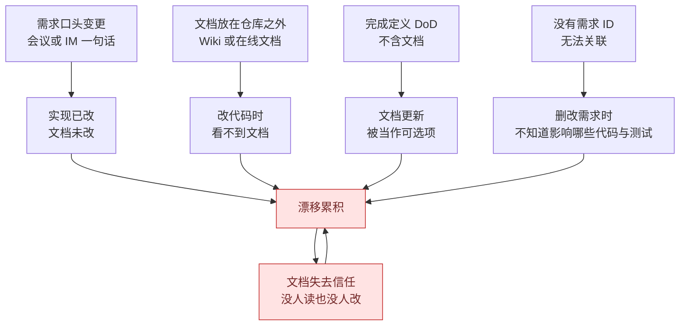
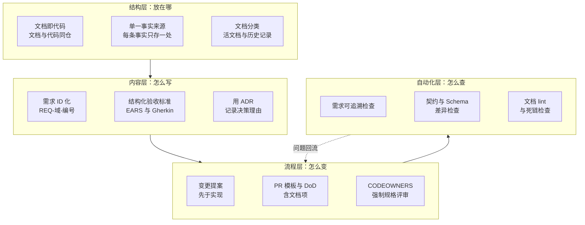
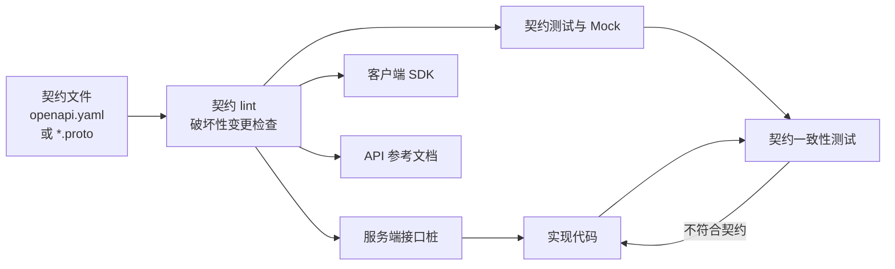
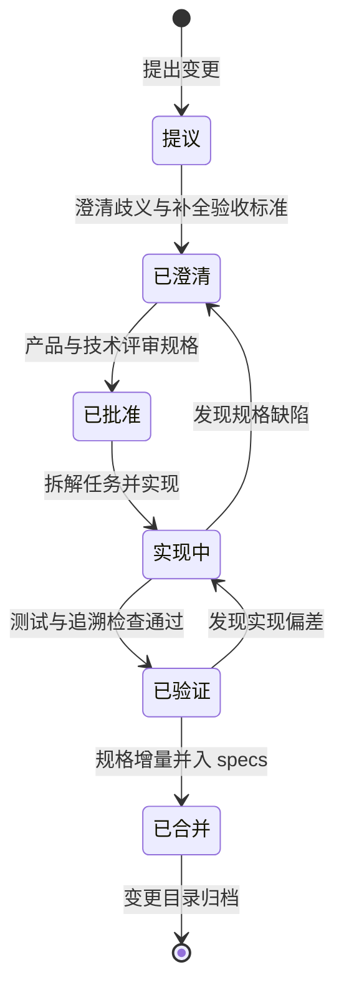
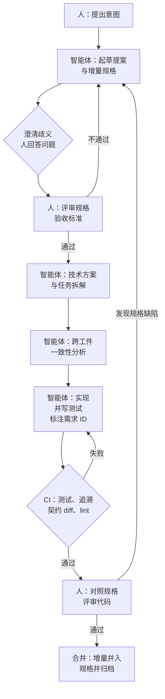
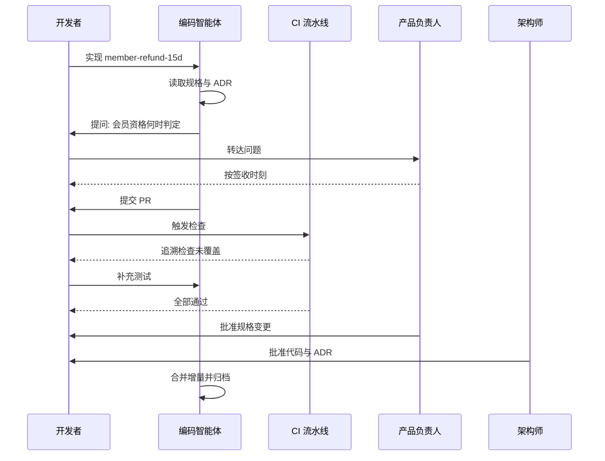

[toc]

一致性治理要解决的问题，可以用两句话概括：**让需求、文档与实际行为可追溯、可验证，并随变更持续同步**，而不只是“文档写得多”。NASA 的软件工程指南把这类要求表述为：应在项目生命周期内维护需求、设计、实现与测试之间的双向追溯关系。

同时要防止两个常见误解：

- **一致不等于正确**。需求、文档、实现三者可能一起理解错，因此还需要业务验收；一致只说明“彼此对得上”，不说明“做对了事”。
- **冲突时不能简单“以代码为准”**。代码只说明“现在实际怎么做”，不说明“应该怎么做”，也不记录“为什么这么做”。

本文的路线是：先把概念和代价讲清，再给出**结构、内容、流程、自动化**四层治理手段，最后落到 AI 编程时代的变化与一条可执行的落地路径。

## 一致性的定义与边界

### 四类工件：三角加一个裁判

讨论一致性时，至少涉及四类工件（Artifact）：

- **需求（Requirement）**：系统**应该**做什么、为什么做。载体通常是 PRD、用户故事、验收标准。
- **文档（Documentation）**：对系统**是什么、怎么用、为什么这样设计**的描述。包括架构文档、API 文档、运维手册、决策记录。
- **实现（Implementation）**：系统**实际**做了什么，也就是代码、配置和基础设施。
- **测试（Test）**：可执行的证据，**自动判定**实现是否符合需求。它是三角关系里的“裁判”。


这张图说明三点：

- 实线是**正向推导链**：需求细化成设计，设计指导实现，实现由测试验证，测试的判定标准又来自需求的验收标准，形成闭环。
- 虚线是**反向生成**：部分文档（API 参考、Schema 说明）应当从代码或契约自动生成，而不是手写。
- 闭环里任何一条边断了，就会出现**漂移（Drift）**：工件之间的描述悄悄分叉，却没人察觉。

### 一致不等于正确

闭环只保证“四者互相对得上”，不保证“四者都对”。同一处业务规则被误解时，需求、文档、实现会一起错，而且**看起来格外一致**。因此：

- **业务验收不可省略**。一致性与正确性是两道独立的检查，前者由追溯和门禁保证，后者由验收与真实用户反馈保证。
- **不要用“代码是事实标准”消解冲突**。代码可能实现错了，也可能实现了一个没人批准的行为；正确做法是把冲突记入需求或 ADR，由人裁定后再统一四者。
- **冲突的裁定结果必须回写**。只在聊天里达成一致，等于没有裁定，漂移会在下一次交付中重现。

### 术语与边界

以下术语在团队讨论中极易混用，先固定含义，后续治理方案才不会落空。

| 术语 | 英文 | 含义 | 常见误区 |
| --- | --- | --- | --- |
| **需求** | Requirement | 对系统“应当做什么”及“做到什么程度”的陈述，来自业务、用户、法规、运维等相关方 | 把“功能清单”等同于需求，忽略非功能需求（性能、安全、合规） |
| **规格** | Specification, Spec | 对需求的精确化、可验证化描述，包含验收标准、接口契约、数据模型等 | 规格写得像散文，无法被测试或工具校验 |
| **设计文档** | Design Doc, Architecture Doc | 描述“怎么做”：架构、模块划分、关键技术决策与取舍 | 设计文档一次性写完后不再更新 |
| **实现** | Implementation | 代码、配置、基础设施定义、数据库迁移脚本等真正运行的产物 | 只把“源码”当实现，忽略配置、脚本与环境 |
| **文档** | Documentation | 面向人或 AI 的说明性产物：用户手册、API 参考、运维手册、教程等 | 把文档当“写完代码之后的附加任务” |
| **可追溯性** | Traceability | 任一产物可向前（来源）和向后（衍生物）被追踪；分正向（需求到代码）与反向（代码到需求） | 只在立项时做一次追溯矩阵，后续不维护；只做一个方向 |
| **文档漂移** | Documentation Drift | 实现已变，而文档或规格未同步，导致描述不一致 | 认为“代码即文档”就不会漂移——代码只能说明“是什么”，说不了“为什么”与“应当是什么” |
| **单一事实来源** | Single Source of Truth, SSOT | 对某一类信息只有一个权威存放处，其余均派生或引用 | 误解成“只有一份文档”；正确含义是“**每条事实**只有一个权威副本” |
| **活文档** | Living Documentation | 从代码、测试或契约自动生成、随构建更新的文档 | 把“自动生成”误解为“无需人工审阅” |
| **决策记录** | Architecture Decision Record, ADR | 记录“为什么这样设计”的不可变短文档 | 与设计文档混淆；ADR 记录“为什么”，设计文档记录“是什么” |
| **文档即代码** | Docs as Code | 文档用纯文本写在 Git 里，走代码评审与 CI | 以为“放进仓库”就完事，关键是**同一 PR、同一评审、同一门禁** |
| **规格驱动开发** | Spec-Driven Development, SDD | 先写结构化、受版本控制的规格，再让 AI 智能体据此生成计划、任务与代码 | 与 BDD、TDD 混为一谈；三者互补而非替代 |

### 活文档与历史记录

这是很多团队忽略的关键区分：**不是所有文档都应该保持最新**。

- **活文档**（规格、参考、指南）：**必须**和实现保持一致，过时就是缺陷。
- **历史记录**（ADR、会议纪要、已归档的变更提案）：**必须保持原样**。它们记录“当时为什么这么决定”，改写历史反而破坏可追溯性。

两类混淆会产生两种反向错误：要么去“更新”ADR，把历史抹掉；要么把过时的设计稿当成现状来读。因此仓库里应让两类文档在目录上就分开，并在 `AGENTS.md` 中写明哪类可改、哪类只读。

## 不一致的代价与漂移机制

### 不一致的类型与代价

先看一个具体场景：某电商团队的退款规则在三个地方有三种说法：

- PRD 写的是“**签收后** 7 天内可无理由退款”；
- 客服知识库写的是“**下单后** 7 天”；
- 代码按 `delivered_at`（物流显示送达的时间）计算，而这个时间常比用户签收早一两天。

结果是：用户按客服说法申请被系统拒绝而投诉，客服按文档解释与系统行为对不上，开发排查时找不到“哪个才是对的”，只能翻半年前的聊天记录。**每个人都没做错什么，系统整体却是错的。** 这正是不一致的典型代价：它很少立刻导致故障，而是持续消耗信任、沟通成本和排障时间。

| 不一致类型 | 典型症状 | 短期后果 | 长期后果 |
| --- | --- | --- | --- |
| **需求遗漏** | 验收时才发现“这个场景没人考虑过” | 返工、延期 | 隐性规则只存在于少数人脑中，人员流动即丢失 |
| **需求与实现偏离** | 实现“差不多”，但边界条件不同 | 线上缺陷、客诉 | 偏离被当成事实标准，以后没人敢改 |
| **实现反向蔓延** | 开发者“顺手”加了未经确认的行为 | 隐性需求无人测试、无人维护 | 后续重构不敢删，遗留负担累积 |
| **文档漂移** | 照着文档操作失败，接口文档与真实返回不符 | 新人上手慢、集成方对接失败 | **文档整体信誉破产**，大家不再看文档，形成恶性循环 |
| **文档分散** | 同一主题散落在 Wiki、IM、邮件、代码注释里 | 找不到，或找到多个版本 | 知识孤岛，决策理由丢失，重复踩坑 |
| **决策理由丢失** | “为什么这么设计？”“不知道，别动” | 不敢重构 | 架构僵化，技术债滚雪球 |
| **知识流失** | 决策只存在于离职员工脑中 | 交接成本高 | 后人不敢改也不敢删，系统变成黑箱 |
| **AI 协作失效** | 智能体按过期文档生成调用方代码 | 一次生成大量错误代码 | 文档失真被批量放大，评审成本飙升 |

### 为什么长期保持比一次做对更难

一致性不是一次性交付物，而是一种**状态**。它的天然趋势是**熵增**：每一次变更都是一次让工件分离的机会，而需求与文档没有“编译器”强迫它们同步更新。具体原因有五条：

- **修复成本随时间上升**：需求阶段发现的错误只需改一句话，上线后则要改代码、迁移数据、安抚用户。漂移存在越久，越多下游决策建立在错误信息上。
- **文档信誉是二元的**：一份文档只要被发现几次错误，读者就会**默认它不可信**，转而去读代码或问人。之后即使文档是对的，也没人用了。
- **系统寿命远长于开发周期**：多数系统的维护期是开发期的数倍，维护者往往不是原作者，他们只能依赖留下来的工件。
- **文档不在交付路径上**：代码不合并就无法上线，文档不更新却没有任何阻断，因此在压力下总被牺牲。
- **合规与审计**：金融、医疗、汽车等行业的功能安全与合规体系通常要求需求到测试的双向追溯，这是硬性要求，不是最佳实践。

因此治理的核心不是“写一份好文档”，而是**建立让不一致难以发生、发生后能被自动发现的机制**。

### 漂移如何发生：根因与自我强化回路



图中四条起点分别对应四类治理手段：**变更走流程**、**文档就近存放**、**DoD 包含文档**、**需求 ID 化与可追溯**。需要警惕的是图中填充为浅红的**漂移累积**与**文档失去信任**两框构成的自强化回路：漂移导致失信，失信导致更少维护，维护越少漂移越多。治理的目标就是打断这个回路，而不是笼统地“加强文档意识”。

把根因按性质分类，可以直接对应到后文的章节：

| 根因类别 | 具体表现 | 对应治理手段 |
| --- | --- | --- |
| **结构性** | 信息没有唯一权威位置；需求没有稳定 ID；文档与代码物理分离 | 结构层：SSOT、就近原则、Docs as Code、需求 ID |
| **流程性** | DoD 不含文档；需求经口头或 IM 变更；没有所有权与保鲜期；无审计节奏 | 流程层：DoD、PR 模板、CODEOWNERS、复审节奏 |
| **工具性** | CI 不检查文档；文档无法自动生成或校验 | 自动化层：追溯检查、契约检查、文档 lint、活文档 |
| **人的因素** | 写文档无即时回报；AI 产出速度远超人工更新文档 | 降低摩擦（就近、自动生成）加提高回报（文档成为 AI 的燃料） |

## 治理框架总览

### 四层治理



四层自上而下依次依赖：**先决定放在哪，再规定怎么写，然后约束怎么变，最后用机器检查**。只靠流程和自觉的治理一定会衰减，**自动化层是长期一致性的唯一可靠保障**。

### 治理原则

下面用规范性措辞（必须、应该、可以、避免）给出原则，后文逐项展开为具体实践。

| 等级 | 原则 | 说明 |
| --- | --- | --- |
| **必须** | **单一事实来源** | 每类信息只有一个权威位置，其他地方只放链接，不用副本 |
| **必须** | **就近原则（Co-location）** | 文档放在离它描述的代码最近的地方，通常就是同一个仓库 |
| **必须** | **稳定 ID 与可追溯** | 需求、ADR、接口都有稳定 ID，代码与测试通过 ID 引用 |
| **必须** | **变更即文档** | 改变行为的改动必须同时改规格与文档，同一 PR、同一评审、同一门禁 |
| **必须** | **完成定义包含文档与规格同步** | 把“文档已更新”写进团队 DoD，而不是上线后补 |
| **应该** | **优先采用可执行或可校验的规格** | OpenAPI、Protobuf、JSON Schema、Gherkin 能被工具验证，比散文不易漂移 |
| **应该** | **能生成的不要手写** | API 参考、配置项说明、CLI 帮助从代码或契约生成 |
| **应该** | **用 ADR 记录“为什么”** | 代码记录“是什么”，ADR 记录决策理由与被否决的备选方案 |
| **应该** | **为每份文档指定 Owner 与复审周期** | 用元数据（如 `last_reviewed`）配合 CI 做过期提醒 |
| **可以** | **用工具生成追溯矩阵** | 中小团队可只靠 ID 约定与脚本，受监管项目再上专业工具 |
| **可以** | **用 AI 做一致性审查** | 作为评审辅助，而非事实来源 |
| **避免** | **把 IM 聊天记录当需求存档** | 结论必须回写到需求条目 |
| **避免** | **在 Wiki 中维护与代码强相关的技术文档** | Wiki 缺乏版本关联与评审流程，极易漂移 |
| **避免** | **“大而全”的一次性设计文档** | 应拆成可独立演进的小文档（ADR、模块 README） |
| **避免** | **设立文档专员事后补文档** | 事后补出来的文档准确性最差 |

### 分层产物与追溯链

推荐把项目产物按“意图到实现”分层，每层只回答自己的问题，并通过 ID 互相引用。下表的“事实来源”指该类信息的权威归属，而不是文件位置。

| 层级 | 回答的问题 | 事实来源 | 推荐存放 | 形式 |
| --- | --- | --- | --- | --- |
| 产品愿景与 PRD | 为什么做 | 产品负责人 | 需求管理系统或仓库 `docs/prd/` | Markdown |
| 需求条目 | 做什么、验收标准 | 需求管理系统（Jira、Linear、GitHub Issues；国内如 PingCode、ONES、TAPD、飞书项目）或仓库需求目录 | 系统中，仓库内引用 ID；或反之，以仓库为准 | 用户故事加验收标准，EARS |
| 架构与设计 | 怎么做、为什么这样做 | 架构或技术负责人 | 仓库 `docs/adr/`、`docs/architecture/` | MADR、C4、arc42 |
| 接口契约 | 对外承诺了什么 | 服务提供方 | 仓库 `api/` 或独立契约仓库 | OpenAPI、Protobuf、AsyncAPI、JSON Schema |
| 代码与测试 | 实际行为 | 开发团队 | 仓库 | 源码加 Gherkin、单测 |
| 用户与运维文档 | 怎么用、怎么运维 | 文档 Owner | 仓库 `docs/`，CI 发布 | Docs as Code |

层间的引用方向有三条：需求向下约束契约与测试，契约与代码向上生成参考文档，测试向上引用需求 ID 形成证据。缺任何一条，追溯就只剩单向。

## 结构层：文档放在哪里

### 单一事实来源与就近原则

**必须**：每类信息只有一个权威位置。其他地方引用链接，不维护第二份正文。复制出来的每一份副本，都是一个未来的漂移点。

**必须**：文档放在离它描述的代码最近的地方。按照**就近原则**，涉及系统行为的文档应与代码同仓库，因为“改代码时看得见文档”是文档被顺手更新的前提。

**可以**：Wiki 或在线文档平台（Confluence、飞书、语雀等）适合放**面向非研发的内容**，如业务培训、会议纪要、运营手册。但**必须**遵守一条规则：涉及系统行为的内容，在线文档里只放摘要和**指向仓库的链接**，不复制正文。

### Docs as Code

**必须**：凡是描述系统行为、会随代码变化的文档，都和代码放在**同一个仓库**，用 Markdown（或 AsciiDoc）编写，走同样的 PR 评审，同版本发布。

这样做的理由：

- 改代码和改文档在**同一个 PR** 里，评审者能同时看到两者是否一致；
- 有版本历史，能回答“v2.3 时规则是什么”；
- 可以被 CI 检查，也**可以被 AI 读到**，AI 时代这一点尤其关键。

### 两种仓库结构模型

结构模型有两条主流路线，治理能力等价，区别在于“追溯的统计单位”。两者都可以直接套用，但**位置必须固定并写进 `AGENTS.md`**，否则第三次重构目录时追溯就断了。

**模型一：域规格加增量变更**，适合已有系统持续迭代。

```
README.md                       面向人类的入口：项目简介、快速开始、文档导航
AGENTS.md                       面向 AI 智能体的项目指令
CHANGELOG.md                    面向用户的变更记录
docs/
├── specs/<域>/spec.md          当前系统行为的权威规格，需求以标题行定义
├── changes/<变更名>/           进行中的变更提案，完成后并入 specs 并归档
├── adr/                        架构决策记录，编号递增，正文不可改
├── guides/                     教程与操作指南
└── reference/                  参考文档，尽量自动生成
api/openapi.yaml                API 契约，文档与客户端代码从它生成
tests/                          测试中标注需求 ID
.github/                        PR 模板、CODEOWNERS、CI 工作流
```

**模型二：一需求一文件**，适合需求数量可控、需要逐条跟踪状态的项目。

```
docs/
├── requirements/REQ-REFUND-001.md   一个需求一个文件，front matter 含 id 与 status
├── adr/0007-refund-async-saga.md
├── tutorials/
├── how-to/
├── reference/
├── explanation/
└── index.md                        文档导航
src/   tests/   api/   scripts/check_trace.py
```

两种模型的差异：

| 维度 | 模型一：域规格加增量 | 模型二：一需求一文件 |
| --- | --- | --- |
| 统计单位 | 域，需求以标题行存在 | 单个需求，带状态字段 |
| 变更表达 | `changes/` 下的增量规格，合并后归档 | 直接改需求文件，靠 Git 历史 |
| 适合 | 已有系统、需求频繁小改 | 需求条目清晰、需要状态看板 |
| 追溯粒度 | 需求 ID，子条目靠命名约定 | 需求 ID 与子条目 `.N` 均可统计 |
| 主要风险 | 增量合并遗漏，规格文件膨胀 | 文件数量多，跨需求关系需靠链接维护 |

两种模型都要求配套同一套东西：需求 ID 规范、追溯检查脚本、PR 门禁、ADR 目录。仓库布局只是载体，不是治理本身。

**避免**：把需求正文只放在 Jira、Confluence 或飞书里而仓库中无副本。智能体读不到，代码评审时也看不到；同时**避免**反过来在仓库与平台各维护一份正文。

### 文档分类：Diátaxis

文档分散的另一个原因是**类型混杂**：一篇文档里既有教程又有参考又有设计讨论，没人知道该在哪里更新。**Diátaxis** 框架（作者 Daniele Procida，被 Django、Canonical、Cloudflare 等采用）按读者意图把文档分为四类。

| 类型 | 英文 | 回答的问题 | 示例 | 一致性维护要点 | 维护者 |
| --- | --- | --- | --- | --- | --- |
| **教程** | Tutorial | 我是新手，带我走一遍 | “15 分钟跑通本地开发环境” | 纳入 CI 定期实际执行 | 开发者体验或文档负责人 |
| **操作指南** | How-to Guide | 我要完成某个具体任务 | “如何配置部分退款” | 与脚本和命令同步 | 对应模块负责人 |
| **参考** | Reference | 精确的事实是什么 | API 字段表、配置项清单 | **尽量自动生成** | 自动化为主 |
| **解释** | Explanation | 为什么是这样 | 架构说明、ADR | 引用 ADR，不复制结论 | 架构负责人 |

**推荐**：在 `docs/` 下按这四类组织，每篇文档只属于一类。参考类文档尽量从契约与代码生成；解释类文档引用 ADR 而不是复制；教程与操作指南由人工维护，但在 CI 中做链接检查与示例可运行性测试。

### 外部平台：只做入口与看板

平台不是 SSOT，而是**入口与看板**。选择时优先考虑“能否深度链接到 Git 仓库”和“是否支持 Markdown 与 Mermaid”。

| 用途 | 国际常见 | 国内常见 | 治理建议 |
| --- | --- | --- | --- |
| 需求与任务管理 | Jira、Linear、GitHub Issues | PingCode、ONES、禅道、Gitee 企业版、飞书项目 | Issue 标题带需求 ID，正文首行链接到仓库需求文件 |
| 知识库与文档 | Confluence、Notion | 语雀、飞书文档、腾讯文档 | 只放流程性与组织性内容，技术文档放仓库，知识库放链接 |
| 文档站生成 | MkDocs Material、Docusaurus、VitePress、Sphinx、mdBook | 同左 | 从 `docs/` 自动构建发布，禁止在站点后台直接编辑 |
| 内部开发者门户 | Backstage | 自建或基于 Backstage | 多仓库时统一聚合展示 `docs/` |

**避免**：同一份需求在 Jira、飞书、Confluence 各写一遍。一旦出现“哪份是对的”的争论，就说明 SSOT 已经失效。

## 内容层：需求与决策怎么写

### 需求 ID 规范

**必须**：每条可验收的需求有一个**稳定、唯一、可 grep 的 ID**。推荐格式为 `REQ-<域>-<NNN>`。

| 占位符 | 含义 | 约束 |
| --- | --- | --- |
| `REQ` | 固定前缀，表示需求 | 非功能需求可用 `NFR` 等前缀，但**前缀种类越少越好** |
| `<域>` | 业务域缩写，2 到 8 个大写字母或数字 | 与 `docs/specs/` 下的目录对应，如 `REFUND`、`ORD`、`PAY` |
| `<NNN>` | 域内序号，三位数字 | **只增不复用**。需求删除后编号作废，不分配给新需求 |
| `.<N>` | 可选子条目序号 | 用于一条需求下的多个可独立验收的条款，如 `REQ-ORD-012.2` |

几条实践约定：

- **子条目优于版本号**。需求实质性变化时不要加 `-v2` 后缀，版本交给 Git 管理；需要拆出可独立验收的行为时用子条目 `.1`、`.2`。
- **不要用标题文字充当 ID**。标题一改，所有关联就断了。
- **ID 必须出现在四个位置**：规格或需求文件的标题（或 front matter）、测试的注释或标签、PR 描述与提交信息、需求或任务系统。少一处，链路就缺一环。
- **代码在业务规则分支处引用 ID**：不必处处写，但分支处必须写，例如判断订单已发货时注明 `# REQ-ORD-012.2`，便于反向定位与影响面分析。

### 需求文件模板

需求文件采用 front matter 承载元数据，正文用 EARS 写条款，并显式写明**非目标**——非目标是防止范围蔓延最便宜的手段。

```markdown
---
id: REQ-ORD-012
title: 用户取消未发货订单
status: accepted          # draft | accepted | implemented | deprecated
owner: product@example.com
last_reviewed: 2026-01-15
related: [ADR-0007]
---

## 背景
用户下单后在仓库发货前可能改变主意，需要自助取消以减少客服压力。

## 需求陈述（EARS）
- REQ-ORD-012.1 当用户对状态为 PAID 或 CREATED 的订单发起取消时，系统应当在 2 秒内
  将订单置为 CANCELLED 并触发退款流程。
- REQ-ORD-012.2 如果订单状态为 SHIPPED 或之后，那么系统应当拒绝取消并返回错误码
  ORDER_ALREADY_SHIPPED。
- REQ-ORD-012.3 在退款处理期间，系统应当在订单详情显示“退款处理中”状态。

## 验收标准
见 tests/features/order_cancel.feature（Gherkin），场景标签引用 REQ-ORD-012.N。

## 非目标
不包含部分取消（拆单取消），另见 REQ-ORD-015（draft）。
```

状态字段有实际用途：追溯脚本据此判断“未覆盖”是否构成缺陷（`draft` 允许未覆盖，`accepted` 与 `implemented` 不允许）。需求变更时**推荐**由 CI 把 `implemented` 回退为 `accepted` 或打标签，提醒实现需要跟进。

### 结构化验收标准：EARS

**EARS**（Easy Approach to Requirements Syntax，简易需求语法）由 Alistair Mavin 等人在罗尔斯·罗伊斯公司提出，用少量固定句式约束自然语言需求，减少歧义。AWS 的 Kiro 用它生成验收标准；据其发布博客，每个用户故事都附带 EARS 格式的验收标准，覆盖开发者容易遗漏的边界情况。

| 模式 | 中文句式 | 英文模板 | 何时使用 |
| --- | --- | --- | --- |
| **普遍型** | 系统**应当**〈响应〉 | THE SYSTEM SHALL … | 始终成立的约束 |
| **事件驱动** | **当**〈触发事件〉时，系统**应当**〈响应〉 | WHEN 〈event〉, THE SYSTEM SHALL … | 由某个事件触发的行为 |
| **状态驱动** | **在**〈状态〉期间，系统**应当**〈响应〉 | WHILE 〈state〉, THE SYSTEM SHALL … | 只在某种状态下成立 |
| **非期望行为** | **如果**〈异常条件〉，**那么**系统**应当**〈响应〉 | IF 〈condition〉, THEN THE SYSTEM SHALL … | 错误与非期望情况，最容易遗漏 |
| **可选特性** | **若包含**〈特性〉，系统**应当**〈响应〉 | WHERE 〈feature〉, THE SYSTEM SHALL … | 配置开关、版本差异 |

占位符的要求：

- 〈触发事件〉是可观察到的离散事件，如“用户提交退款申请”。
- 〈状态〉是持续一段时间的条件，如“订单处于已签收状态”。
- 〈异常条件〉是不期望但可能发生的情况，如“签收时间超过 7 天”。
- 〈响应〉必须可测试。“快速”“友好”这类词不合格，应写成“在 2 秒内返回”“返回错误码 `REFUND_EXPIRED`”。

**辨析**：`WHEN` 表示瞬时事件，`WHILE` 表示持续状态，两者不可混用；`IF…THEN` 专用于不希望发生但必须处理的情况，不要用它表达正常分支。

把退款规则用 EARS 改写后，“下单后还是签收后”的歧义就不存在了，因为句式逼着作者写清触发条件：

- **REQ-REFUND-001**：**当**用户在订单**签收后 7 天内**提交退款申请时，系统**应当**受理该申请并进入审核流程。
- **REQ-REFUND-002**：**如果**用户提交申请时距签收已超过 7 天，**那么**系统**应当**拒绝申请并返回错误码 `REFUND_EXPIRED`。

EARS 的价值在于每条需求只有明确的触发条件与可观察结果，**可以近乎机械地转换成 Gherkin 场景与测试**，也便于 AI 逐条核对实现覆盖。

### 可执行规格：Gherkin

**BDD**（Behavior-Driven Development，行为驱动开发）用 Gherkin 语法写场景，这些场景**本身就是可执行的测试**，是最彻底的“文档即测试”。Cucumber、Behave（Python）、pytest-bdd、SpecFlow 与 Reqnroll（.NET）、godog（Go）都能执行。

```gherkin
# language: zh-CN
功能: 无理由退款
  # 追溯: REQ-REFUND-001, REQ-REFUND-002

  场景: 签收后第 7 天内申请退款
    假如 订单"A1001"已于"2026-03-01 10:00"签收
    当 用户于"2026-03-08 09:59"提交退款申请
    那么 申请状态应为"审核中"

  场景: 超过 7 天申请退款被拒绝
    假如 订单"A1002"已于"2026-03-01 10:00"签收
    当 用户于"2026-03-08 10:01"提交退款申请
    那么 应返回错误码"REFUND_EXPIRED"
```

逐项说明：

- `# language: zh-CN` 声明使用中文关键字，`功能`、`场景`、`假如`、`当`、`那么` 分别对应 `Feature`、`Scenario`、`Given`、`When`、`Then`。
- `场景` 用**具体数据**而非抽象描述，这就是实例化需求（Specification by Example）。
- 场景标签（如 `@REQ-REFUND-001.2`）把场景与需求绑定，测试报告即追溯证据。不使用 BDD 框架时，也可以在普通测试里用注释或标记达到同样效果，如 `# covers: REQ-REFUND-001`。
- **推荐**：核心业务规则（计费、退款、权限）用 Gherkin 写成可执行规格；普通功能用 EARS 加单元测试即可，避免 BDD 胶水代码泛滥。
- **避免**：把 Gherkin 写成 UI 点击步骤脚本，那会让它退化为脆弱的 E2E 测试，而非规格。

### ADR：把“为什么”固定下来

代码能告诉你“是什么”，却说不出“为什么”。**ADR**（Architecture Decision Record）由 Michael Nygard 在 2011 年推广；**MADR**（Markdown Any Decision Records）是目前较流行的模板，存放在 `docs/adr/`，文件名形如 `0007-refund-async-saga.md`。

```markdown
# ADR-0012: 退款时效以用户签收时间为起点

- 状态: 已接受 (Accepted)
- 日期: 2026-03-10
- 决策者: @alice(产品), @bob(架构)
- 关联需求: REQ-REFUND-001, REQ-REFUND-002

## 背景与问题
物流"送达时间"(delivered_at)常早于用户实际签收，导致用户在第 7 天申请时被误拒，
近 30 天相关客诉在退款类客诉中占比明显偏高。

## 备选方案
1. 维持 delivered_at：实现不改，但与用户认知不符，客诉持续。
2. 以 signed_at 为起点，无签收记录时以 delivered_at 加 48 小时兜底：需物流服务补字段。
3. 以申请时间倒推：无法处理跨月、跨年等边界，且与条款表述冲突。

## 决策
采用方案 2。退款时效统一以 signed_at 为起点；无签收记录时以 delivered_at + 48 小时兜底。

## 后果
- 正面: 与用户认知一致，客服口径统一。
- 负面: 需要物流服务新增 signed_at 字段，历史订单需回填；兜底逻辑需单测覆盖边界。
- 需同步更新: docs/how-to/partial-refund.md、AGENTS.md 中的"退款时效"约定。

## 取代关系
无。若未来调整，新建 ADR 并将本篇状态改为"已被 ADR-XXXX 取代"。
```

字段说明：

| 字段 | 含义 | 要点 |
| --- | --- | --- |
| 状态 | 提议、已接受、已废弃、已被取代 | **唯一允许事后修改的字段**，ADR 正文不可改 |
| 背景与问题 | 当时面临的问题和约束 | 写事实与数据，不写结论 |
| 备选方案 | 被否决的方案与原因 | ADR 最有价值的部分，防止后人重复争论 |
| 决策 | 选了什么 | 一句话能说清最好 |
| 后果 | 正面与负面影响 | **必须写负面影响**，否则就是宣传稿 |
| 需同步更新 | 本次决策牵连的文档与约定 | 评审时逐项核对，避免决策落地后文档滞后 |
| 关联需求 | 触发该决策的需求 ID | 建立向上追溯 |
| 取代关系 | 是否被新 ADR 取代 | 保持历史可查 |

**推荐**：工具可用 adr-tools（命令行）或 Log4brains（可生成静态站点），也可以直接手写 Markdown。**避免**给小决策也写 ADR（判断标准是“半年后有人会问为什么”），也**避免**把 ADR 写成长篇设计文档。

### 架构文档：C4 与 arc42

- **C4 模型**用上下文、容器、组件、代码四级视图描述架构，配合 Structurizr DSL 或 Mermaid 的 `C4Context` 语法，可把架构图写成文本进 Git。
- **arc42** 是成熟的架构文档模板，与 C4 互补：C4 解决“画成什么样”，arc42 解决“写哪些章节”。
- **推荐**：图用 Mermaid、PlantUML 或 Structurizr DSL 等文本格式，放在仓库中与代码同 PR 评审，避免截图类架构图随实现演进而静默过时。

### 契约优先：接口、事件与数据库

接口是“文档与实现漂移”的重灾区。**契约优先**（Contract-First）的思路是：**先写契约，契约进仓库并评审，再从契约生成服务端桩、客户端 SDK 和参考文档**，让“文档”与“实现”源自同一份事实。



关键措施：

- **契约 lint**：用 Spectral（OpenAPI）或 `buf lint`（Protobuf）在 CI 中强制命名、必填描述、错误码规范。
- **破坏性变更检测**：用 `oasdiff` 或 `buf breaking` 对比主分支与 PR 分支，阻断未经版本升级的破坏性修改。
- **契约测试**：Schemathesis 可基于 OpenAPI 对运行中的服务做基于属性的测试，直接验证“实现是否符合文档”；Pact 适合消费者驱动的契约测试；Dredd 是另一类可选工具。
- **在契约内挂追溯**：用扩展字段把接口与需求、决策关联，扫描时即可定位影响面，例如 `x-requirements: [REQ-ORD-012]`、`x-adr: [ADR-0007]`。
- **事件也是契约**：消息与事件用 AsyncAPI 描述，避免“事件字段只有生产者知道”。
- **数据库也有契约**：迁移脚本（Flyway、Liquibase、Alembic、golang-migrate）就是数据模型的 SSOT；ER 图应从迁移后的真实 Schema 生成（如 `tbls`、SchemaSpy），而不是手绘。

## 流程层：变更怎么走

### 规格先行

核心原则：**任何改变系统行为的变更，规格的修改必须先于或同步于代码的修改，并在同一个 PR 中评审。**

以“订单退款期限从 7 天改为 14 天”为例，一次改动至少要同时触及：需求条款、用户说明、退款判断逻辑，以及期限内、临界点、超期三组测试。只改一个数字，就是把一次需求变更降级成一次潜在的漂移。



图中有两条回退边，值得特别注意：

- **实现中回到已澄清**：实现过程中发现规格有漏洞时，**必须回去改规格**，而不是在代码里“顺手处理掉”。这是防止需求与实现偏离最关键的一条纪律。
- **已验证回到实现中**：测试或追溯检查失败时，回去修实现，而不是放宽断言。

### 变更提案与增量规格

采用模型一的团队，把进行中的变更放在 `docs/changes/<变更名>/`，内容包括提案、增量规格与任务清单；变更完成后把增量并入 `docs/specs/`，变更目录归档。增量规格只写变化部分，标明修改与新增：

```markdown
## 修改 (MODIFIED)
### REQ-REFUND-001: 普通用户签收后 7 天内可申请无理由退款
当**非会员**用户在订单签收后 7 天内提交退款申请时,系统应当受理并进入审核流程。

## 新增 (ADDED)
### REQ-REFUND-004: 会员签收后 15 天内可申请无理由退款
当用户**在签收时刻**具有有效会员资格,且在签收后 15 天内提交退款申请时,
系统应当受理并进入审核流程。

### REQ-REFUND-005: 会员资格判定时点
如果用户签收后会员过期,那么系统应当仍按签收时刻的会员资格计算退款期限。
```

增量规格的价值在于**合并步骤不可省略**：跳过“并入 `specs/`”，规格就退化成“先写后扔”，几个月后照样漂移。

### PR 模板与完成定义

在 `.github/pull_request_template.md`（GitLab 用 `.gitlab/merge_request_templates/`，Gitee 也有类似机制）中放入一致性自查：

```markdown
## 关联需求
<!-- 必填: 列出需求 ID, 如 REQ-REFUND-004; 纯重构或依赖升级填写"无行为变更" -->

## 变更类型
- [ ] 行为变更（需要更新规格与文档）
- [ ] 纯重构（不改变外部行为）
- [ ] 文档或契约变更

## 一致性自查
- [ ] 行为变更已同步修改对应规格（docs/specs/ 或 docs/requirements/）
- [ ] 新增或修改的需求均有测试引用其 ID
- [ ] API 变更已先改 api/openapi.yaml，且破坏性检查通过
- [ ] 重要设计取舍已新增 ADR（或说明无需）
- [ ] 用户可见的变化已写入 CHANGELOG.md
- [ ] AGENTS.md 中的命令与约定仍然正确
- [ ] no-doc-change: <若确实不需改文档，写明理由>
```

配套要求：

- **必须**：团队的**完成定义**（Definition of Done）里明确写入“规格与文档已同步”。没写进 DoD 的事情，在赶工期时一定会被跳过。
- **必须**：`no-doc-change` 是显式豁免而非默认通道，CI 检查到 `src/` 有变更而文档无变更时，只接受 PR 描述中写明理由的情况。
- **推荐**：提交信息遵循 Conventional Commits，并在 footer 写入 `Refs: REQ-XXXX-001`；用 `git-cliff`、`semantic-release` 或 `release-please` 生成 CHANGELOG，避免手写遗漏。

### 所有权与节奏

没有主人的文档必然腐烂，而只有主人、没有节奏的文档会缓慢腐烂。以下四类机制覆盖了“人、时间、新人、账目”四个维度。

| 机制 | 做法 | 频率 |
| --- | --- | --- |
| **CODEOWNERS** | `docs/specs/`、`docs/requirements/` 由产品或领域负责人必审，`docs/adr/` 由架构负责人必审，`api/` 由接口负责人必审 | 每个 PR |
| **文档复审** | 脚本列出 `last_reviewed` 超期的文档，指派负责人复审并更新日期 | 每季度 |
| **新人验证** | 新成员按 `docs/guides/` 从零跑通，记录所有卡点并作为文档缺陷修复 | 每次入职 |
| **需求对账** | 产品与开发用追溯矩阵对账：`accepted` 但未实现、已实现但无需求来源的，各自处理 | 每个迭代结束 |

**必须**：规格的改动等于需求的改动，**不能只由开发者自审**。`CODEOWNERS` 的作用不是形式审批，而是保证“验收标准”这件事始终有人负责。

## 自动化层：用机器守住一致性

### 追溯检查脚本

下面的脚本只依赖 Python 标准库，在 Windows、Linux、macOS 上都能运行。它同时支持两种需求定义方式，做三类检查，并可输出追溯矩阵：

- **未覆盖（UNCOVERED）**：定义了需求，但没有任何测试引用它，说明需求可能被遗漏实现或缺少验证。
- **悬空引用（DANGLING）**：测试引用了不存在的需求 ID，说明需求已删除但测试残留，或 ID 写错。
- **重复定义（DUPLICATE）**：同一个 ID 在两处定义，说明合并或复制出了岔子。
- **追溯矩阵**：输出 Markdown 表格，作为 CI 产物或文档站的参考页。

```python
#!/usr/bin/env python3
"""需求可追溯性检查：把"需求定义"与"引用它的文件"对账，并输出追溯矩阵。

定义来源（两者可同时使用，也可只用其一）:
  1. requirements 目录下每个 Markdown 的 front matter 含 `id: REQ-<域>-<NNN>`；
  2. 规格 Markdown 中形如 `### REQ-<域>-<NNN> ...` 的标题行；
     标题带 `[deprecated]` / `[废弃]` 的视为已废弃，不要求测试覆盖。
引用: 其他文本文件中出现的 `REQ-<域>-<NNN>[.N]`；子条目 `.N` 归并到主需求统计。
"""
from __future__ import annotations

import argparse
import re
import sys
from collections import defaultdict
from pathlib import Path

ID_RE = re.compile(r"\bREQ-[A-Z][A-Z0-9]{1,7}-\d{3}\b")
HEAD_RE = re.compile(r"^#{2,6}\s+(?P<id>REQ-[A-Z][A-Z0-9]{1,7}-\d{3})\b(?P<rest>.*)$")
FRONT_RE = re.compile(r"^---\s*\n(?P<body>.*?)\n---\s*(?:\n|$)", re.S)
DEPRECATED_STATUS = {"deprecated", "obsolete", "dropped", "废弃", "已废弃"}
DEPRECATED_TAGS = ("[deprecated]", "[废弃]")
DRAFT_STATUS = {"draft", "proposed", "提议", "草稿"}
DEFAULT_EXT = (".md", ".py", ".ts", ".js", ".go", ".java", ".kt", ".rs",
               ".yaml", ".yml", ".feature", ".sql", ".sh")


def read_text(path: Path) -> str:
    return path.read_text(encoding="utf-8", errors="replace")


def front_matter(text: str) -> dict[str, str]:
    m = FRONT_RE.match(text)
    if not m:
        return {}
    meta: dict[str, str] = {}
    for line in m.group("body").splitlines():
        if ":" not in line or line.lstrip().startswith("#"):
            continue
        key, value = line.split(":", 1)
        meta[key.strip().lower()] = value.strip()
    return meta


def is_test(path: Path) -> bool:
    p = path.as_posix()
    name = path.name
    return ("/tests/" in p or p.startswith("tests/") or path.suffix == ".feature"
            or name.startswith("test_") or "_test." in name or ".test." in name)


def collect_defs(req_dirs: list[Path], spec_dirs: list[Path]):
    """返回 (defs, def_files, duplicates)。defs: id -> dict(file, status, title)"""
    defs: dict[str, dict] = {}
    def_files: set[Path] = set()
    duplicates: list[str] = []

    def register(rid: str, path: Path, status: str, title: str) -> None:
        if rid in defs:
            duplicates.append(f"{rid} 同时定义于 {defs[rid]['file'].as_posix()} 与 {path.as_posix()}")
            return
        defs[rid] = {"file": path, "status": status, "title": title}

    for d in req_dirs:
        if not d.is_dir():
            continue
        for f in sorted(d.rglob("*.md")):
            meta = front_matter(read_text(f))
            rid = meta.get("id", "")
            if not ID_RE.fullmatch(rid):
                print(f"[WARN] {f} 缺少合法 id 的 front matter, 已跳过", file=sys.stderr)
                continue
            def_files.add(f)
            register(rid, f, meta.get("status", "unknown").lower(), meta.get("title", ""))

    for d in spec_dirs:
        if not d.is_dir():
            continue
        for f in sorted(d.rglob("*.md")):
            for line in read_text(f).splitlines():
                m = HEAD_RE.match(line.strip())
                if not m:
                    continue
                rest = m.group("rest")
                def_files.add(f)
                status = "deprecated" if any(t in rest.lower() for t in DEPRECATED_TAGS) else "unknown"
                register(m.group("id"), f, status, rest.lstrip(":： ").strip())

    return defs, def_files, duplicates


def collect_refs(scan_dirs: list[Path], exts: tuple[str, ...], skip: set[Path]) -> dict[str, set[Path]]:
    refs: dict[str, set[Path]] = defaultdict(set)
    for d in scan_dirs:
        if not d.is_dir():
            continue
        for f in sorted(d.rglob("*")):
            if not f.is_file() or f.suffix not in exts or f in skip:
                continue
            for rid in set(ID_RE.findall(read_text(f))):
                refs[rid].add(f)
    return refs


def main() -> int:
    ap = argparse.ArgumentParser(description=__doc__,
                                 formatter_class=argparse.RawDescriptionHelpFormatter)
    ap.add_argument("--requirements", "-r", type=Path, nargs="*", default=[Path("docs/requirements")],
                    help="front matter 定义需求的目录 (默认 docs/requirements)")
    ap.add_argument("--specs", "-s", type=Path, nargs="*", default=[Path("docs/specs")],
                    help="标题行定义需求的目录 (默认 docs/specs)")
    ap.add_argument("--scan", nargs="+", type=Path, default=[Path("src"), Path("tests")],
                    help="扫描引用的目录, 可多个 (默认 src tests)")
    ap.add_argument("--ext", nargs="+", default=list(DEFAULT_EXT), help="扫描的文件扩展名")
    ap.add_argument("--out", "-o", type=Path, default=None, help="追溯矩阵输出路径 (Markdown)")
    ap.add_argument("--fail-on-uncovered", "-u", action="store_true",
                    help="有需求未被任何测试引用时返回非零 (默认仅报告)")
    ap.add_argument("--fail-on-dangling", "-d", action="store_true",
                    help="引用了未定义的需求 ID 时返回非零 (默认仅报告)")
    ap.add_argument("--warn-only", "-w", action="store_true", help="只报告, 始终返回 0")
    a = ap.parse_args()

    defs, def_files, duplicates = collect_defs(list(a.requirements), list(a.specs))
    if not defs:
        print("[ERROR] 没有找到任何需求定义, 检查 --requirements / --specs 路径", file=sys.stderr)
        return 2

    refs = collect_refs(list(a.scan), tuple(a.ext), def_files)
    active = {k: v for k, v in defs.items() if v["status"] not in DEPRECATED_STATUS}
    uncovered = [rid for rid in sorted(active) if not {p for p in refs.get(rid, ()) if is_test(p)}]
    dangling = sorted(set(refs) - set(defs))

    total = len(active)
    covered = total - len(uncovered)
    pct = 100.0 * covered / total if total else 100.0
    print(f"有效需求 {total} 条 (已废弃 {len(defs) - total} 条不计), 有测试引用 {covered} 条 ({pct:.1f}%)")
    for rid in uncovered:
        meta = defs[rid]
        note = "" if meta["status"] not in DRAFT_STATUS else " (状态为草稿, 实现前允许未覆盖)"
        print(f"[UNCOVERED] {rid} [{meta['status']}] 定义于 {meta['file'].as_posix()}, 没有任何测试引用{note}")
    for rid in dangling:
        files = ", ".join(sorted(p.as_posix() for p in refs[rid]))
        print(f"[DANGLING]  {rid} 被 {files} 引用, 但没有任何定义 (已删除或拼写错误)")
    for msg in duplicates:
        print(f"[DUPLICATE] {msg}")

    if a.out:
        rows = ["| 需求 | 标题 | 状态 | 实现引用 | 测试引用 |", "| --- | --- | --- | --- | --- |"]
        for rid in sorted(defs):
            meta = defs[rid]
            files = refs.get(rid, set())
            tests = sorted(p.as_posix() for p in files if is_test(p))
            impls = sorted(p.as_posix() for p in files if not is_test(p))
            rows.append(f"| {rid} | {meta['title'] or '-'} | {meta['status']} | "
                        f"{'<br>'.join(impls) or '-'} | {'<br>'.join(tests) or '-'} |")
        a.out.parent.mkdir(parents=True, exist_ok=True)
        a.out.write_text("# 需求追溯矩阵(自动生成, 勿手改)\n\n" + "\n".join(rows) + "\n",
                         encoding="utf-8")
        print(f"追溯矩阵已写入 {a.out}")

    if duplicates:
        return 1
    if a.warn_only:
        return 0
    if (uncovered and a.fail_on_uncovered) or (dangling and a.fail_on_dangling):
        return 1
    return 0


if __name__ == "__main__":
    sys.exit(main())
```

参数说明：

| 参数 | 默认值 | 作用 |
| --- | --- | --- |
| `--requirements`、`-r` | `docs/requirements` | front matter 定义需求的目录，递归扫描 `*.md` |
| `--specs`、`-s` | `docs/specs` | 标题行定义需求的目录，递归扫描 `*.md` |
| `--scan` | `src tests` | 扫描引用的目录，可写多个，如 `--scan src tests docs api` |
| `--ext` | 常见语言扩展名 | 扫描哪些文件类型，`.feature` 用于 Gherkin |
| `--out`、`-o` | 关闭 | 输出追溯矩阵 Markdown，供文档站或 CI 产物使用 |
| `--fail-on-uncovered`、`-u` | 关闭 | 有需求未被测试引用时返回非零 |
| `--fail-on-dangling`、`-d` | 关闭 | 有悬空引用时返回非零 |
| `--warn-only`、`-w` | 关闭 | 只报告不失败，**老项目引入初期推荐开启** |

设计要点：

- **定义与引用分离**：只有 front matter 的 `id:` 或标题行里的 ID 才算“定义”，正文中提到的 ID 只算引用；定义文件本身不参与引用扫描，避免规格文件自我引用造成假覆盖。
- **公文与草稿区别对待**：`deprecated` 状态的需求不要求覆盖；`draft` 允许未覆盖但在报告中标注，避免新需求刚立项就让 CI 变红。
- **子条目归并**：`REQ-ORD-012.2` 计入主需求 `REQ-ORD-012` 的覆盖统计，团队需要子条目级覆盖时，把正则改为 `REQ-[A-Z][A-Z0-9]{1,7}-\d{3}(?:\.\d+)?` 并相应调整统计键。
- **重复定义直接失败**：即使不开任何 `--fail-on-*` 开关，重复 ID 也会返回非零，因为这类错误一定是人为疏漏。
- **显式指定 `encoding="utf-8"`**：Windows 上 Python 默认编码可能是 GBK，不指定时读取中文规格会乱码或报错。

### 脚本实测

用一个最小示例仓库验证三种场景：规格与需求文件混用两种定义方式，测试中故意写一个不存在的 ID，另有一个已废弃需求。

示例仓库的构成：`docs/requirements/` 下有 `REQ-REFUND-001`（implemented）、`REQ-REFUND-002`（accepted）、`REQ-REFUND-003`（deprecated）三个需求文件；`docs/specs/refund/spec.md` 用标题行定义了 `REQ-REFUND-004` 与 `REQ-REFUND-005`；`src/refund/policy.py` 引用 `REQ-REFUND-001`；`tests/test_refund.py` 引用 `REQ-REFUND-001`、`REQ-REFUND-002.1` 与一个不存在的 `REQ-REFUND-009`。

以阻断模式运行：

```bash
python scripts/check_trace.py --scan src tests docs --out build/traceability.md \
  --fail-on-uncovered --fail-on-dangling
```

实际输出：

```
有效需求 4 条 (已废弃 1 条不计), 有测试引用 2 条 (50.0%)
[UNCOVERED] REQ-REFUND-004 [unknown] 定义于 docs/specs/refund/spec.md, 没有任何测试引用
[UNCOVERED] REQ-REFUND-005 [unknown] 定义于 docs/specs/refund/spec.md, 没有任何测试引用
[DANGLING]  REQ-REFUND-009 被 tests/test_refund.py 引用, 但没有任何定义 (已删除或拼写错误)
追溯矩阵已写入 build/traceability.md
```

退出码为 `1`，CI 据此阻断合并。三个细节值得注意：

- `REQ-REFUND-002` 只被 `REQ-REFUND-002.1` 引用，仍被计为已覆盖，说明子条目归并生效。
- `REQ-REFUND-003` 状态为 `deprecated`，未计入分母，也没有报未覆盖。
- 同一命令加 `--warn-only` 后退出码为 `0`，适合作为存量项目的过渡模式。

再加一份重复定义 `REQ-REFUND-001` 的文件，输出末尾会出现 `[DUPLICATE] REQ-REFUND-001 同时定义于 ... 与 ...`，退出码仍为 `1`。

生成的矩阵可直接提交或作为 CI 产物：

| 需求 | 标题 | 状态 | 实现引用 | 测试引用 |
| --- | --- | --- | --- | --- |
| REQ-REFUND-001 | 签收后 7 天内可申请无理由退款 | implemented | src/refund/policy.py | tests/test_refund.py |
| REQ-REFUND-002 | 退款申请写入审计日志 | accepted | - | tests/test_refund.py |
| REQ-REFUND-003 | 旧版电话退款通道 | deprecated | - | - |
| REQ-REFUND-004 | 会员签收后 15 天内可申请无理由退款 | unknown | - | - |
| REQ-REFUND-005 | 会员资格判定时点 | unknown | - | - |

矩阵中出现的每个“-”单元格都是**需求遗漏的直接证据**。这正是追溯的价值：把“想不起来还有这条需求”变成表格里一个可见的空格。

需要更完整的追溯能力时，可考虑现成工具：

| 工具 | 类型 | 适用 | 备注 |
| --- | --- | --- | --- |
| 约定加脚本（本文做法） | 零成本 | 中小团队 | 推荐起点，规则完全可控 |
| **sphinx-needs** | 开源，Sphinx 扩展 | 需求、规格、测试都在文档中建模，自动生成追溯图与覆盖表 | 适合 Python 与 Sphinx 生态 |
| **Doorstop** | 开源，Python | 需求以 YAML 存储在 Git 中，支持层级与链接检查 | 纯文本，适合“需求即代码” |
| **OpenFastTrace** | 开源，Java | 扫描代码、文档、测试中的追溯标签并生成报告 | 适合嵌入式与安全关键项目 |
| Jira 加 Xray 或 Zephyr、Polarion、DOORS、Jama | 商业 | 受监管行业 | 重，但审计友好 |
| PingCode、ONES、TAPD、飞书项目 | 国内商业 | 国内团队协作 | 需求与测试用例的关联能力各有差异 |

### CI 门禁

```yaml
# .github/workflows/consistency.yml
name: consistency
on:
  pull_request:
    paths: ["docs/**", "src/**", "tests/**", "api/**", "AGENTS.md"]
jobs:
  gate:
    runs-on: ubuntu-latest
    steps:
      - uses: actions/checkout@v4
        with:
          fetch-depth: 0          # 取基线分支，oasdiff 与 diff 检查需要
      - uses: actions/setup-python@v5
        with:
          python-version: "3.12"

      - name: 需求可追溯检查
        run: >
          python scripts/check_trace.py --scan src tests docs api
          --out build/traceability.md --fail-on-uncovered --fail-on-dangling

      - name: 改了 src 必须改文档（或显式声明 no-doc-change）
        env:
          PR_BODY: ${{ github.event.pull_request.body }}
          BASE_SHA: ${{ github.event.pull_request.base.sha }}
        run: |
          changed=$(git diff --name-only "$BASE_SHA"...HEAD)
          if echo "$changed" | grep -qE '^src/' \
             && ! echo "$changed" | grep -qE '^(docs/|api/|AGENTS\.md)'; then
            if ! printf '%s' "$PR_BODY" | grep -qi 'no-doc-change'; then
              echo "::error::源码有改动但未更新文档。请更新 docs/，或在 PR 描述中写明 no-doc-change: <理由>"
              exit 1
            fi
          fi

      - name: 契约 lint
        run: npx --yes @stoplight/spectral-cli lint "api/*.yaml"

      - name: API 破坏性变更检查
        run: |
          git show "origin/${{ github.base_ref }}:api/openapi.yaml" > /tmp/base.yaml
          docker run --rm -v /tmp:/base -v "$PWD/api":/cur tufin/oasdiff \
            breaking /base/base.yaml /cur/openapi.yaml --fail-on ERR

      - name: Markdown 规范检查
        run: npx --yes markdownlint-cli2 "docs/**/*.md" "*.md"

      - name: 死链检查（国内 Runner 可加 --offline 只检内链）
        uses: lycheeverse/lychee-action@v2
        with:
          args: --no-progress --exclude-all-private docs README.md AGENTS.md

      - name: 上传追溯矩阵
        uses: actions/upload-artifact@v4
        with:
          name: traceability
          path: build/traceability.md
```

说明：

- `paths` 只在相关文件变更时触发，节省 CI 资源；`fetch-depth: 0` 让基线分支可取，供 diff 与破坏性检查使用。
- **oasdiff** 检测 OpenAPI 的破坏性变更（删字段、改类型等），防止“接口改了、契约文档没改”，必要时可换成 `openapi-diff` 等同类工具。
- **no-doc-change 门禁**把“忘记更新文档”从道德问题变成技术上无法合并；豁免必须写在 PR 描述里，留下可审计的痕迹。
- GitLab CI、Gitee Go、Jenkins 可以等价迁移，核心只是“运行脚本加非零退出码阻断合并”。

### 契约与接口的自动检查

| 检查项 | 推荐工具 | 防止的问题 |
| --- | --- | --- |
| 契约风格与必填项 | Spectral、`buf lint` | 接口描述缺失、错误码随意命名 |
| 破坏性变更 | oasdiff、`buf breaking` | 未经版本升级就删字段或改类型 |
| 契约一致性 | Schemathesis、Pact、Dredd | 实现响应与契约描述不符 |
| 事件字段 | AsyncAPI 校验器 | 生产者改了字段，消费者不知情 |
| 数据模型 | 迁移脚本加 `tbls`、SchemaSpy | ER 图与真实 Schema 脱节 |

### 文档自身的自动检查

| 检查项 | 推荐工具 | 说明 |
| --- | --- | --- |
| Markdown 格式 | `markdownlint-cli2` | 统一标题层级与列表风格；中文混排需调整行长规则 |
| 文字风格与术语 | Vale、textlint | Vale 内置规则以英文为主，中文术语一致性用 textlint 加自定义规则更实际 |
| 死链 | lychee、markdown-link-check | 阻断指向已删除文件的链接；国内 Runner 检查外链易超时，可只检内链 |
| 示例代码可运行 | doctest、`mdbook test`、Go Example、CI 实际执行文档脚本 | 防止“文档示例跑不起来”，这是最有效的手段之一 |
| 图表 | Mermaid、PlantUML、D2、Structurizr | 图即代码，可 diff、可评审 |
| 版本对应 | mike、Docusaurus versioning | 文档版本与软件版本对齐 |
| 文档与代码绑定 | `fiberplane/drift` 一类工具 | 在 Markdown 中声明锚点到文件或 AST 符号，代码变更时标记文档过期 |
| 过期检测 | 自写脚本读取 `last_reviewed` | 见下节 |

### 文档新鲜度检查

文档元数据约定：

```markdown
---
title: 如何配置部分退款
owner: payments-team
last_reviewed: 2026-03-10
review_interval_days: 180
related_requirements: [REQ-REFUND-001]
---
```

一个最小的过期检查脚本（POSIX shell，可放入 CI，只依赖 `grep` 与 `date`）：

```bash
#!/usr/bin/env sh
# 检查 docs/ 下所有带 last_reviewed 的 Markdown 文件是否超过复审周期
# 用法: scripts/check-doc-freshness.sh [docs目录] [默认复审天数]
set -eu

DOCS_DIR="${1:-docs}"
DEFAULT_INTERVAL="${2:-180}"
NOW_EPOCH="$(date +%s)"
STALE=0

for f in $(find "$DOCS_DIR" -name '*.md'); do
  reviewed="$(grep -m1 '^last_reviewed:' "$f" | sed 's/last_reviewed:[[:space:]]*//')" || true
  [ -z "$reviewed" ] && continue
  interval="$(grep -m1 '^review_interval_days:' "$f" | sed 's/review_interval_days:[[:space:]]*//')" || true
  interval="${interval:-$DEFAULT_INTERVAL}"
  # GNU date 与 BSD date 的解析参数不同, 这里先尝试 GNU 形式
  reviewed_epoch="$(date -d "$reviewed" +%s 2>/dev/null || date -j -f '%Y-%m-%d' "$reviewed" +%s)"
  age_days=$(( (NOW_EPOCH - reviewed_epoch) / 86400 ))
  if [ "$age_days" -gt "$interval" ]; then
    echo "STALE: $f (last_reviewed=$reviewed, age=${age_days}d, limit=${interval}d)"
    STALE=1
  fi
done

exit "$STALE"
```

脚本说明：在 Windows 上建议通过 Git Bash 或 WSL 运行；若团队以 Node 或 Python 为主，可用同等逻辑改写为 npm 脚本或 pytest 用例，避免 shell 方言问题。编写 shell 脚本时建议用 `shellcheck` 与 `shfmt` 做静态检查与格式化。

另一条更直接的新鲜度信号是**代码与规格的最后修改时间差**：对比 `src/<域>/` 与 `docs/specs/<域>/` 的提交时间，若代码频繁改动而规格长期未动，提示人工复核。它不精确，但成本极低，适合作为复审队列的排序依据。

### 度量指标

| 指标 | 计算方式 | 用途 |
| --- | --- | --- |
| **追溯覆盖率** | 被测试引用的有效需求数除以有效需求总数 | 衡量需求遗漏风险，由脚本直接输出 |
| **悬空引用数** | 测试中引用了不存在需求的数量 | 衡量清理是否及时 |
| **规格同步率** | 涉及行为变更的 PR 中同时修改了规格的比例 | 衡量流程执行度 |
| **带需求 ID 的 PR 比例** | 含 `Refs:` 或需求 ID 的 PR 数除以总 PR 数 | 衡量约定落地程度 |
| **超期未复审文档数** | `last_reviewed` 加复审周期已过的文档数 | 衡量文档保鲜状况 |
| **契约测试通过率** | 契约测试通过次数除以执行总数 | 衡量实现与契约的贴合度 |
| **漂移事件数** | 因文档与实现不一致导致的缺陷或客诉数 | 衡量最终效果 |
| **新人独立交付天数** | 新成员首次独立完成并合入 PR 所需天数 | 间接反映文档有效性 |

**避免**把指标当作考核 KPI。否则会出现为凑覆盖率而写空测试、为凑同步率而空改文档的情况。指标是用来发现问题的，不是用来证明团队努力的。

## AI 编程时代

### 变了什么

| 维度 | 传统时代 | AI 编程时代 |
| --- | --- | --- |
| 瓶颈 | 写代码慢，文档是“奢侈品” | 代码生产成本骤降，**清晰的规格成为稀缺资产** |
| 文档读者 | 人 | 人**和 AI 智能体**；文档质量直接决定 AI 产出质量 |
| 漂移速度 | 以周计 | 智能体一天可改数千行，**漂移以小时计** |
| 新型风险 | 遗忘、拖延 | 按过时文档生成错误代码；生成的文档“看起来完整”但与实现不符 |
| 规格形态 | 自然语言为主 | 以 EARS、Gherkin、OpenAPI 等结构化形式成为 AI 的直接输入 |

一个具体的变化是文档的作用位：**文档不再只是给人读的，它直接成为编码智能体的运行时输入**。有分析指出，过时的仓库文档、`AGENTS.md` 与运维手册会把智能体引向错误的代码路径；文档漂移过去是一种“税”，有了编码智能体之后，它更接近“运行时缺陷”。

由此可以理解一句常被引用的判断：AI 很擅长按上下文执行，但**上下文本身松散时，执行得越快，偏离得也越快**。所以 AI 时代的一致性治理不是“让 AI 多写文档”，而是把规格、契约与验证做成机器可读、可校验的形态。

### 规格驱动开发的三个层次

**规格驱动开发**（Spec-Driven Development，SDD）是这一变化的直接产物。Thoughtworks 的 Birgitta Böckeler 在 martinfowler.com 的文章中把它分为三层。

| 层次 | 英文 | 含义 | 规格寿命 | 代表 |
| --- | --- | --- | --- | --- |
| **规格先行** | Spec-first | 先写好规格再驱动 AI 实现 | 任务结束后可能被丢弃 | 多数工具的默认用法 |
| **规格锚定** | Spec-anchored | 规格长期保留，功能演进时同步维护 | 与功能同寿 | 增量规格模型（如当前规格加变更提案） |
| **规格即源码** | Spec-as-source | 规格是唯一由人编辑的工件，代码完全生成 | 永久，代码成为派生物 | Tessl 的激进路线 |

**对长期一致性真正有价值的是“规格锚定”**。只做规格先行，等于把 AI 时代的 PRD 写完就扔，过几个月照样漂移。规格即源码的理念很诱人，但与当年的模型驱动开发（MDD）有相似之处，成熟度仍需观察。

### SDD 工具对比

| 工具 | 性质 | 核心流程与工件 | 适合场景 | 注意事项 |
| --- | --- | --- | --- | --- |
| **GitHub Spec Kit** | 开源，与智能体无关，支持 Copilot、Claude Code、Gemini CLI 等多种智能体 | 宪章（constitution）、specify、clarify、plan、tasks、analyze、implement；工件在 `.specify/` 与 `specs/<编号-功能>/` 下 | 新项目、较大的新功能、遗留系统重写 | 流程较重，小改动显得繁琐 |
| **OpenSpec** | 开源，轻量 | `openspec/specs/` 存放当前行为的事实来源，`openspec/changes/<变更>/` 存放提案、设计、任务与增量规格，完成后合并归档 | **已有项目的持续迭代** | 社区项目，命令名迭代较快 |
| **Kiro** | AWS 出品的智能体 IDE，商业产品 | `.kiro/specs/<功能>/` 下的 `requirements.md`（EARS）、`design.md`、`tasks.md`；另有 steering 与 hooks | 希望 IDE 一体化体验的团队 | 绑定特定 IDE，国内访问与计费需评估 |
| **Tessl** | 商业平台 | 规格即源码，规格注册中心 | 探索性尝试 | 理念激进，生态较新 |
| **BMAD Method** | 开源方法论 | 用多个角色化智能体（分析师、产品经理、架构师等）产出 PRD 与架构文档 | 想要完整“AI 研发团队”流程的场景 | 仪式较重，细节未逐一核实 |

几条与选型相关的事实（检索时点为 2026 年前后，**命令与目录结构请以各工具官方仓库当前版本为准**）：

- Spec Kit 的核心是**宪章**（constitution）：一份记录项目不可协商原则的文件，后续每个命令都会参照它。
- Spec Kit 的 `/speckit.analyze` 在生成任务之后、开始实现之前做**跨工件一致性与覆盖度分析**；`/speckit.clarify` 在制定技术计划之前，通过结构化提问暴露规格中不明确的地方。这两步正对应前文的“需求遗漏”和“不一致”两大痛点。
- 据第三方评测，Spec Kit 已演进到 1.0 版本附近，工作流增加了 converge 一类阶段，官网定位也从“规格驱动”转向“让意图和证据走在实现前面”。
- **安装安全提示**：官方说明 Spec Kit 只从 GitHub 仓库发布，**不要从 PyPI 安装同名包**；官方初始化方式形如 `uvx --from git+https://github.com/github/spec-kit.git specify init <项目名>`，其中 `<项目名>` 是要创建的项目目录。
- OpenSpec 的默认工作流按 proposal、specs、design、tasks 的顺序生成四个工件，分别回答“为什么改”“什么行为变了”“怎么实现”“实施清单”。
- Kiro 支持“需求优先”等多种流程，需求变更后会更新设计与任务使之匹配，这正是规格锚定式的同步。

选型建议：

- **已有项目、持续迭代**：优先采用“当前规格加增量变更”的模型。它天然契合规格锚定，也与前文推荐的 `docs/specs/` 加 `docs/changes/` 结构同源。
- **新项目或大功能**：Spec Kit 的宪章、澄清、分析机制更完整。
- **不想引入工具**：完全可以手工实践本文的目录结构、需求 ID 与 `AGENTS.md`。**SDD 的本质是纪律，工具只是脚手架。**

### 冷静看待 SDD

Böckeler 的文章还总结了这类工具面临的共同挑战：

- **流程不分大小**：改一个文案也要走完整流程，显得过重。
- **Markdown 评审负担**：AI 生成大量冗长 Markdown，评审规格的工作量可能超过评审代码。
- **AI 不一定遵守指令**：写了规格，AI 仍可能偏离。
- **功能规格与技术规格边界模糊**。

AWS Builder 的一篇文章说得更直接：规格是必要的，**但单靠规格不够**，还需要测试套件和 linter 这类“传感器”，以及编排、运行时治理和沙箱等基础设施。由此可得出 AI 时代的治理公式：

**规格（意图）加测试与检查（证据）加人工评审（判断），三者缺一不可。**

### AGENTS.md：给智能体的统一入口

`AGENTS.md` 是面向编码智能体的开放格式，官网称已被数万个开源项目使用，定位是“给智能体看的 README”。它补充而非替代 `README.md`：`README.md` 给人看，`AGENTS.md` 给智能体看，承载构建命令、测试步骤、目录边界与禁止事项。

| 文件 | 适用工具 | 建议 |
| --- | --- | --- |
| `AGENTS.md` | Codex、Cursor、Copilot、Gemini CLI、Jules、Amp 等多数工具 | **主文件**，放通用约定 |
| `CLAUDE.md` | Claude Code | 只写一行 `@AGENTS.md` 导入，避免两份内容 |
| `.cursor/rules/*.mdc` | Cursor | 按路径范围的细则，全局内容指向 `AGENTS.md` |
| `.github/copilot-instructions.md` | GitHub Copilot | 同上 |
| `GEMINI.md` | Gemini CLI | 同上 |
| `.kiro/steering/*.md` | Kiro | 等价于上下文文件 |
| `.trae/rules/`、通义灵码与 CodeBuddy 的项目规则 | 字节 Trae、阿里通义灵码、腾讯 CodeBuddy | 位置各不相同，部分已支持读取 `AGENTS.md`，以官方文档为准 |

**必须**：只维护一份权威内容，其余文件通过**引用或一行导入**指向它。**避免**用软链接统一这些文件：Windows 上 Git 软链接需要开启开发者模式并设置 `core.symlinks=true`，否则会被检出成内容为路径的普通文本文件，跨平台团队容易踩坑。

一份以一致性为导向的 `AGENTS.md` 示例：

```markdown
# AGENTS.md

## 项目概况
电商订单服务(Python 3.12 / FastAPI / PostgreSQL)。业务规则的唯一事实来源是 docs/specs/。

## 常用命令
- 安装依赖: uv sync
- 运行测试: uv run pytest -q
- 追溯检查: uv run python scripts/check_trace.py --scan src tests docs --fail-on-uncovered --fail-on-dangling
- 文档检查: npx markdownlint-cli2 "docs/**/*.md"

## 一致性规则(必须遵守)
1. 动手前先阅读 docs/specs/<相关域>/spec.md 和 docs/adr/ 中相关决策。
2. 规格与用户指令冲突时,停止并提问,不得自行选择。
3. 任何行为变更,必须在同一次修改中更新对应规格;新需求先在 docs/changes/<变更名>/ 写提案。
4. 新增测试须在注释中标注所验证的需求 ID,如 # covers: REQ-REFUND-004。
5. 禁止为让测试通过而修改 tests/acceptance/ 下的断言;如认为验收测试有误,说明理由并停止。
6. 不得修改 docs/adr/ 中已接受 ADR 的正文;需要推翻决策时新建 ADR。
7. 完成前运行测试与追溯检查,并在总结中列出改动涉及的需求 ID。

## 目录边界
- 可修改: src/, tests/unit/, docs/changes/
- 需人工确认: docs/specs/(合并增量时), api/openapi.yaml, migrations/
```

几条规则的设计意图：

- **规则 2** 防止智能体“脑补”需求，把歧义变成显式提问。
- **规则 5** 配合 `CODEOWNERS` 保护验收测试，防止“裁判被收买”。
- **规则 7** 让智能体的产出自带追溯信息，方便人工评审。
- **避免**把 `AGENTS.md` 写成百科全书。它应当短小、指令化，并**指向**规格与 ADR，而不是复制其内容，否则它自己就成了新的漂移源。
- **推荐**把评审中反复出现的纠正沉淀进 `AGENTS.md`：同一个问题被纠正第二次，就说明该写进规则了。

### 人机协作的端到端流程



这张图要讲清三点：

- **人的精力向前移**：人主要把关两处，一是规格评审（验收标准对不对），二是代码评审时对照规格。智能体承担起草、拆解、实现与自查。
- **一致性分析发生在实现之前**：在写代码前发现“某条需求没有任务覆盖”，代价最小。
- **合并一步不可省略**：它把这次变更固化进长期的事实来源。跳过这一步，SDD 就退化成“规格先行，用完即弃”。

### 让 AI 参与治理

AI 既是漂移的放大器，也可以成为治理的助手。可行的用法与边界：

| 用法 | 做法 | 边界 |
| --- | --- | --- |
| **PR 级一致性审查** | 在 CI 中让 AI 对比 diff 与 `api/`、`features/`、`docs/`，输出“疑似未同步”清单作为评论 | 仅提示，不自动修改；最终由人裁定 |
| **规格覆盖核对** | 把 EARS 需求逐条与测试、代码对照，列出未覆盖项 | 作为追溯矩阵的补充，不替代带 ID 的硬追溯 |
| **文档草稿生成** | 从契约、ADR、提交历史生成操作指南初稿 | 必须经 Owner 审阅，并标注生成来源 |
| **漂移巡检** | 定期让 AI 阅读文档与代码，报告不一致处 | 报告进入待办，不直接改文档 |
| **ADR 辅助撰写** | 根据设计讨论记录生成 ADR 草稿 | 决策与取舍理由必须由人确认 |
| **会议与 IM 转规格** | 把讨论结论整理成增量规格草稿 | 消灭“聊天即需求”，但仍需人批准 |
| **存量补追溯** | 为存量测试补标需求 ID，提升覆盖率 | 补标内容需抽样复核，避免批量误标 |

**原则**：AI 负责**发现和起草**，人负责**确认和裁决**。**避免**让 AI 自动修改规格并自动合并——规格是需求的权威表达，改它就是改需求，必须有人负责。

### AI 参与时的门禁要求

把前文的原则落到 AI 参与的具体动作上，有四条不能让步：

- **规格由人拥有并批准**。智能体可以起草规格，但批准权留在人手里；需求变更由人发起，禁止智能体自行改动需求状态之外的内容。
- **AI 产出走同一道门禁**。契约测试、BDD、追溯检查、文档 lint 对人类代码与 AI 代码一视同仁，不为 AI 生成物开设快速通道。
- **指令文件纳入版本控制与评审**。`AGENTS.md` 只有一份主文件，改动走 PR，避免“给 AI 的规则”本身开始漂移。
- **生成物打标并复审**。AI 生成的文档在 front matter 中标记生成来源，人工复审后去标；PR 中可声明 AI 参与程度，便于评审者调整审查深度。
- **关键约束交给机器执行**。提示词不是强制控制：能写成 CI 检查、合并规则、`CODEOWNERS` 的约束，就不要只写在提示词里，也不要指望智能体“记得住”。

### AI 时代的反模式

- **让 AI 批量生成大量文档后无人审阅**：这是制造文档分散与漂移最快的方式。生成是起点，审阅与门禁才是治理。
- **多份上下文文件内容不一致**：`CLAUDE.md` 说用 pytest，`.cursor/rules` 说用 unittest。
- **把规格当一次性提示词**：规格写在聊天框里，没有进 Git，下次会话就丢失。
- **上下文文件无限膨胀**：应保持精炼并链接到详细文档，冗长且过时的上下文文件比没有更糟。
- **允许智能体改需求或验收测试**：需求变更必须由人发起，验收断言不可为通过而放宽。
- **只评审 AI 生成的代码，不评审 AI 生成的规格**：错误的规格会产出“正确实现的错误功能”。
- **为了“喂给 AI”而复制文档到多处**：应改进检索（索引、链接），而不是复制。

## 综合示例：一条需求从提案到归档

**场景**：某电商团队的订单服务已按本文方案治理。产品提出新需求：**会员**的无理由退款期限从 7 天延长到 15 天。团队使用编码智能体，仓库采用前文的目录结构、`AGENTS.md` 与追溯检查脚本。

### 提案与增量规格

开发者对智能体说：“按 `AGENTS.md` 流程，为会员 15 天退款创建变更提案。”智能体读取 `docs/specs/refund/spec.md` 与 ADR-0012 后，生成 `docs/changes/member-refund-15d/`：

- `proposal.md`：说明为什么改（会员权益升级）、影响范围（退款服务、会员服务接口），并列出关联需求。
- `spec-delta.md`（增量规格）：内容即上文“变更提案与增量规格”一节所示的 `MODIFIED` 与 `ADDED` 段落。

注意其中的 `REQ-REFUND-005`：它是智能体在**澄清**环节提问“会员资格按申请时还是签收时判定”之后，由产品回答并补充的。**这正是需求遗漏在编码前被拦截的时刻。** 如果没有澄清环节，AI 多半会按申请时刻判定，而这个分歧很可能到线上客诉时才暴露。

### 评审、决策与实现

- 产品负责人作为文档目录的 CODEOWNER 评审增量规格并批准。
- 由于“按签收时刻判定”需要会员服务提供历史资格查询，架构师让智能体起草 **ADR-0019：会员资格快照写入订单**，经评审后状态改为“已接受”。
- 智能体按 `tasks.md` 实现，新增测试：

```python
# tests/unit/test_refund_policy.py
import pytest
from datetime import datetime, timedelta
from refund.policy import refund_deadline

SIGNED = datetime(2026, 3, 1, 10, 0)

def test_non_member_deadline_is_7_days():  # covers: REQ-REFUND-001
    assert refund_deadline(SIGNED, member_at_sign=False) == SIGNED + timedelta(days=7)

def test_member_deadline_is_15_days():  # covers: REQ-REFUND-004
    assert refund_deadline(SIGNED, member_at_sign=True) == SIGNED + timedelta(days=15)

@pytest.mark.parametrize("expired_after_sign", [True, False])
def test_membership_judged_at_sign_time(expired_after_sign):  # covers: REQ-REFUND-005
    # 无论签收后会员是否过期, 只看签收时刻的资格快照
    assert refund_deadline(SIGNED, member_at_sign=True) == SIGNED + timedelta(days=15)
```

### 门禁与合并



时序图说明：

- 第一次 CI 运行时，追溯检查发现 **REQ-REFUND-005 没有测试覆盖**（智能体最初漏写了），PR 被拦下。**自动化在这里兜住了 AI 的遗漏。**
- 产品与架构师**分别评审各自负责的工件**（规格、代码与 ADR），这由 `CODEOWNERS` 自动指派。
- 合并后，`docs/specs/refund/spec.md` 成为包含 001、002、004、005 的最新事实来源，变更目录移入归档（如 `docs/changes/archive/`），作为历史记录保留。
- 最后，客服知识库中的退款口径**只更新摘要和指向规格的链接**，不复制规则正文。

### 这个例子体现的关键点

- **需求 ID 是贯穿全程的线**：任何产物都能顺着它找到其他产物，评审者不必靠记忆比对。
- **契约先于实现**：API 参考由契约生成，实现由契约测试约束，三者不可能各说各话。
- **决策理由被 ADR 固定**：日后有人质疑“为什么按签收时刻判定”，直接给链接。
- **门禁把“忘记更新”变成“无法合并”**：一致性不再依赖个人自觉。
- **需求先入库时报出的未覆盖是预期信号**：新增 `accepted` 需求而未实现时，追溯检查会报未覆盖，这不是误报，而是“待实现”的显式记录。

## 选型与落地

### 最小可行起步

如果只做五件事，从下面这些做起，收益最大、成本最低：

| 治理措施 | 具体做法 |
| --- | --- |
| **每类信息只有一个权威来源** | 明确需求、接口规范、操作文档分别在哪里维护；其他地方引用链接，不复制多份。Google 的文档实践同样强调避免同一内容多副本。 |
| **需求可验收、可追溯** | 为需求设置唯一编号，写清正常场景、异常与边界条件，关联实现变更与验收测试。 |
| **代码、测试、文档同批更新** | 把相关文档更新列入完成定义，随同一个合并请求评审，而不是上线后补。 |
| **用自动检查守住底线** | 在 CI 中执行测试、接口兼容性检查、文档构建与链接检查；核心业务规则尽量转化为自动化验收测试。 |
| **有人负责长期维护** | 明确负责人，区分当前有效规范与历史决策，废弃内容标记失效或删除。追溯关系同样需要持续维护。 |

**文档可以分目录、分系统，但不能没有统一入口、权威归属和版本关系。** 起步阶段的建议是：Git 管理规范与代码、统一文档入口、需求编号、同批评审、CI 检查。先建立闭环，再考虑引入大型治理平台。

### 团队规模与投入强度

| 团队情境 | 最低配置 | 推荐配置 | 可选增强 |
| --- | --- | --- | --- |
| **1 至 5 人初创或内部工具** | 需求 ID 约定、README、`AGENTS.md`、Conventional Commits | 加 OpenAPI 契约、ADR 目录、PR 模板 | 文档站（MkDocs 或 VitePress） |
| **5 至 30 人产品团队** | 上述全部，加 Docs as Code 与 DoD | 加 Gherkin 活文档、契约测试、`CODEOWNERS`、新鲜度检查 | 追溯工具生成矩阵 |
| **受监管行业（医疗、汽车、金融）** | 上述全部，加正式追溯矩阵 | 专业需求工具（Jama、Polarion、DOORS 或 Jira 加 Xray）、OpenFastTrace | 审计报告自动生成 |
| **开源项目** | README、CONTRIBUTING、`AGENTS.md`、CHANGELOG | Diátaxis 组织的文档站、ADR、API 契约 | RFC 流程（如 Rust、Python PEP 模式） |

权衡说明：

- **轻量约定优先于重型工具**。ID 约定与 PR 门禁成本接近零，却能覆盖绝大多数漂移场景；重型需求管理工具若没有流程配合，反而成为另一份“没人更新的副本”。
- **可执行规格优先于散文规格**，但不是所有需求都适合 BDD（例如视觉设计、性能目标），这类需求用 EARS 加可度量指标（如 p99 延迟）即可。
- **Wiki 适合非技术内容**。会议纪要、流程制度放平台是合理的；与代码强耦合的技术文档应留在仓库，平台只放入口页。

### 分阶段路线图

| 阶段 | 目标 | 必须做 | 可以暂缓 |
| --- | --- | --- | --- |
| **起步**（1 至 2 周） | 止血：不再产生新的分散 | 文档迁入仓库；建立 `docs/` 结构与 `AGENTS.md`；需求 ID 约定；PR 模板加一致性自查 | ADR、BDD |
| **规范**（1 至 2 月） | 核心业务可追溯 | 核心域需求 ID 化；测试标注 ID；追溯检查以 `--warn-only` 接入 CI；重要决策写 ADR | 全量覆盖 |
| **强化**（季度级） | 机器守门 | 追溯检查改为阻断；接入契约破坏性检查与死链检查；`CODEOWNERS` 保护规格与验收测试；文档站上线 | 规格即源码 |
| **保鲜与协同**（持续） | 规格锚定的人机协作 | 启用文档新鲜度检查；引入 AI 辅助的 PR 一致性审查；采用增量规格或 SDD 流程；每季度做一次漂移审计 | 视团队情况而定 |

**度量与节奏**：把每季度的漂移审计结果作为技术债纳入迭代；指标只用来看趋势，不用来排名。

### 反模式清单

- **口头或 IM 里改需求，回头再补文档**。回头永远不会来。
- **同一规则在多处复制**，包括 PRD、Wiki、代码注释与 AI 指令文件。
- **修改 ADR 正文来“更新”决策**。这等于抹掉历史。
- **只评审 AI 生成的代码，不评审 AI 生成的规格**。
- **允许 AI 修改验收测试来让测试通过**。
- **为每个微小改动都跑完整 SDD 流程**。按改动规模分级，文案修正与依赖升级可走快速通道。
- **规格写得像小说**。规格要可验证；冗长规格没人读，也没人维护。
- **只做规格先行，不做规格合并**。规格用完即弃，等于没有规格。
- **手写 Excel 版追溯矩阵**。它会在第二次变更后失效。
- **在多平台各写一份需求正文**。一旦争论“哪份是对的”，SSOT 已经失效。
- **上下文文件无限膨胀或内容冲突**。这本身就是新的漂移源。
- **文件名用中文**。ID 与英文短名更利于工具链与 URL；中文放在 `title` 字段。
- **不设 `.gitattributes`**。换行符差异会制造大面积伪变更，还会让脚本在 Linux 上执行失败。

## 跨平台、编码与国内环境

### 换行符与编辑器

**必须**在仓库根目录提供 `.gitattributes`，否则 Windows 与 `*nix` 协作者会互相把文件改成 CRLF 或 LF，制造无意义 diff，甚至让 shell 脚本在 Linux 上执行失败：

```gitattributes
* text=auto eol=lf
*.sh text eol=lf
*.py text eol=lf
*.md text eol=lf
*.bat text eol=crlf
*.ps1 text eol=crlf
```

**推荐**配套 `.editorconfig`：`end_of_line = lf`、`charset = utf-8`、`insert_final_newline = true`、`indent_style = space`。

### 编码与中文

- **必须**：文档统一使用 UTF-8 无 BOM；脚本读写文件时显式指定 `encoding="utf-8"`。
- **Windows 上的三个坑**：Python 默认编码可能是 GBK，读中文规格会乱码；PowerShell 5.x 默认编码非 UTF-8，用重定向生成的 Markdown 可能带 BOM 或乱码，建议用 PowerShell 7 以上或在脚本中显式写入 UTF-8；`git status` 会把中文路径显示成八进制转义，需执行 `git config --global core.quotepath false`。
- **推荐**：文件名与目录名用英文，中文放在 front matter 的 `title` 中。这既利于 URL 与工具链，也避免跨平台编码差异。

### 中英文档工具链

- `markdownlint` 对中英文混排需要调整行长等规则；`Vale` 内置规则以英文为主，中文需自建术语规则集（如统一“登录”与“登陆”），`textlint` 对中日文支持更好。
- Sphinx 需设置 `language = 'zh_CN'`；MkDocs Material 与 VitePress 对中文搜索支持良好，MkDocs 可配置 `jieba` 分词插件。
- 生成 PDF 时需显式配置中文字体（如 Noto Sans CJK、思源黑体），否则出现方块字。

### Mermaid 中的中文

节点文本含中文一般没有问题，但含括号、冒号等特殊字符时必须用引号包裹，例如 `A["订单服务"]`。节点文案宜用 `<br>` 主动分成一到两行，不交给渲染器自动折行，避免框高参差与文字截断。

### 网络、镜像与代理

Spec Kit 通过 `uvx` 从 GitHub 安装，OpenSpec 等工具通过 npm 安装，国内网络下常需要代理或镜像：

- **有本地代理时**（端口以实际配置为准，示例为 `7890`）：
  - Linux 与 macOS：`export HTTPS_PROXY=http://127.0.0.1:7890 HTTP_PROXY=http://127.0.0.1:7890`
  - Windows PowerShell：`$env:HTTPS_PROXY="http://127.0.0.1:7890"` 与 `$env:HTTP_PROXY="http://127.0.0.1:7890"`
  - Windows CMD：`set HTTPS_PROXY=http://127.0.0.1:7890`
  - 仅为 Git 设置时：`git config --global http.proxy http://127.0.0.1:7890`，不需要时用 `--unset` 撤销。
- **没有代理时**：
  - npm 可切换镜像：`npm config set registry https://registry.npmmirror.com`。
  - Python 包可设置 `UV_INDEX_URL` 或 `PIP_INDEX_URL` 指向国内镜像。但 Spec Kit **必须从 GitHub 安装**，镜像不能替代。
  - GitHub 资源可尝试 `gh-proxy` 一类加速前缀；**其可用性未核实**，且第三方代理存在安全风险，**不要通过它传输令牌等凭据**。
- **CI 的外链检查**：`lychee` 在国内 Runner 上检查外链容易超时，建议只检内链或排除外域；生产环境部署在海外服务器时通常无此问题。

### 国内工具生态

- **文档平台**：飞书、语雀、Confluence 适合放非研发内容；规格的事实来源应留在代码仓库。
- **代码托管**：Gitee、GitLab（含极狐）、Coding 等都支持 MR 模板、`CODEOWNERS` 或类似的保护分支评审机制，本文流程可以直接迁移。
- **AI IDE**：Trae（字节跳动）、通义灵码（阿里）、CodeBuddy（腾讯）、文心快码（百度）等发展很快，它们对 `AGENTS.md` 与规格驱动流程的支持程度**未逐项核实**。好在本文方案（Markdown 规格、`AGENTS.md`、CI 脚本）**不依赖任何特定 IDE**，换工具不影响治理体系。这也是推荐“工具无关的文件约定”优先于“某个 IDE 专有功能”的原因。

## 小结

- **一致性的本质是信任**：文档可信，大家才会读文档；规格可信，AI 才能产出正确代码。漂移的长期代价远高于维护成本。
- **四层治理**：结构层（Docs as Code、SSOT、区分活文档与历史记录）、内容层（需求 ID、EARS 与 Gherkin、ADR）、流程层（规格先行、PR 模板、DoD、CODEOWNERS）、自动化层（追溯检查、契约差异、文档 lint）。**只有自动化层能保证长期有效。**
- **AI 时代的关键转变**：规格从参考资料变成 AI 的控制面。应当做**规格锚定**而不只是规格先行，用 `AGENTS.md` 统一 AI 指令，用测试与 CI 作为证据，由人负责评审与裁决。
- **工具选择**：已有项目优先考虑增量规格模型，新项目可用 Spec Kit；不引入工具时，本文的文件约定加脚本就是一套完整的手工 SDD。

## 待确认事项

以下内容来自原始草稿的检索时点信息或各方说法，未能逐一复核，使用时请按官方来源确认：

- **Spec Kit 的版本与命令**：草稿提到 1.0 版本附近、新增 converge 阶段、官网定位变化，均来自第三方评测与新闻稿；命令名与目录结构请以官方仓库当前版本为准。
- **OpenSpec 的工件顺序与命令**：社区项目迭代较快，proposal、specs、design、tasks 的顺序可能已调整。
- **Kiro 的计费与国内访问**：绑定特定 IDE，商业条款与网络可达性需按实际评估。
- **BMAD Method 的流程细节**：原始草稿未深入核实，仅作横向对照。
- **国内 AI IDE 对 `AGENTS.md` 的支持**：Trae、通义灵码、CodeBuddy 等未逐项核实，以官方文档为准。
- **`gh-proxy` 类加速前缀的可用性**：第三方镜像随时变化，且涉及凭据安全，使用前需自行核实。
- **示例中的量化描述**：如“客诉占比明显偏高”“数万个开源项目使用 `AGENTS.md`”，前者为示意数据，后者来自官网表述，均不作为本项目指标依据。
- **本文未添加 front matter 元数据**：与本仓库既有文章的体例保持一致（首行 `[toc]`）；若需纳入文档站，需补充 `title`、`owner`、`last_reviewed` 等字段。
- **团队自身的指标阈值**：追溯覆盖率与复审周期的具体数值需按团队现状设定，本文只给出计算方式。

## 来源与依据

本文在合并多份草稿的基础上整理，主要依据如下（检索时点为 2025 至 2026 年；工具命令与目录以官方仓库当前版本为准）：

- **标准与规范**：ISO/IEC/IEEE 29148（需求工程）、ISO 26262、IEC 62304、DO-178C（功能安全与追溯要求）；NASA 软件工程指南关于双向追溯的表述；EARS 语法（Alistair Mavin 等，2009）。
- **文档方法论**：Diátaxis（diataxis.fr）、MADR（adr.github.io/madr）、C4 模型（c4model.com）、arc42（arc42.org）、ADR（Michael Nygard，2011）。
- **AI 与 SDD**：Birgitta Böckeler 在 martinfowler.com 关于 Kiro、spec-kit 与 Tessl 的分析；GitHub Spec Kit 官方文档与官网；OpenSpec 官方文档；AWS Kiro 官方文档与发布博客；agents.md 官网；arXiv 2511.12884《Agent READMEs: An Empirical Study of Context Files for Agentic Coding》；Focused Labs 关于文档漂移影响编码智能体的分析；AWS Builder 关于 harness engineering 的文章；TrueFoundry 等对 SDD 术语演进的梳理。
- **工具文档**：Spectral、oasdiff、buf、Schemathesis、Pact、Dredd、markdownlint、Vale、textlint、lychee、doctest、mdBook、mike、adr-tools、Log4brains、Structurizr、tbls、SchemaSpy、`fiberplane/drift`、git-cliff、semantic-release、release-please。
- **实践与案例**：TestRail 的需求追溯矩阵指南；各团队公开的 Docs as Code 与需求 ID 实践；本文的追溯脚本与 CI 配置在示例仓库中实测通过（Python 3.13，Windows 与 POSIX 路径均验证输出）。
