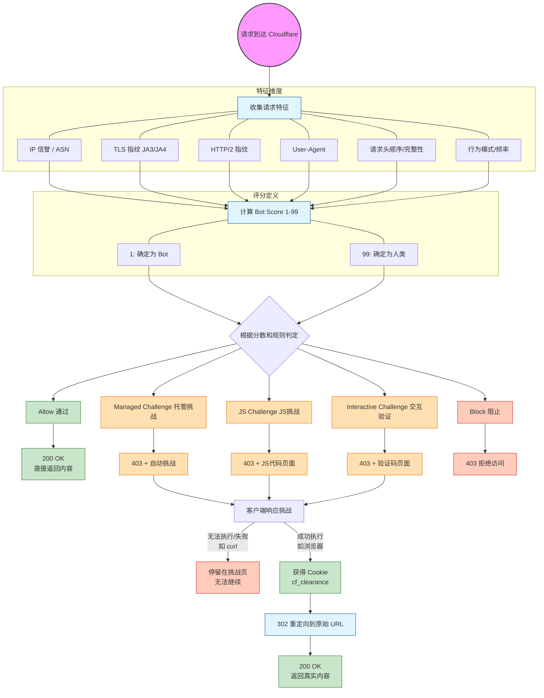

[toc]

## 案例

` curl -I -L  https://www.motointegrator.es`

```powershell
$agent='Mozilla/5.0 (Windows NT 10.0; Win64; x64) AppleWebKit/537.36 (KHTML, like Gecko) Chrome/120.0.0.0 Safari/537.36'

(base) #⚡️[Administrator@CXXUDESK][~\Desktop][8:58:20] PS >
 curl -I -L -A $agent  https://www.motointegrator.es/productos/51826-limpiaparabrisas-bosch-twin-truck-3-397-018-140-400mm-frente-1-pieza 
HTTP/1.1 403 Forbidden
Date: Thu, 29 Jan 2026 00:58:33 GMT
Content-Type: text/html; charset=UTF-8
Connection: close
accept-ch: Sec-CH-UA-Bitness, Sec-CH-UA-Arch, Sec-CH-UA-Full-Version, Sec-CH-UA-Mobile, Sec-CH-UA-Model, Sec-CH-UA-Platform-Version, Sec-CH-UA-Full-Version-List, Sec-CH-UA-Platform, Sec-CH-UA, UA-Bitness, UA-Arch, UA-Full-Version, UA-Mobile, UA-Model, UA-Platform-Version, UA-Platform, UA

cf-mitigated: challenge

critical-ch: Sec-CH-UA-Bitness, Sec-CH-UA-Arch, Sec-CH-UA-Full-Version, Sec-CH-UA-Mobile, Sec-CH-UA-Model, Sec-CH-UA-Platform-Version, Sec-CH-UA-Full-Version-List, Sec-CH-UA-Platform, Sec-CH-UA, UA-Bitness, UA-Arch, UA-Full-Version, UA-Mobile, UA-Model, UA-Platform-Version, UA-Platform, UA
cross-origin-embedder-policy: require-corp
cross-origin-opener-policy: same-origin
cross-origin-resource-policy: same-origin
origin-agent-cluster: ?1
permissions-policy: accelerometer=(),browsing-topics=(),camera=(),clipboard-read=(),clipboard-write=(),geolocation=(),gyroscope=(),hid=(),interest-cohort=(),magnetometer=(),microphone=(),payment=(),publickey-credentials-get=(),screen-wake-lock=(),serial=(),sync-xhr=(),usb=()
referrer-policy: same-origin
server-timing: chlray;desc="9c54c8259f513bb9"
x-content-type-options: nosniff
x-frame-options: SAMEORIGIN
Cache-Control: private, max-age=0, no-store, no-cache, must-revalidate, post-check=0, pre-check=0
Expires: Thu, 01 Jan 1970 00:00:01 GMT
Set-Cookie: __cf_bm=ZpkamqZ1V3PWN.vr453wD7BgtVVlEuXf_vwmAuWRGx8-1769648313-1.0.1.1-6fZNVsJZQclJFxhuq_w5KcJrBz3CtcaDiMlTb6_Viw90jDBIE5jEzJvAiVjiZfo_5K.aDAGHtoy6im5nMsm_eerKNWE9hclhH7_YThhWZig; path=/; expires=Thu, 29-Jan-26 01:28:33 GMT; domain=.motointegrator.es; HttpOnly; Secure; SameSite=None
Server: cloudflare
CF-RAY: 9c54c8259f513bb9-LAX
alt-svc: h3=":443"; ma=86400

```

```bash

(base) #⚡️[Administrator@CXXUDESK][~\Desktop][8:58:33] PS >
 curl -L -A $agent  https://www.motointegrator.es/
<!DOCTYPE html><html lang="en-US"><head><title>Just a moment...</title><meta http-equiv="Content-Type" content="text/html; charset=UTF-8"><meta http-equiv="X-UA-Compatible" content="IE=Edge"><meta name="robots" content="noindex,nofollow"><meta name="viewport" content="width=device-width,initial-scale=1"><style>...</html>
(base) #⚡️[Administrator@CXXUDESK][~\Desktop][8:58:46] PS >
```

Cloudflare 反爬虫保护分析

这是典型的 **Cloudflare 的 Bot 检测和 JavaScript Challenge**（JS质询）。

## 关键信息解读

### 1. HTTP 响应头显示

```
HTTP/1.1 403 Forbidden
cf-mitigated: challenge          ← Cloudflare 触发了质询
Server: cloudflare
```

### 2. 返回的 HTML 内容

```html
<title>Just a moment...</title>
<noscript>
  <span>Enable JavaScript and cookies to continue</span>
</noscript>
```

这是 Cloudflare 的经典质询页面："请稍候..."

### 3. 保护机制

```
critical-ch: Sec-CH-UA-Bitness, Sec-CH-UA-Arch, Sec-CH-UA-Full-Version...
```

网站要求浏览器提供 **Client Hints**（客户端提示），用于验证是否是真实浏览器。

## 为什么 curl 被拦截？

```
┌─────────────────────────────────────────────────────────────┐
│  curl 请求                                                   │
│     ↓                                                        │
│  Cloudflare 检测到：                                         │
│  ✗ 无法执行 JavaScript                                       │
│  ✗ 缺少 Client Hints 头                                      │
│  ✗ 缺少浏览器指纹特征                                        │
│  ✗ 请求模式异常                                              │
│     ↓                                                        │
│  返回 403 + JS Challenge                                     │
└─────────────────────────────────────────────────────────────┘
```

## 解决方案

### 方案1：使用真实浏览器自动化

```python
from playwright.sync_api import sync_playwright

with sync_playwright() as p:
    browser = p.chromium.launch(headless=False)
    page = browser.new_page()
    page.goto("https://www.motointegrator.es/productos/...")
    # Cloudflare 会自动通过验证
    content = page.content()
```

### 方案2：使用专门绕过工具

```python
import cloudscraper

scraper = cloudscraper.create_scraper()
response = scraper.get("https://www.motointegrator.es/productos/...")
```

### 方案3：检查是否有 API

很多网站的数据可通过 API 获取，绕过前端保护。

## 总结

| 项目         | 说明                                     |
| ------------ | ---------------------------------------- |
| **保护类型** | Cloudflare JS Challenge                  |
| **原因**     | curl 无法执行 JavaScript                 |
| **解决**     | 使用 Playwright/Selenium 或 cloudscraper |

## Cloudflare JS Challenge 工作原理

启用此类cloudflare的保护之后,curl请求得到状态码403,但是也得到了一段特定的html(挑战页源码,典型包含了`just a moment`提示语),而浏览器观测到挑战页面,通过检测后跳转到真实页面

### 核心文档

| 主题                    | 链接                                                         |
| ----------------------- | ------------------------------------------------------------ |
| **Bot Management 概述** | https://developers.cloudflare.com/bots/                      |
| **JS Challenge 说明**   | https://developers.cloudflare.com/waf/reference/cloudflare-challenges/#js-challenge |
| **Managed Challenge**   | https://developers.cloudflare.com/waf/reference/cloudflare-challenges/#managed-challenge-recommended |
| **Challenge 通过流程**  | https://developers.cloudflare.com/waf/reference/cloudflare-challenges/#challenge-passage |
| **Turnstile (验证码)**  | https://developers.cloudflare.com/turnstile/                 |

### 技术细节

| 主题             | 链接                                                         |
| ---------------- | ------------------------------------------------------------ |
| **Bot 检测指标** | https://developers.cloudflare.com/bots/concepts/bot-score/   |
| **JA3/JA4 指纹** | https://developers.cloudflare.com/bots/concepts/ja3-ja4-fingerprint/ |
| **WAF 规则**     | https://developers.cloudflare.com/waf/managed-rules/         |

### 流程图(参考)

这是一个非常清晰准确的**Cloudflare Bot Management/Bot Fight Mode 流程图**。它完美展示了现代云安全服务如何通过**渐进式、多层次的挑战机制**来区分真实用户和恶意爬虫/自动化工具。

流程核心解析

**1. 特征收集阶段**

Cloudflare会收集多项请求指纹：
- **网络层特征**：IP信誉、ASN（哪个网络服务商）
- **传输层特征**：TLS指纹（JA3/JA4）、HTTP/2指纹
- **应用层特征**：User-Agent、请求头顺序、行为模式
- **行为分析**：请求频率、访问模式（与正常人类行为的差异）

**2. 评分与决策引擎**

- **Bot Score (1-99)**：分数越低越像机器人
- **动态规则匹配**：基于威胁情报和机器学习模型

**3. 五级响应策略**

**A. Allow (直接通过)**

- **分数**：通常 > 90
- **场景**：信任度高的合法流量
- **结果**：直接返回200 OK和真实内容

**B. Managed Challenge (托管挑战)**

- **智能选择**：Cloudflare自动选择最适合的挑战类型
- **灵活性**：根据威胁级别动态调整

**C. JS Challenge (JavaScript挑战)**

- **机制**：返回包含JavaScript计算的403页面
- **目标**：
  - **真实浏览器**：能执行JS，通过计算得到答案
  - **简单爬虫**：无法执行JS，停留在挑战页
- **技术细节**：通常需要在固定时间内完成数学计算并提交

**D. Interactive Challenge (交互式验证)**

- **最高级挑战**：通常是验证码（Captcha）
- **类型**：旋转图片、点击特定物体、reCAPTCHA等
- **目标**：确保操作者是人类

**E. Block (直接阻止)**

- **分数**：通常 < 10
- **场景**：已知恶意IP、明显攻击特征
- **结果**：直接返回403拒绝访问

对开发者和爬虫的影响

**绕过难点**

1. **指纹完整性**：需要模拟完整浏览器指纹
2. **JS执行环境**：需要真正的JS引擎（如Chrome、Firefox）
3. **行为模仿**：需要模拟人类点击间隔、鼠标移动等
4. **TLS指纹**：需要匹配具体浏览器版本的TLS栈

安全设计哲学

这个系统的精妙之处在于：

1. **渐进式升级**：从不必要的严格到必要的严格
2. **用户体验平衡**：好用户几乎无感，可疑用户遇到适度阻碍
3. **资源消耗战**：让攻击者的成本远高于防御者
4. **持续学习**：基于全球威胁情报更新模型




在 HTTP 协议中，**3xx 系列状态码**被称为**重定向状态码**。它们告诉浏览器或客户端：“你请求的资源现在不在这个地址，请去另一个地方看看。”

## Challenge HTML 中的关键代码分析

你获取到的 HTML 中包含：

```javascript
window._cf_chl_opt = {
  cvId: '3',
  cZone: 'www.motointegrator.es',
  cType: 'managed',           // 挑战类型：managed challenge
  cRay: '9c54c87878331024',   // 请求追踪 ID
  // ... 大量混淆的验证数据
  md: 'IrTlbYmD...',          // 加密的挑战数据
  mdrd: 'XGXYTWgB...'         // 加密的响应模板
};

// 动态加载挑战脚本
var a = document.createElement('script');
a.src = '/cdn-cgi/challenge-platform/h/b/orchestrate/chl_page/v1?ray=xxx';
document.getElementsByTagName('head')[0].appendChild(a);
```

## JS 挑战验证的内容

| 验证项            | 说明                         |
| ----------------- | ---------------------------- |
| **Canvas 指纹**   | 通过 Canvas 渲染生成唯一标识 |
| **WebGL 指纹**    | 显卡渲染特征                 |
| **音频指纹**      | AudioContext 特征            |
| **字体检测**      | 系统安装字体列表             |
| **屏幕信息**      | 分辨率、色深等               |
| **时区/语言**     | 系统时区和语言设置           |
| **PoW 计算**      | Proof of Work，消耗 CPU 时间 |
| **鼠标/键盘行为** | 检测是否有真实用户交互       |

## 为什么 curl 无法通过

```bash
# curl 只能做到这一步
curl → 收到 403 + Challenge HTML → 结束 ❌

# 浏览器完整流程
浏览器 → 收到 Challenge HTML 
       → 执行 JS 
       → 收集指纹 
       → 计算 PoW 
       → 提交验证 
       → 获得 cf_clearance 
       → 重定向 
       → 获取真实内容 ✓
```

## 如果想模拟这个过程

需要使用能执行 JavaScript 的工具：

```python
# 使用 Playwright (推荐)
from playwright.sync_api import sync_playwright

with sync_playwright() as p:
    browser = p.chromium.launch(headless=False)  # 有头模式更容易通过
    context = browser.new_context()
    page = context.new_page()
    
    # 访问页面，自动等待 Cloudflare 验证
    page.goto("https://www.motointegrator.es/productos/...")
    page.wait_for_load_state("networkidle")
    
    # 此时已通过验证，可以获取内容
    html = page.content()
    
    # 获取 cookies 供后续请求使用
    cookies = context.cookies()
    cf_clearance = [c for c in cookies if c['name'] == 'cf_clearance']
```