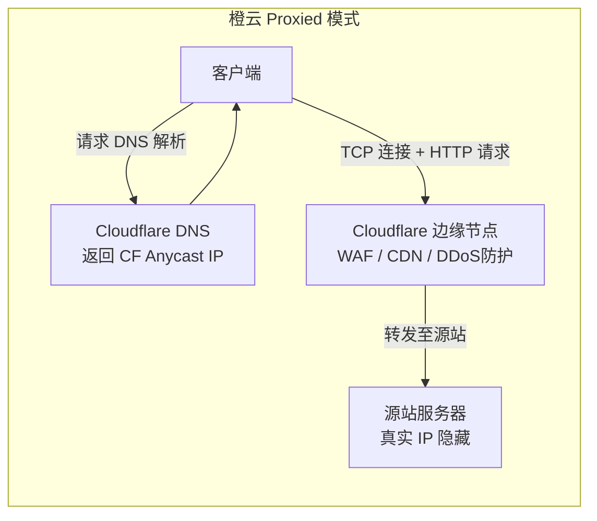
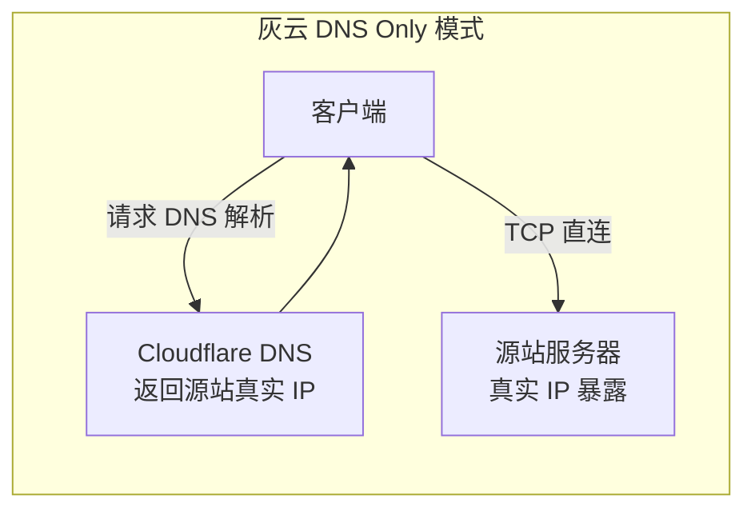
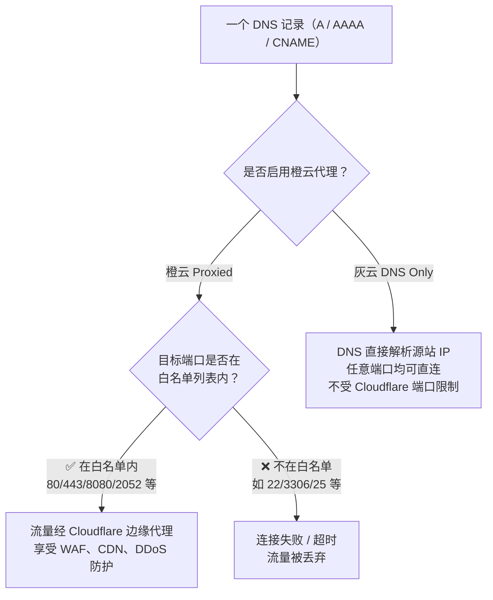
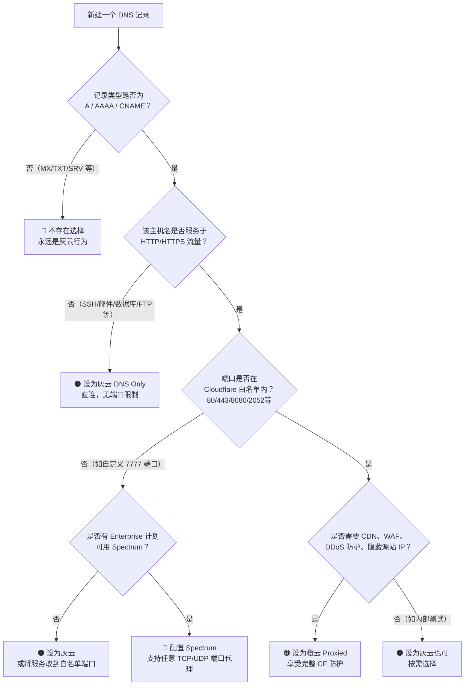
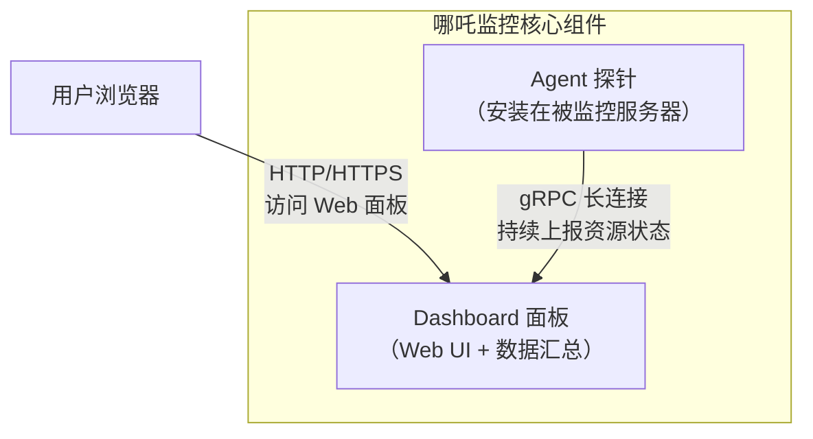
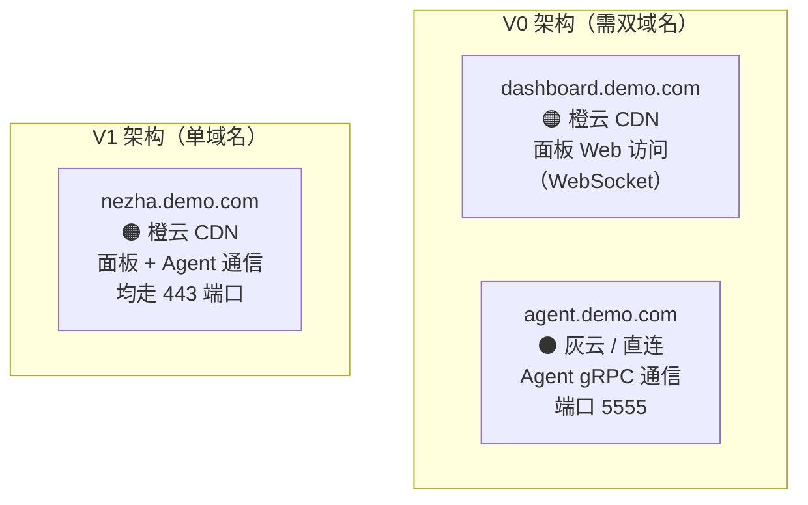
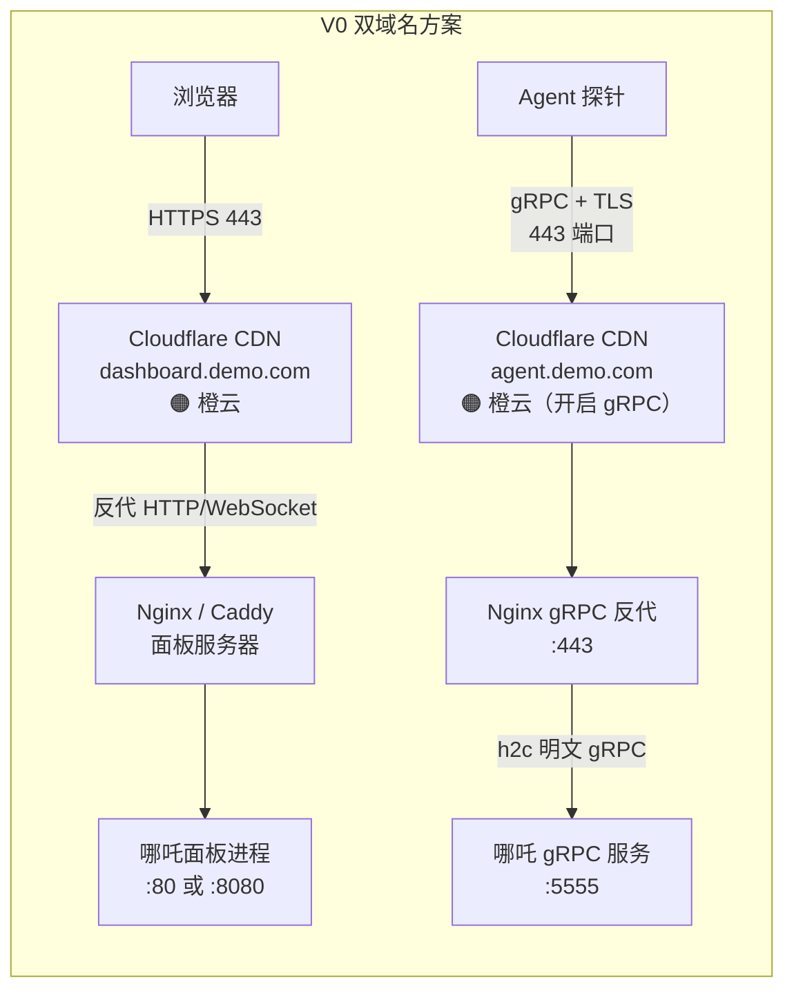

[toc]


## Cloudflare 端口规则与橙云代理机制深度解析

> **信息依据：** Cloudflare 官方开发者文档（`developers.cloudflare.com/fundamentals/reference/network-ports/`，最后更新 2026-04-20）、Cloudflare 官方 GitHub 文档仓库 (`production` 分支)。

---

## 核心工作机制概述

在正式讨论端口规则之前，需要理解 Cloudflare 代理的本质：它是一个**七层(L7)反向代理**（对于 HTTP/HTTPS 流量）。





**橙云(Proxied)**：DNS 记录指向 Cloudflare 边缘节点，**所有流量先经过 Cloudflare 安全防护层**（DDoS防护、WAF、Bot管理等）后再转发至源站。

**灰云(DNS Only)**：DNS 记录直接解析到源站真实 IP，流量绕过 Cloudflare 网络，直接到达服务器。

---

## 橙云模式下的端口限制（核心规则）

这是本文最关键的部分。**橙云代理对端口有严格的白名单限制**，只有列表内的端口才能被 Cloudflare 反向代理。

### 默认支持的代理端口白名单

默认情况下，Cloudflare 仅代理以下 HTTP/HTTPS 端口的流量：

| 协议      | 支持的端口 | 说明                     |
| --------- | ---------- | ------------------------ |
| **HTTP**  | `80`       | 标准 HTTP 端口           |
| **HTTP**  | `8080`     | 常见备用 HTTP / 控制面板 |
| **HTTP**  | `8880`     | 控制面板备用             |
| **HTTP**  | `2052`     | cPanel 备用              |
| **HTTP**  | `2082`     | cPanel                   |
| **HTTP**  | `2086`     | WHM                      |
| **HTTP**  | `2095`     | Webmail                  |
| **HTTPS** | `443`      | 标准 HTTPS 端口          |
| **HTTPS** | `8443`     | 控制面板 HTTPS 备用      |
| **HTTPS** | `2053`     | cPanel SSL 备用          |
| **HTTPS** | `2083`     | cPanel SSL               |
| **HTTPS** | `2087`     | WHM SSL                  |
| **HTTPS** | `2096`     | Webmail SSL              |

> **历史背景：** Cloudflare 最初只代理 80 和 443 两个端口，后来因大量用户反馈控制面板无法访问（因控制面板运行在非标准端口上），才陆续将 cPanel 等常用控制面板端口纳入代理支持列表。

### 扩展端口的缓存行为差异

非 80/443 的其他受支持端口（即上表中 `8080`、`2052` 等）默认**被代理但不被缓存(proxied but not cached)**。

Enterprise 用户如需对这些端口启用缓存，须另行创建缓存规则(Cache Rule)。

---

## 灰云 vs 橙云——端口行为对比

这是理解 Cloudflare 端口规则的关键判断维度：



| 维度             | 橙云 Proxied                 | 灰云 DNS Only                |
| ---------------- | ---------------------------- | ---------------------------- |
| **端口限制**     | **严格**，仅支持白名单端口   | **无限制**，任何端口均可直连 |
| **DDoS 防护**    | ✅ 有                         | ❌ 无                         |
| **WAF**          | ✅ 有                         | ❌ 无                         |
| **CDN 缓存**     | ✅ 80/443 默认开启            | ❌ 无                         |
| **源站 IP 隐藏** | ✅ DNS 返回 CF Anycast IP     | ❌ 暴露源站真实 IP            |
| **SSL 终止**     | 在 CF 边缘终止               | 在源站终止                   |
| **非 HTTP 协议** | ❌ 不支持（SSH/FTP/数据库等） | ✅ 完全支持                   |

Cloudflare 不代理所有端口，仅支持特定端口（如 80、443、8443 等）。**在非支持端口上运行的服务，如果启用橙云代理，将会直接中断**。

---

## 非白名单端口下的处理策略

当你的服务运行在非白名单端口时，有以下几种处理方案，需根据实际场景权衡：

### 方案一：切换为灰云(DNS Only)——最简单

如果域名/子域名的流量目标端口不在受支持列表中（例如 SSH 服务监听 `22` 端口），最直接的方式是将该子域名改为灰云，让流量绕过 Cloudflare 直连源站。

**适用场景举例：**

- `ssh.example.com` → A记录 → 灰云 → 直连 `22` 端口 SSH 服务
- `mysql.example.com` → A记录 → 灰云 → 直连 `3306` 端口数据库
- `mail.example.com` → A记录 → 灰云 → 直连邮件服务

**代价：** 源站 IP 暴露，失去 Cloudflare 安全防护。

### 方案二：使用 Cloudflare Spectrum——非 HTTP 端口代理（企业级）

可以为主机名配置 **Spectrum 应用**，Spectrum 支持所有端口，但对所有 TCP/UDP 端口的完整支持仅在 Enterprise 计划中提供。

在 Pro/Business 计划中，Spectrum 仅限于特定协议（如 SSH、Minecraft）。完整的任意端口代理需要 Enterprise 计划。

Spectrum 支持代理任意 TCP 协议的所有端口，**唯一例外是端口 `21`（FTP），不支持代理**。

### 方案三：端口映射（架构层面重设计）

如果希望保留橙云代理的安全性，可在源站侧使用反向代理（如 Nginx）将标准端口 `443` 映射到后端非标准端口服务，客户端始终通过 `443` 访问。

```
客户端 :443 → Cloudflare 橙云 → 源站 Nginx :443 → 内部服务 :8080/3000/...
```

---

## 常见易错场景与最佳实践

### 邮件服务（最高频错误）

MX 记录**完全不能**被代理；用于邮件收发的主机名（如 `mail.example.com`）必须保持灰云状态，因为 Cloudflare 不在橙云模式下代理 SMTP 的 `25` 端口，启用橙云会导致邮件无法投递。

将邮件端口（SMTP/POP/IMAP）通过橙云代理，**一定会导致邮件投递中断**，这是最常见的配置错误之一。

> Cloudflare 对此有一个保护机制：如果 MX 记录指向了一个已开启代理的主机名，Cloudflare 会自动在 DNS 响应中加上 `_dc-mx` 前缀让邮件流量绕过代理——这是一个安全兜底机制，而非应该依赖的设计。

### SSH / RDP / FTP / 数据库

SSH、FTP、数据库等非 Web 流量的子域名**不应该**启用橙云代理，这类记录应保持灰云状态。

### 中国大陆网络的特殊限制

启用了 China Network 的域名，仅 **`80` 和 `443`** 端口与中国数据中心的 HTTP/HTTPS 流量兼容，其他端口即使在白名单内也不适用于国内节点。

### 关于"非标准端口显示为开放"的安全扫描误报

由于 Cloudflare Anycast 网络的特性，非 80/443 端口在 Cloudflare IP 上可能对外显示为"开放"（Netcat 或安全扫描器会报告如此）。这是因为 Cloudflare 在这些 IP 上为其他客户提供服务，**并不代表你的源站暴露在这些端口上**。

### 付费计划下的主动封锁能力

Pro 计划及以上，可以通过 WAF 规则 ID `100015`（`Block requests to all ports except 80 and 443`）主动阻断除 80 和 443 之外的所有端口流量，进一步收紧攻击面。

在新版 WAF 中，对应规则 ID 为 `664ed6fe`（`Anomaly:Port - Non Standard Port (not 80 or 443)`），该规则默认**禁用**，需手动开启，属于 Cloudflare Managed Ruleset 的一部分。

---

## 记录类型与橙云可用性

并非所有 DNS 记录类型都支持橙云代理：

只有 **A、AAAA、CNAME** 类型的记录可以切换为橙云代理；MX、TXT、SRV 等记录类型**永远不会被代理**。

| 记录类型 | 支持橙云 | 说明                 |
| -------- | -------- | -------------------- |
| `A`      | ✅        | IPv4 地址，可代理    |
| `AAAA`   | ✅        | IPv6 地址，可代理    |
| `CNAME`  | ✅        | 别名，可代理         |
| `MX`     | ❌        | 邮件路由，不可代理   |
| `TXT`    | ❌        | 文本记录，不可代理   |
| `SRV`    | ❌        | 服务定位，不可代理   |
| `NS`     | ❌        | 名称服务器，不可代理 |

---

## 决策流程图：如何选择橙云还是灰云



---

## 总结速查

| 问题                            | 结论                                                         |
| ------------------------------- | ------------------------------------------------------------ |
| 橙云支持哪些端口？              | HTTP：`80/8080/8880/2052/2082/2086/2095`；HTTPS：`443/2053/2083/2087/2096/8443` |
| 非白名单端口 + 橙云会怎样？     | **服务中断**，流量被丢弃或超时                               |
| 非白名单端口如何处理？          | 切换灰云；或 Enterprise 用 Spectrum                          |
| 灰云有端口限制吗？              | **无**，完全直连，任意端口均可                               |
| 邮件服务应该用橙云吗？          | **绝对不要**，会导致邮件投递失败                             |
| 非标准端口能缓存吗？            | 免费/标准计划不缓存；Enterprise 可通过 Cache Rule 开启       |
| Pro+ 计划能主动封非标准端口吗？ | 可以，通过 WAF 规则 `100015` / `664ed6fe`                    |
| Spectrum 支持 `21` 端口吗？     | **不支持**，FTP 的 21 端口是 Spectrum 的唯一例外             |
| 中国大陆节点的限制？            | 仅 `80` 和 `443` 与 China Network 兼容                       |

下面cloudflare的服务政策在某些应用(例如Nezha监控)中的影响.

---

## Nezha与 Cloudflare 配合使用指南

> **信息来源与知识截止日期：** 哪吒监控官方文档（`nezha.wiki`）、Cloudflare 官方开发者文档（`developers.cloudflare.com`，最后更新 2026-08-14）、NodeSeek 社区及多位博主实践教程（2023–2026）。

---

## 哪吒监控架构速览

在讨论与 Cloudflare 的配合之前，必须先清楚哪吒监控的通信结构，它决定了端口需求的来源。



哪吒监控有两条独立的流量通道：

| 通道           | 协议                    | 用途                             | 默认端口                          |
| -------------- | ----------------------- | -------------------------------- | --------------------------------- |
| **面板访问**   | HTTP/HTTPS（WebSocket） | 用户浏览器访问 Web 面板          | `8008`（V1+） / `80`（V0）        |
| **Agent 通信** | **gRPC**（基于 HTTP/2） | 探针持续上报 CPU/内存/流量等数据 | `5555`（V0） / `8008`（V1+ 合并） |

**这两条通道的协议差异，是与 Cloudflare 配合时所有问题的根源。**

---

## Nezha版本变化关键架构差异

**V1 版本**相比 V0 有一个重要变化：**不再区分 Dashboard 和 gRPC 端口，访问与通信均通过默认的 `8008` 端口**。这意味着在 V1 中，**只需一个域名开启 CDN 并配置反向代理**，即可同时满足面板访问和 Agent 通信的需求。

而在旧版（V0）中，如果需要开启 CDN，**必须准备两个域名**：一个配置好 CDN 用于公开访问（需支持 WebSocket），另一个域名不使用 CDN 用作 Agent 与 Dashboard 的 gRPC 通信。



---

## 核心问题：gRPC 与 Cloudflare 的兼容条件

Cloudflare 对 gRPC 流量的代理有严格的前提要求，这是配置能否成功的关键。

Cloudflare 要求通过其代理的 gRPC 端点**必须监听 `443` 端口**，**必须支持 TLS 和 HTTP/2**，且 HTTP/2 必须通过 ALPN（应用层协议协商）进行通告。

### 反向代理解决端口限制

cloudflare的限制意味着哪吒 Agent 默认的 `5555` 端口**直接套橙云是不可行的**，必须经过以下改造：

1. 在面板服务器上用 Nginx 或 Caddy 将 `gRPC` 流量反向代理到 `443` 端口并配置 TLS
2. 在 Cloudflare 后台手动开启 gRPC 支持开关
3. 修改面板配置，告知 Agent 使用新端口和 TLS

此外还有一个重要限制：**Cloudflare Access 不支持**通过其反向代理传输的 gRPC 流量——gRPC 流量会被 Access 直接忽略。如果必须用 Access 保护面板，应为面板 Web 和 Agent gRPC 分配**不同域名**。

另需注意：**WAF 托管规则不会对 gRPC 流量内容生效**，即通过 Cloudflare gRPC 代理传输的探针数据不受 WAF 检查。

---

## 完整配置方案

### 方案一：V1 版本（推荐，单域名配置最简）

从 V1 版本开始，访问与通信均通过默认的 `8008` 端口，以下是使用 Nginx 配置反向代理的示例核心片段（`grpc_set_header nz-realip` 用于将真实客户端 IP 传递给哪吒面板）：

```nginx
server {
    listen 443 ssl http2;
    server_name dashboard.example.com;   # 你的面板域名

    ssl_certificate     /path/to/fullchain.pem;
    ssl_certificate_key /path/to/key.pem;
    ssl_protocols       TLSv1.2 TLSv1.3;

    underscores_in_headers on;

    # 从 Cloudflare 获取真实客户端 IP
    set_real_ip_from 0.0.0.0/0;          # 替换为 CF 回源 IP 段（见下文）
    real_ip_header   CF-Connecting-IP;

    # gRPC 流量（Agent 上报）
    location ^~ /proto.NezhaService/ {
        grpc_set_header Host $host;
        grpc_set_header nz-realip $http_CF_Connecting_IP;
        grpc_pass grpc://127.0.0.1:8008;
    }

    # HTTP/WebSocket 流量（面板访问）
    location / {
        proxy_pass         http://127.0.0.1:8008;
        proxy_http_version 1.1;
        proxy_set_header   Upgrade    $http_upgrade;
        proxy_set_header   Connection "upgrade";
        proxy_set_header   Host       $host;
    }
}
```

> Cloudflare 官方回源 IP 段参见：`https://www.cloudflare.com/ips/`，建议将完整列表填入 `set_real_ip_from`。

**V1 版 Cloudflare 操作步骤（全部在对应域名下操作）：**

1. DNS 记录：A 记录 → 面板服务器 IP → **开启橙云代理**
2. SSL/TLS → 概述：加密模式选 **Full**（源站有证书）或 **Full (strict)**，**禁止选 Flexible**
3. 网络(Network) → **开启 gRPC** 开关
4. 网络(Network) → **开启 WebSockets** 开关（面板 Web 依赖）

---

### 方案二：V0 版本双域名配置

根据 Cloudflare gRPC 的要求，gRPC 服务**必须侦听 `443` 端口**，且必须支持 TLS 和 HTTP/2。因此如果需要开启 CDN，必须在配置 Nginx 或 Caddy 反向代理 gRPC 时使用 `443` 端口并配置证书。



**V0 的 `config.yaml` 关键配置：**

```yaml
GRPCHost: agent.demo.com      # Agent 通信专用域名（橙云已开启）
GRPCPort: 5555                # 哪吒进程实际监听端口（不变）
ProxyGRPCPort: 443            # Agent 连接时使用的外部端口（经反代后的端口）
TLS: true                     # 与上层 Nginx/CF 之间启用 TLS
```

字段说明：

| 字段            | 说明                                                         |
| --------------- | ------------------------------------------------------------ |
| `GRPCHost`      | Agent 连接到 Dashboard 时使用的**域名**（非 IP）             |
| `GRPCPort`      | 哪吒 Dashboard 进程在**服务器本地实际监听**的 gRPC 端口      |
| `ProxyGRPCPort` | Agent 对外连接时的**目标端口**（经过 Nginx/Cloudflare 后的端口，通常为 443） |
| `TLS`           | 是否在 Agent → Dashboard 的通信链路上启用 TLS 加密           |

此配置将 `ProxyGRPCPort` 改为 `443`，**并非直接将哪吒的 `GRPCPort` 修改为 `443`**，原来的 `ip:5555` 仍然继续运行，两者同时生效——这是为了让面板后台复制的客户端一键脚本直接使用 `通信域名:443` 格式。

**V0 对应 Nginx gRPC 反代配置：**

```nginx
upstream grpcservers {
    server localhost:5555;
    keepalive 512;
}

server {
    listen 443 ssl http2;
    server_name agent.demo.com;     # gRPC 专用域名

    ssl_certificate     /path/to/fullchain.pem;
    ssl_certificate_key /path/to/key.pem;

    underscores_in_headers on;
    keepalive_time    24h;
    keepalive_requests 100000;
    keepalive_timeout  120s;

    location / {
        grpc_read_timeout  300s;
        grpc_send_timeout  300s;
        grpc_socket_keepalive on;
        grpc_set_header nz-realip $http_CF_Connecting_IP;
        grpc_pass grpc://grpcservers;
    }
}
```

---

### 方案三：Cloudflare Tunnel（Argo Tunnel）——无公网 IP 的特殊场景

Cloudflare Tunnel（Argo Tunnel）突破了哪吒传统部署对公网入口的依赖——传统哪吒需要两个公网端口（面板访问 + 客户端上报），而通过 Argo Tunnel 可以使用内网穿透实现，面板服务器无需任何公网 IP。

实际上也可以通过 Cloudflare Tunnel 为无公网 IP 的设备（如家庭 NAS、NAT VPS、IPv6-only VPS）部署哪吒探针面板，关键是将 `ProxyGRPCPort` 设为 `443`，`TLS` 设为 `true`，并使用 Cloudflare 的 15 年源站证书或自签名证书。

---

## 总结：配置检查清单

| 检查项                          | 要求 / 说明                                                  |
| ------------------------------- | ------------------------------------------------------------ |
| **Cloudflare gRPC 开关**        | 必须在域名的"网络(Network)"页面**手动开启**                  |
| **Cloudflare WebSockets 开关**  | 面板 Web 依赖，也需开启                                      |
| **SSL/TLS 加密模式**            | 至少选 **Full**，禁止使用 **Flexible**（否则与源站证书冲突） |
| **gRPC 监听端口**               | Cloudflare 侧要求必须是 **`443`**，通过 Nginx/Caddy 反代实现 |
| **Nginx HTTP/2 支持**           | `listen 443 ssl http2;` 必须显式声明，否则 gRPC 无法工作     |
| **`underscores_in_headers on`** | 允许 `nz-realip` 这类含下划线的自定义请求头通过 Nginx        |
| **Cloudflare Access**           | **不可用于 gRPC 域名**，如需保护面板 Web 须使用不同域名      |
| **WAF 托管规则**                | 对 gRPC 流量内容不生效，无法扫描探针上报的内容               |
| **V0 双域名 / V1 单域名**       | V1 推荐，配置更简洁；V0 gRPC 域名必须单独一个灰云或橙云+gRPC 配置 |
| **真实 IP 传递**                | Nginx 反代中配置 `real_ip_header CF-Connecting-IP`，并设置 CF 回源 IP 段 |
| **防火墙/安全组**               | 源站需放行 `443`（Nginx 监听）以及哪吒本地端口（`8008` 或 `5555`） |