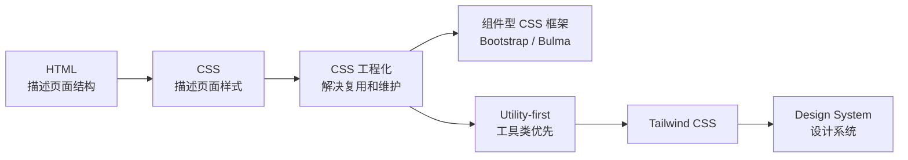
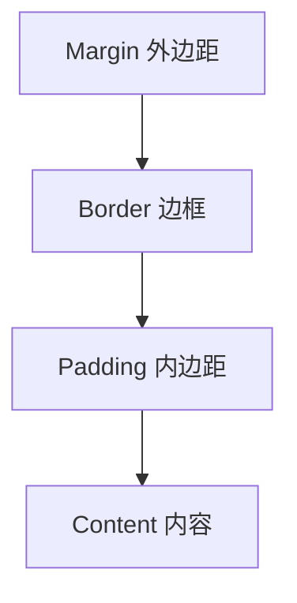
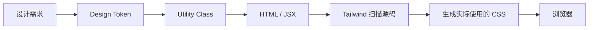
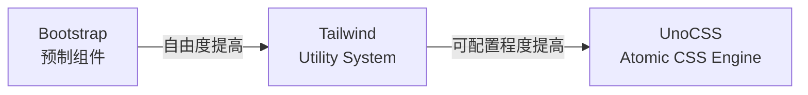
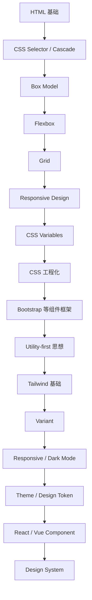

下面这套结构我建议直接作为一篇完整的“**从原生 CSS 到 Tailwind CSS 的现代前端样式体系入门**”。重点不是教读者背 `class`，而是建立一条清晰的认知路径：

**CSS 基础规则 → CSS 工程化问题 → CSS 框架 → Utility-first → Tailwind → Design System（设计系统）**

这样初学者学到最后，会明白“为什么需要 Tailwind”，而不是只知道“Tailwind 怎么写”。

截至 2026 年 8 月，Tailwind 官方文档已进入 **v4.3** 体系，因此下面以 Tailwind CSS v4 的现代用法为主，不再把 v3 时代的 `tailwind.config.js + content` 配置方式作为主线。Tailwind v4 引入了 CSS-first configuration、自动源码检测等重要变化。([Tailwind CSS](https://tailwindcss.com/blog?utm_source=chatgpt.com))

------

## 从 CSS 到 Tailwind

### 这篇内容要解决什么问题

很多初学者的学习路线是：

```text
HTML
→ CSS
→ Bootstrap
→ Tailwind
```

但这种路线容易产生一个误区：

> Bootstrap 和 Tailwind 都只是“一堆 CSS 类”。

实际上它们背后代表的是不同的 UI 构建思想。

更合理的理解应该是：



Tailwind 并不是为了取代 CSS。

恰恰相反：

> **越理解 CSS，越容易真正理解 Tailwind。**

------

## CSS 到底是什么

CSS，全称：

**Cascading Style Sheets，层叠样式表。**

HTML 解决的是：

> 页面里有什么？

CSS 解决的是：

> 这些东西应该长什么样？

例如：

```html
<button>保存</button>
```

浏览器知道这是一个按钮。

但是如果我们希望它变成一个蓝色圆角按钮：

```css
button {
  background: #2563eb;
  color: white;
  padding: 8px 16px;
  border-radius: 8px;
}
```

CSS 本质上做的是：

```text
选择某些元素
+
向这些元素应用样式声明
```

基本结构：

```css
selector {
  property: value;
}
```

例如：

```css
.button {
  color: white;
  background-color: blue;
}
```

这里：

| 内容      | 名称   | 英文              |
| --------- | ------ | ----------------- |
| `.button` | 选择器 | Selector          |
| `color`   | 属性   | Property          |
| `white`   | 属性值 | Value             |
| `{ ... }` | 声明块 | Declaration Block |

------

## CSS 最应该先理解的几个概念

学习 Tailwind 前，不需要先背完几百个 CSS 属性，但下面这些概念一定要理解。

### 选择器

CSS 需要先确定：

> 我要修改谁？

例如：

```css
p {
  color: gray;
}
```

选择所有 `p`：

```css
.card {
  padding: 20px;
}
```

选择：

```html
<div class="card"></div>
```

还可以组合：

```css
.card .title {
  font-weight: bold;
}
```

------

### 层叠

CSS 中的 C 就是：

**Cascading。**

多个规则可能同时作用于一个元素：

```css
button {
  color: black;
}

.primary {
  color: blue;
}
```

浏览器需要决定：

> 到底谁生效？

这涉及：

- Cascade，层叠
- Specificity，选择器优先级
- Inheritance，继承
- Source Order，源码顺序
- `!important`

这也是传统大型 CSS 项目很容易变复杂的地方。

现代 CSS 还提供了 **Cascade Layers（层叠层）**，即 `@layer`，用于更加明确地组织不同来源的样式。W3C 将其定义为在同一作者样式来源内部组织和控制层叠关系的一种机制。([万维网联盟](https://www.w3.org/TR/css-cascade-5/?utm_source=chatgpt.com))

例如：

```css
@layer reset, base, components, utilities;
```

这个思想其实与现代 CSS 框架的架构非常相关。

------

## 盒模型

浏览器中的元素最终基本都可以理解为一个“盒子”。

```text
Margin
  Border
    Padding
      Content
```

即：



例如：

```css
.card {
  width: 300px;
  padding: 20px;
  border: 1px solid #ddd;
  margin: 20px;
}
```

这几个概念以后在 Tailwind 里分别会变成：

```html
<div class="w-[300px] p-5 border m-5">
```

所以 Tailwind 并没有创造新的布局规则。

它只是提供了一套：

> **用 class 操作 CSS 的 API。**

------

## CSS 布局的核心：Flexbox 和 Grid

如果学习现代前端 CSS，我不建议把大量时间花在早期的：

- float 布局
- table 布局
- 各种清除浮动技巧

应该重点掌握：

- Flexbox
- Grid

Flexbox 更适合解决一维排列和对齐；CSS Grid 是二维网格布局体系。W3C 对 Flexbox 和 Grid 分别进行了标准化定义，Grid Level 2 还加入了 `subgrid`。([万维网联盟](https://www.w3.org/TR/css-flexbox-1/?utm_source=chatgpt.com))

例如 Flex：

```css
.toolbar {
  display: flex;
  align-items: center;
  justify-content: space-between;
  gap: 16px;
}
```

Tailwind：

```html
<div class="flex items-center justify-between gap-4">
```

你会发现：

```text
display: flex
        ↓
flex

align-items: center
        ↓
items-center

justify-content: space-between
        ↓
justify-between
```

这就是理解 Tailwind 最重要的一步：

> Tailwind Utility 通常只是对 CSS 属性和值的一层命名映射。

------

## CSS Grid 到 Tailwind

原生 CSS：

```css
.product-list {
  display: grid;
  grid-template-columns: repeat(3, 1fr);
  gap: 24px;
}
```

Tailwind：

```html
<div class="grid grid-cols-3 gap-6">
```

响应式版本：

```html
<div class="grid grid-cols-1 md:grid-cols-2 lg:grid-cols-3 gap-6">
```

含义是：

```text
默认
1 列

md 及以上
2 列

lg 及以上
3 列
```

Tailwind 官方采用移动优先（Mobile-first）的响应式变体，并允许通过主题变量调整断点。([Tailwind CSS](https://tailwindcss.com/docs/responsive-design?utm_source=chatgpt.com))

------

## CSS 已经比过去强大很多

理解现代 CSS 非常重要，因为今天选择 Tailwind，不应该建立在：

> “CSS 太弱，所以必须用框架”

这个前提上。

现代 CSS 已经具备很多过去需要 Sass、JavaScript 或复杂框架才能比较方便实现的能力。

例如：

### CSS Custom Properties

```css
:root {
  --color-primary: #2563eb;
}

.button {
  background: var(--color-primary);
}
```

Custom Properties（自定义属性）是 CSS 标准的一部分，可以通过 `var()` 在不同规则中复用值。([万维网联盟](https://www.w3.org/TR/css-variables-1/?utm_source=chatgpt.com))

------

### CSS Nesting

现代 CSS 已经存在原生 Nesting（嵌套）规范，因此类似 Sass 的部分嵌套写法正在成为 CSS 本身的一部分。([万维网联盟](https://www.w3.org/TR/css-nesting-1/?utm_source=chatgpt.com))

------

### Cascade Layers

```css
@layer reset, base, components, utilities;
```

可以更有组织地处理样式覆盖。([万维网联盟](https://www.w3.org/TR/css-cascade-5/?utm_source=chatgpt.com))

------

### Container Queries

过去响应式设计主要问：

> 浏览器窗口有多宽？

即 Media Query。

Container Query 则可以问：

> **这个组件所在的容器有多宽？**

W3C 将 Container Query 定义为针对元素容器特征进行条件查询的机制，而不是只针对整个 viewport。([万维网联盟](https://www.w3.org/TR/css-contain-3/?utm_source=chatgpt.com))

这对于真正可复用组件非常重要。

------

## 那为什么还需要 CSS 框架

假设我们需要做 50 个按钮。

第一个：

```css
.save-button {
  padding: 8px 16px;
  background: blue;
}
```

然后出现：

```css
.cancel-button {}
.delete-button {}
.login-button {}
.register-button {}
```

慢慢就会出现一个问题：

> 很多 CSS 实际上都在重复。

于是开发者开始寻找不同的解决方案。

------

## CSS 工程化大致经历了哪些思路

可以把 CSS 工程化粗略理解为几条路线。

### 给 CSS 制定命名规则

例如：

**BEM（Block Element Modifier）**

```html
<div class="card">
  <h2 class="card__title"></h2>
  <button class="card__button card__button--primary"></button>
</div>
```

解决：

> CSS class 应该怎么命名？

------

### 使用 CSS 预处理器

例如：

- Sass
- Less

解决：

- 变量
- 嵌套
- mixin
- 函数
- 文件组织

不过随着 CSS Custom Properties、Nesting 等原生能力持续增强，一部分以前必须依赖预处理器的能力已经进入 CSS 标准体系。([万维网联盟](https://www.w3.org/TR/css-variables-1/?utm_source=chatgpt.com))

------

### 使用组件型 CSS Framework

典型代表：

**Bootstrap。**

你不再设计一个按钮。

框架已经设计好了：

```html
<button class="btn btn-primary">
  保存
</button>
```

Bootstrap 的组件通常采用“基础类 + Modifier”的组织方式，例如：

```text
.btn
.btn-primary
.btn-success
```

同时 Bootstrap 5 也拥有基于 Sass Map 生成的 Utility API。([Bootstrap](https://getbootstrap.com/docs/5.3/customize/components/?utm_source=chatgpt.com))

------

### Utility-first

另一条思路是：

> 不提供一个已经设计好的 `.btn-primary`，而是提供大量小型样式积木。

例如：

```html
<button
  class="rounded-lg bg-blue-600 px-4 py-2 font-medium text-white"
>
  保存
</button>
```

这就是 Tailwind 所代表的：

**Utility-first CSS。**

Tailwind 官方本身就将其定位为 Utility-first CSS Framework。([Tailwind CSS](https://tailwindcss.com/?utm_source=chatgpt.com))

------

## CSS 框架可以怎么分类

| 类型              | 代表         | 核心思想                 | 比较适合                         |
| ----------------- | ------------ | ------------------------ | -------------------------------- |
| 原生 CSS          | CSS          | 自己设计全部样式规则     | 小型项目、学习 CSS、定制程度极高 |
| Component-first   | Bootstrap    | 提供完整 UI 组件         | 后台、管理系统、快速原型         |
| Component-first   | Bulma        | CSS 组件与辅助类         | 简单 Web UI                      |
| Utility-first     | Tailwind CSS | 使用小型 Utility 组合 UI | 产品型前端、设计系统             |
| Atomic CSS Engine | UnoCSS       | 按需生成 Atomic Utility  | 高度定制、现代工程化项目         |

Bootstrap 同时提供完整组件体系和 Utilities；Bulma 官方定位是基于 Flexbox、Sass、响应式和模块化的 CSS Framework；UnoCSS 则明确把自己定位为可扩展的即时 Atomic CSS Engine，并通过 presets 提供具体规则。([Bootstrap](https://getbootstrap.com/?utm_source=chatgpt.com))

------

## Bootstrap 与 Tailwind 最本质的区别

这两个经常被放在一起比较，但它们解决问题的方法并不相同。

Bootstrap：

```html
<button class="btn btn-primary">
  Submit
</button>
```

它表达的是：

> 这是一个 Primary Button。

Tailwind：

```html
<button
  class="rounded-lg bg-blue-600 px-4 py-2 text-white"
>
  Submit
</button>
```

表达的是：

> 圆角、蓝背景、水平 Padding 4、垂直 Padding 2、白字。

所以：

```text
Bootstrap
更像拿现成家具装修房子

Tailwind
更像提供标准化尺寸的积木
```

这是理解二者最重要的区别。

------

## Bootstrap 什么时候仍然非常好用

Bootstrap 并没有因为 Tailwind 流行就失去价值。

官方 Bootstrap 5.3 仍然同时维护：

- Layout
- Components
- Utilities
- Sass customization
- Utility API

例如 Card、Button 等依然是完整预制组件。([Bootstrap](https://getbootstrap.com/docs/5.3/getting-started/introduction/?utm_source=chatgpt.com))

如果你的项目是：

```text
管理后台
内部系统
CRUD 系统
原型系统
设计要求并不特别独特
```

Bootstrap 的“拿来即用”反而可能更高效。

------

## Bulma 的位置

Bulma 也是典型的 CSS Framework。

例如：

```html
<button class="button is-primary">
  Save
</button>
```

官方强调其：

- Responsive
- Modular
- Flexbox
- Sass
- CSS Variables

并提供 Button、Form、Table、Components 等现成体系。([Bulma](https://bulma.io/?utm_source=chatgpt.com))

它的思路仍然更接近：

> 框架定义组件语义。

而不是 Tailwind 那种：

> 框架提供低层 Utility。

------

## UnoCSS 为什么值得知道

UnoCSS 经常被误认为：

> 更快版 Tailwind。

不完全准确。

UnoCSS 官方把它称为：

**Instant On-demand Atomic CSS Engine**

核心本身是 un-opinionated 的，具体 Utility 能力通过 presets 提供。([UnoCSS](https://unocss.dev/?utm_source=chatgpt.com))

例如它可以加载类似 Tailwind 风格的 preset，也可以自己定义：

```ts
rules: [
  ['m-1', { margin: '1px' }],
]
```

UnoCSS 更像：

```text
一个 Atomic CSS 生成引擎
```

Tailwind 更像：

```text
已经建立成熟约定的 Utility-first Framework
```

因此对于初学者，我仍然推荐：

```text
CSS
→ Tailwind
→ 再了解 UnoCSS
```

而不是反过来。

------

# 正式进入 Tailwind CSS

## Tailwind 的核心不是“少写 CSS”

这是最容易产生的误解。

有人看到：

```html
<div class="flex items-center justify-between p-4">
```

就认为：

> Tailwind 只是把 CSS 写进 HTML。

这种说法过度简化了 Tailwind。

更准确地说：

> **Tailwind 将一套经过约束的 Design Token 和 CSS Utility 暴露为 class API。**

例如：

```html
p-4
```

不是单纯：

```text
padding = 某个值
```

而是：

```text
从项目的 spacing scale 中选择一个标准间距。
```

因此它带来的一个重要价值是：

> 限制开发者随意创造大量没有体系的 CSS 值。

------

## Tailwind Utility 是什么

Utility Class 可以理解成：

> 通常只承担一个非常有限职责的 CSS class。

例如：

```html
flex
```

大致对应：

```css
display: flex;
```

------

```html
items-center
```

对应：

```css
align-items: center;
```

------

```html
rounded-lg
```

对应圆角。

------

```html
font-bold
```

对应字体粗细。

所以：

```html
<div class="flex items-center gap-4 p-6">
```

实际上是在组合：

```text
布局
+
对齐
+
间距
+
Padding
```

------

## Tailwind 的思维模型

可以概括成：



Tailwind 会扫描项目源码中的 Utility class，并生成实际需要的 CSS。官方文档明确说明，它会检测源文件中的类名，然后为被使用的 Utility 生成对应样式。([Tailwind CSS](https://tailwindcss.com/docs/detecting-classes-in-source-files?utm_source=chatgpt.com))

因此 Tailwind 并不是浏览器中的 JavaScript CSS Runtime。

------

# Tailwind CSS v4 的现代安装方式

如果使用 Vite，官方现在推荐使用专门的 Vite Plugin。([Tailwind CSS](https://tailwindcss.com/docs?utm_source=chatgpt.com))

安装：

```bash
npm install tailwindcss @tailwindcss/vite
```

然后：

```ts
import { defineConfig } from 'vite'
import tailwindcss from '@tailwindcss/vite'

export default defineConfig({
  plugins: [
    tailwindcss(),
  ],
})
```

CSS 中：

```css
@import "tailwindcss";
```

然后即可：

```html
<h1 class="text-3xl font-bold">
  Hello Tailwind
</h1>
```

这与大量旧教程中：

```text
tailwind.config.js
content
@tailwind base
@tailwind components
@tailwind utilities
```

的默认教学流程已经明显不同。

------

# Tailwind v4 的一个重要变化：CSS-first

旧 Tailwind 项目经常把设计配置放在 JavaScript：

```text
tailwind.config.js
```

而 Tailwind v4 的重要变化之一是：

**CSS-first configuration。** ([Tailwind CSS](https://tailwindcss.com/blog/tailwindcss-v4?utm_source=chatgpt.com))

例如：

```css
@import "tailwindcss";

@theme {
  --color-brand-500: #6366f1;
  --color-brand-600: #4f46e5;
}
```

然后可以使用：

```html
<button class="bg-brand-500 hover:bg-brand-600">
  保存
</button>
```

Tailwind 官方将 Theme Variables 描述为：

> 使用 Utility Class 作为 Design Token 的 API。

换句话说：Theme 不应该只是“改几个颜色”，而应该理解为项目的设计语言。([Tailwind CSS](https://tailwindcss.com/docs/theme?utm_source=chatgpt.com))

------

# 什么是 Design Token

这是学习 Tailwind 很值得顺便掌握的概念。

Design Token 可以理解成：

> 产品设计系统中的基础设计变量。

例如：

```text
颜色
字体
字号
间距
圆角
阴影
断点
```

不要到处出现：

```css
#1348fa
#1450ff
#174cff
#1249f8
```

而应该建立：

```text
brand-50
brand-100
brand-500
brand-600
brand-900
```

同样：

```text
8px
12px
16px
24px
32px
```

应该逐渐形成统一 spacing system。

这正是 Tailwind 比“单纯 CSS 快捷写法”更重要的价值。

------

# Tailwind 最常用的 Utility 分类

## Layout

例如：

```html
block
inline
hidden
flex
grid
relative
absolute
fixed
sticky
```

------

## Flexbox

```html
flex
flex-row
flex-col
items-center
justify-center
justify-between
flex-wrap
grow
shrink-0
```

------

## Grid

```html
grid
grid-cols-2
grid-cols-3
col-span-2
gap-4
```

------

## Spacing

Margin：

```html
m-4
mt-4
mb-4
mx-auto
```

Padding：

```html
p-4
px-6
py-2
```

------

## Size

```html
w-full
w-64
h-screen
min-h-screen
max-w-xl
```

------

## Typography

```html
text-sm
text-base
text-xl
text-4xl

font-normal
font-medium
font-semibold
font-bold

text-center
leading-relaxed
tracking-wide
```

------

## Color

```html
bg-white
bg-gray-950

text-gray-600
text-blue-600

border-gray-200
```

------

## Border

```html
border
border-2
rounded
rounded-lg
rounded-full
```

------

## Shadow

```html
shadow
shadow-md
shadow-lg
```

------

# Tailwind 最强大的概念之一：Variant

假设按钮默认蓝色：

```html
<button class="bg-blue-600">
```

鼠标经过：

```html
<button class="bg-blue-600 hover:bg-blue-700">
```

这里：

```text
hover:
```

就是一个 Variant。

------

## 状态 Variant

例如：

```html
hover:
focus:
active:
disabled:
checked:
```

例如：

```html
<button
  class="
    bg-blue-600
    hover:bg-blue-700
    active:bg-blue-800
    disabled:opacity-50
  "
>
```

------

## Responsive Variant

例如：

```html
<div class="grid grid-cols-1 md:grid-cols-2 lg:grid-cols-4">
```

可以理解为：

```text
grid-cols-1

md:grid-cols-2

lg:grid-cols-4
```

Tailwind 官方的响应式设计也是通过 breakpoint variant 组合 Utility。([Tailwind CSS](https://tailwindcss.com/docs/responsive-design?utm_source=chatgpt.com))

------

## Dark Mode

例如：

```html
<div
  class="
    bg-white
    text-gray-900
    dark:bg-gray-900
    dark:text-white
  "
>
```

Tailwind 内置 `dark` variant 用来表达暗色模式下的样式。([Tailwind CSS](https://tailwindcss.com/docs/dark-mode?utm_source=chatgpt.com))

这就是 Tailwind 一个非常统一的设计思想：

```text
基础 Utility

+

Variant
```

------

# Variant 可以组合

例如：

```html
<button class="dark:lg:hover:bg-indigo-600">
```

表达：

```text
dark mode
+
lg breakpoint
+
hover
+
background
```

Tailwind 官方文档本身就展示了多个 Variant 组合的能力。([Tailwind CSS](https://tailwindcss.com/docs/styling-with-utility-classes?utm_source=chatgpt.com))

因此你可以把 Tailwind 的语法理解成：

```text
variant:variant:utility
```

------

# Arbitrary Value：逃生舱

假设设计稿要求：

```text
width: 372px
```

而标准 Theme 中没有这个值。

可以：

```html
<div class="w-[372px]">
```

颜色也可以：

```html
<div class="bg-[#316ff6]">
```

Tailwind 官方称这类能力为 arbitrary values。([Tailwind CSS](https://tailwindcss.com/docs/styling-with-utility-classes?utm_source=chatgpt.com))

但这里有一个非常重要的最佳实践：

> **Arbitrary Value 应该是例外，而不是默认。**

如果代码到处都是：

```html
mt-[13px]
ml-[17px]
w-[327px]
text-[15px]
bg-[#235fea]
```

那么你实际上重新创造了：

> 无约束 CSS。

这会破坏 Design System。

------

# 一个非常重要的 Tailwind 坑：动态 Class

不要这样：

```jsx
<div className={`bg-${color}-500`}>
```

因为 Tailwind 的源码检测并不会真正执行 JavaScript；官方明确说明它把源文件当成文本扫描，因此无法可靠理解这种字符串拼接。([Tailwind CSS](https://tailwindcss.com/docs/detecting-classes-in-source-files?utm_source=chatgpt.com))

应该：

```jsx
const colors = {
  success: 'bg-green-500',
  danger: 'bg-red-500',
  warning: 'bg-yellow-500',
}
```

然后：

```jsx
<div className={colors[type]}>
```

关键原则：

> **让完整 Tailwind class 以完整字符串出现在源码中。**

------

# 从 CSS 写法迁移到 Tailwind

假设原来：

```html
<div class="card">
  <h2 class="card-title">Tailwind CSS</h2>
  <p class="card-description">
    Learn utility-first CSS.
  </p>
</div>
```

CSS：

```css
.card {
  max-width: 400px;
  padding: 24px;
  border: 1px solid #e5e7eb;
  border-radius: 12px;
  background: white;
}

.card-title {
  font-size: 20px;
  font-weight: 600;
}

.card-description {
  margin-top: 8px;
  color: #6b7280;
}
```

Tailwind：

```html
<div class="max-w-md rounded-xl border border-gray-200 bg-white p-6">
  <h2 class="text-xl font-semibold">
    Tailwind CSS
  </h2>

  <p class="mt-2 text-gray-500">
    Learn utility-first CSS.
  </p>
</div>
```

重点不只是：

```text
少了 CSS 文件
```

真正的变化是：

```text
过去：
HTML → class name → CSS 文件 → 查找实际样式

Tailwind：
HTML → Utility → 基本直接知道实际样式
```

这减少了一层人为命名。

------

# 为什么 Tailwind 的 HTML 看起来很长

这是最常见的质疑：

```html
<button
  class="inline-flex items-center justify-center rounded-lg bg-blue-600 px-4 py-2 text-sm font-medium text-white shadow-sm transition hover:bg-blue-700 focus:outline-none"
>
```

确实长。

但是传统 CSS 往往是：

```html
<button class="primary-button">
```

然后你必须去找：

```css
.primary-button {
  ...
}
```

所以复杂度没有消失。

只是复杂度的位置发生变化：

```text
Traditional CSS
复杂度主要在 CSS 文件

Tailwind
复杂度主要靠近组件 markup
```

------

# Tailwind 并不意味着永远不能写 CSS

这是另一个重要误区。

Tailwind 官方专门提供了 Adding Custom Styles 指南，并支持自定义 Design Token、Utility 和其他自定义 CSS。([Tailwind CSS](https://tailwindcss.com/docs/adding-custom-styles?utm_source=chatgpt.com))

遇到特殊需求，完全可以写 CSS。

例如：

```css
.article-content {
  text-wrap: pretty;
}
```

所以正确原则不是：

> 禁止写 CSS。

而是：

> **能由已有设计系统表达的东西，优先使用 Utility；真正特殊的样式再写 CSS。**

------

# Tailwind 的组件复用应该怎么做

如果你使用 React/Vue/Svelte，那么不要因为 Tailwind class 重复，就立刻创造新的 CSS class。

例如三个地方都有：

```html
class="rounded-lg bg-blue-600 px-4 py-2 text-white hover:bg-blue-700"
```

更好的方式通常不是：

```css
.btn-primary {}
```

而是提取：

```jsx
<Button variant="primary">
```

把：

```text
视觉复用
```

转换成：

```text
组件复用
```

这其实是 Tailwind 在现代组件化前端中非常重要的价值。

------

# 一个更健康的抽象层级

推荐：

```text
Design Token
    ↓
Tailwind Utility
    ↓
UI Component
    ↓
Business Component
    ↓
Page
```

例如：

```text
颜色变量
    ↓
bg-primary
    ↓
<Button>
    ↓
<LoginForm>
    ↓
<LoginPage>
```

而不是：

```text
CSS
↓
.btn
↓
.btn-blue
↓
.btn-login
↓
.login-page-button
```

------

# Tailwind 的最佳实践

## 先学 CSS，再学 Utility 名称

看到：

```html
justify-between
```

应该能够想到：

```css
justify-content: space-between;
```

看到：

```html
items-center
```

应该想到：

```css
align-items: center;
```

否则只是背 Tailwind。

------

## 建立统一 Design Token

优先：

```html
text-sm
text-base
text-lg
```

少用：

```html
text-[15px]
text-[17px]
text-[19px]
```

优先：

```html
p-4
p-6
p-8
```

少用：

```html
p-[19px]
```

------

## Mobile-first

优先：

```html
<div class="grid grid-cols-1 md:grid-cols-2 lg:grid-cols-4">
```

思考：

```text
手机默认是什么？

更大的屏幕需要增加什么？
```

而不是先设计桌面，再拼命覆盖手机。

------

## 不动态拼接 Utility

错误：

```jsx
`text-${color}-500`
```

正确：

```jsx
const styles = {
  red: 'text-red-500',
  blue: 'text-blue-500',
}
```

这是由 Tailwind 的静态源码检测方式决定的。([Tailwind CSS](https://tailwindcss.com/docs/detecting-classes-in-source-files?utm_source=chatgpt.com))

------

## 不要把所有 Tailwind 都抽成 CSS

如果最终变成：

```css
.card {}
.button {}
.input {}
.title {}
.container {}
.wrapper {}
```

然后 HTML：

```html
<div class="card">
```

那么基本又退回传统 CSS 体系了。

------

## 但也不要拒绝合理抽象

如果一个项目有明确的：

```text
Button
Input
Card
Modal
Dialog
Badge
Avatar
Tabs
```

应该把它们封装为 UI Component。

Tailwind Utility 和组件化并不冲突。

------

# Tailwind 与现代前端框架的关系

Tailwind 本身并不是：

- React 框架
- Vue 框架
- JavaScript 框架
- Component Library

它主要解决：

```text
Styling
```

React：

```text
组件与 UI 状态
```

Tailwind：

```text
样式
```

所以：

```text
React + Tailwind
Vue + Tailwind
Svelte + Tailwind
Nuxt + Tailwind
```

都是很自然的组合。Tailwind 官方也分别维护了 React Router、Nuxt、SvelteKit 等现代框架的安装指南。([Tailwind CSS](https://tailwindcss.com/docs/guides/sveltekit?utm_source=chatgpt.com))

------

# Tailwind 和 UI Component Library 也不是一回事

例如你可以有：

```text
Tailwind
    ↓
负责 Utility

Component Library
    ↓
负责 Button / Dialog / Select

Application
    ↓
负责业务
```

所以不要把：

```text
Tailwind
```

理解成：

```text
Bootstrap 的另一套按钮组件。
```

这是完全不同的层次。

------

# 几种方案应该怎么选

| 场景                  | 推荐                     |
| --------------------- | ------------------------ |
| 正在学习前端基础      | 原生 CSS                 |
| 简单静态页面          | 原生 CSS                 |
| 快速后台 CRUD         | Bootstrap                |
| 快速做标准 UI         | Bootstrap / Bulma        |
| React/Vue 产品项目    | Tailwind 很合适          |
| 强设计系统项目        | Tailwind 很合适          |
| 高度自定义 Atomic CSS | UnoCSS 值得研究          |
| 老浏览器支持要求很高  | 需要谨慎考虑 Tailwind v4 |

尤其最后一点需要注意：Tailwind v4 面向现代浏览器。官方升级指南列出的设计目标是 Safari 16.4+、Chrome 111+、Firefox 128+；如果项目必须支持更老浏览器，官方建议继续使用 v3.4，直到浏览器支持要求允许升级。([Tailwind CSS](https://tailwindcss.com/docs/upgrade-guide?utm_source=chatgpt.com))

------

# Bootstrap、Tailwind、UnoCSS 的思想对比

可以记成这三个问题。

Bootstrap：

> **有没有一个现成组件让我用？**

Tailwind：

> **我应该组合哪些 Utility 来实现设计？**

UnoCSS：

> **我希望 Atomic CSS Engine 按什么规则生成 Utility？**

因此抽象程度大致是：



这并不存在绝对的“谁更高级”。

它们解决的是不同的问题。

------

# 为什么说 Tailwind 是“富有生命力”的 CSS Framework

Tailwind 的生命力并不仅来自“流行”。

更重要的是它正在越来越贴近现代 Web Platform：

```text
CSS Variables
Design Token
现代浏览器
现代构建工具
组件化开发
Utility-first
Dark Mode
Responsive Variant
按需 CSS Generation
CSS-first Configuration
```

v4 开始明显强化 CSS-first 配置；v4.3 又继续加入 Scrollbar utilities、更多 logical properties、`zoom`、`tab-size` 等能力。([Tailwind CSS](https://tailwindcss.com/blog/tailwindcss-v4?utm_source=chatgpt.com))

所以 Tailwind 更值得学习的不是：

```text
1000 个 class 名称
```

而是一种：

> **如何把 CSS 能力组织成可维护设计系统的思维方式。**

------

# 推荐给初学者的学习路线

我会把整个主题进一步拆成下面这条路线。



------

## 初级阶段

重点：

- CSS Selector
- Cascade
- Box Model
- Position
- Flexbox
- Grid
- Responsive Design

目标：

> 能看懂 Tailwind Utility 对应的 CSS。

------

## Tailwind 入门阶段

重点：

- spacing
- size
- layout
- flex
- grid
- typography
- colors
- border
- shadow

目标：

> 不查文档也能完成普通页面布局。

------

## Tailwind 进阶阶段

重点：

- Variants
- Responsive
- Dark Mode
- Arbitrary Values
- Theme Variables
- Custom Utilities
- Source Detection

目标：

> 理解 Tailwind 编译机制，而不是简单背 class。

------

## 工程化阶段

重点：

- Component Extraction
- Design Token
- Component Variants
- Class Composition
- Design System
- Accessibility
- Responsive Component
- Dark Theme

目标：

> 不只是“用 Tailwind 写页面”，而是用 Tailwind 构建可维护 UI 系统。

------

# 一个非常适合作为全篇贯穿案例的小项目

我建议不要用几十个零散 Demo，而是整篇教程围绕一个：

**Dashboard Card**

逐步演化。

### 原始 HTML

```html
<article>
  <h2>Revenue</h2>
  <strong>$24,580</strong>
  <p>+12.5% from last month</p>
</article>
```

------

### 加原生 CSS

学习：

- Box Model
- typography
- colors
- spacing

------

### 使用 Flexbox

加入：

```text
标题
金额
趋势
Icon
```

------

### 使用 Grid

创建：

```text
Revenue
Orders
Customers
Conversion
```

四张 Card。

------

### 加 Media Query

实现：

```text
手机 1 列
平板 2 列
桌面 4 列
```

------

### 使用 CSS Variable

创建：

```text
primary color
surface
text
border
spacing
```

------

### Bootstrap 实现一遍

让读者理解：

```text
Component-first
```

------

### Tailwind 实现一遍

让读者理解：

```text
Utility-first
```

------

### 最后组件化

React：

```jsx
<StatCard
  title="Revenue"
  value="$24,580"
  change="+12.5%"
/>
```

最终形成：

```text
CSS
→ CSS Framework
→ Tailwind
→ Component
→ Design System
```

这样整套教程会非常连贯。

------

## 整篇文章最终建议的章节骨架

如果后面准备真正写成长篇教程，我建议最终目录保持这种结构，不做数字编号：

```text
从 CSS 到 Tailwind

CSS 到底解决什么问题
CSS 的基本语法
Selector 与 Cascade
Box Model
Flexbox
CSS Grid
Responsive Design
现代 CSS 的新能力

为什么会出现 CSS Framework
CSS 工程化究竟在解决什么
BEM 与 CSS 命名
Sass 与预处理器
Component-first CSS
Utility-first CSS

Bootstrap
Bulma
Tailwind CSS
UnoCSS
不同 CSS Framework 应该怎么选择

为什么是 Tailwind
Utility Class
Utility-first 思想
Tailwind 的编译机制
源码检测
Tailwind CSS v4
Vite 安装
CSS-first Configuration

Layout
Spacing
Sizing
Typography
Colors
Borders
Shadows
Flexbox
Grid

Variant
Hover / Focus / Active
Responsive Variant
Dark Mode
Group / Peer
Arbitrary Variant

Arbitrary Value
CSS Variables
Theme Variables
Design Token
Custom Utility

Tailwind 与 React
Tailwind 与 Vue
组件抽象
Variant 抽象
Design System

常见错误
动态 Class
Arbitrary Value 滥用
过度抽象
过度重复
复杂 Class 的组织
何时应该写原生 CSS

Bootstrap vs Tailwind
Bulma vs Tailwind
UnoCSS vs Tailwind
原生 CSS vs Tailwind

Tailwind 最佳实践
项目目录组织
组件设计原则
Responsive Design
Dark Mode
可维护性
Accessibility

完整项目实战
从 CSS Card 到 Tailwind Card
响应式 Dashboard
Dark Mode
组件化
Design Token

应该继续学习什么
现代 CSS
Design System
Component Library
Atomic CSS
UnoCSS
前端工程化
```

这个目录的优势在于，它不是一本“Tailwind class 字典”，而是在回答一个更重要的问题：

> **Web 样式开发为什么从 CSS 一步步发展出了 Tailwind 这种工具？**

学完之后，读者应该能形成四层认知：

```text
CSS
我知道浏览器为什么这样渲染

Tailwind
我知道 Utility 对应什么 CSS

Component
我知道什么时候应该抽象

Design System
我知道怎样让整个项目保持一致
```

这比单纯背 `flex`、`p-4`、`bg-blue-500` 的学习价值高得多。

下一步最适合直接基于这个大纲展开成一篇**完整的《从 CSS 到 Tailwind》长篇教程正文**，并用同一个 Dashboard 案例从原生 CSS、Bootstrap 一直重构到 Tailwind v4，这样会非常适合初学者连续阅读。