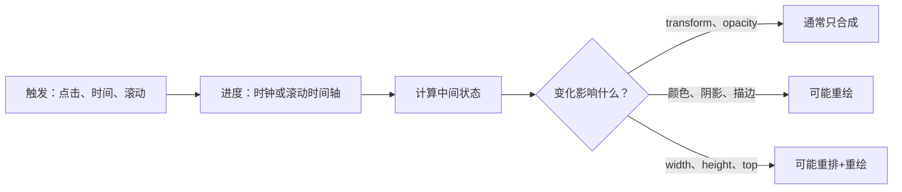
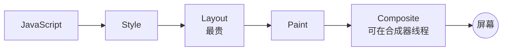
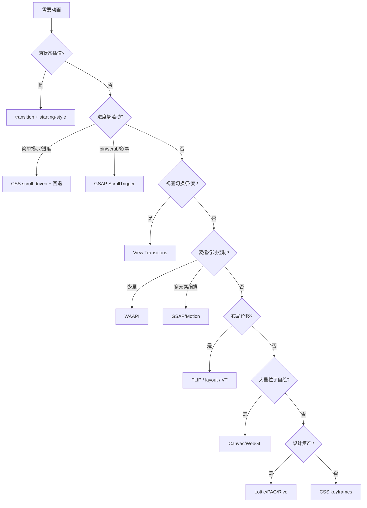

[toc]

## 合并结论（先说结论）

来源：`动画指南gpt5.6sol.md` / `动画指南gpt6sol.md` / `css@动画@animations.md` / `web动画技术指南@fable5.1.md`，截止 2026-10-04 合并。

| 文档 | 一句话特点 | 最强处（取） | 最弱处（舍/补） |
|---|---|---|---|
| gpt5.6sol | 工程化综合实验室，深色单文件 demo 约1900行 | 全套可运行 demo：3D翻牌、Motion Path回退、WAAPI全控制、rAF小球、FLIP列表、SVG+Canvas、滚动+VT、无障碍（skip-link/live-region/键盘）、全局暂停、DPR上限、生命周期 | 无 `@starting-style`/`linear()`，无库选型/国内环境，选型图较粗 |
| gpt6sol | 概念最干净，判断框架最好 | 三问框架（触发/进度/绘制）、性能免责声明、`scroll驱动 vs 触发`辨析、`1ms`写法与 `animation-timeline`位置解释、`fill:forwards`与 `finished`拒绝警告、SMIL 独立示例、小滚动容器隔离演示 | demo 最简，无 FLIP/3D/`@starting-style`，无库深度，无管线图 |
| css@动画 | 唯一认真讲库与框架的 | 包体积对比表、GSAP Timeline+ScrollTrigger、`Framer Motion`挂载/卸载、跨文档 VT、OffscreenCanvas、INP/`contain`、移动分级、React优先决策树 | 只有片段无综合可运行页，SMIL 一句“废弃”过于绝对，Firefox 132 稳定等版本断言与另两篇冲突 |
| fable5.1 | 最严谨+中国环境 | 管线 P1/P2/P3 图、阻塞主线程实验、FPS、`@starting-style`+`allow-discrete`+`overlay`/popover、`linear()`、`composite`/`commitStyles`、中文分词/`Segmenter`/竖排、npmmirror/CDN/微信X5、冲突明确标注“待核实”、9分支决策树 | 最长最重，新手负担大，缺 Motion Path/3D demo，GSAP 示例偏简 |

合并策略：以 fable5.1 为骨架（管线/现代增强/决策/国内/中文/自查），注入 gpt6 的判断框架与正确性注记，注入 css@动画 的库对比与框架决策，注入 gpt5.6 的工程化 demo 与无障碍细节。三个重复 demo 合一，不保留三份。

版本冲突（统一口径，以 MDN/caniuse 为准，本文不拍板）：Firefox 滚动驱动是“132稳定”还是“152仍需 flag”两说并存；Safari 18/26 表述不一；VT Firefox 133/144 不一；覆盖率 84% 与包体积数字随版本浮动。下文凡涉版本均写“请核实”，demo 一律 `@supports`/运行时检测 + 静态回退。

---
## 1 判断框架：先回答三个问题

1. 什么触发变化？点击/状态切换、时间经过、滚动位置。
2. 什么决定进度？时钟（CSS/WAAPI/rAF）或滚动时间轴（scroll/view）。
3. 由谁绘制画面？CSS 合成器、WAAPI 同引擎、rAF 手写、Canvas/WebGL 自绘。



最后三条是性能线索不是保证，以 DevTools 实测为准。常规界面优先 `transform`/`opacity`。

易混：滚动**驱动**（滚动多少进行多少，可反向） vs 滚动**触发**（越过某处播一次时间动画，后者用 IntersectionObserver 即可）。

---
## 2 本质：像素管线与合成器

60Hz 约 16.7ms，120Hz 约 8.3ms 一帧：



- 几何属性 `width/height/top/left/margin/font-size`：Layout+Paint+Composite，最贵，动画中避免。
- 视觉属性 `color/background/box-shadow/border-radius`：Paint+Composite。
- 合成属性 `transform/opacity/filter部分/clip-path部分`：仅 Composite，最便宜。只动这两类时，即使主线程被阻塞，合成器仍可能继续（demo 有“阻塞 2s”实验；若未提升为独立层，个别环境也会停顿）。

---
## 3 技术全景

| 技术 | 典型用途 | 边界 |
|---|---|---|
| CSS Transition | 悬停/聚焦/展开，两状态插值 | 需状态变化触发；显式列属性，禁 `all` |
| CSS `@keyframes` | 加载/强调/多阶段/循环 | 编排多元素时序弱；无限循环须可停 |
| CSS Motion Path | 沿曲线装饰移动 | `offset-path`+`offset-distance`；坐标与响应式留意 |
| WAAPI `element.animate()` | 需暂停/反向/变速/拖进度 | 返回 `Animation`；须管理 cancel/finish |
| rAF | 物理/指针跟随/逐帧计算 | 主线程；必须时间戳+增量上限 |
| FLIP | 列表重排/布局位移转合成动画 | 真实 DOM 先变，视觉用 transform 补偿；可视为 VT 的手动版 |
| SVG | 图标/路径/图表 | CSS 描边为主；SMIL 独立但互操作弱， pressurized 按需用 |
| Canvas 2D | 粒子/图表/游戏 | 零 DOM 开销，主线程自负；DPR+可见性管理 |
| WebGL/WebGPU | 3D/大规模粒子 | 另专题，本文仅定位 |
| Scroll-driven `scroll()/view()` | 进度条/随滚动揭示 | 合成器友好；兼容未收敛，必须静态回退 |
| IntersectionObserver | 进入一次触发 | 只负责发现时机，非逐帧引擎 |
| View Transitions | SPA 切换/列表形变/MPA 导航 | 同文档 `startViewTransition`，跨文档 `@view-transition`；过渡期不可交互，控 300~500ms |
| 库（GSAP/Motion/anime/Lottie/Rive/PAG） | 复杂编排/设计资产/3D | 按素材/框架/授权/体积选，不为按钮引引擎 |

参数速查：`transition: <property> <duration> <timing> <delay>`；`animation: <name> <duration> <timing> <delay> <count> <direction> <fill> <play-state>`，`animation-timeline` 须写在 `animation` 简写之后；`element.animate(keyframes, {duration,easing,iterations,direction,fill,composite})`；`requestAnimationFrame(cb)` 回调用时间戳算位移。

---
## 4 CSS Transition / Animation 与缓动

Transition 只呈现状态变化，状态本身必须先可用。必须同时给 `:hover` 与 `:focus-visible`；`transitionend` 每个属性触发一次，应用 `getAnimations()+finished` 或判 `propertyName`，且值未变则不触发。

Animation 常见坑：忘 `forwards` 弹回；`timing` 作用于每段关键帧之间；无限循环必须配减弱偏好；`steps(n)` 做精灵图；`linear()`（Chrome 113+/FF 112+/Safari 17.2+，以 MDN 为准）用采样点逼近弹簧/回弹；`@property` 可动画化自定义属性（如角度），不支持则静态。

---
## 5 现代增强 A：`@starting-style` + `allow-discrete`

`display/overlay` 离散属性分工：`@starting-style` 给入场第 0 帧，`allow-discrete` 让退场先过渡再 `display:none`。`overlay` 保顶层 `dialog/popover` 退场可见。简写中 `allow-discrete` 跟在对应属性后，勿被后续简写覆盖；`@starting-style` 内不写 `display`。2024 进入 Baseline，具体版本以 MDN 为准。

---
## 6 Motion Path 与 3D（要点）

`offset-path: path("...")` + `offset-distance: 0~100%` + `offset-rotate: auto`；`@supports (offset-path: path(...))` 做直线回退。3D 翻牌三件套：`perspective` + `preserve-3d` + `backface-visibility:hidden`，键盘 Enter/Space 同步。

---
## 7 滚动：驱动 vs 触发写法

```css
.el { animation: reveal-in linear both; animation-timeline: view(); animation-range: entry 0% entry 60%; }
```

`scroll(nearest/root/self <axis>)` 跟容器进度；`view(<axis> <inset>)` 跟元素穿过进度；`range` 名 `cover/contain/entry/exit/entry-crossing/exit-crossing`。滚动时长声明用 `1ms` 只是兼顾实现差异的写法，不是播 1ms。正确模式两层防护：默认即终态可见 + `@media (prefers-reduced-motion: no-preference)` 包 `@supports`。不支持只是无动画，不应损坏。复杂 pin/scrub/叙事仍用 GSAP ScrollTrigger。

---
## 8 View Transitions

同文档 `document.startViewTransition(updateDOM)`，跨文档两页各声明 `@view-transition { navigation: auto; }`。伪树：`::view-transition / group(name) / image-pair(name) / old(name) / new(name)`，`root` 为整页，元素用 `view-transition-name` 独立形变，同页名唯一，列表须动态赋名。回退即直接更新；`::view-transition-group(*)` 时长可调，减弱时压到 `0.01ms` 量级。

---
## 9 WAAPI

与 CSS 同引擎，可 `getAnimations()` 互操作。`composite: replace/add/accumulate` 解决同属性叠加；`fill:forwards` 长期持有会占样式优先级，稳妥用 `finished` 后写终值+`cancel()` 或 `commitStyles()`；`iterations:Infinity` 调 `finish()` 抛错；卸载前 `cancel()`；`finished` 被 cancel 会拒绝须 catch；变速用 `updatePlaybackRate()` 避免跳帧；`currentTime` 可拖动。

无障碍：减弱时 `duration:0` 而非跳过调用，保留终态副作用。

---
## 10 rAF 与 FLIP

rAF 铁律：用回调时间戳算 `dt`，上限 0.04~0.05s 防切回瞬移；`hidden`/不可见停循环；先读后写防布局抖动；卸载 `cancelAnimationFrame`+断观察器。

FLIP：First 记录 `getBoundingClientRect` → Last 真改 DOM 再记录 → Invert 加反向 `translate` → Play `animate([{transform:反向},{transform:none}])`。GSAP Flip/Motion layout/VT 快照皆同思想泛化。

---
## 11 SVG / Canvas / WebGL 定位

SVG：`pathLength="1"` + `dasharray:1` + `dashoffset:1→0` 绘制；`transform-box:fill-box; transform-origin:center` 修原点；形变需等点数，原生不行用 MorphSVG；SMIL 适合独立资源，暂停须 `pauseAnimations()`，CSS 暂停管不到它。

Canvas：rAF 清屏重绘；`devicePixelRatio` 上限 2，改 `width/height` 重置状态故用 `setTransform`；`OffscreenCanvas` 可进 Worker；滚出视口/`hidden` 停帧省电。WebGL/WebGPU（Three/Pixi/Babylon）另专题。

---
## 12 库选型（按需，不默认引）

| 方案 | 体积(gzip,随版本变) | 特长 | 选谁 |
|---|---|---|---|
| CSS/WAAPI 原生 | 0 | 状态/轻命令 | 80% UI 默认 |
| Motion One | ~12KB | 轻 WAAPI 封装 | 非 React 轻量 |
| GSAP 核心 | ~22KB | timeline 位置参数(`-=0.3`/`<`)/ScrollTrigger pin+scrub/Flip | 复杂序列/滚动叙事；现 100% 免费可商用（含原付费插件，Webflow 收购后） |
| Motion（原 Framer） | 较大 | `motion/react`+`AnimatePresence`+layout/手势/弹簧 | React/Vue 组件 |
| Anime.js v4 | ~17KB | 简洁+SVG 好 | 中小补间 |
| Lottie/dotLottie | 视渲染器 | AE JSON 高保真 | 品牌/图标；中文转形状防方框 |
| Rive | 小运行时 | 状态机可交互 | 角色/交互动画，许可先核实 |
| PAG/Galacean | — | 国产，中文/Wasm/营销特效 | 国内团队按需 |

原则：CSS 搞定状态循环；WAAPI 搞定轻运行时；GSAP 搞定时间线；Motion 搞定 React 挂载手势；Lottie/PAG 搞定插画资产；同一元素同一属性只归一主。

---
## 13 选型决策



底线：能 CSS 不 JS，能原生不引库，能 transform 不布局，不支持仍可用。

---
## 14 实践注意事项

性能：只动 transform/opacity；scroll/resize/mousemove 不直写样式（rAF 合批或 CSS 驱动）；`will-change` 临前加事后删，禁全局常驻，禁 `translateZ(0)` 迷信；`contain/layout paint` 限范围；大模糊阴影滤镜慎用；DevTools Performance+Paint flashing+Layer borders+低端机+CPU 降速+120Hz 验证。

无障碍：`prefers-reduced-motion` 至少一刀切 `.01ms`（保事件触发），最好精细（位移视差停，颜色透明保留，入场变 ≤0.3s 淡入）；JS `matchMedia` 监听；WAAPI/SMIL/Canvas/视频全覆盖；站内开关可覆盖系统；持续 5s+ 自动播放须给暂停；勿闪烁；`opacity:0` 不等于删除（焦点/读屏同步处理）。

生命/兼容：重触发 cancel 旧动画；卸载 cancel rAF/断 IO；`@supports`+运行时检测，不 UA 嗅探；Chrome/Edge/Firefox/Safari+真移动端+微信/厂商容器/iOS WebKit 实测。

跨平台/中文/国内：rAF 必 dt；Win ClearType 缩放抖动终态回 `scale(1)`；mac/Win 滚轮差异优先 CSS 驱动；移动层数/GPU 省着用；中文逐字用 chars 或 `Intl.Segmenter('zh')`，Lottie 中文转曲，`font-display:swap`+`fonts.ready` 再入场，竖排注意 `inline/block` 轴对调；npm 走 npmmirror，CDN 用可达镜像（用前验证），体积 tree-shaking，原生 0KB 优先。

---
## 15 综合演示页（合并版，单文件零依赖）

覆盖：过渡/关键帧+缓动对比/`linear()`/3D/Motion Path/WAAPI 全控制/rAF/FLIP/SVG+SMIL/Canvas FPS+阻塞实验/滚动进度+揭示+IO 回退/starting-style dialog+popover/VT 列表+主题/特性检测/暂停+减弱开关。存为 `web-animation-merged.html` 直接打开，Chrome 126+/Safari 26+ 体验最全，不支持自动回退。

```html
<!DOCTYPE html>
<html lang="zh-CN" data-reduced-motion="no-preference">
<head>
<meta charset="UTF-8">
<meta name="viewport" content="width=device-width, initial-scale=1">
<title>Web动画合并演示</title>
<style>
:root{--bg:#f6f7fb;--fg:#1f2330;--muted:#6b7280;--card:#fff;--accent:#3b6cf6;--accent2:#f65c3b;--ok:#16a34a;--no:#dc2626;--radius:12px;--dur:.4s;--ease:cubic-bezier(.2,.8,.2,1);color-scheme:light}
html[data-theme="dark"]{--bg:#15171f;--fg:#e8eaf2;--muted:#9aa3b5;--card:#1f2230;color-scheme:dark}
*{box-sizing:border-box}body{margin:0;background:var(--bg);color:var(--fg);line-height:1.6;font-family:system-ui,-apple-system,"Segoe UI","PingFang SC","Microsoft YaHei",sans-serif;transition:background .4s,color .4s}
main{max-width:980px;margin:0 auto;padding:24px 16px 96px}section{background:var(--card);border-radius:var(--radius);padding:20px;margin:20px 0;box-shadow:0 1px 2px rgb(0 0 0/.06)}
h1{font-size:1.5rem;margin:0}h2{font-size:1.15rem;margin:0 0 8px}p.note{color:var(--muted);font-size:.9rem}code{font-size:.9em}
button,select{font:inherit;padding:8px 12px;border-radius:8px;border:1px solid transparent;background:var(--accent);color:#fff;cursor:pointer;transition:transform 150ms var(--ease),box-shadow 150ms}
button:hover{transform:translateY(-1px)}button.secondary{background:transparent;color:var(--accent);border-color:currentColor}.row{display:flex;flex-wrap:wrap;gap:8px;align-items:center;margin:8px 0}
.toolbar{position:sticky;top:8px;z-index:50;display:flex;gap:8px;flex-wrap:wrap;background:var(--card);padding:10px;border-radius:var(--radius);box-shadow:0 4px 16px rgb(0 0 0/.08)}
.badge{display:inline-block;padding:2px 10px;border-radius:999px;font-size:.8rem;color:#fff;background:var(--no)}.badge.ok{background:var(--ok)}
#progress{position:fixed;top:0;left:0;width:100%;height:4px;z-index:99;background:var(--accent);transform:scaleX(0);transform-origin:0 50%;display:none}
@supports (animation-timeline: scroll()){#progress{display:block;animation:grow linear both;animation-timeline:scroll(root block)}}
@keyframes grow{to{transform:scaleX(1)}}
.reveal{opacity:1}@supports (animation-timeline: view()){.reveal{animation:rv linear both;animation-timeline:view();animation-range:entry 0% entry 60%}}
@keyframes rv{from{opacity:0;transform:translateY(36px)}}
html.need-io .reveal{opacity:0;transform:translateY(14px);transition:opacity .5s,transform .5s var(--ease)}
html.need-io .reveal.in-view{opacity:1;transform:none}
.card-demo{width:170px;padding:14px;border-radius:10px;background:var(--bg);border:1px solid rgb(0 0 0/.08);transition:transform 250ms var(--ease),box-shadow 250ms}
.card-demo:hover,.card-demo:focus-visible{transform:translateY(-4px);box-shadow:0 12px 24px rgb(0 0 0/.15)}
.ease-row{display:grid;grid-template-columns:90px 1fr;gap:8px;align-items:center;margin:6px 0}.track{height:14px;background:rgb(0 0 0/.08);border-radius:99px;overflow:hidden}.fill{height:100%;background:linear-gradient(90deg,var(--accent),var(--accent2));transform:scaleX(0);transform-origin:left}
.run .f1{animation:g 1.6s linear both}.run .f2{animation:g 1.6s ease both}.run .f3{animation:g 1.6s cubic-bezier(.2,.9,.25,1.25) both}.run .f4{animation:g 1.6s steps(6,end) both}
@keyframes g{to{transform:scaleX(1)}}
.spinner{width:32px;height:32px;border-radius:50%;border:4px solid rgb(59 108 246/.25);border-top-color:var(--accent);animation:spin 1s linear infinite}
@keyframes spin{to{transform:rotate(360deg)}}.ball{width:32px;height:32px;border-radius:50%;background:var(--ok)}
.ball.bounce{animation:drop 1.4s both;animation-timing-function:linear(0,.063,.25,.563,1 36.4%,.812,.75,.813,1 72.7%,.953,.938,.953,1 90.9%,.984,1)}
@keyframes drop{from{transform:translateY(-70px)}to{transform:translateY(0)}}.paused{animation-play-state:paused}
.flip-scene{width:170px;height:110px;perspective:700px}.flip{width:100%;height:100%;position:relative;transform-style:preserve-3d;transition:transform .6s var(--ease);cursor:pointer}
.flip.on{transform:rotateY(180deg)}.face{position:absolute;inset:0;display:grid;place-items:center;border-radius:10px;backface-visibility:hidden;font-weight:700}.front{background:var(--accent);color:#fff}.back{background:var(--accent2);color:#fff;transform:rotateY(180deg)}
.path-area{position:relative;width:200px;height:115px}.dot{position:absolute;left:12px;top:78px;width:14px;height:14px;border-radius:50%;background:var(--no)}
@supports (offset-path: path("M 0 0 L 1 1")){.dot{left:0;top:0;offset-path:path("M 12 78 C 52 6 137 117 188 64")}body.go .dot{animation:orb 4s linear infinite alternate}}
@keyframes orb{to{offset-distance:100%}}
.stage{position:relative;height:70px;background:var(--bg);border-radius:8px;overflow:hidden}#wbox{position:absolute;top:15px;left:15px;width:40px;height:40px;border-radius:8px;background:var(--accent)}
#flip-grid{display:grid;grid-template-columns:repeat(auto-fill,minmax(64px,1fr));gap:8px}#flip-grid button{background:var(--bg);color:var(--fg);border:1px solid rgb(0 0 0/.1)}
#vt-list{list-style:none;padding:0;display:grid;gap:8px;grid-template-columns:repeat(auto-fill,minmax(120px,1fr))}#vt-list li{padding:10px;background:var(--bg);border-radius:8px;text-align:center}
::view-transition-old(root),::view-transition-new(root){animation-duration:.4s}
dialog{border:none;border-radius:12px;padding:20px;opacity:0;translate:0 20px;transition:opacity var(--dur),translate var(--dur),display var(--dur) allow-discrete,overlay var(--dur) allow-discrete}
dialog[open]{opacity:1;translate:0 0}dialog::backdrop{background:rgb(0 0 0/0);transition:background var(--dur),display var(--dur) allow-discrete,overlay var(--dur) allow-discrete}
dialog[open]::backdrop{background:rgb(0 0 0/.45)}@starting-style{dialog[open]{opacity:0;translate:0 20px}}
[popover]{margin:auto;padding:10px 14px;border-radius:10px;border:1px solid rgb(0 0 0/.1);opacity:0;scale:.95;transition:opacity .25s,scale .25s,display .25s allow-discrete,overlay .25s allow-discrete}
[popover]:popover-open{opacity:1;scale:1}@starting-style{[popover]:popover-open{opacity:0;scale:.95}}
svg.draw-demo{width:220px;height:110px}.draw{fill:none;stroke:var(--accent);stroke-width:4;stroke-linecap:round;stroke-dasharray:1}
#particles{width:100%;height:170px;display:block;border-radius:8px;background:#0f1222}.race{position:relative;height:44px;background:var(--bg);border-radius:8px;overflow:hidden;margin:6px 0}.runner{position:absolute;top:4px;left:0;width:36px;height:36px;border-radius:8px}.rl{background:var(--accent2);animation:ml 1.5s ease-in-out infinite alternate}
@keyframes ml{from{left:0}to{left:260px}}.rt{background:var(--ok);animation:mt 1.5s ease-in-out infinite alternate}@keyframes mt{from{transform:translateX(0)}to{transform:translateX(260px)}}
@media (prefers-reduced-motion: reduce){*,*::before,*::after{animation-duration:.01ms!important;animation-iteration-count:1!important;transition-duration:.01ms!important}.reveal{animation:none!important}}
html[data-reduced-motion="reduce"] *,html[data-reduced-motion="reduce"] *::before,html[data-reduced-motion="reduce"] *::after{animation-duration:.01ms!important;animation-iteration-count:1!important;transition-duration:.01ms!important}
html[data-reduced-motion="reduce"] .reveal{animation:none!important}
</style>
</head>
<body>
<div id="progress"></div>
<main>
<h1>Web动画合并演示</h1>
<p class="note">零依赖。回退优先，不支持仍可用。含阻塞实验与特性检测。</p>
<div class="toolbar"><button id="theme">切换主题(VT)</button><button id="motion" class="secondary" aria-pressed="false">减弱动效:关</button><button id="pause" class="secondary">暂停循环</button></div>
<section><h2>特性检测</h2><ul id="features"></ul></section>
<section class="reveal"><h2>Transition</h2><p class="note">悬停/聚焦，只动 transform+shadow。</p><div class="row"><div class="card-demo" tabindex="0">悬停/聚焦</div></div></section>
<section class="reveal"><h2>缓动对比 + linear() + 3D + 路径</h2>
<div id="easeBox" class="run"><div class="ease-row"><span>linear</span><div class="track"><div class="fill f1"></div></div></div><div class="ease-row"><span>ease</span><div class="track"><div class="fill f2"></div></div></div><div class="ease-row"><span>bezier</span><div class="track"><div class="fill f3"></div></div></div><div class="ease-row"><span>steps</span><div class="track"><div class="fill f4"></div></div></div></div>
<div class="row"><button id="reEase" class="secondary">重播缓动</button><div class="spinner" id="sp"></div><div class="ball" id="bl"></div><button id="reBounce" class="secondary">回弹</button></div>
<div class="row"><div class="flip-scene"><div class="flip" id="flip" tabindex="0" role="button" aria-pressed="false"><div class="face front">正</div><div class="face back">背</div></div></div>
<div class="path-area"><svg width="200" height="115" viewBox="0 0 200 115"><path d="M 12 78 C 52 6 137 117 188 64" fill="none" stroke="#3b6cf6" stroke-width="2"/></svg><span class="dot"></span></div></div>
</section>
<section class="reveal"><h2>starting-style dialog + popover</h2><div class="row"><button id="openDlg">对话框</button><button popovertarget="tip" class="secondary">Popover</button><div id="tip" popover>原生 popover 缩放淡入。</div></div>
<dialog id="dlg"><h3>dialog</h3><p>Esc/遮罩可关，退场先过渡。</p><form method="dialog"><button>关闭</button></form></dialog></section>
<section class="reveal"><h2>VT 列表</h2><div class="row"><button id="shuffle">重排</button></div><ul id="vt-list"><li>北京</li><li>上海</li><li>广州</li><li>深圳</li><li>杭州</li><li>成都</li></ul></section>
<section class="reveal"><h2>WAAPI</h2><div class="stage"><div id="wbox"></div></div><div class="row"><button id="wp">播放</button><button id="wpa" class="secondary">暂停</button><button id="wr" class="secondary">反向</button><button id="wc" class="secondary">取消</button><select id="wrate"><option>0.5</option><option selected>1</option><option>2</option></select><input type="range" id="wscrub" min="0" max="2000" value="0"><span id="wst" class="note">空闲</span></div></section>
<section class="reveal"><h2>FLIP</h2><p class="note">点数字到首位，真 DOM 立变。</p><div id="flip-grid"></div></section>
<section class="reveal"><h2>SVG CSS+SMIL</h2><div class="row"><svg class="draw-demo" viewBox="0 0 220 120"><path id="dp" class="draw" pathLength="1" d="M10 90 C 40 10 80 10 110 60 S 180 110 210 30"/><rect x="150" y="70" width="26" height="26" rx="6" fill="#f65c3b" style="transform-box:fill-box;transform-origin:center"><animateTransform attributeName="transform" type="rotate" from="0 13 13" to="360 13 13" dur="3s" repeatCount="indefinite"/></rect></svg><button id="redraw" class="secondary">重绘</button></div></section>
<section class="reveal"><h2>Canvas + 阻塞实验</h2><canvas id="particles" role="img" aria-label="粒子"></canvas><div class="row"><button id="cs">开始</button><button id="cx" class="secondary">停止</button><span id="fps" class="note">FPS:-</span></div><div class="race"><div class="runner rl"></div></div><div class="race"><div class="runner rt"></div></div><div class="row"><button id="block">阻塞主线程2s</button></div></section>
</main>
<script>
(()=>{const mq=matchMedia('(prefers-reduced-motion: reduce)');const html=document.documentElement;let ov=null;const red=()=>(ov??(mq.matches?'reduce':'no-preference'))==='reduce';
const mb=document.getElementById('motion');function ap(){const r=red();html.dataset.reducedMotion=r?'reduce':'no-preference';mb.textContent=`减弱动效:${r?'开':'关'}`;mb.setAttribute('aria-pressed',String(r))}mq.addEventListener?.('change',ap);mb.onclick=()=>{ov=red()?'no-preference':'reduce';ap()};ap();
if(!CSS.supports('animation-timeline: view()')&&'IntersectionObserver' in window){html.classList.add('need-io');const o=new IntersectionObserver(es=>es.forEach(e=>{if(e.isIntersecting){e.target.classList.add('in-view');o.unobserve(e.target)}}),{threshold:.15});document.querySelectorAll('.reveal').forEach(el=>o.observe(el))}
const F={'WAAPI':'animate' in Element.prototype,'scroll()':CSS.supports('animation-timeline: scroll()'),'view()':CSS.supports('animation-timeline: view()'),'startViewTransition':'startViewTransition' in document,'allow-discrete':CSS.supports('transition-behavior: allow-discrete'),'linear()':CSS.supports('animation-timing-function: linear(0,1)')};const ul=document.getElementById('features');for(const[k,v]of Object.entries(F)){const li=document.createElement('li');li.innerHTML=`<span class="badge ${v?'ok':''}">${v?'支持':'回退'}</span> ${k}`;ul.appendChild(li)}
const withVT=u=>{if(!document.startViewTransition||red()){u();return}document.startViewTransition(u)};document.getElementById('theme').onclick=()=>withVT(()=>html.dataset.theme=html.dataset.theme==='dark'?'':'dark');
document.getElementById('pause').onclick=e=>{document.querySelectorAll('.spinner,.ball,.fill').forEach(x=>x.classList.toggle('paused'));e.currentTarget.textContent='继续/暂停'};
document.getElementById('reEase').onclick=()=>{const b=document.getElementById('easeBox');b.classList.remove('run');void b.offsetWidth;b.classList.add('run')};
const bl=document.getElementById('bl');document.getElementById('reBounce').onclick=()=>{bl.classList.remove('bounce');void bl.offsetWidth;bl.classList.add('bounce')};
const fl=document.getElementById('flip');const tf=()=>{const o=fl.classList.toggle('on');fl.setAttribute('aria-pressed',String(o))};fl.onclick=tf;fl.onkeydown=e=>{if(e.key==='Enter'||e.key===' '){e.preventDefault();tf()}};
const dlg=document.getElementById('dlg');document.getElementById('openDlg').onclick=()=>dlg.showModal();dlg.onclick=e=>{if(e.target===dlg)dlg.close()};
const vt=document.getElementById('vt-list');[...vt.children].forEach((li,i)=>li.style.viewTransitionName=`vt-${i}`);document.getElementById('shuffle').onclick=()=>withVT(()=>{const a=[...vt.children];for(let i=a.length-1;i>0;i--){const j=Math.floor(Math.random()*(i+1));[a[i],a[j]]=[a[j],a[i]]}a.forEach(li=>vt.appendChild(li))});
const box=document.getElementById('wbox'),sc=document.getElementById('wscrub'),st=document.getElementById('wst');const an=box.animate([{transform:'translateX(0)',borderRadius:'8px'},{transform:'translateX(220px)',borderRadius:'50%',offset:.7},{transform:'translateX(0)',borderRadius:'8px'}],{duration:2000,easing:'ease-in-out',fill:'both'});an.pause();const ss=()=>st.textContent='状态:'+an.playState;
document.getElementById('wp').onclick=()=>{if(an.playState==='finished')an.currentTime=0;an.play();ss()};document.getElementById('wpa').onclick=()=>{an.pause();ss()};document.getElementById('wr').onclick=()=>{an.reverse();ss()};document.getElementById('wc').onclick=()=>{an.cancel();ss()};document.getElementById('wrate').onchange=e=>an.updatePlaybackRate(Number(e.target.value));sc.oninput=()=>{an.pause();an.currentTime=Number(sc.value);ss()};(function s(){if(an.playState==='running')sc.value=Math.round(Number(an.currentTime)||0);requestAnimationFrame(s)})();
const grid=document.getElementById('flip-grid');for(let i=1;i<=12;i++){const b=document.createElement('button');b.textContent=i;b.onclick=()=>{const els=[...grid.children];const f=new Map(els.map(x=>[x,x.getBoundingClientRect()]));grid.prepend(b);if(red())return;els.forEach(x=>{const a=f.get(x),c=x.getBoundingClientRect(),dx=a.left-c.left,dy=a.top-c.top;if(dx||dy)x.animate([{transform:`translate(${dx}px,${dy}px)`},{transform:'none'}],{duration:400,easing:'cubic-bezier(.2,.8,.2,1)'})})};grid.appendChild(b)}
const dp=document.getElementById('dp');function draw(){dp.getAnimations().forEach(a=>a.cancel());dp.animate([{strokeDashoffset:1},{strokeDashoffset:0}],{duration:red()?1:1500,easing:'ease-out',fill:'forwards'}).finished.catch(()=>{})}document.getElementById('redraw').onclick=draw;draw();document.body.classList.add('go');
const cv=document.getElementById('particles'),cx=cv.getContext('2d'),fps=document.getElementById('fps');let ps=[],id=null,last=0,vis=true,fr=0,ft=0;
function rs(){const d=Math.min(devicePixelRatio||1,2),r=cv.getBoundingClientRect();cv.width=r.width*d;cv.height=r.height*d;cx.setTransform(d,0,0,d,0,0)}function sp(n){const r=cv.getBoundingClientRect();ps=Array.from({length:n},()=>({x:Math.random()*r.width,y:Math.random()*r.height,vx:(Math.random()-.5)*80,vy:(Math.random()-.5)*80,s:2+Math.random()*3,h:200+Math.random()*80}))}
function fm(ts){const dt=Math.min((ts-last)/1000,.05);last=ts;const w=cv.getBoundingClientRect().width,h=cv.getBoundingClientRect().height;cx.fillStyle='rgba(15,18,34,.25)';cx.fillRect(0,0,w,h);for(const p of ps){p.x+=p.vx*dt;p.y+=p.vy*dt;if(p.x<0||p.x>w)p.vx*=-1;if(p.y<0||p.y>h)p.vy*=-1;cx.beginPath();cx.arc(p.x,p.y,p.s,0,7);cx.fillStyle=`hsl(${p.h} 90% 65%)`;cx.fill()}fr++;if(ts-ft>1000){fps.textContent='FPS:'+fr;fr=0;ft=ts}id=requestAnimationFrame(fm)}
function start(){if(id||red()){if(red())fps.textContent='减弱偏好跳过';return}rs();if(!ps.length)sp(100);last=performance.now();ft=last;id=requestAnimationFrame(fm)}function stop(){if(id)cancelAnimationFrame(id);id=null;fps.textContent='FPS:停'}
document.getElementById('cs').onclick=()=>{vis=true;start()};document.getElementById('cx').onclick=stop;new IntersectionObserver(([e])=>{vis=e.isIntersecting;vis?start():stop()},{threshold:.1}).observe(cv);document.addEventListener('visibilitychange',()=>document.hidden?stop():vis&&start());
document.getElementById('block').onclick=()=>{const e=performance.now()+2000;while(performance.now()<e){}};addEventListener('resize',()=>{if(id)rs()});
})();
</script>
</body>
</html>
```

观察法：切状态看 Transition 是否只呈现；缓动重播看曲线；阻塞 2s 看绿块（transform）与橙块（left）差异；小屏/减弱/无 VT 时内容仍可用；`finished` cancel 会拒绝已 catch；`timeline` 在简写后。

---
## 16 测试验收

- [ ] 无 JS 仍可读；减弱后无大范围连续动；按钮可键盘操作
- [ ] 暂停后 CSS/WAAPI/SMIL/Canvas 全停；后台返回无跳跃；60/120Hz 速度一致
- [ ] 缩放 200%/中文/小屏不裁切；四浏览器+移动容器测过
- [ ] Performance 无长任务，动画主走合成层；API 缺失回退仍改状态；无闪烁传信

---
## 17 引用与核实

CSS Transition/Animation、WAAPI、rAF、Motion Path、Scroll-driven、VT、Canvas、`prefers-reduced-motion` 按 MDN；滚动/视图/starting-style 版本以 caniuse+MDN 当日为准；GSAP/Motion/Lottie/Rive/PAG 许可与体积以官方仓库为准。本文 demo 刻意零依赖，GSAP 等不打入单文件。
