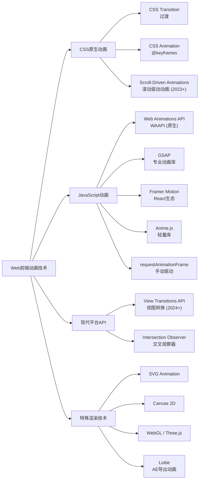
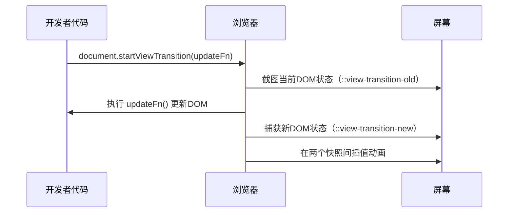
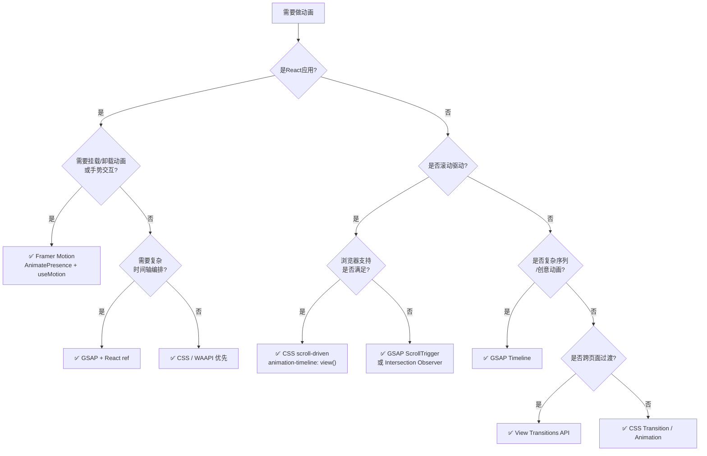
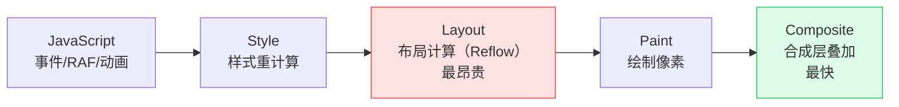

[toc]

## Web前端动画技术全景

### 技术总览与演进脉络

Web动画领域经历了从Flash时代、JavaScript动画库，到现代CSS动画与复杂框架的戏剧性演变。当今的动画能力包括：高性能CSS过渡与关键帧动画、强大的JavaScript动画库（GSAP、Anime.js、Framer Motion）、SVG动画、面向设计师友好的Lottie、面向3D效果的WebGL，以及成熟的滚动交互。

下图展示了主要动画技术的分类与关系：



---

### CSS原生动画

#### CSS Transition（过渡）

**CSS Transition**是最轻量的动画手段，用于在两个状态之间平滑插值，无需任何JavaScript。

核心属性如下表：

| 属性                         | 说明                                               |
| ---------------------------- | -------------------------------------------------- |
| `transition-property`        | 要过渡的CSS属性，如`opacity`、`transform`          |
| `transition-duration`        | 过渡持续时长，如`300ms`、`0.3s`                    |
| `transition-timing-function` | 缓动函数，如`ease`、`cubic-bezier(0.4, 0, 0.2, 1)` |
| `transition-delay`           | 过渡开始前的延迟                                   |

**典型场景：** 按钮悬停效果、导航菜单展开、表单聚焦高亮。

```css
.btn {
  background: #3b82f6;
  transform: translateY(0);
  transition: background 200ms ease, transform 200ms ease;
}

.btn:hover {
  background: #1d4ed8;
  transform: translateY(-2px);
}
```

#### CSS Animation（关键帧动画）

**CSS Animation**通过`@keyframes`规则定义动画序列，适合循环动画、入场/出场动效。

| 属性                        | 说明                                                      |
| --------------------------- | --------------------------------------------------------- |
| `animation-name`            | 引用`@keyframes`名称                                      |
| `animation-duration`        | 单次动画时长                                              |
| `animation-timing-function` | 缓动函数                                                  |
| `animation-iteration-count` | 播放次数，`infinite`表示无限循环                          |
| `animation-direction`       | 播放方向，`alternate`为来回交替                           |
| `animation-fill-mode`       | 动画结束后的状态：`forwards`保持末帧、`backwards`保持首帧 |
| `animation-play-state`      | `running`或`paused`，可用JS动态控制                       |

```css
@keyframes spin {
  from { transform: rotate(0deg); }
  to   { transform: rotate(360deg); }
}

.loader {
  animation: spin 1s linear infinite;
}
```

#### Scroll-Driven Animations（滚动驱动动画）

这是**2023年以来最重要的CSS新能力之一**。滚动驱动动画API让你无需滚动事件监听器或重量级脚本，就能创建动态的基于滚动的动画。现代浏览器可以通过声明式CSS在合成线程（compositor thread）上完全运行动画——`animation-timeline: scroll()`、`animation-timeline: view()`——将动效逻辑从主线程移走，实现确定性帧时序，而这曾经需要重量级JavaScript库才能做到。

**两种时间轴类型：**

| 类型           | 语法                           | 说明                                                 |
| -------------- | ------------------------------ | ---------------------------------------------------- |
| 滚动进度时间轴 | `animation-timeline: scroll()` | 以滚动容器的整体进度（0%–100%）驱动动画              |
| 视图进度时间轴 | `animation-timeline: view()`   | 以元素相对于视口的可见区间驱动动画（常用于入场动效） |

**实战示例：** 元素滚动入场淡入效果

```css
/* 默认：元素始终可见（作为降级兜底） */
.card { opacity: 1; }

@media (prefers-reduced-motion: no-preference) {
  @supports (animation-timeline: view()) {
    @keyframes reveal {
      from { opacity: 0; transform: translateY(2rem); }
      to   { opacity: 1; transform: translateY(0); }
    }
    .card {
      animation: reveal auto linear both;
      animation-timeline: view();
      /* 元素进入视口0%到覆盖40%的区间内完成动画 */
      animation-range: entry 0% cover 40%;
    }
  }
}
```

`animation-range`字段解释：

| 占位符      | 示例值      | 说明                            |
| ----------- | ----------- | ------------------------------- |
| range-start | `entry 0%`  | 动画起点：元素开始进入视口时    |
| range-end   | `cover 40%` | 动画终点：元素覆盖视口40%位置时 |

**浏览器支持（截至2026年中）：** Chrome 115+、Edge 115+、Firefox 132+（稳定版）、Safari 18+ 均已支持。全球用户覆盖率约84%。

---

### Web Animations API（WAAPI）

Web Animations API是浏览器原生API，允许开发者通过JavaScript直接创建、控制和操作动画，与浏览器渲染引擎无缝集成，提供对动画播放和性能的精确控制。

WAAPI的4大核心优势：在主线程之外运行；无内联样式写入；0KB体积；支持所有现代浏览器。

**核心接口：**

| 接口                                  | 说明                                                         |
| ------------------------------------- | ------------------------------------------------------------ |
| `Element.animate(keyframes, options)` | 最常用的入口，返回`Animation`对象                            |
| `Animation`                           | 提供播放控制和时间轴：`.play()`、`.pause()`、`.reverse()`、`.cancel()` |
| `KeyframeEffect`                      | 描述可动画属性和值（即关键帧）及其时序选项                   |
| `AnimationTimeline`                   | 表示动画的时间轴基类，`DocumentTimeline`和滚动时间轴均继承自此 |

**典型示例：** 模态框弹入动画，带运动偏好检测

```javascript
function openModal(el) {
  // 检测用户是否开启了减弱动效偏好
  const reduced = window.matchMedia('(prefers-reduced-motion: reduce)').matches;

  el.animate(
    [
      { opacity: 0, transform: 'scale(0.9) translateY(-8px)' },
      { opacity: 1, transform: 'scale(1) translateY(0)' }
    ],
    {
      duration: reduced ? 0 : 280,  // 减弱动效时直接跳到终态
      easing: 'cubic-bezier(0.34, 1.56, 0.64, 1)',
      fill: 'forwards'
    }
  );
}
```

> 重要的无障碍注意事项：当用户偏好减弱动效时，推荐将`duration`设为`0`而非跳过动画调用本身，这样`fill: 'forwards'`等布局副作用仍会生效，不会影响最终状态的渲染。

---

### JavaScript动画库

#### 技术选型全景

CSS可以处理2026年约80%的UI动画需求，且无需任何打包体积、享有原生浏览器优化。当需要时间轴编排、复杂滚动交互或运行时控制时，再使用GSAP（当前版本3.15）。

以下是主流动画方案的横向对比：

| 方案          | 包大小（gzip核心）    | 特长                             | 适用场景              |
| ------------- | --------------------- | -------------------------------- | --------------------- |
| CSS原生       | 0 KB                  | 简单过渡、状态变化               | 悬停、入场、loading   |
| WAAPI（原生） | 0 KB                  | 程序化控制、无库依赖             | 中等复杂动画          |
| Motion One    | ~12 KB                | 轻量WAAPI封装，现代API           | 非React项目的轻量需求 |
| GSAP核心      | ~22 KB                | 时间轴编排、ScrollTrigger        | 复杂序列、创意动画    |
| Framer Motion | 较大（含React运行时） | React声明式、手势、挂载/卸载动画 | React应用             |
| Anime.js      | ~17 KB                | API简洁、SVG支持好               | 中等复杂的通用动画    |
| Lottie        | 视渲染器而定          | After Effects导出、矢量动画      | 品牌动画、图标动效    |

#### GSAP——专业复杂动画的首选

GSAP（GreenSock Animation Platform）是高性能的JavaScript驱动动画库，广泛用于生产级应用。GSAP的差异化竞争力在于：带标签和相对偏移的时间轴编排、带钉住和进度映射的ScrollTrigger交互，以及对运行中动画的运行时修改（暂停、反转、时间扭曲、销毁）。

**GSAP时间轴编排示例（多元素入场序列）：**

```javascript
import { gsap } from 'gsap';
import { ScrollTrigger } from 'gsap/ScrollTrigger';

gsap.registerPlugin(ScrollTrigger);

// 创建时间轴，绑定滚动触发
const tl = gsap.timeline({
  scrollTrigger: {
    trigger: '.hero-section',
    start: 'top 80%',  // 当触发元素顶部到达视口80%位置时开始
    end: 'bottom 20%',
    scrub: 1           // 动画进度与滚动进度同步，scrub值为平滑缓冲时长(秒)
  }
});

// 按顺序入场，stagger参数使多个子元素依次延迟
tl.from('.hero-title', { opacity: 0, y: 40, duration: 0.6 })
  .from('.hero-desc',  { opacity: 0, y: 30, duration: 0.5 }, '-=0.3')
  .from('.hero-cta',   { opacity: 0, scale: 0.9, duration: 0.4 }, '-=0.2');
```

> `'-=0.3'`的含义：相对于前一个动画的结束时间**提前0.3秒**开始，实现重叠效果。

#### Framer Motion——React生态的声明式动画

在React项目中，Framer Motion提供了最符合React范式的动画开发体验，尤其是在**挂载/卸载（mount/unmount）动画**和**手势交互**方面。

```jsx
import { motion, AnimatePresence } from 'framer-motion';

// AnimatePresence 处理组件卸载时的退出动画
function Toast({ visible, message }) {
  return (
    <AnimatePresence>
      {visible && (
        <motion.div
          initial={{ opacity: 0, y: -20 }}
          animate={{ opacity: 1, y: 0 }}
          exit={{ opacity: 0, y: -20 }}
          transition={{ duration: 0.25, ease: 'easeOut' }}
          className="toast"
        >
          {message}
        </motion.div>
      )}
    </AnimatePresence>
  );
}
```

---

### View Transitions API（视图转换）

View Transitions API让浏览器通过`document.startViewTransition()`（同文档）或`@view-transition`规则（跨文档MPA）在两个DOM状态间实现交叉淡化或元素变形。

**工作机制：**



**实战：SPA页面间的共享元素过渡**

```javascript
// 触发视图转换（以路由切换为例）
async function navigate(newRoute) {
  // 为目标元素命名（卡片缩略图 → 全屏英雄图）
  document.querySelector('.card-img').style.viewTransitionName = 'hero-image';

  await document.startViewTransition(async () => {
    // 更新DOM：这里切换路由/内容
    await router.push(newRoute);
  });
}
```

```css
/* 浏览器会自动找到两个页面中同名元素并插值过渡，这里可自定义缓动 */
::view-transition-old(hero-image),
::view-transition-new(hero-image) {
  animation-duration: 350ms;
  animation-timing-function: cubic-bezier(0.4, 0, 0.2, 1);
}
```

**跨文档视图转换（MPA场景）：** 跨文档视图转换在Chrome 126+、Firefox 128+和Safari 18+中已支持，到2026年，三大主流引擎均已实现。只需一行CSS即可启用：

```css
/* 在全局CSS中添加，无需任何JavaScript */
@view-transition {
  navigation: auto;
}
```

---

### SVG动画

**SVG动画**天然适合**图标动效、数据可视化、插画交互**等场景，兼具矢量无损缩放和动画能力。驱动SVG动画的方式主要有三种：

| 方式          | 工具/语法                    | 特点                     |
| ------------- | ---------------------------- | ------------------------ |
| CSS Animation | `@keyframes` + SVG属性       | 简洁，适合简单路径变换   |
| GSAP          | `gsap.to('path', {...})`     | 支持MorphSVG路径变形插件 |
| Lottie        | JSON（AE导出）+ `lottie-web` | 设计师友好，高保真       |
| SMIL          | `<animate>` 标签             | 已基本废弃，不推荐       |

---

### Canvas 2D与WebGL

| 维度     | Canvas 2D                                   | WebGL / Three.js               |
| -------- | ------------------------------------------- | ------------------------------ |
| 核心能力 | 2D像素绘图，逐帧手动控制                    | GPU驱动3D渲染                  |
| 典型场景 | 粒子系统、游戏、数据可视化                  | 3D场景、着色器特效、沉浸式体验 |
| 性能模型 | 主线程绘图；`OffscreenCanvas`可转移到Worker | GPU并行渲染，性能天花板高      |
| 上手难度 | 中等                                        | 较高（推荐用Three.js封装）     |
| 文件体积 | 原生无依赖                                  | Three.js约600KB（可按需裁剪）  |

Canvas动画的**核心循环模式**：

```javascript
let lastTime = 0;
const particles = []; // 粒子数组

function animate(currentTime) {
  const delta = currentTime - lastTime;
  lastTime = currentTime;

  ctx.clearRect(0, 0, canvas.width, canvas.height); // 清除上一帧

  // 更新并绘制每个粒子
  for (const p of particles) {
    p.update(delta);
    p.draw(ctx);
  }

  requestAnimationFrame(animate); // 申请下一帧
}

requestAnimationFrame(animate);
```

> **注意：** 使用`requestAnimationFrame`而非`setInterval`/`setTimeout`。rAF自动与屏幕刷新率同步，减少不必要的计算；强制使用后两者可能导致卡顿和低效动画。

---

### 动画技术选型决策树

实践中的基本原则：CSS处理简单循环和状态过渡；WAAPI处理轻量命令式动画；GSAP处理时间轴编排、复杂序列和滚动交互；JavaScript仅在动画真正需要应用状态或运行时计算时使用。



---

### 性能核心原理：浏览器渲染管线

理解动画性能的基础是理解**像素渲染管线（Pixel Pipeline）**：



**黄金规则：** 只动画`transform`和`opacity`，让动画运行在**合成阶段（Composite）**，完全跳过Layout和Paint。

| 属性类别     | 示例                                       | 触发阶段                   | 性能             |
| ------------ | ------------------------------------------ | -------------------------- | ---------------- |
| 几何属性     | `width`、`height`、`top`、`left`、`margin` | Layout → Paint → Composite | 极差，触发全管线 |
| 视觉属性     | `border-radius`、`color`、`box-shadow`     | Paint → Composite          | 较差，触发重绘   |
| **合成属性** | **`transform`、`opacity`**                 | **Composite**              | **最佳**         |

> `will-change: transform`可强制GPU加速，但要**节制使用**——它会消耗额外内存。

---

### 实践注意事项

#### 无障碍（Accessibility）：尊重运动偏好

这是最容易被忽视却至关重要的要求。`prefers-reduced-motion`既是最佳实践，也是无障碍要求。推荐将动画时长设为零而非跳过调用本身，这样可以保留`fill: forwards`等布局副作用，同时消除对部分用户有害的视觉运动。

**全局CSS兜底（防护网）：**

```css
@media (prefers-reduced-motion: reduce) {
  *,
  *::before,
  *::after {
    animation-duration: 0.01ms !important;
    animation-iteration-count: 1 !important;
    transition-duration: 0.01ms !important;
    scroll-behavior: auto !important;
  }
  /* View Transitions也需要处理 */
  ::view-transition-old(root),
  ::view-transition-new(root) {
    animation-duration: 1ms;
  }
}
```

#### 渐进增强：Scroll-Driven Animations的正确写法

使用`@supports`规则检测浏览器是否支持滚动驱动动画，并将动画包裹在用户偏好查询（如`@media (prefers-reduced-motion: no-preference)`）中。这是两层防护的正确模式：

```css
/* 第一层：无支持时的降级——元素默认可见 */
.section { opacity: 1; transform: none; }

/* 第二层：仅在支持且用户无减弱动效偏好时启用 */
@media (prefers-reduced-motion: no-preference) {
  @supports (animation-timeline: view()) {
    .section {
      opacity: 0;
      animation: fade-in linear both;
      animation-timeline: view();
      animation-range: entry 0% cover 35%;
    }
  }
}
```

#### 避免混用导致的问题

避免CSS动画与GSAP同时控制同一元素，常见问题包括：运动抖动（jittery motion）和意外延迟。同一元素的动画应由单一技术全权负责。

#### 移动端：分层的动效策略

应按设备性能实施**分级动效（motion tiers）策略**：高性能环境提供完整体验；受限设备提供更少的并发效果、更简单的过渡和更轻量的装饰性动画。`prefers-reduced-motion`是独立的无障碍考量，不应与性能降级混为一谈。

#### 性能调试核查清单

上线前必做自查，包括：动效是否传达有意义的信息（反馈、层级、连续性）；是否主要动画`transform/opacity`；是否在`prefers-reduced-motion`开启时测试过；是否在性能面板下测试了重负载情况的稳定性。

常见问题的诊断与修复：

| 症状               | 根因                                         | 修复方案                                      |
| ------------------ | -------------------------------------------- | --------------------------------------------- |
| 动画卡顿，帧率低   | 动画了`top`/`left`/`width`等触发Layout的属性 | 改用`transform: translate()`等合成属性        |
| 全页面持续重绘     | 未提升动画元素为合成层                       | 为动画元素添加`will-change: transform`        |
| JS动画不稳定       | 使用了`setInterval`而非`rAF`                 | 迁移到CSS动画或WAAPI                          |
| 滚动处理器导致卡顿 | 滚动回调中频繁读写DOM（布局抖动）            | 用`requestAnimationFrame`节流，批量读写       |
| Canvas动画掉帧     | 每帧粒子/对象数量过多，主线程压力大          | 减少粒子数量，考虑`OffscreenCanvas`移入Worker |

---

### 技术对比总结

| 技术                 | 学习曲线 | 包大小 | 时间轴控制     | 运行时控制           | 无框架依赖      | 推荐场景               |
| -------------------- | -------- | ------ | -------------- | -------------------- | --------------- | ---------------------- |
| CSS Transition       | 低       | 0      | 无             | 有限                 | 是              | 悬停、状态切换         |
| CSS Animation        | 低       | 0      | 有限           | 有限（`play-state`） | 是              | loading、入场、循环    |
| Scroll-Driven (CSS)  | 中       | 0      | 无（绑定滚动） | 无                   | 是              | 滚动联动、视差         |
| WAAPI                | 中       | 0      | 无             | 完整                 | 是              | 命令式动画、替代轻量库 |
| GSAP                 | 中高     | ~22KB  | 完整           | 完整                 | 是              | 复杂序列、创意动画     |
| Framer Motion        | 中       | 较大   | 部分           | 完整                 | **否**（React） | React应用动画          |
| View Transitions API | 低       | 0      | 无             | 有限                 | 是              | 页面/路由过渡          |
| Canvas 2D            | 高       | 0      | 手动           | 完整                 | 是              | 游戏、粒子、自定义图形 |
| WebGL/Three.js       | 极高     | 600KB+ | 手动           | 完整                 | 是              | 3D场景、着色器特效     |

---

**一句话总结最佳实践路径：** 优先用**CSS原生动画（含Scroll-Driven）**满足大多数场景，需要命令式控制时用**WAAPI**，面对复杂编排或创意滚动动效选**GSAP**，在React中处理挂载/卸载和手势时用**Framer Motion**，跨页面过渡使用**View Transitions API**——同时在任何技术路线中都必须尊重`prefers-reduced-motion`并坚持只动画合成层属性。