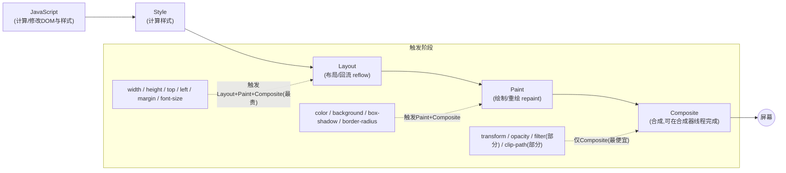
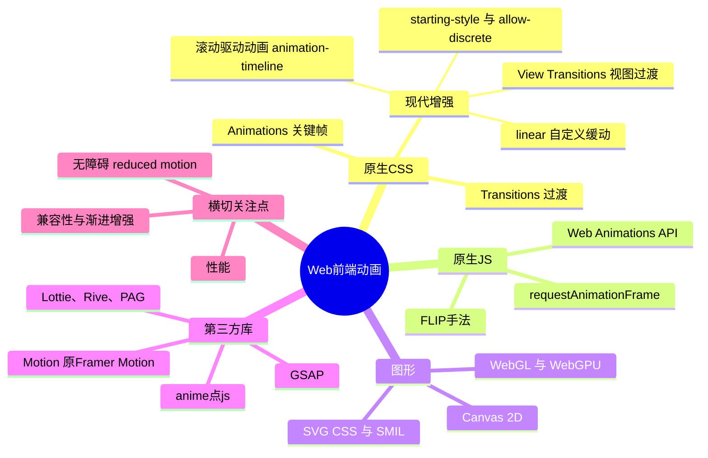
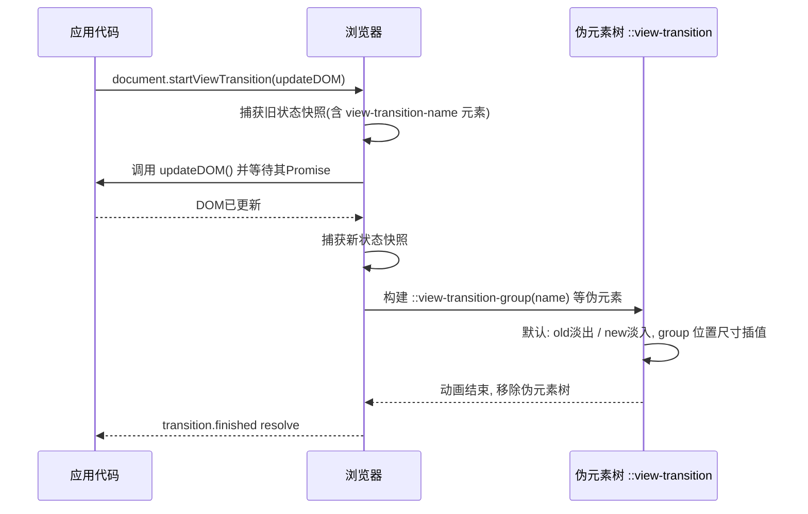
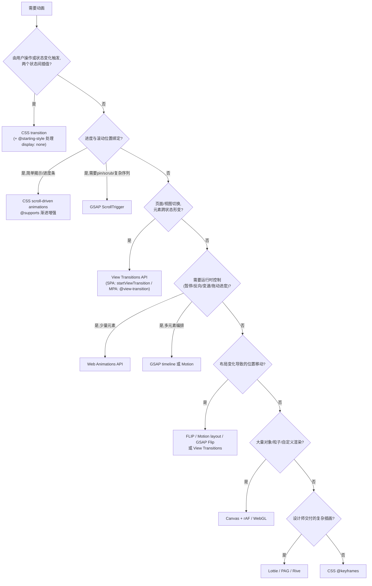

[toc]

## 内容大纲

- 动画的本质:浏览器渲染管线与"合成器友好"
- 技术全景:五大类技术及其定位
- 原生CSS:Transitions、Animations、现代增强(`@starting-style`、滚动驱动、View Transitions)
- 原生JS:Web Animations API、`requestAnimationFrame`、FLIP手法
- 矢量与图形:SVG、Canvas/WebGL
- 第三方库:GSAP、Motion、Lottie/Rive、国内方案
- 选型决策
- 实践注意事项:性能、无障碍、兼容性、跨平台、国内网络、中文文本
- 综合演示页面(单文件,零依赖)
- 自查与总结

---

## 动画的本质:渲染管线与合成器

要写出不卡顿的动画,**必须**先理解浏览器每一帧(60Hz下约16.7ms,120Hz下约8.3ms)要做的工作。通常称为**像素管线(Pixel Pipeline)**:



核心规则(未经本轮搜索验证,但属于长期稳定的业界共识):

- **合成器线程(Compositor Thread)**与**主线程(Main Thread)**相互独立。只改变`transform`和`opacity`的动画可以完全由合成器线程驱动,**即便主线程被JavaScript阻塞,动画仍然流畅**。演示页面中专门设计了"阻塞主线程"按钮来直观验证这一点。
- 改变几何属性(`width`、`left`、`margin`等)会触发**布局(Layout)**,布局会连锁影响其他元素,成本最高;在动画中应避免。
- 搜索结果也印证了这一思路:CSS滚动驱动动画的性能优势之一就是在合成器线程运行,默认60fps;而JavaScript方案在主线程运行,可能造成卡顿。

---

## 技术全景



| 类别            | 代表技术                                                  | 适用场景                                   | 主要优点                             | 主要局限                              |
| --------------- | --------------------------------------------------------- | ------------------------------------------ | ------------------------------------ | ------------------------------------- |
| CSS过渡         | `transition`                                              | 悬停、焦点、状态切换的简单插值             | 零JS、声明式、可合成器加速           | 只能在两个状态间插值,需有状态变化触发 |
| CSS关键帧       | `@keyframes`+`animation`                                  | 循环、多阶段、加载指示器                   | 多阶段控制、可暂停                   | 编排多个元素时序较困难                |
| CSS现代增强     | `@starting-style`、`animation-timeline`、View Transitions | 入场/退场、滚动联动、页面切换              | 原生、零依赖、渐进增强友好           | 浏览器支持仍在收敛(尤其Firefox)       |
| WAAPI           | `Element.animate()`                                       | 需要运行时控制(暂停、反向、变速、拖拽进度) | 原生、可与CSS动画互操作、性能等同CSS | 复杂编排需自己写时间线                |
| rAF             | `requestAnimationFrame`                                   | Canvas、物理模拟、自定义渲染               | 任意逻辑                             | 全部在主线程、需自行处理时间步长      |
| GSAP            | `gsap.to`、`timeline`、`ScrollTrigger`                    | 复杂编排、滚动叙事、SVG变形                | 功能最全、生态成熟                   | 需引入JS、学习成本                    |
| Motion          | `animate()`、`motion.div`                                 | React/Vue组件动画、布局动画                | 混合引擎、体积小、MIT                | 复杂时间线不如GSAP                    |
| Lottie/Rive/PAG | 设计稿导出播放                                            | 复杂插画、吉祥物、图标动效                 | 设计师主导、还原度高                 | 运行时体积、文本/字体处理             |

---

## 原生CSS动画

### CSS Transitions(过渡)

过渡是最常用、最轻量的动画形式:当某个属性的值发生变化时,浏览器自动在新旧值之间插值。

形式化用法:

```css
.selector {
  transition: <property> <duration> <timing-function> <delay> <behavior>;
}
```

| 占位符              | 对应长属性                   | 含义                                                         | 建议                                                  |
| ------------------- | ---------------------------- | ------------------------------------------------------------ | ----------------------------------------------------- |
| `<property>`        | `transition-property`        | 要过渡的属性名,可逗号分隔多个                                | **避免**`all`,显式列出属性,防止意外过渡与性能浪费     |
| `<duration>`        | `transition-duration`        | 持续时间,如`200ms`、`.3s`                                    | UI微交互推荐150ms到300ms;大面积移动可到400ms到500ms   |
| `<timing-function>` | `transition-timing-function` | 缓动曲线:`ease`、`ease-out`、`cubic-bezier()`、`steps()`、`linear()` | 入场用`ease-out`,退场用`ease-in`,位移类用自定义贝塞尔 |
| `<delay>`           | `transition-delay`           | 延迟开始时间                                                 | 可用于错落(stagger)效果                               |
| `<behavior>`        | `transition-behavior`        | `normal`或`allow-discrete`,控制离散属性(如`display`)能否参与过渡 | 见下文"现代增强"                                      |

示例(卡片悬停抬起,只动`transform`与`box-shadow`):

```css
.card {
  transition: transform 250ms cubic-bezier(.2,.8,.2,1), box-shadow 250ms ease;
}
.card:hover,
.card:focus-visible {
  transform: translateY(-4px);
  box-shadow: 0 12px 24px rgb(0 0 0 / .15);
}
```

注意事项:

- **必须**同时为`:hover`与`:focus-visible`提供反馈,保证键盘用户的可感知性。
- `transitionend`事件**对每个属性各触发一次**,若监听"动画结束"做后续逻辑,应使用`element.getAnimations()`配合`Promise.all(anims.map(a => a.finished))`,或监听时判断`event.propertyName`。
- 若属性值实际未改变,过渡不会发生、`transitionend`也不会触发,业务逻辑不要依赖"一定触发"。

### CSS Animations(关键帧动画)

```css
@keyframes <name> {
  from { /* 或 0% */ }
  50%  { /* 任意百分比 */ }
  to   { /* 或 100% */ }
}
.selector {
  animation: <name> <duration> <timing-function> <delay> <iteration-count> <direction> <fill-mode> <play-state>;
}
```

| 占位符              | 长属性                      | 含义                                                         | 常见陷阱                                        |
| ------------------- | --------------------------- | ------------------------------------------------------------ | ----------------------------------------------- |
| `<name>`            | `animation-name`            | 关键帧名称                                                   | 不要与CSS关键字(如`none`、`infinite`)同名       |
| `<iteration-count>` | `animation-iteration-count` | 次数或`infinite`                                             | 无限动画**必须**考虑减弱动效偏好                |
| `<direction>`       | `animation-direction`       | `normal`、`reverse`、`alternate`、`alternate-reverse`        | 配合`alternate`做往返无需写回程关键帧           |
| `<fill-mode>`       | `animation-fill-mode`       | `none`、`forwards`、`backwards`、`both`:动画前后是否保持关键帧状态 | 最常见的bug是忘写`forwards`导致动画结束后"弹回" |
| `<play-state>`      | `animation-play-state`      | `running`或`paused`                                          | 通过切换class暂停,比移除动画更平滑              |
| `<timing-function>` | `animation-timing-function` | 同过渡;`steps(n)`用于逐帧精灵图                              | 缓动作用于**每两个关键帧之间**,不是整段         |

现代缓动函数`linear()`(未经本轮搜索验证,Chrome 113+、Firefox 112+、Safari 17.2+):通过一组采样点逼近任意曲线,可用纯CSS实现弹簧、回弹等以往只能靠JS的效果。演示页面中有示例。

### 现代增强一:`@starting-style`与`transition-behavior: allow-discrete`

长期以来`display`、`visibility`这类离散属性无法过渡;元素一旦为`display: none`就被移出渲染树,因此出现或消失时无法运行任何`transform`或`opacity`过渡。现在由两个特性配合解决:

| 特性                                  | 作用                                                         | 职责辨析                                             |
| ------------------------------------- | ------------------------------------------------------------ | ---------------------------------------------------- |
| `@starting-style`                     | 定义元素**首次渲染那一帧**("第0帧")的样式,作为过渡的起点     | 负责**入场**:从`display: none`或刚插入DOM时的起始值  |
| `transition-behavior: allow-discrete` | 允许离散属性参与过渡:它不会插值离散属性本身(没有"一半的display"),但允许在离散属性切换前先完成过渡 | 负责**退场**:让`display: none`延迟到过渡结束后再生效 |

二者分工明确:从`display: none`到`display: block`并带过渡,需要两部分同时存在——`display`的变化需要`allow-discrete`,起始值需要`@starting-style`。

示例(对话框入场与退场,含`::backdrop`与顶层`overlay`):

```css
dialog {
  opacity: 0;
  translate: 0 20px;
  /* allow-discrete 需紧跟在对应属性之后 */
  transition:
    opacity .4s, translate .4s,
    display .4s allow-discrete,
    overlay .4s allow-discrete;
}
dialog[open] {
  opacity: 1;
  translate: 0 0;
}
@starting-style {
  dialog[open] { opacity: 0; translate: 0 20px; }
}
```

关键注意事项:

- 简写顺序:如果把`transition-behavior: allow-discrete`写在`transition`简写**之前**,会被简写覆盖而失效;在简写中只需对确实需要离散过渡的属性加`allow-discrete`关键字。
- `@starting-style`只在元素进入时生效,并且不要在其中设置`display`。
- `overlay`属性用于顶层元素(`<dialog>`、`popover`),对`overlay`使用`allow-discrete`可让顶层元素在退场过渡期间保持可见。
- 支持情况:web.dev在2024年发文宣布该组合进入Baseline(文章标题为*Now in Baseline: animating entry effects*)。一篇2026年的实践文章给出的版本为Chrome 117+、Firefox 124+、Safari 18.2+(与我记忆中的MDN数据略有出入,请以MDN为准)。

### 现代增强二:滚动驱动动画(Scroll-driven Animations)

原理:把动画的"时间轴"从时钟替换为**滚动进度**,动画进度完全由滚动位置决定。无需IntersectionObserver、无需滚动事件监听、不阻塞主线程,动画运行在合成器上。

形式化用法:

```css
.el {
  animation: <keyframes-name> linear both;   /* 时间轴来自滚动时无需 duration */
  animation-timeline: scroll(<scroller> <axis>) | view(<axis> <inset>) | --custom-name;
  animation-range: <start-name> <start-offset> <end-name> <end-offset>;
}
```

| 占位符                      | 取值                                                         | 含义                                                         |
| --------------------------- | ------------------------------------------------------------ | ------------------------------------------------------------ |
| `scroll()`的`<scroller>`    | `nearest`(默认)、`root`、`self`                              | 以哪个滚动容器的滚动进度作为时间轴                           |
| `<axis>`                    | `block`(默认)、`inline`、`x`、`y`                            | 滚动轴向                                                     |
| `view()`的`<inset>`         | 长度或百分比                                                 | 视口判定区域的内缩,类似IntersectionObserver的`rootMargin`    |
| `animation-range`的`<name>` | `cover`、`contain`、`entry`、`exit`、`entry-crossing`、`exit-crossing` | 元素相对滚动口(scrollport)的可见阶段:`entry`指元素从开始进入到完全进入 |
| `<offset>`                  | 百分比或长度                                                 | 阶段内的进度位置,如`entry 0% entry 60%`表示进入过程的前60%   |
| `--custom-name`             | 自定义时间轴                                                 | 通过`scroll-timeline-name`/`view-timeline-name`在其他元素上声明,再在后代引用 |

示例(滚动进度条与元素渐显,带渐进增强):

```css
/* 回退:默认状态即可见 */
.reveal { opacity: 1; }

@supports (animation-timeline: view()) {
  .reveal {
    animation: reveal-in linear both;
    animation-timeline: view();
    animation-range: entry 0% entry 60%;
  }
}
@keyframes reveal-in {
  from { opacity: 0; transform: translateY(40px); }
}
```

**浏览器支持(本轮搜索来源之间存在冲突,务必注意)**:

- 一致的部分:Chrome和Edge自Chrome 115(2023年7月)起无需标志即支持;Safari 26于2025年9月落地该特性,26.4加入线程化的滚动驱动动画,26.5修复了一批进度精度与`animation-play-state`问题。
- 冲突的部分(Firefox):一方说截至Firefox 152(2026年6月)该特性在稳定版中仍位于`layout.css.scroll-driven-animations.enabled`标志之后,Nightly默认开启,并且是Interop 2026的命名优先项;另一来源却声称Firefox 132+已稳定支持。综合多数来源与Interop 2026的表述,我倾向于**Firefox稳定版尚未默认开启**的说法,请以caniuse当前数据为准。
- 失败模式友好:不支持的浏览器只是"没有动画"而不是"页面损坏"。所以**推荐**的写法是:把揭示后的状态写成默认值,把运动包在`@supports`里。

能力边界:原生滚动驱动动画覆盖约80%的简单效果;GSAP仍然掌握复杂的20%,如固定(pinned)式滚动叙事、拖动式时间线、多元素协同序列。简单揭示用CSS,真正的时间线控制用GSAP。

### 现代增强三:View Transitions(视图过渡)

视图过渡让浏览器**对DOM变化前后分别截图**,然后在两张"快照"之间做动画。分为两种:

| 类型                   | 触发方式                                                     | 典型场景                        | 支持情况                                                     |
| ---------------------- | ------------------------------------------------------------ | ------------------------------- | ------------------------------------------------------------ |
| 同文档(same-document)  | `document.startViewTransition(callback)`                     | SPA路由切换、列表重排、主题切换 | 2025年10月进入Baseline Newly Available:Chrome 111+、Edge 111+、Firefox 133+、Safari 18+(另一来源称Firefox为144+,版本号请以MDN为准) |
| 跨文档(cross-document) | CSS声明`@view-transition { navigation: auto; }`,两个页面都需声明 | MPA多页站点的页面切换           | Chrome 126+、Edge 126+、Opera 112+、Safari 18.2+;Firefox尚不支持(个别来源称Firefox已支持,与Chrome官方文档矛盾,请核实) |

工作机制:



伪元素树各层含义:

| 伪元素                                 | 含义                                    |
| -------------------------------------- | --------------------------------------- |
| `::view-transition`                    | 覆盖整个视口的根容器                    |
| `::view-transition-group(<name>)`      | 每个命名元素一个组,负责位置与尺寸的插值 |
| `::view-transition-image-pair(<name>)` | 包裹新旧快照的容器                      |
| `::view-transition-old(<name>)`        | 旧状态快照,默认淡出                     |
| `::view-transition-new(<name>)`        | 新状态快照,默认淡入                     |

`<name>`为`root`时指整个页面;通过`view-transition-name: 任意名称`可让某元素独立参与"形变"过渡。

示例(同文档,列表重排):

```js
function reorder(updateDOM) {
  // 渐进增强:不支持或用户偏好减弱动效时直接更新
  if (!document.startViewTransition || prefersReducedMotion()) {
    updateDOM();
    return;
  }
  document.startViewTransition(updateDOM);
}
```

```css
::view-transition-old(root),
::view-transition-new(root) { animation-duration: .4s; }
```

注意事项:

- 每个`view-transition-name`在同一页面内只能被一个元素使用,列表项需动态赋名(如`item-${id}`)。
- 对不支持的浏览器,回退就是普通导航;`@view-transition`与`view-transition-name`会被直接忽略。
- 过渡期间页面不可交互(伪元素树覆盖视口),**应**把持续时间控制在300ms到500ms。
- 框架集成:React 19.2提供`<ViewTransition>`组件代为调用`document.startViewTransition`;Next.js App Router与React Router有类似封装。

---

## 原生JavaScript动画

### Web Animations API(WAAPI)

WAAPI是CSS动画引擎的JavaScript接口(未经本轮搜索验证,但API已稳定多年,所有现代浏览器支持)。它与CSS动画使用**同一引擎**,因此`transform`/`opacity`同样可以合成器加速,同时又具备完整的运行时控制。

形式化用法:

```js
const animation = element.animate(keyframes, options);
```

| 参数/字段                    | 类型                                            | 含义                                                         |
| ---------------------------- | ----------------------------------------------- | ------------------------------------------------------------ |
| `keyframes`                  | 数组或对象                                      | 数组形式:`[{transform:'...'}, {transform:'...', offset:.7}, {...}]`;`offset`为0到1的关键帧位置,可省略(均匀分布) |
| `options.duration`           | 毫秒                                            | 持续时间                                                     |
| `options.easing`             | 字符串                                          | 缓动,同CSS                                                   |
| `options.delay` / `endDelay` | 毫秒                                            | 前后延迟                                                     |
| `options.iterations`         | 数字或`Infinity`                                | 次数                                                         |
| `options.direction`          | 字符串                                          | 同`animation-direction`                                      |
| `options.fill`               | `'none'`、`'forwards'`、`'backwards'`、`'both'` | 同`animation-fill-mode`                                      |
| `options.composite`          | `'replace'`、`'add'`、`'accumulate'`            | 多个动画作用于同一属性时如何合成                             |
| 返回值`animation`            | `Animation`对象                                 | 提供`play()`、`pause()`、`reverse()`、`cancel()`、`finish()`、`playbackRate`、`currentTime`、`finished`(Promise)、`onfinish` |

还可通过`element.getAnimations()`与`document.getAnimations()`拿到**CSS声明的动画**并控制它们,这是CSS与JS互操作的关键。

注意事项:

- 对`iterations: Infinity`的动画调用`finish()`会抛出`InvalidStateError`。
- 元素销毁(组件卸载)前**应**调用`animation.cancel()`,避免悬挂引用。
- `fill: 'forwards'`会让动画永久"持有"属性值并覆盖样式表,长期大量使用会造成内存与样式冲突;更稳妥的做法是在`finished`后把终值写入样式再`cancel()`,或用`commitStyles()`。

### `requestAnimationFrame`(rAF)

rAF是所有自定义渲染(Canvas、WebGL、物理模拟)的基石。**必须**遵守的规则:

- 使用回调参数的**时间戳计算增量时间(delta time)**,而不是假设每帧16.7ms,否则高刷新率(120Hz)或掉帧时速度不一致。
- 对增量时间设上限(如50ms),避免切回标签页时物体"瞬移"。
- 标签页隐藏时rAF会自动暂停,但**应**配合`visibilitychange`与IntersectionObserver,在不可见时停止循环以节省电量。
- 在rAF回调中**先读后写**:先集中读取`getBoundingClientRect`等布局信息,再集中写样式,避免**布局抖动(layout thrashing)**。

### FLIP手法

FLIP(First, Last, Invert, Play)用于把"布局变化"(如列表重排、元素放大到全屏)这类本应触发Layout的动画,转换为只用`transform`的合成器动画。步骤线性、简单,直接列出:

- **First**:记录每个元素变化前的位置与尺寸(`getBoundingClientRect()`)。
- **Last**:同步执行真正的DOM/布局变化,再次记录位置与尺寸。
- **Invert**:计算差值,立即给元素施加反向`transform`,使其在视觉上"看起来仍在原位"。
- **Play**:从反向`transform`过渡到`none`,元素平滑"滑"到新位置。

现代浏览器中Invert与Play可直接用`element.animate([{transform: 'translate(dx,dy)'}, {transform: 'none'}], ...)`一步完成(见演示页面)。GSAP的`Flip`插件与Motion的`layout`属性是该手法的工程化封装;View Transitions则可视为浏览器内置的、基于快照的FLIP泛化。

---

## SVG与Canvas/WebGL

### SVG

- **CSS驱动**:绝大多数SVG表现属性(`fill`、`stroke`、`transform`、`opacity`)可直接用CSS过渡/动画。最经典的是**描边绘制**:设置`pathLength="1"`归一化后,用`stroke-dasharray: 1`与`stroke-dashoffset`从1到0过渡即可。
- **SMIL**(`<animate>`、`<animateTransform>`、`<animateMotion>`):内嵌在SVG中的声明式动画,所有现代浏览器支持,适合独立的SVG资源文件(如图标),但与CSS/JS的互操作较弱,**不推荐**作为主要方案。
- 注意SVG内`transform-origin`默认基于SVG视口左上角而非元素自身,需设置`transform-box: fill-box; transform-origin: center;`。
- 路径形变(morph)需要两条路径点数一致,原生无法直接做到,GSAP的MorphSVG(现已免费)是常用方案。

### Canvas 2D与WebGL/WebGPU(未经本轮搜索验证)

- Canvas适合**粒子、大量对象、图表、游戏**,所有绘制逻辑由你在rAF循环中完成,DOM开销为零,但主线程压力完全取决于你的代码。
- **必须**处理设备像素比(`devicePixelRatio`),否则高分屏下模糊;注意调整`canvas.width/height`会重置绘图状态。
- `OffscreenCanvas`可把绘制移入Web Worker,避免阻塞主线程。
- WebGL(Three.js、PixiJS、Babylon.js)与WebGPU用于3D与超大规模2D渲染,属于独立专题,本文不展开。

---

## 第三方库

### GSAP

GSAP(GreenSock Animation Platform)是功能最全面的JS动画平台。重大变化:得益于Webflow,GSAP现已100%免费,包括此前仅对Club GSAP会员开放的全部付费插件(SplitText、MorphSVG等),且允许商业使用。所有付费插件已加入GSAP的GitHub主仓库与npm包。背景是2024年10月Webflow宣布收购GSAP。

核心概念:

| 概念                                | 说明                                                         |
| ----------------------------------- | ------------------------------------------------------------ |
| `gsap.to()` / `from()` / `fromTo()` | 单个补间(tween),第一个参数为目标(选择器或元素),第二个为属性与配置 |
| `gsap.timeline()`                   | 时间线,用于编排多个补间;**位置参数**(如`"-=0.2"`、`"<"`)是其编排能力的核心 |
| `ScrollTrigger`                     | 滚动触发与滚动拖动(scrub)、固定(pin),是复杂滚动叙事的事实标准 |
| `Flip`                              | FLIP手法的封装                                               |
| `SplitText`                         | 把文本拆为字符/单词/行以做逐字动画;3.13重写后体积减半并新增14项特性 |
| `MorphSVG`、`DrawSVG`、`MotionPath` | SVG形变、描边、路径运动                                      |

示例:

```js
import gsap from "gsap";
import { ScrollTrigger } from "gsap/ScrollTrigger";
gsap.registerPlugin(ScrollTrigger);

const tl = gsap.timeline({ defaults: { ease: "power2.out", duration: .6 } });
tl.from(".hero-title", { y: 40, opacity: 0 })
  .from(".hero-sub",   { y: 20, opacity: 0 }, "-=0.3")   // 与上一个重叠0.3秒
  .from(".hero-cta",   { scale: .9, opacity: 0 }, "<");  // 与上一个同时开始

gsap.to(".panel", {
  xPercent: -100,
  scrollTrigger: { trigger: ".panel-wrap", start: "top top", end: "+=2000", scrub: 1, pin: true }
});
```

注意事项:

- GSAP默认也优先动`transform`,但它允许你动任何属性,**应**自觉避免布局属性。
- 在React/Vue中使用时要在组件卸载时清理(GSAP提供`gsap.context()`与`useGSAP`钩子)。
- 国内安装:npm包公开可用,可走npmmirror;CDN见后文"国内网络"一节。

### Motion(原Framer Motion)

Framer Motion已独立,更名为Motion,成为面向React与所有JavaScript环境的动画库。包名由`framer-motion`改为`motion`,React推荐导入路径为`motion/react`;旧包仍可用但不再积极开发。官方定位:MIT开源、完全免费;"混合引擎"——在一个库中同时使用JavaScript与硬件加速的浏览器API。

与GSAP的差异化(第三方评测观点):Motion适合用声明式方式为自己的React组件编写布局、退场与手势动画;局限在于`useScroll`在固定(pin)与复杂拖动上不及GSAP ScrollTrigger深入,多元素时间线编排也不如`gsap.timeline()`的位置参数表达力强。

示例(React):

```jsx
import { motion, AnimatePresence } from "motion/react";

function Toast({ open, children }) {
  return (
    <AnimatePresence>
      {open && (
        <motion.div
          initial={{ opacity: 0, y: 20 }}
          animate={{ opacity: 1, y: 0 }}
          exit={{ opacity: 0, y: 20 }}
          transition={{ type: "spring", stiffness: 300, damping: 24 }}
        >
          {children}
        </motion.div>
      )}
    </AnimatePresence>
  );
}
```

原生JS写法:`import { animate } from "motion"; animate(".box", { x: 100 }, { duration: .5 });`。

### 其他库与设计稿驱动方案(未经本轮搜索验证,请核实最新许可)

| 方案                            | 类型                      | 说明                                                         |
| ------------------------------- | ------------------------- | ------------------------------------------------------------ |
| anime.js                        | 轻量JS动画库              | v4重写,MIT;适合中小型项目的补间与时间线                      |
| Lottie(`lottie-web`、dotLottie) | After Effects导出JSON播放 | Airbnb开源;Web端有SVG/Canvas渲染器;中文文本层需注意字体与字形嵌入 |
| Rive                            | 自带编辑器与运行时        | 支持状态机与交互,运行时体积小;**编辑器与运行时的许可政策近年有调整,请自行核实** |
| 腾讯PAG(libpag)                 | 国产开源,AE导出           | 二进制格式、支持Web(WebAssembly);对中文文本支持较好          |
| 蚂蚁Galacean Effects            | 国产开源                  | 面向营销与互动特效的运行时                                   |

**推荐原则**:UI状态反馈用CSS/WAAPI;复杂编排用GSAP;React组件化用Motion;插画类内容用Lottie/PAG;需要交互状态机的角色动画用Rive。

---

## 选型决策



决策原则概括:**能用CSS就不用JS;能用原生就不引库;能只动`transform`/`opacity`就绝不动布局属性;所有增强都以"不支持时页面依然可用"为底线**。

---

## 实践注意事项

### 性能

| 等级 | 规则                                                         |
| ---- | ------------------------------------------------------------ |
| 必须 | 只用`transform`与`opacity`做持续运动;避免动画`width`、`height`、`top`、`left`、`margin`、`padding`、`font-size`、`box-shadow`(大面积) |
| 必须 | 不要在`scroll`、`resize`、`mousemove`事件中同步修改样式;使用rAF合并,或改用CSS滚动驱动动画 |
| 应该 | 在rAF与事件处理中**先读后写**,避免布局抖动                   |
| 应该 | `will-change`仅在动画**即将开始前**加、结束后移除;**避免**在全局样式表中对大量元素常驻`will-change`(会创建大量合成层,反而耗内存) |
| 应该 | 为独立动画区域设置`contain: layout paint`或`content-visibility: auto`以限制重排/重绘范围 |
| 应该 | 关注INP(Interaction to Next Paint):交互触发的动画由CSS class切换或WAAPI启动,避免在事件回调里做重计算 |
| 可以 | 用Chrome DevTools的Performance面板、Rendering面板中的"Paint flashing"与"Layer borders"、Animations抽屉诊断;Firefox有Animation Inspector |
| 避免 | 使用过时的`transform: translateZ(0)`"硬件加速黑科技"替代`will-change` |
| 避免 | 在动画中改变会触发字体重排的属性;缩放文字时考虑在容器上缩放再回正 |

### 无障碍:`prefers-reduced-motion`

部分用户(前庭障碍、偏头痛、注意力障碍)会被大幅位移、缩放、视差、自动播放的动画严重影响。各操作系统均有开关(Windows:设置,辅助功能,视觉效果,动画效果;macOS/iOS:辅助功能,显示,减弱动态效果;Android:开发者选项或辅助功能的"移除动画")。

**必须**做的最小实现:

```css
@media (prefers-reduced-motion: reduce) {
  *, *::before, *::after {
    animation-duration: .01ms !important;
    animation-iteration-count: 1 !important;
    transition-duration: .01ms !important;
    scroll-behavior: auto !important;
  }
}
```

**推荐**的更精细做法(而非一刀切):

- 把运动类动画(位移、缩放、视差、自动轮播)关闭或替换为**不透明度淡入淡出**;颜色、不透明度变化通常可以保留。Motion官方的处理策略可作参考:入场与退场变为不超过0.3秒的短暂淡入淡出,入场终点与完整动画一致;悬停、循环等其他运动关闭;不透明度、颜色、滤镜、阴影变化以及延迟与错落予以保留。
- 在JS中用`matchMedia('(prefers-reduced-motion: reduce)')`判定,并监听其`change`事件;Canvas与WAAPI动画据此跳过或降级。
- **可以**在站内提供独立的"减弱动效"开关,覆盖系统偏好(演示页面实现了该模式)。
- 把系统偏好设为`.01ms`而非`0`,是为了保证`animationend`/`transitionend`事件仍会触发,依赖它们的业务逻辑不会卡住。

### 兼容性与渐进增强

- 使用`@supports (animation-timeline: scroll())`、`@supports (transition-behavior: allow-discrete)`、`if (document.startViewTransition)`、`'CSSStartingStyleRule' in window`等做特性检测,**不要**做UA嗅探。
- 把**最终可见状态**作为无动画时的默认状态,运动只作为增强。
- 国内浏览器生态:微信内置浏览器(X5/XWeb内核,基于较新Chromium但版本滞后)、各厂商系统浏览器、钉钉/飞书容器,普遍滞后桌面Chrome数个大版本;iOS上所有浏览器均为WebKit内核,因此Safari版本决定了iOS全部浏览器的能力。上线前**必须**在目标容器中实测。

### 跨平台差异

- **刷新率**:Windows与Android高刷设备越来越多,rAF逻辑必须基于delta time;CSS/WAAPI动画由浏览器处理,无此问题。
- **文字渲染**:Windows下ClearType与缩放动画叠加时文字常出现模糊或抖动;策略是最终状态`scale(1)`、动画期间可临时提升到合成层,结束后移除。
- **滚动行为**:macOS触控板与Windows鼠标滚轮的滚动事件频率和惯性差异明显,基于滚动事件的JS视差在Windows上更容易卡顿,这也是优先选用CSS滚动驱动动画的理由。
- **电量与性能**:移动端合成层数量受限、GPU内存更小,`will-change`滥用在手机上后果更严重。
- 换行符等源码层面的跨平台问题与本话题关系不大,略。

### 国内网络环境

- npm安装:GSAP、Motion、anime.js、lottie-web均为公开npm包,设置`npm config set registry https://registry.npmmirror.com`即可。
- CDN:`unpkg.com`在国内不稳定;`cdn.jsdelivr.net`时好时坏;**推荐**国内可达的`https://registry.npmmirror.com/<包名>/<版本>/files/<文件路径>`(npmmirror的文件CDN)、BootCDN、七牛Staticfile(请在使用前自行验证当前可用性)。
- 开发环境可通过本地代理(如mihomo)访问GitHub与文档站;Windows下在系统代理或终端环境变量`HTTP_PROXY`/`HTTPS_PROXY`中设置,`*nix`下在shell中`export`同名变量;npm/pnpm还可单独配置`proxy`/`https-proxy`。
- 生产服务器在国外、用户在国内时,动画库体积直接影响首屏:GSAP核心约23KB gzip,Motion完整约30KB以上gzip(来源为第三方评测,数值随版本变化)。**应**按需引入并开启tree-shaking,或优先原生方案(0KB)。
- 演示页面特意做成**零外部依赖**,国内无代理也能直接打开。

### 中文与非ASCII文本

- 逐字/逐词动画:GSAP SplitText、Motion的文本拆分工具默认以空格分词,中文没有空格,逐词模式会把整句当一个词;**应**使用逐字(chars)模式,或用`Intl.Segmenter('zh', {granularity: 'word'})`自行分词后再包裹`<span>`。
- Lottie的文本层默认依赖设计机器上的字体,中文字体体积大且常不嵌入,Web端会退化为系统字体甚至显示方框;**推荐**在AE中把中文文本转为形状图层(outline)后再导出,或使用对中文文本处理更友好的PAG。
- 字体加载导致的FOUT会与入场动画叠加产生"闪烁",**应**使用`font-display: swap`并在关键字体就绪(`document.fonts.ready`)后再触发入场动画。
- 竖排(`writing-mode: vertical-rl`)下`translateX/Y`的直觉方向不变,但`inline`/`block`滚动轴会对调,滚动驱动动画中`axis`取值需要留意。

---

## 综合演示页面

下面是一个**单文件、零外部依赖**的演示页面,覆盖:CSS过渡、关键帧与`linear()`缓动、`@starting-style`对话框与popover、滚动驱动进度条与揭示、同文档View Transitions(列表重排、主题切换)、WAAPI交互控制、FLIP重排、SVG描边与SMIL、Canvas粒子(delta time、可见性暂停)、合成器与主线程对比实验、减弱动效开关、特性检测面板。所有现代特性均做了渐进增强,不支持的浏览器仍可正常使用。

保存为`web-animation-demo.html`,直接用浏览器打开即可(推荐Chrome 126+或Safari 26+以体验全部特性)。

```html
<!DOCTYPE html>
<html lang="zh-CN">
<head>
<meta charset="UTF-8">
<meta name="viewport" content="width=device-width, initial-scale=1">
<title>Web前端动画技术综合演示</title>
<style>
  /* ===== 基础与主题 ===== */
  :root {
    --bg: #f6f7fb; --fg: #1f2330; --muted: #6b7280; --card: #ffffff;
    --accent: #3b6cf6; --accent-2: #f65c3b; --ok: #16a34a; --no: #dc2626;
    --radius: 12px;
    --dur: .4s;
    --ease-out: cubic-bezier(.2, .8, .2, 1);
    color-scheme: light;
  }
  html[data-theme="dark"] {
    --bg: #15171f; --fg: #e8eaf2; --muted: #9aa3b5; --card: #1f2230;
    color-scheme: dark;
  }
  * { box-sizing: border-box; }
  body {
    margin: 0; background: var(--bg); color: var(--fg); line-height: 1.6;
    font-family: system-ui, -apple-system, "Segoe UI", "PingFang SC", "Microsoft YaHei", sans-serif;
    transition: background .4s, color .4s;
  }
  main { max-width: 960px; margin: 0 auto; padding: 24px 16px 96px; }
  section {
    background: var(--card); border-radius: var(--radius); padding: 20px 24px; margin: 24px 0;
    box-shadow: 0 1px 2px rgb(0 0 0 / .06);
  }
  h1 { font-size: 1.6rem; margin: 0 0 8px; }
  h2 { font-size: 1.2rem; margin: 0 0 12px; }
  p.note { color: var(--muted); font-size: .9rem; margin: 6px 0 12px; }
  code { font-family: ui-monospace, Consolas, "Courier New", monospace; font-size: .9em; }
  button, select {
    font: inherit; padding: 8px 14px; border-radius: 8px; border: 1px solid transparent;
    background: var(--accent); color: #fff; cursor: pointer;
    transition: transform 150ms var(--ease-out), background 150ms, box-shadow 150ms;
  }
  button:hover, button:focus-visible { transform: translateY(-1px); box-shadow: 0 4px 12px rgb(59 108 246 / .35); }
  button:active { transform: translateY(0) scale(.98); }
  button.secondary { background: transparent; color: var(--accent); border-color: currentColor; }
  .row { display: flex; flex-wrap: wrap; gap: 10px; align-items: center; margin: 10px 0; }
  .toolbar { position: sticky; top: 8px; z-index: 50; display: flex; gap: 8px; flex-wrap: wrap;
    background: var(--card); padding: 10px 14px; border-radius: var(--radius); box-shadow: 0 4px 16px rgb(0 0 0 / .08); }
  .badge { display: inline-block; padding: 2px 10px; border-radius: 999px; font-size: .8rem; color: #fff; background: var(--no); }
  .badge.ok { background: var(--ok); }
  #features li { margin: 4px 0; }

  /* ===== 滚动进度条:滚动驱动动画 ===== */
  #progress {
    position: fixed; top: 0; left: 0; width: 100%; height: 4px; z-index: 100;
    background: var(--accent); transform-origin: 0 50%; transform: scaleX(0);
    display: none; /* 不支持时隐藏 */
  }
  @supports (animation-timeline: scroll()) {
    #progress { display: block; animation: grow-x linear both; animation-timeline: scroll(root block); }
  }
  @keyframes grow-x { from { transform: scaleX(0); } to { transform: scaleX(1); } }

  /* ===== 滚动揭示:默认可见,支持时增强 ===== */
  .reveal { opacity: 1; }
  @supports (animation-timeline: view()) {
    .reveal {
      animation: reveal-in linear both;
      animation-timeline: view();
      animation-range: entry 0% entry 60%;
    }
  }
  @keyframes reveal-in { from { opacity: 0; transform: translateY(40px); } to { opacity: 1; transform: none; } }

  /* ===== CSS过渡:卡片 ===== */
  .card-demo {
    width: 180px; padding: 16px; border-radius: 10px; background: var(--bg);
    border: 1px solid rgb(0 0 0 / .08); outline: none;
    transition: transform 250ms var(--ease-out), box-shadow 250ms ease;
  }
  .card-demo:hover, .card-demo:focus-visible { transform: translateY(-4px); box-shadow: 0 12px 24px rgb(0 0 0 / .15); }

  /* ===== 关键帧:旋转器、脉冲、linear() 回弹 ===== */
  .spinner { width: 36px; height: 36px; border-radius: 50%; border: 4px solid rgb(59 108 246 / .25);
    border-top-color: var(--accent); animation: spin 1s linear infinite; }
  @keyframes spin { to { transform: rotate(360deg); } }
  .pulse { width: 36px; height: 36px; border-radius: 50%; background: var(--accent-2);
    animation: pulse 1.2s ease-in-out infinite alternate; }
  @keyframes pulse { from { transform: scale(.8); opacity: .6; } to { transform: scale(1.1); opacity: 1; } }
  .ball { width: 36px; height: 36px; border-radius: 50%; background: var(--ok); }
  .ball.bounce {
    /* linear() 以采样点逼近回弹曲线;不支持 linear() 的浏览器会忽略该声明并使用默认 ease */
    animation: drop 1.4s both;
    animation-timing-function: linear(0, 0.063, 0.25, 0.563, 1 36.4%, 0.812, 0.75, 0.813, 1 72.7%, 0.953, 0.938, 0.953, 1 90.9%, 0.984, 1);
  }
  @keyframes drop { from { transform: translateY(-80px); } to { transform: translateY(0); } }
  .paused { animation-play-state: paused; }

  /* ===== @starting-style:对话框与 popover ===== */
  dialog {
    border: none; border-radius: var(--radius); padding: 24px; max-width: 420px;
    background: var(--card); color: var(--fg);
    opacity: 0; translate: 0 20px;
    transition: opacity var(--dur), translate var(--dur),
                display var(--dur) allow-discrete, overlay var(--dur) allow-discrete;
  }
  dialog[open] { opacity: 1; translate: 0 0; }
  dialog::backdrop { background: rgb(0 0 0 / 0);
    transition: background var(--dur), display var(--dur) allow-discrete, overlay var(--dur) allow-discrete; }
  dialog[open]::backdrop { background: rgb(0 0 0 / .45); }
  @starting-style {
    dialog[open] { opacity: 0; translate: 0 20px; }
    dialog[open]::backdrop { background: rgb(0 0 0 / 0); }
  }
  [popover] {
    border: 1px solid rgb(0 0 0 / .1); border-radius: 10px; padding: 12px 16px; margin: auto;
    background: var(--card); color: var(--fg);
    opacity: 0; scale: .95;
    transition: opacity .25s, scale .25s, display .25s allow-discrete, overlay .25s allow-discrete;
  }
  [popover]:popover-open { opacity: 1; scale: 1; }
  @starting-style { [popover]:popover-open { opacity: 0; scale: .95; } }

  /* ===== View Transitions ===== */
  #vt-list { list-style: none; padding: 0; margin: 0; display: grid; gap: 8px; grid-template-columns: repeat(auto-fill, minmax(140px, 1fr)); }
  #vt-list li { padding: 12px; border-radius: 8px; background: var(--bg); text-align: center; border: 1px solid rgb(0 0 0 / .06); }
  ::view-transition-old(root), ::view-transition-new(root) { animation-duration: .45s; }

  /* ===== WAAPI ===== */
  .stage { position: relative; height: 72px; background: var(--bg); border-radius: 8px; overflow: hidden; }
  #waapi-box { position: absolute; top: 16px; left: 16px; width: 40px; height: 40px; border-radius: 8px; background: var(--accent); }
  input[type=range] { width: 240px; }

  /* ===== FLIP ===== */
  #flip-grid { display: grid; grid-template-columns: repeat(auto-fill, minmax(72px, 1fr)); gap: 8px; }
  #flip-grid button { padding: 18px 0; background: var(--bg); color: var(--fg); border: 1px solid rgb(0 0 0 / .08); }

  /* ===== SVG ===== */
  svg.draw-demo { width: 220px; height: 120px; }
  .draw { fill: none; stroke: var(--accent); stroke-width: 4; stroke-linecap: round; stroke-dasharray: 1; stroke-dashoffset: 0; }

  /* ===== Canvas ===== */
  #particles { width: 100%; height: 180px; display: block; border-radius: 8px; background: #0f1222; }

  /* ===== 性能对比 ===== */
  .race { position: relative; width: 320px; max-width: 100%; height: 48px; background: var(--bg); border-radius: 8px; overflow: hidden; margin: 8px 0; }
  .runner { position: absolute; top: 4px; left: 0; width: 40px; height: 40px; border-radius: 8px; }
  .runner-left { background: var(--accent-2); animation: move-left 1.5s ease-in-out infinite alternate; }
  @keyframes move-left { from { left: 0; } to { left: 272px; } }
  .runner-transform { background: var(--ok); animation: move-transform 1.5s ease-in-out infinite alternate; }
  @keyframes move-transform { from { transform: translateX(0); } to { transform: translateX(272px); } }

  /* ===== 减弱动效:系统偏好(无JS也生效) ===== */
  @media (prefers-reduced-motion: reduce) {
    *, *::before, *::after {
      animation-duration: .01ms !important; animation-iteration-count: 1 !important;
      transition-duration: .01ms !important; scroll-behavior: auto !important;
    }
    .reveal { animation: none !important; }
  }
  /* ===== 减弱动效:站内开关(由JS镜像系统偏好,并允许用户覆盖) ===== */
  html[data-reduced-motion="reduce"] *, html[data-reduced-motion="reduce"] *::before, html[data-reduced-motion="reduce"] *::after {
    animation-duration: .01ms !important; animation-iteration-count: 1 !important;
    transition-duration: .01ms !important; scroll-behavior: auto !important;
  }
  html[data-reduced-motion="reduce"] .reveal { animation: none !important; }
</style>
</head>
<body>
<div id="progress" aria-hidden="true"></div>

<main>
  <h1>Web前端动画技术综合演示</h1>
  <p class="note">单文件、零依赖。所有现代特性均做了渐进增强;不支持的浏览器中页面功能不受影响。</p>

  <div class="toolbar" role="toolbar" aria-label="全局控制">
    <button id="theme-toggle">切换主题(View Transition)</button>
    <button id="motion-toggle" class="secondary" aria-pressed="false">减弱动效:关</button>
  </div>

  <!-- 特性检测 -->
  <section>
    <h2>当前浏览器特性检测</h2>
    <ul id="features"></ul>
  </section>

  <!-- CSS 过渡 -->
  <section class="reveal">
    <h2>CSS Transitions(过渡)</h2>
    <p class="note">悬停或用Tab聚焦卡片。只过渡<code>transform</code>与<code>box-shadow</code>,并同时响应<code>:hover</code>与<code>:focus-visible</code>。</p>
    <div class="row">
      <div class="card-demo" tabindex="0">悬停 / 聚焦我</div>
      <div class="card-demo" tabindex="0">我也可以</div>
    </div>
  </section>

  <!-- CSS 关键帧 -->
  <section class="reveal">
    <h2>CSS Animations(关键帧)与 linear() 缓动</h2>
    <p class="note">旋转器与脉冲为无限循环;回弹小球使用<code>linear()</code>采样曲线。暂停通过<code>animation-play-state</code>实现。</p>
    <div class="row">
      <div class="spinner" id="spinner" aria-label="加载中"></div>
      <div class="pulse" id="pulse"></div>
      <div class="ball" id="ball"></div>
      <button id="toggle-loop" class="secondary">暂停 / 继续循环动画</button>
      <button id="replay-bounce" class="secondary">重播回弹</button>
    </div>
  </section>

  <!-- @starting-style -->
  <section class="reveal">
    <h2>@starting-style + allow-discrete:对话框与 Popover</h2>
    <p class="note">入场由<code>@starting-style</code>提供第0帧,退场由<code>transition-behavior: allow-discrete</code>延迟<code>display: none</code>与<code>overlay</code>。</p>
    <div class="row">
      <button id="open-dialog">打开对话框</button>
      <button popovertarget="tip" class="secondary">打开 Popover</button>
      <div id="tip" popover>这是一个原生 popover,带有缩放淡入与淡出过渡。</div>
    </div>
    <dialog id="dlg">
      <h3 style="margin-top:0">原生 &lt;dialog&gt;</h3>
      <p>背景遮罩<code>::backdrop</code>也参与过渡。按 Esc 或点击关闭。</p>
      <form method="dialog"><button>关闭</button></form>
    </dialog>
  </section>

  <!-- View Transitions -->
  <section class="reveal">
    <h2>View Transitions(同文档)</h2>
    <p class="note">每个列表项通过唯一的<code>view-transition-name</code>参与形变过渡;不支持时直接重排。顶部"切换主题"按钮演示<code>root</code>级交叉淡入淡出。</p>
    <div class="row"><button id="shuffle">随机重排列表</button></div>
    <ul id="vt-list">
      <li>北京</li><li>上海</li><li>广州</li><li>深圳</li><li>杭州</li><li>成都</li>
    </ul>
  </section>

  <!-- WAAPI -->
  <section class="reveal">
    <h2>Web Animations API(运行时控制)</h2>
    <p class="note"><code>element.animate()</code>返回<code>Animation</code>对象,可暂停、反向、变速、拖动<code>currentTime</code>。</p>
    <div class="stage"><div id="waapi-box"></div></div>
    <div class="row">
      <button id="w-play">播放</button>
      <button id="w-pause" class="secondary">暂停</button>
      <button id="w-reverse" class="secondary">反向</button>
      <button id="w-cancel" class="secondary">取消</button>
      <label>速率
        <select id="w-rate"><option>0.5</option><option selected>1</option><option>2</option></select>
      </label>
      <label>进度 <input type="range" id="w-scrub" min="0" max="2000" value="0"></label>
      <span id="w-status" class="note">状态:空闲</span>
    </div>
  </section>

  <!-- FLIP -->
  <section class="reveal">
    <h2>FLIP 手法(布局变化转为 transform 动画)</h2>
    <p class="note">点击任意方块将其移到首位。真实DOM顺序立即改变,动画只用<code>transform</code>完成。</p>
    <div id="flip-grid"></div>
  </section>

  <!-- SVG -->
  <section class="reveal">
    <h2>SVG:描边绘制(CSS/WAAPI)与 SMIL</h2>
    <p class="note">路径设置<code>pathLength="1"</code>后,用<code>stroke-dashoffset</code>从1到0绘制。右侧小方块由SMIL <code>&lt;animateTransform&gt;</code>旋转。</p>
    <div class="row">
      <svg class="draw-demo" viewBox="0 0 220 120" aria-hidden="true">
        <path id="draw-path" class="draw" pathLength="1"
              d="M10 90 C 40 10, 80 10, 110 60 S 180 110, 210 30"/>
        <rect x="150" y="70" width="30" height="30" rx="6" fill="#f65c3b" style="transform-box: fill-box; transform-origin: center;">
          <animateTransform attributeName="transform" type="rotate" from="0 165 85" to="360 165 85" dur="3s" repeatCount="indefinite"/>
        </rect>
      </svg>
      <button id="redraw" class="secondary">重新绘制路径</button>
    </div>
  </section>

  <!-- Canvas -->
  <section class="reveal">
    <h2>Canvas + requestAnimationFrame(粒子)</h2>
    <p class="note">基于时间增量更新;处理设备像素比;标签页隐藏或滚出视口时自动暂停;减弱动效时不启动。</p>
    <canvas id="particles" aria-label="粒子动画" role="img"></canvas>
    <div class="row">
      <button id="c-start">开始</button>
      <button id="c-stop" class="secondary">停止</button>
      <span id="c-fps" class="note">FPS: -</span>
    </div>
  </section>

  <!-- 性能对比 -->
  <section class="reveal">
    <h2>合成器线程 vs 主线程(性能实验)</h2>
    <p class="note">上方橙色方块动画<code>left</code>(需要主线程布局),下方绿色方块动画<code>transform</code>(合成器)。点击按钮用死循环阻塞主线程2秒,观察哪一个仍在运动。</p>
    <div class="race"><div class="runner runner-left"></div></div>
    <div class="race"><div class="runner runner-transform"></div></div>
    <div class="row"><button id="block-main">阻塞主线程 2 秒</button></div>
  </section>
</main>

<script>
(() => {
  'use strict';

  /* ===== 工具:减弱动效判定(系统偏好或站内开关) ===== */
  const mq = matchMedia('(prefers-reduced-motion: reduce)');
  const html = document.documentElement;
  let userOverride = null; // null=跟随系统, 'reduce' | 'no-preference'=用户显式选择
  const prefersReducedMotion = () => (userOverride ?? (mq.matches ? 'reduce' : 'no-preference')) === 'reduce';
  function applyMotionPref() {
    const reduce = prefersReducedMotion();
    html.dataset.reducedMotion = reduce ? 'reduce' : 'no-preference';
    const btn = document.getElementById('motion-toggle');
    btn.textContent = `减弱动效:${reduce ? '开' : '关'}`;
    btn.setAttribute('aria-pressed', String(reduce));
  }
  mq.addEventListener('change', applyMotionPref);
  document.getElementById('motion-toggle').addEventListener('click', () => {
    userOverride = prefersReducedMotion() ? 'no-preference' : 'reduce';
    applyMotionPref();
  });
  applyMotionPref();

  /* ===== 特性检测面板 ===== */
  const features = {
    'Web Animations API (element.animate)': 'animate' in Element.prototype,
    'CSS 滚动驱动动画 (animation-timeline)': CSS.supports('animation-timeline: scroll()'),
    'View Transitions 同文档 (document.startViewTransition)': 'startViewTransition' in document,
    'transition-behavior: allow-discrete': CSS.supports('transition-behavior: allow-discrete'),
    '@starting-style (CSSStartingStyleRule)': 'CSSStartingStyleRule' in window,
    'Popover API': Object.prototype.hasOwnProperty.call(HTMLElement.prototype, 'popover'),
    'linear() 缓动': CSS.supports('animation-timing-function: linear(0, 1)'),
    '系统偏好 prefers-reduced-motion: reduce': mq.matches,
  };
  const ul = document.getElementById('features');
  for (const [name, ok] of Object.entries(features)) {
    const li = document.createElement('li');
    li.innerHTML = `<span class="badge ${ok ? 'ok' : ''}">${ok ? '支持' : '不支持'}</span> ${name}`;
    ul.appendChild(li);
  }

  /* ===== 主题切换:root 级 View Transition ===== */
  function withViewTransition(update) {
    if (!document.startViewTransition || prefersReducedMotion()) { update(); return; }
    document.startViewTransition(update);
  }
  document.getElementById('theme-toggle').addEventListener('click', () => {
    withViewTransition(() => {
      html.dataset.theme = html.dataset.theme === 'dark' ? '' : 'dark';
    });
  });

  /* ===== 关键帧:暂停/继续与重播 ===== */
  const loops = [document.getElementById('spinner'), document.getElementById('pulse')];
  document.getElementById('toggle-loop').addEventListener('click', () => {
    loops.forEach(el => el.classList.toggle('paused'));
  });
  const ball = document.getElementById('ball');
  document.getElementById('replay-bounce').addEventListener('click', () => {
    ball.classList.remove('bounce');
    void ball.offsetWidth; // 强制一次样式刷新,使动画可重新触发
    ball.classList.add('bounce');
  });

  /* ===== 对话框 ===== */
  const dlg = document.getElementById('dlg');
  document.getElementById('open-dialog').addEventListener('click', () => dlg.showModal());
  dlg.addEventListener('click', e => { if (e.target === dlg) dlg.close(); }); // 点击遮罩关闭

  /* ===== View Transitions:列表重排 ===== */
  const vtList = document.getElementById('vt-list');
  [...vtList.children].forEach((li, i) => { li.style.viewTransitionName = `vt-item-${i}`; });
  document.getElementById('shuffle').addEventListener('click', () => {
    withViewTransition(() => {
      const items = [...vtList.children];
      for (let i = items.length - 1; i > 0; i--) {
        const j = Math.floor(Math.random() * (i + 1));
        [items[i], items[j]] = [items[j], items[i]];
      }
      items.forEach(li => vtList.appendChild(li));
    });
  });

  /* ===== WAAPI ===== */
  const box = document.getElementById('waapi-box');
  const DURATION = 2000;
  const anim = box.animate([
    { transform: 'translateX(0) rotate(0deg)', borderRadius: '8px' },
    { transform: 'translateX(240px) rotate(180deg)', borderRadius: '50%', offset: .7 },
    { transform: 'translateX(0) rotate(360deg)', borderRadius: '8px' }
  ], { duration: DURATION, easing: 'ease-in-out', fill: 'both' });
  anim.pause();
  const scrub = document.getElementById('w-scrub');
  const status = document.getElementById('w-status');
  const setStatus = () => { status.textContent = `状态:${anim.playState}`; };
  document.getElementById('w-play').addEventListener('click', () => {
    if (anim.playState === 'finished') anim.currentTime = 0;
    anim.play(); setStatus();
  });
  document.getElementById('w-pause').addEventListener('click', () => { anim.pause(); setStatus(); });
  document.getElementById('w-reverse').addEventListener('click', () => { anim.reverse(); setStatus(); });
  document.getElementById('w-cancel').addEventListener('click', () => { anim.cancel(); setStatus(); });
  document.getElementById('w-rate').addEventListener('change', e => {
    anim.updatePlaybackRate(Number(e.target.value)); // 平滑变速,不产生跳帧
  });
  scrub.addEventListener('input', () => { anim.pause(); anim.currentTime = Number(scrub.value); setStatus(); });
  anim.addEventListener('finish', setStatus);
  (function syncScrub() {
    if (anim.playState === 'running') scrub.value = String(Math.round(Number(anim.currentTime) || 0));
    requestAnimationFrame(syncScrub);
  })();

  /* ===== FLIP ===== */
  const grid = document.getElementById('flip-grid');
  for (let i = 1; i <= 12; i++) {
    const b = document.createElement('button');
    b.textContent = String(i);
    b.addEventListener('click', () => flip(grid, () => grid.prepend(b)));
    grid.appendChild(b);
  }
  function flip(container, mutate) {
    const els = [...container.children];
    const first = new Map(els.map(el => [el, el.getBoundingClientRect()])); // First
    mutate();                                                                // Last(真实DOM变化)
    if (prefersReducedMotion()) return;
    for (const el of els) {
      const f = first.get(el), l = el.getBoundingClientRect();
      const dx = f.left - l.left, dy = f.top - l.top;
      if (!dx && !dy) continue;
      el.animate([                                                           // Invert + Play
        { transform: `translate(${dx}px, ${dy}px)` },
        { transform: 'none' }
      ], { duration: 400, easing: 'cubic-bezier(.2,.8,.2,1)' });
    }
  }

  /* ===== SVG 描边:用 WAAPI 以便随时重播 ===== */
  const path = document.getElementById('draw-path');
  function drawPath() {
    path.getAnimations().forEach(a => a.cancel());
    path.animate([{ strokeDashoffset: 1 }, { strokeDashoffset: 0 }],
      { duration: prefersReducedMotion() ? 1 : 1800, easing: 'ease-out', fill: 'forwards' });
  }
  document.getElementById('redraw').addEventListener('click', drawPath);
  drawPath();

  /* ===== Canvas 粒子 ===== */
  const canvas = document.getElementById('particles');
  const ctx = canvas.getContext('2d');
  const fpsEl = document.getElementById('c-fps');
  let particles = [], rafId = null, last = 0, visible = true, frames = 0, fpsTimer = 0;
  function resize() {
    const dpr = Math.min(devicePixelRatio || 1, 2);
    const r = canvas.getBoundingClientRect();
    canvas.width = Math.round(r.width * dpr);
    canvas.height = Math.round(r.height * dpr);
    ctx.setTransform(dpr, 0, 0, dpr, 0, 0); // 以CSS像素为单位绘制
  }
  function spawn(n) {
    const r = canvas.getBoundingClientRect();
    particles = Array.from({ length: n }, () => ({
      x: Math.random() * r.width, y: Math.random() * r.height,
      vx: (Math.random() - .5) * 80, vy: (Math.random() - .5) * 80,
      size: 2 + Math.random() * 3, hue: 200 + Math.random() * 80
    }));
  }
  function frame(ts) {
    const dt = Math.min((ts - last) / 1000, .05); // 秒;上限避免切回标签页时瞬移
    last = ts;
    const w = canvas.getBoundingClientRect().width, h = canvas.getBoundingClientRect().height;
    ctx.fillStyle = 'rgba(15,18,34,.25)'; ctx.fillRect(0, 0, w, h);
    for (const p of particles) {
      p.x += p.vx * dt; p.y += p.vy * dt;
      if (p.x < 0 || p.x > w) p.vx *= -1;
      if (p.y < 0 || p.y > h) p.vy *= -1;
      ctx.beginPath(); ctx.arc(p.x, p.y, p.size, 0, Math.PI * 2);
      ctx.fillStyle = `hsl(${p.hue} 90% 65%)`; ctx.fill();
    }
    frames++;
    if (ts - fpsTimer > 1000) { fpsEl.textContent = `FPS: ${frames}`; frames = 0; fpsTimer = ts; }
    rafId = requestAnimationFrame(frame);
  }
  function start() {
    if (rafId || prefersReducedMotion()) { if (prefersReducedMotion()) fpsEl.textContent = '已按减弱动效偏好跳过'; return; }
    resize(); if (!particles.length) spawn(120);
    last = performance.now(); fpsTimer = last; frames = 0;
    rafId = requestAnimationFrame(frame);
  }
  function stop() { if (rafId) cancelAnimationFrame(rafId); rafId = null; fpsEl.textContent = 'FPS: 已停止'; }
  document.getElementById('c-start').addEventListener('click', () => { visible = true; start(); });
  document.getElementById('c-stop').addEventListener('click', stop);
  addEventListener('resize', () => { if (rafId) resize(); });
  document.addEventListener('visibilitychange', () => { document.hidden ? stop() : (visible && start()); });
  new IntersectionObserver(([e]) => { visible = e.isIntersecting; visible ? start() : stop(); }, { threshold: .1 }).observe(canvas);

  /* ===== 阻塞主线程实验 ===== */
  document.getElementById('block-main').addEventListener('click', () => {
    const end = performance.now() + 2000;
    while (performance.now() < end) { /* 故意空转 */ }
  });
})();
</script>
</body>
</html>
```

### 演示页面要点讲解

| 区块              | 对应技术                                                     | 观察要点                                                     |
| ----------------- | ------------------------------------------------------------ | ------------------------------------------------------------ |
| 顶部进度条        | 滚动驱动动画`scroll(root block)`                             | 不支持时`display: none`,支持时随滚动伸展;整段动画只用`transform: scaleX` |
| 各区块入场        | 滚动驱动动画`view()`+`animation-range: entry 0% entry 60%`   | 默认`opacity: 1`,仅在`@supports`内附加运动;减弱动效时移除    |
| 卡片              | CSS过渡                                                      | `:hover`与`:focus-visible`一致;只动`transform`与阴影         |
| 旋转器/脉冲/回弹  | 关键帧、`animation-play-state`、`linear()`                   | 重播通过移除class、强制样式刷新、再加class实现;`.paused`切换比移除动画平滑 |
| 对话框/Popover    | `@starting-style`、`allow-discrete`、`overlay`、`::backdrop` | 关闭时元素先淡出再真正`display: none`;遮罩同步过渡           |
| 列表重排/主题切换 | 同文档View Transitions                                       | 每项有唯一`view-transition-name`;`withViewTransition()`统一处理不支持与减弱动效两种回退 |
| WAAPI方块         | `animate()`、`updatePlaybackRate()`、`currentTime`拖动       | 使用`updatePlaybackRate`而非直接赋值`playbackRate`,避免变速瞬间跳帧;`fill: 'both'`让拖动时两端有确定状态 |
| FLIP网格          | `getBoundingClientRect`+`animate()`                          | 真实DOM立即变化,动画只是视觉补偿;减弱动效时跳过动画但保留重排 |
| SVG               | `pathLength`+`stroke-dashoffset`、SMIL、`transform-box`      | 用WAAPI控制描边以便重播;SMIL独立于CSS/JS运行                 |
| Canvas            | rAF、delta time、DPR、`visibilitychange`、IntersectionObserver | FPS显示;滚出视口自动停止;减弱动效时不启动                    |
| 性能实验          | 合成器线程 vs 主线程                                         | 阻塞主线程期间,`transform`方块(绿)通常继续运动,`left`方块(橙)冻结;这正是"只动`transform`/`opacity`"规则的直观证据 |

关于性能实验的说明:主线程被阻塞时,整页所有需要主线程参与的更新(包括`left`动画、JS驱动的Canvas、滚动揭示的关键帧提交)都会停滞,而已经交给合成器的`transform`动画可以继续。在个别浏览器或低端设备上,若元素未被提升为独立合成层,绿色方块也可能短暂停顿,这属于实现细节差异。

---

## 自查与总结

**自查结论**:本轮为"正常搜索(a)"场景而非深度调研,搜索轮次限制为5次,已覆盖变化最快的五个主题(滚动驱动动画、View Transitions、`@starting-style`、GSAP、Motion),并对来源之间关于Firefox支持状态的冲突做了明确标注;未能搜索的主题(WAAPI、FLIP、性能、无障碍、Lottie/Rive、国内方案)属于长期稳定知识或已标注"未经本轮搜索验证",读者在引用Lottie/Rive许可、PAG/Galacean现状等商业与项目动态时**应**自行核实。

**核心要点回顾**:

- **先理解管线再写动画**:只动`transform`与`opacity`,让动画跑在合成器线程。
- **原生优先**:2024至2026年间`@starting-style`、`allow-discrete`、滚动驱动动画、View Transitions相继落地,View Transitions与滚动驱动动画已能替代以往约80%使用framer-motion的场景;库只用于剩下的复杂编排。
- **GSAP已完全免费**(含全部插件,可商用),复杂时间线与滚动叙事首选;**Motion**(原Framer Motion,MIT)是React/Vue组件动画的首选。
- **渐进增强是底线**:默认状态即最终可见状态,运动包在`@supports`或特性检测中。
- **无障碍不可省略**:`prefers-reduced-motion`至少做一刀切,最好做精细降级,并考虑站内开关。
- **国内环境**:优先零依赖原生方案;需要库时走npmmirror与国内CDN;务必在微信等容器实测。