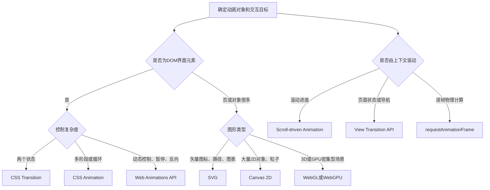

[toc]


## 内容大纲

- Web动画的作用和基本组成
- 浏览器渲染与动画性能原理
- CSS Transition与CSS Animation
- 变换、缓动、3D和运动路径
- Web Animations API
- `requestAnimationFrame`
- SVG与Canvas动画
- 滚动驱动动画
- View Transition API
- FLIP布局动画
- 动画技术选型
- 性能、无障碍与兼容性注意事项
- 综合演示页面与测试清单

---

## Web动画技术全景

| 技术                        | 适合场景                               | 主要优势                           | 注意事项                                    |
| --------------------------- | -------------------------------------- | ---------------------------------- | ------------------------------------------- |
| **CSS Transition**          | 悬停、展开、选中等两个状态之间的变化   | 简单、声明式、易维护               | 不适合复杂时间线；避免使用`transition: all` |
| **CSS Animation**           | 循环动画、多关键帧动画、加载状态       | 无需JavaScript，浏览器可自行优化   | 交互控制能力弱于WAAPI                       |
| **CSS Transform**           | 位移、旋转、缩放、倾斜、3D翻转         | 通常不会引起文档重新布局           | 可能创建新的层叠上下文                      |
| **CSS Motion Path**         | 元素沿曲线、轨道运行                   | 路径表达直观                       | 应通过特性检测提供回退                      |
| **Web Animations API**      | 动态参数、播放控制、时间线管理         | 可执行暂停、反向、变速等操作       | 必须管理动画生命周期                        |
| **`requestAnimationFrame`** | 物理模拟、跟随指针、逐帧计算           | 与浏览器重绘周期协调               | 必须使用时间戳计算进度                      |
| **SVG动画**                 | 图标、路径、图表、矢量插画             | 任意缩放仍清晰，可操作独立图形节点 | 大量节点可能造成DOM开销                     |
| **Canvas 2D**               | 粒子、游戏、数据可视化                 | 适合大量图形的逐帧绘制             | 内容不是语义化DOM，需要无障碍替代           |
| **WebGL/WebGPU**            | 3D场景、大规模粒子、GPU计算            | 图形能力和吞吐量高                 | 开发复杂，通常配合Three.js等引擎            |
| **Scroll-driven Animation** | 阅读进度、视口揭示、滚动联动           | 可直接把滚动进度作为时间线         | 兼容性不足时使用Intersection Observer回退   |
| **View Transition API**     | 页面状态、SPA视图、跨文档导航切换      | 浏览器负责新旧视图快照和过渡       | 不同子功能的浏览器支持程度可能不同          |
| **动画库**                  | 复杂编排、跨浏览器时间线、设计资产播放 | 工程效率高                         | 应评估体积、授权、可访问性和维护状态        |

CSS Transition负责浏览器隐式计算两个状态之间的中间值；CSS Animation则使用`@keyframes`定义一个或多个关键状态。

WAAPI通过`Element.animate()`把浏览器动画引擎暴露给JavaScript，适合需要暂停、恢复、反向和变速控制的场景。

`requestAnimationFrame()`在下一次重绘前执行回调；实现动画时必须使用回调时间戳计算位移，不能假定显示器固定为60Hz。

Scroll-driven Animation可以用滚动时间线或视口进度时间线替代传统时间轴；View Transition API则用于同文档状态变化及跨文档导航。两者都适合采用**渐进增强**。



---

## 核心参数说明

### CSS Transition

```css
transition: <property> <duration> <timing-function> <delay>;
```

| 字段              | 含义                                               |
| ----------------- | -------------------------------------------------- |
| `property`        | 需要插值变化的CSS属性，推荐显式列举                |
| `duration`        | 动画持续时间，如`200ms`                            |
| `timing-function` | 速度曲线，如`ease-out`、`linear`或`cubic-bezier()` |
| `delay`           | 属性变化后等待多久开始动画                         |

### Web Animations API

```js
element.animate(keyframes, options);
```

| 参数           | 含义                                         |
| -------------- | -------------------------------------------- |
| `element`      | 被动画控制的DOM元素                          |
| `keyframes`    | 关键帧数组或属性数组对象                     |
| `duration`     | 一轮动画的持续时间，单位为毫秒               |
| `iterations`   | 播放次数，JavaScript中无限循环使用`Infinity` |
| `direction`    | 播放方向，如`normal`、`reverse`、`alternate` |
| `easing`       | 时间曲线                                     |
| `fill`         | 动画开始前和结束后如何应用关键帧样式         |
| `playbackRate` | 播放速率，负值可反向播放                     |

---

## 综合演示页面

下面的单文件页面覆盖：

- CSS Transition
- CSS Keyframes
- 缓动函数与`steps()`
- CSS自定义属性动画
- CSS 3D
- CSS Motion Path
- Web Animations API
- `requestAnimationFrame`
- FLIP布局动画
- SVG路径动画
- Canvas粒子动画
- Scroll-driven Animation
- Intersection Observer回退
- View Transition API
- `prefers-reduced-motion`
- 全局暂停和特性检测

将代码保存为`web-animation-lab.html`，直接使用最新版Chrome、Edge、Firefox或Safari打开。页面不依赖CDN，适合国内无代理环境。

```html
<!doctype html>
<html lang="zh-CN" data-motion="running">
<head>
  <meta charset="utf-8">
  <meta name="viewport" content="width=device-width, initial-scale=1">
  <meta name="color-scheme" content="dark">
  <title>Web动画技术综合实验室</title>

  <style>
    @property --ring-angle {
      syntax: "<angle>";
      inherits: false;
      initial-value: 0deg;
    }

    :root {
      --bg: #08111f;
      --surface: #101c30;
      --surface-2: #162640;
      --text: #edf5ff;
      --muted: #a9bad0;
      --primary: #68d5ff;
      --secondary: #a88cff;
      --success: #65e6a5;
      --warning: #ffd166;
      --danger: #ff7f96;
      --border: rgb(255 255 255 / 12%);
      --shadow: 0 18px 50px rgb(0 0 0 / 28%);
      --radius: 18px;
      --duration-fast: 160ms;
      --duration-normal: 360ms;
      --duration-slow: 900ms;
      --ease-out: cubic-bezier(.2, .8, .2, 1);
    }

    * {
      box-sizing: border-box;
    }

    html {
      scroll-behavior: smooth;
    }

    body {
      min-width: 320px;
      margin: 0;
      color: var(--text);
      background:
        radial-gradient(circle at 10% 5%, rgb(104 213 255 / 13%), transparent 28rem),
        radial-gradient(circle at 90% 15%, rgb(168 140 255 / 12%), transparent 30rem),
        var(--bg);
      font-family:
        Inter, "PingFang SC", "Microsoft YaHei", system-ui, sans-serif;
      line-height: 1.65;
    }

    button,
    select {
      min-height: 42px;
      border: 1px solid var(--border);
      border-radius: 10px;
      color: var(--text);
      background: var(--surface-2);
      font: inherit;
    }

    button {
      padding: .6rem 1rem;
      cursor: pointer;
      transition:
        transform var(--duration-fast) ease,
        background-color var(--duration-fast) ease,
        border-color var(--duration-fast) ease;
    }

    button:hover {
      border-color: var(--primary);
      background: #1d3455;
      transform: translateY(-1px);
    }

    button:active {
      transform: translateY(1px);
    }

    button:focus-visible,
    a:focus-visible {
      outline: 3px solid var(--warning);
      outline-offset: 3px;
    }

    button:disabled {
      cursor: not-allowed;
      opacity: .55;
      transform: none;
    }

    code {
      color: #b9ecff;
    }

    .skip-link {
      position: fixed;
      top: .5rem;
      left: .5rem;
      z-index: 100;
      padding: .7rem 1rem;
      color: #06111d;
      background: var(--warning);
      transform: translateY(-150%);
    }

    .skip-link:focus {
      transform: none;
    }

    #scroll-progress {
      position: fixed;
      inset: 0 0 auto;
      z-index: 90;
      height: 4px;
      background: linear-gradient(90deg, var(--primary), var(--secondary));
      transform: scaleX(0);
      transform-origin: left center;
    }

    @supports (animation-timeline: scroll()) {
      #scroll-progress {
        animation: page-progress linear;
        animation-timeline: scroll(root block);
      }
    }

    @keyframes page-progress {
      to {
        transform: scaleX(1);
      }
    }

    .hero,
    main,
    .footer {
      width: min(1180px, calc(100% - 2rem));
      margin-inline: auto;
    }

    .hero {
      padding: 5rem 0 2rem;
    }

    .hero h1 {
      max-width: 900px;
      margin: 0 0 1rem;
      font-size: clamp(2.2rem, 7vw, 5.4rem);
      line-height: 1.02;
      letter-spacing: -.045em;
    }

    .hero h1 span {
      color: transparent;
      background: linear-gradient(90deg, var(--primary), var(--secondary));
      background-clip: text;
    }

    .hero > p {
      max-width: 780px;
      color: var(--muted);
      font-size: 1.08rem;
    }

    .toolbar {
      position: sticky;
      top: 1rem;
      z-index: 50;
      display: flex;
      flex-wrap: wrap;
      gap: .75rem;
      align-items: center;
      margin: 1.5rem 0;
      padding: .8rem;
      border: 1px solid var(--border);
      border-radius: 14px;
      background: rgb(8 17 31 / 82%);
      box-shadow: var(--shadow);
      backdrop-filter: blur(16px);
    }

    .motion-state {
      color: var(--muted);
    }

    .feature-panel {
      padding: 1rem 1.2rem;
      border: 1px solid var(--border);
      border-radius: var(--radius);
      background: rgb(16 28 48 / 82%);
    }

    .feature-list {
      display: grid;
      grid-template-columns: repeat(auto-fit, minmax(180px, 1fr));
      gap: .6rem 1rem;
      margin: 0;
      padding: 0;
      list-style: none;
    }

    .status {
      color: var(--success);
    }

    .status.fallback {
      color: var(--warning);
    }

    .toc {
      position: sticky;
      top: 5.5rem;
      z-index: 40;
      display: flex;
      gap: .5rem;
      width: min(1180px, calc(100% - 2rem));
      margin: 0 auto 1.5rem;
      overflow-x: auto;
      padding: .65rem;
      border: 1px solid var(--border);
      border-radius: 14px;
      background: rgb(8 17 31 / 88%);
      backdrop-filter: blur(14px);
    }

    .toc a {
      flex: 0 0 auto;
      padding: .45rem .8rem;
      border-radius: 8px;
      color: var(--muted);
      text-decoration: none;
    }

    .toc a:hover {
      color: var(--text);
      background: var(--surface-2);
    }

    .section {
      margin: 0 0 2rem;
      padding: clamp(1rem, 3vw, 2rem);
      border: 1px solid var(--border);
      border-radius: 24px;
      background: rgb(16 28 48 / 74%);
      box-shadow: var(--shadow);
    }

    .section > h2 {
      margin-top: 0;
      font-size: clamp(1.6rem, 4vw, 2.5rem);
    }

    .section-intro {
      max-width: 850px;
      color: var(--muted);
    }

    .demo-grid {
      display: grid;
      grid-template-columns: repeat(auto-fit, minmax(min(100%, 320px), 1fr));
      gap: 1rem;
      margin-top: 1.5rem;
    }

    .demo {
      min-width: 0;
      padding: 1rem;
      border: 1px solid var(--border);
      border-radius: var(--radius);
      background: linear-gradient(150deg, rgb(255 255 255 / 5%), transparent);
    }

    .demo h3 {
      margin-top: 0;
    }

    .description {
      min-height: 3.3em;
      color: var(--muted);
    }

    .stage {
      position: relative;
      display: grid;
      place-items: center;
      min-height: 220px;
      margin: 1rem 0;
      overflow: hidden;
      border: 1px solid var(--border);
      border-radius: 14px;
      background:
        linear-gradient(rgb(255 255 255 / 4%) 1px, transparent 1px),
        linear-gradient(90deg, rgb(255 255 255 / 4%) 1px, transparent 1px),
        #0b1628;
      background-size: 24px 24px;
    }

    .controls {
      display: flex;
      flex-wrap: wrap;
      gap: .6rem;
    }

    /* CSS Transition */

    .transition-box {
      display: grid;
      place-items: center;
      width: 110px;
      aspect-ratio: 1;
      border-radius: 18px;
      color: #06111d;
      background: var(--primary);
      font-weight: 800;
      transition:
        transform var(--duration-normal) var(--ease-out),
        border-radius var(--duration-normal) var(--ease-out),
        background-color var(--duration-normal) ease;
    }

    .transition-box.is-active {
      border-radius: 50%;
      background: var(--warning);
      transform: translateX(80px) rotate(180deg) scale(.82);
    }

    /* CSS Keyframes及@property */

    .keyframe-stage {
      grid-template-columns: 1fr 1fr;
    }

    .key-orb {
      width: 72px;
      aspect-ratio: 1;
      border-radius: 50%;
      background: radial-gradient(circle at 30% 25%, #fff, var(--primary) 20%, #157aab);
      box-shadow: 0 15px 30px rgb(104 213 255 / 24%);
      animation: orb-float 2s var(--ease-out) infinite;
    }

    @keyframes orb-float {
      0%,
      100% {
        transform: translateY(20px) rotate(0) scale(.9);
      }

      50% {
        transform: translateY(-30px) rotate(180deg) scale(1.08);
      }
    }

    .gradient-ring {
      width: 90px;
      aspect-ratio: 1;
      padding: 9px;
      border-radius: 50%;
      background: conic-gradient(
        from var(--ring-angle),
        var(--primary),
        var(--secondary),
        var(--danger),
        var(--primary)
      );
      animation: ring-spin 2.2s linear infinite;
    }

    .gradient-ring::after {
      display: block;
      height: 100%;
      border-radius: inherit;
      background: #0b1628;
      content: "";
    }

    @keyframes ring-spin {
      to {
        --ring-angle: 1turn;
      }
    }

    /* 缓动函数 */

    .easing-stage {
      display: block;
      min-height: 250px;
      padding: 1rem;
    }

    .easing-row {
      display: grid;
      grid-template-columns: 110px 1fr;
      gap: .8rem;
      align-items: center;
      margin: .8rem 0;
    }

    .easing-track {
      height: 18px;
      overflow: hidden;
      border-radius: 999px;
      background: rgb(255 255 255 / 8%);
    }

    .easing-fill {
      width: 100%;
      height: 100%;
      border-radius: inherit;
      background: linear-gradient(90deg, var(--primary), var(--secondary));
      transform: scaleX(0);
      transform-origin: left;
    }

    .easing-stage.run .linear {
      animation: easing-grow 1.8s linear both;
    }

    .easing-stage.run .ease {
      animation: easing-grow 1.8s ease both;
    }

    .easing-stage.run .bezier {
      animation: easing-grow 1.8s cubic-bezier(.2, .9, .25, 1.25) both;
    }

    .easing-stage.run .steps {
      animation: easing-grow 1.8s steps(6, end) both;
    }

    @keyframes easing-grow {
      to {
        transform: scaleX(1);
      }
    }

    /* CSS 3D */

    .flip-scene {
      width: 190px;
      height: 125px;
      perspective: 800px;
    }

    .flip-card {
      position: relative;
      width: 100%;
      height: 100%;
      cursor: pointer;
      transform-style: preserve-3d;
      transition: transform .7s var(--ease-out);
    }

    .flip-card.is-flipped {
      transform: rotateY(180deg);
    }

    .flip-face {
      position: absolute;
      inset: 0;
      display: grid;
      place-items: center;
      border-radius: 16px;
      backface-visibility: hidden;
      font-weight: 800;
    }

    .flip-front {
      color: #06111d;
      background: var(--primary);
    }

    .flip-back {
      background: var(--secondary);
      transform: rotateY(180deg);
    }

    /* CSS Motion Path */

    .motion-viewport {
      overflow-x: auto;
    }

    .motion-stage {
      position: relative;
      width: 360px;
      height: 220px;
      margin-inline: auto;
    }

    .motion-stage svg {
      position: absolute;
      inset: 0;
      width: 360px;
      height: 220px;
    }

    .motion-stage path {
      fill: none;
      stroke: rgb(104 213 255 / 35%);
      stroke-dasharray: 5 6;
      stroke-width: 2;
    }

    .motion-runner {
      position: absolute;
      top: 94px;
      left: 14px;
      display: grid;
      place-items: center;
      width: 32px;
      aspect-ratio: 1;
      border-radius: 10px;
      color: #06111d;
      background: var(--warning);
      animation: fallback-motion 3s linear infinite;
    }

    @keyframes fallback-motion {
      50% {
        transform: translateX(280px) rotate(180deg);
      }

      100% {
        transform: rotate(360deg);
      }
    }

    @supports (offset-path: path("M 30 110 L 330 110")) {
      .motion-runner {
        top: 0;
        left: 0;
        offset-path: path(
          "M 30 110 C 90 10 270 10 330 110 C 270 210 90 210 30 110 Z"
        );
        offset-rotate: auto;
        animation: path-travel 4s linear infinite;
      }

      @keyframes path-travel {
        to {
          offset-distance: 100%;
        }
      }
    }

    /* WAAPI */

    .waapi-stage {
      justify-items: start;
      padding: 12px;
    }

    .waapi-box {
      display: grid;
      place-items: center;
      width: 66px;
      aspect-ratio: 1;
      border-radius: 18px;
      color: #06111d;
      background: var(--success);
      font-weight: 900;
    }

    /* requestAnimationFrame */

    .raf-stage {
      display: block;
      min-height: 180px;
    }

    .raf-ball {
      position: absolute;
      top: 58px;
      left: 10px;
      width: 54px;
      aspect-ratio: 1;
      border-radius: 50%;
      background: radial-gradient(circle at 30% 25%, #fff, var(--danger) 25%, #a71942);
      box-shadow: 0 14px 24px rgb(255 127 150 / 25%);
      will-change: transform;
    }

    /* FLIP */

    .flip-list {
      display: grid;
      gap: .6rem;
      width: min(100%, 300px);
      padding: 0;
      list-style: none;
    }

    .flip-item {
      padding: .75rem 1rem;
      border: 1px solid var(--border);
      border-radius: 10px;
      background: var(--surface-2);
    }

    /* SVG */

    .svg-demo {
      width: min(100%, 320px);
      overflow: visible;
    }

    .svg-line {
      fill: none;
      stroke: var(--primary);
      stroke-linecap: round;
      stroke-width: 8;
      stroke-dasharray: 1;
      stroke-dashoffset: 1;
    }

    .svg-stage.run .svg-line {
      animation: draw-line 2.3s var(--ease-out) forwards;
    }

    .svg-dot {
      fill: var(--warning);
      transform-box: fill-box;
      transform-origin: center;
    }

    .svg-stage.run .svg-dot {
      animation: svg-pulse .7s ease-in-out 3 alternate;
    }

    @keyframes draw-line {
      to {
        stroke-dashoffset: 0;
      }
    }

    @keyframes svg-pulse {
      to {
        transform: scale(1.7);
      }
    }

    /* Canvas */

    #particle-canvas {
      display: block;
      width: 100%;
      height: 260px;
      border: 1px solid var(--border);
      border-radius: 14px;
      background: #07101d;
    }

    /* Scroll-driven animation */

    .scroll-demo {
      display: grid;
      gap: 1rem;
      margin-top: 1.5rem;
    }

    .scroll-card {
      min-height: 145px;
      padding: 1.2rem;
      border: 1px solid var(--border);
      border-radius: 18px;
      background: linear-gradient(130deg, var(--surface-2), #0d1830);
      opacity: 0;
      transform: translateY(50px) scale(.96);
    }

    @supports (animation-timeline: view()) {
      .scroll-card {
        animation: scroll-reveal linear both;
        animation-timeline: view();
        animation-range: entry 10% cover 35%;
      }
    }

    @supports not (animation-timeline: view()) {
      .scroll-card {
        transition:
          opacity .6s ease,
          transform .6s var(--ease-out);
      }

      .scroll-card.is-visible {
        opacity: 1;
        transform: none;
      }
    }

    @keyframes scroll-reveal {
      to {
        opacity: 1;
        transform: none;
      }
    }

    /* View Transition */

    .vt-card {
      width: min(100%, 420px);
      padding: 1.4rem;
      border: 1px solid var(--border);
      border-radius: 18px;
      background: linear-gradient(135deg, #133250, #34255e);
      view-transition-name: demo-card;
    }

    .vt-card.is-alternative {
      color: #10131c;
      background: linear-gradient(135deg, #ffd166, #ff9c74);
    }

    ::view-transition-old(demo-card) {
      animation: vt-out .28s ease both;
    }

    ::view-transition-new(demo-card) {
      animation: vt-in .38s var(--ease-out) both;
    }

    @keyframes vt-out {
      to {
        opacity: 0;
        transform: scale(.9) rotate(-2deg);
      }
    }

    @keyframes vt-in {
      from {
        opacity: 0;
        transform: scale(1.08) rotate(2deg);
      }
    }

    .practice-list {
      display: grid;
      grid-template-columns: repeat(auto-fit, minmax(260px, 1fr));
      gap: 1rem;
      padding: 0;
      list-style: none;
    }

    .practice-list li {
      padding: 1rem;
      border: 1px solid var(--border);
      border-radius: 14px;
      background: var(--surface-2);
    }

    .footer {
      padding: 1rem 0 4rem;
      color: var(--muted);
    }

    .sr-only {
      position: absolute;
      width: 1px;
      height: 1px;
      overflow: hidden;
      clip-path: inset(50%);
      white-space: nowrap;
    }

    html[data-motion="paused"] .animated {
      animation-play-state: paused !important;
    }

    html[data-motion="paused"] .transition-box,
    html[data-motion="paused"] .flip-card {
      transition-duration: 0s !important;
    }

    @media (prefers-reduced-motion: reduce) {
      html {
        scroll-behavior: auto;
      }

      .animated {
        animation: none !important;
      }

      button,
      .transition-box,
      .flip-card,
      .scroll-card {
        transition-duration: 0s !important;
      }

      .scroll-card {
        opacity: 1 !important;
        transform: none !important;
      }

      .easing-fill {
        transform: scaleX(1);
      }

      .svg-line {
        stroke-dashoffset: 0;
      }

      ::view-transition-group(*) {
        animation-duration: 1ms !important;
      }
    }

    @media (max-width: 680px) {
      .hero {
        padding-top: 3rem;
      }

      .toolbar {
        position: relative;
        top: auto;
      }

      .toc {
        top: .5rem;
      }

      .transition-box.is-active {
        transform: translateX(45px) rotate(180deg) scale(.82);
      }

      .easing-row {
        grid-template-columns: 90px 1fr;
        font-size: .9rem;
      }
    }
  </style>
</head>

<body>
  <a class="skip-link" href="#main">跳到主要内容</a>
  <div id="scroll-progress" aria-hidden="true"></div>

  <header class="hero">
    <p>原生Web平台综合演示</p>
    <h1>Web动画技术<br><span>综合实验室</span></h1>
    <p>
      本页面集中演示声明式动画、JavaScript逐帧动画、矢量动画、
      像素绘制、滚动时间线、视图过渡和布局动画。
    </p>

    <div class="toolbar" aria-label="全局动画控制">
      <button id="toggle-motion" type="button" aria-pressed="false">
        暂停所有动态
      </button>
      <span id="motion-state" class="motion-state">
        正在检测系统动态效果偏好
      </span>
    </div>

    <section class="feature-panel" aria-labelledby="feature-title">
      <h2 id="feature-title">当前浏览器特性检测</h2>
      <ul class="feature-list">
        <li>Web Animations API：<strong id="status-waapi" class="status"></strong></li>
        <li>CSS Motion Path：<strong id="status-path" class="status"></strong></li>
        <li>滚动时间线：<strong id="status-scroll" class="status"></strong></li>
        <li>视口时间线：<strong id="status-view" class="status"></strong></li>
        <li>View Transition：<strong id="status-transition" class="status"></strong></li>
      </ul>
    </section>
  </header>

  <nav class="toc" aria-label="页面章节">
    <a href="#css-animation">CSS动画</a>
    <a href="#js-animation">JavaScript动画</a>
    <a href="#graphics-animation">SVG与Canvas</a>
    <a href="#context-animation">滚动与视图</a>
    <a href="#practices">实践原则</a>
  </nav>

  <main id="main">
    <section id="css-animation" class="section">
      <h2>CSS声明式动画</h2>
      <p class="section-intro">
        CSS适合界面状态反馈、循环装饰和关键帧序列。优先使用
        <code>transform</code>和<code>opacity</code>表达视觉变化。
      </p>

      <div class="demo-grid">
        <article class="demo">
          <h3>CSS Transition</h3>
          <p class="description">用于两个明确状态之间的平滑插值。</p>
          <div class="stage">
            <div id="transition-box" class="transition-box">状态</div>
          </div>
          <div class="controls">
            <button id="transition-button" type="button">切换状态</button>
          </div>
        </article>

        <article class="demo">
          <h3>关键帧与自定义属性</h3>
          <p class="description">
            左侧使用多关键帧，右侧通过<code>@property</code>动画化角度。
          </p>
          <div class="stage keyframe-stage">
            <div class="key-orb animated" aria-label="上下浮动的圆球"></div>
            <div class="gradient-ring animated" aria-label="旋转渐变圆环"></div>
          </div>
        </article>

        <article class="demo">
          <h3>缓动函数</h3>
          <p class="description">
            相同持续时间，不同缓动曲线会产生不同的运动感受。
          </p>
          <div id="easing-stage" class="stage easing-stage run">
            <div class="easing-row">
              <span>linear</span>
              <div class="easing-track"><div class="easing-fill linear animated"></div></div>
            </div>
            <div class="easing-row">
              <span>ease</span>
              <div class="easing-track"><div class="easing-fill ease animated"></div></div>
            </div>
            <div class="easing-row">
              <span>cubic-bezier</span>
              <div class="easing-track"><div class="easing-fill bezier animated"></div></div>
            </div>
            <div class="easing-row">
              <span>steps</span>
              <div class="easing-track"><div class="easing-fill steps animated"></div></div>
            </div>
          </div>
          <button id="restart-easing" type="button">重新播放</button>
        </article>

        <article class="demo">
          <h3>CSS 3D变换</h3>
          <p class="description">
            通过<code>perspective</code>、<code>preserve-3d</code>和背面隐藏实现翻牌。
          </p>
          <div class="stage">
            <div class="flip-scene">
              <div
                id="flip-card"
                class="flip-card"
                role="button"
                tabindex="0"
                aria-pressed="false"
                aria-label="翻转卡片"
              >
                <div class="flip-face flip-front">正面</div>
                <div class="flip-face flip-back">背面</div>
              </div>
            </div>
          </div>
          <button id="flip-button" type="button">翻转卡片</button>
        </article>

        <article class="demo">
          <h3>CSS Motion Path</h3>
          <p class="description">
            支持时沿<code>offset-path</code>运行；不支持时退化为直线运动。
          </p>
          <div class="stage motion-viewport">
            <div class="motion-stage">
              <svg viewBox="0 0 360 220" aria-hidden="true">
                <path d="M30 110 C90 10 270 10 330 110 C270 210 90 210 30 110 Z"/>
              </svg>
              <div class="motion-runner animated">→</div>
            </div>
          </div>
        </article>
      </div>
    </section>

    <section id="js-animation" class="section">
      <h2>JavaScript控制动画</h2>
      <p class="section-intro">
        当动画依赖动态数据、用户输入、播放控制或物理计算时，
        应使用Web Animations API或<code>requestAnimationFrame</code>。
      </p>

      <div class="demo-grid">
        <article class="demo">
          <h3>Web Animations API</h3>
          <p class="description">
            使用同一动画对象执行播放、暂停、反向、变速和复位。
          </p>
          <div id="waapi-stage" class="stage waapi-stage">
            <div id="waapi-box" class="waapi-box">WAAPI</div>
          </div>
          <div class="controls">
            <button id="waapi-play" type="button">播放</button>
            <button id="waapi-pause" type="button">暂停</button>
            <button id="waapi-reverse" type="button">反向</button>
            <button id="waapi-rate" type="button">
              速度：<span id="waapi-rate-value">1</span>×
            </button>
            <button id="waapi-reset" type="button">复位</button>
          </div>
        </article>

        <article class="demo">
          <h3>requestAnimationFrame</h3>
          <p class="description">
            位置由时间差计算，因此不会依赖显示器的固定刷新率。
          </p>
          <div id="raf-stage" class="stage raf-stage">
            <div id="raf-ball" class="raf-ball"></div>
          </div>
          <div class="controls">
            <button id="raf-toggle" type="button">启动</button>
            <button id="raf-reset" type="button">复位</button>
          </div>
        </article>

        <article class="demo">
          <h3>FLIP布局动画</h3>
          <p class="description">
            First、Last、Invert、Play：先改变布局，再使用反向变换补间。
          </p>
          <div class="stage">
            <ul id="flip-list" class="flip-list">
              <li class="flip-item">动画需求分析</li>
              <li class="flip-item">记录初始位置</li>
              <li class="flip-item">更新DOM布局</li>
              <li class="flip-item">反向位移并播放</li>
            </ul>
          </div>
          <button id="reorder-list" type="button">移动首项到末尾</button>
        </article>
      </div>
    </section>

    <section id="graphics-animation" class="section">
      <h2>SVG与Canvas图形动画</h2>
      <p class="section-intro">
        SVG适合可缩放且需要独立交互的图形节点；Canvas适合大量对象的逐帧绘制。
      </p>

      <div class="demo-grid">
        <article class="demo">
          <h3>SVG路径绘制</h3>
          <p class="description">
            通过<code>pathLength</code>、虚线长度和偏移量模拟线条绘制。
          </p>
          <div id="svg-stage" class="stage svg-stage run">
            <svg
              class="svg-demo"
              viewBox="0 0 320 160"
              role="img"
              aria-label="一条逐渐绘制出来的波浪曲线"
            >
              <path
                class="svg-line animated"
                pathLength="1"
                d="M20 105 C55 20 105 20 140 105 S225 190 300 55"
              />
              <circle class="svg-dot animated" cx="300" cy="55" r="8"/>
            </svg>
          </div>
          <button id="restart-svg" type="button">重新绘制</button>
        </article>

        <article class="demo">
          <h3>Canvas粒子</h3>
          <p class="description">
            Canvas每帧清理并重新绘制粒子；高DPI设备限制为最高2倍分辨率。
          </p>
          <canvas
            id="particle-canvas"
            role="img"
            aria-label="缓慢移动的彩色粒子动画"
          >
            当前浏览器不支持Canvas。这里原本显示缓慢移动的粒子。
          </canvas>
          <div class="controls" style="margin-top: 1rem">
            <button id="canvas-toggle" type="button">暂停粒子</button>
            <button id="canvas-reset" type="button">重置粒子</button>
          </div>
        </article>
      </div>
    </section>

    <section id="context-animation" class="section">
      <h2>滚动驱动与视图过渡</h2>
      <p class="section-intro">
        滚动动画应区分“到达某处后触发一次”和“连续绑定滚动进度”；
        两者分别适合Intersection Observer与滚动时间线。
      </p>

      <div class="scroll-demo">
        <article class="scroll-card animated">
          <h3>进入视口</h3>
          <p>
            支持CSS视口时间线时，透明度和位移直接由元素进入视口的进度控制。
          </p>
        </article>

        <article class="scroll-card animated">
          <h3>渐进增强</h3>
          <p>
            不支持视口时间线时，JavaScript使用Intersection Observer添加状态类。
          </p>
        </article>

        <article class="scroll-card animated">
          <h3>减少动态效果</h3>
          <p>
            如果操作系统请求减少动态效果，内容直接显示，不依赖动画才能被理解。
          </p>
        </article>
      </div>

      <div class="demo-grid">
        <article class="demo">
          <h3>View Transition API</h3>
          <p class="description">
            浏览器支持时使用新旧视图快照；否则直接完成DOM更新。
          </p>
          <div class="stage">
            <article id="vt-card" class="vt-card">
              <h4 id="vt-title">分析模式</h4>
              <p id="vt-content">以信息密度和结构清晰度为优先。</p>
            </article>
          </div>
          <button id="vt-toggle" type="button">切换视图状态</button>
        </article>
      </div>
    </section>

    <section id="practices" class="section">
      <h2>页面内置的实践原则</h2>
      <ul class="practice-list">
        <li><strong>渐进增强：</strong>现代API不可用时仍能完成核心操作。</li>
        <li><strong>动态效果可暂停：</strong>页面提供全局暂停按钮。</li>
        <li><strong>尊重系统偏好：</strong>检测<code>prefers-reduced-motion</code>。</li>
        <li><strong>时间驱动：</strong>逐帧动画使用时间差，不依赖固定帧率。</li>
        <li><strong>生命周期管理：</strong>页面隐藏时停止或重置逐帧循环。</li>
        <li><strong>高DPI控制：</strong>Canvas内部像素比例最高限制为2。</li>
        <li><strong>键盘可操作：</strong>翻牌组件同时响应点击、Enter和空格。</li>
        <li><strong>内容独立：</strong>禁用动画不会导致内容消失或操作失效。</li>
      </ul>
    </section>
  </main>

  <footer class="footer">
    Web动画技术综合实验室。单文件、无第三方依赖。
  </footer>

  <div id="live-region" class="sr-only" aria-live="polite"></div>

  <script>
    "use strict";

    const root = document.documentElement;
    const reduceMotionQuery = window.matchMedia("(prefers-reduced-motion: reduce)");
    const liveRegion = document.querySelector("#live-region");
    let userPaused = false;

    function announce(message) {
      liveRegion.textContent = "";
      window.setTimeout(() => {
        liveRegion.textContent = message;
      }, 30);
    }

    function motionAllowed() {
      return !userPaused && !reduceMotionQuery.matches;
    }

    function restartClass(element, className) {
      element.classList.remove(className);
      void element.offsetWidth;
      element.classList.add(className);
    }

    /* 特性检测 */

    const features = {
      waapi: "animate" in Element.prototype,
      path: CSS.supports(
        "offset-path",
        'path("M 0 0 L 100 100")'
      ),
      scrollTimeline: CSS.supports("animation-timeline", "scroll()"),
      viewTimeline: CSS.supports("animation-timeline", "view()"),
      viewTransition: "startViewTransition" in document
    };

    function setFeatureStatus(id, supported, fallbackText = "提供回退") {
      const element = document.querySelector(id);
      element.textContent = supported ? "支持" : fallbackText;
      element.classList.toggle("fallback", !supported);
    }

    setFeatureStatus("#status-waapi", features.waapi);
    setFeatureStatus("#status-path", features.path);
    setFeatureStatus("#status-scroll", features.scrollTimeline);
    setFeatureStatus("#status-view", features.viewTimeline);
    setFeatureStatus("#status-transition", features.viewTransition, "直接更新");

    /* 全局动态效果控制 */

    const motionButton = document.querySelector("#toggle-motion");
    const motionState = document.querySelector("#motion-state");

    function updateMotionStatus() {
      if (reduceMotionQuery.matches) {
        motionState.textContent = "系统已请求减少动态效果";
      } else if (userPaused) {
        motionState.textContent = "动态效果已由用户暂停";
      } else {
        motionState.textContent = "动态效果正常运行";
      }
    }

    function synchronizeAnimationEngines() {
      root.dataset.motion = userPaused ? "paused" : "running";

      if (waapiAnimation) {
        if (waapiWanted && motionAllowed()) {
          waapiAnimation.play();
        } else {
          waapiAnimation.pause();
        }
      }

      scheduleBallFrame();
      scheduleCanvasFrame();
      updateMotionStatus();
    }

    motionButton.addEventListener("click", () => {
      userPaused = !userPaused;
      motionButton.setAttribute("aria-pressed", String(userPaused));
      motionButton.textContent = userPaused ? "继续动态效果" : "暂停所有动态";
      synchronizeAnimationEngines();
      announce(userPaused ? "所有动态效果已暂停" : "动态效果已继续");
    });

    const onMotionPreferenceChange = () => {
      synchronizeAnimationEngines();
      drawCanvas();
    };

    if ("addEventListener" in reduceMotionQuery) {
      reduceMotionQuery.addEventListener("change", onMotionPreferenceChange);
    } else {
      reduceMotionQuery.addListener(onMotionPreferenceChange);
    }

    /* CSS Transition */

    const transitionBox = document.querySelector("#transition-box");

    document.querySelector("#transition-button").addEventListener("click", () => {
      transitionBox.classList.toggle("is-active");
    });

    /* 缓动函数 */

    document.querySelector("#restart-easing").addEventListener("click", () => {
      restartClass(document.querySelector("#easing-stage"), "run");
    });

    /* 3D翻牌 */

    const flipCard = document.querySelector("#flip-card");

    function toggleFlipCard() {
      const flipped = flipCard.classList.toggle("is-flipped");
      flipCard.setAttribute("aria-pressed", String(flipped));
      announce(flipped ? "卡片已翻到背面" : "卡片已翻到正面");
    }

    flipCard.addEventListener("click", toggleFlipCard);
    document.querySelector("#flip-button").addEventListener("click", toggleFlipCard);

    flipCard.addEventListener("keydown", event => {
      if (event.key === "Enter" || event.key === " ") {
        event.preventDefault();
        toggleFlipCard();
      }
    });

    /* Web Animations API */

    const waapiStage = document.querySelector("#waapi-stage");
    const waapiBox = document.querySelector("#waapi-box");
    const rateValue = document.querySelector("#waapi-rate-value");

    let waapiAnimation = null;
    let waapiWanted = false;
    let waapiRate = 1;

    function buildWaapiAnimation() {
      if (!features.waapi) {
        document
          .querySelectorAll(
            "#waapi-play, #waapi-pause, #waapi-reverse, #waapi-rate, #waapi-reset"
          )
          .forEach(button => {
            button.disabled = true;
          });
        return;
      }

      const distance = Math.max(
        0,
        waapiStage.clientWidth - waapiBox.offsetWidth - 24
      );

      waapiAnimation?.cancel();

      waapiAnimation = waapiBox.animate(
        [
          {
            transform: "translateX(0) rotate(0deg)",
            borderRadius: "18px",
            backgroundColor: "#65e6a5"
          },
          {
            transform: `translateX(${distance}px) rotate(360deg)`,
            borderRadius: "50%",
            backgroundColor: "#ffd166"
          }
        ],
        {
          duration: 1600,
          iterations: Infinity,
          direction: "alternate",
          easing: "cubic-bezier(.2, .8, .2, 1)",
          fill: "both"
        }
      );

      waapiAnimation.pause();
      waapiAnimation.currentTime = 0;
      waapiAnimation.updatePlaybackRate(waapiRate);

      if (waapiWanted && motionAllowed()) {
        waapiAnimation.play();
      }
    }

    document.querySelector("#waapi-play").addEventListener("click", () => {
      waapiWanted = true;
      if (motionAllowed()) {
        waapiAnimation?.play();
      }
    });

    document.querySelector("#waapi-pause").addEventListener("click", () => {
      waapiWanted = false;
      waapiAnimation?.pause();
    });

    document.querySelector("#waapi-reverse").addEventListener("click", () => {
      if (!waapiAnimation) {
        return;
      }

      waapiWanted = true;

      if (waapiAnimation.currentTime === 0) {
        waapiAnimation.currentTime = 1600;
      }

      waapiAnimation.reverse();

      if (!motionAllowed()) {
        waapiAnimation.pause();
      }
    });

    document.querySelector("#waapi-rate").addEventListener("click", () => {
      const rates = [0.5, 1, 1.5, 2];
      const index = rates.indexOf(waapiRate);
      waapiRate = rates[(index + 1) % rates.length];

      const direction = Math.sign(waapiAnimation?.playbackRate || 1);
      waapiAnimation?.updatePlaybackRate(direction * waapiRate);
      rateValue.textContent = String(waapiRate);
    });

    document.querySelector("#waapi-reset").addEventListener("click", () => {
      waapiWanted = false;

      if (waapiAnimation) {
        waapiAnimation.pause();
        waapiAnimation.currentTime = 0;
        waapiAnimation.updatePlaybackRate(waapiRate);
      }
    });

    buildWaapiAnimation();

    /* requestAnimationFrame */

    const rafStage = document.querySelector("#raf-stage");
    const rafBall = document.querySelector("#raf-ball");
    const rafToggle = document.querySelector("#raf-toggle");

    let ballPosition = 0;
    let ballVelocity = 190;
    let ballWanted = false;
    let ballFrameId = null;
    let ballLastTime = 0;

    function drawBall() {
      rafBall.style.transform = `translateX(${ballPosition}px)`;
    }

    function ballFrame(timestamp) {
      ballFrameId = null;

      if (!ballWanted || !motionAllowed()) {
        ballLastTime = 0;
        return;
      }

      if (!ballLastTime) {
        ballLastTime = timestamp;
      }

      const deltaSeconds = Math.min((timestamp - ballLastTime) / 1000, 0.04);
      ballLastTime = timestamp;

      const maxPosition = Math.max(
        0,
        rafStage.clientWidth - rafBall.offsetWidth - 20
      );

      ballPosition += ballVelocity * deltaSeconds;

      if (ballPosition >= maxPosition) {
        ballPosition = maxPosition;
        ballVelocity = -Math.abs(ballVelocity);
      } else if (ballPosition <= 0) {
        ballPosition = 0;
        ballVelocity = Math.abs(ballVelocity);
      }

      drawBall();
      scheduleBallFrame();
    }

    function scheduleBallFrame() {
      if (
        ballWanted &&
        motionAllowed() &&
        ballFrameId === null
      ) {
        ballFrameId = requestAnimationFrame(ballFrame);
      } else if ((!ballWanted || !motionAllowed()) && ballFrameId !== null) {
        cancelAnimationFrame(ballFrameId);
        ballFrameId = null;
        ballLastTime = 0;
      }
    }

    rafToggle.addEventListener("click", () => {
      ballWanted = !ballWanted;
      rafToggle.textContent = ballWanted ? "暂停" : "启动";
      scheduleBallFrame();
    });

    document.querySelector("#raf-reset").addEventListener("click", () => {
      ballPosition = 0;
      ballVelocity = 190;
      ballLastTime = 0;
      drawBall();
    });

    drawBall();

    /* FLIP布局动画 */

    const flipList = document.querySelector("#flip-list");

    document.querySelector("#reorder-list").addEventListener("click", () => {
      const items = [...flipList.children];
      const firstPositions = new Map(
        items.map(item => [item, item.getBoundingClientRect()])
      );

      flipList.append(flipList.firstElementChild);

      if (!motionAllowed() || !features.waapi) {
        return;
      }

      [...flipList.children].forEach(item => {
        const first = firstPositions.get(item);
        const last = item.getBoundingClientRect();
        const deltaX = first.left - last.left;
        const deltaY = first.top - last.top;

        item.animate(
          [
            { transform: `translate(${deltaX}px, ${deltaY}px)` },
            { transform: "translate(0, 0)" }
          ],
          {
            duration: 520,
            easing: "cubic-bezier(.2, .8, .2, 1)"
          }
        );
      });
    });

    /* SVG动画 */

    document.querySelector("#restart-svg").addEventListener("click", () => {
      restartClass(document.querySelector("#svg-stage"), "run");
    });

    /* Canvas粒子 */

    const canvas = document.querySelector("#particle-canvas");
    const context = canvas.getContext("2d");
    const canvasToggle = document.querySelector("#canvas-toggle");

    let canvasWidth = 0;
    let canvasHeight = 0;
    let canvasWanted = true;
    let canvasFrameId = null;
    let canvasLastTime = 0;
    let particles = [];

    function createParticles() {
      particles = Array.from({ length: 55 }, (_, index) => ({
        x: Math.random() * canvasWidth,
        y: Math.random() * canvasHeight,
        radius: 1.5 + Math.random() * 3.4,
        vx: -16 + Math.random() * 32,
        vy: -16 + Math.random() * 32,
        hue: 180 + (index * 5) % 120
      }));
    }

    function resizeCanvas() {
      const rectangle = canvas.getBoundingClientRect();
      const pixelRatio = Math.min(window.devicePixelRatio || 1, 2);

      canvasWidth = rectangle.width;
      canvasHeight = rectangle.height;
      canvas.width = Math.round(canvasWidth * pixelRatio);
      canvas.height = Math.round(canvasHeight * pixelRatio);

      context.setTransform(pixelRatio, 0, 0, pixelRatio, 0, 0);
      createParticles();
      drawCanvas();
    }

    function updateParticles(deltaSeconds) {
      particles.forEach(particle => {
        particle.x += particle.vx * deltaSeconds;
        particle.y += particle.vy * deltaSeconds;

        if (particle.x < -10) particle.x = canvasWidth + 10;
        if (particle.x > canvasWidth + 10) particle.x = -10;
        if (particle.y < -10) particle.y = canvasHeight + 10;
        if (particle.y > canvasHeight + 10) particle.y = -10;
      });
    }

    function drawCanvas() {
      context.clearRect(0, 0, canvasWidth, canvasHeight);

      const gradient = context.createLinearGradient(0, 0, canvasWidth, canvasHeight);
      gradient.addColorStop(0, "#09182a");
      gradient.addColorStop(1, "#17132c");
      context.fillStyle = gradient;
      context.fillRect(0, 0, canvasWidth, canvasHeight);

      particles.forEach(particle => {
        context.beginPath();
        context.arc(
          particle.x,
          particle.y,
          particle.radius,
          0,
          Math.PI * 2
        );
        context.fillStyle = `hsla(${particle.hue}, 85%, 70%, .85)`;
        context.fill();
      });
    }

    function canvasFrame(timestamp) {
      canvasFrameId = null;

      if (!canvasWanted || !motionAllowed()) {
        canvasLastTime = 0;
        drawCanvas();
        return;
      }

      if (!canvasLastTime) {
        canvasLastTime = timestamp;
      }

      const deltaSeconds = Math.min((timestamp - canvasLastTime) / 1000, 0.04);
      canvasLastTime = timestamp;

      updateParticles(deltaSeconds);
      drawCanvas();
      scheduleCanvasFrame();
    }

    function scheduleCanvasFrame() {
      if (
        canvasWanted &&
        motionAllowed() &&
        canvasFrameId === null
      ) {
        canvasFrameId = requestAnimationFrame(canvasFrame);
      } else if ((!canvasWanted || !motionAllowed()) && canvasFrameId !== null) {
        cancelAnimationFrame(canvasFrameId);
        canvasFrameId = null;
        canvasLastTime = 0;
      }
    }

    canvasToggle.addEventListener("click", () => {
      canvasWanted = !canvasWanted;
      canvasToggle.textContent = canvasWanted ? "暂停粒子" : "继续粒子";
      scheduleCanvasFrame();
    });

    document.querySelector("#canvas-reset").addEventListener("click", () => {
      createParticles();
      drawCanvas();
    });

    /* 滚动动画回退 */

    if (!features.viewTimeline && "IntersectionObserver" in window) {
      const observer = new IntersectionObserver(
        entries => {
          entries.forEach(entry => {
            if (entry.isIntersecting) {
              entry.target.classList.add("is-visible");
              observer.unobserve(entry.target);
            }
          });
        },
        {
          threshold: 0.18
        }
      );

      document.querySelectorAll(".scroll-card").forEach(card => {
        observer.observe(card);
      });
    } else if (!features.viewTimeline) {
      document.querySelectorAll(".scroll-card").forEach(card => {
        card.classList.add("is-visible");
      });
    }

    /* 页面滚动进度回退 */

    if (!features.scrollTimeline) {
      const progress = document.querySelector("#scroll-progress");
      let progressFrame = null;

      function updateScrollProgress() {
        progressFrame = null;

        const maximum =
          document.documentElement.scrollHeight - window.innerHeight;

        const ratio = maximum > 0
          ? Math.min(window.scrollY / maximum, 1)
          : 0;

        progress.style.transform = `scaleX(${ratio})`;
      }

      window.addEventListener(
        "scroll",
        () => {
          if (progressFrame === null) {
            progressFrame = requestAnimationFrame(updateScrollProgress);
          }
        },
        { passive: true }
      );

      updateScrollProgress();
    }

    /* View Transition API */

    const viewTransitionCard = document.querySelector("#vt-card");
    const viewTransitionTitle = document.querySelector("#vt-title");
    const viewTransitionContent = document.querySelector("#vt-content");

    function updateViewState() {
      const alternative =
        viewTransitionCard.classList.toggle("is-alternative");

      viewTransitionTitle.textContent =
        alternative ? "展示模式" : "分析模式";

      viewTransitionContent.textContent = alternative
        ? "以视觉层次和状态变化为优先。"
        : "以信息密度和结构清晰度为优先。";
    }

    document.querySelector("#vt-toggle").addEventListener("click", () => {
      if (features.viewTransition && motionAllowed()) {
        document.startViewTransition(updateViewState);
      } else {
        updateViewState();
      }
    });

    /* 尺寸和页面生命周期 */

    let resizeTimer = null;

    function handleResize() {
      window.clearTimeout(resizeTimer);
      resizeTimer = window.setTimeout(() => {
        buildWaapiAnimation();
        resizeCanvas();

        const maximum = Math.max(
          0,
          rafStage.clientWidth - rafBall.offsetWidth - 20
        );

        ballPosition = Math.min(ballPosition, maximum);
        drawBall();
      }, 120);
    }

    if ("ResizeObserver" in window) {
      const canvasObserver = new ResizeObserver(resizeCanvas);
      canvasObserver.observe(canvas);
    } else {
      window.addEventListener("resize", handleResize);
    }

    window.addEventListener("resize", () => {
      window.clearTimeout(resizeTimer);
      resizeTimer = window.setTimeout(() => {
        buildWaapiAnimation();

        const maximum = Math.max(
          0,
          rafStage.clientWidth - rafBall.offsetWidth - 20
        );

        ballPosition = Math.min(ballPosition, maximum);
        drawBall();
      }, 120);
    });

    document.addEventListener("visibilitychange", () => {
      ballLastTime = 0;
      canvasLastTime = 0;

      if (!document.hidden) {
        synchronizeAnimationEngines();
      }
    });

    resizeCanvas();
    scheduleCanvasFrame();
    updateMotionStatus();
  </script>
</body>
</html>
```

---

## 实践中的关键注意事项

### 必须做到

- **动画不能承载唯一信息**：关闭动画后，内容与操作仍应完整。
- **响应`prefers-reduced-motion`**，并为长时间、循环或大范围移动提供暂停机制。该媒体查询用于检测用户是否希望减少非必要运动。
- **`requestAnimationFrame`必须使用时间戳计算进度**，并在组件销毁时调用`cancelAnimationFrame()`。
- **现代API必须做特性检测**，而不是仅根据浏览器名称判断。
- **Canvas必须提供可访问名称或DOM替代内容**。

### 推荐做到

- 优先动画化**`transform`和`opacity`**；动画`width`、`height`、`top`、`left`等属性通常可能触发布局或绘制。
- 使用FLIP处理已经由布局系统确定最终位置的元素。
- 将DOM读取和DOM写入分批执行，避免“读取尺寸—修改样式—再次读取尺寸”的布局抖动。
- 通过CSS自定义属性统一管理时长、颜色和缓动曲线。
- 在组件卸载、路由切换或页面隐藏时暂停、取消或清理动画。
- 使用真实低性能设备、CPU降速和高刷新率显示器测试。

### 谨慎使用

- **`will-change`不是通用性能开关**。它可能增加合成层和显存消耗，只应短期应用于确实存在性能问题的元素，并在动画结束后移除。
- 无限循环动画应只用于加载状态、必要反馈或低干扰装饰。
- 大面积模糊、阴影、滤镜及半透明叠加可能产生较高的绘制成本。
- Canvas每帧都要重新绘制相关内容，复杂场景的性能与每帧绘制量密切相关。
- View Transition的跨文档、元素级过渡等子能力应分别检查兼容性，不要因为`document.startViewTransition`存在就假定所有扩展能力都可用。

### 应避免

- 避免无差别使用`transition: all`。
- 避免使用`setInterval(..., 16)`模拟固定60FPS。
- 避免在每一帧创建大量临时对象、查询大量DOM或反复修改布局属性。
- 避免为了“强制GPU加速”而给所有元素添加`translateZ(0)`。
- 避免长时间自动播放的大范围缩放、旋转和视差运动。
- 避免动画结束后让隐藏元素继续接收焦点或鼠标事件。
- 避免在同一属性上同时运行相互冲突的CSS动画、WAAPI动画和JavaScript样式更新。

---

## 测试与验收清单

- [ ] 页面在禁用JavaScript时，基础内容仍可阅读。
- [ ] 启用系统“减少动态效果”后，页面不存在大范围连续移动。
- [ ] 所有动画控制按钮可以使用键盘操作。
- [ ] 动画暂停后，Canvas和`requestAnimationFrame`循环确实停止。
- [ ] 页面切换到后台再返回时，没有发生位置跳跃。
- [ ] 60Hz、120Hz等不同刷新率下运动速度一致。
- [ ] 小屏幕、缩放200%和中文字体环境下内容不被裁切。
- [ ] Chrome、Edge、Firefox和Safari分别测试。
- [ ] 使用开发者工具检查主线程长任务、布局次数和绘制区域。
- [ ] 使用CPU降速测试，确认动画卡顿不会妨碍核心操作。
- [ ] 动画API不可用时，回退逻辑仍能完成状态变化。
- [ ] 页面中不存在依赖闪烁或快速抖动传递的信息。

---

## 主要依据

- CSS Transition与CSS Animation使用指南。
- Web Animations API概念、控制方法与无障碍建议。
- `requestAnimationFrame()`刷新率与时间戳要求。
- CSS运动路径与`offset-path`。
- Scroll-driven Animation与View Transition API。
- Canvas逐帧绘制方法。
- 动画性能、`transform`、`opacity`及`will-change`建议。
- 减少动态效果媒体查询。