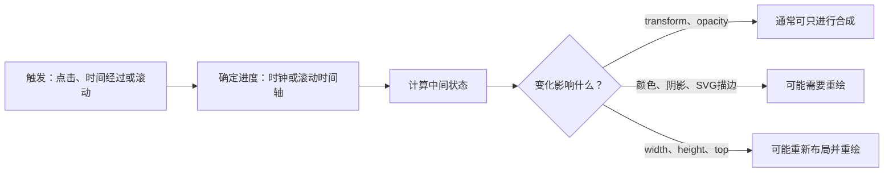

[toc]


## 先建立一个判断框架

Web动画可以拆成三个问题：**什么触发变化、什么决定进度、由谁绘制画面**。例如，点击按钮使卡片移动，是状态变化触发的动画；阅读进度条由滚动位置决定进度；Canvas中的圆点则由JavaScript逐帧计算并绘制。



图中最后三条路径是**性能判断线索，不是绝对保证**：是否真正只发生合成，应以目标浏览器的开发者工具测量为准。制作常规界面动效时，优先尝试`transform`和`opacity`，避免为“移动一个元素”反复改动会影响布局的属性。

## 技术怎么选

| 技术                                             | 典型用途                                   | 选择时要知道的边界                                           |
| ------------------------------------------------ | ------------------------------------------ | ------------------------------------------------------------ |
| **CSS Transition（过渡）**                       | 按钮反馈、展开状态、悬停反馈               | 由**属性或状态改变**触发；简单交互通常先选它。               |
| **CSS `@keyframes`（关键帧）**                   | 加载提示、强调效果、多阶段动画             | 适合声明式、可重复的时间动画；持续循环须提供停止方式。       |
| **CSS Motion Path（运动路径）**                  | 沿曲线移动的装饰元素                       | 用`offset-path`定义路线，用`offset-distance`定义位置；复杂响应式路径要留意坐标。 |
| **Web Animations API，简称WAAPI**                | 由业务逻辑启动、暂停、取消的DOM动画        | `element.animate()`返回可控制的`Animation`对象；仍需管理取消与完成状态。 |
| **CSS Scroll-driven Animations（滚动驱动动画）** | 阅读进度、元素随滚动进入视口               | `scroll()`跟踪滚动进度，`view()`跟踪元素穿过滚动区域的进度；**兼容性尚未全面统一，须提供静态回退**。 |
| **Intersection Observer**                        | 元素进入可视区域后播放一次                 | 它负责**发现进入时机**，不是逐帧动画引擎；不要将其等同于滚动驱动时间轴。 |
| **View Transition API（视图过渡）**              | 页面内部切换列表、卡片或视图状态           | 同文档示例可用`document.startViewTransition()`；不支持时应直接更新内容。 |
| **SVG动画**                                      | 图标、路径描绘、矢量插画                   | SVG描边可用CSS动画；SVG中的`<animate>`等元素也可执行SMIL动画。 |
| **Canvas 2D＋`requestAnimationFrame()`**         | 粒子、图表、频繁变化的绘图                 | Canvas负责绘图，`requestAnimationFrame()`负责请求下一帧；必须自己管理时间、尺寸和暂停。 |
| **WebGL／WebGPU、动画素材与库**                  | 复杂2D／3D场景、设计师交付的动画、复杂编排 | WebGL适合交互图形；WebGPU仍需特别检查兼容性与安全上下文。Lottie、Rive、Motion、GSAP、Anime.js或国内的Galacean Engine等，应按素材格式、框架、授权和交付成本选择，而不是为一个按钮效果先引入引擎。 |

**两个容易混淆的概念：**滚动**驱动**动画，是滚动多少、动画就进行多少；滚动**触发**动画，是越过某处后启动一个按时间播放的动画。后者可以用Intersection Observer实现；较新的CSS滚动触发机制也已出现，但不宜在未验证目标浏览器前当作通用基础能力。

读示例代码前，先认清几个参数：

| 写法                                                   | 各部分含义                                                   |
| ------------------------------------------------------ | ------------------------------------------------------------ |
| `transition: transform 240ms ease-out`                 | `transform`是要过渡的属性；`240ms`是时长；`ease-out`是先快后慢的缓动方式。 |
| `animation: pulse 1.6s ease-in-out infinite alternate` | `pulse`是`@keyframes`名称；`1.6s`是单次时长；`infinite`表示重复；`alternate`表示每轮反向播放。 |
| `element.animate(keyframes, options)`                  | `element`是目标DOM元素；`keyframes`是起止或多段属性值；`options`可包含`duration`（毫秒）、`easing`（缓动）、`iterations`（次数）等。 |
| `animation-timeline: scroll()`或`view()`               | 前者把**滚动容器的滚动进度**作为时间轴；后者把**元素穿过滚动区域的进度**作为时间轴。 |
| `requestAnimationFrame(callback)`                      | 浏览器在下一次绘制前调用`callback`；回调获得的时间戳应参与位移计算，不能假定设备固定为每秒60帧。 |

## 可直接保存运行的综合演示页

将以下内容保存为UTF-8编码的`animation-lab.html`，在现代浏览器中打开。页面展示**CSS过渡、关键帧、运动路径、SVG描边与SMIL、WAAPI、滚动时间轴、Intersection Observer、View Transition和Canvas 2D**。它**不请求CDN、字体、图片或npm包**，适合在不稳定或离线的网络环境中试验。滚动时间轴等特性不受支持时保持静态；视图过渡不受支持时直接切换内容。示例用`1ms`声明滚动时间轴动画的CSS时长，这**不是滚动动画实际播放一毫秒**，而是兼顾实现差异的写法；并且`animation-timeline`须放在`animation`简写**之后**。

```html
<!doctype html>
<html lang="zh-CN">
<head>
  <meta charset="utf-8">
  <meta name="viewport" content="width=device-width, initial-scale=1">
  <title>Web 动画实验室</title>
  <style>
    :root {
      font-family: system-ui, -apple-system, "Segoe UI",
        "Noto Sans CJK SC", sans-serif;
      color: #172338;
      background: #f3f6fb;
    }
    * { box-sizing: border-box; }
    body { margin: 0; }
    main { max-width: 1050px; margin: auto; padding: 24px 16px 60px; }
    h1 { margin: 0 0 8px; font-size: clamp(1.5rem, 4vw, 2rem); }
    .intro, .note { color: #475569; line-height: 1.65; }
    .toolbar, .card {
      background: #fff;
      border: 1px solid #dce4ef;
      border-radius: 14px;
    }
    .toolbar { padding: 14px; margin: 20px 0; }
    .controls { display: flex; flex-wrap: wrap; align-items: center; gap: 12px; }
    .support { display: block; margin-top: 10px; color: #475569; }
    .grid {
      display: grid;
      grid-template-columns: repeat(auto-fit, minmax(min(100%, 285px), 1fr));
      gap: 16px;
    }
    .card { min-width: 0; padding: 16px; }
    .card h2 { font-size: 1.05rem; margin: 0 0 6px; }
    .card p { color: #475569; line-height: 1.55; margin: 0 0 12px; }
    .stage {
      min-height: 125px;
      padding: 8px;
      display: grid;
      place-items: center;
      overflow: hidden;
      border: 1px dashed #cbd5e1;
      border-radius: 10px;
      background: #f8fafc;
    }
    button {
      cursor: pointer;
      border: 0;
      border-radius: 8px;
      background: #2458d3;
      color: #fff;
      padding: 8px 12px;
      font: inherit;
    }
    button:disabled { cursor: wait; opacity: .65; }
    button:focus-visible, input:focus-visible, .scroller:focus-visible {
      outline: 3px solid #f59e0b;
      outline-offset: 3px;
    }
    .action { margin-top: 10px; }
    code { color: #244db0; }

    /* 状态切换：只过渡明确列出的属性。 */
    .lane { width: min(100%, 230px); }
    .moving-box, .waapi-box {
      width: 64px;
      height: 54px;
      display: grid;
      place-items: center;
      border-radius: 10px;
      color: white;
      background: #2458d3;
      font-size: .83rem;
    }
    .moving-box {
      transition: transform 300ms ease-out, background-color 300ms ease-out;
    }
    .moving-box.shifted {
      transform: translateX(120px);
      background: #0f766e;
    }

    .pulse {
      width: 62px;
      height: 62px;
      border-radius: 50%;
      background: #0f766e;
      box-shadow: 0 0 0 10px #ccfbf1;
    }
    body.motion-enabled .pulse {
      animation: pulse 1.6s ease-in-out infinite alternate;
    }
    @keyframes pulse {
      from { transform: scale(.84); opacity: .65; }
      to   { transform: scale(1.12); opacity: 1; }
    }

    /* 路径固定为 200 × 115 的局部坐标，便于对照 SVG 轨迹。 */
    .path-area { position: relative; width: 200px; height: 115px; }
    .path-area svg { display: block; }
    .orbit-dot {
      position: absolute;
      left: 12px;
      top: 78px;
      width: 14px;
      height: 14px;
      border-radius: 50%;
      background: #dc2626;
    }
    @supports (offset-path: path("M 0 0 L 1 1")) {
      .orbit-dot {
        left: 0;
        top: 0;
        offset-path: path("M 12 78 C 52 6 137 117 188 64");
      }
      body.motion-enabled .orbit-dot {
        animation: orbit 4s linear infinite alternate;
      }
    }
    @keyframes orbit {
      to { offset-distance: 100%; }
    }

    .svg-demo { display: block; width: 240px; max-width: 100%; }
    .draw-line {
      fill: none;
      stroke: #2458d3;
      stroke-width: 5;
      stroke-linecap: round;
    }
    body.motion-enabled .draw-line {
      stroke-dasharray: 100;
      stroke-dashoffset: 100;
      animation: draw 2.8s ease-in-out infinite alternate;
    }
    @keyframes draw {
      to { stroke-dashoffset: 0; }
    }

    .waapi-status { display: block; min-height: 1.5em; margin-top: 8px; }
    .scroller {
      height: 190px;
      overflow-y: auto;
      position: relative;
      border: 1px solid #cbd5e1;
      border-radius: 10px;
      background: #f8fafc;
    }
    .progress {
      display: none;
      height: 5px;
      position: sticky;
      top: 0;
      z-index: 1;
      background: #0f766e;
      transform-origin: left center;
    }
    .scroll-gap {
      height: 125px;
      display: grid;
      place-items: center;
      color: #64748b;
    }
    .scroll-item, .reveal {
      margin: 12px;
      padding: 14px;
      border-radius: 9px;
      background: #dbeafe;
    }
    .reveal { background: #ccfbf1; }
    body.motion-enabled.has-io:not(.is-reduced):not(.is-paused)
      .reveal {
      transition: opacity 500ms ease-out, transform 500ms ease-out;
    }
    body.motion-enabled.has-io:not(.is-reduced):not(.is-paused)
      .reveal:not(.in-view) {
      opacity: 0;
      transform: translateY(14px);
    }
    @supports (animation-timeline: scroll()) {
      body.motion-enabled .progress {
        display: block;
        animation: grow 1ms linear both;
        animation-timeline: scroll();
      }
    }
    @supports (animation-timeline: view()) {
      body.motion-enabled .scroll-item {
        animation: arrive 1ms linear both;
        animation-timeline: view();
      }
    }
    @keyframes grow {
      from { transform: scaleX(0); }
      to   { transform: scaleX(1); }
    }
    @keyframes arrive {
      0%       { opacity: .45; transform: translateY(18px); }
      35%, 100% { opacity: 1; transform: none; }
    }

    :root { view-transition-name: none; }
    .view-card {
      view-transition-name: lab-card;
      min-height: 100px;
      padding: 18px;
      display: grid;
      place-content: center;
      gap: 6px;
      border-radius: 10px;
      background: #dbeafe;
      text-align: center;
    }
    .view-card.done { background: #ccfbf1; }
    ::view-transition-group(lab-card) { animation-duration: 450ms; }

    .canvas-stage { padding: 0; min-height: 160px; }
    canvas { display: block; width: 100%; height: 160px; }

    /* 暂停自动效果；点击引起的新状态变化直接完成。 */
    body.is-paused .animated { animation-play-state: paused !important; }
    body.is-paused .moving-box,
    body.is-paused .reveal { transition: none !important; }
    body.is-paused .reveal {
      opacity: 1 !important;
      transform: none !important;
    }

    /* 手动减少动态与系统减少动态，均不隐藏重要信息。 */
    body.is-reduced .animated { animation: none !important; }
    body.is-reduced .draw-line { stroke-dashoffset: 0 !important; }
    body.is-reduced .progress { display: none !important; }
    body.is-reduced .moving-box {
      transition: none !important;
      transform: none !important;
    }
    body.is-reduced .reveal {
      opacity: 1 !important;
      transform: none !important;
      transition: none !important;
    }
    @media (prefers-reduced-motion: reduce) {
      .animated { animation: none !important; }
      .draw-line { stroke-dashoffset: 0 !important; }
      .progress { display: none !important; }
      .moving-box {
        transition: none !important;
        transform: none !important;
      }
      .reveal {
        opacity: 1 !important;
        transform: none !important;
        transition: none !important;
      }
      ::view-transition-group(lab-card) {
        animation-duration: 0.01ms !important;
      }
    }
  </style>
</head>
<body>
  <main>
    <h1>Web 动画实验室</h1>
    <p class="intro">
      同一页面中比较“状态过渡、时间动画、滚动进度、视图切换和逐帧绘图”。
      所有内容均为本地代码，不加载外部资源。
    </p>

    <div class="toolbar">
      <div class="controls" role="group" aria-label="动画控制">
        <button id="pauseAll" type="button" aria-pressed="false">
          暂停自动动效
        </button>
        <label>
          <input id="reduceMotion" type="checkbox">
          减少动态
        </label>
      </div>
      <small class="support" id="support" aria-live="polite">
        正在检查浏览器能力……
      </small>
      <small class="note">
        如果系统已开启“减少动态”，此处会保持选中；可以暂停循环动画，
        但按钮引起的状态更新仍会执行。
      </small>
    </div>

    <div class="grid">
      <section class="card">
        <h2>CSS Transition：状态反馈</h2>
        <p>改变类名后，浏览器过渡位置和颜色；减少动态时仍保留状态变化。</p>
        <div class="stage">
          <div class="lane">
            <div id="movingBox" class="moving-box">状态A</div>
          </div>
        </div>
        <button class="action" id="moveButton" type="button">切换到状态B</button>
      </section>

      <section class="card">
        <h2>CSS关键帧：循环强调</h2>
        <p><code>@keyframes</code>规定两端状态；上方“暂停”按钮会停住它。</p>
        <div class="stage">
          <div class="pulse animated" aria-hidden="true"></div>
        </div>
      </section>

      <section class="card">
        <h2>CSS运动路径：沿曲线移动</h2>
        <p>蓝线是路线，红点的<code>offset-distance</code>随时间变化。</p>
        <div class="stage">
          <div class="path-area">
            <svg width="200" height="115" viewBox="0 0 200 115"
                 aria-hidden="true">
              <path d="M 12 78 C 52 6 137 117 188 64"
                    fill="none" stroke="#2458d3" stroke-width="2"></path>
            </svg>
            <span class="orbit-dot animated" aria-hidden="true"></span>
          </div>
        </div>
      </section>

      <section class="card">
        <h2>SVG：描边动画与SMIL</h2>
        <p>曲线用CSS描绘；下方圆点由SVG的<code>&lt;animate&gt;</code>控制。</p>
        <div class="stage">
          <svg id="svgDemo" class="svg-demo"
               viewBox="0 0 240 125" role="img"
               aria-label="曲线逐渐描绘，圆点沿水平线往返">
            <path class="draw-line animated" pathLength="100"
                  d="M 15 70 C 60 0, 130 125, 225 45"></path>
            <path d="M 24 105 H 216" stroke="#cbd5e1"></path>
            <circle cx="24" cy="105" r="8" fill="#0f766e">
              <animate id="smilMove" attributeName="cx"
                       values="24;216;24" dur="3s"
                       repeatCount="indefinite" begin="indefinite">
              </animate>
            </circle>
          </svg>
        </div>
      </section>

      <section class="card">
        <h2>Web Animations API：按需播放</h2>
        <p>点击后调用<code>element.animate()</code>；再次点击可取消旧动画并重播。</p>
        <div class="stage">
          <div class="lane">
            <div id="waapiBox" class="waapi-box">WAAPI</div>
          </div>
        </div>
        <button class="action" id="waapiButton" type="button">播放一次</button>
        <span class="waapi-status" id="waapiStatus" role="status">
          点击按钮触发。
        </span>
      </section>

      <section class="card">
        <h2>滚动驱动与进入时触发</h2>
        <p>在下方小区域滚动：顶部细条跟随滚动，卡片随视口变化，末项只出现一次。</p>
        <div class="scroller" id="scroller" tabindex="0"
             aria-label="可滚动的动画演示区域">
          <div class="progress animated" aria-hidden="true"></div>
          <div class="scroll-gap">请向下滚动</div>
          <div class="scroll-item animated">CSS：滚动位置控制进度</div>
          <div class="scroll-gap" aria-hidden="true"></div>
          <div class="reveal" id="ioCard">
            Intersection Observer：进入时显示一次
          </div>
          <div class="scroll-gap" aria-hidden="true"></div>
        </div>
      </section>

      <section class="card">
        <h2>View Transition：视图切换</h2>
        <p>切换示例订单状态；不支持该API时立即更新文字与背景。</p>
        <div class="stage">
          <div id="viewCard" class="view-card" aria-live="polite">
            <strong id="viewTitle">示例订单：处理中</strong>
            <span id="viewSubtitle">这是演示数据</span>
          </div>
        </div>
        <button class="action" id="viewButton" type="button">切换状态</button>
      </section>

      <section class="card">
        <h2>Canvas 2D＋逐帧调度</h2>
        <p>每帧重绘三颗圆点；隐藏标签页或暂停时停止请求新帧。</p>
        <div class="stage canvas-stage">
          <canvas id="particleCanvas" width="600" height="160"
                  role="img" aria-label="三颗彩色圆点在三条水平线上往返">
            当前浏览器不支持Canvas。
          </canvas>
        </div>
        <noscript>启用JavaScript后可查看Canvas绘图。</noscript>
      </section>
    </div>
  </main>

  <script>
    (() => {
      "use strict";
      const byId = (id) => document.getElementById(id);
      const body = document.body;
      const media = matchMedia("(prefers-reduced-motion: reduce)");
      const reduceInput = byId("reduceMotion");
      const pauseButton = byId("pauseAll");
      const svg = byId("svgDemo");
      const smil = byId("smilMove");
      const waapiBox = byId("waapiBox");
      const waapiStatus = byId("waapiStatus");
      const viewButton = byId("viewButton");
      const viewCard = byId("viewCard");
      const canvas = byId("particleCanvas");
      const ctx = canvas.getContext("2d");

      let manualReduce = false;
      let paused = false;
      let smilStarted = false;
      let waapiAnimation = null;
      let activeViewTransition = null;
      let completed = false;

      const reduced = () => media.matches || manualReduce;
      const supports = (property, value) =>
        Boolean(window.CSS && CSS.supports(property, value));

      byId("support").textContent =
        "能力检测：滚动时间轴 " +
        (supports("animation-timeline", "scroll()") ? "可用" : "静态回退") +
        "；视图过渡 " +
        (document.startViewTransition ? "可用" : "即时切换") +
        "；运动路径 " +
        (supports("offset-path", 'path("M 0 0 L 1 1")')
          ? "可用" : "静态回退") +
        "；SVG SMIL " +
        (typeof smil.beginElement === "function" ? "可用" : "静态回退") +
        "。";

      byId("moveButton").addEventListener("click", (event) => {
        const box = byId("movingBox");
        const shifted = box.classList.toggle("shifted");
        box.textContent = shifted ? "状态B" : "状态A";
        event.currentTarget.textContent =
          shifted ? "恢复状态A" : "切换到状态B";
      });

      byId("waapiButton").addEventListener("click", () => {
        if (reduced() || paused) {
          waapiStatus.textContent =
            reduced() ? "减少动态：不播放位移动画。"
                      : "请先继续自动动效。";
          return;
        }
        if (typeof waapiBox.animate !== "function") {
          waapiStatus.textContent = "此浏览器不支持该API。";
          return;
        }
        waapiAnimation?.cancel();
        const animation = waapiBox.animate(
          [
            { transform: "translateX(0)", opacity: 1 },
            { transform: "translateX(120px)", opacity: .55 },
            { transform: "translateX(0)", opacity: 1 }
          ],
          { duration: 1600, easing: "ease-in-out" }
        );
        waapiAnimation = animation;
        waapiStatus.textContent = "播放中。";
        animation.finished
          .then(() => {
            if (waapiAnimation === animation) {
              waapiAnimation = null;
              waapiStatus.textContent = "播放完成。";
            }
          })
          .catch(() => {
            // 重播或减少动态时主动 cancel，会使 finished 拒绝。
          });
      });

      function updateView() {
        completed = !completed;
        viewCard.classList.toggle("done", completed);
        byId("viewTitle").textContent =
          completed ? "示例订单：已完成" : "示例订单：处理中";
        byId("viewSubtitle").textContent = "这是演示数据";
      }

      viewButton.addEventListener("click", () => {
        if (paused || reduced() ||
            typeof document.startViewTransition !== "function") {
          updateView();
          return;
        }
        viewButton.disabled = true;
        activeViewTransition = document.startViewTransition(updateView);
        activeViewTransition.finished
          .catch(() => {})
          .finally(() => {
            activeViewTransition = null;
            viewButton.disabled = false;
          });
      });

      if ("IntersectionObserver" in window) {
        body.classList.add("has-io");
        const observer = new IntersectionObserver((entries) => {
          for (const entry of entries) {
            if (entry.isIntersecting) {
              entry.target.classList.add("in-view");
              observer.unobserve(entry.target);
            }
          }
        }, { root: byId("scroller"), threshold: .2 });
        observer.observe(byId("ioCard"));
      }

      let frameId = null;
      let lastTime = 0;
      let phase = 0;
      let width = 1;
      let height = 1;

      function paintCanvas() {
        if (!ctx) return;
        ctx.clearRect(0, 0, width, height);
        const colors = ["#2458d3", "#0f766e", "#dc2626"];
        for (let i = 0; i < 3; i++) {
          const y = (i + 1) * height / 4;
          ctx.beginPath();
          ctx.moveTo(16, y);
          ctx.lineTo(width - 16, y);
          ctx.lineWidth = 2;
          ctx.strokeStyle = "#cbd5e1";
          ctx.stroke();

          const fraction = .5 +
            .46 * Math.sin(phase * (1 + i * .18) + i * 1.3);
          const x = 16 + (width - 32) * fraction;
          ctx.beginPath();
          ctx.arc(x, y, 9, 0, Math.PI * 2);
          ctx.fillStyle = colors[i];
          ctx.fill();
        }
      }

      function resizeCanvas() {
        if (!ctx) return;
        const rect = canvas.getBoundingClientRect();
        const dpr = Math.min(devicePixelRatio || 1, 2);
        width = rect.width;
        height = rect.height;
        canvas.width = Math.max(1, Math.round(width * dpr));
        canvas.height = Math.max(1, Math.round(height * dpr));
        ctx.setTransform(dpr, 0, 0, dpr, 0, 0);
        paintCanvas();
      }

      function frame(timestamp) {
        frameId = null;
        if (paused || reduced() || document.hidden) {
          lastTime = 0;
          return;
        }
        if (lastTime) {
          phase += Math.min((timestamp - lastTime) / 1000, .05);
        }
        lastTime = timestamp;
        paintCanvas();
        frameId = requestAnimationFrame(frame);
      }

      function syncCanvas() {
        if (!ctx) return;
        if (paused || reduced() || document.hidden) {
          if (frameId !== null) cancelAnimationFrame(frameId);
          frameId = null;
          lastTime = 0;
          if (reduced()) phase = 0;
          paintCanvas();
        } else if (frameId === null) {
          frameId = requestAnimationFrame(frame);
        }
      }

      function syncPlayback() {
        const minimize = reduced();
        body.classList.toggle("is-reduced", minimize);
        reduceInput.checked = minimize;
        reduceInput.disabled = media.matches;
        pauseButton.textContent =
          paused ? "继续自动动效" : "暂停自动动效";
        pauseButton.setAttribute("aria-pressed", String(paused));

        if (minimize) {
          waapiAnimation?.cancel();
          waapiAnimation = null;
          waapiStatus.textContent = "减少动态：不播放位移动画。";
        } else if (paused || document.hidden) {
          if (waapiAnimation?.playState === "running") {
            waapiAnimation.pause();
            waapiStatus.textContent = "已暂停。";
          }
        } else if (waapiAnimation?.playState === "paused") {
          waapiAnimation.play();
          waapiStatus.textContent = "继续播放。";
        }

        if (typeof svg.pauseAnimations === "function") {
          if (minimize || paused || document.hidden) {
            svg.pauseAnimations();
          } else {
            svg.unpauseAnimations();
            if (!smilStarted &&
                typeof smil.beginElement === "function") {
              smil.beginElement();
              smilStarted = true;
            }
          }
        }
        if ((minimize || paused) && activeViewTransition) {
          activeViewTransition.skipTransition();
        }
        syncCanvas();
      }

      pauseButton.addEventListener("click", () => {
        paused = !paused;
        syncPlayback();
      });
      reduceInput.addEventListener("change", () => {
        manualReduce = reduceInput.checked;
        syncPlayback();
      });
      document.addEventListener("visibilitychange", syncPlayback);
      if (media.addEventListener) {
        media.addEventListener("change", syncPlayback);
      } else {
        media.addListener(syncPlayback);
      }

      if (ctx) {
        resizeCanvas();
        if ("ResizeObserver" in window) {
          new ResizeObserver(resizeCanvas).observe(canvas);
        } else {
          addEventListener("resize", resizeCanvas);
        }
      }
      body.classList.add("motion-enabled");
      syncPlayback();
    })();
  </script>
</body>
</html>
```

**建议这样观察，而不只是看效果：**

- 点击“切换到状态B”：内容和状态先明确变化，**CSS Transition只负责呈现变化**；开启“减少动态”后，状态依然可辨。
- 点击“播放一次”并迅速再点：旧WAAPI动画会被`cancel()`，新动画从头播放；不使用无限期的`fill: "forwards"`保存业务状态。后者可能让动画效果长期占据样式优先级，应在需要保留终态时另行管理实际样式。
- 在小滚动区域内上下滚动：细条与CSS卡片跟随进度，反向滚动也会反向变化；最下方的Intersection Observer卡片则**只在进入时触发一次**。若能力检测显示“静态回退”，内容仍应可读。
- 暂停后观察SVG和Canvas：SVG的**SMIL时间轴**与Canvas的**逐帧循环**都需要JavaScript单独处理，暂停CSS动画本身不会自动管理它们。Canvas按时间戳计算变化，并在恢复前清空上一帧时间，避免隐藏标签页后发生大幅跳跃。

若直接打开文件时某项功能表现异常，可改用本地服务器排查；Python已安装时，Windows可运行`py -m http.server 8000 --bind 127.0.0.1`，macOS或Linux可运行`python3 -m http.server 8000 --bind 127.0.0.1`，然后访问`http://127.0.0.1:8000/animation-lab.html`。**不必为运行本演示下载依赖或配置代理。**`localhost`通常也可满足需要安全上下文的Web特性；但WebGPU等更复杂功能不在本单文件演示范围内。

## 投入实际项目时的检查清单

| 优先级                 | 应当怎样做                                                   | 避免什么                                                     |
| ---------------------- | ------------------------------------------------------------ | ------------------------------------------------------------ |
| **必须：可访问**       | **遵从`prefers-reduced-motion`，并为自动播放、持续超过5秒且与其他内容同时呈现的运动提供暂停、停止或隐藏机制**；交互控件可用键盘操作。 | 只给CSS写“减少动态”，却遗漏WAAPI、SMIL、Canvas、视频等其他来源；使用快速闪烁吸引注意。 |
| **必须：不丢功能**     | 先确保静态内容和状态更新可用，再逐步增强动画。真正隐藏的交互内容，应同步处理可见性与焦点。 | 仅以`opacity: 0`当作“已删除”：元素可能仍能被聚焦或被辅助技术读取。 |
| **应该：控制绘制成本** | 优先测量`transform`、`opacity`方案；Canvas依据实际尺寸与设备像素比调整位图；必要时暂停不可见区域的绘制。 | 不经测量就给所有元素常驻`will-change`，或用`setInterval()`假设固定刷新率。 |
| **应该：管理生命周期** | 重复触发时取消旧动画；组件卸载时取消`requestAnimationFrame()`、断开观察器；处理`Animation.finished`在取消时的拒绝。 | 让多个动画同时争夺同一元素的同一个`transform`，产生难以判断的最终状态。 |
| **应该：验证兼容**     | 对滚动时间轴等较新能力做`@supports`或运行时检测，并在Chrome／Edge、Firefox、Safari及实际移动端测试。 | 把“某个浏览器已经实现”误认为“所有目标用户均可使用”。         |
| **可以：按需升级工具** | 当确有复杂编排、设计素材或3D需求，再评估Motion、GSAP、Anime.js、Lottie、Rive、Three.js或国内方案；核对当前文档、授权和维护状态。 | 把图形引擎当作普通界面过渡的默认依赖。                       |

最后，**演示页覆盖的是常用页面与交互动效的主要路径，不是假装单文件已经涵盖所有图形制作技术**：真实的Lottie／Rive作品需要相应素材和运行时，WebGL／WebGPU作品需要图形上下文、场景或着色器。对初学者更稳妥的进阶顺序是：**CSS状态过渡 → CSS关键帧与SVG → WAAPI和滚动时间轴 → Canvas逐帧绘制 → 按项目需要进入图形引擎**。