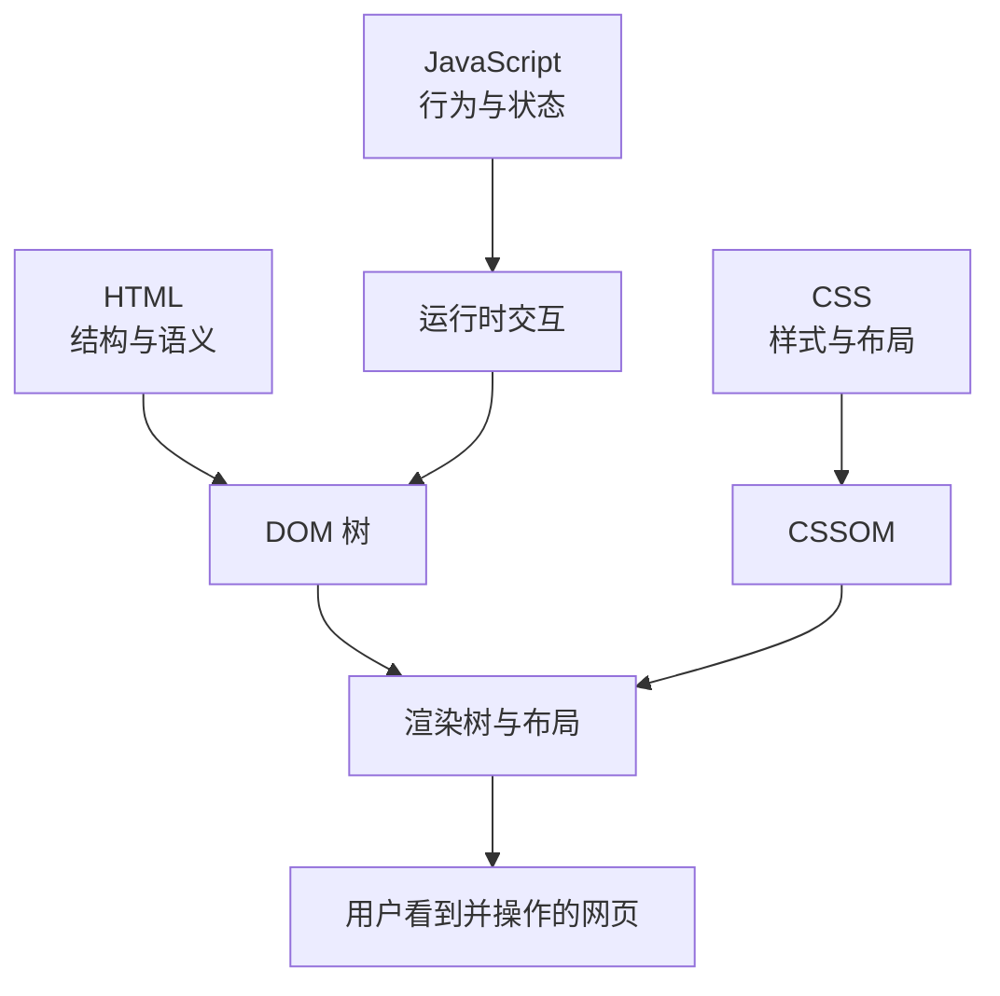
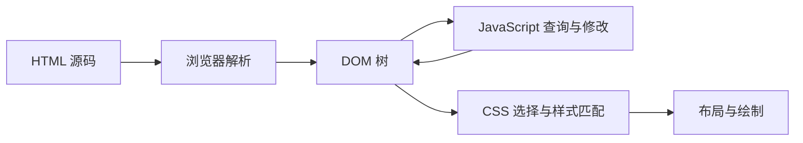

[toc]

## 主题定位：HTML 是网页的结构与语义语言

HTML，全称 HyperText Markup Language，是 Web 页面最基础的组成部分。它的核心职责不是“让页面变好看”，也不是“让页面动起来”，而是描述页面内容的结构、含义与资源关系。样式主要交给 CSS，交互逻辑主要交给 JavaScript，浏览器会把 HTML 解析成 DOM 树，再由 CSSOM、布局、绘制、JavaScript 执行共同形成最终页面。当前 HTML 应以 WHATWG HTML Living Standard 为主要参考，而不是把“HTML5”理解成一个固定不再变化的版本；WHATWG 标准持续维护 HTML 的元素、语义、表单、脚本、嵌入内容等规则。([html.spec.whatwg.org](https://html.spec.whatwg.org/multipage/?utm_source=chatgpt.com))



------

## 详细学习大纲

| 学习阶段    | 要掌握的内容                                             | 学习目标                                 | 典型产出                   |
| ----------- | -------------------------------------------------------- | ---------------------------------------- | -------------------------- |
| 基础入门    | 标签、元素、属性、嵌套、注释、文档骨架                   | 能手写一个合法 HTML 页面                 | 个人介绍页、文章页         |
| 文档结构    | `doctype`、`html`、`head`、`body`、`meta`、`title`       | 理解浏览器如何识别页面、语言、编码、视口 | 标准页面模板               |
| 语义化 HTML | 标题、段落、列表、章节、导航、主内容、页眉页脚           | 用合适元素表达内容含义                   | 博客文章页、产品详情页     |
| 链接与资源  | `a`、相对路径、绝对路径、锚点、下载、外链安全            | 构建站点导航与资源引用                   | 多页面小网站               |
| 表单        | `form`、`input`、`label`、`select`、`textarea`、约束验证 | 收集用户输入并提升可用性                 | 登录、注册、搜索表单       |
| 媒体        | `img`、`picture`、`audio`、`video`、`track`、响应式图片  | 正确展示图片、音视频与字幕               | 图文页、视频页             |
| 表格        | `table`、`caption`、`thead`、`tbody`、`th`、`scope`      | 展示二维数据，而不是做页面布局           | 价格表、成绩表             |
| 可访问性    | 语义、键盘可用、替代文本、表单标签、标题层级             | 让更多用户和辅助技术正确理解页面         | 无障碍友好的页面           |
| 性能与安全  | 延迟加载、脚本加载、CSP、`iframe` 沙箱、外链安全         | 写出更快、更安全的 HTML                  | 生产级页面模板             |
| 现代能力    | `dialog`、`popover`、`template`、Web Components          | 了解平台原生组件能力                     | 模态框、弹出层、可复用组件 |

MDN 的 HTML 元素参考将元素按功能分组，适合作为日常查询入口；WHATWG 标准则更适合理解规则、内容模型与浏览器实现细节。([MDN Web Docs](https://developer.mozilla.org/en-US/docs/Web/HTML/Reference/Elements?utm_source=chatgpt.com))

------

## HTML 的基本语法模型

HTML 由元素、标签、属性和文本内容组成。多数元素由开始标签、内容、结束标签构成，例如：

```html
<p class="lead">HTML 用来描述网页内容的结构和含义。</p>
```

其中：

| 组成部分 | 示例               | 说明                   |
| -------- | ------------------ | ---------------------- |
| 元素     | `<p>...</p>`       | 页面结构的基本单位     |
| 开始标签 | `<p class="lead">` | 标记元素开始           |
| 结束标签 | `</p>`             | 标记元素结束           |
| 属性     | `class="lead"`     | 为元素提供额外信息     |
| 内容     | `HTML 用来...`     | 元素包含的文本或子元素 |

部分元素是空元素，也常被称为 void elements，不包裹内容，例如 `img`、`br`、`hr`、`input`、`meta`、`link`。这类元素不应该写成包裹内容的形式。HTML 还支持全局属性，例如 `id`、`class`、`style`、`title`、`hidden`、`lang`、`dir`、`data-*` 等；其中 `data-*` 适合在 HTML 与脚本之间存放页面私有的自定义数据。([MDN Web Docs](https://developer.mozilla.org/en-US/docs/Web/HTML/Reference/Attributes?utm_source=chatgpt.com))

### 布尔属性

布尔属性只看“是否出现”，不看字符串值是否像 `true` 或 `false`。例如：

```html
<input type="checkbox" checked>
<button disabled>提交中</button>
```

`checked` 出现即表示选中，`disabled` 出现即表示禁用。不要写 `disabled="false"` 来表达“未禁用”，因为属性仍然存在，浏览器会把它视为真。MDN 对 HTML 布尔属性的说明也是“属性存在即为 true，不存在即为 false”。([MDN Web Docs](https://developer.mozilla.org/en-US/docs/Glossary/Boolean/HTML?utm_source=chatgpt.com))

------

## 标准 HTML 文档骨架

推荐从这个模板开始：

```html
<!doctype html>
<html lang="zh-CN">
<head>
  <meta charset="utf-8">
  <meta name="viewport" content="width=device-width, initial-scale=1">
  <title>页面标题</title>
  <meta name="description" content="页面内容的简短描述">
  <link rel="stylesheet" href="/styles/main.css">
</head>
<body>
  <header>
    <nav aria-label="主导航">
      <a href="/">首页</a>
      <a href="/articles/">文章</a>
      <a href="/about/">关于</a>
    </nav>
  </header>

  <main>
    <h1>页面主标题</h1>
    <p>这里是页面的主要内容。</p>
  </main>

  <footer>
    <p>&copy; 2026 Example</p>
  </footer>

  <script type="module" src="/scripts/main.js"></script>
</body>
</html>
```

| 片段                        | 作用                                     | 实践建议                |
| --------------------------- | ---------------------------------------- | ----------------------- |
| `<!doctype html>`           | 声明现代 HTML 文档                       | 固定写在第一行          |
| `<html lang="zh-CN">`       | 声明页面主要语言                         | 中文页面不要省略 `lang` |
| `<meta charset="utf-8">`    | 声明字符编码                             | 放在 `head` 靠前位置    |
| `<meta name="viewport">`    | 适配移动端视口                           | 响应式页面基本必备      |
| `<title>`                   | 浏览器标签、收藏、搜索结果标题的重要来源 | 每个页面都应唯一且具体  |
| `<meta name="description">` | 页面摘要信息                             | 写给人看，不要堆关键词  |
| `<main>`                    | 页面主要内容区域                         | 通常每页一个            |
| `type="module"`             | 使用 JavaScript 模块                     | 现代项目推荐方式之一    |

WHATWG 标准将 `head`、`title`、`base`、`link`、`meta` 等归入文档元数据部分；MDN 的可访问性指南也强调文档应有标题、表单应有标签、嵌入内容应有可理解名称等基础要求。([html.spec.whatwg.org](https://html.spec.whatwg.org/multipage/?utm_source=chatgpt.com))

------

## 元素、属性与 DOM 的关系

HTML 不是简单的字符串。浏览器读取 HTML 后会解析成 DOM，JavaScript 操作的通常是 DOM 节点，而不是原始 HTML 文本。



一个重要原则是：HTML 负责表达“这是什么”，CSS 负责表达“看起来怎样”，JavaScript 负责表达“发生什么”。例如，一个可点击提交控件应该优先使用 `button`，而不是用 `div` 加点击事件模拟按钮。MDN 的语义 HTML 课程特别强调，浏览器已经为 `button`、表单控件等元素内置了键盘访问、焦点轮廓、辅助技术语义等能力。([MDN Web Docs](https://developer.mozilla.org/en-US/curriculum/core/semantic-html/?utm_source=chatgpt.com))

------

## 内容模型：为什么有些标签不能随便嵌套

HTML 元素并不是“想怎么套就怎么套”。WHATWG 标准为每个元素定义了内容模型，也就是该元素期望包含什么类型的子内容；元素内容必须匹配其内容模型要求。([html.spec.whatwg.org](https://html.spec.whatwg.org/dev/dom.html?utm_source=chatgpt.com))

常见内容类别可以这样理解：

| 内容类别   | 大致含义                       | 常见元素                                     |
| ---------- | ------------------------------ | -------------------------------------------- |
| 元数据内容 | 描述文档自身或外部资源关系     | `title`、`meta`、`link`、`style`、`script`   |
| 流式内容   | 大多数能出现在 `body` 中的内容 | `p`、`div`、`section`、`article`、`ul`       |
| 分区内容   | 创建页面结构区块               | `section`、`article`、`nav`、`aside`         |
| 标题内容   | 表示章节标题                   | `h1` 到 `h6`、`hgroup`                       |
| 短语内容   | 段落内部的文本级内容           | `a`、`em`、`strong`、`span`、`code`          |
| 嵌入内容   | 引入外部资源                   | `img`、`video`、`audio`、`iframe`、`svg`     |
| 交互内容   | 用户可操作内容                 | `a`、`button`、`input`、`select`、`textarea` |

常见错误示例：

```html
<!-- 不推荐：p 中不应随意放块级结构 -->
<p>
  这是一个段落
  <section>这是一个章节</section>
</p>
```

更合适：

```html
<p>这是一个段落。</p>

<section>
  <h2>这是一个章节</h2>
  <p>章节中的正文。</p>
</section>
```

------

## 语义化 HTML 的核心思想

语义化 HTML 的核心是“用正确的元素表达正确的含义”。这不仅让代码更容易维护，也让浏览器、搜索引擎、阅读模式、屏幕阅读器、自动化测试工具更容易理解页面。MDN 的无障碍指南明确建议使用语义 HTML，也就是“为正确的工作使用正确的元素”，因为浏览器会为语义元素提供许多内置的可访问性钩子。([MDN Web Docs](https://developer.mozilla.org/en-US/docs/Learn_web_development/Core/Accessibility/HTML?utm_source=chatgpt.com))

| 场景       | 推荐元素  | 不推荐做法         | 原因                           |
| ---------- | --------- | ------------------ | ------------------------------ |
| 页面主标题 | `h1`      | 用 `div` 加大字号  | 标题语义丢失                   |
| 段落       | `p`       | 多个 `br` 模拟段落 | 结构不清晰                     |
| 导航       | `nav`     | 全部用普通 `div`   | 便于识别导航区域               |
| 独立文章   | `article` | 无语义容器         | 适合博客、新闻、评论等独立内容 |
| 普通章节   | `section` | 滥用 `div`         | 表达内容分区                   |
| 侧边补充   | `aside`   | 普通容器           | 表达附属信息                   |
| 重要强调   | `strong`  | 只用粗体样式       | 表达重要性                     |
| 轻微强调   | `em`      | 只用斜体样式       | 表达语气强调                   |
| 按钮操作   | `button`  | `div onclick`      | 原生支持键盘、焦点、语义       |
| 表单标签   | `label`   | 只放占位符         | 更易用、更可访问               |

### `div` 和 `span` 不是错误，但要有节制

`div` 和 `span` 是无语义容器。它们适合在没有更准确语义元素时做分组、布局或脚本挂载点。新手常见问题不是“用了 `div`”，而是“任何东西都用 `div`”。

不理想：

```html
<div class="title">商品详情</div>
<div class="button">加入购物车</div>
```

更好：

```html
<h1>商品详情</h1>
<button type="button">加入购物车</button>
```

------

## 标题与页面大纲

标题元素 `h1` 到 `h6` 用来表达内容层级，而不是字号大小。字号应该由 CSS 控制。

推荐：

```html
<main>
  <h1>HTML 入门指南</h1>

  <section>
    <h2>HTML 是什么</h2>
    <p>HTML 用于描述网页内容结构。</p>
  </section>

  <section>
    <h2>常见元素</h2>

    <section>
      <h3>文本元素</h3>
      <p>例如 p、em、strong、code。</p>
    </section>
  </section>
</main>
```

实践建议：

| 建议               | 说明                                  |
| ------------------ | ------------------------------------- |
| 每页有清晰的主标题 | 通常使用一个 `h1` 表示页面主题        |
| 不要跳级混乱       | 不要为了视觉效果从 `h2` 直接跳到 `h5` |
| 不要用标题控制字号 | 视觉样式交给 CSS                      |
| 标题文本要有意义   | 避免“更多”“详情”这类脱离上下文的标题  |

MDN 的 WCAG 相关说明中包含“文档必须有标题”“标题必须有可理解文本”等要求；这类规则对辅助技术和页面理解都很重要。([MDN Web Docs](https://developer.mozilla.org/en-US/docs/Web/Accessibility/Guides/Understanding_WCAG/Text_labels_and_names?utm_source=chatgpt.com))

------

## 文本内容元素

| 元素         | 用途         | 示例                                                  |
| ------------ | ------------ | ----------------------------------------------------- |
| `p`          | 段落         | `<p>这是一段正文。</p>`                               |
| `br`         | 文本内换行   | 地址、诗歌等特殊场景                                  |
| `hr`         | 主题性分隔   | 章节语义分隔                                          |
| `strong`     | 重要内容     | `<strong>不可删除此文件</strong>`                     |
| `em`         | 强调语气     | `<em>真的</em>很重要`                                 |
| `mark`       | 标记或高亮   | 搜索结果高亮                                          |
| `small`      | 附属说明     | 法律声明、版权说明                                    |
| `code`       | 行内代码     | `<code>npm install</code>`                            |
| `pre`        | 保留格式文本 | 代码块、ASCII 图                                      |
| `blockquote` | 块级引用     | 引用长文本                                            |
| `q`          | 行内引用     | 短引用                                                |
| `time`       | 机器可读时间 | `<time datetime="2026-06-19">今天</time>`             |
| `abbr`       | 缩写         | `<abbr title="HyperText Markup Language">HTML</abbr>` |

示例：

```html
<article>
  <h1>发布说明</h1>
  <p>
    本版本修复了一个 <strong>严重安全问题</strong>，
    建议所有用户在 <time datetime="2026-06-30">6 月底</time> 前升级。
  </p>

  <blockquote cite="https://example.com/report">
    <p>稳定性和可访问性是本次更新的重点。</p>
  </blockquote>
</article>
```

------

## 链接与导航

`a` 元素用于创建超链接，可以跳转到页面、文件、锚点、邮件地址、电话等。链接文本应清楚描述目标，不要写成大量“点击这里”。

推荐：

```html
<a href="/docs/html-basics/">阅读 HTML 基础教程</a>
```

不推荐：

```html
<a href="/docs/html-basics/">点击这里</a>
```

常见链接写法：

```html
<!-- 站内链接 -->
<a href="/articles/">文章列表</a>

<!-- 页面内锚点 -->
<a href="#comments">跳到评论区</a>

<!-- 邮件 -->
<a href="mailto:hello@example.com">联系我们</a>

<!-- 电话 -->
<a href="tel:+8613800000000">拨打电话</a>

<!-- 下载 -->
<a href="/files/report.pdf" download>下载报告</a>

<!-- 新窗口打开外部链接 -->
<a href="https://example.com" target="_blank" rel="noopener noreferrer">
  访问外部网站
</a>
```

对于 `target="_blank"`，现代浏览器通常已有一定防护，但显式使用 `rel="noopener"` 仍是兼容旧环境的安全实践；`noopener` 的作用是让新打开的浏览上下文不能通过 `window.opener` 访问原页面。([MDN Web Docs](https://developer.mozilla.org/en-US/docs/Web/HTML/Reference/Attributes/rel/noopener?utm_source=chatgpt.com))

------

## 图片与响应式图片

最基础图片：

```html

```

关键实践：

| 属性或元素         | 作用                       | 建议                         |
| ------------------ | -------------------------- | ---------------------------- |
| `src`              | 图片地址                   | 必填                         |
| `alt`              | 替代文本                   | 内容图片必须写有意义的 `alt` |
| `width` / `height` | 图片固有尺寸               | 建议写，减少布局偏移         |
| `loading="lazy"`   | 延迟加载                   | 适合首屏以下图片             |
| `decoding="async"` | 异步解码提示               | 常用于非关键图片             |
| `srcset`           | 多分辨率候选图             | 适配不同像素密度或宽度       |
| `sizes`            | 告诉浏览器图片显示尺寸     | 与 `srcset` 配合             |
| `picture`          | 根据格式或媒体条件选择图片 | 艺术方向、格式降级           |

MDN 说明 `img` 的 `loading="lazy"` 会推迟图片加载，直到浏览器判断图片接近视口；这通常能节省网络与存储带宽。MDN 的响应式图片指南也强调，在 `picture` 中仍必须提供一个带 `src` 和 `alt` 的 `img` 作为默认与回退。([MDN Web Docs](https://developer.mozilla.org/en-US/docs/Web/HTML/Reference/Elements/img?utm_source=chatgpt.com))

响应式图片示例：

```html
<picture>
  <source
    type="image/avif"
    srcset="/images/hero-800.avif 800w, /images/hero-1600.avif 1600w">
  <source
    type="image/webp"
    srcset="/images/hero-800.webp 800w, /images/hero-1600.webp 1600w">
  
</picture>
```

图片 `alt` 写法要根据语境决定：

| 图片类型         | `alt` 建议                         |
| ---------------- | ---------------------------------- |
| 传达内容的信息图 | 描述关键信息，复杂内容可在正文补充 |
| 文章配图         | 描述图片与文章相关的信息           |
| 纯装饰图         | 使用空 `alt=""`                    |
| 图标按钮         | 按钮本身应有可访问名称             |
| 链接图片         | `alt` 应描述链接目标               |

------

## 音频、视频与字幕

HTML 原生支持 `audio` 和 `video`。`video` 用于在文档中嵌入视频播放器；`track` 可作为 `audio` 或 `video` 的子元素，提供字幕、说明字幕、章节或元数据等定时文本轨道。([MDN Web Docs](https://developer.mozilla.org/en-US/docs/Web/HTML/Reference/Elements/video?utm_source=chatgpt.com))

```html
<video controls width="960" poster="/images/poster.jpg">
  <source src="/media/intro.webm" type="video/webm">
  <source src="/media/intro.mp4" type="video/mp4">
  <track
    kind="captions"
    src="/media/intro.zh-CN.vtt"
    srclang="zh-CN"
    label="中文字幕"
    default>
  抱歉，你的浏览器不支持内嵌视频。
</video>
```

实践建议：

| 场景             | 建议                                        |
| ---------------- | ------------------------------------------- |
| 视频需要用户控制 | 添加 `controls`                             |
| 自动播放         | 谨慎使用，尤其避免带声音自动播放            |
| 需要字幕         | 使用 `track kind="captions"` 或 `subtitles` |
| 大文件           | 合理使用 `preload="metadata"` 或不预加载    |
| 多格式兼容       | 提供多个 `source`                           |
| 封面图           | 使用 `poster`                               |

------

## 表单：HTML 最重要的交互能力之一

`form` 表示包含交互控件并可提交信息的文档区域；`input` 是最复杂、最强大的表单控件之一，支持多种输入类型。([MDN Web Docs](https://developer.mozilla.org/en-US/docs/Web/HTML/Reference/Elements/form?utm_source=chatgpt.com))

基础表单：

```html
<form action="/signup" method="post">
  <div>
    <label for="email">邮箱</label>
    <input
      id="email"
      name="email"
      type="email"
      autocomplete="email"
      required>
  </div>

  <div>
    <label for="password">密码</label>
    <input
      id="password"
      name="password"
      type="password"
      minlength="8"
      autocomplete="new-password"
      required>
  </div>

  <button type="submit">注册</button>
</form>
```

### 表单核心元素

| 元素       | 用途               | 实践建议                        |
| ---------- | ------------------ | ------------------------------- |
| `form`     | 表单容器           | 设置合适的 `action` 和 `method` |
| `label`    | 控件标签           | 用 `for` 关联控件 `id`          |
| `input`    | 单行输入或选择控件 | 根据数据类型选择 `type`         |
| `textarea` | 多行文本           | 用于评论、简介、备注            |
| `select`   | 下拉选择           | 选项较少且固定时使用            |
| `option`   | 下拉选项           | 配合 `select`                   |
| `fieldset` | 表单分组           | 适合单选、复选组                |
| `legend`   | 分组标题           | 提供分组语义                    |
| `button`   | 按钮               | 明确写 `type`                   |

### 常见 `input type`

| 类型       | 用途     | 优点                            |
| ---------- | -------- | ------------------------------- |
| `text`     | 普通文本 | 默认类型                        |
| `email`    | 邮箱     | 浏览器可做格式校验              |
| `url`      | 网址     | 浏览器可做格式校验              |
| `password` | 密码     | 输入隐藏                        |
| `number`   | 数字     | 支持 `min`、`max`、`step`       |
| `tel`      | 电话     | 移动端可弹出电话键盘            |
| `search`   | 搜索     | 语义更准确                      |
| `date`     | 日期     | 浏览器可提供日期选择            |
| `checkbox` | 多选     | 布尔选择                        |
| `radio`    | 单选     | 同名分组单选                    |
| `file`     | 文件上传 | 配合 `accept` 限制类型          |
| `hidden`   | 隐藏字段 | 不要存敏感可信数据              |
| `submit`   | 提交按钮 | 也可使用 `button type="submit"` |

### HTML 约束验证

HTML 提供了内置约束验证能力，例如 `required`、`minlength`、`maxlength`、`min`、`max`、`step`、`pattern`、`type="email"` 等。MDN 说明约束验证可以通过单个表单元素或整个 `form` 进行；`pattern` 属性指定正则表达式，输入值不匹配时会导致约束验证失败。([MDN Web Docs](https://developer.mozilla.org/en-US/docs/Web/HTML/Guides/Constraint_validation?utm_source=chatgpt.com))

示例：

```html
<label for="username">用户名</label>
<input
  id="username"
  name="username"
  pattern="[A-Za-z0-9_]{3,16}"
  title="用户名只能包含字母、数字和下划线，长度 3 到 16 位"
  required>
```

表单最佳实践：

| 建议                            | 原因                     |
| ------------------------------- | ------------------------ |
| 每个可见控件都配 `label`        | 提升可点击区域与可访问性 |
| 不要只依赖 `placeholder` 当标签 | 占位符输入后会消失       |
| 客户端验证不能替代服务端验证    | 前端验证可被绕过         |
| 使用合适的 `autocomplete`       | 提升填写效率             |
| 错误信息要具体                  | 告诉用户如何修正         |
| 提交按钮写 `type="submit"`      | 避免默认行为造成混乱     |
| 普通按钮写 `type="button"`      | 防止意外提交表单         |

------

## 表格：用于数据，不用于布局

表格适合展示二维数据，不应用来做页面布局。

```html
<table>
  <caption>课程成绩</caption>
  <thead>
    <tr>
      <th scope="col">姓名</th>
      <th scope="col">课程</th>
      <th scope="col">成绩</th>
    </tr>
  </thead>
  <tbody>
    <tr>
      <th scope="row">李雷</th>
      <td>HTML 基础</td>
      <td>92</td>
    </tr>
    <tr>
      <th scope="row">韩梅梅</th>
      <td>HTML 基础</td>
      <td>95</td>
    </tr>
  </tbody>
</table>
```

| 元素      | 用途             |
| --------- | ---------------- |
| `table`   | 表格             |
| `caption` | 表格标题         |
| `thead`   | 表头区域         |
| `tbody`   | 表体区域         |
| `tfoot`   | 表尾区域         |
| `tr`      | 表格行           |
| `th`      | 表头单元格       |
| `td`      | 数据单元格       |
| `scope`   | 指明表头作用范围 |

实践建议：

| 建议                 | 说明                             |
| -------------------- | -------------------------------- |
| 表格必须表达数据关系 | 不要用表格排版页面               |
| 使用 `caption`       | 给表格一个可理解标题             |
| 表头用 `th`          | 不要只用加粗 `td`                |
| 简单表格使用 `scope` | 帮助辅助技术关联表头和数据       |
| 复杂表格谨慎设计     | 表头多层嵌套时要额外处理可访问性 |

------

## 章节结构元素

现代 HTML 提供了更清晰的页面结构元素。

| 元素      | 适合场景         | 说明                         |
| --------- | ---------------- | ---------------------------- |
| `header`  | 页面或章节的头部 | 可包含标题、导航、简介       |
| `nav`     | 主要导航链接区域 | 不必包裹所有链接，只包裹导航 |
| `main`    | 页面主要内容     | 通常每页一个                 |
| `section` | 有主题的章节     | 通常应有标题                 |
| `article` | 可独立分发的内容 | 文章、新闻、评论、卡片       |
| `aside`   | 附属内容         | 侧栏、相关阅读、广告         |
| `footer`  | 页面或章节底部   | 版权、作者、相关链接         |
| `address` | 联系信息         | 通常用于作者或组织联系信息   |

示例：

```html
<body>
  <header>
    <h1>前端学习笔记</h1>
    <nav aria-label="主导航">
      <a href="/">首页</a>
      <a href="/html/">HTML</a>
      <a href="/css/">CSS</a>
    </nav>
  </header>

  <main>
    <article>
      <header>
        <h2>如何学习语义化 HTML</h2>
        <p>
          发布于
          <time datetime="2026-06-19">2026 年 6 月 19 日</time>
        </p>
      </header>

      <p>语义化 HTML 的关键是用正确元素表达内容含义。</p>
    </article>

    <aside>
      <h2>相关阅读</h2>
      <ul>
        <li><a href="/accessibility/">无障碍基础</a></li>
      </ul>
    </aside>
  </main>

  <footer>
    <p>&copy; 2026 前端学习笔记</p>
  </footer>
</body>
```

------

## 可访问性：从 HTML 阶段就要开始

可访问性不是后期补丁。很多可访问性问题在 HTML 结构阶段就已经决定了。MDN 指出，大量 Web 内容只要确保始终为正确目的使用正确 HTML 元素，就可以变得可访问得多。([MDN Web Docs](https://developer.mozilla.org/en-US/docs/Web/Accessibility?utm_source=chatgpt.com))

### 常见可访问性规则

| 规则                  | 推荐做法                          | 错误示例                           |
| --------------------- | --------------------------------- | ---------------------------------- |
| 图片有替代文本        | ``          | ``                 |
| 表单有标签            | `<label for="email">邮箱</label>` | 只写 `placeholder`                 |
| 按钮用按钮元素        | `<button>保存</button>`           | `<div onclick="save()">保存</div>` |
| 链接文本有意义        | `下载年度报告`                    | `点击这里`                         |
| 标题层级清晰          | `h1`、`h2`、`h3` 顺序组织         | 为了字号乱用标题                   |
| 交互可键盘操作        | 使用原生控件                      | 只监听鼠标事件                     |
| 动态区域谨慎使用 ARIA | 原生语义优先                      | 到处加 `role`                      |

ARIA 可以补充语义，但不要用 ARIA 替代本来就存在的 HTML 语义。比如需要按钮就用 `button`，而不是：

```html
<!-- 不推荐 -->
<div role="button" tabindex="0">提交</div>
```

更推荐：

```html
<button type="submit">提交</button>
```

`aria-label` 可以为允许命名的元素提供可访问名称，适合图标按钮等没有可见文字的场景；但有可见文本时，通常优先使用真实文本或 `label`。([MDN Web Docs](https://developer.mozilla.org/en-US/docs/Web/Accessibility/ARIA/Reference/Attributes/aria-label?utm_source=chatgpt.com))

图标按钮示例：

```html
<button type="button" aria-label="关闭弹窗">
  <svg aria-hidden="true" viewBox="0 0 24 24">
    <!-- icon path -->
  </svg>
</button>
```

------

## 脚本加载：避免阻塞页面

脚本加载会影响页面解析和性能。WHATWG 标准描述了 `async`、`defer`、模块脚本的加载与执行行为：经典脚本加 `async` 会并行获取并在可用后尽快执行，可能早于文档解析完成；经典脚本加 `defer` 会并行获取并在页面解析完成后执行；模块脚本默认会并行获取依赖并在页面解析完成后执行，`defer` 对模块脚本没有效果。([html.spec.whatwg.org](https://html.spec.whatwg.org/multipage/scripting.html?utm_source=chatgpt.com))

| 写法                                           | 适合场景                 | 特点                                |
| ---------------------------------------------- | ------------------------ | ----------------------------------- |
| `<script src="app.js"></script>`               | 很少作为现代默认选择     | 可能阻塞解析                        |
| `<script defer src="app.js"></script>`         | 传统多脚本、需要顺序执行 | 解析完成后按顺序执行                |
| `<script async src="analytics.js"></script>`   | 统计、广告等独立脚本     | 加载完尽快执行，顺序不稳定          |
| `<script type="module" src="app.js"></script>` | 现代模块化代码           | 默认延后到解析后执行，支持 `import` |

推荐现代写法：

```html
<script type="module" src="/scripts/main.js"></script>
```

第三方独立脚本可用：

```html
<script async src="https://example.com/analytics.js"></script>
```

需要兼容旧脚本顺序时：

```html
<script defer src="/scripts/vendor.js"></script>
<script defer src="/scripts/app.js"></script>
```

------

## 性能相关 HTML 实践

HTML 会直接影响首屏加载、资源发现、布局稳定性和交互体验。

| 目标             | HTML 实践                                                 |
| ---------------- | --------------------------------------------------------- |
| 减少布局偏移     | 为图片、视频写 `width` 和 `height`                        |
| 减少首屏无用请求 | 首屏以下图片使用 `loading="lazy"`                         |
| 优化关键图片     | 首屏关键图片不要懒加载，可谨慎使用 `fetchpriority="high"` |
| 避免阻塞解析     | 使用 `defer`、`type="module"` 或合理的 `async`            |
| 提前发现关键资源 | 使用 `link rel="preload"`，但不要滥用                     |
| 降低第三方影响   | 第三方脚本异步加载，减少阻塞                              |
| 响应式图片       | 使用 `srcset`、`sizes`、`picture`                         |
| 媒体资源控制     | 视频音频合理设置 `preload`                                |

`loading="lazy"` 可让浏览器原生延迟加载图片，无需自写懒加载脚本；web.dev 也建议多数场景使用浏览器级懒加载以减少额外 JavaScript 依赖。`fetchpriority` 可以向浏览器提示资源相对优先级，帮助优化资源加载与 Core Web Vitals，但应该只用于真正关键资源。([web.dev](https://web.dev/articles/browser-level-image-lazy-loading?utm_source=chatgpt.com))

示例：

```html
<!-- 首屏关键图：不要 lazy，可谨慎提高优先级 -->


<!-- 首屏以下图片：适合懒加载 -->

```

------

## 安全相关 HTML 实践

HTML 本身也涉及安全边界，尤其是外链、第三方脚本、内嵌页面和用户生成内容。

| 风险                 | HTML 层面的实践                                    |
| -------------------- | -------------------------------------------------- |
| 外链新窗口访问原页面 | `target="_blank"` 配合 `rel="noopener noreferrer"` |
| 第三方页面嵌入       | `iframe` 使用 `sandbox`、`allow`、`referrerpolicy` |
| 第三方脚本篡改       | 使用 Subresource Integrity，配合 CSP               |
| XSS                  | 不把用户输入当 HTML 注入，使用 CSP 降低风险        |
| 隐私泄露             | 控制 `referrerpolicy`                              |
| 权限滥用             | 对 `iframe` 使用最小权限 `allow`                   |

CSP 是浏览器安全机制，用于限制页面代码可以加载或执行哪些资源；MDN 说明 CSP 可以帮助阻止或降低某些安全威胁风险，严格 CSP 使用 nonce 或 hash 来控制脚本和样式执行，是缓解 XSS 的重要防线。OWASP 也将强 CSP 描述为防御纵深中的有效第二层保护，尤其针对 XSS。([MDN Web Docs](https://developer.mozilla.org/en-US/docs/Web/HTTP/Guides/CSP?utm_source=chatgpt.com))

外部脚本示例：

```html
<script
  src="https://cdn.example.com/library.js"
  integrity="sha384-..."
  crossorigin="anonymous"></script>
```

`iframe` 示例：

```html
<iframe
  src="https://www.youtube.com/embed/example"
  title="HTML 教程视频"
  loading="lazy"
  referrerpolicy="strict-origin-when-cross-origin"
  allow="fullscreen"
  sandbox="allow-scripts allow-same-origin"
  width="560"
  height="315">
</iframe>
```

`iframe` 表示嵌套浏览上下文；WHATWG 标准中也定义了 `iframe` 的 `loading` 和 `referrerpolicy` 等属性。MDN 说明 `iframe` 的懒加载在 JavaScript 启用时才会延迟，这是出于反跟踪考虑。([MDN Web Docs](https://developer.mozilla.org/en-US/docs/Web/HTML/Reference/Elements/iframe?utm_source=chatgpt.com))

------

## 现代 HTML 能力

### `dialog`

`dialog` 是原生对话框元素，适合模态框、确认框等。MDN 的 `dialog` 文档也展示了它与 Popover API 属性一起使用的现代模式。([MDN Web Docs](https://developer.mozilla.org/en-US/docs/Web/HTML/Reference/Elements/dialog?utm_source=chatgpt.com))

```html
<button type="button" id="open-dialog">打开设置</button>

<dialog id="settings-dialog">
  <form method="dialog">
    <h2>设置</h2>
    <p>这里是设置内容。</p>
    <button value="cancel">取消</button>
    <button value="confirm">确认</button>
  </form>
</dialog>

<script type="module">
  const dialog = document.querySelector("#settings-dialog");
  const openButton = document.querySelector("#open-dialog");

  openButton.addEventListener("click", () => {
    dialog.showModal();
  });
</script>
```

实践建议：

| 建议                   | 原因                             |
| ---------------------- | -------------------------------- |
| 模态框用 `showModal()` | 获得更符合预期的模态行为         |
| 提供明确关闭按钮       | 不依赖用户知道按 Esc             |
| 标题清晰               | 用户和辅助技术都需要知道弹窗目的 |
| 不要滥用模态框         | 模态框会打断任务流               |

### Popover API

Popover API 允许通过 HTML 属性创建弹出层。与 `dialog` 不同，`popover` 是属性，很多元素都可以成为弹出层。web.dev 将 `dialog` 与 `popover` 归为现代分层 UI 模式，并指出 `popover` 可用于非模态的弹出内容。([web.dev](https://web.dev/articles/baseline-in-action-dialog-popover?utm_source=chatgpt.com))

```html
<button popovertarget="help-popover">查看提示</button>

<div id="help-popover" popover>
  <p>密码至少需要 8 位，并包含字母和数字。</p>
</div>
```

适用区分：

| 需求                     | 推荐                  |
| ------------------------ | --------------------- |
| 必须让用户处理后才能继续 | `dialog` 模态框       |
| 小提示、菜单、浮层       | `popover`             |
| 普通展开内容             | `details` / `summary` |
| 页面主体内容             | 不要放进弹层          |

### `details` 与 `summary`

适合无需 JavaScript 的折叠面板：

```html
<details>
  <summary>查看配送说明</summary>
  <p>订单将在 2 个工作日内发货。</p>
</details>
```

### `template`

`template` 用来存放不会立即渲染的 HTML 片段，常与 JavaScript 或 Web Components 配合。

```html
<template id="card-template">
  <article class="card">
    <h2></h2>
    <p></p>
  </article>
</template>
```

### Web Components

Web Components 涉及 Custom Elements、Shadow DOM、`template`、`slot` 等能力。MDN 说明创建 Web Component 的典型步骤包括定义自定义元素、可选地附加 Shadow DOM、使用 `template` 和 `slot`，然后像普通 HTML 元素一样使用自定义元素。([MDN Web Docs](https://developer.mozilla.org/en-US/docs/Web/API/Web_components?utm_source=chatgpt.com))

```html
<user-card name="Nigella"></user-card>

<template id="user-card-template">
  <article>
    <h2></h2>
    <slot></slot>
  </article>
</template>

<script type="module">
  class UserCard extends HTMLElement {
    connectedCallback() {
      const template = document.querySelector("#user-card-template");
      const content = template.content.cloneNode(true);
      content.querySelector("h2").textContent = this.getAttribute("name");
      this.attachShadow({ mode: "open" }).append(content);
    }
  }

  customElements.define("user-card", UserCard);
</script>
```

------

## HTML 与 CSS 的协作

HTML 不应该承担视觉样式职责。避免为了样式选择错误标签。

不推荐：

```html
<center>
  <font color="red" size="5">警告</font>
</center>
```

推荐：

```html
<p class="warning">警告</p>
.warning {
  color: red;
  text-align: center;
  font-size: 1.25rem;
}
```

类名建议表达组件或语义角色，而不是纯视觉细节：

| 不推荐类名    | 更推荐类名       |
| ------------- | ---------------- |
| `red-text`    | `error-message`  |
| `big-title`   | `page-title`     |
| `left-box`    | `sidebar`        |
| `blue-button` | `primary-button` |

------

## HTML 与 JavaScript 的协作

HTML 为 JavaScript 提供结构和状态入口，但不要把复杂逻辑塞进内联事件。

不推荐：

```html
<button onclick="submitForm()">提交</button>
```

推荐：

```html
<button type="button" data-action="submit">提交</button>
document.addEventListener("click", (event) => {
  const button = event.target.closest("[data-action='submit']");
  if (!button) return;

  submitForm();
});
```

`data-*` 属性适合存放脚本需要读取的自定义数据，并能通过 DOM 的 `dataset` 访问；这比把业务状态塞进类名更清晰。([MDN Web Docs](https://developer.mozilla.org/en-US/docs/Web/HTML/Reference/Global_attributes/data-*?utm_source=chatgpt.com))

------

## 常见 HTML 元素速查

| 类别   | 元素                                                         | 用途           |
| ------ | ------------------------------------------------------------ | -------------- |
| 文档   | `html`、`head`、`body`                                       | 页面根结构     |
| 元数据 | `title`、`meta`、`link`、`style`                             | 页面信息与资源 |
| 章节   | `header`、`nav`、`main`、`section`、`article`、`aside`、`footer` | 页面结构       |
| 标题   | `h1` 到 `h6`                                                 | 内容层级       |
| 文本   | `p`、`br`、`hr`、`em`、`strong`、`small`、`mark`             | 正文与强调     |
| 列表   | `ul`、`ol`、`li`、`dl`、`dt`、`dd`                           | 列表与术语说明 |
| 链接   | `a`                                                          | 超链接         |
| 媒体   | `img`、`picture`、`source`、`audio`、`video`、`track`        | 图片与音视频   |
| 嵌入   | `iframe`、`embed`、`object`                                  | 外部内容       |
| 表格   | `table`、`caption`、`thead`、`tbody`、`tr`、`th`、`td`       | 数据表         |
| 表单   | `form`、`label`、`input`、`select`、`textarea`、`button`、`fieldset`、`legend` | 用户输入       |
| 脚本   | `script`、`noscript`、`template`、`slot`                     | 脚本与模板     |

MDN 的 HTML 元素参考列出了全部标准元素，并按功能分类，适合在编码时随查随用。([MDN Web Docs](https://developer.mozilla.org/en-US/docs/Web/HTML/Reference/Elements?utm_source=chatgpt.com))

------

## 常见错误与修正

| 错误                 | 问题                 | 修正                                |
| -------------------- | -------------------- | ----------------------------------- |
| 全页面都是 `div`     | 语义缺失             | 使用 `header`、`main`、`article` 等 |
| 用 `br` 做段落间距   | 结构和样式混乱       | 用 `p` 分段，CSS 控制间距           |
| 图片没有 `alt`       | 辅助技术无法理解     | 按语境写替代文本                    |
| 表单没有 `label`     | 点击和读屏体验差     | `label for` 关联控件                |
| 按钮用 `a href="#"`  | 语义错误             | 操作用 `button`，跳转用 `a`         |
| 标题跳级混乱         | 页面大纲不清楚       | 按内容层级组织                      |
| 表格用于布局         | 可访问性和响应式差   | 使用 CSS 布局                       |
| 外链新窗口无 `rel`   | 旧环境可能有安全风险 | 加 `rel="noopener noreferrer"`      |
| 客户端验证当安全保障 | 可被绕过             | 服务端再次验证                      |
| 首屏关键图懒加载     | 可能拖慢 LCP         | 首屏关键图不要 `loading="lazy"`     |

------

## 实用页面案例：文章详情页

```html
<!doctype html>
<html lang="zh-CN">
<head>
  <meta charset="utf-8">
  <meta name="viewport" content="width=device-width, initial-scale=1">
  <title>语义化 HTML 入门 - 前端学习笔记</title>
  <meta name="description" content="一篇面向新手的语义化 HTML 入门文章。">
  <link rel="stylesheet" href="/styles/main.css">
</head>
<body>
  <header class="site-header">
    <a href="/" class="site-logo">前端学习笔记</a>

    <nav aria-label="主导航">
      <ul>
        <li><a href="/html/">HTML</a></li>
        <li><a href="/css/">CSS</a></li>
        <li><a href="/javascript/">JavaScript</a></li>
      </ul>
    </nav>
  </header>

  <main>
    <article>
      <header>
        <h1>语义化 HTML 入门</h1>
        <p>
          作者：<a href="/authors/nigella/">Nigella</a>
          <time datetime="2026-06-19">2026 年 6 月 19 日</time>
        </p>
      </header>

      <p>
        语义化 HTML 的目标是使用合适的元素表达内容含义，
        而不是只关心页面长什么样。
      </p>

      <section>
        <h2>为什么语义化重要</h2>
        <p>
          它能提升可维护性、可访问性，并帮助浏览器和工具更好地理解页面。
        </p>
      </section>

      <figure>
        
        <figcaption>HTML 文档由元数据和主体内容组成。</figcaption>
      </figure>

      <section>
        <h2>学习建议</h2>
        <ul>
          <li>先掌握常用语义元素。</li>
          <li>写页面时先考虑结构，再考虑样式。</li>
          <li>用验证工具检查 HTML 是否有效。</li>
        </ul>
      </section>
    </article>

    <aside aria-labelledby="related-title">
      <h2 id="related-title">相关阅读</h2>
      <ul>
        <li><a href="/html/forms/">HTML 表单基础</a></li>
        <li><a href="/accessibility/">网页可访问性入门</a></li>
      </ul>
    </aside>
  </main>

  <footer>
    <p>&copy; 2026 前端学习笔记</p>
  </footer>

  <script type="module" src="/scripts/main.js"></script>
</body>
</html>
```

这个案例体现了几个关键点：页面有明确 `lang`、`title`、`description`；主体内容放在 `main`；独立文章用 `article`；侧边相关阅读用 `aside`；导航使用 `nav`；图片有 `alt`、尺寸和懒加载；脚本使用模块方式加载。

------

## 实用页面案例：注册表单

```html
<form action="/register" method="post">
  <fieldset>
    <legend>账户信息</legend>

    <p>
      <label for="name">用户名</label>
      <input
        id="name"
        name="name"
        type="text"
        autocomplete="username"
        minlength="3"
        maxlength="20"
        required>
    </p>

    <p>
      <label for="email">邮箱</label>
      <input
        id="email"
        name="email"
        type="email"
        autocomplete="email"
        required>
    </p>

    <p>
      <label for="password">密码</label>
      <input
        id="password"
        name="password"
        type="password"
        autocomplete="new-password"
        minlength="8"
        required>
    </p>
  </fieldset>

  <fieldset>
    <legend>偏好设置</legend>

    <p>
      <label>
        <input type="checkbox" name="newsletter" value="yes">
        接收每周学习资料
      </label>
    </p>
  </fieldset>

  <button type="submit">创建账户</button>
</form>
```

这个表单体现了：控件有标签，字段有合适类型，浏览器可辅助验证，使用 `fieldset` 和 `legend` 对相关控件分组。

------

## 学习路线建议

| 阶段     | 重点                                                         | 练习                      |
| -------- | ------------------------------------------------------------ | ------------------------- |
| 入门     | 元素、属性、文档骨架                                         | 写个人主页                |
| 结构     | 标题、段落、列表、链接、图片                                 | 写一篇博客文章            |
| 语义     | `header`、`nav`、`main`、`article`、`section`、`aside`、`footer` | 重构一个全是 `div` 的页面 |
| 表单     | 输入类型、标签、验证、分组                                   | 写注册和搜索表单          |
| 媒体     | 响应式图片、音视频、字幕                                     | 写产品展示页              |
| 可访问性 | 替代文本、键盘、标题层级、表单标签                           | 用键盘完整操作页面        |
| 性能     | 懒加载、脚本策略、资源提示                                   | 优化图文页面              |
| 安全     | 外链、CSP、iframe、第三方资源                                | 加固嵌入页面和外链        |
| 现代特性 | `dialog`、`popover`、`template`、Web Components              | 写一个原生弹窗和卡片组件  |

------

## 新手实践方法

学习 HTML 不建议从背标签开始，而建议围绕页面类型练习：

| 页面类型     | 重点训练                              |
| ------------ | ------------------------------------- |
| 个人主页     | 文档骨架、标题、段落、链接、图片      |
| 博客文章页   | `article`、标题层级、`time`、`figure` |
| 产品详情页   | 图片、列表、按钮、表格、结构化内容    |
| 登录注册页   | 表单、标签、验证、自动填充            |
| 视频课程页   | `video`、`track`、章节导航            |
| 数据报表页   | 表格、标题、说明文本                  |
| FAQ 页面     | `details`、`summary`、语义结构        |
| 管理后台页面 | 表单、表格、按钮、可访问交互          |

------

## 生产级 HTML 检查清单

| 检查项                                     | 是否应该满足 |
| ------------------------------------------ | ------------ |
| 页面有 `<!doctype html>`                   | 是           |
| `html` 有正确 `lang`                       | 是           |
| 设置 `charset="utf-8"`                     | 是           |
| 移动端页面设置 `viewport`                  | 是           |
| 每页有唯一、准确的 `title`                 | 是           |
| 页面主内容放在 `main`                      | 是           |
| 标题层级清晰                               | 是           |
| 交互按钮使用 `button`                      | 是           |
| 跳转使用 `a`                               | 是           |
| 图片根据语境写 `alt`                       | 是           |
| 图片有 `width` 和 `height`                 | 推荐         |
| 首屏以下图片使用 `loading="lazy"`          | 推荐         |
| 表单控件有关联 `label`                     | 是           |
| 表单有客户端验证                           | 推荐         |
| 服务端再次验证表单数据                     | 必须         |
| 表格用于数据而非布局                       | 是           |
| 外链新窗口使用 `rel="noopener noreferrer"` | 推荐         |
| 第三方 iframe 设置合理权限                 | 推荐         |
| 脚本避免阻塞页面解析                       | 推荐         |
| 使用 HTML 验证工具检查                     | 推荐         |
| 页面能只用键盘完成主要操作                 | 是           |

------

## 核心原则总结

HTML 学习的关键不是记住所有标签，而是形成判断力：

| 原则           | 含义                                     |
| -------------- | ---------------------------------------- |
| 先语义，后样式 | 先问“这是什么内容”，再问“它长什么样”     |
| 原生优先       | 有原生元素就不要自己模拟                 |
| 内容可理解     | 标题、链接、按钮、图片、表单都要能被理解 |
| 结构清晰       | 页面区域、章节和层级要明确               |
| 渐进增强       | 基础 HTML 可用，再叠加 CSS 和 JavaScript |
| 可访问性内建   | 不要等页面完成后再补无障碍               |
| 性能从标记开始 | 图片、脚本、媒体、嵌入都会影响加载       |
| 安全默认保守   | 外链、iframe、第三方资源都要谨慎         |
| 查标准和 MDN   | 遇到不确定规则时查 WHATWG 和 MDN         |

把 HTML 写好，等于为 CSS、JavaScript、SEO、可访问性、性能和维护性打好地基。对于新手来说，最有效的学习方式是：每写一个元素都问自己“我选择它是因为样式方便，还是因为语义正确？”这个问题能帮助你从“会写标签”逐渐过渡到“会设计网页结构”。