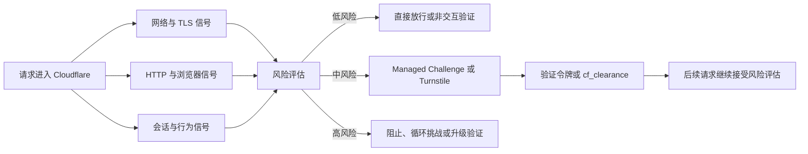
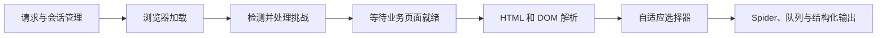
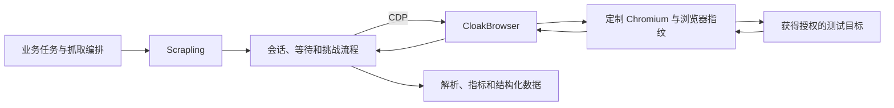
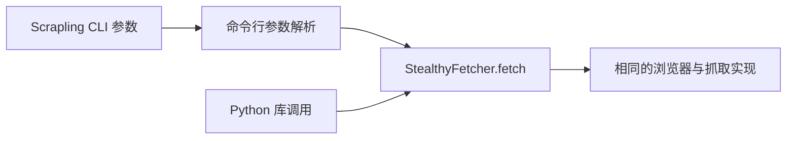
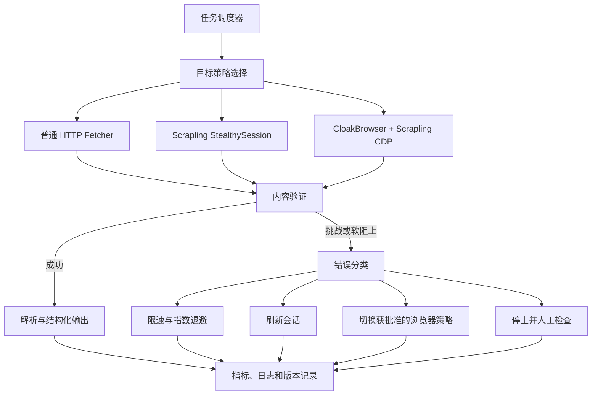
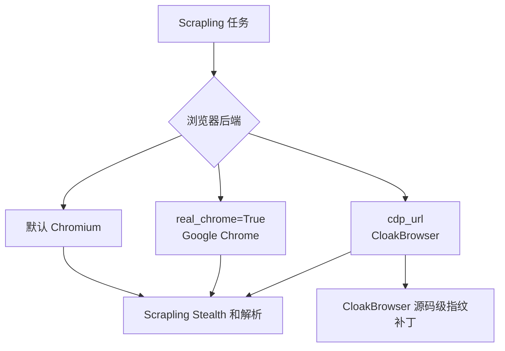
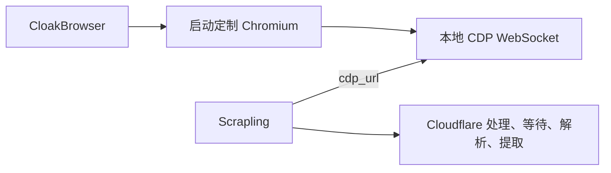
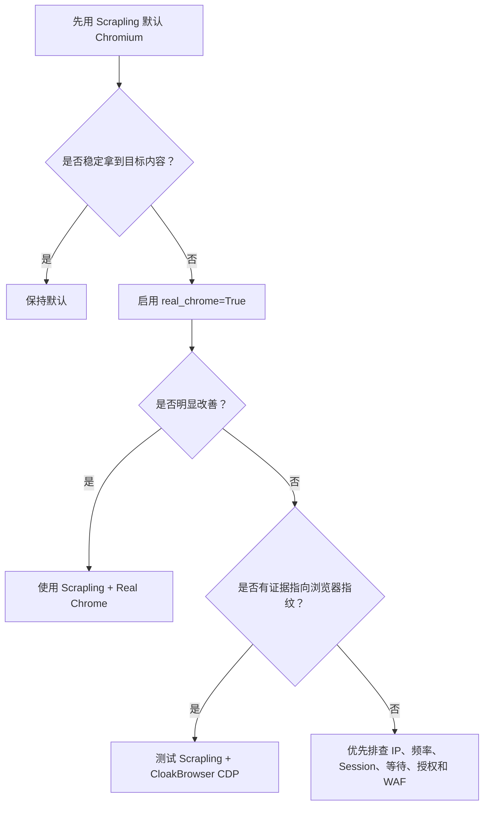

[toc]


## 内容大纲

- 先建立正确的 Cloudflare 验证模型
- 区分“求解验证”和“降低验证触发概率”
- Scrapling 的定位、能力和工作方式
- CloakBrowser 的定位、能力和工作方式
- 两者在 Cloudflare 场景下的逐项对比
- 是否存在客观意义上的“效果更好”
- Scrapling 与 CloakBrowser 的集成价值
- 有头模式与无头模式的成功率差异
- Scrapling CLI 与库 API 是否存在成功率差异
- 面向生产环境的架构和选择建议
- 如何设计可信、可复现的对照实验
- 常见误区、失败模式和最佳实践
- 面向新手的推荐学习路线

## 结论

| 问题                                        | 结论                                                         |
| ------------------------------------------- | ------------------------------------------------------------ |
| Scrapling 是否提供 Cloudflare 验证求解？    | **提供明确的自动处理流程。** `StealthyFetcher` 和 `StealthySession` 支持 `solve_cloudflare`，官方称可处理 Managed JavaScript Challenge、交互式复选框和 Invisible Turnstile 等场景。([Scrapling documentation](https://scrapling.readthedocs.io/en/latest/fetching/stealthy.html)) |
| CloakBrowser 是否提供 Cloudflare 验证求解？ | **严格来说不提供求解器。** 官方明确表示它不解决 CAPTCHA，而是通过修改 Chromium 底层指纹，使验证尽量不出现或以低摩擦方式自动完成。([GitHub](https://github.com/CloakHQ/cloakbrowser)) |
| 哪个效果更好？                              | 不能直接横向下结论。**Scrapling 更擅长完整的挑战识别、等待、交互、会话和内容提取；CloakBrowser 更擅长提供一致的 Chromium 浏览器指纹基础。** |
| 只为处理 Cloudflare 验证应选哪个？          | 初学者和一般抓取任务优先从 **Scrapling 单独使用**开始。它的工作流更完整，成本和复杂度更低。 |
| 二者结合会不会更好？                        | **在特定目标上可能更好，但不是必然。** 官方提供通过 Chrome DevTools Protocol 连接的集成方式；其价值主要是“Scrapling 编排和解析 + CloakBrowser 浏览器底座”。([GitHub](https://github.com/CloakHQ/CloakBrowser/blob/main/examples/integrations/scrapling_example.py)) |
| 有头模式成功率是否更高？                    | 在部分高度敏感目标上可能更高，但不是普遍规律。CloakBrowser 官方将有头模式作为高对抗环境的一种建议；Scrapling 官方示例则表明其验证处理可以在无头模式下工作。([GitHub](https://github.com/CloakHQ/cloakbrowser)) |
| Scrapling CLI 是否比库 API 成功率高？       | **没有内在优势。** CLI 最终调用的就是 `StealthyFetcher.fetch` 等库 API。观察到差异时，通常是参数、版本、超时、会话、运行环境或浏览器路径不同。([GitHub](https://github.com/D4Vinci/Scrapling/raw/refs/heads/main/scrapling/cli.py)) |
| 生产环境推荐 CLI 还是 API？                 | API。API 更适合持久会话、异步并发、自定义等待、可观测性、重试策略和错误分类；CLI 更适合快速验证和一次性任务。 |

## 先理解 Cloudflare 验证到底是什么

很多比较结论之所以互相矛盾，是因为把下面几种不同机制都称为“CF 验证”。

| 机制             | 英文术语                               | 主要作用                                                     | 典型结果                        |
| ---------------- | -------------------------------------- | ------------------------------------------------------------ | ------------------------------- |
| Turnstile        | Cloudflare Turnstile                   | 替代传统 CAPTCHA 的风险评估组件，可采用 Managed、Non-interactive 或 Invisible 模式 | 返回一次性验证令牌              |
| 挑战页面         | Challenge Page、Interstitial Challenge | 在访问目标页面前执行 JavaScript、浏览器环境检查或用户交互    | 通过后可能设置 Clearance Cookie |
| JavaScript 检测  | JavaScript Detections，JSD             | 收集浏览器 API、执行环境和客户端一致性信号                   | 进入 Bot Score 或安全规则判断   |
| 机器人管理       | Bot Management                         | 综合网络、请求、浏览器、会话和行为信号计算风险               | 放行、挑战、限速或阻止          |
| 防火墙规则       | Web Application Firewall，WAF          | 根据路径、IP、国家、请求特征、Bot Score 等执行规则           | Allow、Challenge、Block 等      |
| Clearance Cookie | `cf_clearance`                         | 表示某个访问者和设备已通过一定级别的挑战                     | 在有效期内减少重复挑战          |

Cloudflare 的检测不是简单检查一个 `navigator.webdriver` 属性。官方资料表明，判断可能综合：

- HTTP 请求头和请求一致性
- TLS 指纹，例如 JA3、JA4
- 浏览器 API 和 JavaScript 执行结果
- 浏览器特征之间是否相互一致
- 会话连续性
- 用户行为和访问模式
- 已有 Cookie 和挑战结果
- IP、网络信誉及安全规则

([Cloudflare Docs](https://developers.cloudflare.com/bots/concepts/bot-detection-engines/?utm_source=chatgpt.com))



这带来一个非常重要的结论：

> **通过一个 Turnstile 组件，不等于解决了整个 Cloudflare 防护。**

即使页面上的验证组件已经完成，后续请求仍可能因网络、会话、行为、WAF 规则或指纹不一致而再次被挑战。Cloudflare 还会持续重新评估会话，`cf_clearance` 也不是跨设备、跨环境永久有效的“万能通行证”。([Cloudflare Docs](https://developers.cloudflare.com/cloudflare-challenges/concepts/clearance/))

## “求解器”和“隐身浏览器”是两类不同产品

理解 Scrapling 和 CloakBrowser 的关键，是把它们放到不同层次上。

### 验证求解或挑战编排

这一类工具负责：

- 检测当前是否出现挑战页面
- 判断挑战类型
- 等待 JavaScript 执行
- 必要时执行点击等交互
- 等待跳转或验证完成
- 保存 Cookie 和会话状态
- 确认最终页面是否真的加载
- 把页面交给解析和抓取逻辑

Scrapling 的 `solve_cloudflare` 更接近这一类能力。

### 浏览器隐身和指纹一致性

这一类工具负责：

- 从浏览器底层减少自动化痕迹
- 让浏览器 API、窗口尺寸、GPU、Canvas 等信号更一致
- 避免 JavaScript 层覆盖产生明显矛盾
- 尽量使访问在风险评估阶段被视为正常浏览器
- 降低挑战页面出现的概率

CloakBrowser 更接近这一类能力。

简单来说：

> Scrapling 倾向于解决“挑战已经出现后怎么办”；
> CloakBrowser 倾向于解决“怎样让挑战尽量不要出现”。

两者存在交集，但并不是同一种产品。

## Scrapling 的能力与定位

Scrapling 是一个 Python 抓取框架，涵盖请求获取、动态浏览器、隐身获取、会话、Spider、解析和自适应元素定位等能力。官方将 Fetcher 分为普通 HTTP、动态浏览器和 Stealthy 模式，其中 StealthyFetcher 面向更强的反自动化环境，但资源开销也更高。([Scrapling documentation](https://scrapling.readthedocs.io/en/latest/fetching/choosing.html))

### 与 Cloudflare 相关的核心能力

`StealthyFetcher` 和 `StealthySession` 提供：

- `solve_cloudflare`
- 有头或无头运行
- 页面等待和选择器等待
- 自定义页面操作
- Cookie 与会话保持
- 代理和浏览器配置
- Chrome DevTools Protocol 连接
- 浏览器指纹和自动化痕迹处理
- 页面解析和结构化提取

官方文档声称 `solve_cloudflare` 可处理：

- Managed JavaScript Challenge
- Interactive Checkbox Challenge
- Invisible Challenge

同时官方也提醒，对于经过深度定制的验证页面，可能需要自定义等待选择器，并应设置足够长的超时。([Scrapling documentation](https://scrapling.readthedocs.io/en/latest/fetching/stealthy.html))

### Scrapling 的真正优势

Scrapling 的优势不只是“能点验证框”，而是验证前后完整链路都在同一个框架中：



因此它特别适合：

- 验证完成后还需要解析大量内容
- 需要分页、详情页或 Spider 工作流
- 需要保持会话和 Cookie
- 需要将失败重试、日志和解析统一编排
- Python 是主要技术栈
- 希望以相对低的集成成本开始

### Scrapling 不是万能求解服务

Scrapling 的 `solve_cloudflare` 不应被理解为第三方 CAPTCHA 识别平台，也不意味着：

- 所有 Cloudflare 配置都可通过
- 所有验证类型都可自动完成
- 所有站点都具有相同成功率
- 通过验证后一定能访问业务内容
- 在任何 IP、网络和行为模式下都有效

它更准确的定位是：

> 在其控制的浏览器会话内，自动识别和编排一部分常见 Cloudflare 挑战流程。

## CloakBrowser 的能力与定位

CloakBrowser 是经过修改的 Chromium 浏览器及其控制层。与单纯在 Playwright 页面里注入 JavaScript 不同，它强调在 Chromium C++ 源码层修改浏览器指纹和自动化特征。([GitHub](https://github.com/CloakHQ/cloakbrowser))

### 官方明确不把它称为 CAPTCHA 求解器

CloakBrowser 官方的表述非常明确：

> 它不解决 CAPTCHA，而是试图防止 CAPTCHA 出现。

([GitHub](https://github.com/CloakHQ/cloakbrowser))

因此，对“CloakBrowser 是否提供 CF 验证求解”的严谨回答是：

- 它没有类似 Scrapling `solve_cloudflare` 的通用挑战求解编排接口
- 它可能使非交互 Turnstile 自动通过
- 它可能使 Managed Challenge 仅需很少交互
- 遇到真正要求人工辨识的图像、文字或复杂交互时，它本身不是答案

CloakBrowser 官方自测页面报告，在其特定测试环境中，Turnstile 非交互测试可自动通过，Managed 测试可用一次点击完成。但这些属于项目方自测，不是针对任意 Cloudflare 站点的独立、通用成功率证明。([GitHub](https://github.com/CloakHQ/cloakbrowser))

### CloakBrowser 的核心价值

它重点解决的是“指纹一致性”问题，例如：

- 自动化环境和普通 Chromium 之间的差异
- Playwright 或 CDP 暴露出的自动化特征
- Window、Screen 和显示几何信息的一致性
- Canvas、WebGL、音视频和浏览器 API 特征
- 有头与无头环境之间的不自然差异
- JavaScript 层补丁之间互相矛盾的问题

它适合：

- 已有 Playwright 工作流，希望替换浏览器底座
- 主要瓶颈是浏览器指纹，而非抓取编排
- 需要 Chromium 特有兼容性
- 需要 Python、JavaScript 等不同控制方式
- 愿意承担自定义浏览器二进制的维护成本

## 两个项目的核心对比

| 维度                 | Scrapling                                        | CloakBrowser                                 |
| -------------------- | ------------------------------------------------ | -------------------------------------------- |
| 主要定位             | 抓取、浏览器自动化、挑战处理、解析和 Spider 框架 | 经过底层修改的隐身 Chromium                  |
| 产品层级             | 应用和工作流层                                   | 浏览器运行时和指纹层                         |
| Cloudflare 处理方式  | 挑战出现后检测、等待、交互和继续导航             | 降低挑战触发概率，使低摩擦挑战更容易通过     |
| 是否明确提供求解开关 | 是，`solve_cloudflare`                           | 否，官方明确不称为求解器                     |
| CAPTCHA 识别服务     | 不是                                             | 不是                                         |
| 页面解析能力         | 强                                               | 主要依赖 Playwright 或外部框架               |
| Spider 与任务队列    | 有                                               | 不是其核心功能                               |
| 持久会话             | 支持 `StealthySession` 等                        | 可通过浏览器上下文和连接层实现               |
| 浏览器底层修改       | 有自身 Stealthy Chromium 运行方式                | 核心卖点是 Chromium C++ 层修改               |
| CLI                  | 有                                               | 主要作为浏览器及控制包装器使用               |
| CDP 集成             | 支持连接外部浏览器                               | 支持远程调试和 CDP 连接                      |
| 适合初学者           | 更适合端到端抓取学习                             | 更适合已经理解 Playwright 和浏览器指纹的用户 |
| 主要复杂度           | 参数、会话和抓取流程                             | 浏览器版本、二进制、启动参数和兼容性         |
| 最主要风险           | 把“求解开关”误认为百分之百成功                   | 把“隐身浏览器”误认为完整的验证求解和抓取框架 |

## 到底哪个效果更好

目前没有可信的、公开的、统一条件下的 Scrapling 与 CloakBrowser 一对一对照实验。两个项目的官方测试使用的目标、版本、网络、指标和成功定义不同，不能直接把宣传页中的测试结果当成横向排名。([Scrapling documentation](https://scrapling.readthedocs.io/en/latest/fetching/stealthy.html))

更合理的判断方式是根据失败发生在哪一层。

### 挑战已经出现，需要自动完成后继续抓取

优先考虑 Scrapling。

因为这一场景需要：

- 判断是否进入挑战页面
- 等待挑战组件初始化
- 完成交互
- 等待挑战跳转
- 确认最终页面
- 保存会话状态
- 继续解析内容

这是 Scrapling 的完整工作流强项。

### 普通 Playwright 能正常访问，但在某些目标上频繁出现指纹异常

CloakBrowser 可能更有价值。

因为这更接近：

- 浏览器指纹不一致
- 自动化特征暴露
- Chromium 启动环境异常
- Headless 几何信息异常
- JavaScript 补丁不足或互相矛盾

### 需要大规模抓取、Spider、解析和结构化数据

优先 Scrapling。

即使 CloakBrowser 能顺利打开页面，你仍需要自己解决：

- URL 队列
- 去重
- 限速
- 重试
- 页面解析
- 数据持久化
- 任务恢复
- 错误分类

Scrapling 已经覆盖其中相当一部分。

### 已经有成熟 Playwright 应用，只想替换浏览器

优先评估 CloakBrowser。

此时重写为另一套抓取框架未必划算，替换浏览器二进制和启动方式可能更加直接。

### 失败由 IP、会话行为或 WAF 规则造成

两者都未必能解决。

例如：

- 某个国家或网络被安全规则拒绝
- 访问速率明显异常
- 同一会话短时间浏览数千页面
- 请求路径不符合正常用户流程
- 登录状态或授权不足
- 目标明确禁止自动化客户端

这种情况下，增加更多浏览器指纹补丁通常不会从根本上改善结果。

## 两者结合是否有价值

有，而且 CloakBrowser 官方给出了 Scrapling 集成示例：先启动 CloakBrowser 并开放本地远程调试接口，再让 Scrapling 通过 `cdp_url` 连接该浏览器。Scrapling 负责抓取、页面解析和元素跟踪，CloakBrowser 负责浏览器指纹层。([GitHub](https://github.com/CloakHQ/CloakBrowser/blob/main/examples/integrations/scrapling_example.py))



### 集成可能带来的收益

- 保留 Scrapling 的抓取和解析能力
- 使用 CloakBrowser 的定制 Chromium
- 不必重写整个 Spider 或提取逻辑
- 可以把浏览器底座作为可替换后端
- 便于进行原生 Scrapling 与 CloakBrowser 的 A/B 测试
- 对浏览器指纹敏感的授权测试目标可能有更好表现

### 集成不会自动叠加所有优势

这里很容易出现一个错误假设：

> Scrapling 隐身能力 + CloakBrowser 隐身能力 = 双倍隐身效果。

现实中并不是简单相加。

可能出现的问题包括：

- 两套启动参数互相冲突
- Scrapling 对外部 CDP 浏览器的控制能力与原生启动不同
- CloakBrowser 包装层提供的某些行为模拟未必会自动传递给外部 CDP 客户端
- Browser Context、Cookie 和页面生命周期由谁负责不清晰
- 浏览器崩溃后的恢复流程更复杂
- 版本兼容问题增加
- 日志归属不清，故障更难定位
- 外部 CDP 控制会引入额外安全面

CloakBrowser 文档特别指出，某些 wrapper 层的 `humanize` 行为不是单纯的浏览器底层补丁；使用其他框架通过 CDP 连接时，不应假设这些上层功能会自动存在。浏览器底层指纹补丁仍然有效，但交互行为需要由实际控制浏览器的一方负责。([GitHub](https://github.com/CloakHQ/cloakbrowser))

### 什么时候值得集成

推荐在满足以下条件后再做：

- Scrapling 单独运行已有稳定基线
- 失败证据指向浏览器指纹，而非网络或业务授权
- 目标必须使用 Chromium
- 可以承担自定义浏览器版本维护
- 有完善的会话、日志和错误指标
- 通过实验能够证明成功率或会话寿命明显提升

### 什么时候不值得集成

- 只是因为“两个工具看起来都很强”
- 尚未判断失败发生在哪一层
- 简单任务使用 Scrapling 已经稳定
- 主要失败原因是限速或 WAF 规则
- 团队没有能力维护浏览器二进制和版本兼容
- 每次请求都启动一个新的浏览器，无法利用会话连续性
- 增加 CloakBrowser 后性能成本远高于实际收益

### CDP 安全注意事项

Chrome DevTools Protocol 几乎可以完全控制浏览器，包括读取页面、Cookie、存储和执行脚本。远程调试端口应只绑定到 `127.0.0.1` 或受保护的内部网络，不能直接暴露到公网。CloakBrowser 官方文档也明确给出这一警告。([GitHub](https://github.com/CloakHQ/cloakbrowser))

## 有头模式成功率会不会更高

“有头模式”通常称为 Headed 或 Headful Mode；“无头模式”称为 Headless Mode。

### 为什么有头模式有时表现更好

部分网站可能检查：

- 窗口和屏幕几何信息
- 显示设备和缩放比例
- GPU 与图形渲染路径
- 字体和操作系统显示环境
- 焦点、可见状态和页面生命周期
- 浏览器后台节流行为
- Headless 特有的 API 差异

CloakBrowser 官方文档认为，即使存在底层补丁，部分目标仍可能检测 Headless，因此将 `headless=False` 作为某些高敏感场景的排查方式。([GitHub](https://github.com/CloakHQ/cloakbrowser))

### 为什么无头模式不一定更差

现代 Chromium 的新式 Headless 与早期 Headless 已有很大差别。CloakBrowser 近期版本还专门改善了有头和无头模式下 Window、Screen 和几何参数的一致性。([GitHub](https://github.com/CloakHQ/CloakBrowser/releases))

Scrapling 的官方 Cloudflare 示例也使用无头模式，说明它的设计目标不是必须依赖可见窗口才能处理挑战。([Scrapling documentation](https://scrapling.readthedocs.io/en/latest/fetching/stealthy.html))

### 两种模式的实际对比

| 维度             | 无头模式 Headless          | 有头模式 Headed              |
| ---------------- | -------------------------- | ---------------------------- |
| 资源占用         | 通常更低                   | 通常更高                     |
| 容器和 CI 部署   | 更方便                     | 可能需要显示服务或虚拟显示   |
| 调试体验         | 较弱，需要截图、录像和日志 | 直观，便于观察挑战过程       |
| 某些强检测目标   | 可能表现稍差               | 有时更接近普通用户环境       |
| 大规模并发       | 更适合                     | 成本较高                     |
| 几何和显示一致性 | 依赖浏览器实现和配置       | 通常更自然                   |
| 推荐用途         | 默认生产基线               | 调试、对照实验和特定目标回退 |

### 实际推荐

不要一开始就将所有任务切换到有头模式。更稳妥的顺序是：

1. 以无头模式建立性能和成功率基线。
2. 对同一授权目标、同一浏览器版本、同一网络和同一会话策略运行有头模式。
3. 比较的不只是“是否通过”，还包括延迟、资源、会话寿命和重复挑战率。
4. 只有当有头模式带来稳定、显著的提升时，才将其作为特定目标的策略。
5. 保留有头模式作为调试和异常回退，而不是全局迷信。

## Scrapling CLI 会不会比库 API 成功率更高

一般不会。

Scrapling CLI 的 `stealthy fetch` 命令最终导入并调用 `StealthyFetcher.fetch`，CLI 中的 `--solve-cloudflare`、`--headless`、`--timeout` 等参数也会转换为对应的库参数。因此二者不是两套不同的求解引擎。([GitHub](https://github.com/D4Vinci/Scrapling/raw/refs/heads/main/scrapling/cli.py))



### 为什么实际测试中有时会感觉 CLI 更容易成功

通常是测试条件不一致：

| 潜在差异      | CLI 可能使用的状态                   | API 代码中常见问题             |
| ------------- | ------------------------------------ | ------------------------------ |
| 默认参数      | 自动使用 CLI 默认值                  | 手动传入了不合适的参数         |
| 超时          | CLI 可能保持默认 30 秒或显式设置更长 | API 超时过短                   |
| 浏览器版本    | CLI 使用项目安装的浏览器             | API 指向系统中另一个 Chromium  |
| Headless 设置 | CLI 参数清晰                         | API 中被环境变量或封装覆盖     |
| 会话          | 一次性干净进程                       | API 复用了已污染或失效的上下文 |
| 等待条件      | CLI 等待完整导航                     | API 过早读取页面               |
| 安装 extras   | CLI 环境安装了浏览器依赖             | API 所在虚拟环境依赖不完整     |
| 版本          | CLI 和 Python 解释器来自不同环境     | 实际导入的是旧版本 Scrapling   |
| 工作目录      | 使用不同配置或浏览器缓存             | API 读取了其他 Profile         |
| 错误判定      | CLI 输出最终 HTML                    | API 只判断 HTTP 状态码         |

### CLI 适合什么场景

- 验证安装是否正确
- 快速打开单个授权页面
- 做环境冒烟测试
- 比较有头与无头模式
- 保存一份 HTML 检查最终响应
- 复现最小问题

### API 适合什么场景

- 持久化浏览器会话
- 多页面连续访问
- 自定义等待条件
- 页面加载后的业务验证
- 异步任务和并发
- 重试、退避和错误分类
- 记录挑战次数及页面阶段
- Spider 和结构化解析
- 浏览器池管理
- 连接 CloakBrowser 等外部 CDP 浏览器

Scrapling 文档也建议在连续请求中使用 `StealthySession`，避免每次请求都重新打开和关闭浏览器。([GitHub](https://github.com/d4vinci/Scrapling))

因此更准确的结论是：

> CLI 不会天然提高验证成功率；API 通常更容易构建高成功率、可维护的生产系统。

## 如何正确衡量“成功率”

很多测试只记录“没有看到验证码”，这会产生误判。

建议至少区分以下指标。

| 指标           | 英文名称                    | 含义                                          |
| -------------- | --------------------------- | --------------------------------------------- |
| 挑战出现率     | Challenge Presentation Rate | 请求中出现 Cloudflare 挑战的比例              |
| 挑战完成率     | Challenge Completion Rate   | 出现挑战后成功完成的比例                      |
| 最终页面成功率 | Final Content Success Rate  | 最终取得正确业务页面和数据的比例              |
| 重复挑战率     | Re-challenge Rate           | 同一会话后续请求再次被挑战的比例              |
| 会话寿命       | Session Longevity           | 一个会话在失效前可稳定工作的时间或请求数      |
| 错误通过率     | False Success Rate          | HTTP 200 但实际拿到挑战、错误页或空页面的比例 |
| 中位延迟       | Median Latency              | 典型请求完成时间                              |
| 尾部延迟       | P95 或 P99 Latency          | 最慢的一部分请求耗时                          |
| 单页面资源     | Resource Cost per Page      | CPU、内存和浏览器进程成本                     |
| 恢复时间       | Recovery Time               | 浏览器或会话失败后的恢复耗时                  |

### 正确的“成功”判断

不要只判断：

- HTTP 状态码为 200
- 页面标题不是 Cloudflare
- HTML 长度超过某个数字
- 浏览器没有抛异常

应该同时检查：

- 预期业务元素是否存在
- 当前 URL 是否为预期路径
- 页面是否包含业务数据
- 登录或授权状态是否有效
- 页面内容是否为软阻止页面
- Cookie 和会话是否按预期延续
- 后续请求是否仍能正常运行

## 推荐的对照实验设计

只在你拥有或获授权的测试目标上进行。

### 测试矩阵

| 方案 | 浏览器底座                     | 抓取编排                | 模式     |
| ---- | ------------------------------ | ----------------------- | -------- |
| A    | Scrapling 原生 Stealthy 浏览器 | Scrapling               | Headless |
| B    | Scrapling 原生 Stealthy 浏览器 | Scrapling               | Headed   |
| C    | CloakBrowser                   | Playwright 或官方包装器 | Headless |
| D    | CloakBrowser                   | Playwright 或官方包装器 | Headed   |
| E    | CloakBrowser                   | Scrapling 通过 CDP      | Headless |
| F    | CloakBrowser                   | Scrapling 通过 CDP      | Headed   |

### 必须固定的变量

为了保证对比有效，应固定：

- 测试目标和页面路径
- 测试时间窗口
- 网络出口
- 地理位置
- 浏览器大版本
- 操作系统或容器镜像
- 会话新建和复用规则
- 请求间隔
- 页面等待条件
- 成功判断逻辑
- 是否加载图片、字体和第三方资源
- 运行样本数量

不要让 A 方案使用稳定会话，而 B 方案每个请求都创建新浏览器；这种实验无法说明浏览器本身的差异。

### 建议的实验过程

- 先运行少量冒烟测试，确认各方案功能正确。
- 每种方案运行足够样本，避免根据两三次访问下结论。
- 同时测量首次访问和会话复用。
- 单独记录“未出现挑战”和“出现后成功完成”。
- 保存截图、最终 URL、关键 DOM 摘要和错误类别。
- 不保存不必要的敏感 Cookie 或用户数据。
- 使用同一个内容验证函数判断是否真正成功。
- 在升级浏览器或项目版本后重复测试。

### 对自有 Turnstile 应用的正确测试方式

Cloudflare 官方建议，自动化测试应使用专用测试 Sitekey 和 Secret，而不是依赖真实生产挑战，因为 Playwright、Selenium 等自动化环境可能被识别，真实挑战结果也具有不确定性。([Cloudflare Docs](https://developers.cloudflare.com/turnstile/troubleshooting/testing/))

这意味着：

- 功能测试验证你的前后端集成是否正确，应使用 Cloudflare 测试密钥。
- 反自动化兼容性测试应放在隔离、获授权的环境中。
- 不要把生产 Turnstile 是否偶然通过当成唯一的 CI 测试。
- 服务端仍必须通过 Siteverify 验证 Turnstile 令牌；令牌具有时效性且只能使用一次。([Cloudflare Docs](https://developers.cloudflare.com/turnstile/get-started/server-side-validation/?utm_source=chatgpt.com))

## 面向生产环境的推荐架构



### 为什么不应默认所有页面都使用最强浏览器

浏览器自动化成本很高：

- 启动慢
- 内存占用高
- 并发能力低
- 故障模式复杂
- 浏览器升级可能引入回归
- 日志和调试成本高

合理做法是建立分层策略：

- 静态公开页面首先使用普通 HTTP Fetcher
- 必须执行 JavaScript 时使用动态浏览器
- 确有挑战或指纹问题时使用 StealthySession
- 只有实验表明有收益时才引入 CloakBrowser
- 对不可恢复的阻止停止访问，而不是无限重试

## 最佳实践

### 优先保持会话连续性

Cloudflare 会综合会话行为并可能将 Clearance 与访问者或设备特征关联。频繁更换浏览器、Profile、Cookie、User-Agent 或运行环境，可能导致信号互相矛盾。([Cloudflare Docs](https://developers.cloudflare.com/cloudflare-challenges/concepts/clearance/))

因此应：

- 在合理范围内复用 Browser Context
- 保持 Cookie 与浏览器环境一致
- 不要把 Cookie 随意复制到完全不同的浏览器环境
- 对会话设定明确寿命
- 会话异常时整体重建，而不是只修改一个字段

### 使用持久 Session，而不是每次启动浏览器

对于连续页面，`StealthySession` 通常比反复调用一次性 Fetcher 更合理：

- 减少启动开销
- 保持 Cookie 和存储
- 保持浏览器上下文
- 更贴近正常连续浏览
- 更容易追踪会话级指标

([GitHub](https://github.com/d4vinci/Scrapling))

### 控制访问速率

浏览器指纹再逼真，也无法弥补明显异常的访问行为。

应遵循：

- 合理并发
- 请求间隔
- 指数退避
- 服务器返回 `429` 或明确限速信号时降低速率
- 避免短时间遍历整个网站
- 尽量使用官方 API、导出接口或合作数据源

### 使用确定性的环境

生产环境应固定：

- Scrapling 版本
- CloakBrowser 版本
- Chromium 版本
- Python 和 Playwright 版本
- 容器镜像
- 字体及系统依赖
- 启动参数
- 成功判断规则

CloakBrowser 官方提供版本固定和回退相关能力，这对于浏览器升级后的回归控制很重要。([GitHub](https://github.com/CloakHQ/CloakBrowser/releases))

### 将“挑战失败”细分

不要统一记录为 `CloudflareError`。建议至少区分：

- 导航超时
- DNS 或 TLS 错误
- 挑战未初始化
- 挑战交互超时
- 挑战完成但业务页未加载
- 出现重复挑战
- 明确阻止页
- 业务登录失效
- DOM 变化
- 浏览器崩溃
- CDP 断连
- 内容验证失败

只有细分后，才能判断应该：

- 增加等待
- 修复页面选择器
- 重建会话
- 调整浏览器模式
- 降低访问速率
- 修复权限或停止访问

### 将有头模式作为诊断工具

遇到失败时，先在相同环境中切换有头模式观察：

- 挑战是否实际出现
- 页面是否还在加载
- 是否存在权限或登录问题
- 是否弹出浏览器错误页
- 是否是页面业务逻辑而非 Cloudflare
- 点击后是否发生跳转
- 最终内容是否被延迟渲染

定位完成后，再决定是否需要长期使用有头模式。

## 常见误区

| 误区                                                      | 正确认识                                                     |
| --------------------------------------------------------- | ------------------------------------------------------------ |
| CloakBrowser 能通过 Turnstile，所以它是 CAPTCHA Solver    | 它的官方定位是减少 CAPTCHA 和挑战出现，不提供通用 CAPTCHA 识别服务 |
| Scrapling 开启 `solve_cloudflare` 就能处理所有 Cloudflare | 它能编排常见挑战，但最终结果仍受网络、会话、规则和目标定制影响 |
| HTTP 200 就代表成功                                       | Cloudflare 挑战页、软阻止页和业务错误页都可能返回 200        |
| 有头模式一定比无头模式强                                  | 只能说某些目标上可能更好，需要实际对照                       |
| CLI 比 API 隐身                                           | CLI 和 API 调用相同底层实现，差异通常来自配置                |
| 工具叠加越多成功率越高                                    | 叠加也会增加冲突、版本和故障复杂度                           |
| 随机化越多越真实                                          | 过度随机化会产生互相矛盾的浏览器指纹                         |
| 只要通过一次就可以永久复用 Cookie                         | Clearance 会过期，也可能因设备、会话或后续风险评估而失效     |
| 官方演示通过率等于我的目标通过率                          | 官方自测只能说明特定环境中的表现                             |
| 失败时无限刷新即可                                        | 无限刷新可能产生更异常的行为信号，并增加目标负载             |

## 按场景给出最终选择

| 你的场景                                                 | 推荐方案                                       |
| -------------------------------------------------------- | ---------------------------------------------- |
| 初学 Python 抓取，希望快速理解动态页面和 Cloudflare 挑战 | Scrapling                                      |
| 需要抓取、解析、Spider、会话和挑战处理的一体化框架       | Scrapling                                      |
| 已有成熟 Playwright 项目，主要问题是浏览器指纹           | CloakBrowser                                   |
| 需要 Chromium 底层指纹修改                               | CloakBrowser                                   |
| Scrapling 原生模式已稳定                                 | 不要为了技术堆叠额外引入 CloakBrowser          |
| Scrapling 的失败经实验确认与浏览器指纹相关               | 测试 CloakBrowser + Scrapling CDP              |
| 失败主要来自速率、IP、权限或 WAF 规则                    | 先解决授权、速率和访问策略，两者都不是根治方案 |
| 需要一次性命令行验证                                     | Scrapling CLI                                  |
| 需要生产级抓取服务                                       | Scrapling API 和持久 Session                   |
| 有头模式明显提高特定目标成功率                           | 只对该目标启用有头策略                         |
| 没有对目标的明确授权                                     | 不应尝试规避其访问控制                         |

## 面向新手的学习路线

### 先掌握 Scrapling 基础

先学习：

- Fetcher 与 StealthyFetcher 的差别
- DOM、CSS Selector 和 XPath
- 页面导航和等待条件
- Cookie、Browser Context 和 Session
- HTTP 状态码与内容验证
- 超时、重试和错误分类

### 再理解 Cloudflare 的多层检测

重点理解：

- Turnstile Token
- Challenge Page
- `cf_clearance`
- Bot Score
- Browser Fingerprint
- TLS Fingerprint
- Behavioral Analysis
- WAF Rule

### 然后做 Headless 与 Headed 对照

不要凭直觉选择，建立相同条件的测试矩阵，记录：

- 挑战出现率
- 最终页面成功率
- 重复挑战率
- 延迟
- 内存
- 会话寿命

### 最后再评估 CloakBrowser

只有当证据表明瓶颈位于浏览器指纹层时，再学习：

- 自定义 Chromium 二进制
- CDP
- 远程调试端口安全
- 浏览器版本固定
- Playwright 与外部浏览器连接
- Scrapling 的 `cdp_url` 集成
- Browser Context 生命周期

## 最终判断

**Scrapling 和 CloakBrowser 并不都是 Cloudflare 求解器。**

- **Scrapling** 明确提供 Cloudflare 挑战自动处理工作流，更接近“求解与抓取编排工具”。
- **CloakBrowser** 明确不提供 CAPTCHA 求解器，更接近“降低挑战触发概率的定制隐身浏览器”。
- 对大多数新项目，先使用 Scrapling，能够更快得到完整、可维护的抓取流程。
- 对已有 Playwright 系统或明确存在浏览器指纹问题的目标，CloakBrowser 更有针对性。
- 二者结合在架构上合理，而且有官方示例，但只有在对照实验显示出稳定收益时才值得进入生产。
- 有头模式在某些高敏感目标上可能提高成功率，但应作为按目标启用的策略，而不是默认结论。
- Scrapling CLI 和库 API 使用相同底层实现；CLI 不会天然拥有更高成功率，生产系统通常应选择 API、持久 Session 和完善的可观测性。

## 对比scrpling的real_chrome和cloakbrowser

`real_chrome=True` 的作用是：**让 Scrapling 使用你设备上安装的 Google Chrome，而不是默认的 Chromium 浏览器后端**。它不是新的 Cloudflare 求解器，也不是 CloakBrowser 那种“源码级改造浏览器”。

Scrapling 文档对 `real_chrome` 的定义是：如果设备上安装了 Chrome，启用后 Fetcher 会启动并使用这个 Chrome 实例；而 `cdp_url` 则是连接外部真实浏览器，不再新启动浏览器。([Scrapling documentation](https://scrapling.readthedocs.io/en/latest/api-reference/fetchers.html))

最实用的选择顺序是：

| 优先级       | 方案                           | 适合情况                                             |
| ------------ | ------------------------------ | ---------------------------------------------------- |
| 首选基线     | Scrapling 默认 Chromium        | 先验证任务、解析、等待、Session 是否正确             |
| 低成本增强   | Scrapling + `real_chrome=True` | 默认 Chromium 表现不佳，想测试正式 Chrome 是否更稳定 |
| 高复杂度增强 | Scrapling + CloakBrowser CDP   | 已确认主要瓶颈是浏览器指纹、CDP 或自动化检测         |

一句话概括：

> `real_chrome=True` 是“换成普通 Google Chrome”；CloakBrowser 是“换成经过指纹层改造的 Chromium”。
> 大多数场景先试 `real_chrome=True`；只有明确遇到深层指纹检测时，再考虑 Scrapling + CloakBrowser。

## `real_chrome=True` 相比不使用有什么差别

### 不使用 `real_chrome`

默认情况下，Scrapling 使用 Chromium。Scrapling 文档把运行方式区分为：普通 Playwright Chromium，以及通过 `real_chrome` 或 `cdp_url` 控制真实浏览器。([Scrapling documentation](https://scrapling.readthedocs.io/en/latest/overview.html))

这通常意味着：

| 项目              | 默认 Chromium                             |
| ----------------- | ----------------------------------------- |
| 浏览器来源        | Scrapling/Playwright 环境中的 Chromium    |
| 可复现性          | 较好，适合 Docker、CI、服务器部署         |
| 版本控制          | 更容易跟随项目依赖统一                    |
| 安装复杂度        | 较低                                      |
| 与 Scrapling 集成 | 最自然                                    |
| 适合用途          | 建立基线、普通动态页面、一般 Stealth 场景 |

重要的是：**默认 Chromium 并不等于裸奔**。在 `StealthyFetcher` 中，Scrapling 仍然会处理 Playwright 指纹、CDP Runtime 泄漏、WebRTC 泄漏、Canvas 指纹、Headless 检测等问题，并提供 `solve_cloudflare`。([Scrapling documentation](https://scrapling.readthedocs.io/en/latest/fetching/stealthy.html))

### 使用 `real_chrome=True`

启用后，浏览器后端变成设备上的 Google Chrome。

| 项目                | `real_chrome=True`                          |
| ------------------- | ------------------------------------------- |
| 浏览器来源          | 本机安装的 Google Chrome                    |
| 浏览器品牌          | 更接近普通用户使用的 Chrome                 |
| 兼容性              | 对某些只充分适配 Chrome 的网站可能更好      |
| 部署要求            | 机器上需要安装 Chrome                       |
| 版本风险            | 系统 Chrome 升级可能改变行为                |
| Cloudflare 求解逻辑 | 仍然是 Scrapling 的同一套逻辑               |
| 复杂度              | 比默认 Chromium 略高，但远低于 CloakBrowser |

它可能改善的问题主要是：

- 目标网站对正式 Google Chrome 兼容性更好；
- Chromium 与 Chrome 在品牌、User-Agent Client Hints、媒体能力、插件表现上存在差异；
- 反自动化系统对“Playwright 管理的 Chromium”打分较差；
- 当前 Chromium 版本和目标页面存在兼容性问题。

但它不会自动解决：

- IP 信誉差；
- 访问频率异常；
- Cookie 和会话不连续；
- WAF 规则直接阻断；
- Cloudflare 挑战交互超时；
- 业务权限不足；
- 深层浏览器指纹检测；
- CDP 控制痕迹检测。

## 它和 `solve_cloudflare` 是什么关系

这两个参数不是一回事。

| 参数                    | 作用                                                         |
| ----------------------- | ------------------------------------------------------------ |
| `real_chrome=True`      | 选择浏览器后端：用 Google Chrome                             |
| `solve_cloudflare=True` | 启用 Scrapling 的 Cloudflare Turnstile/Interstitial 挑战处理 |
| `headless=False`        | 用有头模式显示浏览器窗口                                     |
| `cdp_url=...`           | 连接外部浏览器，例如 CloakBrowser                            |

Scrapling 的 API 文档把 `solve_cloudflare` 描述为在返回响应前解决 Cloudflare Turnstile/Interstitial 挑战；`real_chrome` 则只是启动本机 Chrome。二者是独立参数，可以组合使用。([Scrapling documentation](https://scrapling.readthedocs.io/en/latest/api-reference/fetchers.html))

常见组合：

```python
from scrapling.fetchers import StealthySession

with StealthySession(
    real_chrome=True,
    solve_cloudflare=True,
    headless=True,
    timeout=60_000,
) as session:
    page = session.fetch("https://example.com")
    print(page.status)
```

这表示：

- 用 Google Chrome；
- 启用 Cloudflare 挑战处理；
- 使用无头模式；
- 复用 Session。

这里真正建议关注的是 **Session 复用**。Cloudflare 场景下，反复创建全新浏览器和全新 Cookie 环境，往往比浏览器后端选择更容易导致重复验证。

## Real Chrome 和 CloakBrowser 的本质区别



| 维度                | Scrapling + Real Chrome             | Scrapling + CloakBrowser                     |
| ------------------- | ----------------------------------- | -------------------------------------------- |
| 浏览器              | 官方 Google Chrome                  | 定制 Chromium                                |
| 改造深度            | 普通 Chrome，无专门源码级反检测补丁 | 浏览器源码级指纹修改是核心卖点               |
| 集成方式            | Scrapling 直接启动                  | CloakBrowser 先启动，Scrapling 通过 CDP 连接 |
| 复杂度              | 中低                                | 高                                           |
| 稳定性              | 更容易维护                          | 取决于 CloakBrowser 版本和 CDP 生命周期      |
| 适合新手            | 更适合                              | 不太适合作为第一步                           |
| 适合深层指纹问题    | 有时有帮助                          | 更有针对性                                   |
| 是否 CAPTCHA Solver | 不是                                | 不是                                         |

CloakBrowser 官方明确说它**不解决 CAPTCHA，而是防止 CAPTCHA 出现**；也就是说，它的定位不是“验证码求解服务”，而是降低浏览器被识别为自动化环境的概率。([GitHub](https://github.com/CloakHQ/cloakbrowser))

CloakBrowser 与 Scrapling 的官方集成示例也说明了分工：Scrapling 负责解析和元素跟踪，CloakBrowser 负责 bot detection 相关浏览器能力；示例中做法是启动 CloakBrowser 后，通过 WebSocket CDP 地址让 `StealthyFetcher.async_fetch(..., cdp_url=ws_url)` 连接它。([GitHub](https://github.com/CloakHQ/CloakBrowser/blob/main/examples/integrations/scrapling_example.py))

## 和 CloakBrowser 结合时，是否还需要 `real_chrome=True`

通常不需要。

因为这三个选项是浏览器后端选择：

| 使用方式                  | `real_chrome`    | `cdp_url`                       |
| ------------------------- | ---------------- | ------------------------------- |
| 默认 Scrapling Chromium   | `False`          | 不设置                          |
| Scrapling + Google Chrome | `True`           | 不设置                          |
| Scrapling + CloakBrowser  | 不重要，通常不设 | 设置为 CloakBrowser 的 CDP 地址 |

一旦你设置了 `cdp_url`，Scrapling 的角色就变成“连接并控制外部浏览器”。这时外部浏览器已经是 CloakBrowser，`real_chrome=True` 没有叠加意义。Scrapling 文档对 `cdp_url` 的说明就是连接该 CDP 地址来控制真实浏览器，而不是启动新的浏览器实例。([Scrapling documentation](https://scrapling.readthedocs.io/en/latest/api-reference/fetchers.html))

换句话说：

```python
# 方案 A：Scrapling 自己启动 Google Chrome
StealthySession(real_chrome=True, solve_cloudflare=True)
```

和：

```python
# 方案 B：Scrapling 连接 CloakBrowser
StealthyFetcher.async_fetch(url, cdp_url=cloakbrowser_ws_url)
```

是两种浏览器后端策略，不是“都打开更强”的叠加关系。

## 哪个结合更好

### 大多数情况下：Scrapling + `real_chrome=True` 更适合先试

适合你现在的探索阶段，原因是：

- 配置简单；
- 不需要额外维护 CloakBrowser；
- 不需要开放 CDP 端口；
- 不需要处理外部浏览器生命周期；
- Scrapling 的 `solve_cloudflare`、Session、解析、等待都能自然工作；
- 出问题时更容易定位。

推荐基线：

```python
from scrapling.fetchers import StealthySession

with StealthySession(
    real_chrome=True,
    solve_cloudflare=True,
    headless=True,
    timeout=60_000,
) as session:
    page = session.fetch("https://example.com")
```

### 明确是浏览器指纹问题：Scrapling + CloakBrowser 更值得测

如果你观察到下面现象，CloakBrowser 更有价值：

| 现象                                           | 说明                         |
| ---------------------------------------------- | ---------------------------- |
| 默认 Chromium 和 Real Chrome 都失败            | 说明问题可能不只是浏览器品牌 |
| 普通人工 Chrome 正常，自动化 Chrome 异常       | 可能存在自动化或 CDP 检测    |
| 一进页面就被挑战或阻断                         | 可能是浏览器环境评分低       |
| 指纹检测页显示 Canvas、WebGL、GPU、Screen 异常 | CloakBrowser 更对口          |
| 降低频率、保持 Session 后仍失败                | 问题可能不在访问行为         |
| 同一网络下不同浏览器后端差异明显               | 值得做浏览器底座对照实验     |

此时更合理的结构是：



但不要误解：CloakBrowser 不会替代 Scrapling 的抓取框架能力。它主要补浏览器指纹层，Scrapling 仍负责页面流转、挑战处理、选择器和提取。

## 实用选择矩阵

| 当前情况                                     | 推荐                                 |
| -------------------------------------------- | ------------------------------------ |
| 刚开始评估                                   | 默认 Chromium                        |
| 默认 Chromium 偶发失败                       | 加 `real_chrome=True`                |
| 默认 Chromium 解析、等待、Session 都还没调好 | 先别上 CloakBrowser                  |
| Real Chrome 明显提升                         | 固定 Real Chrome，不必复杂化         |
| Real Chrome 和默认 Chromium 都差不多         | 检查 IP、速率、Cookie、WAF、等待逻辑 |
| 证据指向浏览器指纹                           | 测 Scrapling + CloakBrowser          |
| 需要最低维护成本                             | Scrapling 默认或 Real Chrome         |
| 需要更强浏览器指纹控制                       | CloakBrowser 作为 CDP 后端           |
| 想同时启用 Real Chrome 和 CloakBrowser       | 没必要，二者是替代浏览器后端         |
| 主要目标是求解挑战后继续解析                 | Scrapling 是核心，浏览器后端只是变量 |

## 推荐测试顺序

不要直接问“哪个更强”，而是做同条件对照：

| 方案 | 浏览器                 | `solve_cloudflare` | 用途                  |
| ---- | ---------------------- | ------------------ | --------------------- |
| A    | 默认 Chromium          | 开                 | 基线                  |
| B    | Google Chrome          | 开                 | 测 `real_chrome` 增益 |
| C    | Google Chrome 有头模式 | 开                 | 测 Headless 差异      |
| D    | CloakBrowser CDP       | 开或按需           | 测指纹底座增益        |

每组都记录：

- 挑战出现率；
- 挑战完成率；
- 最终业务内容成功率；
- 重复挑战率；
- 会话寿命；
- 中位耗时；
- P95 耗时；
- 浏览器崩溃率；
- 内存占用；
- 软阻断页面比例。

尤其不要只看 HTTP 200。Cloudflare 挑战页、软阻断页、错误页也可能返回 200。

## 最终建议

你的选择可以按这个规则定：



最终判断：

- **`real_chrome=True` 是低成本、低风险、优先测试的选项。**
- **CloakBrowser 是高复杂度、高针对性的浏览器指纹后端。**
- **两者不是同时叠加的关系；接入 CloakBrowser 时用 `cdp_url`，不要再纠结 `real_chrome`。**
- **新手和大多数项目：Scrapling + `real_chrome=True` 更合适。**
- **已经确认深层指纹检测：Scrapling + CloakBrowser 更值得投入。**