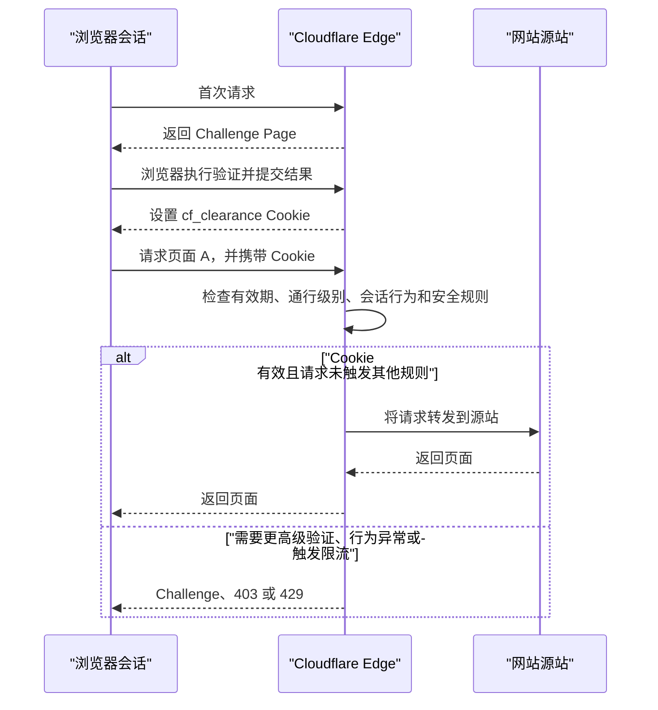
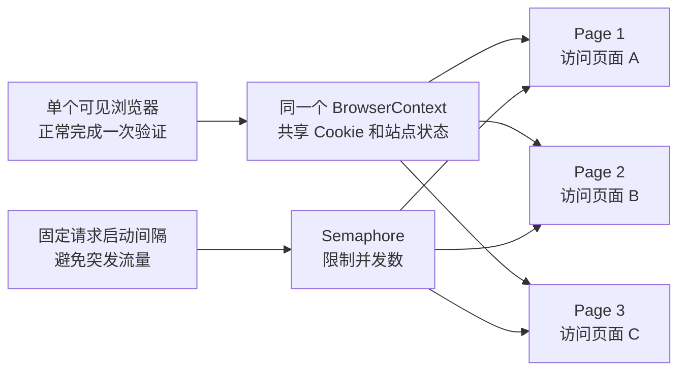

[toc]


## 详细大纲

下面从机制、边界、实现方案到故障处理完整展开。

- Cloudflare 在请求链路中的位置
- 首次验证后不重复验证的核心机制
- `cf_clearance`、站点登录 Cookie 与 Bot Management Cookie 的区别
- 通行等级、有效期和持续行为评估
- 为什么同站部分页面仍可能再次要求验证
- “同一网站”的域名、Zone、Cookie 作用域边界
- 轻量级并发访问的推荐架构
- Playwright 单浏览器上下文、多标签页的实现
- 进一步减轻资源消耗的方法
- 普通 HTTP 请求模式的适用条件和风险
- 并发数、请求节奏、超时与重试策略
- `403`、`429`、Error 1015 和 Challenge 响应的处理
- 站点所有者的正式自动化方案
- 常见错误做法与最佳实践清单

------

## 现象背后的核心原理

Cloudflare 通常位于访问者和网站源站之间，充当**反向代理**（Reverse Proxy）。浏览器访问页面时，请求先到达 Cloudflare 边缘节点（Edge），Cloudflare 根据 WAF 规则、Bot Management、IP 信誉、访问频率和浏览器环境等信号决定：

- 直接放行请求；
- 阻止请求；
- 执行托管验证（Managed Challenge）；
- 执行非交互或交互式验证；
- 对请求应用限流规则。

首次验证成功后，Cloudflare通常会在浏览器中设置一个名为 `cf_clearance` 的 **Cookie**。后续请求携带这个 Cookie 时，Cloudflare可以确认当前访问者已经完成了相应级别的客户端验证，因此无需对每个 URL 重新展示验证页面。Cloudflare官方将这个过程称为**验证通行**（Challenge Passage）。([Cloudflare Docs](https://developers.cloudflare.com/cloudflare-challenges/challenge-types/challenge-pages/challenge-passage/))



这里的关键点是：

> Cloudflare保存的不是“这个 URL 已经验证过”，而是“**这个浏览器会话中的访问者，在一定时间和条件下获得了某一级别的通行资格**”。

因此，验证结果通常可以应用于同一 Cloudflare Zone 中符合 Cookie 作用域和安全规则的多个页面，而不是只适用于最初访问的页面。Cloudflare的 Turnstile Pre-clearance 文档也明确说明，获得的 `cf_clearance` 可以用于该 Zone 后续请求，包括受到 WAF Challenge 保护的 API 请求，但具体效果仍取决于站点配置的通行级别。([Cloudflare Docs](https://developers.cloudflare.com/cloudflare-challenges/concepts/clearance/))

## 关键术语

| 术语           | 英文                          | 作用                                                |
| -------------- | ----------------------------- | --------------------------------------------------- |
| 验证通行       | Challenge Clearance           | 表示访问者已经完成某一级别的 Cloudflare Challenge   |
| 通行 Cookie    | `cf_clearance` Cookie         | 保存验证通过证明和相关客户端检测结果                |
| 验证有效期     | Challenge Passage             | 网站所有者配置的通行持续时间                        |
| 持续评估       | Precursor Clearance           | 在会话期间持续观察行为并动态调整信任程度            |
| 浏览器上下文   | BrowserContext                | 一组共享 Cookie、本地存储和浏览器配置的页面         |
| 限流           | Rate Limiting                 | 限制某个 IP、Cookie、用户或路径在一定时间内的请求数 |
| Web 应用防火墙 | Web Application Firewall，WAF | 根据请求特征执行允许、阻止或验证等规则              |
| 分区 Cookie    | Partitioned Cookie，CHIPS     | 在第三方嵌入场景中按顶层网站隔离 Cookie             |

## `cf_clearance` 到底保存了什么

`cf_clearance` 的核心作用是向 Cloudflare证明当前访问者已经通过客户端验证。现代 Cloudflare 将其中的通行状态分成两个协作部分：

- Challenge Clearance：某次明确验证所授予的通行权限。
- Precursor Clearance：根据会话中的持续行为动态更新的信任状态。

Cloudflare说明，该 Cookie 会安全地绑定到获发它的特定访问者和设备，不能简单地视为一个可以任意复制到其他机器上的永久令牌。即使 Cookie 尚未过期，持续行为评估也可能降低或撤销有效通行状态，并再次要求验证。([Cloudflare Docs](https://developers.cloudflare.com/cloudflare-challenges/concepts/clearance/))

Cloudflare还可能设置其他 Cookie，但它们的用途不同：

| Cookie                    | 主要用途                                            | 是否等同于验证通行 |
| ------------------------- | --------------------------------------------------- | ------------------ |
| `cf_clearance`            | 保存 Challenge 通行证明和 JavaScript 检测状态       | 是                 |
| `__cf_bm`                 | Bot Management 的机器人评分和会话检测               | 否                 |
| `_cfuvid`                 | 在共享 IP 或 NAT 环境中区分不同访问者，以便执行限流 | 否                 |
| 网站自身的 Session Cookie | 保存登录状态、购物车、用户身份等                    | 否                 |

`__cf_bm` 通常是每个站点单独生成的；`_cfuvid` 只有站点启用了相应限流配置时才会出现。通过 Cloudflare验证也不代表已经登录网站，因此自动化访问时通常需要同时保留：

- Cloudflare通行状态；
- 网站自身的登录 Cookie；
- Local Storage 或其他应用状态。

([Cloudflare Docs](https://developers.cloudflare.com/fundamentals/reference/policies-compliances/cloudflare-cookies/))

## 通行等级并非完全相同

Cloudflare的 Challenge Clearance 存在等级关系：

| 通行等级            | 可以跳过的验证                        |
| ------------------- | ------------------------------------- |
| Interactive，高     | Interactive、Managed、Non-Interactive |
| Managed，中         | Managed、Non-Interactive              |
| Non-Interactive，低 | Non-Interactive                       |

因此，某个浏览器通过了较低级别的验证后，访问其他更敏感的页面时，仍可能遇到更高级别的验证。

例如：

- 首页只配置了 Non-Interactive Challenge；
- 登录页配置了 Managed Challenge；
- 支付页面配置了 Interactive Challenge。

通过首页验证并不一定能够直接访问支付页面。较高级别的通行可以覆盖较低级别，反过来则不成立。([Cloudflare Docs](https://developers.cloudflare.com/cloudflare-challenges/concepts/clearance/))

## 有效期不是永久的

Cloudflare当前默认的 `cf_clearance` 有效期是 30 分钟，官方建议站点所有者通常配置在 15 至 45 分钟之间。网站所有者可以修改 Challenge Passage，因此不同网站的有效期可能不同。([Cloudflare Docs](https://developers.cloudflare.com/cloudflare-challenges/challenge-types/challenge-pages/challenge-passage/))

需要特别注意：

- Cookie 未过期不代表一定不会再次验证；
- Precursor 可以根据会话行为提前降低或撤销通行；
- 更高级别的 Challenge 仍然可能出现；
- Challenge Passage 不适用于限流规则；
- 页面验证通过后，仍可能因为请求过快而得到 `429` 或 Error 1015。

([Cloudflare Docs](https://developers.cloudflare.com/cloudflare-challenges/challenge-types/challenge-pages/challenge-passage/))

## 什么叫“同一个网站”

从用户视角看，以下地址可能属于同一个品牌：

- `www.example.com`
- `api.example.com`
- `account.example.com`
- `static.example.com`

但从 Cloudflare和浏览器角度，它们可能具有不同的：

- Cloudflare Zone；
- WAF 规则；
- Challenge 等级；
- Cookie Domain 和 Path；
- Access 策略；
- Bot Management 配置。

Cloudflare会设置带有 `SameSite=None; Secure; Partitioned` 等属性的 `cf_clearance`。在普通的同站顶层浏览场景中，这通常不影响多个页面共享通行状态；但在 iframe、第三方嵌入和跨站子资源场景中，CHIPS 分区机制会使通行状态按顶层网站隔离。([Cloudflare Docs](https://developers.cloudflare.com/fundamentals/reference/policies-compliances/cloudflare-cookies/))

因此，更准确的表述是：

> 应在同一个浏览器上下文、同一个有效 Cookie 作用域、同一稳定设备与网络环境中复用通行状态，而不是假定所有相似域名都能共享验证结果。

## 为什么有时会再次要求验证

| 现象                      | 常见原因                                           | 推荐处理                                          |
| ------------------------- | -------------------------------------------------- | ------------------------------------------------- |
| 换一个标签页就再次验证    | 创建了新的浏览器上下文，而不是同一上下文中的新页面 | 在同一个 `BrowserContext` 中创建多个 Page         |
| 一段时间后重新验证        | `cf_clearance` 已过期                              | 重新完成一次正常验证                              |
| 某些路径需要验证          | 路径配置了更高级别或不同的 WAF 规则                | 不要假定所有路径规则一致                          |
| 切换代理后不断循环验证    | Challenge 请求和完成验证时的 IP 不一致             | 验证期间和后续访问保持稳定网络                    |
| API 返回 HTML 而不是 JSON | 返回的是 Challenge Page                            | 检查 `cf-mitigated: challenge`                    |
| 出现 `429`                | 请求超过网站限流阈值                               | 降低并发并遵守 `Retry-After`                      |
| 出现 Error 1015           | Cloudflare站点限流规则已阻止当前访问者             | 停止请求并等待限流窗口恢复                        |
| XHR 或跨域请求仍失败      | CORS 预检 `OPTIONS` 不携带 Cookie                  | 使用站点正式 API 或由站点所有者配置 Pre-clearance |
| Cookie 仍存在但又被验证   | 会话行为被持续评估为可疑                           | 降低访问强度，停止自动重试                        |

Cloudflare明确指出，Challenge Page 响应会包含：

```text
cf-mitigated: challenge
```

并且无论原本请求的是 JSON、图片还是其他资源，Challenge 响应的 `Content-Type` 都会变成 `text/html`。([Cloudflare Docs](https://developers.cloudflare.com/cloudflare-challenges/challenge-types/challenge-pages/detect-response/))

此外，Challenge 请求和完成验证的请求来自不同 IP 时，验证结果可能无效并形成验证循环。([Cloudflare Docs](https://developers.cloudflare.com/cloudflare-challenges/concepts/how-challenges-work/?utm_source=chatgpt.com))

## 轻量级并发访问的推荐模型

最稳妥的方式**不是**：

- 启动多个独立浏览器；
- 为每个 URL 建立新的浏览器上下文；
- 把 `cf_clearance` 复制给大量 HTTP 客户端。

而是(复用上下文的多个标签)：



Playwright的一个 `BrowserContext` 可以容纳多个 Page，也就是多个**标签页**。相同上下文中的页面共享上下文级 Cookie 和浏览器状态；创建新的上下文则相当于创建一个隔离的新会话。([Playwright](https://playwright.dev/python/docs/pages))

推荐的初始参数：

| 参数           | 保守起始值         | 说明                              |
| -------------- | ------------------ | --------------------------------- |
| 浏览器进程     | 1                  | 避免重复启动浏览器和重复验证      |
| BrowserContext | 1                  | 所有并发页面共享通行状态          |
| 并发 Page 数   | 2 至 4             | 先从 2 开始，根据响应情况调整     |
| 新请求启动间隔 | 0.5 至 1 秒        | 避免瞬间突发多个请求              |
| 页面超时       | 20 至 30 秒        | 超时后关闭页面，不无限等待        |
| 自动重试次数   | 0 至 2             | Challenge 和 403 不应自动循环重试 |
| 429 处理       | 遵守 `Retry-After` | 没有该响应头时采用较长退避        |

不存在对所有网站都安全的统一并发数。站点可能按 IP、Cookie、路径、会话标识或它们的组合进行限流。

## Playwright 实现示例

安装依赖：

```bash
python -m pip install playwright
python -m playwright install chromium
```

示例使用以下原则：

- 使用独立的持久化浏览器目录；
- 人工正常完成一次验证；
- 后续页面全部位于同一个 BrowserContext；
- 使用信号量限制并发；
- 使用固定间隔平滑启动请求；
- 验证通过后再屏蔽图片、字体和视频；
- 遇到新 Challenge 或限流时停止，而不是循环冲击。

```python
import asyncio
from pathlib import Path
from typing import Any

from playwright.async_api import (
    BrowserContext,
    Response,
    Route,
    async_playwright,
)


BASE_URL = "https://example.com"

TARGET_URLS = [
    "https://example.com/page-a",
    "https://example.com/page-b",
    "https://example.com/page-c",
    "https://example.com/page-d",
]

PROFILE_DIR = Path("./playwright-profile")

MAX_CONCURRENCY = 3
REQUEST_START_INTERVAL_SECONDS = 0.8
NAVIGATION_TIMEOUT_MS = 30_000


class RequestPacer:
    """限制新导航的启动频率，避免所有任务在同一时刻突发。"""

    def __init__(self, interval_seconds: float) -> None:
        self.interval_seconds = interval_seconds
        self._lock = asyncio.Lock()
        self._next_start = 0.0

    async def wait(self) -> None:
        async with self._lock:
            loop = asyncio.get_running_loop()
            now = loop.time()

            delay = max(0.0, self._next_start - now)
            if delay > 0:
                await asyncio.sleep(delay)

            current = loop.time()
            self._next_start = current + self.interval_seconds


async def lightweight_route(route: Route) -> None:
    """
    仅屏蔽通常不影响页面数据解析的重型资源。

    不建议屏蔽 script、document、xhr 或 fetch，
    也不要阻止 /cdn-cgi/ 下的 Cloudflare资源。
    """
    resource_type = route.request.resource_type

    if resource_type in {"image", "media", "font"}:
        await route.abort()
    else:
        await route.continue_()


async def response_header(
    response: Response | None,
    name: str,
) -> str | None:
    if response is None:
        return None
    return await response.header_value(name)


async def visit_one(
    context: BrowserContext,
    semaphore: asyncio.Semaphore,
    pacer: RequestPacer,
    url: str,
) -> dict[str, Any]:
    async with semaphore:
        await pacer.wait()
        page = await context.new_page()

        try:
            response = await page.goto(
                url,
                wait_until="domcontentloaded",
                timeout=NAVIGATION_TIMEOUT_MS,
            )

            status = response.status if response else None
            mitigated = await response_header(response, "cf-mitigated")
            retry_after = await response_header(response, "retry-after")

            if mitigated == "challenge":
                return {
                    "url": url,
                    "ok": False,
                    "status": status,
                    "reason": "Cloudflare 返回了新的 Challenge",
                }

            if status == 429:
                return {
                    "url": url,
                    "ok": False,
                    "status": 429,
                    "reason": "请求受到限流",
                    "retry_after": retry_after,
                }

            if status is not None and status >= 400:
                return {
                    "url": url,
                    "ok": False,
                    "status": status,
                    "reason": f"HTTP 错误 {status}",
                }

            title = await page.title()

            try:
                body_text = await page.locator("body").inner_text(
                    timeout=10_000
                )
            except Exception:
                body_text = ""

            return {
                "url": url,
                "ok": True,
                "status": status,
                "title": title,
                "text_preview": body_text[:300],
            }

        except Exception as exc:
            return {
                "url": url,
                "ok": False,
                "status": None,
                "reason": f"{type(exc).__name__}: {exc}",
            }

        finally:
            await page.close()


async def main() -> None:
    PROFILE_DIR.mkdir(parents=True, exist_ok=True)

    async with async_playwright() as playwright:
        # 使用单独的自动化 Profile，不要直接使用日常 Chrome Profile。
        context = await playwright.chromium.launch_persistent_context(
            user_data_dir=str(PROFILE_DIR),
            headless=False,
            viewport={"width": 1280, "height": 800},
        )

        try:
            gate_page = await context.new_page()
            await gate_page.goto(
                BASE_URL,
                wait_until="domcontentloaded",
                timeout=NAVIGATION_TIMEOUT_MS,
            )

            print("请在打开的浏览器中正常完成 Cloudflare 验证。")
            print("如网站需要登录，也请在此时完成登录。")
            input("完成后按 Enter 继续：")

            cookies = await context.cookies()
            clearance_present = any(
                cookie.get("name") == "cf_clearance"
                for cookie in cookies
            )

            if not clearance_present:
                print(
                    "提示：当前未发现 cf_clearance。"
                    "站点可能没有签发该 Cookie，或验证尚未完成。"
                )

            # 验证完成后再屏蔽非必要重型资源。
            await context.route("**/*", lightweight_route)

            semaphore = asyncio.Semaphore(MAX_CONCURRENCY)
            pacer = RequestPacer(REQUEST_START_INTERVAL_SECONDS)

            tasks = [
                visit_one(
                    context=context,
                    semaphore=semaphore,
                    pacer=pacer,
                    url=url,
                )
                for url in TARGET_URLS
            ]

            results = await asyncio.gather(*tasks)

            for result in results:
                print(result)

            challenged = any(
                result.get("reason")
                == "Cloudflare 返回了新的 Challenge"
                for result in results
            )

            if challenged:
                print(
                    "检测到新的 Challenge。"
                    "请停止批量任务，不要自动循环重试。"
                )

        finally:
            await context.close()


if __name__ == "__main__":
    asyncio.run(main())
```

Playwright的持久化上下文会把 Cookie 和 Local Storage 等状态保存在指定的用户数据目录中。官方建议为自动化单独创建目录，不要直接复用日常 Chrome 的主 Profile。([Playwright](https://playwright.dev/python/docs/api/class-browsertype))

该目录可能包含登录 Cookie 和其他敏感凭据，应当：

- 加入 `.gitignore`；
- 设置适当的文件权限；
- 不发送给其他人；
- 不在不同机器之间共享；
- 测试结束后按需要安全删除。

Playwright也明确提醒，保存的浏览器状态可能包含足以模拟用户身份的敏感 Cookie 和请求头。([Playwright](https://playwright.dev/python/docs/auth))

## 为什么不要一开始就屏蔽 JavaScript

Cloudflare Challenge 本身依赖 JavaScript、Cookie 和浏览器环境信号。若在验证前屏蔽：

- JavaScript；
- `/cdn-cgi/` 路径；
- WebAssembly；
- Canvas 或 WebGL；
- 必要的 fetch/XHR；
- 第三方 Cookie 或安全 Cookie；

可能导致验证无法完成或进入循环。

因此，资源优化应遵循以下顺序：

- 先使用接近正常浏览器的环境完成验证；
- 确认目标页面能够正常访问；
- 再屏蔽图片、字体和视频；
- 每次只减少一种资源类型；
- 页面异常时立即恢复资源加载。

Playwright支持在 BrowserContext 或 Page 层拦截和终止图片等资源请求。([Playwright](https://playwright.dev/python/docs/network?utm_source=chatgpt.com))

## 更轻量的 `context.request` 模式

Playwright为每个 BrowserContext 提供了关联的 `APIRequestContext`：

```python
response = await context.request.get(
    "https://example.com/api/data",
    timeout=30_000,
)

if response.headers.get("cf-mitigated") == "challenge":
    print("接口返回了 Challenge，不能按普通 API 响应处理")
else:
    print(response.status)
    print((await response.text())[:500])
```

`context.request` 和该 BrowserContext 使用同一个 Cookie Jar，浏览器页面设置的 Cookie 会自动用于关联的 API 请求，API 响应设置的 Cookie 也会反向更新浏览器上下文。([Playwright](https://playwright.dev/python/docs/api/class-apirequestcontext))

这种方式比打开完整页面更轻，但只适合：

- 自有或明确授权的 API；
- 不需要页面 JavaScript 渲染的资源；
- 已确认允许自动化的普通 HTML 或 JSON 端点；
- 请求不会触发新的 Challenge；
- 网站没有要求完整浏览器页面生命周期。

Cloudflare明确指出，Challenge Page 会打断正常请求流程；对于期待 JSON 的 AJAX、XHR 或 API 客户端，返回完整 HTML Challenge Page 会导致调用失败。([Cloudflare Docs](https://developers.cloudflare.com/cloudflare-challenges/challenge-types/challenge-pages/))

建议采用渐进策略：

| 模式                            | 资源消耗 | 兼容性 | 推荐用途                          |
| ------------------------------- | -------- | ------ | --------------------------------- |
| 同一 Context 中多个 Page        | 中       | 高     | 普通网页和需要 JavaScript 的页面  |
| `context.request`               | 低       | 中     | 正式 API、静态 HTML、简单数据端点 |
| 独立 `httpx` 或 Requests 客户端 | 低       | 低     | 仅用于站点明确提供的 API          |
| 多浏览器、多 Profile            | 高       | 低     | 不推荐用于共享通行状态            |

不建议把 `cf_clearance` 单独复制到 `requests`、`curl` 或多个远程节点。现代 Cloudflare会把通行状态与具体访问者、设备和持续会话行为关联；单纯拥有 Cookie 值并不保证请求会被接受。([Cloudflare Docs](https://developers.cloudflare.com/cloudflare-challenges/concepts/clearance/))

## 并发控制的正确思路

### 限制同时在途的任务

信号量（Semaphore）控制的是“同时有多少页面正在加载”。

例如并发为 3：

- 最多三个页面同时加载；
- 某个页面完成后，队列中的下一个页面才开始；
- 避免一次创建几十个标签页。

### 限制请求启动速度

只有信号量仍可能产生突发流量。

例如并发为 3 时，三个任务可能在同一毫秒启动。因此还应加入固定启动间隔：

```text
页面 A 在 0.0 秒启动
页面 B 在 0.8 秒启动
页面 C 在 1.6 秒启动
页面 D 等待前面任务释放并发槽位
```

这种做法的目的不是模拟人类，而是：

- 避免连接突发；
- 降低源站瞬时压力；
- 更容易观察网站允许的访问节奏；
- 减少误触发限流的概率。

### 不要无限自动重试

推荐按状态区分：

| 状态                       | 推荐策略                        |
| -------------------------- | ------------------------------- |
| 网络瞬时错误               | 最多重试 1 至 2 次              |
| `500`、`502`、`503`、`504` | 使用指数退避                    |
| `429`                      | 优先遵守 `Retry-After`          |
| Error 1015                 | 停止当前批次，等待限流恢复      |
| `403`                      | 停止，不要高频重试              |
| `cf-mitigated: challenge`  | 返回可见浏览器，由用户正常处理  |
| 登录失效                   | 重新登录，不要复制或伪造 Cookie |

Cloudflare说明，`429 Too Many Requests` 表示客户端在指定时间窗口内发送了过多请求，服务器可能通过 `Retry-After` 指定何时可以再次尝试。([Cloudflare Docs](https://developers.cloudflare.com/support/troubleshooting/http-status-codes/4xx-client-error/error-429/?utm_source=chatgpt.com))

Error 1015 则表示站点所有者配置的 Cloudflare限流规则已经暂时阻止当前访问者。([Cloudflare Docs](https://developers.cloudflare.com/support/troubleshooting/http-status-codes/cloudflare-1xxx-errors/error-1015/?utm_source=chatgpt.com))

## 一种合适的指数退避方式

仅对可重试的服务器错误使用：

```python
import asyncio


async def backoff(attempt: int, retry_after: str | None = None) -> None:
    if retry_after:
        try:
            seconds = min(float(retry_after), 300.0)
            await asyncio.sleep(seconds)
            return
        except ValueError:
            pass

    seconds = min(2 ** attempt, 60)
    await asyncio.sleep(seconds)
```

例如：

- 第一次失败等待 1 秒；
- 第二次等待 2 秒；
- 第三次等待 4 秒；
- 上限设为 60 秒。

不要对 Challenge、明确的访问拒绝或持续 `403` 使用无限指数重试。

## 充分利用通行状态的最佳实践

### 保持一个稳定会话

- 使用一个浏览器进程；
- 使用一个 BrowserContext；
- 在其中创建多个 Page；
- 不要频繁重建上下文；
- 不要在运行中切换代理或出口 IP；
- 不要不断修改 User-Agent、时区或浏览器特征。

### 只验证一次入口页面

流程应当是：

- 打开一个入口页面；
- 正常完成 Challenge；
- 完成必要的网站登录；
- 确认 `cf_clearance` 和登录状态存在；
- 再启动有限并发任务。

不要让每个并发任务同时尝试完成 Challenge。

### 减少不必要资源

通常可以优先减少：

- 图片；
- 视频和音频；
- 字体；
- 广告或分析资源，但需确认不会破坏页面。

通常不应屏蔽：

- HTML 文档；
- JavaScript；
- XHR 和 fetch；
- Service Worker；
- `/cdn-cgi/`；
- 页面业务所需 CSS。

### 利用应用层缓存

同一个 URL 不应重复下载。可以在本地保存：

- URL；
- 抓取时间；
- HTTP 状态；
- `ETag`；
- `Last-Modified`；
- 内容摘要；
- 解析结果。

再次运行时优先发送条件请求：

```http
If-None-Match: "previous-etag"
```

或者：

```http
If-Modified-Since: previous-date
```

收到 `304 Not Modified` 时无需重新处理完整正文。

### 控制每个主机的独立队列

即使任务涉及多个域名，也应按 Host 分别限流：

```text
www.example.com      并发 2
api.example.com      并发 1
static.example.com   并发 4
```

不要因为总并发只有 5，就允许 5 个请求同时冲向同一个敏感 API 路径。

## 站点所有者应采用的正式方案

对于自己管理的网站，不应依赖人工完成一次 Challenge 后长期复用 Cookie。正式自动化最好采用机器身份。

### Cloudflare Access Service Token

Cloudflare Access 可以为自动化系统生成 Service Token，由 Client ID 和 Client Secret 组成。自动化程序通过专用请求头访问受 Access 保护的应用，不需要模拟浏览器用户。([Cloudflare Docs](https://developers.cloudflare.com/cloudflare-one/access-controls/service-credentials/service-tokens/))

适用于：

- CI/CD；
- 内部爬虫；
- 监控服务；
- 数据同步任务；
- 后端到后端调用。

### 独立 API 和 API Key

为自动化访问提供：

- 明确的 API 路径；
- OAuth、API Key 或签名认证；
- 独立限流额度；
- 可审计的客户端身份；
- 分页和增量同步；
- `ETag` 或版本号。

### WAF Skip Rule

对于可信内部监控或合作方客户端，站点所有者可以创建精确的 Skip Rule，只跳过必要的安全产品或规则。

Skip Rule 应结合：

- 固定 IP 或 mTLS；
- 专用认证请求头；
- 特定 URI Path；
- 特定请求方法；
- 独立限流规则。

Cloudflare的 Skip action 可以让明确匹配的合法流量跳过指定安全功能，但不应创建过宽的全站绕过规则。([Cloudflare Docs](https://developers.cloudflare.com/waf/custom-rules/skip/))

推荐匹配思想：

```text
请求来自可信网络
并且携带机器身份
并且只访问 /internal-api/*
并且请求方法为 GET
```

而不是：

```text
只要带某个普通 User-Agent 就跳过全部安全检查
```

## 不推荐的做法

| 做法                                   | 问题                                                       |
| -------------------------------------- | ---------------------------------------------------------- |
| 把 `cf_clearance` 分发给很多机器       | 通行状态与访问者、设备和会话行为相关，且可能按 Cookie 限流 |
| 每个 URL 启动一个新浏览器              | 资源消耗高，也无法稳定共享会话                             |
| 使用几十或几百并发                     | 容易触发 WAF、限流和源站保护                               |
| 自动循环刷新 Challenge                 | 可能进一步降低会话信誉并形成验证循环                       |
| 不断轮换 IP                            | 验证请求与解决请求 IP 不一致时可能失效                     |
| 伪造浏览器指纹                         | 不稳定，且属于规避安全机制                                 |
| 屏蔽所有 JavaScript                    | Challenge 和许多现代页面将无法运行                         |
| 把 Challenge HTML 当作 JSON 解析       | 应先检查 `cf-mitigated` 和 Content-Type                    |
| 忽略 `429` 和 `Retry-After`            | 会延长封禁或限流时间                                       |
| 把 Profile 或 Storage State 提交到 Git | 其中可能包含登录凭据和敏感 Cookie                          |

## 推荐的学习与实施顺序

- 先理解 Cookie、Domain、Path、SameSite 和 Secure。
- 使用浏览器开发者工具观察首次验证前后的 Cookie。
- 检查请求是否携带 `cf_clearance`。
- 观察不同路径是否触发不同 Challenge。
- 用 Playwright 单 Page 完成稳定访问。
- 改成一个 Context 中的两个 Page。
- 加入 Semaphore，将并发固定为 2。
- 加入固定启动间隔。
- 加入 `cf-mitigated`、`429` 和 `Retry-After` 检测。
- 最后才考虑屏蔽图片、字体和媒体。
- 对自有网站迁移到 Service Token 或正式 API。

## 总结

第一次通过 Cloudflare验证后，后续页面通常不再验证，主要是因为浏览器获得了 `cf_clearance`，后续请求会在同一会话中自动携带这个验证通行证明。

但它不是永久许可证，也不是对所有规则的绕过：

- 通行具有等级；
- 通行具有有效期；
- 行为会被持续评估；
- Cookie 与访问者和设备相关；
- 路径可能配置不同规则；
- 限流仍然有效。

轻量级并发访问的最佳方案是：

> 使用一个稳定的浏览器进程和一个 BrowserContext，正常完成一次验证，然后在同一上下文内创建少量并发 Page，同时使用信号量、固定启动间隔、资源裁剪、缓存和正确的错误退避策略。

对于自有网站或长期自动化任务，Service Token、正式 API、mTLS 或精确的 WAF Skip Rule 会比复用浏览器 Challenge Cookie 更稳定、更安全，也更容易审计。

也可以进一步整理成“Playwright 项目目录版实战教程”，包含任务队列、结果持久化、断点续传和按域名独立限流。