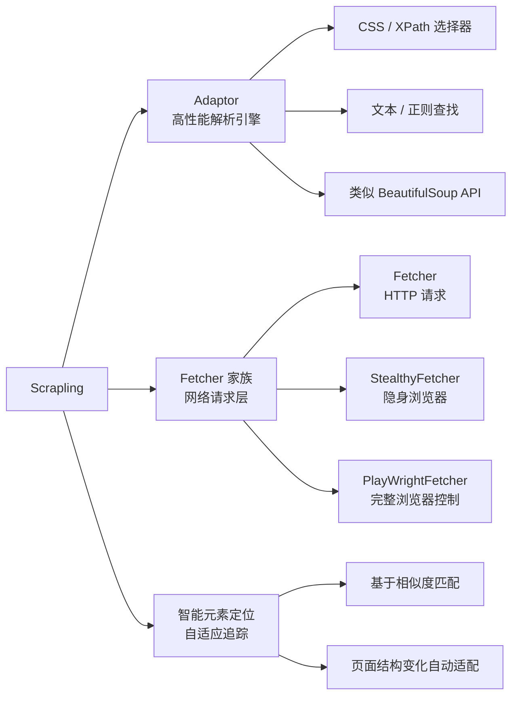
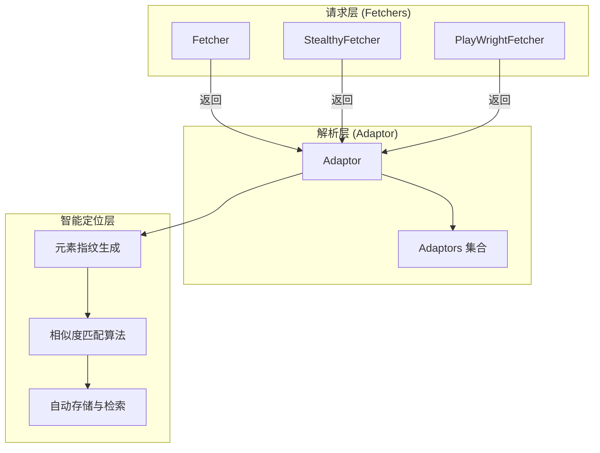
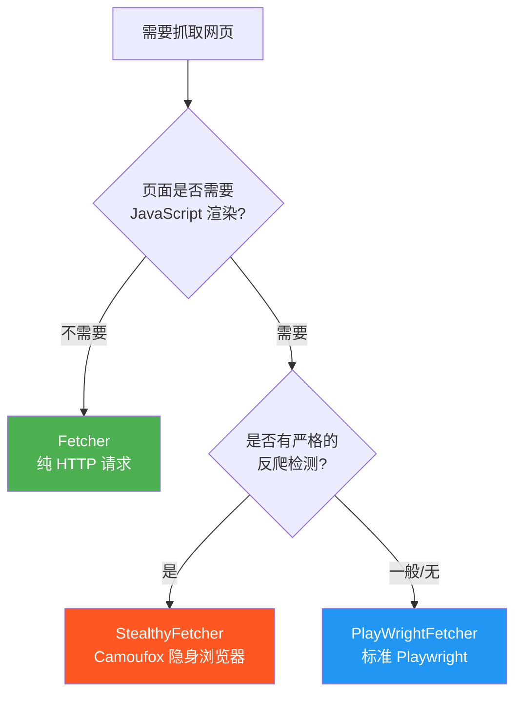
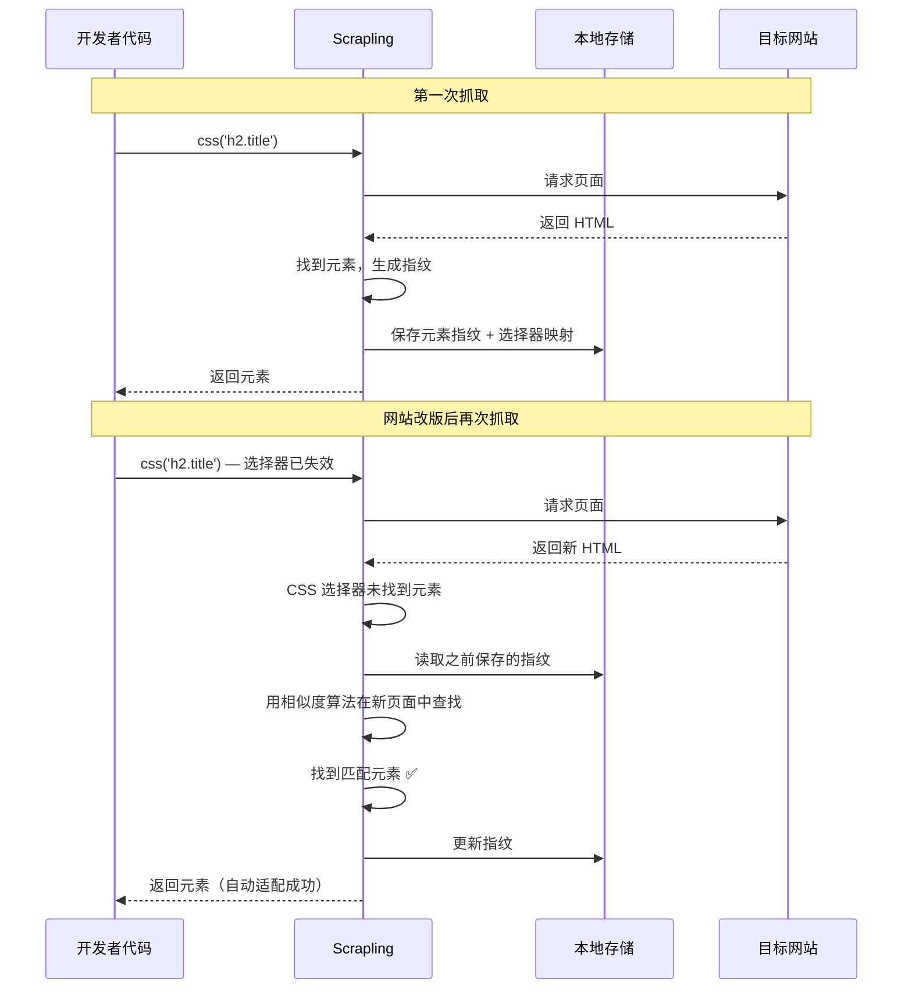
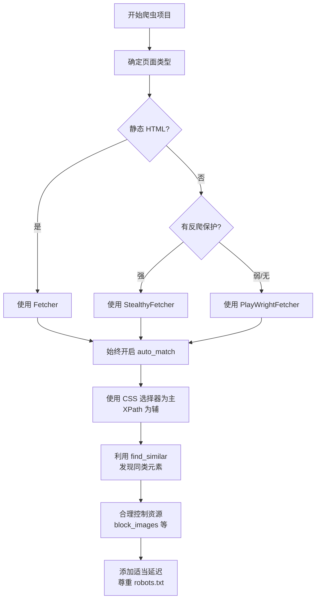

[toc]


- [Index - Scrapling](https://scrapling.readthedocs.io/en/latest/)


# Scrapling 爬虫系统介绍

## 概述

Scrapling 是一个现代化的 Python 网页爬虫与解析库，专为应对当今复杂的反爬虫环境而设计。它将**高性能 HTML 解析**、**智能元素定位**和**反检测浏览器自动化**融为一体，目标是让开发者用最少的代码完成最复杂的抓取任务。

> **一句话定位**：Scrapling ≈ 智能解析引擎 + 反检测浏览器控制 + 自适应元素追踪，三位一体。



---

## 为什么需要 Scrapling

| 痛点                             | 传统方案              | Scrapling 的解决方式                                         |
| -------------------------------- | --------------------- | ------------------------------------------------------------ |
| 网站结构频繁变化导致选择器失效   | 手动修复选择器        | **智能元素定位**：基于元素特征自动适配，即使 class/id 变了也能找到 |
| 反爬检测（指纹识别、TLS 指纹等） | 拼凑各种反检测库      | 内置 **Camoufox / real-browser** 引擎，开箱即用              |
| HTML 解析性能瓶颈                | lxml / BeautifulSoup  | 底层基于 **lxml**，API 接近 BeautifulSoup 但速度快数倍       |
| 动态渲染页面                     | Selenium / Playwright | 内置 Playwright 集成，支持隐身模式，一行代码切换             |
| 学习成本高、API 不统一           | 多个库组合使用        | 统一 API，HTTP/浏览器请求无缝切换                            |

---

## 安装

```bash
# 基础安装（仅解析 + HTTP 请求）
pip install scrapling

# 包含 Playwright 支持（动态页面）
pip install scrapling[playwright]

# 包含所有功能
pip install scrapling[all]

# 安装完成后，首次使用浏览器功能需要安装浏览器
scrapling install
```

> `scrapling install` 会自动下载 Camoufox 和 Playwright 所需的浏览器二进制文件。

---

## 核心架构



---

## Adaptor：高性能解析引擎

Adaptor 是 Scrapling 的解析核心，可以独立使用（不发起网络请求），也会被 Fetcher 自动返回。

### 基本使用

```python
from scrapling import Adaptor

html = """
<html>
<body>
    <div class="product" id="item-1">
        <h2 class="title">Python 编程指南</h2>
        <span class="price">¥89.00</span>
        <p class="desc">适合初学者的 Python 教程</p>
    </div>
    <div class="product" id="item-2">
        <h2 class="title">数据科学实战</h2>
        <span class="price">¥128.00</span>
        <p class="desc">从入门到精通</p>
    </div>
</body>
</html>
"""

page = Adaptor(html, auto_match=True)
```

### 元素查找方法一览

| 方法                     | 用途                 | 示例                                     |
| ------------------------ | -------------------- | ---------------------------------------- |
| `css(selector)`          | CSS 选择器查找       | `page.css('div.product')`                |
| `xpath(expression)`      | XPath 表达式查找     | `page.xpath('//div[@class="product"]')`  |
| `find(id/class_/tag)`    | 按属性快速查找第一个 | `page.find('div', class_='product')`     |
| `find_all(...)`          | 按属性查找所有       | `page.find_all('div', class_='product')` |
| `find_by_text(text)`     | 按文本内容查找       | `page.find_by_text('Python')`            |
| `find_by_regex(pattern)` | 按正则表达式查找     | `page.find_by_regex(r'¥\d+')`            |
| `find_similar()`         | 查找结构相似的元素   | `element.find_similar()`                 |

### 元素属性与数据提取

```python
products = page.css('div.product')

for product in products:
    # 获取文本内容
    title = product.css_first('h2.title').text
    price = product.css_first('span.price').text
    
    # 获取属性
    product_id = product.attrib['id']
    
    # 获取所有属性
    all_attrs = product.attrib
    
    print(f"{title} - {price} (ID: {product_id})")
```

### 链式操作与导航

```python
# 链式 CSS 选择
page.css('div.product').css('h2.title')

# 父子兄弟导航（类似 BeautifulSoup）
element = page.css_first('span.price')
parent = element.parent                # 父元素
siblings = element.siblings            # 兄弟元素
children = element.children            # 子元素
next_el = element.next                 # 下一个兄弟
prev_el = element.previous             # 上一个兄弟
```

### Adaptors 集合操作

当查找返回多个元素时，返回的是 `Adaptors` 对象（可迭代集合），支持批量操作：

```python
titles = page.css('h2.title')

# 批量提取所有文本
all_texts = titles.texts            # ['Python 编程指南', '数据科学实战']

# 第一个 / 最后一个
first = titles.first               # 等同于 titles[0]
last = titles.last

# 过滤
filtered = titles.filter(lambda el: 'Python' in el.text)
```

---

## Fetcher 家族：网络请求层

Scrapling 提供三种 Fetcher，适用于不同场景：



### 三种 Fetcher 对比

| 特性            | Fetcher      | StealthyFetcher    | PlayWrightFetcher |
| --------------- | ------------ | ------------------ | ----------------- |
| 底层技术        | httpx        | Camoufox (Firefox) | Playwright        |
| JavaScript 渲染 | ❌            | ✅                  | ✅                 |
| 反指纹检测      | 基础         | ✅ 极强             | 中等              |
| TLS 指纹伪装    | ✅            | ✅                  | ❌                 |
| 速度            | 🚀 最快       | 🐢 较慢             | 🐇 中等            |
| 资源消耗        | 极低         | 高                 | 中                |
| 无头模式        | N/A          | ✅                  | ✅                 |
| 适用场景        | 静态页面/API | 强反爬网站         | 动态页面通用      |

### Fetcher：轻量 HTTP 请求

适用于静态页面和 API 抓取，底层使用 httpx，速度极快。

```python
from scrapling import Fetcher

fetcher = Fetcher(auto_match=True)

# GET 请求
page = fetcher.get('https://example.com')
print(page.status)       # HTTP 状态码
print(page.title)        # 页面标题

# 带参数的请求
page = fetcher.get(
    'https://example.com/search',
    params={'q': 'python'},
    headers={'Accept-Language': 'zh-CN'},
    timeout=30
)

# POST 请求
page = fetcher.post(
    'https://example.com/api/data',
    json={'key': 'value'},
    headers={'Authorization': 'Bearer token123'}
)

# 提取数据（返回的就是 Adaptor 对象）
items = page.css('div.item')
for item in items:
    print(item.css_first('h2').text)
```

**Fetcher 的反检测特性**：
- 自动生成真实的浏览器 User-Agent
- 模拟真实的 TLS/JA3 指纹
- 自动处理常见的请求头

### StealthyFetcher：隐身浏览器

基于 Camoufox（经过深度修改的 Firefox），专门对抗高级反爬检测。

```python
from scrapling import StealthyFetcher

fetcher = StealthyFetcher(auto_match=True)

page = fetcher.fetch(
    'https://heavily-protected-site.com',
    headless=True,         # 无头模式
    block_images=True,     # 阻止加载图片（加速）
    disable_resources=True # 阻止加载 CSS/字体等
)

# 返回的同样是 Adaptor，用法完全一致
title = page.css_first('h1').text
```

**StealthyFetcher 的反检测能力**：
- 真实的浏览器指纹（Canvas、WebGL、AudioContext 等）
- 自动绕过 Cloudflare、DataDome 等主流反爬服务
- 消除 WebDriver 检测痕迹

### PlayWrightFetcher：完整浏览器控制

基于 Playwright，提供最灵活的浏览器自动化能力。

```python
from scrapling import PlayWrightFetcher

fetcher = PlayWrightFetcher(auto_match=True)

# 基础用法
page = fetcher.fetch(
    'https://spa-website.com',
    headless=True,
    wait_selector='div.content',   # 等待特定元素出现
    timeout=60000                  # 超时时间（毫秒）
)

# 使用 page_action 执行复杂交互
def interact(page):
    """在页面加载后执行自定义操作"""
    # 点击按钮
    page.click('button.load-more')
    # 等待新内容
    page.wait_for_selector('div.new-content')
    # 滚动页面
    page.evaluate('window.scrollTo(0, document.body.scrollHeight)')
    page.wait_for_timeout(2000)
    # 必须返回 page
    return page

page = fetcher.fetch(
    'https://spa-website.com',
    headless=True,
    page_action=interact
)

# 使用 wait_selector 等待动态内容
page = fetcher.fetch(
    'https://example.com',
    wait_selector='table.data-table',
    wait_selector_state='visible'   # 'attached' | 'visible' | 'hidden'
)
```

**PlayWrightFetcher 的 `page_action` 参数**是其最强大的特性之一，让你可以：

- 填写表单、点击按钮
- 处理无限滚动
- 等待 AJAX 请求完成
- 执行任意 JavaScript
- 处理弹窗和对话框

---

## 智能元素定位（Auto Match）

这是 Scrapling 最具创新性的特性。当网站更新导致 HTML 结构变化时，传统选择器会失效，而 Scrapling 的智能定位能自动适配。

### 工作原理



### 如何启用

```python
from scrapling import Adaptor, Fetcher

# 方式一：在 Adaptor 层启用
page = Adaptor(html, auto_match=True, url='https://example.com')

# 方式二：在 Fetcher 层启用（推荐）
fetcher = Fetcher(auto_match=True)
page = fetcher.get('https://example.com')

# 之后正常使用选择器即可，智能定位在后台自动工作
element = page.css_first('div.product-info h2.title')
```

### 指纹生成策略

Scrapling 为每个元素生成的指纹包含多个维度：

| 指纹维度      | 说明                     |
| ------------- | ------------------------ |
| 标签名        | 元素的 HTML 标签         |
| 属性集合      | id、class、data-* 等属性 |
| 文本内容特征  | 文本长度、关键词哈希     |
| 结构位置      | 在 DOM 树中的路径和层级  |
| 兄弟/父子关系 | 周围元素的特征           |

匹配时通过**加权相似度算法**综合评分，超过阈值即视为同一元素。

### 最佳实践

- 首次运行时确保选择器正确，因为这次的结果会被作为基准指纹保存
- 使用 `url` 参数确保不同页面的指纹不会混淆
- 生产环境建议始终开启 `auto_match=True`

---

## 实战案例

### 案例一：抓取静态商品列表

```python
from scrapling import Fetcher

fetcher = Fetcher(auto_match=True)
page = fetcher.get('https://books.toscrape.com/')

books = []
for article in page.css('article.product_pod'):
    title = article.css_first('h3 a').attrib['title']
    price = article.css_first('p.price_color').text
    rating = article.css_first('p.star-rating').attrib.get('class', '')
    in_stock = bool(article.css_first('p.instock'))
    
    books.append({
        'title': title,
        'price': price,
        'rating': rating,
        'in_stock': in_stock
    })

for book in books[:3]:
    print(book)
```

### 案例二：处理动态加载页面（无限滚动）

```python
from scrapling import PlayWrightFetcher

fetcher = PlayWrightFetcher(auto_match=True)

def scroll_to_bottom(page):
    """模拟无限滚动，加载更多内容"""
    previous_height = 0
    for _ in range(5):  # 最多滚动 5 次
        page.evaluate('window.scrollTo(0, document.body.scrollHeight)')
        page.wait_for_timeout(2000)  # 等待加载
        
        new_height = page.evaluate('document.body.scrollHeight')
        if new_height == previous_height:
            break  # 没有更多内容了
        previous_height = new_height
    return page

page = fetcher.fetch(
    'https://example.com/infinite-scroll',
    headless=True,
    page_action=scroll_to_bottom
)

items = page.css('div.item')
print(f'共加载 {len(items)} 个项目')
```

### 案例三：绕过 Cloudflare 保护

```python
from scrapling import StealthyFetcher

fetcher = StealthyFetcher(auto_match=True)

# StealthyFetcher 会自动处理 Cloudflare 挑战
page = fetcher.fetch(
    'https://cloudflare-protected-site.com',
    headless=True,
    block_images=True,     # 节省带宽
)

if page.status == 200:
    content = page.css_first('div.main-content').text
    print(content)
else:
    print(f'请求失败: {page.status}')
```

### 案例四：表单登录后抓取

```python
from scrapling import PlayWrightFetcher

fetcher = PlayWrightFetcher(auto_match=True)

def login_and_navigate(page):
    """登录并导航到目标页面"""
    # 填写登录表单
    page.fill('input[name="username"]', 'myuser')
    page.fill('input[name="password"]', 'mypass')
    page.click('button[type="submit"]')
    
    # 等待登录完成
    page.wait_for_url('**/dashboard**')
    
    # 导航到数据页面
    page.goto('https://example.com/data')
    page.wait_for_selector('table.data')
    
    return page

page = fetcher.fetch(
    'https://example.com/login',
    headless=True,
    page_action=login_and_navigate
)

# 提取表格数据
rows = page.css('table.data tbody tr')
for row in rows:
    cells = row.css('td')
    print([cell.text for cell in cells])
```

### 案例五：使用 `find_similar` 发现同类元素

```python
from scrapling import Adaptor

html = """
<div class="container">
    <div class="card type-a" data-id="1">
        <h3>商品 A</h3><span>¥99</span>
    </div>
    <div class="card type-b" data-id="2">
        <h3>商品 B</h3><span>¥199</span>
    </div>
    <div class="card type-c" data-id="3">
        <h3>商品 C</h3><span>¥299</span>
    </div>
    <div class="sidebar">
        <p>这不是商品卡片</p>
    </div>
</div>
"""

page = Adaptor(html)

# 找到一个商品卡片
first_card = page.css_first('div.card')

# 自动发现结构相似的所有卡片（即使 class 不完全一致）
similar_cards = first_card.find_similar()
print(f'找到 {len(similar_cards)} 个相似元素')
```

---

## 进阶技巧

### 代理配置

```python
from scrapling import Fetcher, StealthyFetcher

# HTTP Fetcher 代理
fetcher = Fetcher()
page = fetcher.get(
    'https://example.com',
    proxies={
        'http://': 'http://proxy:8080',
        'https://': 'http://proxy:8080'
    }
)

# 浏览器 Fetcher 代理
stealthy = StealthyFetcher()
page = stealthy.fetch(
    'https://example.com',
    proxy={
        'server': 'http://proxy:8080',
        'username': 'user',
        'password': 'pass'
    }
)
```

### 资源控制（提升性能）

```python
from scrapling import StealthyFetcher

fetcher = StealthyFetcher()

page = fetcher.fetch(
    'https://example.com',
    headless=True,
    block_images=True,        # 不加载图片
    disable_resources=True,   # 不加载 CSS/字体/媒体
)
```

### 结合数据处理

```python
import json
import csv
from scrapling import Fetcher

fetcher = Fetcher(auto_match=True)
page = fetcher.get('https://quotes.toscrape.com/')

quotes = []
for quote_div in page.css('div.quote'):
    quotes.append({
        'text': quote_div.css_first('span.text').text,
        'author': quote_div.css_first('small.author').text,
        'tags': [tag.text for tag in quote_div.css('a.tag')]
    })

# 保存为 JSON
with open('quotes.json', 'w', encoding='utf-8') as f:
    json.dump(quotes, f, ensure_ascii=False, indent=2)

# 保存为 CSV
with open('quotes.csv', 'w', newline='', encoding='utf-8') as f:
    writer = csv.DictWriter(f, fieldnames=['text', 'author', 'tags'])
    writer.writeheader()
    for q in quotes:
        q['tags'] = ', '.join(q['tags'])
        writer.writerow(q)
```

---

## 与其他工具对比

| 维度     | Scrapling            | BeautifulSoup | Scrapy       | Selenium      | Playwright    |
| -------- | -------------------- | ------------- | ------------ | ------------- | ------------- |
| 定位     | 解析 + 请求 + 反检测 | 纯解析        | 爬虫框架     | 浏览器自动化  | 浏览器自动化  |
| 解析速度 | ⭐⭐⭐⭐⭐                | ⭐⭐⭐           | ⭐⭐⭐⭐         | ⭐⭐            | ⭐⭐            |
| JS 渲染  | ✅ 内置               | ❌             | 需插件       | ✅             | ✅             |
| 反爬能力 | ✅ 内置               | ❌             | 需扩展       | 弱            | 中            |
| 智能定位 | ✅ 独有               | ❌             | ❌            | ❌             | ❌             |
| 学习曲线 | 低                   | 低            | 高           | 中            | 中            |
| 适合场景 | 中小规模通用抓取     | HTML 解析     | 大规模分布式 | 测试/简单抓取 | 测试/复杂交互 |

> **选择建议**：如果你的项目不需要分布式架构（Scrapy 的强项），Scrapling 几乎在所有其他维度都是更现代、更便捷的选择。

---

## 常见问题与排错

| 问题                     | 可能原因              | 解决方案                                             |
| ------------------------ | --------------------- | ---------------------------------------------------- |
| `scrapling install` 失败 | 网络问题或权限不足    | 使用代理或 `sudo` 运行                               |
| StealthyFetcher 仍被检测 | 目标站有极端检测策略  | 尝试 `headless=False`（有头模式）+ 添加随机延迟      |
| 页面内容为空             | 内容由 JS 动态生成    | 从 `Fetcher` 切换到 `PlayWrightFetcher`              |
| `auto_match` 匹配错误    | 首次选择器结果不正确  | 清除缓存，确保首次选择器准确                         |
| 内存占用过高             | 浏览器 Fetcher 未释放 | 确保适当关闭，使用 `block_images` 等参数             |
| 选择器返回 `None`        | CSS/XPath 写错        | 用 `css` 代替 `css_first` 检查是否有结果，调试选择器 |

---

## 总结与最佳实践清单



**核心实践要点**：

- **始终开启 `auto_match=True`**：几乎没有性能损失，但能极大提升代码的健壮性
- **从 Fetcher 开始**：能用 HTTP 解决的就不要启动浏览器，性能差距是数量级的
- **善用 `find_similar()`**：当你找到一个目标元素后，用它来发现页面上所有同类元素，比手写选择器更可靠
- **控制浏览器资源**：使用 `block_images` 和 `disable_resources` 可以显著提升浏览器 Fetcher 的速度
- **遵守爬虫道德**：添加合理延迟、遵守 robots.txt、不对目标服务器造成过大压力