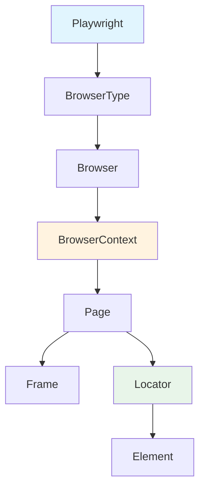
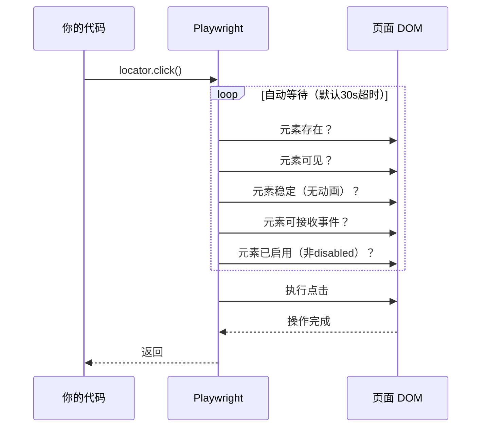

[toc]


# Playwright for Python 系统介绍

## 概述

Playwright 是微软开发的端到端测试与浏览器自动化框架。

它通过单一 API 控制 Chromium、Firefox 和 WebKit 三大浏览器引擎，支持跨平台运行（Windows、Linux、macOS）。

> Playwright for Python 是其官方 Python 绑定，提供同步和异步两套 API。

核心优势：

- 自动等待元素可操作，无需手动 sleep
- 浏览器上下文隔离，天然支持并行测试
- 网络拦截与模拟能力
- 支持多页面、多标签页、iframe 操作
- 内置代码生成器（codegen）和调试工具

## 架构与核心概念



| 概念           | 职责                                    | 生命周期                  |
| -------------- | --------------------------------------- | ------------------------- |
| Playwright     | 入口对象，管理浏览器类型                | 整个会话                  |
| BrowserType    | 启动特定引擎（chromium/firefox/webkit） | 与 Playwright 相同        |
| Browser        | 浏览器实例                              | 手动关闭                  |
| BrowserContext | 隔离的浏览器会话（类似隐身窗口）        | 手动关闭                  |
| Page           | 单个标签页                              | 随 Context 关闭或手动关闭 |
| Locator        | 元素定位器，惰性求值                    | 无状态，每次操作重新查找  |

BrowserContext 是隔离的关键单元。每个 Context 拥有独立的 cookie、localStorage、会话状态，互不干扰。这意味着你可以在同一个 Browser 实例中创建多个 Context 来模拟不同用户，而无需启动多个浏览器进程。

## 安装与设置

```bash
pip install playwright
playwright install
```

`playwright install` 会下载 Chromium、Firefox、WebKit 三个浏览器二进制文件。如果只需要特定浏览器：

```bash
playwright install chromium
```

## 同步 API 与异步 API

Playwright for Python 提供两套完整的 API。选择依据：

| 场景                                    | 推荐 API          | 原因                     |
| --------------------------------------- | ----------------- | ------------------------ |
| 脚本、爬虫、简单自动化                  | 同步（sync_api）  | 代码直观，调试方便       |
| 与 asyncio 框架集成（FastAPI、aiohttp） | 异步（async_api） | 避免阻塞事件循环         |
| pytest-playwright 测试                  | 同步              | 插件默认使用同步 fixture |

### 同步用法

```python
from playwright.sync_api import sync_playwright

with sync_playwright() as p:
    browser = p.chromium.launch(headless=False)
    context = browser.new_context()
    page = context.new_page()
    
    page.goto("https://example.com")
    print(page.title())
    
    browser.close()
```

### 异步用法

```python
import asyncio
from playwright.async_api import async_playwright

async def main():
    async with async_playwright() as p:
        browser = await p.chromium.launch()
        context = await browser.new_context()
        page = await context.new_page()
        
        await page.goto("https://example.com")
        print(await page.title())
        
        await browser.close()

asyncio.run(main())
```

两套 API 的方法名完全一致，异步版本只是在每个操作前加 `await`。

## Locator 定位策略

Locator 是 Playwright 推荐的元素交互方式。它是惰性的——创建 Locator 时不会立即查找元素，而是在执行操作（click、fill 等）时才查找，并自动等待元素满足可操作条件。

### 推荐的定位方式（按优先级）

| 方法                 | 示例                                        | 适用场景         |
| -------------------- | ------------------------------------------- | ---------------- |
| `get_by_role`        | `page.get_by_role("button", name="Submit")` | 语义化元素，首选 |
| `get_by_text`        | `page.get_by_text("Welcome")`               | 可见文本内容     |
| `get_by_label`       | `page.get_by_label("Email")`                | 表单字段         |
| `get_by_placeholder` | `page.get_by_placeholder("Search...")`      | 输入框           |
| `get_by_test_id`     | `page.get_by_test_id("submit-btn")`         | 专用测试属性     |
| `locator(css)`       | `page.locator(".card >> nth=0")`            | CSS 选择器兜底   |
| `locator(xpath)`     | `page.locator("//div[@class='item']")`      | 复杂 DOM 结构    |

最佳实践：优先使用面向用户的定位方式（role、text、label），它们更贴近用户实际看到的内容，对 DOM 结构变化的抗性更强。

### Locator 链式过滤

```python
# 在表格中定位特定行的按钮
page.locator("tr").filter(has_text="John").get_by_role("button", name="Edit")

# 组合过滤
page.get_by_role("listitem").filter(has_text="Product 1").filter(has=page.get_by_role("button"))
```

### 严格模式

Locator 默认启用严格模式：如果匹配到多个元素，操作会抛出异常。这能帮助你尽早发现定位不精确的问题。

```python
# 如果页面有多个 button 匹配 "Submit"，会报错
page.get_by_role("button", name="Submit").click()

# 明确选择第一个
page.get_by_role("button", name="Submit").first.click()

# 或者操作所有匹配元素
for btn in page.get_by_role("button", name="Submit").all():
    btn.click()
```

## 自动等待机制

Playwright 的自动等待是其最重要的设计决策之一。执行操作前，Playwright 会自动等待元素满足一系列可操作性检查：



| 操作           | 等待条件                                            |
| -------------- | --------------------------------------------------- |
| `click`        | attached, visible, stable, enabled, receives events |
| `fill`         | attached, visible, enabled, editable                |
| `check`        | attached, visible, stable, enabled, receives events |
| `text_content` | attached                                            |
| `inner_text`   | attached                                            |
| `is_visible`   | 不等待，立即返回当前状态                            |

这意味着你几乎不需要写 `time.sleep()` 或显式等待。如果需要等待特定条件：

```python
# 等待元素出现
page.locator(".result").wait_for(state="visible")

# 等待元素消失
page.locator(".loading").wait_for(state="hidden")

# 等待自定义条件
page.wait_for_function("document.querySelector('.count').textContent === '5'")
```

## 页面导航与事件

### 导航

```python
# 基本导航
page.goto("https://example.com")

# 等待特定加载状态
page.goto("https://example.com", wait_until="domcontentloaded")
# wait_until 选项: "load" | "domcontentloaded" | "networkidle" | "commit"

# 等待导航完成（用于 SPA 路由跳转）
with page.expect_navigation():
    page.get_by_role("link", name="Dashboard").click()
```

| wait_until 值        | 含义                     | 适用场景             |
| -------------------- | ------------------------ | -------------------- |
| `"commit"`           | 收到服务器响应           | 最快，只关心响应到达 |
| `"domcontentloaded"` | DOM 解析完成             | 不依赖外部资源的页面 |
| `"load"`             | 所有资源加载完成（默认） | 传统多页应用         |
| `"networkidle"`      | 500ms 内无网络请求       | 动态加载内容多的页面 |

### 事件监听

```python
# 监听 console 输出
page.on("console", lambda msg: print(f"Console: {msg.text}"))

# 监听请求
page.on("request", lambda req: print(f">> {req.method} {req.url}"))

# 监听对话框（alert/confirm/prompt）
page.on("dialog", lambda dialog: dialog.accept())

# 一次性事件
page.once("popup", lambda popup: print(f"Popup: {popup.url}"))
```

## 网络拦截与模拟

网络层控制是 Playwright 的强大能力，适用于测试中 mock API、录制请求、修改响应等场景。

### 路由拦截

```python
# 阻止图片加载（加速测试）
page.route("**/*.{png,jpg,jpeg,gif,svg}", lambda route: route.abort())

# Mock API 响应
page.route("**/api/users", lambda route: route.fulfill(
    status=200,
    content_type="application/json",
    body='[{"id": 1, "name": "Alice"}]'
))

# 修改请求
def handle_route(route):
    headers = {**route.request.headers, "X-Custom": "value"}
    route.continue_(headers=headers)

page.route("**/api/**", handle_route)
```

### 等待特定请求/响应

```python
# 等待 API 响应后再断言
with page.expect_response("**/api/users") as response_info:
    page.get_by_role("button", name="Load").click()

response = response_info.value
assert response.status == 200
data = response.json()
```

### HAR 录制与回放

```python
# 录制网络请求到 HAR 文件
context = browser.new_context(record_har_path="network.har")
# ... 执行操作 ...
context.close()  # HAR 在 close 时写入

# 回放 HAR（测试时使用录制的响应）
context = browser.new_context()
page = context.new_page()
page.route_from_har("network.har", url="**/api/**")
```

## 断言

Playwright 提供 `expect` API，内置自动重试机制。断言会在超时时间内反复检查条件，直到满足或超时。

```python
from playwright.sync_api import expect

# 文本断言
expect(page.get_by_role("heading")).to_have_text("Welcome")
expect(page.locator(".status")).to_contain_text("Success")

# 属性断言
expect(page.get_by_role("button", name="Submit")).to_be_enabled()
expect(page.get_by_role("checkbox")).to_be_checked()
expect(page.locator("input")).to_have_value("hello")

# 可见性
expect(page.locator(".modal")).to_be_visible()
expect(page.locator(".spinner")).to_be_hidden()

# 数量断言
expect(page.get_by_role("listitem")).to_have_count(5)

# 页面断言
expect(page).to_have_url("https://example.com/dashboard")
expect(page).to_have_title("Dashboard")

# 自定义超时
expect(page.locator(".result")).to_have_text("Done", timeout=10000)

# 取反
expect(page.locator(".error")).not_to_be_visible()
```

与手动 `assert` 的区别：`expect` 会自动重试直到条件满足或超时，而 `assert` 只检查一次当前状态。对于动态页面，始终优先使用 `expect`。

## BrowserContext 高级用法

### 认证状态复用

避免每个测试都重新登录：

```python
# 第一次：登录并保存状态
context = browser.new_context()
page = context.new_page()
page.goto("https://example.com/login")
page.get_by_label("Email").fill("user@example.com")
page.get_by_label("Password").fill("password")
page.get_by_role("button", name="Sign in").click()
# 保存认证状态
context.storage_state(path="auth.json")
context.close()

# 后续：直接使用已认证状态
context = browser.new_context(storage_state="auth.json")
page = context.new_page()
page.goto("https://example.com/dashboard")  # 已登录
```

### 设备模拟

```python
# 使用预定义设备
iphone = p.devices["iPhone 13"]
context = browser.new_context(**iphone)

# 自定义视口和 User-Agent
context = browser.new_context(
    viewport={"width": 1280, "height": 720},
    user_agent="Custom UA",
    locale="zh-CN",
    timezone_id="Asia/Shanghai",
    geolocation={"latitude": 39.9, "longitude": 116.4},
    permissions=["geolocation"],
    color_scheme="dark",
)
```

### 多用户场景

```python
# 模拟两个用户同时在线聊天
context_alice = browser.new_context(storage_state="alice_auth.json")
context_bob = browser.new_context(storage_state="bob_auth.json")

page_alice = context_alice.new_page()
page_bob = context_bob.new_page()

page_alice.goto("https://chat.example.com")
page_bob.goto("https://chat.example.com")

page_alice.get_by_placeholder("Message").fill("Hello Bob!")
page_alice.get_by_role("button", name="Send").click()

expect(page_bob.locator(".message").last).to_have_text("Hello Bob!")
```

## 页面交互操作

### 表单操作

```python
# 文本输入
page.get_by_label("Username").fill("alice")

# 逐字符输入（模拟真实打字，触发 keydown/keyup 事件）
page.get_by_label("Search").press_sequentially("playwright", delay=100)

# 清除并重新输入
page.get_by_label("Email").clear()
page.get_by_label("Email").fill("new@example.com")

# 选择框
page.get_by_label("Country").select_option("China")
page.get_by_label("Country").select_option(label="中国")
page.get_by_label("Tags").select_option(["tag1", "tag2"])  # 多选

# 复选框和单选
page.get_by_label("Agree to terms").check()
page.get_by_label("Agree to terms").uncheck()
page.get_by_label("Express shipping").set_checked(True)

# 文件上传
page.get_by_label("Upload").set_input_files("report.pdf")
page.get_by_label("Upload").set_input_files(["file1.png", "file2.png"])
page.get_by_label("Upload").set_input_files([])  # 清除选择
```

### 鼠标与键盘

```python
# 悬停
page.get_by_role("link", name="Menu").hover()

# 双击
page.locator(".editable-cell").dblclick()

# 右键
page.locator(".item").click(button="right")

# 拖拽
page.locator("#source").drag_to(page.locator("#target"))

# 键盘快捷键
page.keyboard.press("Control+A")
page.keyboard.press("Meta+C")  # macOS Cmd+C
page.get_by_role("textbox").press("Enter")
```

### 对话框处理

```python
# 自动接受所有 alert/confirm
page.on("dialog", lambda dialog: dialog.accept())

# 处理 confirm 并获取消息
def handle_dialog(dialog):
    assert dialog.message == "Are you sure?"
    dialog.accept()

page.on("dialog", handle_dialog)
page.get_by_role("button", name="Delete").click()

# prompt 输入
page.on("dialog", lambda dialog: dialog.accept("my input"))
```

## Frame 与 iframe

```python
# 通过 name 属性定位
frame = page.frame(name="editor")

# 通过 URL 定位
frame = page.frame(url=r".*editor\.html")

# 通过 frame_locator（推荐，支持链式）
page.frame_locator("#editor-frame").get_by_role("button", name="Bold").click()

# 嵌套 iframe
page.frame_locator("#outer").frame_locator("#inner").locator(".content")
```

## 截图与视频

### 截图

```python
# 整页截图
page.screenshot(path="full_page.png", full_page=True)

# 元素截图
page.get_by_role("table").screenshot(path="table.png")

# 指定区域
page.screenshot(path="area.png", clip={"x": 0, "y": 0, "width": 800, "height": 600})
```

### 视频录制

```python
context = browser.new_context(
    record_video_dir="videos/",
    record_video_size={"width": 1280, "height": 720}
)
page = context.new_page()
# ... 操作 ...
context.close()  # 视频在 context 关闭时保存

# 获取视频路径
video_path = page.video.path()
```

## 代码生成与调试

### Codegen（代码生成器）

```bash
# 打开浏览器，录制操作并生成 Python 代码
playwright codegen https://example.com

# 指定设备模拟
playwright codegen --device="iPhone 13" https://example.com

# 使用已保存的认证状态
playwright codegen --load-storage=auth.json https://example.com
```

Codegen 会打开一个浏览器窗口和一个代码面板。你在浏览器中的每个操作都会实时生成对应的 Python 代码。这是学习 Playwright API 和快速生成定位器的最佳方式。

### 调试

```python
# 暂停执行，打开 Playwright Inspector
page.pause()

# 启用 Playwright Inspector（环境变量方式）
# PWDEBUG=1 python my_script.py
# Trace 录制（用于事后分析）
# 在代码中：
context.tracing.start(screenshots=True, snapshots=True, sources=True)
# ... 执行操作 ...
context.tracing.stop(path="trace.zip")
# 查看 trace
playwright show-trace trace.zip
```

Trace Viewer 提供时间线视图，可以逐步回放每个操作，查看操作前后的 DOM 快照、网络请求和 console 日志。

## 与 pytest 集成

`pytest-playwright` 插件提供开箱即用的 fixture 和配置。

```bash
pip install pytest-playwright
```

### 基本测试

```python
# test_example.py
import re
from playwright.sync_api import Page, expect

def test_homepage(page: Page):
    page.goto("https://example.com")
    expect(page).to_have_title(re.compile("Example"))
    expect(page.get_by_role("heading")).to_have_text("Example Domain")

def test_navigation(page: Page):
    page.goto("https://example.com")
    page.get_by_role("link", name="More information").click()
    expect(page).to_have_url(re.compile("iana.org"))
```

### 常用 Fixture

| Fixture        | 类型           | 作用域   | 说明                 |
| -------------- | -------------- | -------- | -------------------- |
| `page`         | Page           | function | 每个测试一个新页面   |
| `context`      | BrowserContext | function | 每个测试一个新上下文 |
| `browser`      | Browser        | session  | 整个会话共享         |
| `browser_name` | str            | session  | 当前浏览器名称       |
| `browser_type` | BrowserType    | session  | 当前浏览器类型对象   |

### 自定义 Fixture

```python
# conftest.py
import pytest
from playwright.sync_api import Page

@pytest.fixture(scope="function")
def authenticated_page(context):
    """每个测试获得已登录的页面"""
    context = context.browser.new_context(storage_state="auth.json")
    page = context.new_page()
    yield page
    context.close()

@pytest.fixture(scope="session")
def auth_state(browser):
    """会话级别：执行一次登录，保存状态"""
    context = browser.new_context()
    page = context.new_page()
    page.goto("https://example.com/login")
    page.get_by_label("Email").fill("user@example.com")
    page.get_by_label("Password").fill("password")
    page.get_by_role("button", name="Login").click()
    storage = context.storage_state(path="auth.json")
    context.close()
    return storage
```

### 运行配置

```bash
# 指定浏览器
pytest --browser chromium
pytest --browser firefox
pytest --browser webkit

# 多浏览器
pytest --browser chromium --browser firefox

# 有头模式（可视化）
pytest --headed

# 慢动作
pytest --slowmo 500
# pytest.ini
[pytest]
addopts = --browser chromium --headed
```

## Page Object Model

对于复杂项目，推荐使用 Page Object 模式封装页面交互：

```python
# pages/login_page.py
from playwright.sync_api import Page, expect

class LoginPage:
    def __init__(self, page: Page):
        self.page = page
        self.email_input = page.get_by_label("Email")
        self.password_input = page.get_by_label("Password")
        self.submit_button = page.get_by_role("button", name="Sign in")
        self.error_message = page.locator(".error-message")

    def goto(self):
        self.page.goto("https://example.com/login")
        return self

    def login(self, email: str, password: str):
        self.email_input.fill(email)
        self.password_input.fill(password)
        self.submit_button.click()
        return self

    def expect_error(self, message: str):
        expect(self.error_message).to_have_text(message)
        return self

    def expect_success(self):
        expect(self.page).to_have_url("https://example.com/dashboard")
        return self
# tests/test_login.py
from pages.login_page import LoginPage

def test_successful_login(page):
    login_page = LoginPage(page).goto()
    login_page.login("user@example.com", "correct_password")
    login_page.expect_success()

def test_invalid_credentials(page):
    login_page = LoginPage(page).goto()
    login_page.login("user@example.com", "wrong_password")
    login_page.expect_error("Invalid email or password")
```

## 并行执行

Playwright 的 BrowserContext 隔离设计天然支持并行。配合 `pytest-xdist`：

```bash
pip install pytest-xdist
pytest -n 4  # 4 个 worker 并行
```

每个 worker 获得独立的 BrowserContext，无需额外配置即可安全并行。

## 最佳实践总结

| 实践                                             | 说明                                   |
| ------------------------------------------------ | -------------------------------------- |
| 优先使用 `get_by_role`、`get_by_text` 等语义定位 | 抗 DOM 变化，贴近用户视角              |
| 使用 `expect` 而非 `assert`                      | 自动重试，应对异步 UI                  |
| 不要使用 `time.sleep()`                          | 用 `wait_for`、`expect` 或事件等待替代 |
| 每个测试使用独立 Context                         | 避免状态污染                           |
| 复用认证状态（storage_state）                    | 减少重复登录开销                       |
| 使用 Trace 而非截图调试                          | Trace 提供完整操作回放                 |
| 使用 `data-testid` 作为最后手段                  | 当语义定位不可行时                     |
| 避免依赖 `networkidle`                           | 不可靠，优先等待具体元素或响应         |
| 测试用户可见行为，而非实现细节                   | 不要断言 CSS class 或内部状态          |

## 常见模式速查

### 等待 API 完成后断言

```python
with page.expect_response(lambda r: "/api/data" in r.url and r.status == 200):
    page.get_by_role("button", name="Refresh").click()

expect(page.get_by_role("table")).to_be_visible()
```

### 处理新标签页/弹窗

```python
with page.expect_popup() as popup_info:
    page.get_by_role("link", name="Open in new tab").click()

new_page = popup_info.value
new_page.wait_for_load_state()
expect(new_page).to_have_title("New Page")
```

### 下载文件

```python
with page.expect_download() as download_info:
    page.get_by_role("button", name="Download").click()

download = download_info.value
download.save_as(f"downloads/{download.suggested_filename}")
```

### 执行页面内 JavaScript

```python
# 获取计算值
scroll_height = page.evaluate("document.body.scrollHeight")

# 传参执行
result = page.evaluate("([a, b]) => a + b", [1, 2])

# 操作 DOM（不推荐常规使用，但某些场景有用）
page.evaluate("window.scrollTo(0, document.body.scrollHeight)")
```

### 多页面标签切换

```python
# 监听新页面事件
context.on("page", lambda new_page: print(f"New page: {new_page.url}"))

# 获取所有页面
all_pages = context.pages

# 切换到最新页面
latest_page = context.pages[-1]
latest_page.bring_to_front()
```

------

## 总结

实际项目中，建议从 `playwright codegen` 开始探索，用它生成初始代码，再根据上述最佳实践进行重构和优化。