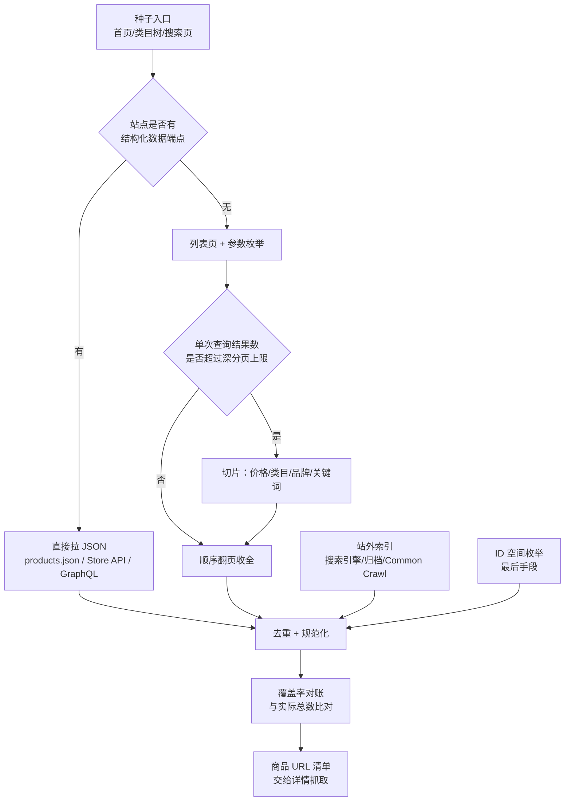

[toc]


---

## 先把问题拆开：发现阶段其实是三个子问题

没有 sitemap 时，最容易犯的错是"写个爬虫从首页开始递归爬"。真正决定成败的是下面三件事，而不是爬虫框架选型。

| 子问题 | 要回答的问题 | 典型手段 |
| --- | --- | --- |
| **入口（seed）** | 从哪些页面开始？ | 首页导航、类目树、站内搜索首页、站外索引 |
| **扩展（expand）** | 从已有页面还能挖出哪些 URL？ | 列表分页、筛选维度、详情页推荐位、关联集合页 |
| **切片（partition）** | 结果数超过站点深分页上限时，怎么把集合切成很多小份？ | 价格区间二分、类目/品牌枚举、关键词扫描、排序反转 |

**切片能力是核心差异点**。一个电商类目动辄几万 SKU，而列表页往往只允许翻到第 100 页或 1 万条。不会切片的爬虫，抓到的永远是"最热的那一小撮"。



---

## 先确认"真的没有 sitemap"

很多"没有 sitemap"的站点，其实只是**没在 robots.txt 里声明**，或者 sitemap 用了非标准路径。这一步成本最低、收益最高，值得花 10 分钟穷举。

### 探测清单

| 探测目标 | 路径示例 | 说明 |
| --- | --- | --- |
| 声明 | `/robots.txt` 中的 `Sitemap:` 行 | 顺便看 `Disallow`，常能暴露 `/search`、`/api`、`/collection` 等真实路径 |
| 通用 | `/sitemap.xml`、`/sitemap_index.xml`、`/sitemap-index.xml`、`/sitemap.xml.gz` | 大小写、下划线/连字符都要试 |
| Shopify | `/sitemap.xml`、`/sitemap_products_1.xml?from=1&to=9999999999999`、`/sitemap_collections_1.xml` | 只有商品分片、没有主索引时很常见 |
| WooCommerce | `/product-sitemap.xml`、`/sitemap_index.xml`（Yoast/RankMath） | 分页形式 `/product-sitemap2.xml` |
| Magento | `/sitemap.xml`、`/pub/sitemap.xml`、`/media/sitemap/sitemap.xml` | 后台生成，路径可配 |
| BigCommerce | `/xmlsitemap.php`、`/sitemap.php?page=1` | |
| Salesforce CC | `/sitemap.xml`、`/on/demandware.store/Sites-XXX-Site/zh_CN/` | 多站点前缀 |
| 多语言/多地区 | `/en/sitemap.xml`、`/zh-cn/sitemap.xml`、`/us/sitemap.xml` | 从 `hreflang` 与语言切换菜单拿前缀 |
| 搜索式 | 搜索引擎 `site:example.com sitemap` | 有人把 sitemap 放在了奇怪域名或目录 |
| 归档 | Wayback 里的旧 sitemap | 站点改版删掉 sitemap，但归档还在 |

### 归档里的旧 sitemap

站点现在不给 sitemap，通常历史某个版本是给的。用 Wayback CDX 找出所有 xml 快照，再取最近一份：

```bash
# 列出该域名下所有被归档过的 xml，按时间倒序取一条
curl -s "http://web.archive.org/cdx/search/cdx?url=example.com&matchType=domain\
&output=json&fl=original,timestamp,statuscode&filter=mimetype:application/xml&limit=-20"
```

拿到 `original` + `timestamp` 后，用 `https://web.archive.org/web/<timestamp>id_/<original>` 取原始内容（`id_` 后缀表示不加归档工具栏、返回原始字节）。

**实测记录（books.toscrape.com，一个公开的练习用沙盒站）**：CDX 前缀查询可用，但返回的 URL 里混有 `.../catalogue/'`、`.../index.htmlXPath` 这类脏数据——说明**归档数据必须清洗**，不能直接当清单用。

```bash
curl -s "http://web.archive.org/cdx/search/cdx?url=books.toscrape.com/catalogue/\
&matchType=prefix&output=json&fl=original&collapse=urlkey&limit=5"
# 返回中包含：
# http://books.toscrape.com:80/catalogue/'
# http://books.toscrape.com/catalogue/10-day-green-...-581/index.htmlXPath
```

---

## 七类发现方法（按性价比排序）

| # | 方法 | 典型产出规模 | 请求成本 | 覆盖率 | 主要风险 |
| --- | --- | --- | --- | --- | --- |
| 1 | 结构化数据端点（JSON/GraphQL/Feed） | 全站 | 极低 | 高（常含缺货） | 需要逆向，且站点可能随时关闭 |
| 2 | 站内搜索 + 切片 | 全站 | 低 | 很高（用户可见即收录） | 深分页上限、排序不稳定 |
| 3 | 类目树 + 分页递归 | 类目内的全量 | 中 | 中（长尾/新品可能在树外） | 类目树深、叶子页仍超上限 |
| 4 | 详情页关联图扩展 | 增量补漏 | 高 | 低（只做补充） | 图爆炸、易踩推荐位死循环 |
| 5 | 站外索引（搜索引擎/归档/CC） | 有索引的部分 | 低 | 低-中，冷启动友好 | 数据陈旧、分页受限 |
| 6 | ID / SKU 空间枚举 | 理论上全量 | 极高 | 取决于 ID 密度 | 浪费巨大、易触发风控 |
| 7 | 商业数据源（联盟 feed / 平台 API） | 全量 | 花钱 | 高 | 授权、字段受限、有费用 |

原则：按 **结构化端点、站内搜索、类目树、站外索引、关联图、ID 枚举** 的先后顺序尝试，前一层能拿到 80% 就不要急着上后一层。任何单一方法的覆盖率都不该被默认可信，详见 **覆盖率评估** 一节。

---

## 直接找结构化数据端点（首选）

电商前端几乎都是"后端 API + 前端渲染"。列表页上看到的商品，本质上是某个 JSON 接口返回的。找到它，就绕过了分页 HTML、反爬 DOM、渲染开销。

### 平台指纹与已知端点

| 平台 | 探测特征 | 端点 | 备注 |
| --- | --- | --- | --- |
| **Shopify** | 响应头 `x-shopify-stage`、页面含 `cdn.shopify.com` | `/products.json?limit=250&page=N`、`/collections.json?limit=250`、`/collections/<handle>/products.json` | 免鉴权，最好用的一类 |
| **WooCommerce** | `/wp-json/`、`wp-content` | `/wp-json/wc/store/v1/products?per_page=100&page=N` | 新版路径；旧版 `/wp-json/wc/store/products` |
| **Magento** | `mage/cookies`、`/static/version` | `/rest/V1/products?searchCriteria[pageSize]=100&searchCriteria[currentPage]=N` | 多数需 token；匿名可用性看配置 |
| **BigCommerce** | `cdn11.bigcommerce.com` | `/graphql`（storefront token 在页面里） | token 从前端 JS 提取 |
| **Shopware** | `/store-api/` | `/store-api/product` + 头 `sw-access-key` | access key 在前端 |
| **PrestaShop** | `/api/`、`ws_key` | `/api/products?display=full&limit=100` | 需 webservice key |
| **SaaS 搜索** | 页面里出现 `algolia`、`klevu`、`searchspring` | 直接调搜索服务 | 见 **SSR 数据与前端搜索服务** |
| **微信小店** | 小程序/视频号小店后台 | `shop/api/getproductlist`（需 `access_token`） | 官方开放接口，商品 ID 与类目树可全量拉取 |
| **微店** | `weidian.com`、H5 店铺 | `weidian.item.shop.list.get`、`vdian.shop.item.list.get` | OAuth 授权后分页取全量商品 |
| **有赞** | 微商城 / 连锁 | 有赞云开放平台「商品列表」类接口 | 需应用授权，连锁按店铺维度 |
| **微盟** | `weimobcloud.com` | 开放平台商品 API | 需应用授权 |

> 国内 SaaS 商城与海外不同：普遍**没有** `products.json` 这类免鉴权公开端点，商品接口一律要 app key + 店铺授权。所以自有店铺走官方 API 是最短路径；第三方店铺只能退回搜索/类目/站外索引三件套。

### Shopify 实测（2026-10-22，allbirds.com）

```bash
curl -s "https://www.allbirds.com/products.json?limit=250&page=1" | head -c 200
# {"products":[{"id":7340901859408,"title":"Women's Allbirds Flip Flop - Dusty Pink","handle":"...
```

关键参数行为（实测）：

| 请求 | 结果 |
| --- | --- |
| `?limit=250&page=1` | 200，返回 **250** 条 |
| `?limit=500&page=1` | 200，仍返回 **250** 条，说明**上限就是 250/页** |
| `?limit=250&page=2` | 200，返回 250 条，与第 1 页不同 |
| `?limit=250&page=99` | 200，返回 `{"products":[]}`，**越界不报错，用空数组判断结束** |
| `/collections.json?limit=5` | 200，含 `handle` 与 `products_count`，可用于枚举集合 |

所以 Shopify 站的发现逻辑极简：`page` 从 1 递增，`products` 为空即停；再用 `collections.json` 把所有集合过一遍（集合通常比 `/products.json` 更全，能捞到未上架到主目录的商品）。

### SSR 数据与前端搜索服务

- **Next.js**：页面里的 `__NEXT_DATA__` JSON 常直接带整页商品列表（`pageProps.products`、`initialState`），比解析 DOM 稳。用 `/_next/static/<buildId>/_buildManifest.js` 还能看到全部路由，反推 URL 模式（如 `/product/[slug]`）。
- **Nuxt**：`window.__NUXT__` 同理。
- **Algolia / Klevu / Searchspring / Bloomreach**：前端必须暴露 appId + search-only key 才能搜索。这些 key 本就是公开的，可直接查索引拿记录。注意 Algolia 的 `search` 接口有分页上限（受 `paginationLimitedTo` 约束，默认 1000 条），要全量应当用 **`browse` 接口按游标遍历**，它返回的是全量记录而非搜索结果，不受该限制。**这是很多自建搜索站最容易被忽略的"全量入口"**。
- **GraphQL**：先试 introspection（`{"query":"{__schema{types{name}}}"}`），开着就能看清 `products(first:, after:)` 之类的游标分页，配合 relay cursor 可以稳定全量遍历。

### 通用逆向套路

1. 打开列表页，在 DevTools 的 Network 面板过滤 `Fetch/XHR`。
2. 点"下一页"或修改筛选条件，观察新增请求，找出参数名（`page`、`offset`、`cursor`、`after`）。
3. 删参数，只留最小集，看是否仍返回数据（很多参数是冗余的）。
4. 改 `limit` 加到很大，看服务端是否放行（放行就省掉 90% 请求）。
5. **记录 `total` 字段**：它是后面覆盖率对账的唯一可信基准。

> 经验：JSON 接口返回的 `items` 往往比列表页 HTML 更全——缺货商品常被前端过滤掉但接口仍返回。如果目标是"全量 SKU 含下架"，优先走接口。

---

## 站内搜索与切片（没有接口时的主力）

### 空查询技巧

站内搜索页通常支持"搜索空字符串"来列出全部商品。空串常被前端拦截，但 URL 编码的空格 `%20` 往往能过，常见形态有两类：查询串式 `/search?q=%20`，以及带分页参数的 `/search?keyword=%20&page=1`。

命中后先看页面/接口返回的 `total`（"共 13780 件商品"），这个数字就是后续对账的基准。

### 深分页上限是常态

几乎所有电商都会限制用户可以翻到多深，因为深分页对数据库极不友好。

| 站点 | 观测到的上限 | 来源 |
| --- | --- | --- |
| eBay | 搜索结果集 **10,000 条**（Browse API 文档明确） | eBay 官方 KB |
| H&M | 搜索接口 offset 到 10,000 后返回空数组 | 社区实测 |
| Amazon | 通常只放出前若干页（数百条），超出提示结果过多 | 卖家社区观测"多数搜索被限制在最多 7 页"，各类目不同，**必须实测** |

> 判断方法：`total=15000` 时，直接把 `offset` 设成 `total-20` 请求一次。返回空说明有上限；返回数据说明无上限，可直接翻页。

**为什么这个数字常常正好是 10,000**：多数电商的搜索后端是 Elasticsearch/OpenSearch，其 `index.max_result_window` 默认值为 10000，即 `from + size` 超过 1 万直接报 `Result window is too large`。站点为免报错，通常把可翻页深度截到 1 万——这解释了为什么换一个站还是 1 万。

官方给出的替代方案是 `search_after` + PIT（point in time，时间点快照），可稳定翻过 1 万条。因此：

- 若目标站把 ES 接口直接暴露在前端，优先找 `search_after`、`pit`、`scroll` 参数，这是**唯一不用切片就能全量**的路径；
- 若前端只做了 `from/size` 封装，切片的必要性就来自这条后端限制，而不是站点的"额外限制"。

Amazon 则是另一种情形：上限远低于 1 万，且按类目浮动，说明它的截断来自业务策略而非引擎默认值——这类站点的切片维度要按实测结果定，不能套用 1 万的假设。

### 绕上限的四种切法

| 切法 | 做法 | 适用 |
| --- | --- | --- |
| **排序反转（双端法）** | 同一查询分别 `sort=price_asc` 与 `sort=price_desc` 各取前 C 条 | `total ≤ 2C` 时一举拿下，最省事 |
| **游标续采** | 升序取前 C 条，记住第 C 条的价格 `p`，下次加 `price_min=p` 再取 C 条，循环 | 支持价格/ID 过滤时最通用，能线性扫完全站 |
| **facet 切片** | 按类目/品牌/颜色/评分枚举，每个值单独查询 | facet 维度多且分布均匀时最稳（剪枝见 **枚举 facet 的组合爆炸与剪枝** 一节） |
| **关键词扫描** | 用 `a`~`z`、品牌名、型号前缀等做查询词轮询 | 无 facet、无排序参数的兜底方案，覆盖率不可控 |

**排序必须选稳定键**（价格、上架时间、ID），不要用 `relevance`/`推荐`——那玩意儿带个性化，两次请求结果会漂移，翻页必然重复和漏。

### 双端法示意

```python
total, C = 13_780, 10_000
# 升序取前 10000 条 + 降序取前 3780 条，两段并集即全量
ranges = [(0, C, "price_asc"), (0, total - C, "price_desc")]
```

社区对 H&M 的经典案例就是这个思路：13780 件商品，两组查询全部拿下。

---

## 类目树递归与详情页扩展

### 类目树递归

从首页导航 + footer 抽取类目链接（注意 footer 里的"全部品牌""全部分类"页往往是入口金矿），逐层下钻到叶子类目，叶子页再分页。发现路径是固定的四级：

1. 首页导航与 footer，抽取一级类目。
2. 逐层下钻至叶子类目，记录每一层的 URL 模板。
3. 叶子列表页读取 `total`。
4. `total` 未超上限则顺序翻页，超了则在该节点上切片。

- 每个节点先读 `total`，`total ≤ C` 才值得直接翻页；否则在该节点上继续切片。
- 类目树本身可以用"类目页 URL 模式 + 数字/字母枚举"扩展（如 `/category/12`、`/c/12345`），比递归发现更快。
- **盲区**：未挂到任何类目的商品（清仓、测试、地区限定）、搜索才能命中的商品。所以类目树适合作为**骨架**，不适合作为唯一来源。

### 详情页关联图扩展

商品详情页的"相关商品/看了又看/搭配购买/同品牌"是天然的边。做法：

1. 对已收集的 URL 抽样（比如 10%），抓取详情页，抽出站内商品链接。
2. 新链接只**入队**、不立即跟进（避免图爆炸），按来源质量打优先级。
3. 设深度上限 1~2 跳；到第 3 跳基本只剩热门商品，边际收益接近 0。

这条主要用于**补漏**：用它和类目树结果做交集，交集外的部分就是类目树漏掉的长尾。

---

## 站外索引与商业数据源（冷启动、下架商品与封禁出路）

### 搜索引擎

搜索引擎的发现靠 `site:` 与 `inurl:` 组合，常用写法有三种：

- `site:example.com inurl:product`：按路径词收窄到商品页。
- `site:example.com inurl:/p/ 价格`：叠加内容词，进一步切小结果集。
- `site:example.com "加入购物车"`：用页面固定文案识别详情页。

- 每个引擎的 `site:` 分页都有硬上限（通常只有前几十页），所以**必须把一个大查询切成很多小查询**：品牌首字母、类目词、价格段、型号前缀。
- 引擎选择：Bing / Yandex 对自动化相对宽松；Google 风控最严；DuckDuckGo、Startpage、Yahoo 可作为补充，但数据集与 Bing 高度重叠，别指望它们互补。
- 中文站另加：搜狗、360、头条搜索。跨境站优先 Bing + Yandex。

### Wayback CDX（最实用的站外索引）

参数不多，但每一个都影响成败：

| 参数 | 作用 | 常用值 |
| --- | --- | --- |
| `url` | 目标 URL 或前缀 | `example.com/*` |
| `matchType` | 匹配范围 | `prefix` / `host` / `domain` / `exact` |
| `output` | 输出格式 | `json`（首行是表头） |
| `fl` | 返回字段 | `original,timestamp,statuscode,mimetype` |
| `filter` | 字段级正则过滤 | `filter=original:.*/product/.*`、`filter=statuscode:200` |
| `collapse` | 相邻去重 | `collapse=urlkey`（每个 URL 只留一条） |
| `limit` | 条数（上限默认 15 万） | `limit=5000`，负数取最后 N 条 |
| `from` / `to` | 时间范围 | `20240101` |
| `page` / `pageSize` | 分页 API | 大结果集必用 |

```bash
# 拿某站所有商品类 URL（去重、只要 200）
curl -s "http://web.archive.org/cdx/search/cdx?url=example.com&matchType=host\
&output=json&fl=original,timestamp&collapse=urlkey\
&filter=original:.*/product/.*&filter=statuscode:200&limit=5000"
```

**实测注意（2026-10-22）**：

- 简单前缀查询稳定返回 200，速度快。
- 在**大站**上加 `filter=original:.*xxx.*` 这种全字段正则，容易超时或 502（实测对 `www2.hm.com` 的 host 级 + 正则查询触发了 502）。对策：先用 `matchType=prefix` 收敛到具体路径前缀，再叠加 `filter`；大结果集改用 `page` + `pageSize` 分页，按 `showNumPages=true` 先算页数。
- 结果**必须清洗**：会出现 `:80` 端口、`XPath` 后缀、单引号、重复的 `index.html` 变体。清洗规则见 **去重与规范化** 一节。

### Common Crawl

- 按月度 crawl 建索引，`index.commoncrawl.org` 提供 CDX 风格查询（`url=`、`matchType=prefix|domain`、`output=json`）。
- 适合**冷启动时一次性拿几十万条候选**，不适合追新（数据滞后数月）。
- 官方明确要求不要压索引服务器；大批量请下载 columnar index 离线跑。

### 比价站、购物搜索与联盟 feed（商业数据源）

| 来源 | 能给什么 |
| --- | --- |
| Google Shopping / Bing Shopping | 商品标题 + 商家落地页链接（可反推商家 URL 模式） |
| Idealo / PriceRunner / 什么值得买 / 慢慢买 | 国内/欧洲站点的历史价格页，常含已下架商品 |
| 联盟平台（Awin、CJ、Rakuten、淘宝客） | 官方商品 feed（CSV/XML），字段最干净，**有授权** |
| Google Merchant Center feed | 商家主动提交的全量商品，通常含 `link` 字段 |

如果能拿到联盟 feed，发现阶段基本就结束了——比自建爬虫便宜且合法。这条路在商业项目里常被忽略。

---

## ID / SKU 空间枚举（最后手段）

只有在下面几条**同时成立**时才值得做：

- URL 由自增整数 ID 构成（`/product/123456`），且 ID 分布密集；
- 校验成本低（`HEAD` 或轻量 JSON 接口，单请求 < 100 ms）；
- 站点没有把风控做到"连续 404 就封 IP"的程度。

成本可以先用一个除法估出来：**请求数 ≈ ID 空间跨度 ÷ 平均命中率**。例如 ID 从 1 到 2,000,000、命中率 30%，就要发出约 200 万次请求。

200 万次请求在多数站点上等于自杀。所以更现实的用法是**局部填补**：已知 ID 区间（比如某类目是 120000~135000）时，用于补齐分页漏掉的部分。

必须处理：软 404（返回 200 但内容是"商品不存在"）、已下架返回 410、重定向到类目页。

---

## 切片算法：把"超上限"变成"多次不超上限"

这是整篇文章最值得写成代码的部分。核心是：**给定一个查询和它的总数 T，当 T 超过上限 C 时，用查询自身可用的维度把它切成若干子查询，递归直到每个子查询的 T 都不超过 C**。

### 决策树

判断顺序是固定的三层：

- **结果数未超上限**（`T ≤ C`）：顺序翻页收全，最省事。
- **结果数超上限**，且站点支持按某个数值维度过滤：
  - 价格：二分切片或游标续采。
  - 时间、ID：换成对应字段做同样的处理。
- **不支持数值过滤**：改用枚举型 facet。
  - 有类目：逐类目下钻。
  - 有品牌：逐品牌查询。
  - 两者都没有：关键词扫描加站外索引兜底。

### 价格二分切片（伪代码）

```python
def partition(query, fetch, cap=10_000):
    """query: 基础查询参数 dict
    fetch(params, offset=0, limit=None) -> (total, items)  # items 按 price 升序
    """
    stack, out = [query], []
    while stack:
        q = stack.pop()
        total, _ = fetch(q)                    # 先要总数
        if total is None:                      # 拿不到总数，只能翻到空页
            out += crawl_all_pages(q)
            continue
        if total <= cap:
            out += crawl_all_pages(q)
            continue
        if q.get("_no_split"):                 # 已经判定切不动，尽力翻到上限为止
            out += crawl_all_pages(q)
            continue

        # 取第 cap 条的价格作为分割点，把集合分成低价/高价两半
        _, edge = fetch(q, offset=cap - 1, limit=1)
        p = edge[-1]["price"]

        left  = {**q, "price_max": p}          # 只含低价区
        right = {**q, "price_min": p}          # 含 p 及高价区，与 left 重叠（靠去重吃掉）
        t_left, _  = fetch(left)
        t_right, _ = fetch(right)

        if t_left + t_right >= total * 0.98:   # 两半加起来还是那么多，说明这一维切不动
            stack.append({**q, "_no_split": True})  # 换维度，见 facet 剪枝一节
        else:
            stack += [left, right]
    return dedupe(out)
```

要点：

1. **区间要重叠**（`<=` 与 `>=`），宁重不漏；重复由去重层解决。
2. **必须有进展检测**：如果切完两个子查询的 total 没有明显变小，说明这一维失效（大量同价商品），立刻换维度。
3. **别依赖"减半"**：真实价格分布是长尾的，二分可能一边 3% 一边 97%，递归深度会很不均匀，用**任务队列 + 并发**而不是纯递归。

### 游标续采（比二分更稳的通用解）

不需要总数、不需要二分，只要排序稳定 + 支持对排序键过滤：

```python
def sweep(query, fetch, cap=10_000, key="price"):
    cursor = None
    while True:
        q = {**query, "sort": f"{key}_asc"}
        if cursor is not None:
            q[f"{key}_min"] = cursor        # 从上一批末尾继续
        _, items = fetch(q, offset=0, limit=cap)
        if not items:
            return
        yield from items
        new_cursor = items[-1][key]
        if new_cursor == cursor:            # 游标不前进 = 同值商品堆死
            break                           # 交回上层，改用 (key, id) 复合游标或枚举 facet
        cursor = new_cursor
```

同价商品扎堆是这套方法唯一的死穴。解决：用**复合游标**（`price_min=p` 且 `id > last_id`），前提是站点支持两个条件同时过滤；否则退回枚举 facet。

### 枚举 facet 的组合爆炸与剪枝

有 N 个维度、每维 M 个值时，全组合是 M^N，不可行。实际做法：

- 先按**基数大、分布均匀**的维度切（品牌 > 类目 > 颜色）。
- 每次只切一层，切完读子查询的 `total`，仍超上限就继续下一层；`total ≤ C` 立即停止下钻。
- 用"最不平衡分支优先"策略：切完一批后，挑 total 最大的那一支继续切，其余直接翻页——这样并发度可控、浪费最少。
- 记录每个节点的 `(路径, total)`，形成一棵可审计的切片树，出问题能定位到底哪一支没抓全。

### 什么时候这些切法会失效

方法不是万能的。下面六种情形在实际项目里出现频率最高，建议写进探针的断言里：

| 失效场景 | 表现 | 判据与对策 |
| --- | --- | --- |
| **facet 被站点封禁** | 带筛选参数的 URL 返回简化页，或 canonical 指回类目页 | 先测 `?color=red` 是否真的改变结果集；Google 官方就建议站点收敛 facet 组合，说明封禁是普遍做法 |
| **同价商品扎堆** | 游标不前进；二分后两侧 total 不变 | 换 `(price, id)` 复合游标；或改用类目/品牌维度切 |
| **个性化排序** | 同样请求两次结果不同 | 必须换稳定排序键；抽样比对两次结果重合率，低于 80% 说明排序不可用 |
| **无限筛选陷阱** | 能生成无限多 URL，但每条都没有实际商品 | 只抓有 canonical、有价格、有加购按钮的页面；URL 模式加白名单 |
| **软 404** | 返回 200，内容是"商品不存在/已下架" | 校验页面必含价格或加购；按 **抽样验真** 一节的统计方法 |
| **切完去重骤减** | 抓到 10 万，去重后剩 3 万 | 说明切片维度之间高度交叉（如颜色 × 尺码），改按单维度切，或只保留其中一个维度 |

---

## 去重与规范化

不做规范化，后面所有统计都是错的。同一个商品常见 5~10 个 URL 变体。

| 变体来源 | 处理 |
| --- | --- |
| 跟踪参数 `utm_*`、`gclid`、`fbclid`、`spm` | 整段删除 |
| 分页/排序/视图参数 `page`、`sort`、`view=grid` | 删除（除非它改变内容） |
| 会话/缓存参数 `sid`、`sessionid`、`_=时间戳` | 删除 |
| 大小写、尾斜杠、`index.html` | 统一小写、去尾斜杠、去默认文档名 |
| 协议与端口 `http://`、`:80`、`:443` | 统一 `https`，去默认端口 |
| 多语言前缀 `/en/`、`/zh-cn/`、`?lang=` | 固定一个 locale，其余丢弃 |
| 变体参数 `?color=red&size=40` | **保留**或归并到主 SKU，取决于业务：要 SKU 级就保留，要 SPU 级就归并 |
| 哈希路由 `#/product/1`、`#!/p/1` | 无法服务端抓取，需走接口或浏览器 |

**唯一键优先级**，从强到弱：

1. 平台商品 ID（Shopify `id`、Magento `sku`、WooCommerce `id`）。
2. URL 路径中的数字 ID，如 `/product/123456`。
3. 规范化后的 slug 路径。
4. 规范化后的完整 URL。

存储侧：小规模用 `set` + SQLite 唯一索引；千万级用 Redis Set 或布隆过滤器（注意布隆有假阳性，只适合做"快速跳过已见"，最终仍需落库去重）。

**实测脏数据示例**（CDX 返回，必须清洗）：

- `http://books.toscrape.com:80/catalogue/'`：混入默认端口与脏字符。
- `http://books.toscrape.com/catalogue/xxx_581/index.htmlXPath`：后缀污染。
- `http://books.toscrape.com/catalogue/xxx_581/`：与上面带 `/index.html` 的写法是同一页。

---

## 覆盖率评估：怎么证明"抓全了"

没有 sitemap 时，"抓完"这件事必须有证据，否则只能叫"跑完了"。

### 对账法（首选）

| 基准 | 用法 |
| --- | --- |
| 列表/接口的 `total` 字段 | 各切片的 total 之和 vs 去重后的实际条数，差 5% 以上就要查 |
| 类目页显示的"共 N 件" | 逐类目对账，定位到具体类目漏抓 |
| 站内搜索结果数 | 换一种查询方式（关键词/筛选）再跑一次，两次数值应接近 |
| 品牌页商品数 | 品牌维度交叉验证 |

### 捕获-再捕获（估算漏抓量）

用两种**相互独立**的方法各抓一遍，记四个量：

- `A`：方法一的结果集大小。
- `B`：方法二的结果集大小。
- `I`：两者的交集大小。
- `N`：估计总量，按 Lincoln-Petersen 估计取 `N ≈ (A × B) ÷ I`；漏抓量则为 `N - |A ∪ B|`。

例：类目树抓到 12000，搜索切片抓到 13500，交集 9000，则 N ≈ 12000×13500/9000 = 18000，而已发现并集为 16500，说明还有约 1500 条从未被任何方法触达。

**必须说明假设**：两法独立、每个商品被抓到的概率相同。真实场景里热门商品被两法都抓到（高估交集，则低估 N），冷门商品都不被抓（同样低估），所以这个估计通常**偏保守**，只能当量级参考，不要写进 SLA。

### 发现曲线

按批次记录"每 1000 次请求新增的唯一 URL 数"。曲线走平（新增 < 已知量的 1%）时停止扩展，转去详情抓取。这比拍脑袋设"抓 10 万条就停"可靠得多。

这个方法不是经验拍脑袋，已有正式定义：Common Crawl 团队把纵向抓取中的累计发现量称为**发现曲线 `U(s,T)`**，即在从第 s 轮起的 T 轮滑动窗口内累计出现过的 URL 数量，并证明它与存活率、覆盖率构成闭式关系。

更重要的是他们给出的结构结论：站点 URL 总体可分为两部分——

| 组成 | 特征 | 抓取策略 |
| --- | --- | --- |
| **持久核心（persistent core）** | 反复被抓到、长期存在（主力商品、常驻类目） | 高频回访，是增量抓取的主体 |
| **变动外壳（shell）** | 只出现一两次、很快消失（限时活动页、一次性 SKU） | 只能靠持续扫描捕获，不必追求"抓全" |

实践含义：**"全站覆盖率"这个指标本身就有歧义**。核心部分的覆盖率可以做到接近 100%，外壳部分永远追不上。所以对账时应当分层报数（核心覆盖率 / 外壳捕获率），而不是给一个笼统的百分比。

### 抽样验真

随机抽 200 条 URL 请求一次，统计：

- 200 且页面含价格或加购按钮：有效商品页。
- 200 但内容是"已下架/不存在"：软 404，需剔除。
- 301/302 跳类目页：失效。
- 404/410：失效。

有效率低于 90% 说明发现阶段混入了太多垃圾源（常见于 ID 枚举和 CDX 未清洗）。

---

## 工程落地要点

### frontier 数据结构

```sql
CREATE TABLE frontier (
  canonical_key TEXT PRIMARY KEY,   -- 规范化后的唯一键
  url           TEXT NOT NULL,
  kind          TEXT,               -- list | detail | api
  source        TEXT,               -- category_tree | search_slice | archive | related
  depth         INTEGER DEFAULT 0,
  priority      REAL,               -- 越大越先
  status        TEXT,               -- new | fetched | failed | skipped
  attempts      INTEGER DEFAULT 0,
  next_run_at   TIMESTAMP,
  discovered_at TIMESTAMP
);
CREATE INDEX idx_frontier_pick ON frontier(status, priority DESC, next_run_at);
```

优先级建议：`类目权重（销量/层级） × 新鲜度（上架时间） × 来源可信度`。宁可先抓 10 万个高价值商品，也不要平均用力。

这个结构并非自创，搜索引擎的经典设计就是**双队列**：按 host 分队列保证礼貌性（同一站点串行、不同站点并行），按优先级分队列保证质量（高价值 URL 先出队），两者分离才是关键。区别在于商用搜索引擎还会加一层"变化频率"调度，对应到电商就是 **增量** 一节的策略。

### 稳定性

- **按 host 分别限速**，全局并发对单站无意义，只会更快被封。
- **幂等**：同一 canonical_key 重复入队不产生重复抓取。
- **断点续跑**：切片树状态（哪一支切到哪、哪个 offset）必须落盘，否则一次失败全部重来。
- **分页漂移**：翻页过程中商品上下架会导致偏移，用"排序键 + 游标"而不是纯 offset；纯 offset 时对相邻页做交集校验，重复率高就重跑该段。
- **失败分类**：网络错误重试，403/429 退避（并检查是否被判定为机器人），软 404 直接标记 skipped，不要无限重试。

### 增量

首次全量之后，日常只需：

1. 高频类目按"最新上架"排序扫前几页；
2. 已知 URL 的 `lastmod`/价格变化做差量；
3. 每周用切片法跑一次全量对账，修正漂移。

---

## 合规与边界

- 先读 `robots.txt`，遵守 `Disallow` 与 `Crawl-delay`；robots 不是法律，但它是**意图声明**，越界会显著提高被投诉/封禁的概率。
- 站点 ToS 常明确禁止自动采集；商业用途走联盟 feed 或官方 API，比硬爬便宜且没有法律尾巴。
- 控制速率，不要让对方为你扩容；出现 429/503 立即退避，不要换 IP 硬顶。
- 只采商品公开信息，不碰用户数据、订单、评价者身份等个人信息。
- 抓取结果注意版权：图片、描述文本的再分发需要授权。

---

## 决策清单

### 按站点类型选组合

| 站点类型 | 推荐组合 |
| --- | --- |
| Shopify / WooCommerce / 标准 SaaS 商城 | 直接用 `products.json` 或 Store API 全量拉取，再用集合枚举补漏 |
| 自研前端 + 有 JSON 接口 | 逆向列表接口，用游标续采扫全，最后对账 |
| 老式服务端渲染（PHP/JSP） | 类目树加分页，超出上限再价格切片，最后以搜索引擎兜底 |
| 大平台（Amazon/eBay/淘宝类） | 官方 API 优先；无 API 时按 facet 切片 + 站外索引，接受"无法 100% 全量" |
| 强反爬 / Cloudflare 挑战 | 先走归档与搜索引擎拿候选，再用浏览器方案补详情（见 `scrapling学习指南.md`） |

### 上线前检查

- [ ] 确认过 sitemap 的所有变体路径与归档版本
- [ ] 拿到过一个可信的 `total` 基准数字
- [ ] 记录过深分页上限（实测，不是猜）
- [ ] 切片维度可枚举且分布可查（每个切片的 total 都落了盘）
- [ ] 排序键是稳定的（price/time/id），不是 relevance
- [ ] 规范化规则表已确定，唯一键已选定
- [ ] 抽样验真有效率 ≥ 90%
- [ ] 两种独立方法做过交集对账，漏抓量有估算
- [ ] 限速、退避、断点续跑、失败分类都已实现
- [ ] robots / ToS / 授权方式已确认

---

## 参考

- [Web Scraping Target Discovery 系列（sitemaps、search API、indexes、crawling 四篇）](https://scrapecrow.com/web-scraping-discovery.html)，Scrapecrow
- [Wayback CDX Server API 文档](https://github.com/internetarchive/wayback/tree/master/wayback-cdx-server)
- [Common Crawl Index Server](https://index.commoncrawl.org/)
- [Measuring Crawled Coverage of a Website in Common Crawl](https://commoncrawl.org/blog/measuring-crawled-coverage-of-a-website-in-common-crawl)，2026-07，含核心/外壳与发现曲线
- [Measuring What the Crawler Sees: Discovery Curves, Core Persistence, and Shell Dynamics in Longitudinal Web Crawls](https://arxiv.org/abs/2607.13636)，Paris、Celikkanat、Foppiano
- [Managing crawling of faceted navigation URLs](https://developers.google.com/crawling/docs/faceted-navigation)，Google Search Central
- [Paginate search results](https://www.elastic.co/docs/reference/elasticsearch/rest-apis/paginate-search-results)，Elastic，含 `max_result_window` 与 `search_after` + PIT
- [Browse for records](https://www.algolia.com/doc/rest-api/search/browse)，Algolia，按游标遍历全量记录
- [The URL frontier](https://nlp.stanford.edu/IR-book/html/htmledition/the-url-frontier-1.html)，Stanford IR Book，双队列与礼貌性设计
- [eBay 10,000 条结果上限说明](https://developer.ebay.com/support/kb-article?KBid=2106)
- [微信小店 获取商品列表 API](https://developers.weixin.qq.com/doc/store/shop/API/channels-shop-product/shop/api_getproductlist.html)
- [有赞云开放平台文档](https://doc.youzanyun.com/)，微店商品列表接口 `weidian.item.shop.list.get` 见其开放平台
- 同目录相关笔记：`python@web爬虫工具和库简介.md`、`python@爬虫框架简介@抗反爬框架.md`、`scrapling学习指南.md`
