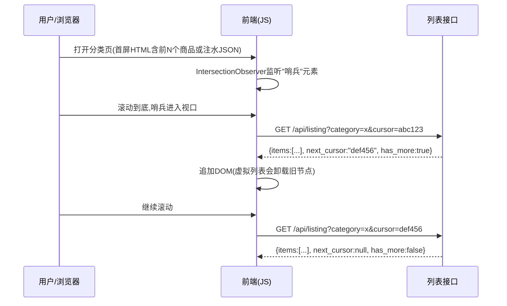
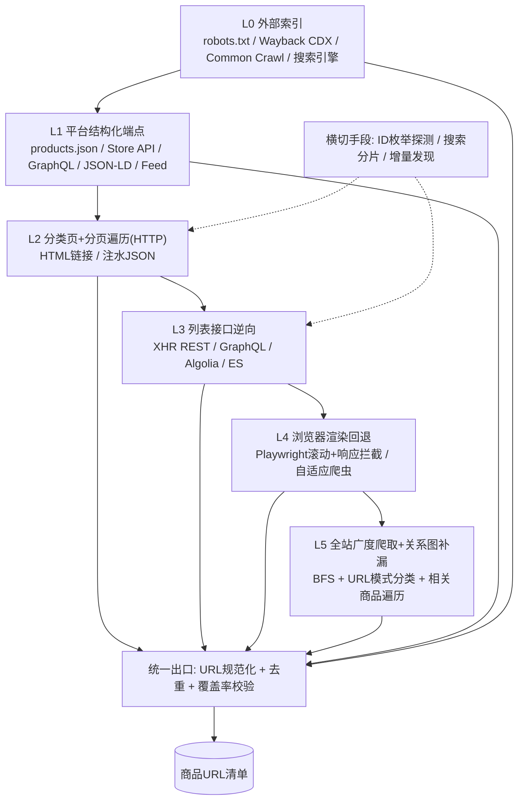
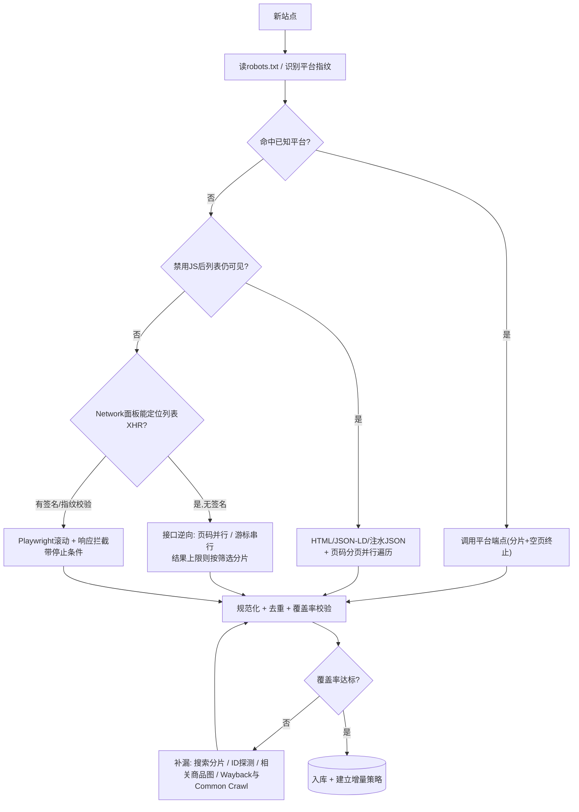

[toc]


---

## 问题定义：链接发现阶段到底在解决什么

电商采集通常分两段：**链接发现/收集（URL Discovery）** 与 **详情页抽取（Extraction）**。前者的产出是一份**尽可能完整、去重、规范化的商品URL（或商品ID）清单**，它决定了后续抽取的**覆盖率上限**。有站点地图时，这一步几乎是"白给"的；没有站点地图时，就必须从网站自身的**设计与实现**中反推出"商品在哪里、如何被列出、如何翻页"。

衡量一个发现方案的四个指标：

| 指标                           | 含义                                  | 典型矛盾                             |
| ------------------------------ | ------------------------------------- | ------------------------------------ |
| **覆盖率（Coverage）**         | 发现的商品数 / 站点真实商品数         | 深度遍历可提高覆盖率，但请求数暴涨   |
| **效率（Efficiency）**         | 每发现一个新URL的平均请求数/耗时/费用 | 浏览器渲染慢且贵，接口直连快但需逆向 |
| **稳定性（Robustness）**       | 页面改版、反爬升级后的存活能力        | 依赖CSS选择器的方案最脆弱            |
| **增量能力（Incrementality）** | 第二次运行能否只发现新品/下架         | 全量遍历简单但浪费                   |

---

## 从网站设计与实现看"链接发现面"

### 渲染架构决定了"链接藏在哪一层"

| 渲染模式                   | 典型技术                                                     | 商品链接所在位置                                       | 对采集的含义                             |
| -------------------------- | ------------------------------------------------------------ | ------------------------------------------------------ | ---------------------------------------- |
| **SSR/传统服务端渲染**     | PHP模板、Django、Magento Luma、Shopify Liquid                | 直接在HTML的`<a href>`里                               | 纯HTTP即可，最便宜                       |
| **SSG/预渲染**             | Next.js静态导出、Nuxt generate                               | HTML里有链接，同时常附带注水JSON                       | 同上，且JSON更结构化                     |
| **CSR/纯前端渲染（SPA）**  | React/Vue直出空壳+XHR                                        | 不在HTML里，在XHR/GraphQL响应里                        | 要么逆向接口，要么渲染                   |
| **混合/注水（Hydration）** | Next.js的`__NEXT_DATA__`、Nuxt的`window.__NUXT__`、`window.__INITIAL_STATE__` | 首屏列表以JSON内嵌在HTML的`<script>`里                 | 纯HTTP即可拿到结构化数据，**性价比极高** |
| **RSC/流式渲染**           | Next.js App Router（React Server Components）                | 链接在HTML中，但数据以`self.__next_f.push`分片形式内嵌 | HTML解析仍可用，JSON解析需拼接分片       |

**最佳实践**：拿到目标站后**第一步必须判定渲染模式**。方法很简单——在DevTools中禁用JavaScript并刷新页面，留下来的内容就是服务端渲染的部分（这正是Scrapfly分页指南推荐的"60秒诊断法"）；再开启JS、打开Network面板过滤Fetch/XHR，观察翻页时发出的请求。

### 商品URL的模式设计

链接发现不只是"找到链接"，还要能**识别哪些是商品链接**并**规范化**。常见模式：

| URL模式         | 示例                                                | 识别与规范化要点                                             |
| --------------- | --------------------------------------------------- | ------------------------------------------------------------ |
| **slug型**      | `/products/merino-wool-base-layer`                  | 用路径前缀识别；注意slug可能变化，应以页面内商品ID为主键     |
| **ID型**        | `/item/123456.html`、`/p/123456`                    | 正则识别；**可枚举**（见后文ID探测）                         |
| **slug+ID混合** | `/dp/B08XXXX`、`/p/merino-base-layer-123456`        | 以ID为主键，slug仅用于展示                                   |
| **带变体参数**  | `/products/abc?variant=4567&color=red`              | 去掉变体参数后归并为同一SPU；是否保留取决于需求是SPU级还是SKU级 |
| **多入口重复**  | `/collections/sale/products/abc` 与 `/products/abc` | 读取`<link rel="canonical">`统一为规范URL                    |

**必须做的事**：建立一条**URL规范化（canonicalization）规则链**——去跟踪参数（`utm_*`、`ref`、`srsltid`）、统一大小写与尾斜杠、按`canonical`标签合并、按商品ID去重。否则同一商品会被重复抽取多次，直接摧毁效率指标。

### 导航结构：商品被"列出"的几种入口

无站点地图时，商品清单一定通过某些**列表入口**暴露给用户，否则用户自己也找不到。常见入口按发现价值排序：

- **分类/集合页（Category / Collection）**：主入口，通常有分页。注意分类树可能有多级、交叉（一个商品属于多个分类）。
- **品牌页、标签页、专题/活动页**：覆盖面与分类重叠，但可用来**补漏**与**交叉验证**。
- **站内搜索**：输入空串、单字母、通配符或常见词可能返回全量结果；搜索结果常由第三方搜索服务驱动（见下文）。
- **"新品"/"热销"/"全部商品"（All Products）页**：若存在"全部"页，就是最省力的入口。
- **商品详情页内的关联推荐（相关商品、搭配购买、同品牌）**：形成一张**商品关系图**，可通过图遍历补充分类页不可达的"孤儿商品"。
- **页脚、面包屑、筛选器（Facet）的链接**：筛选器的每个取值往往就是一个可直接访问的列表URL。

### 分页与"加载下一页"的实现方式（核心）

这是本题的重点。不同实现方式决定了采集手段与效率上限。

| 实现方式                          | 前端表现                                   | 后端/请求特征                                                | 可预测性                   | 采集难度             |
| --------------------------------- | ------------------------------------------ | ------------------------------------------------------------ | -------------------------- | -------------------- |
| **页码/偏移分页（page/offset）**  | 数字页码、上一页/下一页                    | `?page=3` 或 `?offset=60&limit=30`，有时在`rel="next"`中     | 高，可**并行**请求任意页   | 低                   |
| **游标/令牌分页（cursor/token）** | 常伴随无限滚动或"加载更多"                 | 响应里返回`next_cursor`、`endCursor`、`after`，下一次请求必须携带 | 低，必须**串行**跟随       | 中                   |
| **键集分页（keyset / seek）**     | 同上                                       | `?after_id=12345`、`?since=2024-...`，按排序键继续           | 中，若排序键可猜测则可并行 | 中                   |
| **"加载更多"按钮（Load More）**   | 点击按钮追加内容                           | 本质是上述三种之一，由按钮触发XHR                            | 取决于底层分页             | 低到中               |
| **无限滚动（Infinite Scroll）**   | 滚动到底自动加载                           | 由`IntersectionObserver`或scroll事件触发XHR，底层多为游标分页 | 取决于底层分页             | 中                   |
| **虚拟列表（Virtualized List）**  | 无限滚动，但DOM中始终只有几十个节点        | 旧节点被卸载；只看DOM永远拿不全                              | —                          | **高（陷阱）**       |
| **SSR分页链接+JS增强**            | HTML中有完整分页链接，JS接管后变成无限滚动 | 禁用JS后可见页码                                             | 高                         | 低（走HTML分页即可） |

两点需要特别提醒：

- **无限滚动大多由游标分页驱动**，游标值由服务端生成，**无法猜测，只能从上一响应中读取**（Scrapfly的指南把这列为关键要点之一）。
- **虚拟列表陷阱**：webscraping.cc的文章指出，滚动到底后解析DOM，"4000个商品只拿到30个"，就是因为列表被虚拟化；其结论是直接调用XHR数据源不碰DOM，可以完全免疫这个问题，而且在渲染型API上成本约低6倍。

下图是无限滚动（游标分页）的典型机制，理解它才能知道该拦截什么：



采集者的切入点是**第4步的请求格式和第5步的响应结构**：复制URL、方法、请求头（很多接口校验`Referer`，Scrapfly的指南特别提到这一点），循环`page`/`offset`/`cursor`直到响应为空。

### 列表数据来源：谁在后面提供数据

逆向接口时，识别数据服务类型能直接套用已知规律：

| 数据源                                                       | 请求特征                                                     | 已知限制/规律                                                |
| ------------------------------------------------------------ | ------------------------------------------------------------ | ------------------------------------------------------------ |
| **自研REST**                                                 | `/api/products?category=&page=`                              | 无通用规律，看响应中的`total`、`has_more`                    |
| **GraphQL**                                                  | `POST /graphql`，body含`query`或`persistedQuery`的sha256哈希 | 多用Relay风格`edges/pageInfo.endCursor`游标；**持久化查询（persisted queries）**使得无法自定义查询，只能重放哈希 |
| **Algolia**                                                  | 域名`*.algolia.net`/`algolianet.com`，Header含`x-algolia-application-id`与`x-algolia-api-key`（搜索用公开key） | 默认分页上限`paginationLimitedTo=1000`条，需按筛选条件切分   |
| **Elasticsearch/OpenSearch类**                               | 自研API包装，响应含`hits.total`、`aggregations`              | 默认`index.max_result_window=10000`，超出报错，需切分或改用`search_after` |
| **Typesense/Meilisearch**                                    | 类似Algolia，Header带`X-TYPESENSE-API-KEY`等                 | 也有分页上限（通常可配置）                                   |
| **商业搜索SaaS**（Bloomreach、Constructor、Klevu、Searchspring、Coveo） | 各自专用域名                                                 | 多有每次查询条数与总翻页上限                                 |
| **国内常见**                                                 | 阿里云OpenSearch、自研ES、淘系/京东系的签名接口              | 签名与风控严格，通常不走接口逆向而走渲染                     |

**关键规律：结果总数上限（Result Window Cap）**。无论Algolia的1000还是ES的10000，都意味着**单一查询不可能翻到底**。应对策略是**分片（partitioning）**：按分类、品牌、价格区间、颜色等筛选条件把结果集切成每片小于上限的子集，再分别翻页，最后按商品ID合并去重。这是大目录采集的核心技巧。

### 平台指纹：识别建站平台可以直接"抄近路"

很多独立站并非自研，而是基于SaaS或开源平台。平台往往自带**公开的、未在站点地图中声明的结构化端点**。

| 平台                                               | 识别特征                                                     | 可用的产品发现端点                                           | 注意事项                                                     |
| -------------------------------------------------- | ------------------------------------------------------------ | ------------------------------------------------------------ | ------------------------------------------------------------ |
| **Shopify**                                        | `cdn.shopify.com`资源、`Shopify.theme`全局变量、`/collections/`路径 | `/products.json?limit=250&page=N`、`/collections.json`、`/collections/{handle}/products.json`、单品`/products/{handle}.json`或`.js` | 每页最多250；一篇2026年对68家店的实测指出`page × limit`超过25000后返回HTTP 400，且**"短页不代表结束"**（某店各页数量为58、190、163…最后才为0，若按"少于250就停"会丢掉93%）；约四分之一的店会拦截或404 |
| **WooCommerce**                                    | `wp-content/plugins/woocommerce`、`/product/`路径            | `/wp-json/wc/store/v1/products?per_page=100&page=N`（Store API，无需鉴权）、`/wp-json/wp/v2/product` | 每页最多100；站点可能禁用REST                                |
| **Magento 2**                                      | `/static/version…/frontend/`、`mage/`脚本                    | `/graphql`（公开可查`products(filter…)`）、`/rest/V1/products`（通常需token） | GraphQL默认每页上限可配置，常见300                           |
| **BigCommerce**                                    | `cdn11.bigcommerce.com`                                      | Storefront GraphQL `/graphql`（需页面内注入的token）、`/search.php?search_query=` | 游标分页                                                     |
| **Salesforce Commerce Cloud（Demandware）**        | `/on/demandware.store/`、`dwvar_`参数                        | `Search-UpdateGrid?cgid={category}&start=0&sz=60`返回HTML片段 | `start/sz`偏移分页，极易并行                                 |
| **PrestaShop**                                     | `prestashop`标记、`id_product=`                              | `?controller=category&id_category=N&page=M`、`/api/products`（需key） | ID型URL，可枚举                                              |
| **Shopline / Shoplazza / Ueeshop（国内出海建站）** | 各自CDN域名                                                  | 部分提供类Shopify的`/products.json`风格接口（需逐站验证）    | 文档公开度较低                                               |
| **有赞/微盟/小程序电商**                           | 以小程序/H5为主                                              | 需抓包H5接口，常有签名                                       | 通常归入"对抗型"处理                                         |

**推荐做法**：维护一个**平台指纹库**（正则匹配HTML/响应头/脚本URL），命中平台后优先尝试其结构化端点，失败再回退到通用策略。

---

## 采集方案：分层的链接发现策略

把发现手段按"成本从低到高、通用性从高到低"排成一条**策略链（Strategy Chain）**，逐层尝试、相互补漏。



### L0 外部索引法：不碰目标站就拿到大量URL

适合**冷启动**与**对抗性强的站点**（请求目标站本身代价高）。

- **`robots.txt`**：必读。它可能声明了未公开的`Sitemap:`、而`Disallow:`条目恰恰暴露了列表接口路径（例如`Disallow: /api/search`）。同时它也是**合规边界**的依据。
- **Wayback Machine CDX API**：可列出互联网档案馆见过的该域名全部URL。基本形式为`https://web.archive.org/cdx/search/cdx?url=example.com&matchType=domain&fl=original&collapse=urlkey&output=json`，可加`filter=statuscode:200`。CDX服务器README说明`url`是唯一必需参数，域级大查询可考虑并行并先估算规模。Wayback可用来发现"已删除或当前离线的页面"，这对于补历史商品很有用。
- **Common Crawl索引**：`https://index.commoncrawl.org/CC-MAIN-<year>-<week>-index?url=*.example.com&output=json`，按域查询返回它抓到的所有路径，经常包含自己的爬虫到不了的深层页面。
- **搜索引擎`site:`操作符**：`site:example.com inurl:/products/`，仅作抽样估计规模，不可作为完整来源（且会触发搜索引擎自身的反爬）。
- **聚合工具**：安全圈的`gau`、`waymore`、`waybackurls`把上述来源打包，一条命令导出URL；用于采集同样有效。

**边界**：外部索引是**历史快照**，含大量失效/重复URL，必须经规范化与存活校验；它适合"种子+补漏"，不适合作为唯一来源。

国内测试环境访问`web.archive.org`、`index.commoncrawl.org`与GitHub通常需要代理；Windows下在PowerShell中设置`$env:HTTPS_PROXY="http://127.0.0.1:7890"`，`*nix`下`export HTTPS_PROXY=http://127.0.0.1:7890`，Python的`httpx`/`requests`会自动读取（注意`httpx`需`trust_env=True`，默认即是）。

### L1 平台结构化端点与页面结构化数据

- **平台端点**：如上表，命中Shopify直接走`/products.json`。为绕过25000上限和"短页"问题，**正确的终止条件是"连续返回空页"而不是"本页不足limit"**，并且用`/collections.json`拿到集合列表后，**按集合分片**请求`/collections/{handle}/products.json`，再按商品`id`合并。
- **JSON-LD / 微数据**：列表页常内嵌`<script type="application/ld+json">`，其中`ItemList`的`itemListElement[].url`直接就是商品URL；详情页的`Product`含`sku`、`offers`。这是**最稳定**的解析目标，因为它服务于Google，改版概率远低于CSS类名。
- **Feed**：`/feed`、`/rss`、`/products.rss`、Google Merchant/Facebook Catalog的XML feed（有时路径可在页面源码或robots中找到）。
- **注水JSON**：`__NEXT_DATA__`等，用`json.loads`而不是CSS选择器，更稳。

### L2 分类页+分页遍历（HTTP-only）

最经典、最通用的方案。流程是：从首页/导航抓分类树 → 对每个叶子分类按页遍历 → 抽取商品链接。Scrapfly的目录采集文章把它概括为"**翻到穷尽**"：递增page直到没有新商品，并按商品ID去重以防重叠。

**推荐实践**：

- 优先从`rel="next"`、页码控件或注水JSON中的`totalPages`/`total`推算总页数，然后**并行**请求各页（页码分页的最大优势）。
- 分类**可能交叉**，应以叶子分类为遍历单位，用全局去重集合合并。
- 对于每页抽取的链接数做**监控**：如果某一页突然为0但不是最后一页，应判定为被拦截/改版而非自然终止。
- 把`?limit=`、`?per_page=`、`?sz=`调到服务端允许的最大值，常能减少数倍请求数（许多站点允许远大于前端默认的值）。

### L3 列表接口逆向（效率最高的通用方案）

当页面是CSR或列表数据来自XHR时，**优先逆向接口而不是渲染**。Scrapfly和webscraping.cc两篇资料结论一致：直接调用端点跳过渲染，更快、更便宜、更不易碎；后者给出的参考数字是1万条商品走XHR单线程约90秒、并发10约15秒。

操作要点：

- **定位请求**：Network面板过滤Fetch/XHR，触发翻页，找响应中含商品数组的请求；用"Copy as cURL"保留完整头。
- **识别分页类型**：响应有`next_cursor/endCursor/after`→串行跟随；有`total/page`→并行。
- **最小化请求头**：逐个删头验证哪些是必需的（常见必需：`Referer`、`Accept`、`x-requested-with`、平台API key）。
- **GraphQL**：若是持久化查询，直接重放`extensions.persistedQuery.sha256Hash`与`variables`，只改`after`/`page`变量；若允许自由查询，可**只请求`id`与`handle`字段**，让响应体缩小一个数量级。
- **突破结果上限**：按筛选条件分片。在Algolia中可用`facetFilters`或`numericFilters`（如价格区间）切分；在ES包装接口中按分类/品牌切分；分片大小控制在上限的80%以内，并用`nbHits`/`total`验证每片是否完整。
- **失效情形**：端点带签名（HMAC/时间戳）、TLS指纹校验、Cloudflare Turnstile等，此时转L4。

### L4 浏览器渲染回退（Playwright等）

**只作为回退**，并且要带**停止条件与守卫**（最大滚动次数、连续N次无新增则停止、超时）。两种用法：

- **滚动驱动+DOM抽取**：简单但受虚拟列表影响，不推荐作为主路径。
- **滚动驱动+响应拦截**（推荐）：用`page.on("response")`监听列表接口的JSON响应，让浏览器负责签名与反爬，**数据仍从JSON取**。这样既免疫虚拟列表，又能拿到完整字段，还能顺便学习到请求格式用于日后降级到L3。

框架层面，Crawlee（JS与Python版）提供`AdaptivePlaywrightCrawler`：它组合了Playwright爬虫与HTTP爬虫（如Parsel/BeautifulSoup），检测到纯HTTP能带来性能收益时自动切换，`enqueueLinks`可按选择器（例如`.pagination a`）把分页链接入队。这适合**站点形态混杂、不想逐站手工判定**的场景。

### L5 全站广度爬取与关系图补漏

当分类结构不清晰或存在"孤儿商品"时，用**BFS全站爬取+URL模式分类器**：对每个发现的URL判定是"列表页/商品页/其他"，列表页继续展开，商品页入清单。再对已发现商品页抽取"相关商品"链接做**图遍历**，直到不再出现新商品。效率最低，但覆盖率最高，适合作为**周期性校准**（比如每月一次）而非日常手段。

### 横切手段

- **ID枚举探测**：商品ID为连续整数时，可直接探测`/p/{id}`，用HEAD或轻量GET判断存在（注意软404）。对历史下架商品尤其有效。应配合二分法估计ID上界，并限速。
- **搜索分片**：用站内搜索以单字母、数字、常见词或空查询穷举，与分类遍历交叉补漏。
- **增量发现**：第二次运行只遍历"按上新时间排序"的列表前几页（`sort=newest`），直到遇到已知商品为止；配合L0可发现下架。
- **覆盖率校验**：分类页展示的商品计数、搜索接口的`total`、Shopify的`collections.json`中`products_count`，都可作为"真值"来检查发现是否完整。

---

## 按需求等级选择策略层次

不同需求对覆盖率、时效、成本的要求差异很大，没有必要一律用最重的方案。

| 需求等级                  | 典型场景                         | 推荐策略组合                                                 | 效率/成本特征                                          | 避免                               |
| ------------------------- | -------------------------------- | ------------------------------------------------------------ | ------------------------------------------------------ | ---------------------------------- |
| **一级：一次性小规模**    | 竞品调研，抓几百到几千个商品     | L1平台端点 → L2分类分页；不行再L4"滚动+拦截"                 | 单机脚本，分钟级完成                                   | 搭建分布式框架；过度逆向           |
| **二级：周期性中等规模**  | 每日价格监测，数万商品，数个站点 | L1/L2为主 + L3接口逆向；增量发现；覆盖率校验                 | 请求数应接近商品数的1/N（N为每页条数）                 | 每次全量渲染；只看DOM              |
| **三级：大规模全量+增量** | 数十到数百站点，百万级URL        | 平台指纹库自动选路；L3分片突破上限；L0做冷启动与校准；L5月度校准；URL前沿与去重集中化（Redis/Bloom） | 以"每新URL的请求数"为核心KPI；分页可并行的站点优先并行 | 把渲染当默认路径；无规范化导致重复 |
| **四级：对抗型站点**      | 强风控大平台、签名接口、指纹校验 | L0外部索引降低对目标站的请求；L4真实浏览器+代理池+响应拦截；低频增量 | 成本最高，追求"够用"的覆盖率                           | 高并发硬撞；忽视合规风险           |

**效率总结**：在可行的前提下，效率排序通常为 **平台端点/结构化JSON > 页码分页接口（可并行） > 游标分页接口（串行） > HTML分类分页 > 浏览器渲染+拦截 > 浏览器渲染+DOM > 全站BFS**。决策时**先用最便宜的层级把覆盖率推到90%以上，再用较贵的层级补最后10%**，而不是反过来。

下面是单站首次接入时的决策流程：



---

## 综合示例：一个无站点地图的海外户外用品独立站

**场景设定**（贴近真实但为虚构）：`example-outdoor.com`，Next.js构建，无`sitemap.xml`，`robots.txt`仅有`Disallow: /api/`与`Disallow: /cart`。分类页首屏SSR渲染24个商品，向下滚动自动加载；Network面板显示请求发往`https://XXXX-dsn.algolia.net/1/indexes/*/queries`，Header含`x-algolia-api-key`（Search-Only Key）。商品URL形如`/products/{slug}`，详情页JSON-LD含`sku`。该分类约有4,800个商品，而Algolia默认最多翻到1,000条。

**分析过程**：

- `robots.txt`的`Disallow: /api/`暗示有自研接口，但真正的列表数据来自Algolia（第三方），且robots并未禁止商品页与分类页，合规上可以抓取列表与商品页。
- 禁用JS后能看到24个商品与页码链接（`?page=2`），说明L2可行，但每页24条、4800条需200个请求，并且页码分页在Algolia后端同样受1000条上限影响（第42页之后会空）。
- 走L3：Algolia接口支持`hitsPerPage=1000`，但`page * hitsPerPage`仍受`paginationLimitedTo`限制，所以按**价格区间分片**：先请求一次拿`facets`里的价格分布，把区间切成每段小于800条，再逐段翻页，最后按`objectID`合并。整站只需十几个请求。
- 用`__NEXT_DATA__`中的`totalHits`以及分类页展示的"4,800 items"做覆盖率校验；用Wayback CDX拉取历史`/products/*`列表，找出已下架但仍可访问的商品，作为补充。

**代码骨架**（Python 3.11+，依赖`httpx`、`parsel`；展示策略链思路，实际使用时按站点调整正则与端点）：

```python
#!/usr/bin/env python3
"""
discover.py - 无站点地图的电商商品URL发现（策略链示例）
用法:
  python discover.py --base https://example-outdoor.com --out urls.txt
  python discover.py --base https://shop.example.com --strategy shopify
环境变量 HTTPS_PROXY 可用于国内测试环境走代理。
"""
import argparse, json, re, sys, time
from urllib.parse import urljoin, urlsplit, urlunsplit, parse_qsl, urlencode
import httpx
from parsel import Selector

TRACKING = {"utm_source", "utm_medium", "utm_campaign", "ref", "srsltid", "gclid"}
PRODUCT_RE = re.compile(r"^/products/[^/?#]+$")  # 按站点修改


def canonical(url: str) -> str:
    """URL规范化: 去跟踪参数、去片段、统一尾斜杠"""
    s = urlsplit(url)
    q = [(k, v) for k, v in parse_qsl(s.query) if k not in TRACKING]
    path = s.path.rstrip("/") or "/"
    return urlunsplit((s.scheme, s.netloc.lower(), path, urlencode(q), ""))


class Discoverer:
    def __init__(self, base: str, delay: float = 0.5):
        self.base = base.rstrip("/")
        self.client = httpx.Client(
            headers={"User-Agent": "Mozilla/5.0 (research crawler; contact@example.com)"},
            timeout=20, follow_redirects=True,
        )
        self.delay = delay
        self.found: set[str] = set()

    def get(self, url: str, **kw) -> httpx.Response:
        time.sleep(self.delay)
        return self.client.get(url, **kw)

    # ---- L1: Shopify 平台端点, 按集合分片 + 空页终止 ----
    def shopify(self) -> bool:
        r = self.get(f"{self.base}/collections.json?limit=250")
        if r.status_code != 200 or "collections" not in r.text[:200]:
            return False
        handles = [c["handle"] for c in r.json()["collections"]] or ["all"]
        for h in handles:
            page, empty_streak = 1, 0
            while empty_streak < 2 and page * 250 <= 25000:  # 25000为已知硬上限
                r = self.get(f"{self.base}/collections/{h}/products.json?limit=250&page={page}")
                items = r.json().get("products", []) if r.status_code == 200 else []
                empty_streak = empty_streak + 1 if not items else 0  # 短页不代表结束
                for p in items:
                    self.found.add(f"{self.base}/products/{p['handle']}")
                page += 1
        return True

    # ---- L2: 分类页 + 页码分页, 同时利用 JSON-LD 与注水 JSON ----
    def category_pages(self, category_url: str, max_pages: int = 500) -> None:
        for page in range(1, max_pages + 1):
            r = self.get(category_url, params={"page": page})
            if r.status_code != 200:
                break
            before = len(self.found)
            self._extract_links(r.text, category_url)
            if len(self.found) == before:  # 本页无新链接 -> 终止
                break

    def _extract_links(self, html: str, page_url: str) -> None:
        sel = Selector(html)
        # 1) JSON-LD ItemList (最稳定)
        for blob in sel.css('script[type="application/ld+json"]::text').getall():
            try:
                data = json.loads(blob)
            except json.JSONDecodeError:
                continue
            for node in (data if isinstance(data, list) else [data]):
                for el in node.get("itemListElement", []) if isinstance(node, dict) else []:
                    u = el.get("url") or (el.get("item") or {}).get("url")
                    if u:
                        self.found.add(canonical(urljoin(page_url, u)))
        # 2) Next.js 注水 JSON
        nd = sel.css("script#__NEXT_DATA__::text").get()
        if nd:
            for m in re.finditer(r'"(?:url|href|handle)":"(/products/[^"]+)"', nd):
                self.found.add(canonical(urljoin(page_url, m.group(1))))
        # 3) 普通 <a href>
        for href in sel.css("a::attr(href)").getall():
            u = urljoin(page_url, href)
            if urlsplit(u).netloc == urlsplit(self.base).netloc and PRODUCT_RE.match(urlsplit(u).path):
                self.found.add(canonical(u))

    # ---- L3: Algolia 接口, 按价格区间分片突破 1000 条上限 ----
    def algolia(self, app_id: str, api_key: str, index: str, price_edges: list[int]) -> None:
        url = f"https://{app_id}-dsn.algolia.net/1/indexes/{index}/query"
        headers = {"x-algolia-application-id": app_id, "x-algolia-api-key": api_key}
        for lo, hi in zip(price_edges, price_edges[1:]):
            page = 0
            while True:
                body = {"hitsPerPage": 1000, "page": page,
                        "numericFilters": [f"price>={lo}", f"price<{hi}"],
                        "attributesToRetrieve": ["objectID", "handle"]}
                r = self.client.post(url, headers=headers, json=body)
                data = r.json()
                for h in data.get("hits", []):
                    self.found.add(f"{self.base}/products/{h['handle']}")
                if data.get("nbHits", 0) > 1000:
                    print(f"[warn] 分片 {lo}-{hi} 超过上限, 需再细分", file=sys.stderr)
                if page + 1 >= data.get("nbPages", 0):
                    break
                page += 1


def main() -> None:
    ap = argparse.ArgumentParser(description=__doc__, formatter_class=argparse.RawDescriptionHelpFormatter)
    ap.add_argument("--base", required=True, help="站点根URL, 如 https://example.com")
    ap.add_argument("--strategy", choices=["auto", "shopify", "category"], default="auto")
    ap.add_argument("--category", action="append", default=[], help="分类页URL, 可重复")
    ap.add_argument("--delay", type=float, default=0.5, help="请求间隔秒数")
    ap.add_argument("--out", default="urls.txt")
    args = ap.parse_args()

    d = Discoverer(args.base, args.delay)
    if args.strategy in ("auto", "shopify") and d.shopify():
        print("[info] Shopify端点命中", file=sys.stderr)
    elif args.strategy in ("auto", "category"):
        for c in args.category:
            d.category_pages(c)
    with open(args.out, "w", encoding="utf-8", newline="\n") as f:  # 固定UTF-8与LF, 跨平台一致
        f.write("\n".join(sorted(d.found)) + "\n")
    print(f"[done] 发现 {len(d.found)} 个商品URL -> {args.out}", file=sys.stderr)


if __name__ == "__main__":
    main()
```

脚本中关键占位符与参数说明：

| 名称                           | 含义                                                    | 备注                                       |
| ------------------------------ | ------------------------------------------------------- | ------------------------------------------ |
| `--base`                       | 站点根URL（协议+域名）                                  | 用于拼接相对链接与域名过滤                 |
| `--strategy`                   | 发现策略：`auto`先试Shopify端点再回退分类分页           | 真实项目应扩展为平台指纹自动判定           |
| `--category`                   | 分类页URL列表                                           | 可从导航栏自动抓取替代手工指定             |
| `--delay`                      | 请求间隔（秒）                                          | 礼貌限速，必须保留                         |
| `PRODUCT_RE`                   | 商品URL路径正则                                         | 按目标站模式修改，是识别商品链接的核心规则 |
| `TRACKING`                     | 需剔除的跟踪参数集合                                    | 规范化去重的一部分                         |
| `price_edges`                  | Algolia分片的价格边界，如`[0,20,50,100,200,500,100000]` | 每片`nbHits`必须小于`paginationLimitedTo`  |
| `app_id` / `api_key` / `index` | Algolia应用ID、Search-Only Key、索引名                  | 均可从Network面板请求头与URL中读出         |

**L4回退片段**（Playwright，滚动+响应拦截，带停止条件）：

```python
import asyncio, json
from playwright.async_api import async_playwright

async def scroll_and_capture(url: str, api_hint: str = "/api/listing", max_idle: int = 3):
    items, idle = [], 0
    async with async_playwright() as p:
        browser = await p.chromium.launch(headless=True)
        page = await browser.new_page()

        async def on_response(resp):
            if api_hint in resp.url and resp.status == 200:
                try:
                    data = await resp.json()
                    items.extend(data.get("items", []))
                except Exception:
                    pass
        page.on("response", on_response)

        await page.goto(url, wait_until="domcontentloaded")
        while idle < max_idle:                      # 连续max_idle次无新增则停止
            before = len(items)
            await page.mouse.wheel(0, 4000)
            await page.wait_for_timeout(1200)
            idle = idle + 1 if len(items) == before else 0
        await browser.close()
    return items
```

---

## 工程化要点与效率实践

- **必须**：URL规范化与以商品ID为键的去重；礼貌限速与并发上限；记录每个URL的来源策略（便于复盘覆盖率）；断点续爬（把前沿队列持久化到SQLite/Redis）。
- **应该**：把"每新URL的请求数"作为核心效率KPI；对页码分页做并行、对游标分页做多分片并行（不同分类/筛选条件各自串行）；先小规模验证终止条件再放量。
- **可以**：使用Crawlee的自适应爬虫自动在HTTP与浏览器间切换；用Bloom过滤器处理千万级去重；用Wayback/Common Crawl做月度校准。
- **避免**：以"本页少于limit"作为终止条件（Shopify实测证明会大面积漏抓）；只从DOM读无限滚动结果（虚拟列表陷阱）；把浏览器渲染作为默认路径；忽略`canonical`导致多入口重复。

**跨平台与字符问题**：Windows上Python默认控制台编码可能不是UTF-8，输出含中文商品名时应设置`PYTHONUTF8=1`或在写文件时显式`encoding="utf-8"`；用Excel打开CSV需`utf-8-sig`（带BOM）；URL清单文件统一用`LF`换行，并在Git中配置`.gitattributes`（`*.txt text eol=lf`）以免跨系统不一致。生产在海外服务器时不需代理，但国内测试需要，建议通过环境变量而非硬编码切换。

**合规提醒**：遵守`robots.txt`与站点服务条款，控制频率避免影响目标站可用性，不采集个人数据；平台公开端点（如`/products.json`）虽无鉴权，仍应视为"目标站资源"而非"公共数据集"，按同样的礼貌规则对待。

---

