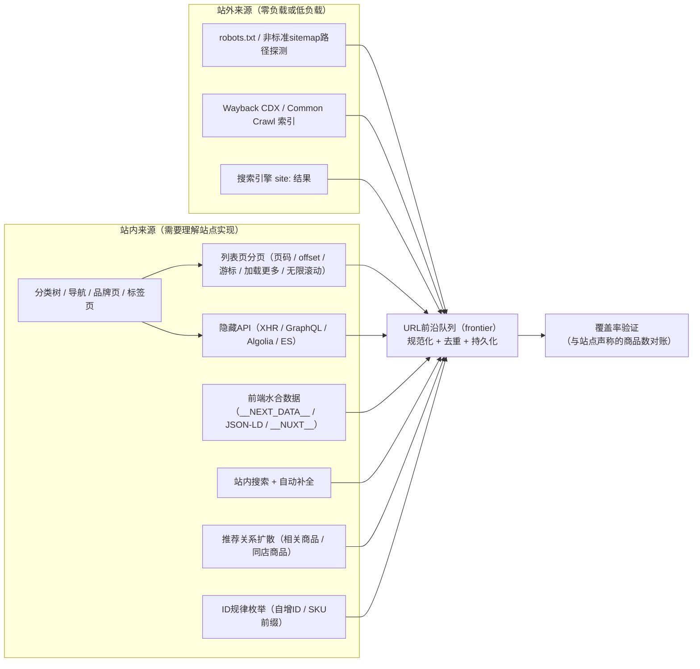
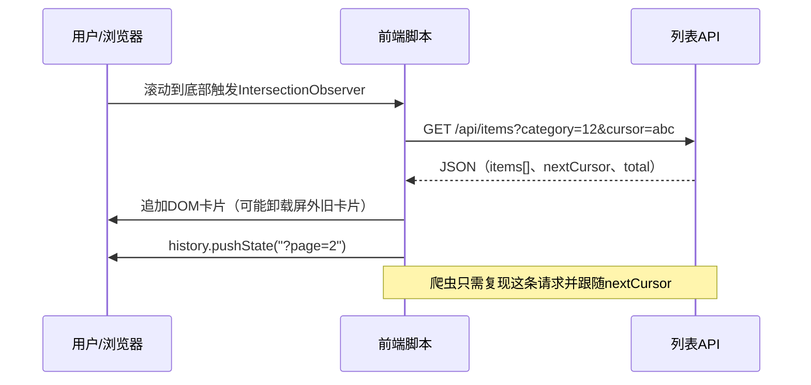
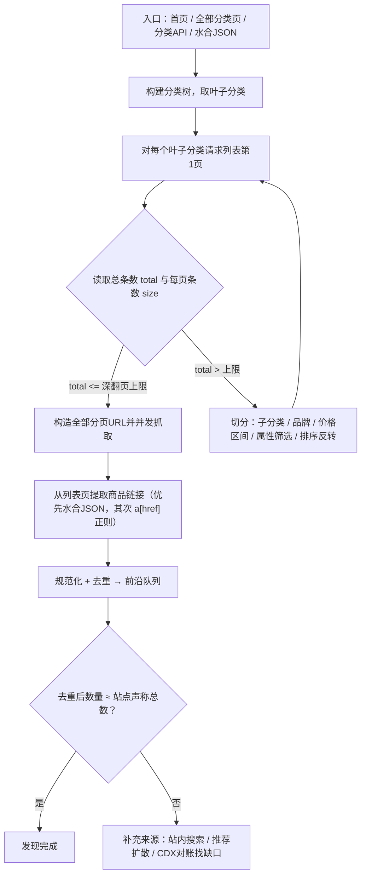
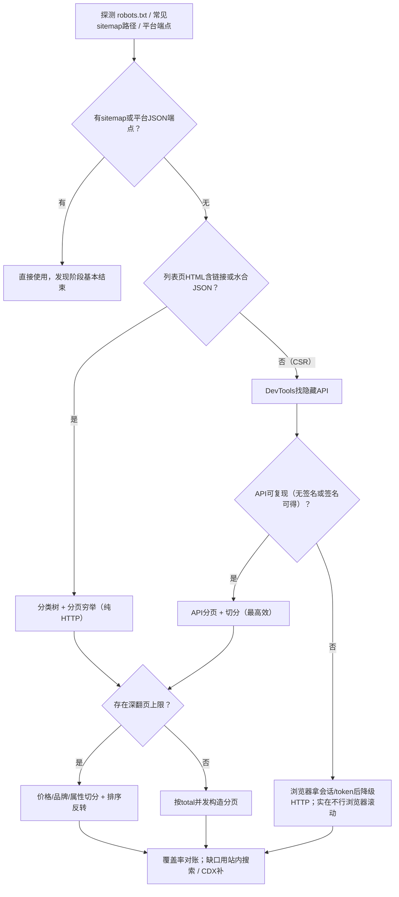

[toc]


## 问题定义：链接发现阶段到底在解决什么

电商采集通常拆成两个阶段：**链接发现（URL discovery / 种子收集）**和**详情抓取（item extraction）**。前者的目标是在合理成本内，得到一份**尽可能完整、去重、可增量维护的商品URL（或商品ID）清单**；后者才是逐条拉取价格、库存、属性。本文只讨论前者。

"没有站点地图"在工程上要先**证伪**，再谈替代方案。很多站点只是没有在`robots.txt`里声明，或者站点地图藏在非标准路径。一个被检索资料反复印证的事实是：**一旦有了sitemap或平台级JSON端点，链接发现的成本可以下降一到两个数量级**，所以探测环节值得花10分钟。

无站点地图时，产品链接真正的"来源面"（discovery surfaces）其实都来自网站自身的设计：**分类导航、列表分页、站内搜索、推荐关系、ID规律、前端水合数据、隐藏API**，以及站外的**历史存档与搜索引擎索引**。下图概括了这些来源与它们之间的关系：



图中的关键思想是：**所有来源汇入同一个URL前沿队列**，由统一的规范化与去重逻辑处理，并最终以"覆盖率对账"来判断发现阶段是否完成，而不是凭感觉"差不多了"。

---

## 从网站设计与实现看链接发现面

### 信息架构：分类树是最稳定的骨架

电商站的信息架构（IA）几乎总是"**分类树 + 列表页 + 详情页**"三层。Scrapfly的文章在讨论无站点地图时，推荐的首选方案正是**分类枚举（category enumeration）**：从导航读出所有分类，再递归进入每个分类收集商品链接。工程上要注意几个设计细节：

- **叶子分类 vs 非叶子分类**：很多站的父分类列表页只是子分类聚合，或只显示"精选"，必须**遍历到叶子分类**才能穷尽。
- **多入口重复**：同一商品常挂在多个分类、品牌页、标签页、专题页下。这是好事（提高召回）也是负担（必须去重）。
- **隐藏分类**：导航只露出热门分类，完整分类树往往在"全部分类"页、页脚、`__NEXT_DATA__`等水合数据或一个`/api/categories`接口里。
- **面包屑与`BreadcrumbList`结构化数据**：从任意详情页反推其分类ID，可用于补齐分类树。

### 渲染方式决定"链接长在哪里"

| 渲染方式                           | 产品链接的位置                                               | 采集含义                                                     |
| ---------------------------------- | ------------------------------------------------------------ | ------------------------------------------------------------ |
| **SSR/SSG（服务端渲染/静态生成）** | 直接在HTML的`<a href>`中                                     | 纯HTTP即可，成本最低                                         |
| **SSR + 水合（hydration）**        | HTML中同时存在`<script id="__NEXT_DATA__">`、`window.__NUXT__`、`__INITIAL_STATE__`、Apollo缓存等JSON | **优先解析JSON而不是DOM**，字段更稳定、信息更全（常含分类树与总数） |
| **CSR（客户端渲染）**              | HTML近乎空壳，数据来自XHR/Fetch                              | 找到**隐藏API**直接调用；找不到才用浏览器渲染                |
| **流式RSC（Next.js App Router）**  | 数据分片在`self.__next_f.push(...)`中                        | 需要拼接解析，或改走API；trickster.dev的文章专门讨论了这类站点 |

Bright Data的文章指出Next.js站点无法移除`__NEXT_DATA__`，因为React水合依赖它，这意味着对Pages Router站点而言它是一个**可靠的数据源**。另外，Next.js Pages Router通常还暴露`/_next/data/{buildId}/{path}.json`，可用于直接以JSON形式请求列表页；SvelteKit有`__data.json`，Remix有`?_data=`参数，思路相同。

### 分页与"下一页"的实现方式：这是发现阶段的核心变量

分页实现方式直接决定你能否"穷举"一个列表。下表按实现机制整理，并给出识别方式与处理思路：

| 实现方式            | 典型特征                                                     | 如何识别                              | 采集处理                                                    | 常见坑                                                       |
| ------------------- | ------------------------------------------------------------ | ------------------------------------- | ----------------------------------------------------------- | ------------------------------------------------------------ |
| **页码URL**         | `?page=3`、`/page/3/`、`?p=3`                                | 地址栏随翻页变化；页面有页码条        | 读总页数/总条数直接构造URL列表，或跟随`rel="next"`/"下一页" | 页码超上限时可能**静默返回最后一页或第一页**而非404          |
| **offset/limit**    | `?start=96&size=48`、`?offset=`                              | 参数是条数偏移而非页码                | 自行步进；步长用服务端允许的最大值                          | 排序不稳定时跨页**重复/漏项**                                |
| **游标（cursor）**  | `?after=eyJ...`、`cursor=`、`next_token`                     | 响应里带`endCursor`/`hasNextPage`     | 必须串行跟随游标，无法并行跳页                              | 游标有时效；不能从中间续爬，需保存游标                       |
| **"加载更多"按钮**  | 点击后DOM追加，URL不变                                       | DevTools网络面板出现XHR/Fetch         | 复现该XHR请求（通常是上面三类之一）                         | 请求带签名/CSRF token时需从页面取                            |
| **无限滚动**        | 滚动到底部自动追加                                           | `IntersectionObserver`触发XHR         | 优先复现XHR；否则浏览器自动滚动                             | 虚拟列表会**卸载屏外DOM**，滚到底后DOM里并不保留所有商品     |
| **pushState伪分页** | 滚动时URL变为`?page=N`但无整页刷新                           | History API更新URL                    | 直接请求对应URL通常能得到服务端渲染的该页                   | 有些站该URL只在客户端有意义                                  |
| **hash分页**        | `#page=3`                                                    | `#`后内容不发送到服务端               | 必须找XHR                                                   | 纯HTTP抓到的永远是第一页                                     |
| **POST表单翻页**    | ASP.NET WebForms的`__VIEWSTATE`/`__EVENTTARGET`              | 翻页是POST，响应是整页HTML            | 维护会话，回传ViewState                                     | 大量传统B2B站如此；并发不友好                                |
| **GraphQL**         | 单一`/graphql`端点，`first/after`参数                        | 请求体含`query`或`persistedQuery`哈希 | 复现查询；Relay风格的游标分页                               | 持久化查询哈希绑定前端版本，前端发版即失效                   |
| **托管搜索服务**    | Algolia（`*-dsn.algolia.net`）、Elasticsearch代理、Typesense | 请求头含`x-algolia-application-id`    | 直接调用，单页可拉几百到上千条                              | **有深翻页上限**（Algolia默认总命中上限约1000，ES默认`from+size`上限10000） |

无限滚动的机制可以用下面的时序图表达，理解了它就明白为什么"找XHR"几乎总优于"模拟滚动"：



### 深翻页限制：电商站的普遍设计

绝大多数电商站**不允许无限翻页**，原因是数据库深分页代价高与反爬。经验上：淘宝搜索结果最多约100页、京东搜索约100页、Amazon搜索通常只给到几页（这些都是经验数值，会变化）；Algolia默认`paginationLimitedTo`为1000条；Elasticsearch默认`index.max_result_window`为10000。这意味着**单个列表最多只能看到前N条**，而大分类商品数远超N。这是无站点地图场景下发现阶段最大的工程难点，其标准解法是**切分（partitioning）**，后文详述。

### 商品URL模式与标识

发现阶段最终要落到"**什么是一个商品的规范标识**"。常见模式：`/product/{slug}-{id}`、`/dp/{ASIN}`、`/item/{id}.html`、`/p/{sku}`。设计上要辨析：

- **SPU vs SKU**：一个商品页（SPU）可能对应多个变体（SKU，颜色/尺码），URL可能带`?variant=`或`?sku=`。发现阶段通常**以SPU为单位去重**，变体留给详情阶段。
- **canonical**：列表页里的链接常带追踪参数或分类上下文（`?ref=cat_12`），应以页面`<link rel="canonical">`或自定义规范化规则统一。
- **ID可枚举性**：自增整数ID意味着可以枚举；随机slug/哈希则不行。

---

## 采集方案：按成本从低到高的发现策略

下面按"投入成本/对站点负载"从低到高组织，实践中应**自上而下依次尝试，能停则停**。

### 零成本探测：先证伪"没有站点地图"

**必须**先做以下探测（可以写成脚本，对多站点批量跑）：

- 读取`/robots.txt`，查找`Sitemap:`行（可能有多条、可能指向sitemap index）。
- 试探常见路径：`/sitemap.xml`、`/sitemap_index.xml`、`/sitemap/sitemap.xml`、`/sitemap-products.xml`、`/product-sitemap.xml`、`/sitemaps/`、`/sitemap.xml.gz`。
- 识别**建站平台**并直接用平台端点。多篇检索到的文章说明：Shopify店铺（含自定义域名）通常存在`/products.json?limit=250&page=N`，每页上限250条，也可按集合用`/collections/{handle}/products.json`，部分商家会禁用该端点；Apify的Shopify采集器文档还提到其按约2请求/秒限速，并称店铺单次最多翻约200页。其他平台的类似端点：WooCommerce的公开Store API `/wp-json/wc/store/v1/products?per_page=100&page=N`；Magento 2的公开`/graphql`可按分类分页查询`products`；Shopify集合还提供`/collections/all.atom`这类Feed。国内SaaS建站（有赞、微盟、Shopline、Shoplazza等）各有接口，但通常带签名，属于隐藏API范畴。
- 检查HTML中的结构化数据：列表页的`ItemList`、详情页的`Product`与`BreadcrumbList`（JSON-LD）。Scrapfly的文章建议**优先用隐藏JSON或JSON-LD而非CSS选择器**，因为后者随布局改版就会失效。
- 检查RSS/Atom、`<link rel="next">`、`<link rel="alternate">`等提示。

### 站外来源：历史存档与搜索引擎索引

这一类对目标站**零负载**，特别适合冷启动与覆盖率对账：

- **Wayback Machine CDX API**：`https://web.archive.org/cdx/search/cdx?url=example.com&matchType=domain&fl=original&collapse=urlkey&filter=statuscode:200&output=text`。cloro.dev的文章解释了这几个参数的作用：`matchType=domain`包含所有子域，`collapse=urlkey`按URL去重，`fl=original`只输出URL列。配合`filter=original:.*/product/.*`这样的正则可只取商品URL。衍生工具`waybackurls`、`gau`（getallurls，聚合Wayback、Common Crawl、OTX、URLScan）用起来更快。
- **Common Crawl索引**：`https://index.commoncrawl.org/CC-MAIN-2025-XX-index?url=example.com/*&output=json`，或用`cdx-index-client`并行拉取；DuckDB社区扩展`web_archive`甚至允许用SQL直接查询两个索引。
- **搜索引擎`site:`**：`site:example.com inurl:/product/`。人工探查可用，自动化需走SERP API，且结果上限低、成本高，只适合估算规模。

**国内网络注意**：Wayback与Common Crawl在国内直连常不稳定，**需要代理**。`*nix`下对`curl`/Python设置`export HTTPS_PROXY=http://127.0.0.1:7890`即可；Windows PowerShell下为`$env:HTTPS_PROXY="http://127.0.0.1:7890"`（注意PowerShell中`$env:`是变量语法，不要在Markdown中裸写）。Common Crawl数据文件也可通过`https://data.commoncrawl.org/`以HTTPS方式访问，无需AWS凭证。

这些来源的缺点很明确：**不新鲜、不完整、含已下架商品**。它们的最佳用途是(1)冷启动种子；(2)学习URL模式；(3)覆盖率对账的参照系。

### 分类树遍历 + 分页穷举（主力方案）

这是无站点地图时的**默认主力方案**，流程如下：



几个关键的工程要点：

**总数优先于"下一页"**。Scrapfly的文章强调"**翻页到穷尽**"与"**始终验证数量**"两条原则。中文社区的分页总结（CSDN、简书）也把"已知总条数与页大小则直接计算总页数并构造URL"列为首选，其次才是"跟随下一页直到没有下一页"。前者可以**全并发**，后者只能串行。

**切分（partitioning）应对深翻页上限**。核心思想是：把一个超过上限的查询空间，用某个**可排序、可区间筛选的维度**切成多个子查询，直到每个子查询的结果数低于上限。价格是最通用的维度，因为几乎每个电商列表都支持`price_min/price_max`筛选。算法是递归二分：

```python
import httpx

LIMIT = 1000          # 该站点单个列表可见的最大条数（实测得到）
PAGE_SIZE = 100       # 服务端允许的最大每页条数

def count(cat_id: int, lo: int, hi: int) -> int:
    """请求第1页，只为读取 total。lo/hi 为价格区间（分），闭区间。"""
    r = httpx.get("https://shop.example/api/list",
                  params={"cat": cat_id, "price_min": lo, "price_max": hi,
                          "page": 1, "size": 1}, timeout=15)
    r.raise_for_status()
    return r.json()["total"]

def split(cat_id: int, lo: int, hi: int, out: list) -> None:
    """递归切分价格区间，直到每段 total <= LIMIT；结果写入 out。"""
    n = count(cat_id, lo, hi)
    if n == 0:
        return
    if n <= LIMIT or lo == hi:
        # lo == hi 时无法再切：同价商品超过上限，需换维度（品牌/属性）再切
        out.append((cat_id, lo, hi, n))
        return
    mid = (lo + hi) // 2
    split(cat_id, lo, mid, out)
    split(cat_id, mid + 1, hi, out)

segments: list = []
split(cat_id=12, lo=0, hi=10_000_000, segments)   # 0 ~ 10万元，单位为分
# 之后对每个 segment 构造 ceil(n / PAGE_SIZE) 个分页请求并发抓取
```

代码中的占位含义如下：

| 名称        | 含义                                     | 说明                                                         |
| ----------- | ---------------------------------------- | ------------------------------------------------------------ |
| `LIMIT`     | 单个列表查询**最多可见的商品数**         | 必须实测：翻到不再返回新数据的页，或读API返回的`total`被截断的值 |
| `PAGE_SIZE` | 服务端允许的最大每页条数                 | 直接把`size`调大试探，很多站允许比前端默认值大得多的值       |
| `cat_id`    | 叶子分类ID                               | 来自分类树遍历                                               |
| `lo` / `hi` | 价格区间上下界（以最小货币单位整数表示） | 用整数避免浮点边界重叠或漏项                                 |
| `count()`   | 只取`total`的轻量请求                    | 用`size=1`把探测成本降到最低                                 |
| `segments`  | 切分结果（分类、区间、条数）             | 这是后续并发分页的任务清单                                   |

注意事项：**区间必须闭合且不重叠**（`mid`与`mid+1`），否则边界价格的商品会重复或丢失；价格切不动时（大量同价商品）换维度，如品牌、属性facet、甚至"排序反转"（升序取前N、降序取前N，可把可见范围扩大一倍）；每次切分请求本身也是请求，总请求数约为`2 × 段数`，对于万级商品通常只是几十到几百次，非常划算。

**列表页里的链接提取**。优先顺序：水合JSON中的商品数组 → JSON-LD `ItemList` → `a[href]`配合URL正则（如`r"/product/[\w-]+-\d+"`）。用Scrapy时对应`CrawlSpider` + `LinkExtractor(allow=...)`，用Crawlee时对应`enqueueLinks`的`globs`/`regexps`参数；两者都内置去重与并发，适合直接做"分类→分页→商品链接"的三层爬行。

### 隐藏API（hidden API）：找到它就赢了一半

webscraping.ai和nodemaven的文章把隐藏API发现总结为一个"30秒流程"：打开DevTools网络面板、过滤Fetch/XHR、清空后触发翻页或滚动、找返回JSON且含商品数组与分页字段（`page`、`totalPages`、`hasNext`、`cursor`）的请求，再"Copy as cURL"复现。补充几条实战技巧：

- **按响应大小排序**：承载商品列表的往往是最大的几个JSON响应。
- **URL特征**：`/api/`、`/v1/`、`/graphql`、`/_next/data/`、`/__data.json`、`/ajax/`、`*.algolia.net`。
- **读打包后的JS**：全局搜索`fetch(`、`axios`、`baseURL`、`API_URL`，经常能找到前端没有触发过的接口（例如一个返回完整分类树的`/api/categories`）。
- **最小化参数**：逐个删除参数直到响应变化，找出真正必需的参数；同时尝试把`size`/`hitsPerPage`调到最大。
- **Algolia专项**：请求头里的`x-algolia-application-id`与`x-algolia-api-key`是**公开的只读搜索密钥**（设计上就是给浏览器用的）；用`/1/indexes/*/queries`按分类配合`facetFilters`/`numericFilters`切分，`attributesToRetrieve`只取`objectID`与`slug`，单次可拉数百至上千条，是效率极高的发现通道。`browse`接口需要额外ACL，通常不可用。
- **TLS/HTTP指纹**：很多站对非浏览器指纹返回403。Python下`curl_cffi`的`impersonate="chrome"`（Decodo的Shopify指南示例即采用它）是当前低成本的主流做法。

隐藏API的代价在于它是**私有、无文档、可随时变更**的，必须有监控与告警（例如每日对比`total`与字段结构）。

### 浏览器渲染：只在必要时用，并尽快"降级"

**推荐**的原则是：浏览器只负责**拿不到的东西**（会话cookie、签名token、首屏水合数据、通过真实交互触发的API），拿到后**降级为纯HTTP**继续。典型模式：

- 用Playwright打开一个分类页，拦截网络请求（`page.on("response")`）自动捕获列表API的URL与headers，之后用`httpx`/`curl_cffi`并发翻页。
- 对真正只能滚动的页面，Crawlee（JS/Python）与Octoparse等工具都提供"自动滚动直到无新内容"的工具函数；Octoparse的文章也明确指出"找隐藏API端点"是模拟滚动之外更高效的方法。
- 注意虚拟列表（virtualized list）：滚动过程中就要**增量收集**链接，不能滚完再一次性读DOM。

浏览器渲染的单位成本通常是纯HTTP的10到50倍（CPU、内存、时间），且更容易被行为检测识别，**避免**用它做万级以上的全量发现。

### 站内搜索穷举与自动补全

当分类树残缺或某些商品不属于任何分类时，**站内搜索**是Scrapfly文章所说的"最后的兜底"。做法：

- 关键词字典：品牌词、品类词、材质/颜色词、数字与字母前缀（`a`到`z`、`0`到`9`、两字母组合）、从已发现商品标题中提取的高频词（自举扩展）。
- 搜索建议/自动补全API（`/api/suggest?q=`）通常**限流更松、响应更小**，能快速枚举商品名或ID。
- 同样受深翻页上限约束，同样需要切分。
- 它的召回具有长尾衰减特性，适合**补洞**而不是作为主路径；用它时一定要配合去重统计"每批新增比例"，比例趋近于零就停。

### 推荐关系扩散与ID枚举

- **推荐扩散**：详情页的"相关商品/同店商品/看了又看"构成一张商品图，从种子出发做BFS能触达分类导航覆盖不到的商品。缺点是需要请求详情页（成本高），通常只作为发现阶段与详情阶段**合并执行**时的副产品。
- **ID枚举**：当商品ID是自增整数或可预测编码（有些站的`/item/123456.html`），直接枚举并用HEAD/轻量请求验证存在性，是最简单粗暴的穷举。**避免**对大范围稀疏ID空间盲扫（会制造大量404并触发风控）；先用已知ID估计密度和范围。

---

## 爬虫工程层面的共性问题

发现阶段不只是"找到链接"，还要让清单**可维护**。

**URL规范化（canonicalization）**：统一协议与主机大小写、删除fragment、删除追踪参数（`utm_*`、`ref`、`spm`等）、对查询参数排序、解析相对路径；Python里`w3lib.url.canonicalize_url`（Scrapy依赖）可直接用。规范化之后再去重，否则同一商品会以几十种URL形态出现。更稳妥的做法是**以商品ID而非URL作为去重键**，并保存一个"规范URL模板"。

**去重与前沿队列**：万级以内内存集合足够；十万到亿级用Bloom过滤器（`pybloom-live`、RedisBloom）或`scrapy-redis`的持久化去重，接受极小的误判率换取内存与速度。

**覆盖率对账**：分类页"共N件"、API的`total`、CDX中的商品URL数、搜索引擎估算数，多个参照相互印证。差距大就说明有分类未遍历、深翻页被截断或商品只能通过搜索到达。

**增量发现**：周期性任务**不要每次重新全量发现**。电商列表几乎都有"新品/上架时间"排序，按该排序翻页，**连续K页没有新ID即可提前终止**。下架检测则在详情阶段顺带完成（404/下架标记）。

**限速与礼貌**：以每主机并发与间隔控制（Apify的Shopify采集器默认每主机约2请求/秒，可作参考量级）；遵守`robots.txt`中对爬取的限制；避开站点高峰。**必须**避免对探测类请求（切分计数、ID验证）不做限速，它们数量多、很容易触发风控。

**合规**：遵守目标站服务条款与`robots.txt`，不采集个人信息（国内《个人信息保护法》与《反不正当竞争法》相关风险），不绕过登录与明确的访问控制，控制负载以免影响对方服务。本文方法均面向公开商品信息。

---

## 按需求等级选择策略层次

不同需求下，"效率高"的含义不同：一次性任务重**开发时间**，周期任务重**请求成本与稳定性**，高频任务重**延迟与增量能力**。下表给出分层建议：

| 需求等级                     | 典型场景           | 规模与频率       | 推荐发现策略（按优先级）                                     | 不推荐                       | 效率量级（每发现1000个链接的请求数，经验值） |
| ---------------------------- | ------------------ | ---------------- | ------------------------------------------------------------ | ---------------------------- | -------------------------------------------- |
| **L1 探索/样本**             | 调研、验证选题     | 百到千级，一次   | 站外索引种子；分类前几页；浏览器随手抓也可以                 | 搭建基础设施                 | 不敏感                                       |
| **L2 单站一次性全量**        | 竞品目录快照       | 万到十万级，一次 | 平台端点 → 分类树+分页穷举 → 切分；水合JSON提取              | 推荐扩散、ID盲扫             | 纯HTML列表约20到50次；平台JSON端点约4到10次  |
| **L3 周期性全量（日/周）**   | 价格监控、SKU库    | 十万级，周期     | 隐藏API/托管搜索优先；ID持久化；覆盖率对账；告警             | 每次重新全量发现；浏览器为主 | API约1到10次；加上切分探测开销约加20%        |
| **L4 高频增量（小时/分钟）** | 新品监控、补货监控 | 新增量很小，高频 | 新品排序提前终止；自动补全/搜索API探测；只对已知URL复查      | 任何全量遍历                 | 每轮仅几次到几十次请求                       |
| **L5 多站通用**              | 聚合/比价平台      | 数百站点         | 平台指纹识别（Shopify/WooCommerce/Magento等）直接走端点；通用`LinkExtractor`+URL模式学习；站外索引冷启动；人工只配置"例外站" | 为每站手写定制逻辑           | 取决于平台端点覆盖率                         |

一个决策流程可以帮助在具体站点上快速定位层次：



---

## 综合示例：一个虚构跨境家居站的完整发现流程

设目标为`homenest.example`（虚构），采集需求为L3：每周全量更新约8万SKU的目录。探测结果：`robots.txt`无`Sitemap`行，常见路径全部404；`/products.json`返回404（非Shopify）；页面源码含`<script id="__NEXT_DATA__">`；分类列表页滚动时网络面板出现对`xxxx-dsn.algolia.net/1/indexes/products_prod/query`的POST，请求头含`x-algolia-application-id`与`x-algolia-api-key`。

**第一步：分类树**。`__NEXT_DATA__.props.pageProps.navigation`里有完整三级分类，提取出186个叶子分类ID。页脚"全部分类"页作为交叉校验，发现另有7个未在导航出现的清仓分类，合并后193个。

**第二步：确定可见上限**。对最大的分类"沙发"请求`hitsPerPage=1000&page=0`，响应`nbHits=4312`但`nbPages=1`，说明Algolia的`paginationLimitedTo`为1000，**单查询最多可见1000条**。

**第三步：切分**。对每个叶子分类先用`hitsPerPage=1`读`nbHits`；超过1000的29个分类按`numericFilters=["price>=lo","price<=hi"]`递归二分，共产生117个区间段；个别"抱枕"分类在19.9元同价位有1300件，再按`facetFilters=["brand:..."]`切分。全部切分探测约400次请求，几分钟完成。

**第四步：拉取**。对每个段用`hitsPerPage=1000`、`attributesToRetrieve=["objectID","slug","categoryIds"]`拉取，共约320次请求得到84,100个`objectID`，按`objectID`去重后81,730个；URL模板`/p/{slug}-{objectID}`。

**第五步：对账**。首页"全部商品"页显示81,902件；差额172件。用Wayback CDX拉取`/p/`模式的历史URL，与当前集合求差后抽样验证，发现差额主要是"礼品卡"与"服务类"商品挂在一个不在分类树的`gift`集合下；把该集合加入种子后对账误差小于0.1%，视为发现完成。

**第六步：增量**。每日用Algolia的`products_prod_created_desc`索引（从JS中发现的副本索引）翻前几页，连续两页无新`objectID`即停；每周仍跑一次全量对账。监控项：`nbHits`总和、API-key有效性、`__NEXT_DATA__`中导航结构的哈希值。

这个例子把"探测 → 分类树 → 上限实测 → 切分 → 并发拉取 → 对账 → 增量"串了起来；其中最大的效率来源是**用托管搜索API替代HTML分页**（请求数从估计的两千余次降到几百次），其次是**切分而非放弃深翻页**。

---

## 最佳实践清单

- **必须**先探测sitemap与平台端点再谈"无站点地图"；**必须**以商品ID为去重键并做URL规范化；**必须**对发现结果做覆盖率对账；**必须**限速并遵守目标站的条款与`robots.txt`。
- **推荐**优先解析水合JSON与JSON-LD而非CSS选择器；**推荐**用隐藏API或托管搜索接口作为L3及以上需求的主通道；**推荐**用价格/品牌等维度切分应对深翻页上限；**推荐**周期任务用"新品排序提前终止"做增量。
- **可以**用Wayback CDX与Common Crawl做冷启动与对账参照（国内需代理）；**可以**用浏览器获取会话与token后降级为HTTP；**可以**用站内搜索与自动补全补洞。
- **避免**用浏览器渲染做大规模全量发现；**避免**对稀疏ID空间盲扫；**避免**依赖"下一页"串行翻页而放弃基于`total`的并发；**避免**把隐藏API当作稳定契约而不加监控。
- **跨平台与字符**：脚本中处理中文URL时统一用UTF-8并做百分号编码，Windows终端输出中文时注意控制台编码（PowerShell可设置`[Console]::OutputEncoding`为UTF-8）；在Windows与`*nix`间共享脚本时注意换行符（`.gitattributes`中设置`* text=auto`）。

---

