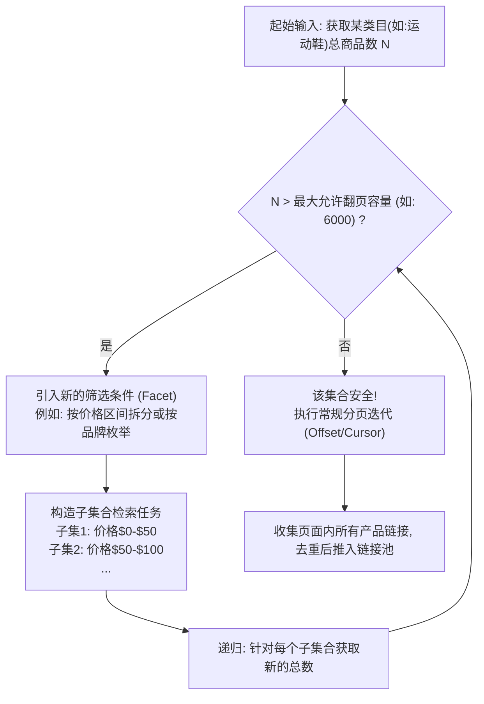

[toc]

## 核心背景与挑战分析

在采集爬虫工程中，**站点地图(Sitemap)**是搜索引擎和爬虫发现全站链接的“捷径”。当电商平台未提供或刻意隐藏Sitemap时，爬虫将失去全局视角的上帝地图。此时，**产品链接发现(Product URL Discovery)**必须完全依赖网站现存的导航结构（如：类目树、站内搜索、推荐流）。

这带来了两个最棘手的工程挑战：
1. **深分页限制(Deep Pagination Limit)**：出于数据库性能保护（如Elasticsearch的`max_result_window`限制），大型电商通常会截断长列表。例如，某个类目下有5万件商品，但每页50件，最多只允许翻到100页（仅能看到前5000件商品）。
2. **动态渲染与反爬(Dynamic Rendering & WAF)**：列表页数据可能不再直接嵌入在HTML文档中，而是通过复杂的加密API、GraphQL或WebAssembly动态下发。

为此，我们需要透彻理解电商网站的分页设计，才能对症下药。

## 一、 电商网站分页机制的设计与实现

现代电商在实现产品列表加载（尤其是“下一页”功能）时，主流方案分为以下两类。理解这些底层机制，直接决定了链接收集环节的并发设计与爬取策略。

### 1. 基于偏移量的传统分页 (Offset-Based Pagination)

这是最经典的分页方式，表现为页面底部带有明确的页码（如 `1 2 3 ... 99 Next`）。

- **后端实现机制**：数据库或搜索引擎执行类似 `SELECT * FROM products LIMIT 50 OFFSET 100` 的查询。
- **前端表现形式**：通常表现为URL中携带明文参数，如 `?category=shoes&page=3` 或 `?limit=50&offset=100`。
- **对爬虫的意义**：**极度友好**。爬虫在获取到总页数后，可以在不依赖前一页结果的情况下，**高并发**地同时构造出所有页码的URL或API请求（例如同时发起第10页和第20页的请求）。

### 2. 基于游标的无限滚动 (Cursor-Based Pagination)

常用于移动端H5、APP以及追求沉浸式体验的现代网页（瀑布流加载）。表现为向下滚动页面时自动加载更多，或者只有一个“加载更多(Load More)”按钮。

- **后端实现机制**：依赖一个全局唯一的排序基准（如主键ID或时间戳）。查询变为 `SELECT * FROM products WHERE id > {last_cursor_id} LIMIT 50`。
- **前端表现形式**：请求参数不再是页码，而是一个不透明的游标。如 `?after=eyJpZCI6MTIzNH0=` 或GraphQL中的 `cursor: "abc..."`。
- **对爬虫的意义**：**具有强制的顺序依赖性**。爬虫无法猜测下一个游标的值，**必须**等待第N页的数据返回后，从响应体（Response）中提取出下一页的游标，才能发起第N+1页的请求。这导致该类列表的爬取无法在单维度上实现并发。

### 3. API请求核心字段辨析

在逆向分析并构造请求时，通常会遇到以下核心占位符变量，需准确区分其适用场景：

| 占位符/字段名          | 含义说明                                      | 辨析与爬虫注意事项                                           |
| :--------------------- | :-------------------------------------------- | :----------------------------------------------------------- |
| `{limit}` / `{size}`   | 单页请求期望返回的最大商品条目数。            | 决定了单次采集的数据密度。**切忌**盲目将其修改为超大值（如9999），极易触发WAF拦截或后端报错。 |
| `{offset}` / `{page}`  | 偏移量或页码（跳过前面多少条数据）。          | 仅存在于Offset分页中。若API使用`offset`，计算公式为 `(page - 1) * limit`。 |
| `{cursor}` / `{after}` | 游标字符串。指示下一批数据的起点。            | 仅存在于Cursor分页中。**不可伪造或预测**，必须从上一页的响应JSON中提取并原样回传。 |
| `{facet_id}`           | 筛选条件/聚合维度标识（如品牌、价格、属性）。 | 爬虫突破“深分页截断限制”的核心武器，下文将详细展开其在递归切分中的运用。 |

## 二、 核心采集思路：从发现到全量遍历

在明确了机制后，针对没有Sitemap的电商整站产品链接收集，业界通用的核心策略遵循**“自顶向下(Top-Down)”**的探测逻辑。

### 策略 1：类目树展开 (Taxonomy Traversal)
通过请求网站的全局导航接口或解析首页HTML，获取完整的层级类目树（例如 `男装 -> 鞋靴 -> 运动鞋`）。获取所有最底层的叶子节点类目URL，将这些节点作为后续列表抓取的**起始种子(Seed URLs)**。

### 策略 2：突破“深分页限制”的条件拆分算法 (Facet Splitting Algorithm)
**这是无Sitemap采集场景下含金量最高的技术方案。**
当某个类目下的商品数量超过电商平台允许的最大翻页限制时（例如运动鞋类目总计30000件商品，但平台最多只允许翻到100页，每页60件，即6000件），常规遍历会永久丢失24000件商品的链接。

**解决方案**：利用电商网站侧边栏的**筛选面板(Facets)**进行集合的递归拆分，直到当前集合的商品总数小于最大翻页限制。

**综合现实示例**：
假设你想全量收集某跨境电商(如Amazon或Walmart)的“Smartphones”类目链接，类目显示共有15,000件商品，但翻页API限制最大`page=50`，每页40个（即最多访问2000个）。
1. 爬虫检查总量 `15000 > 2000`，触发条件拆分策略。
2. 爬虫读取该页面的价格过滤区间，设定步长为$100进行切分搜索。
3. 构造子查询：`Smartphones + 价格区间$0-$100`，总量返回为`1800`件。因为 `1800 < 2000`，安全！直接遍历这45页，收集完这1800个产品链接。
4. 构造子查询：`Smartphones + 价格区间$100-$200`，总量返回为`3100`件。仍然 `> 2000`。
5. **再次递归拆分**：引入“品牌”过滤，构造孙查询：`Smartphones + $100-$200 + Brand=Apple`（总量800，安全，遍历收集）；`Smartphones + $100-$200 + Brand=Samsung`（总量1200，安全，遍历收集）... 依此类推。
通过这种**维度降维**的方式，可以确保无死角地发现并收集100%的产品链接。

### 策略 3：接口流量截获与模拟 (API Reverse Engineering)
在收集列表页的产品链接时，**避免直接解析HTML DOM**。现代电商的前端HTML中包含大量噪音。
推荐的做法是：使用浏览器开发者工具(Network面板)或抓包工具(如Charles)，找出承载商品列表真实数据的XHR/Fetch请求。直接使用程序发送HTTP请求获取纯净的JSON格式数据，直接从中提取`product_url`或`product_id`拼接链接。

## 三、 针对不同需求等级的爬虫分层策略

根据项目的时效性要求、数据量级以及开发资源，采集方案应当分层次实施。以下为三种经典的分级策略架构：

### 第一层：低效但高容错策略（适合一次性/初级调研需求）

- **技术栈**：`Playwright` 或 `Selenium`（无头浏览器/Headless Browser）。
- **执行逻辑**：
  直接驱动真实浏览器打开类目页。通过页面注入JavaScript定位“下一页”按钮。
  - 对于**Offset**分页，不断点击 `a.next-page` 直到按钮不可用或置灰。
  - 对于**Cursor**无限滚动，编写一段 `window.scrollTo(0, document.body.scrollHeight)` 的死循环脚本，配合显式等待(Explicit Wait)检测新元素是否加载，直到页面触底。
  页面渲染完毕后，统一通过XPath或CSS选择器提取页面中所有的 `<a>` 标签的`href`属性。
- **评价**：效率极低，内存消耗极大，易受页面弹窗干扰；但优点是**所见即所得**，能够无视复杂的API签名加密(如防重放Token、请求参数混淆)，对抗基础反爬虫策略效果极佳。

### 第二层：常规规模采集策略（适合长期运维的中型项目）

- **技术栈**：`Scrapy` 框架 + `API接口逆向` + `代理池(Proxy Pool)`。
- **执行逻辑**：
  放弃浏览器渲染，完全基于HTTP(S)协议层的请求。
  - **链接发现流程图（线性表述）**：
    1. 爬虫启动，读取入口类目URL。
    2. 分析列表页后端API，构建带有身份标识或基础Header（如User-Agent, 甚至是从首页获取的Session Cookie）的请求对象。
    3. **处理分页**：
       - 若为Offset分页：在`parse`回调函数中提取出 `total_pages`，随后使用 `yield` 批量生成第2页到最后一页的异步请求。
       - 若为Cursor分页：在解析当前JSON响应时，提取 `next_page_token`，组装新URL后再次 `yield scrapy.Request(...)` 进行链式回调。
    4. 提取当前页JSON内的产品ID列表，持久化至数据库或发布到下一级详情采集队列。
- **网络环境注意事项**：在国内采集海外电商（部署于国外服务器）时，直连网络不稳定且极易触发Cloudflare的WAF拦截。需配合使用高质量的海外原生住宅IP代理（Residential Proxies），并在Scrapy中间件中实现动态代理轮转。

### 第三层：全量极致效率策略（适合企业级数据中心）

- **技术栈**：`Golang / Python Asyncio` + `Redis/Kafka` 分布式消息队列 + `动态条件拆分算法`。
- **执行逻辑**：
  将“发现任务”与“收集任务”彻底解耦。
  - **调度者(Master)** 负责执行前文提到的【条件拆分算法】。它迅速扫描整个网站，一旦发现某个筛选条件的商品数处于安全阈值内，立刻将该查询参数（如 `cat=shoes&price=10-20&pages=40`）打包为一个“遍历任务”，推入Kafka或Redis队列。
  - **工作节点(Workers)** 监听队列。对于**Offset机制**的网站，Worker甚至可以直接将40页的任务再次打散为40个独立的“单页请求任务”，分配给上百个轻量级协程并发执行。在此架构下，数十万级的产品链接能够在几分钟内通过API完全拉取。
  - **Cursor机制的并发妥协**：如果目标站点仅支持游标分页，Worker无法横向拆分页码，只能保持单条链路的顺序抓取。此时，提高效率的唯一方法是**增加初始切分的条件颗粒度**（切出更多的小集合），使得多条Cursor链路能够同时并行向前推进。

## 四、 行业最佳实践总结 (Best Practices)

在产品链接收集阶段，总结以下实践准则：

- **必须怎么做 (Must do)**：
  - 必须对收集到的产品链接(或产品ID)使用哈希表或Redis `SET` / `Bloom Filter`(布隆过滤器) 进行**严格去重**。因为一个产品常常会同时出现在多个类目和不同条件的筛选结果中。
  - 必须合理控制并发请求的频率（Rate Limiting），尊重目标服务器的承载能力，防止因恶意DDoS式的请求导致自身IP段被永久封禁。

- **应该/推荐怎么做 (Should do)**：
  - 推荐优先抓取移动端(APP或小程序)的接口。因为移动端的API相比Web端通常更轻量化、历史包袱小，且返回的JSON结构更加纯粹，有时对请求头(Headers)的校验也更为宽松。
  - 推荐监控采集覆盖率。由于电商数据在实时变动（例如商品上架下架导致排名游标变动），每天的抓取总量应与平台标称的总数或历史基线做对比审计。

- **可以怎么做 (Can do)**：
  - 在条件允许且预算充足的情况下，可以使用成熟的第三方商业化API解决方案（如ZenRows, ScraperAPI或Bright Data的Web Unlocker）。它们在底层为你处理了复杂的JavaScript渲染、验证码破解和IP轮换，你只需传入一个基础的翻页URL即可获得纯净的HTML或数据。

- **避免怎么做 (Avoid)**：
  - 避免过度依赖页面结构（DOM树）来进行链接提取。电商平台的UI改版非常频繁（A/B测试极多），基于强关联XPath的爬虫脚本极易因前端一个微小的改动而大面积崩溃。
  - 在执行Cursor序列化翻页时，避免在中间发生异常时从头重试。应当持久化保存最后一个成功的游标点，实现断点续传。