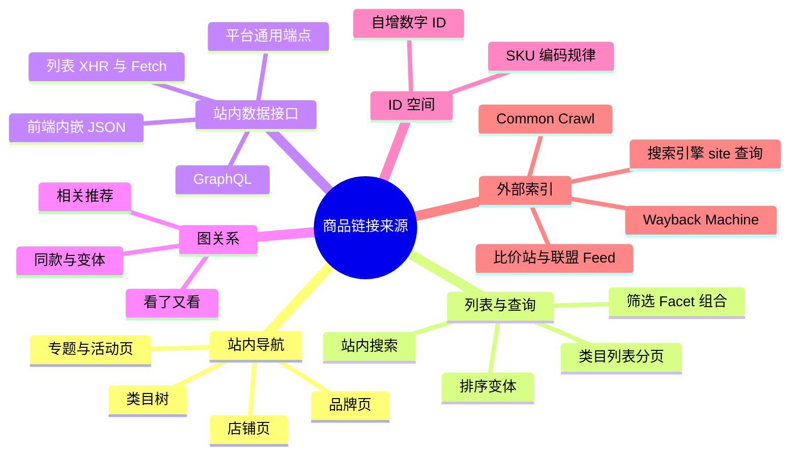
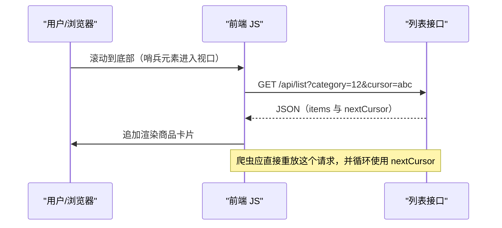
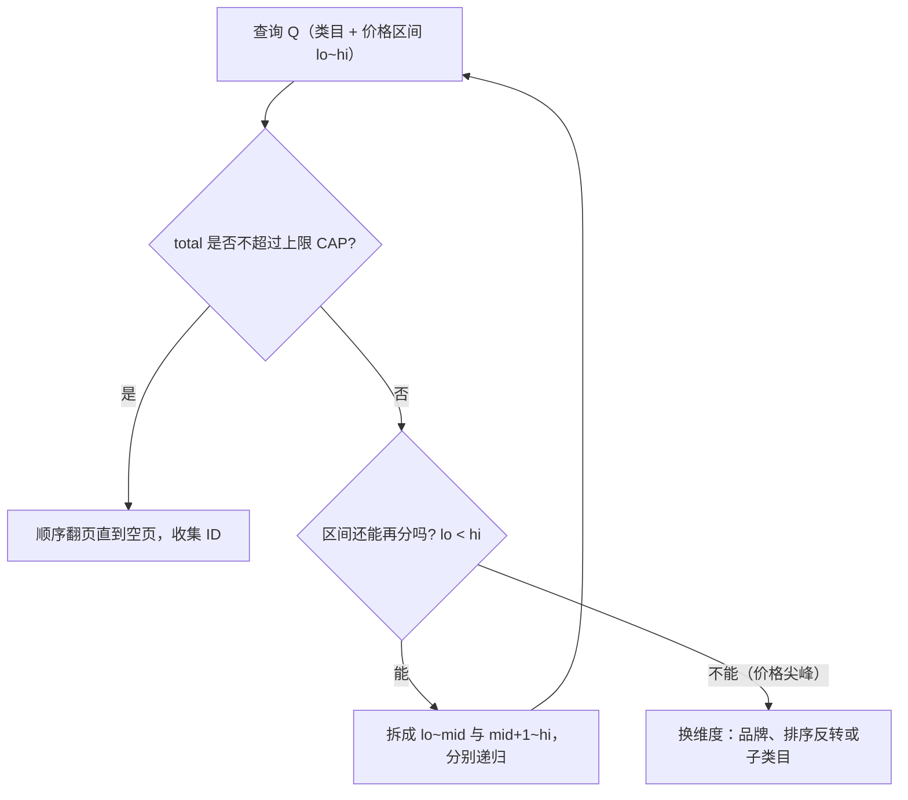
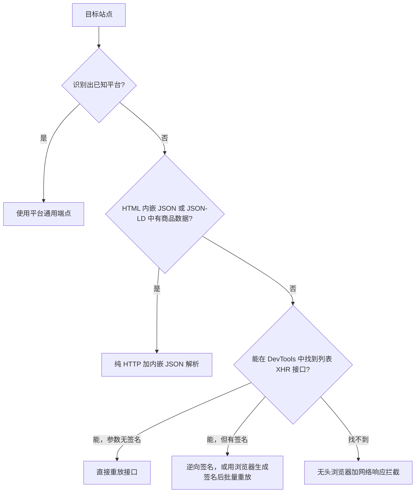
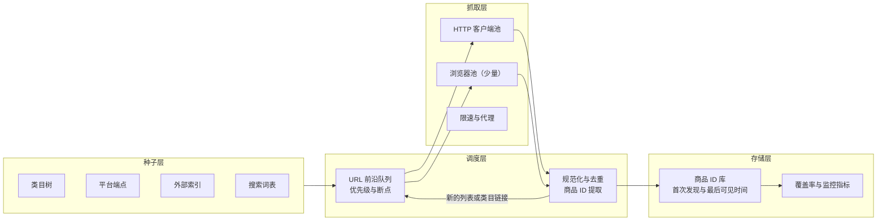

[toc]

## 问题定义：链接发现到底在解决什么

商品采集一般分两个阶段：**链接发现（URL Discovery）**和**详情抓取（Detail Extraction）**。站点地图（`sitemap.xml`）本质上就是站方替你做好的"链接发现"。没有它，你需要自己回答三个问题：

- **从哪里找（入口/来源）**：站内哪些页面或接口会暴露商品 ID 或 URL？
- **怎么找全（覆盖率，Coverage）**：分页上限、筛选组合、隐藏商品怎么处理？怎么知道已经找全了？
- **怎么找得省（发现成本，Discovery Cost）**：平均每发现一个新商品要花几个请求、多少渲染开销、承担多大封禁风险？

全文都用一个核心效率指标：**发现成本 = 消耗的请求数 ÷ 新发现的唯一商品数**。比如 Shopify 的 `/products.json` 一次请求返回 250 个商品，成本约 0.004；传统 HTML 列表页一页 48 个商品，成本约 0.02；靠详情页里的"相关推荐"滚雪球，成本可能接近 1。三者差了两个数量级，所以**先选对发现通道，比优化并发更重要**。



这张图把来源分成六类：前三类在站内而且最常用，"图关系"适合补漏长尾商品，"ID 空间"在 ID 可预测时效率极高，"外部索引"适合拿来做种子和交叉验证。

## 从网站设计看：商品链接是怎么暴露出来的

### 典型电商站点的信息架构

电商站点为了 SEO 和用户导航，几乎都有这样一条层级结构：**首页 → 一级类目 → 叶子类目 → 列表页（可分页、可筛选、可排序） → 商品详情页（PDP，Product Detail Page）**。另外还有几条横向通道：站内搜索、品牌页、店铺页、活动页，以及详情页中的"相关推荐"。

**关键认识**：

- **必须**把"叶子类目列表"当作主通道。站方最希望商品被浏览到的地方就是这里，覆盖率通常最高。
- **应该**意识到列表页只是一个"视图"，数据真正来自后端的**查询接口**（Search/Listing API）。爬虫的最优解往往是直接对接这个接口，而不是解析 HTML。
- **注意**有些商品不挂在任何类目下，比如只通过活动页或搜索才能到达的商品、下架后仍保留 URL 的商品。纯类目遍历会漏掉它们，需要搜索、推荐图或外部索引来补。

### 分页与"加载下一页"的实现方式全景

| 实现方式                              | 前端表现            | 请求特征（示例）                                             | 爬虫要点                                | 难度   |
| ------------------------------------- | ------------------- | ------------------------------------------------------------ | --------------------------------------- | ------ |
| **服务端渲染页码（SSR Page Number）** | 底部 1 2 3 … 下一页 | `GET /c/phones?page=3`                                       | 直接构造 URL，HTML 里有商品链接         | 低     |
| **偏移分页（Offset/Limit）**          | 同上或接口驱动      | `GET /api/list?offset=96&limit=48`                           | 可调大 `limit` 减少请求，但通常有上限   | 低     |
| **游标/键集分页（Cursor/Keyset）**    | 加载更多、无限滚动  | `GET /api/list?cursor=eyJpZCI6...`                           | 只能串行，用上一页返回的游标取下一页    | 中     |
| **Link 响应头（`rel="next"`）**       | 无                  | 响应头 `Link: <...page_info=xx>; rel="next"`                 | 读响应头，不要自己拼参数                | 低     |
| **"加载更多"按钮**                    | 点击追加            | 点击触发 XHR/Fetch                                           | 抓接口，不要模拟点击                    | 中     |
| **无限滚动（Infinite Scroll）**       | 滚到底部自动加载    | `IntersectionObserver` 触发 Fetch                            | 同上；万不得已才用浏览器滚动            | 中     |
| **SPA 内嵌状态（Hydration）**         | 首屏直出            | HTML 中的 `__NEXT_DATA__`、`window.__INITIAL_STATE__`、`__NUXT__` | 解析内嵌 JSON，比解析 DOM 更稳          | 低到中 |
| **GraphQL**                           | 任意                | `POST /graphql`，变量里有 `first`、`after` 或 `pageSize`、`currentPage` | 复用站点自己的 query，改变量即可        | 中     |
| **虚拟列表（Virtual Scroll）**        | 长列表流畅滚动      | DOM 只保留可视区域的节点                                     | **从 DOM 抓会丢数据**，必须拦截网络响应 | 高     |
| **签名/加密参数**                     | 任意                | 请求带 `sign`、`x-s`、时间戳                                 | 需要逆向 JS 或用浏览器环境执行          | 高     |

下面解释几个核心概念。

**偏移分页（Offset Pagination）**：参数形如 `offset`（跳过多少条）和 `limit`（取多少条），也可能是 `page` 加 `pageSize`。它的问题在于后端翻得越深越贵。以 Elasticsearch 为例，`index.max_result_window` 默认把 `from + size` 限制在 10000，要取更深的结果得用 `search_after`、scroll 或 point-in-time（[Pulse](https://pulse.support/kb/elasticsearch-index-max-result-window)）。这个限制是为了防止集群内存被过度消耗（[Typesense](https://typesense.org/learn/elasticsearch-deep-pagination/)）。**所以很多电商"最多显示 100 页"并不是故意反爬，而是后端架构的硬约束**。爬虫遇到的结果就是：一个查询最多只能看到前 N 条。

**游标分页（Cursor Pagination）**：服务端返回一个不透明的字符串，用它去取下一页。在 Relay 规范里，`PageInfo` 必须包含 `hasPreviousPage`、`hasNextPage`、`startCursor`、`endCursor` 这几个字段（[Relay 规范](https://relay.dev/graphql/connections.htm)），查询形如 `friends(first: 10, after: "opaqueCursor")`。各字段含义如下：

| 字段           | 含义                 | 爬虫用法                         |
| -------------- | -------------------- | -------------------------------- |
| `first`        | 本次向后取多少条     | 在服务端允许范围内调到最大       |
| `after`        | 从哪个游标之后开始取 | 填上一页的 `endCursor`           |
| `endCursor`    | 本页最后一条的游标   | 保存下来，作为断点续爬的检查点   |
| `hasNextPage`  | 后面还有没有数据     | **终止条件**，比"返回为空"更明确 |
| `edges[].node` | 实际数据（如商品）   | 从里面提取商品 ID 或 handle      |

游标分页**不能并发跳页**，同一个查询只能串行往下翻。想提速只能**横向拆分出多个查询**（例如每个类目各一条游标链），让它们并行。

**无限滚动和加载更多**：这两种只是前端交互形式，背后是同一个接口。下图展示了它的机制：



图里的意思是：滚动只是触发器，真正有价值的是那一次 `GET /api/list`。**推荐做法**是打开浏览器 DevTools 的 Network 面板，过滤 Fetch/XHR，滚动一次，找到返回商品数组的请求，然后在 Python 里重放（Replay）它。

**虚拟列表**：React Window、vue-virtual-scroller 这类组件只渲染可视区域内的节点。如果你用 Playwright 滚到底再去读 DOM，只能拿到最后几十个商品。**必须**改为监听网络响应（Playwright 的 `page.on("response")`），或者直接重放接口。

### 后端约束带来的四个"坑"

1. **翻页上限**：一个查询最多可见 N 条（N = 每页条数 × 最大页码，或 ES 的 10000）。**这是"找全"的头号障碍**，解决办法见后文的查询空间切分。
2. **结果漂移**：翻页过程中排序变了（销量、新品），会导致重复或遗漏。**应该**选稳定的排序（按 ID 或上架时间），或者多次遍历取并集。
3. **短页（Short Page）陷阱**：页面返回的条数少于 `limit`，并不代表已经到底。一项针对 Shopify 商店的实测发现，50 家里有 4 家在目录还没结束时就返回了短页；如果循环在第一个短页就停，其中一家会丢掉多达 93% 的商品（[DEV 实测](https://dev.to/rslndev/we-tested-shopifys-productsjson-on-68-stores-the-limits-tutorials-dont-mention-1ofj)）。**必须以"空页"或 `hasNextPage=false` 作为终止条件**。
4. **静默截断**：参数超出上限时，服务端往往直接截到最大值而不报错。比如 Shopify `/products.json` 的 `limit` 最大 250，传更大的值会被静默截到 250，不传则默认 30；而且当 `page × limit` 超过 25000 时会返回 HTTP 400（[DEV](https://dev.to/odeeb/shopify-productsjson-pagination-250-limit-and-the-25000-cap-1g37)）。**应该**每次都校验实际返回的条数，不要想当然。

## 链接发现策略详解

下面按"推荐使用顺序"排列：越靠前，发现成本越低、稳定性越高。

### 策略一：平台指纹识别与通用端点（成本最低）

很多中小电商跑在 SaaS 或开源系统上，这些系统自带公开的数据端点。**第一步应该先识别平台**，可以看 HTML 里的 `cdn.shopify.com`、`wp-content/plugins/woocommerce`、`Magento_` 前缀、响应头等特征，也可以用 Wappalyzer 这类工具。

| 平台                                   | 端点（示例）                                                 | 分页参数                           | 注意事项                                                     |
| -------------------------------------- | ------------------------------------------------------------ | ---------------------------------- | ------------------------------------------------------------ |
| **Shopify**                            | `/products.json`、`/collections/{handle}/products.json`      | `limit`（最大 250）、`page`        | `page × limit` 超过 25000 返回 400；大店需要按 collection 分别翻页再按商品 ID 去重（[DEV](https://dev.to/odeeb/shopify-productsjson-pagination-250-limit-and-the-25000-cap-1g37)）；这个端点不是正式文档化的 API，带鉴权的 Admin API 用的是 `page_info` 游标分页（[DEV 实测](https://dev.to/rslndev/we-tested-shopifys-productsjson-on-68-stores-the-limits-tutorials-dont-mention-1ofj)） |
| **WooCommerce**【待核】                | `/wp-json/wc/store/v1/products`                              | `per_page`（通常最大 100）、`page` | Store API 公开免鉴权；响应头里的 `X-WP-Total` 和 `X-WP-TotalPages` 可以用来估计总量 |
| **Magento 2 / Adobe Commerce**【待核】 | `POST /graphql`，用 `products(filter, pageSize, currentPage)` 查询 | `pageSize`、`currentPage`          | 返回 `total_count`，便于判断覆盖率                           |
| **自研 SPA（Next.js 等）**             | 页面内的 `__NEXT_DATA__` 或 `/_next/data/{buildId}/...json`  | 跟随页面参数                       | `buildId` 每次发布都会变，要动态提取                         |

在 Shopify 上，`{handle}` 是集合（collection）的 URL 短名，例如 `/collections/sneakers` 里的 `sneakers`。

### 策略二：站内列表接口直连（主力通道）

**做法**：用 DevTools 找出类目列表或搜索的 XHR 接口，分析参数（类目 ID、页码或游标、排序、筛选、每页条数），然后写成参数化的请求生成器。

**最佳实践**：

- **必须**先试探 `pageSize`/`limit` 的上限（试 48、100、200、500），然后用实际生效的最大值。这一步往往就能把请求数降几倍。
- **应该**尽量只请求能拿到 ID 的最小字段集，GraphQL 可以裁剪 query 字段，链接发现阶段不需要拿详情。
- **应该**记录接口返回的 `total`/`total_count`，它是后面切分和计算覆盖率的依据。
- **避免**直接复用浏览器里带一次性签名的请求去长期跑。签名参数一旦过期就会大面积失败，要么找出签名算法，要么让浏览器环境来生成签名。

### 策略三：类目树遍历（BFS）

**做法**：从首页或"全部分类"页解析出类目树，按广度优先（BFS）一直走到**叶子类目**，再对每个叶子类目翻页。

**要点**：

- **应该只翻叶子类目**。父类目的结果是子类目的并集，重复翻是浪费，除非你怀疑有商品只挂在父类目下。
- **应该**为每个类目记录 `total` 和实际抓到的数量，差异大的类目要重点排查。
- 在 Scrapy 里可以用 `CrawlSpider` 加 `LinkExtractor(allow=...)` 声明式地提取类目和商品链接；Crawlee 则提供 `enqueueLinks({ globs, strategy })` 加持久化的 `RequestQueue`【待核】。

### 策略四：查询空间切分，突破翻页上限（关键技术）

当一个类目有 5 万个商品，但最多只能看到 100 页 × 48 条 = 4800 条时，就需要把这个大查询**切分成多个小查询**，每个小查询的结果都不超过上限，然后取并集。

常用的切分维度：

| 维度                | 做法                               | 优点                                 | 缺点                                     |
| ------------------- | ---------------------------------- | ------------------------------------ | ---------------------------------------- |
| **价格区间**        | `price_min`/`price_max` 自适应二分 | 连续、可无限细分，几乎所有电商都支持 | 遇到同价商品很多的"价格尖峰"时切不动     |
| **品牌/属性 Facet** | 按品牌、颜色、尺码等枚举           | 离散，接口通常会给出每个值的计数     | 有的商品没有这个属性，需要补"未分类"查询 |
| **排序反转**        | 同一查询分别按升序、降序各翻一遍   | 不改筛选条件就能把可见量翻倍         | 只能翻倍，适合总量略超上限的情况         |
| **上架时间**        | 按时间窗口切分                     | 天然支持增量                         | 不是所有站点都开放这个筛选               |
| **店铺/卖家**       | 按卖家枚举                         | 平台型电商很有效                     | 卖家列表本身也需要先发现                 |

**自适应二分算法**的流程如下：



图中的含义：先用一次轻量请求拿到 `total`。没超上限就直接翻完；超了就把价格区间对半拆开递归处理；拆到单一价格点仍然超限（例如大量商品都标价 99 元），就换一个维度继续切。

下面是在沙箱中用模拟站点验证过的核心逻辑（6 万商品，上限 4800，43 次探测后全部找到）。真实使用时，把 `fetch_list` 换成实际的 HTTP 调用即可：

```python
"""查询空间自适应二分：列表接口存在"最多可翻页数"上限时，按价格区间切分直到每个分区可被完整翻页。"""
import asyncio

CAP = 48 * 100   # 单个查询最多可见结果数 = 每页条数 × 最大页码
PAGE_SIZE = 48

async def fetch_list(price_min: int, price_max: int, page: int):
    """返回 (total, items)。价格单位为"分"，区间为闭区间。
    真实实现：httpx/curl_cffi 请求列表接口，解析 total 与商品 ID 列表。"""
    raise NotImplementedError

async def enumerate_range(lo, hi, seen):
    page = 1
    while True:
        _, items = await fetch_list(lo, hi, page)
        if not items:              # 只认"空页"为终止信号，不依赖"短页"
            break
        seen.update(items)
        page += 1

async def discover(lo, hi, seen, stats):
    total, _ = await fetch_list(lo, hi, 1)   # 探测请求：只为拿 total
    stats["probe"] += 1
    if total == 0:
        return
    if total <= CAP:
        await enumerate_range(lo, hi, seen)
    elif lo == hi:                 # 单一价格点仍超限：记录下来，交给其他维度处理
        stats["overflow"].append((lo, total))
        await enumerate_range(lo, hi, seen)
    else:
        mid = (lo + hi) // 2       # 用整数"分"，避免浮点边界造成重叠或遗漏
        await discover(lo, mid, seen, stats)
        await discover(mid + 1, hi, seen, stats)
```

代码中各变量的含义：

| 名称                | 含义                                                         |
| ------------------- | ------------------------------------------------------------ |
| `CAP`               | 单个查询最多能看到的结果数，需要实测（翻到第几页开始返回空或报错） |
| `lo`、`hi`          | 当前价格区间的下界和上界（闭区间，单位为分）                 |
| `total`             | 接口返回的命中总数；如果接口不给总数，可以用"第 CAP/PAGE_SIZE 页是否非空"来判断是否超限 |
| `seen`              | 已发现商品 ID 的集合，用于去重；生产环境换成 Redis Set 或布隆过滤器 |
| `stats["overflow"]` | 无法再按价格切分的价格尖峰，交给品牌、排序等维度二次切分     |

**易错点**：

- **避免**用浮点价格去二分。`[0, 99.99]` 和 `[99.99, 200]` 这样的边界会重复或遗漏，**应该**统一换算成整数分，并使用闭区间 `[lo, mid]` 和 `[mid+1, hi]`。
- **注意**站点对价格筛选的语义：含不含边界？按原价还是折后价？多规格商品按哪个价格？**必须**先拿已知商品做边界测试。
- **应该**先探测再翻页。探测只需要一次请求，避免在一个注定超限的查询上白翻 100 页。

### 策略五：站内搜索枚举

**做法**：用关键词驱动搜索接口。关键词可以来自：

- 类目名、品牌名、属性值词表；
- **搜索联想（Autocomplete）前缀枚举**：依次输入 `a`、`b`……和常用汉字或拼音首字母，收集联想词作为新的查询；
- 已抓到的商品标题经过分词后的高频词，形成"滚雪球"式的词表扩展。

**适用场景**：类目体系混乱，或者有大量商品不挂类目时。**缺点**是覆盖率难以证明、结果重叠度高，**推荐**作为补漏通道，而不是主通道。

### 策略六：商品关系图遍历（补长尾）

**做法**：把详情页里的"相关推荐""同店商品""看了又看""同款其他规格"当作图的边，从已知商品出发做 BFS。

**特点**：发现成本高，每个详情页只带出几个到几十个新链接，而且推荐算法会偏向热门商品。但它能发现**不在类目或搜索中出现的商品**。**应该**只在主通道跑完之后，用它评估和补齐覆盖率。

### 策略七：ID 空间枚举

**做法**：如果商品 URL 是 `/p/1029384` 这样的自增数字 ID，可以直接枚举 ID 区间。

**步骤**：

1. 采样已知商品 ID，估计 ID 的最小值、最大值和**密度**（有效 ID 占比）。
2. 密度高（比如超过 30%）时直接顺序枚举，用轻量请求（HEAD 请求或轻量接口）判断是否存在；密度低时，只在已知 ID 附近的"热区"枚举。
3. 关注最大 ID 的增长，用于增量发现新品。

**避免**：对 UUID、哈希 ID 或稀疏 ID 做盲目枚举，404 洪水既浪费资源又容易触发风控。

### 策略八：外部索引与归档（种子和验证）

| 来源                            | 用法（示例）                                                 | 说明                                                         |
| ------------------------------- | ------------------------------------------------------------ | ------------------------------------------------------------ |
| **Common Crawl Index**          | `https://index.commoncrawl.org/CC-MAIN-YYYY-WW-index?url=example.com/p/*&output=json` | 主索引站提供查询 API，是 CDX server API 的一个变体（[Common Crawl](https://commoncrawl.org/blog/announcing-the-common-crawl-index)）；`cdx_toolkit` 封装了分页接口，并且默认单线程、串行地礼貌访问（[cdx_toolkit](https://github.com/commoncrawl/cdx_toolkit)）；域名级大批量需求可以走 Athena 查询列式索引 |
| **Wayback Machine CDX**【待核】 | `https://web.archive.org/cdx/search/cdx?url=example.com&matchType=domain&fl=original&collapse=urlkey&output=json` | `matchType=domain` 包含子域，`collapse=urlkey` 用于去掉重复快照 |
| **gau、waybackurls**【待核】    | `gau example.com`                                            | 聚合多个归档源的命令行工具（Go 编写，跨平台）                |
| **搜索引擎**                    | `site:example.com/p/`                                        | 量小，适合抽样验证                                           |

**注意**：外部索引里的 URL 可能已经失效，**必须**做存活校验，并把 URL 规范化成商品 ID。它的价值在于：**一份独立来源的样本，可以用来估计你站内爬取的覆盖率**（方法见后文）。

**网络环境提示**：国内直连 `web.archive.org` 和 `index.commoncrawl.org` 往往很慢或不稳定，测试时可以走本地代理（例如 mihomo 默认的混合端口）：

- Linux/macOS：`export HTTPS_PROXY=http://127.0.0.1:7890`
- Windows PowerShell：`$env:HTTPS_PROXY="http://127.0.0.1:7890"`
- Windows CMD：`set HTTPS_PROXY=http://127.0.0.1:7890`

生产环境部署在海外服务器上，一般不需要代理就能访问这些归档源。但目标站如果是国内电商，就要考虑海外 IP 被限速或跳转到国际站的情况。

### 不要忽略的"小入口"

- **`robots.txt`**：即使没有公开 sitemap，`robots.txt` 里也可能有 `Sitemap:` 行，或者写着 `/sitemap_products_1.xml` 这类遗留路径。`Disallow` 规则本身也暴露了 URL 结构。同时它是合规依据（RFC 9309）【待核】。
- **常见 sitemap 路径的盲探**：`/sitemap.xml`、`/sitemap_index.xml`、`/product-sitemap.xml`，"没有站点地图"有时只是没被链接出来。
- **RSS/Atom**：一些独立站的"新品"板块会有 feed。
- **结构化数据**：列表页里 JSON-LD 的 `ItemList`，或者详情页的 `Product` 标记，往往比 DOM 更稳定。
- **"新品"排序**：`sort=newest` 是增量发现的利器。

## 采集方案：架构与技术选型

### 渲染决策阶梯：能不用浏览器就不用



这条阶梯从上往下，资源消耗依次增加约一个数量级：浏览器渲染一页的 CPU 和内存开销，通常是纯 HTTP 请求的几十到上百倍。**推荐**只在必要的环节使用浏览器，比如只用它获取 Cookie 或签名，批量请求仍然走 HTTP 客户端。

### 发现系统的整体架构



各层职责：

- **种子层**：给出初始入口。多种来源并存，便于交叉验证。
- **调度层**：维护**URL 前沿队列（URL Frontier）**，支持优先级（叶子类目优先、新品优先）和断点续爬（持久化游标和页码）。**规范化（Canonicalization）**是去重的前提：去掉 `utm_*`、`spm` 这类追踪参数，统一大小写和末尾斜杠，**最好直接提取商品 ID 作为主键**，因为同一个商品可能对应多个 URL（带规格参数、不同类目路径）。
- **抓取层**：以 HTTP 客户端为主，浏览器为辅。按域名限速，处理 429 或 503 时用指数退避。
- **存储层**：每个商品记录 `first_seen`（首次发现）和 `last_seen`（最后一次在列表中可见）。长时间没出现的，大概率已经下架。

### 工具选型参考

| 工具                  | 语言             | 适用                         | 备注                                                         |
| --------------------- | ---------------- | ---------------------------- | ------------------------------------------------------------ |
| **Scrapy**            | Python           | 中大规模、规则化的站点       | 成熟稳定；`CrawlSpider` 规则化提取链接；可配合 scrapy-playwright |
| **Crawlee**           | Node.js / Python | 需要混合 HTTP 和浏览器的场景 | 内置请求队列、会话池、指纹；开源（Apify 出品）               |
| **Playwright**        | 多语言           | 签名生成、网络拦截           | 用 `page.on("response")` 抓接口数据，而不是读 DOM            |
| **httpx / curl_cffi** | Python           | 高效重放接口                 | curl_cffi 可以模拟浏览器 TLS 指纹【待核】                    |
| **katana**            | Go               | 未知站点的端点侦察           | ProjectDiscovery 出品，支持无头模式和 JS 端点解析【待核】    |
| **cdx_toolkit、gau**  | Python / Go      | 外部索引种子                 | 见上文                                                       |

这些工具都是免费开源、跨平台的。在 Windows 上要注意两点：Scrapy 的部分依赖（如 Twisted）建议用 `pip` 在虚拟环境中安装；Playwright 首次使用需要执行 `playwright install` 下载浏览器，国内可以设置 `PLAYWRIGHT_DOWNLOAD_HOST` 指向镜像【待核】。

## 覆盖率评估：怎么知道"找全了"

1. **对账法**：把接口返回的 `total`、类目页显示的"共 N 件"，与实际抓到的数量逐个类目比较。
2. **多源交叉法（捕获-再捕获，Capture-Recapture）**：用两个相互独立的通道分别发现商品，用 Lincoln-Petersen 估计量估算总量：**N ≈ n1 × n2 ÷ m**。其中 `n1`、`n2` 是两个通道各自发现的数量，`m` 是两者的交集。
   - **示例**：类目遍历找到 9000 个，外部索引存活校验后有 6000 个，交集 5400 个。估计总量 N ≈ 9000 × 6000 ÷ 5400 = 10000，两者并集是 9000 + 6000 − 5400 = 9600，覆盖率约 96%。
   - **注意**：这个公式假设两个通道相互独立。类目遍历和推荐图都偏向热门商品，两者并不独立，会高估覆盖率。**推荐**选择差异化的通道组合，比如站内遍历配外部索引，或者站内遍历配 ID 抽样。
3. **ID 抽样法**：如果 ID 可以枚举，就在 ID 空间随机抽样几百个有效 ID，看其中有多少已经在你的库里，直接得到覆盖率的无偏估计。

## 按需求等级分层的策略

| 等级                                            | 典型需求             | 推荐策略组合                                                 | 工具                                        | 效率关键                                                     | 避免                                             |
| ----------------------------------------------- | -------------------- | ------------------------------------------------------------ | ------------------------------------------- | ------------------------------------------------------------ | ------------------------------------------------ |
| **L0 一次性验证**（少于 1 千商品）              | 调研、样本数据       | DevTools 找接口，写个简单脚本翻页；或者 Playwright 拦截响应  | httpx、Playwright                           | 人工分析时间远大于运行时间，**不必过度工程化**               | 一上来就搭分布式框架                             |
| **L1 单站全量快照**（1 万到百万级）             | 竞品全目录、建库     | 平台端点或列表接口直连，叶子类目遍历，**查询空间切分**突破上限，最后做覆盖率对账 | Scrapy 或 Crawlee，curl_cffi                | 调大 `pageSize`；先探测再翻页；并行跑多个分区                | 用浏览器滚动整站；以短页作为终止条件             |
| **L2 周期增量监控**（每日或每小时）             | 价格、库存、上新监控 | **"新品"排序或上架时间窗口**做增量发现；按类目轮转做部分刷新；**每周或每月一次全量校准**；用 `last_seen` 判断下架 | L1 的工具加调度器（cron、Airflow）          | 增量请求量只有全量的 1% 到 5%；接口列表数据本身就带价格时，**可以跳过详情页** | 每天全量重跑；只做增量从不校准，误差会累积       |
| **L3 多站或平台级**（数十到上千个站）           | 行业比价、品牌监测   | **平台指纹识别后路由到对应适配器**（Shopify、WooCommerce、Magento 等）；对通用站点用"类目遍历 + 内嵌 JSON"的半自动模板；用外部索引做种子并估算覆盖率 | Crawlee、Scrapy 加适配器插件；katana 做侦察 | **复用比优化更重要**：一个 Shopify 适配器就能覆盖大量独立站  | 每个站点手写一套爬虫；不做平台识别               |
| **L4 头部平台或强对抗**（淘宝、京东、亚马逊级） | 大规模商品库         | **优先选官方开放平台、联盟（Affiliate）API 或数据服务商**；自建时以搜索加类目切分为主，控制节奏，账号和设备成本单独核算 | 视情况而定                                  | 合规与成本是第一约束，技术其次                               | 高并发硬刚风控；绕过登录或访问控制抓取非公开数据 |

**选择原则**：

- **必须**先明确"需要多全、多新"。95% 的覆盖率和 99.9% 的覆盖率，成本可能差 10 倍。
- **推荐**的层次顺序：平台端点 → 列表接口 → 查询空间切分 → 搜索和推荐补漏 → 外部索引验证。每往后一层，发现成本更高，但边际覆盖率也更有价值。
- **应该**让发现和抓取解耦：发现阶段只拿 ID，以及列表上顺带的价格；详情抓取按需要和优先级单独调度。

## 综合案例：一个中型 SPA 电商站的链接发现

**场景**：目标站 `shop.example.com`（虚构）是 Next.js 构建的 3C 电商，没有 sitemap。首页有 12 个一级类目，共 320 个叶子类目。列表页是无限滚动，每次加载 48 个，最多加载到第 100 页。站方声称有约 15 万个商品。需求属于 L2：每天监控价格，每周全量校准。

**第一步：侦察（约 30 分钟）**

1. 读 `robots.txt`：没有 `Sitemap:` 行，但看到 `Disallow: /api/internal/`，说明内部接口在 `/api/` 下。
2. 盲探 `/sitemap.xml`，返回 404，确认没有站点地图。
3. 看首页源码：发现 `__NEXT_DATA__`，里面的 `props.pageProps.categoryTree` 就是**完整的类目树 JSON**。一次请求就拿到了全部 320 个叶子类目，省掉了逐层 BFS。
4. 打开 DevTools，滚动列表页，捕获到请求 `GET /api/search?cat=1203&sort=default&cursor=...&size=48`。响应里有 `total`、`items[].id`、`items[].price`、`nextCursor`。
5. 试探参数：`size=200` 生效（实际返回 200 条），`size=500` 被截到 200；`sort=price_asc` 和 `sort=newest` 可用；还有 `priceMin`、`priceMax` 参数，以分为单位，闭区间。

**第二步：确定上限并设计切分**

- 实测在 `size=200` 下，游标翻到约 10000 条后 `nextCursor` 变为空，可以推断后端是 ES，上限 `CAP=10000`。
- 320 个叶子类目里，有 9 个的 `total` 超过 10000（比如"手机壳"有 4.2 万）。对这 9 个类目用前面的**价格自适应二分**。"9.9 元"这个价格点有 1.3 万个手机壳，超出上限，于是二次切分改用 `sort=price_asc` 和 `sort=newest` 两种排序取并集，再加上品牌 Facet 补齐。

**第三步：全量发现**

- 311 个普通类目 × 平均 470 个商品 ÷ 200 条每页 ≈ 950 次请求（每个类目至少 1 页）；9 个大类目经切分后约 400 次请求。**合计约 1400 次请求发现约 15 万个商品，发现成本约 0.009**。
- 对比：如果用 Playwright 模拟滚动，每页 48 条，还受上限截断，需要约 3200 次浏览器页面操作，而且大类目根本翻不全。
- 并发策略：游标链只能串行，所以**按类目并行**（例如 8 个类目同时进行），单域名 QPS 控制在 2 到 5，遇到 429 就退避。

**第四步：覆盖率验证**

- 对账：实际 14.6 万，站方声称约 15 万，差约 2.7%。
- 补漏：从 Common Crawl 拉取 `shop.example.com/p/*` 的历史 URL，提取 ID 并做存活校验，得到 2.1 万个存活 ID，其中 1.95 万个已在库里。估计总量 ≈ 146000 × 21000 ÷ 19500 ≈ 15.7 万，提示还有遗漏。
- 抽样那些"外部有、站内没发现"的 1500 个商品，发现大多数只出现在活动专题页里。于是把活动页加入种子，再用推荐图 BFS 补抓，最终达到约 15.4 万。

**第五步：每日增量（L2）**

- 每天：每个叶子类目用 `sort=newest` 翻页，直到连续遇到一整页已知 ID 为止，大约 400 次请求就能发现新品。列表接口本身带价格，**所以价格监控不需要抓详情页**。
- 每周：重跑全量发现，更新 `last_seen`。连续 3 次全量都没出现的商品标记为疑似下架。

这个案例把几个关键点串了起来：平台/框架识别（`__NEXT_DATA__`）、接口直连、调大页长、上限探测、查询空间切分、排序反转、外部索引交叉验证、推荐图补漏、增量与校准。

## 合规与礼貌（必须重视）

- **必须**遵守 `robots.txt`、网站服务条款和合理的访问频率，不要对目标站造成可感知的负载压力。
- **必须**只采集公开的商品数据。**避免**绕过登录、付费墙或技术保护措施，**避免**采集个人信息（比如评论者身份），这在国内涉及《个人信息保护法》《数据安全法》。用采集的数据做实质性替代的竞争性产品，在国内已有依据《反不正当竞争法》判决的案例。
- **推荐**优先使用官方 API 或开放平台。商业项目上线前请咨询法务。我不是律师，这里只是工程层面的风险提示，不构成法律意见。

## 速查清单

- **必须**：用空页或 `hasNextPage=false` 作为终止条件；按商品 ID 去重；实测翻页上限和 `pageSize` 上限；持久化游标和页码以便断点续爬。
- **应该**：先识别平台、找内嵌 JSON 和 XHR 接口，最后才用浏览器；只翻叶子类目；对超上限的查询做自适应切分；用两个独立通道估算覆盖率；增量和全量校准结合。
- **可以**：用搜索联想前缀枚举扩充词表；用推荐图补长尾；在 ID 可预测时做 ID 枚举；用 Common Crawl 或 Wayback 做种子。
- **避免**：从虚拟列表的 DOM 抓数据；用浮点价格区间二分；以短页判断结束；在单个游标链上追求并发；把短期有效的签名请求写死。

- 