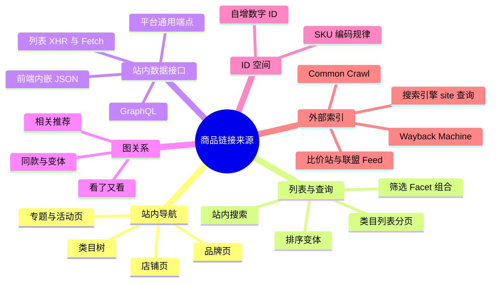
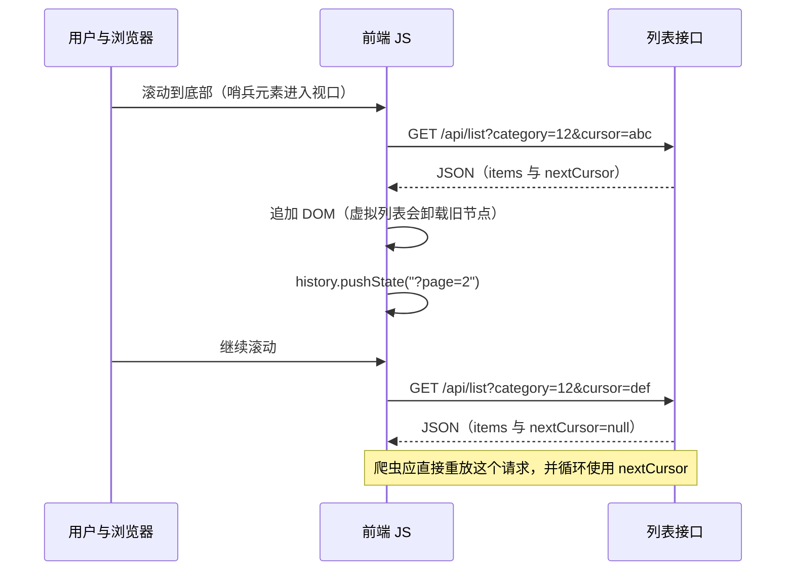
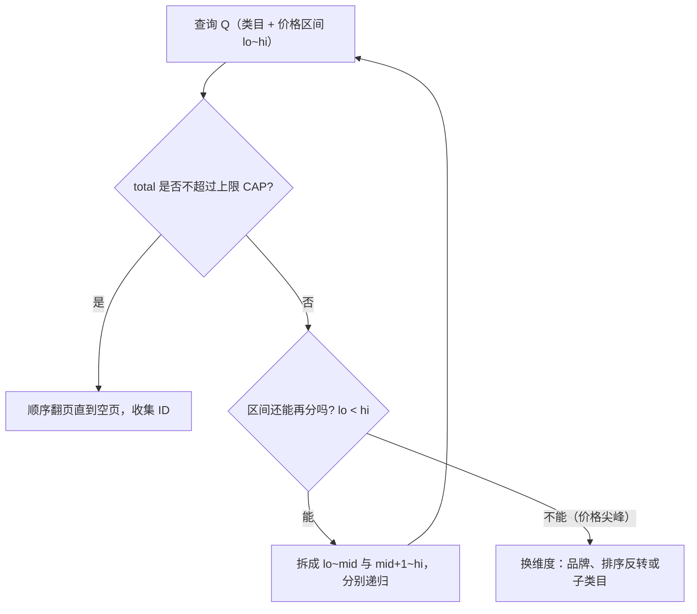
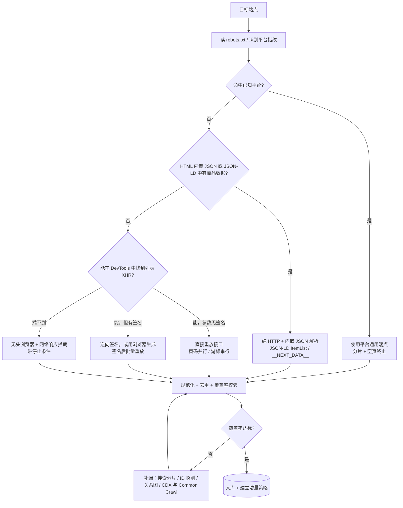
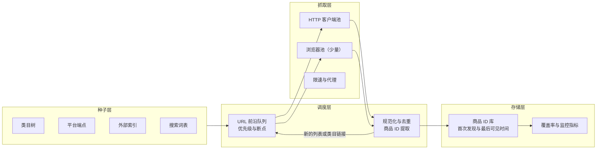

[toc]

## 无站点地图时的电商商品链接发现与收集

> **范围**：目标电商站没有可用的 sitemap(不存在、只含类目、已过期、被 `robots.txt` 屏蔽，或站方故意不提供)，需要先产出一份**商品详情页 URL 清单**。本文只覆盖第一阶段——**链接发现与收集(URL Discovery)**，不涉及详情页解析与反爬实现细节.
>
> **读者**：需要为采集项目做方案选型与落地设计的爬虫 / 数据工程师。默认环境：国内测试网络、海外生产服务器；目标站可能是海外独立站，也可能是国内平台与 SaaS 商城。
>
> **阅读路径**：先拿结论看 **一页速览** 与 **清单**；做方案选型看 **问题定义** 与 **按需求等级分层选型**；动手实现看 **链接发现策略**、**采集方案** 与 **参考实现**；验收"是否抓全"看 **覆盖率评估**。
>

---

## 一页速览

### 决策顺序：自上而下，够用就停

1. **S0 零成本探测**：`robots.txt`、sitemap 盲探与平台指纹。
2. **S1 平台结构化端点**：`products.json`、Store API、GraphQL、Feed。
3. **S2 列表接口直连**：XHR REST、GraphQL、Algolia、ES。
4. **S3 类目树遍历**：叶子类目加分类分页穷举。
5. **S4 查询空间切分**：按价格、facet、排序反转切开超上限的查询。
6. **S5 站内搜索与自动补全**：关键词枚举。
7. **S6 关系图遍历**：相关推荐 BFS。
8. **S7 ID / SKU 空间枚举**。
9. **S8 外部索引与商业数据源**：CDX、Common Crawl、搜索引擎、联盟 feed。
10. **统一出口**：规范化、去重与覆盖率校验后的商品 URL 清单。

排序反转、复合游标、facet 剪枝与增量扫描属于横切手段，可在上述各步中并行使用。

这个顺序表达的是**尝试顺序**，不是流水线：上层产出的覆盖率够用时就停止下探，各层产出都汇入同一个出口。实际项目通常同时启用 2 到 3 层，例如平台端点拿主体、类目遍历补长尾、外部索引做对账。

### 三个最该记住的判断

如果只记三件事，就是下面三条：

| 判断                 | 内容                                                                                                         | 影响                                       |
| -------------------- | ------------------------------------------------------------------------------------------------------------ | ------------------------------------------ |
| **通道决定成本**     | **发现成本(discovery cost)** = 请求数 ÷ 新发现的唯一商品数。平台 JSON 端点约 0.004，HTML 列表页约 0.02，靠推荐位滚雪球接近 1 | 差两个数量级，**先选通道，再谈并发**       |
| **上限是架构约束**   | Elasticsearch `index.max_result_window` 默认 10000、Algolia `paginationLimitedTo` 默认 1000、Shopify `page × limit` 上限 25000 | "最多 100 页"多半不是反爬，**切分是必修课** |
| **终止条件必须显式** | 以"空页"或 `hasNextPage=false` 判断结束，不以"本页不足 `limit`"判断                                          | 短页陷阱可造成数十个百分点的漏抓           |

---

## 问题定义：链接发现到底在解决什么

### 两个阶段与三个子问题

商品采集一般分两段：**链接发现(URL Discovery)** 与 **详情抓取(Detail Extraction)**。前者的产出是一份尽可能完整、去重、规范化的商品 URL(或商品 ID)清单，它决定了后续抓取的**覆盖率上限**；后者才逐条拉取价格、库存、属性。站点地图本质上就是站方替你做好的链接发现，没有它，需要自己回答三个子问题：

| 子问题               | 要回答的内容                                           | 典型手段                                     |
| -------------------- | ------------------------------------------------------ | -------------------------------------------- |
| **入口(seed)**     | 从哪些页面或接口开始？                                 | 首页导航、类目树、站内搜索首页、站外索引     |
| **扩展(expand)**   | 从已有页面还能挖出哪些 URL？                           | 列表分页、筛选维度、详情页推荐位、关联集合页 |
| **切片(partition)** | 结果数超过站点深分页上限时，怎么把集合切成足够小的份？ | 价格区间二分、类目 / 品牌枚举、关键词扫描、排序反转 |

**切片能力是方案之间的核心差异**。一个类目动辄几万 SKU，而列表页往往只允许翻到第 100 页或 1 万条；不具备切片能力的爬虫，抓到的永远是"最热的那一小撮"。最常见的错误是从首页开始写一个递归爬虫，而不先解决这三件事——它们比爬虫框架选型重要得多。

### 四个评价指标与一个成本口径

衡量发现方案有四个指标，彼此存在矛盾：

| 指标                           | 含义                                   | 典型矛盾                               |
| ------------------------------ | -------------------------------------- | -------------------------------------- |
| **覆盖率(Coverage)**         | 发现的商品数 ÷ 站点真实商品数          | 深度遍历提升覆盖率，但请求数随之暴涨   |
| **效率(Efficiency)**         | 每发现一个新 URL 的平均请求数 / 耗时   | 浏览器渲染慢且贵，接口直连快但需逆向   |
| **稳定性(Robustness)**       | 页面改版、反爬升级后的存活能力         | 依赖 CSS 选择器的方案最脆弱            |
| **增量能力(Incrementality)** | 第二次运行能否只发现新品与下架         | 全量遍历简单但浪费                     |

全文统一使用一个指标衡量效率：**发现成本(discovery cost) = 消耗的请求数 ÷ 新发现的唯一商品数**。参考量级：

| 通道                         | 单次请求产出 | 发现成本 |
| ---------------------------- | ------------ | -------- |
| Shopify `/products.json`     | 250 个商品   | ≈ 0.004  |
| HTML 列表页(每页 48 个)    | 48 个商品    | ≈ 0.02   |
| 详情页"相关推荐"滚雪球       | 数个         | 接近 1   |

三者相差两个数量级，所以**先选对发现通道，比优化并发更重要**。

### 术语约定

全文统一使用下列术语：

| 术语                       | 含义                                                                     |
| -------------------------- | ------------------------------------------------------------------------ |
| **深翻页上限(Cap)**      | 单个查询最多可见的结果数，通常等于每页条数 × 最大页码，或引擎的结果窗口 |
| **切片(Partitioning)**   | 把超过上限的查询空间拆成多个子查询，使每个子查询都能完整翻完             |
| **水合数据(Hydration)**  | 首屏直接内嵌在 HTML `<script>` 中的 JSON，如 `__NEXT_DATA__`             |
| **URL 前沿(Frontier)**   | 待抓取 URL 队列，含优先级、去重键、状态与断点                            |
| **规范 URL(Canonical)**  | 经规则链归一后的唯一 URL 形态，用于去重与统计                            |
| **短页(Short Page)**     | 返回条数少于 `limit` 但后面仍有数据的页                                  |
| **软 404**                 | 返回 HTTP 200，正文实为"商品不存在 / 已下架"                             |
| **SPU / SKU**              | 商品与最小库存单位；发现阶段通常以 SPU 为单位去重                        |

### 链接来源全景

无 sitemap 时，商品链接的来源可归为六类：前四类决定主线，后两类负责补漏与校验。



六类来源的分工：前三类在站内且最常用；**图关系**适合补漏长尾商品；**ID 空间**在 ID 可预测时效率极高；**外部索引**适合做种子与交叉验证。

---

## 从网站设计与实现看"链接发现面"

无站点地图时，商品清单一定通过某些**列表入口**暴露给用户，否则用户自己也找不到。因此发现方案的设计依据不是"通用爬虫技巧"，而是目标站的三件事：**信息架构、渲染方式、分页实现**。

### 信息架构：分类树是最稳定的骨架

电商站为了 SEO 与用户导航，几乎都有同一条主链：**首页 → 一级类目 → 叶子类目 → 列表页(可翻页、可筛选、可排序)→ 商品详情页(PDP)**。此外还有四条横向通道：站内搜索、品牌 / 店铺 / 活动页、详情页相关推荐、页脚与面包屑。

工程上要处理的四个细节：

- **必须**把"叶子类目列表"当作主通道。站方最希望商品被浏览到的地方就是这里，覆盖率通常最高。父类目结果往往是子类目的并集，重复翻页是纯浪费，除非怀疑有商品只挂在父类目下。
- **必须**意识到列表页只是一个"视图"，数据来自后端的查询接口(Search / Listing API)。爬虫的最优解通常是对接这个接口，而不是解析 HTML。
- **注意**多入口重复：同一商品常挂在多个类目、品牌页、标签页、专题页下。这既提高召回，也迫使你去重。
- **注意**隐藏分类：导航只露出热门类目，完整分类树常在"全部分类"页、页脚、水合 JSON 或 `/api/categories` 里；面包屑与 `BreadcrumbList` 结构化数据可以从详情页反推分类 ID。

**必须**记住类目树只是骨架，不是全集。不挂在任何类目下的商品(清仓、测试、地区限定、只通过活动页或搜索可达、下架后仍保留 URL)需要搜索、关系图或外部索引来补。

### 渲染方式决定"链接藏在哪一层"

渲染模式决定商品链接落在哪一层，判定模式之后再选采集手段：

| 渲染模式                   | 典型技术                                                                 | 商品链接所在位置                                       | 对采集的含义                             |
| -------------------------- | ------------------------------------------------------------------------ | ------------------------------------------------------ | ---------------------------------------- |
| **SSR / 传统服务端渲染**   | PHP 模板、Django、Magento Luma、Shopify Liquid                           | 直接在 HTML 的 `<a href>` 里                           | 纯 HTTP 即可，最便宜                     |
| **SSG / 预渲染**           | Next.js 静态导出、Nuxt generate                                          | HTML 里有链接，常同时附带注水 JSON                     | 同上，且 JSON 更结构化                   |
| **CSR / 纯前端渲染(SPA)** | React / Vue 直出空壳 + XHR                                              | 不在 HTML 里，在 XHR / GraphQL 响应里                  | 要么逆向接口，要么渲染                   |
| **混合 / 水合(Hydration)** | `__NEXT_DATA__`、`window.__NUXT__`、`window.__INITIAL_STATE__`、Apollo 缓存 | 首屏列表以 JSON 内嵌在 HTML 的 `<script>` 里           | 纯 HTTP 即可拿到结构化数据，**性价比极高** |
| **流式 RSC**               | Next.js App Router(React Server Components)                            | 链接在 HTML 中，数据以 `self.__next_f.push` 分片内嵌   | HTML 解析仍可用，JSON 解析需拼接分片     |

**第一步必须判定渲染模式**。做法是在 DevTools 中禁用 JavaScript 并刷新：留下来的内容就是服务端渲染的部分("60 秒诊断法")；再启用 JS、打开 Network 面板过滤 Fetch/XHR，观察翻页时发出的请求。

关于水合 JSON 的可靠性：Next.js Pages Router 站点无法移除 `__NEXT_DATA__`，因为 React 水合依赖它，所以它是**稳定的数据源**，且常直接携带整页商品列表(`pageProps.products`、`initialState`)与完整分类树。同思路的其他形态：

- `/_next/static/<buildId>/_buildManifest.js` 与 `/_next/data/<buildId>/<path>.json`：`buildId` 每次发布都会变，需动态提取；
- Nuxt 的 `window.__NUXT__`、SvelteKit 的 `__data.json`、Remix 的 `?_data=` 参数；
- 列表页 JSON-LD 的 `ItemList`、详情页的 `Product` 与 `BreadcrumbList`：服务 Google，改版概率远低于 CSS 类名，是**最稳定的解析目标**。

### 商品 URL 模式与规范标识

发现阶段最终要落到"什么是一个商品的规范标识"。常见模式与处理要点：

| URL 模式         | 示例                                                | 识别与规范化要点                                             |
| ---------------- | --------------------------------------------------- | ------------------------------------------------------------ |
| **slug 型**      | `/products/merino-wool-base-layer`                  | 按路径前缀识别；slug 可能变化，应以页面内商品 ID 为主键      |
| **ID 型**        | `/item/123456.html`、`/p/123456`                    | 正则识别；**可枚举**(见 **ID / SKU 空间枚举**)                            |
| **slug + ID**    | `/dp/B08XXXX`、`/p/merino-base-layer-123456`        | 以 ID 为主键，slug 仅用于展示                                |
| **带变体参数**   | `/products/abc?variant=4567&color=red`              | 去掉变体参数后归并为同一 SPU；是否保留取决于要 SPU 还是 SKU  |
| **多入口重复**   | `/collections/sale/products/abc` 与 `/products/abc` | 读取 `<link rel="canonical">` 统一为规范 URL                 |

三层概念需要辨析清楚：

- **SPU 与 SKU**：一个商品页(SPU)可能对应多个变体(SKU)。发现阶段通常**以 SPU 为单位去重**，变体留给详情阶段。
- **canonical**：列表页链接常带追踪参数或分类上下文(`?ref=cat_12`)，应以页面 `canonical` 标签或自定义规则统一。
- **ID 可枚举性**：自增整数 ID 意味着可以枚举；随机 slug 或哈希则不行。

**唯一键优先级**(从强到弱)，决定去重的质量：

1. 平台商品 ID(Shopify `id`、Magento `sku`、WooCommerce `id`)；
2. URL 路径中的数字 ID，如 `/product/123456`；
3. 规范化后的 slug 路径；
4. 规范化后的完整 URL。

### 分页与"加载下一页"的实现全景

分页实现方式直接决定能否穷举一个列表、能否并发、以及上限在哪里。下表按机制整理，这是全文最需要逐行对照的一张表：

| 实现方式                        | 前端表现                              | 请求特征(示例)                                             | 可预测性             | 采集处理                                             | 难度   |
| ------------------------------- | ------------------------------------- | ------------------------------------------------------------ | -------------------- | ---------------------------------------------------- | ------ |
| **服务端页码(SSR Page)**      | 底部 `1 2 3 … 下一页`                 | `GET /c/phones?page=3`                                       | 高，可并行任意页     | 直接构造 URL；HTML 或水合 JSON 内有商品链接           | 低     |
| **偏移分页(Offset/Limit)**    | 同页码，或由接口驱动                  | `GET /api/list?offset=96&limit=48`                           | 高，可并行           | 调大 `limit` 到实测上限；按 `total` 计算总页数        | 低     |
| **游标分页(Cursor)**          | 加载更多、无限滚动                    | `GET /api/list?cursor=eyJpZCI6...`                           | 低，只能串行         | 跟随 `nextCursor`，保存游标做断点续采                | 中     |
| **键集分页(Keyset/Seek)**     | 同上                                  | `?after_id=12345`、`?since=2024-...`                         | 中，排序键可猜则可并行 | 按排序键续采；可组合为复合游标                     | 中     |
| **Link 响应头(`rel="next"`)** | 无                                    | `Link: <...page_info=xx>; rel="next"`                        | 高                   | 读响应头，不要自己拼参数                             | 低     |
| **"加载更多"按钮**              | 点击追加                              | 点击触发 XHR / Fetch                                         | 取决于底层分页       | 抓接口，不模拟点击；注意签名 / CSRF token            | 中     |
| **无限滚动**                    | 滚到底自动加载                        | `IntersectionObserver` 触发 Fetch                            | 取决于底层分页       | 同上；万不得已才让浏览器滚动                         | 中     |
| **SPA 内嵌状态(Hydration)**   | 首屏直出                              | `__NEXT_DATA__`、`window.__INITIAL_STATE__`、`__NUXT__`      | 高                   | 解析内嵌 JSON，比解析 DOM 更稳                       | 低到中 |
| **流式 RSC**                    | 首屏直出                              | `self.__next_f.push(...)` 分片                               | 高                   | 拼接分片，或改走 API                                 | 中     |
| **GraphQL**                     | 任意                                  | `POST /graphql`，变量含 `first` / `after` 或 `pageSize` / `currentPage` | 视结构而定           | 复用站点 query 改变量；持久化查询只能重放哈希        | 中     |
| **托管搜索服务**                | 任意                                  | Algolia(`*-dsn.algolia.net`)、ES 代理、Typesense          | 高                   | 直接调用，单页可拉数百到上千条；受结果窗口上限约束   | 低到中 |
| **虚拟列表(Virtual Scroll)**  | 长列表流畅滚动                        | DOM 只保留可视区域节点                                       | —                    | **从 DOM 抓会丢数据**，必须拦截网络响应              | 高     |
| **签名 / 加密参数**             | 任意                                  | 请求带 `sign`、`x-s`、时间戳                                 | 低                   | 逆向 JS，或用浏览器环境生成签名                      | 高     |
| **pushState 伪分页**            | 滚动时 URL 变为 `?page=N`，无整页刷新 | History API 更新地址                                         | 中                   | 直接请求该 URL 通常能拿到服务端渲染的该页            | 中     |
| **hash 分页**                   | `#page=3`                             | `#` 之后的内容不发送到服务端                                 | 低                   | 必须找 XHR；纯 HTTP 抓到的永远是第一页               | 中     |
| **POST 表单翻页**               | 传统 B2B / ASP.NET WebForms           | `__VIEWSTATE`、`__EVENTTARGET`                               | 中                   | 维护会话并回传 ViewState；并发不友好                 | 高     |

常见坑，逐条对应上表：

- **页码超上限时静默返回最后一页或第一页**，而不是 404。以"翻到第 N 页"为终止条件的循环会在此处空转；
- **排序不稳定导致跨页重复与漏项**：应选稳定排序键(ID、上架时间)，不要用相关性或个性化推荐排序；
- **游标有时效，且不能从中间续爬**：必须把 `endCursor` 落盘；
- **持久化查询(persisted query)的哈希绑定前端版本**，前端发版即失效；
- **`hash` 与纯客户端状态**：服务端永远只看到第一页；
- **`__VIEWSTATE` 体积膨胀**：传统 WebForms 站点每翻一页都要回传整块状态，不适合并发。

三个概念需要展开。

**偏移分页**：参数形如 `offset`(跳过多少条)与 `limit`(取多少条)，也可能是 `page` 加 `pageSize`；后端执行类似 `SELECT * FROM products LIMIT 50 OFFSET 100` 的查询。问题在于翻得越深越贵：以 Elasticsearch 为例，`index.max_result_window` 默认把 `from + size` 限制在 10000，取更深的结果需要用 `search_after`、scroll 或 point-in-time。这个限制是为了防止集群内存被过度消耗([Typesense](https://typesense.org/learn/elasticsearch-deep-pagination/)、[Pulse](https://pulse.support/kb/elasticsearch-index-max-result-window))。**所以很多"最多显示 100 页"并不是反爬，而是后端架构的硬约束**。

**游标分页**：依赖一个全局唯一的排序基准(主键 ID 或时间戳)，后端查询形如 `WHERE id > {last_cursor_id} LIMIT 50`，返回一个不透明字符串供下一页使用。在 Relay 规范里，`PageInfo` 必须包含 `hasPreviousPage`、`hasNextPage`、`startCursor`、`endCursor`([Relay 规范](https://relay.dev/graphql/connections.htm))，查询形如 `friends(first: 10, after: "opaqueCursor")`：

| 字段           | 含义                 | 爬虫用法                         |
| -------------- | -------------------- | -------------------------------- |
| `first`        | 本次向后取多少条     | 在服务端允许范围内调到最大       |
| `after`        | 从哪个游标之后开始取 | 填上一页的 `endCursor`           |
| `endCursor`    | 本页最后一条的游标   | 保存下来，作为断点续爬的检查点   |
| `hasNextPage`  | 后面还有没有数据     | **终止条件**，比"返回为空"更明确 |
| `edges[].node` | 实际数据(如商品)   | 从中提取商品 ID 或 handle        |

游标分页**不能并发跳页**，同一查询只能串行往下翻；提速只能**横向拆出多个查询链**(每个类目一条)，让它们并行。

**请求字段辨析**：逆向接口时这四个占位符最容易混淆。

| 占位符 / 字段         | 含义                                 | 辨析与注意事项                                                       |
| --------------------- | ------------------------------------ | -------------------------------------------------------------------- |
| `{limit}` / `{size}`  | 单页期望返回的最大条数               | 决定单次数据密度；**切忌**盲目填 9999，易触发 WAF(Web Application Firewall，Web 应用防火墙) 或后端报错 |
| `{offset}` / `{page}` | 偏移量或页码                         | 仅存在于偏移分页；`offset = (page - 1) × limit`                       |
| `{cursor}` / `{after}` | 游标字符串，指示下一批起点           | 仅存在于游标分页；**不可预测**，必须从上一页响应体原样回传            |
| `{facet_id}`          | 筛选条件 / 聚合维度标识(品牌、价格) | 突破深翻页上限的核心武器，见 **查询空间切分**                            |

**无限滚动与"加载更多"**只是前端交互形式，背后是同一个接口：



图里的意思是：滚动只是触发器，真正有价值的是那一次 `GET /api/list`。**推荐做法**是打开 DevTools 的 Network 面板，过滤 Fetch/XHR，滚动一次，找到返回商品数组的请求，然后在 Python 里重放它。

**虚拟列表**是这里最大的陷阱：React Window、vue-virtual-scroller 这类组件只渲染可视区域内的节点。若用 Playwright 滚到底再读 DOM，只能拿到最后几十个商品。有实测指出"滚动到底后解析 DOM，4000 个商品只拿到 30 个"，其结论是直接调用 XHR 数据源、完全不碰 DOM，既免疫该问题，成本也显著更低。**必须**改为监听网络响应(Playwright 的 `page.on("response")`)，或直接重放接口。

### 列表数据背后是谁：数据源与已知上限

识别数据服务类型能直接套用已知规律，省掉逐站试错：

| 数据源                                             | 请求特征                                                     | 已知限制与规律                                               |
| -------------------------------------------------- | ------------------------------------------------------------ | ------------------------------------------------------------ |
| **自研 REST**                                      | `/api/products?category=&page=`                              | 无通用规律，看响应里的 `total` 与 `has_more`                 |
| **GraphQL**                                        | `POST /graphql`，body 含 `query` 或 `persistedQuery` 的 sha256 | 多用 Relay 风格 `edges` / `pageInfo.endCursor`；持久化查询只能重放哈希 |
| **Algolia**                                        | 域名 `*.algolia.net` / `algolianet.com`，请求头含 `x-algolia-application-id` 与 `x-algolia-api-key` | 公开的 search-only key 本就给浏览器用；默认 `paginationLimitedTo=1000`，需按筛选条件切分 |
| **Elasticsearch / OpenSearch 类**                  | 自研 API 包装，响应含 `hits.total`、`aggregations`           | 默认 `index.max_result_window=10000`，超出报错，需切分或改用 `search_after` + PIT |
| **Typesense / Meilisearch**                        | 类似 Algolia，头带 `X-TYPESENSE-API-KEY` 等                  | 也有分页上限(通常可配置)                                   |
| **商业搜索 SaaS**(Bloomreach、Constructor、Klevu、Searchspring、Coveo) | 各自专用域名                                                 | 多有每次查询条数与总翻页上限                                 |
| **国内自研**(阿里云 OpenSearch、自研 ES、淘系 / 京东系签名接口) | 签名与风控严格                                               | 通常不走接口逆向，改走渲染或官方开放平台                     |

**关键规律：结果总数上限(Result Window Cap)**。无论 Algolia 的 1000 还是 ES 的 10000，都意味着单一查询不可能翻到底，必须切片。

关于 Algolia 还留有一处未解的分歧，见 **分歧与待确认事项**：一种说法是单次 `search` 受 `paginationLimitedTo` 约束、全量应改用 `browse` 接口按游标遍历；另一种说法是 `browse` 需要额外 ACL(access control list，访问控制列表)、公开的 search-only key 通常不可用。两说的共同点是：**公开 key 的权限边界必须先验证**，不要把它当成稳定的全量入口。

### 后端约束带来的四个坑

后端与前端实现的取舍，会在发现阶段留下四个固定坑：

| 坑                 | 表现                                                                                                         | 对策                                                             |
| ------------------ | ------------------------------------------------------------------------------------------------------------ | ---------------------------------------------------------------- |
| **翻页上限**       | 一个查询最多可见 N 条(每页条数 × 最大页码，或引擎的结果窗口)                                                | **查询空间切分**                                           |
| **结果漂移**       | 翻页过程中排序变化(销量、新品)，导致重复或遗漏                                                             | 选稳定排序键；多次遍历取并集；对相邻页做交集校验                 |
| **短页(Short Page)** | 返回条数少于 `limit` 并不代表到底。一项针对 Shopify 商店的实测发现，50 家中 4 家在目录未结束时返回短页，若在首个短页停止，其中一家会丢掉多达 93% 的商品([DEV 实测](https://dev.to/rslndev/we-tested-shopifys-productsjson-on-68-stores-the-limits-tutorials-dont-mention-1ofj)) | **以"空页"或 `hasNextPage=false` 作为终止条件**                   |
| **静默截断**       | 参数超限时服务端直接截到最大值而不报错。Shopify `/products.json` 的 `limit` 最大 250，传更大值被静默截断，不传默认 30；`page × limit > 25000` 时返回 HTTP 400([DEV](https://dev.to/odeeb/shopify-productsjson-pagination-250-limit-and-the-25000-cap-1g37)) | 每次校验实际返回条数，不假设参数生效                             |

---

## 链接发现策略：按发现成本从低到高

下面按**推荐使用顺序**排列：越靠前，发现成本越低、稳定性越高。每一节给出做法、判定标准与边界。

先给一张总览，便于按站点形态快速取舍：

| 方法                         | 典型产出规模       | 请求成本 | 覆盖率                   | 主要风险                                 | 对应小节 |
| ---------------------------- | ------------------ | -------- | ------------------------ | ---------------------------------------- | -------- |
| **平台 / 列表接口直连**      | 全站               | 极低     | 高(常含缺货商品)       | 需逆向，端点可能随时关闭                 | 4.2、4.3 |
| **站内搜索 + 切片**          | 全站               | 低       | 很高(用户可见即可搜到) | 深分页上限、排序不稳定                   | 4.5、4.6 |
| **类目树 + 分页递归**        | 类目内的全量       | 中       | 中(长尾与新品可能在树外) | 类目树深、叶子页仍超上限               | 4.4、4.5 |
| **详情页关联图扩展**         | 增量补漏           | 高       | 低(只作补充)           | 图爆炸、推荐位死循环                     | 4.7      |
| **站外索引**                 | 有索引的部分       | 低       | 低到中，冷启动友好       | 数据陈旧、分页受限                       | 4.9      |
| **ID / SKU 空间枚举**        | 理论上全量         | 极高     | 取决于 ID 密度           | 浪费巨大、易触发风控                     | 4.8      |
| **商业数据源(联盟 feed / 开放平台)** | 全量      | 花钱     | 高                       | 授权、字段受限、有费用                   | 4.9      |

原则：默认按**结构化端点 → 列表接口 → 类目树 → 切分 → 站内搜索 → 关联图 → 站外索引 → ID 枚举**的顺序推进，前一层能拿到 80% 就不要急着上后一层。顺序不是教条：类目体系混乱、大量商品不挂类目时，站内搜索应提到类目树之前；站点强对抗、直连代价高时，站外索引应提前。任何单一方法的覆盖率都不该被默认可信(见 **覆盖率评估**)。

### S0：先证伪"没有站点地图"

这一步成本最低、收益最高，值得花 10 分钟穷举。"没有 sitemap"在工程上要先证伪：很多站点只是**没在 `robots.txt` 里声明**，或者用了非标准路径。

| 探测目标           | 路径示例                                                                     | 说明                                                         |
| ------------------ | ---------------------------------------------------------------------------- | ------------------------------------------------------------ |
| **声明**           | `/robots.txt` 中的 `Sitemap:` 行                                             | 顺便读 `Disallow`，常能暴露 `/search`、`/api`、`/collection` 等真实路径 |
| **通用**           | `/sitemap.xml`、`/sitemap_index.xml`、`/sitemap-index.xml`、`/sitemap.xml.gz` | 大小写、下划线 / 连字符都要试                                |
| **Shopify**        | `/sitemap.xml`、`/sitemap_products_1.xml?from=1&to=9999999999999`、`/sitemap_collections_1.xml` | 只有商品分片、没有主索引的情况很常见                         |
| **WooCommerce**    | `/product-sitemap.xml`、`/sitemap_index.xml`(Yoast / RankMath)             | 分页形式为 `/product-sitemap2.xml`                           |
| **Magento**        | `/sitemap.xml`、`/pub/sitemap.xml`、`/media/sitemap/sitemap.xml`             | 后台生成，路径可配                                           |
| **BigCommerce**    | `/xmlsitemap.php`、`/sitemap.php?page=1`                                     | —                                                            |
| **Salesforce CC**  | `/sitemap.xml`、`/on/demandware.store/Sites-XXX-Site/zh_CN/`                 | 多站点前缀                                                   |
| **多语言 / 多地区** | `/en/sitemap.xml`、`/zh-cn/sitemap.xml`、`/us/sitemap.xml`                   | 从 `hreflang` 与语言切换菜单取前缀                           |
| **搜索式**         | 搜索引擎 `site:example.com sitemap`                                          | 有人把 sitemap 放在奇怪域名或目录里                          |
| **归档**           | Wayback 里的旧 sitemap                                                       | 改版删掉 sitemap，但归档还在                                 |

**归档里的旧 sitemap**：站点现在不给，通常历史某个版本给过。先用 CDX 列出所有 xml 快照，再取最近一份：

```bash
curl -s "http://web.archive.org/cdx/search/cdx?url=example.com&matchType=domain\
&output=json&fl=original,timestamp,statuscode&filter=mimetype:application/xml&limit=-20"
```

拿到 `original` 与 `timestamp` 后，用 `https://web.archive.org/web/<timestamp>id_/<original>` 取原始内容(`id_` 后缀表示不加归档工具栏、返回原始字节)。

**实测记录**(`books.toscrape.com`，公开练习用沙盒站)：CDX 前缀查询可用，但返回结果混有 `.../catalogue/'`、`.../index.htmlXPath` 这类脏数据，说明**归档数据必须清洗**，不能直接当清单用。

```bash
curl -s "http://web.archive.org/cdx/search/cdx?url=books.toscrape.com/catalogue/\
&matchType=prefix&output=json&fl=original&collapse=urlkey&limit=5"
# 返回中包含：
# http://books.toscrape.com:80/catalogue/'
# http://books.toscrape.com/catalogue/10-day-green-...-581/index.htmlXPath
```

其它"小入口"，很多方案漏掉它们：`robots.txt` 里的遗留 sitemap 路径；RSS / Atom 的新品 feed；列表页 JSON-LD 的 `ItemList`；`sort=newest` 排序(增量发现的利器)；页脚的"全部品牌""全部分类"页。

### S1：平台指纹识别与通用端点

很多独立站并非自研，而是基于 SaaS 或开源平台，这些系统往往自带**公开的、未在站点地图中声明的结构化端点**。**第一步应该先识别平台**，命中后可直接"抄近路"。

| 平台                                   | 识别特征                                                       | 可用端点                                                                 | 注意事项                                                     |
| -------------------------------------- | -------------------------------------------------------------- | ------------------------------------------------------------------------ | ------------------------------------------------------------ |
| **Shopify**                            | `cdn.shopify.com`、`Shopify.theme` 全局变量、`/collections/` 路径、响应头 `x-shopify-stage` | `/products.json?limit=250&page=N`、`/collections.json?limit=250`、`/collections/{handle}/products.json`、单商品 `/products/{handle}.json` | 每页最大 250；`page × limit > 25000` 返回 400；**短页不代表结束**；约四分之一店铺会拦截或返回 404；Admin API 走 `page_info` 游标 |
| **WooCommerce**【待核】                | `wp-content/plugins/woocommerce`、`/wp-json/`、`/product/` 路径 | `/wp-json/wc/store/v1/products?per_page=100&page=N`(Store API，免鉴权)、`/wp-json/wp/v2/product` | 每页最大 100；响应头 `X-WP-Total` 与 `X-WP-TotalPages` 可估总量；站点可能禁用 REST |
| **Magento 2 / Adobe Commerce**【待核】 | `/static/version…/frontend/`、`mage/` 脚本、`mage/cookies`         | `POST /graphql`(`products(filter, pageSize, currentPage)`)、`/rest/V1/products?searchCriteria[pageSize]=100` | GraphQL 返回 `total_count`，便于对账；REST 多数需 token       |
| **BigCommerce**                        | `cdn11.bigcommerce.com`                                        | Storefront GraphQL `/graphql`(token 在页面里)、`/search.php?search_query=` | 游标分页；token 需从前端 JS 提取                              |
| **Salesforce Commerce Cloud**          | `/on/demandware.store/`、`dwvar_` 参数                          | `Search-UpdateGrid?cgid={category}&start=0&sz=60`                         | 返回 HTML 片段；`start/sz` 偏移分页，极易并行                 |
| **PrestaShop**                         | `prestashop` 标记、`id_product=`、`ws_key`                      | `?controller=category&id_category=N&page=M`、`/api/products?display=full&limit=100` | ID 型 URL，可枚举；API 需 webservice key                     |
| **Shopware**                           | `/store-api/`                                                  | `/store-api/product` + 头 `sw-access-key`                                 | access key 在前端                                             |
| **Next.js 自研**                       | `__NEXT_DATA__`                                                | 页面内 JSON、`/_next/data/{buildId}/...json`                              | `buildId` 每次发布都会变，需动态提取                          |
| **国内出海建站**(Shopline、Shoplazza、Ueeshop) | 各自 CDN 域名                                          | 部分提供类 Shopify 的 `/products.json` 风格接口                           | 文档公开度低，需逐站验证                                      |

**国内 SaaS 商城与海外不同**：普遍**没有** `products.json` 这类免鉴权公开端点，商品接口一律要 app key + 店铺授权。因此自有店铺走官方 API 是最短路径；第三方店铺只能退回搜索 / 类目 / 站外索引三件套。

| 平台       | 端点(需授权)                                            | 备注                                     |
| ---------- | --------------------------------------------------------- | ---------------------------------------- |
| **微信小店** | `shop/api/getproductlist`(需 `access_token`)            | 官方开放接口，商品 ID 与类目树可全量拉取 |
| **微店**     | `weidian.item.shop.list.get`、`vdian.shop.item.list.get`  | OAuth 授权后分页取全量                   |
| **有赞**     | 有赞云开放平台"商品列表"类接口                            | 需应用授权；连锁按店铺维度               |
| **微盟**     | 开放平台商品 API                                          | 需应用授权                               |

**Shopify 实测**(2026-10-22，`allbirds.com`)：

```bash
curl -s "https://www.allbirds.com/products.json?limit=250&page=1" | head -c 200
# {"products":[{"id":7340901859408,"title":"Women's Allbirds Flip Flop - Dusty Pink","handle":"...
```

| 请求                   | 结果                                                                 |
| ---------------------- | -------------------------------------------------------------------- |
| `?limit=250&page=1`    | 200，返回 **250** 条                                                 |
| `?limit=500&page=1`    | 200，仍返回 **250** 条，说明**每页上限就是 250**                     |
| `?limit=250&page=2`    | 200，返回 250 条，与第 1 页不同                                      |
| `?limit=250&page=99`   | 200，返回 `{"products":[]}`，**越界不报错，用空数组判断结束**        |
| `/collections.json?limit=5` | 200，含 `handle` 与 `products_count`，可用于枚举集合            |

因此 Shopify 站的发现逻辑极简：`page` 从 1 递增，`products` 为空即停；再用 `collections.json` 把所有集合过一遍(集合通常比 `/products.json` 更全，能捞到未上架到主目录的商品)。大店需要按集合分片，再按商品 `id` 合并去重。

### S2：站内列表接口直连

**做法**：用 DevTools 找出类目列表或搜索的 XHR 接口，分析参数(类目 ID、页码或游标、排序、筛选、每页条数)，写成参数化的请求生成器。

**最佳实践**：

- **必须**先试探 `pageSize` / `limit` 的上限(试 48、100、200、500)，再用实际生效的最大值。这一步往往就能把请求数降几倍，但**切忌**直接填 9999，容易触发 WAF 或后端报错。
- **应该**只请求能拿到 ID 的最小字段集：GraphQL 可裁剪 query，Algolia 用 `attributesToRetrieve` 只留 `objectID` 与 `slug`，响应体可缩小一个数量级。
- **应该**记录接口返回的 `total` / `nbHits` / `total_count`，它是后续切片与覆盖率对账的唯一可信基准。
- **避免**复用浏览器里带一次性签名的请求长期跑：签名过期会大面积失败，要么找出签名算法，要么让浏览器环境生成签名。
- **注意** JSON 接口返回的商品常比列表页 HTML 更全——缺货商品常被前端过滤但接口仍返回。目标是"全量含下架"时优先走接口。

**通用逆向套路**(约 30 分钟)：

1. 打开列表页，在 Network 面板过滤 Fetch/XHR，清空记录。
2. 点"下一页"或改筛选条件，观察新增请求，记录参数名(`page`、`offset`、`cursor`、`after`)。
3. 按响应大小排序——承载商品列表的往往是最大的几个 JSON 响应。
4. 逐个删参数，只留最小集，看是否仍返回数据；再把 `limit` / `hitsPerPage` 调大，看服务端是否放行。
5. 记录 `total` 与字段结构，作为后续监控基线。

定位接口的几种辅助线索：

- **URL 特征**：`/api/`、`/v1/`、`/graphql`、`/_next/data/`、`/__data.json`、`/ajax/`、`*.algolia.net`。
- **读打包后的 JS**：全局搜索 `fetch(`、`axios`、`baseURL`、`API_URL`，常能找到前端未触发过的接口，例如返回完整分类树的 `/api/categories`。
- **GraphQL introspection**：先试 `{"query":"{__schema{types{name}}}"}`，开着就能看清 `products(first:, after:)` 之类结构；关闭时只能重放持久化查询。
- **移动端接口优先**：APP 或小程序的 API 通常更轻量、历史包袱少、返回 JSON 更纯粹，对请求头的校验也可能更宽松。用抓包工具(Charles、mitmproxy)对照 Web 与 App 两套请求。
- **TLS / HTTP 指纹**：不少站点对非浏览器指纹直接返回 403。Python 侧 `curl_cffi` 的 `impersonate` 是当前低成本的主流做法【待核】。

**隐藏 API 的代价**是私有、无文档、可随时变更，**必须**配监控与告警，例如每日比对 `total` 与字段结构是否变化。

### S3：类目树遍历

**做法**：从首页导航、页脚或"全部分类"页解析类目树，下钻到**叶子类目**，再对每个叶子类目翻页。

标准四步：

1. 首页导航与页脚抽取一级类目(页脚的"全部品牌""全部分类"往往是入口金矿)；
2. 逐层下钻到叶子类目，记录每层的 URL 模板；
3. 叶子列表页读取 `total`；
4. `total` 未超上限则顺序翻页，超了就在该节点切片。

要点：

- **必须只翻叶子类目**。父类目结果是子类目并集，重复翻是浪费，除非怀疑有商品只挂在父类目下。
- **应该**为每个类目记录 `total` 与实际抓到数量，差异大的类目重点排查。
- **可以**用"类目 URL 模式 + 数字 / 字母枚举"扩展类目树(`/category/12`、`/c/12345`)，比逐层递归更快。
- **应该**把完整分类树优先从水合 JSON 或 `/api/categories` 取，一次请求即可省掉逐层 BFS。
- Scrapy 可用 `CrawlSpider` 加 `LinkExtractor(allow=...)` 声明式提取；Crawlee 可用 `enqueueLinks({ globs, strategy })` 加持久化 `RequestQueue`【待核】。

### S4：查询空间切分，突破翻页上限

当一个类目有 5 万个商品，但最多只能看到 100 页 × 48 条 = 4800 条时，就需要把大查询**切成多个小查询**，每个子查询的结果都不超过上限，最后取并集。这是无 sitemap 场景里含金量最高的技术，业界对它的叫法有切片(partitioning)、条件拆分(facet splitting)、降维。

**判定标准**：先探测 `total`，`total ≤ CAP` 时直接翻页；`total > CAP` 时切片。探测只需要一次请求(用 `size=1` 把成本压到最低)，能避免在一个注定超限的查询上白翻 100 页。

常用切分维度：

| 维度                | 做法                               | 优点                                 | 缺点                                     |
| ------------------- | ---------------------------------- | ------------------------------------ | ---------------------------------------- |
| **价格区间**        | `price_min` / `price_max` 自适应二分 | 连续、可无限细分，几乎所有电商都支持 | 遇到同价商品密集的"价格尖峰"时切不动     |
| **品牌 / 属性 Facet** | 按品牌、颜色、尺码等枚举           | 离散，接口通常给出每个值的计数       | 有的商品没有该属性，需要补"未分类"查询   |
| **排序反转**        | 同一查询分别按升序、降序各翻一遍   | 不改筛选条件就能把可见量翻倍         | 只能翻倍，适合总量略超上限的情况         |
| **上架时间**        | 按时间窗口切分                     | 天然支持增量                         | 不是所有站点开放这个筛选                 |
| **店铺 / 卖家**     | 按卖家枚举                         | 平台型电商很有效                     | 卖家列表本身也需要先发现                 |

由此可以整理出四种通用切法：

| 切法                 | 做法                                                                 | 适用                                 |
| -------------------- | -------------------------------------------------------------------- | ------------------------------------ |
| **排序反转(双端法)** | 同一查询分别 `sort=price_asc` 与 `sort=price_desc` 各取前 C 条        | `total ≤ 2C` 时一举拿下，最省事       |
| **游标续采**         | 升序取前 C 条，记住第 C 条的排序键值 `p`，下次加 `price_min=p` 再取 C 条，循环 | 支持对排序键过滤时最通用，能线性扫完全站 |
| **facet 切片**       | 按类目 / 品牌 / 颜色 / 评分枚举，每个值单独查询                      | facet 维度多且分布均匀时最稳          |
| **关键词扫描**       | 用 `a`~`z`、品牌名、型号前缀等做查询词轮询                           | 无 facet、无排序参数时的兜底，覆盖率不可控 |

**排序键必须稳定**(价格、上架时间、ID)，不要用 `relevance` 或"推荐"——后者带个性化，两次请求结果会漂移，翻页必然重复与漏项。

**双端法的算术**很直观：`total = 13780`、`C = 10000` 时，升序取前 10000 条、降序取前 3780 条，两段并集即全量：

```python
total, C = 13_780, 10_000
# 升序取前 10000 条 + 降序取前 3780 条，两段并集即全量
ranges = [(0, C, "price_asc"), (0, total - C, "price_desc")]
```

**自适应二分**的流程如下：



含义：先用一次轻量请求拿到 `total`；没超上限就直接翻完；超了就把价格区间对半拆开递归；拆到单一价格点仍超限(例如大量商品都标价 99 元)，换一个维度继续切。

下面是在沙箱中用模拟站点验证过的核心逻辑(6 万商品、上限 4800、43 次探测后全部找到)。真实使用时把 `fetch_list` 换成实际 HTTP 调用即可：

```python
"""查询空间自适应二分：列表接口存在"最多可翻页数"上限时，按价格区间切分直到每个分区可被完整翻页。"""
import asyncio

CAP = 48 * 100   # 单个查询最多可见结果数 = 每页条数 × 最大页码
PAGE_SIZE = 48

async def fetch_list(price_min: int, price_max: int, page: int):
    """返回 (total, items)。价格单位为"分"，区间为闭区间。
    真实实现：httpx/curl_cffi 请求列表接口，解析 total 与商品 ID 列表。"""
    raise NotImplementedError

async def enumerate_range(lo, hi, seen):
    page = 1
    while True:
        _, items = await fetch_list(lo, hi, page)
        if not items:              # 只认"空页"为终止信号，不依赖"短页"
            break
        seen.update(items)
        page += 1

async def discover(lo, hi, seen, stats):
    total, _ = await fetch_list(lo, hi, 1)   # 探测请求：只为拿 total
    stats["probe"] += 1
    if total == 0:
        return
    if total <= CAP:
        await enumerate_range(lo, hi, seen)
    elif lo == hi:                 # 单一价格点仍超限：记录下来，交给其他维度处理
        stats["overflow"].append((lo, total))
        await enumerate_range(lo, hi, seen)
    else:
        mid = (lo + hi) // 2       # 用整数"分"，避免浮点边界造成重叠或遗漏
        await discover(lo, mid, seen, stats)
        await discover(mid + 1, hi, seen, stats)
```

| 名称                | 含义                                                                 |
| ------------------- | -------------------------------------------------------------------- |
| `CAP`               | 单个查询最多能看到的结果数，需实测(翻到第几页开始返回空或报错)     |
| `lo`、`hi`          | 当前价格区间的下界与上界(闭区间，单位为分)                         |
| `total`             | 接口返回的命中总数；接口不给总数时，可用"第 CAP/PAGE_SIZE 页是否非空"判断 |
| `seen`              | 已发现商品 ID 集合，用于去重；生产环境换成 Redis Set 或布隆过滤器    |
| `stats["overflow"]` | 无法再按价格切分的价格尖峰，交给品牌、排序等维度二次切分             |

**游标续采**是不需要总数、也不需要二分的另一种通用解，只要排序稳定且支持对排序键过滤：

```python
def sweep(query, fetch, cap=10_000, key="price"):
    cursor = None
    while True:
        q = {**query, "sort": f"{key}_asc"}
        if cursor is not None:
            q[f"{key}_min"] = cursor        # 从上一批末尾继续
        _, items = fetch(q, offset=0, limit=cap)
        if not items:
            return
        yield from items
        new_cursor = items[-1][key]
        if new_cursor == cursor:            # 游标不前进 = 同值商品堆死
            break                           # 交回上层，改用 (key, id) 复合游标或枚举 facet
        cursor = new_cursor
```

**facet 组合爆炸与剪枝**。有 N 个维度、每维 M 个值时，全组合是 M^N，不可行。实际做法：

- 先切**基数大、分布均匀**的维度(品牌 > 类目 > 颜色)；
- 每次只切一层，读完子查询的 `total`，仍超上限就继续下一层，`total ≤ CAP` 立即停止下钻；
- 用"最不平衡分支优先"：切完一批后只挑 `total` 最大的那支继续切，其余直接翻页，这样并发度可控、浪费最少；
- 记录每个节点的 `(路径, total)`，形成可审计的切片树，出问题时能定位到哪一支没抓全。

**易错点**：

- **避免**用浮点价格二分。`[0, 99.99]` 与 `[99.99, 200]` 这样的边界会重复或漏项。**应该**统一换算成整数分，并使用闭区间。至于子区间是否重叠，两份来源给出了不同主张(不重叠 `lo~mid` / `mid+1~hi` 与重叠 `<=` / `>=`)，见 **分歧与待确认事项**。
- **必须**先拿已知商品做价格筛选的语义测试：含不含边界？按原价还是折后价？多规格商品按哪个价格？
- **必须**有"进展检测"：切完两个子查询的 `total` 之和没有明显变小(例如仍 ≥ 原来的 98%)，说明这一维失效(同价商品扎堆)，立刻换维度。
- **避免**依赖"二分必然减半"：真实价格分布是长尾的，可能一边 3% 一边 97%，递归深度很不均匀，应改用任务队列加并发。

**切法失效的六种情形**，建议直接写成探针里的断言：

| 失效场景             | 表现                                             | 判据与对策                                                     |
| -------------------- | ------------------------------------------------ | -------------------------------------------------------------- |
| **facet 被站点封禁** | 带筛选参数的 URL 返回简化页，或 canonical 指回类目页 | 先测 `?color=red` 是否真的改变结果集；Google 官方就建议站点收敛 facet 组合，说明封禁是普遍做法 |
| **同价商品扎堆**     | 游标不前进；二分后两侧 `total` 不变              | 换 `(price, id)` 复合游标；或改用类目 / 品牌维度切             |
| **个性化排序**       | 同样请求两次结果不同                             | 换稳定排序键；抽样比对两次结果重合率，低于 80% 说明排序不可用  |
| **无限筛选陷阱**     | 能生成无限多 URL，但每条都没有实际商品           | 只抓有 canonical、有价格、有加购按钮的页面；URL 模式加白名单    |
| **软 404**           | 返回 200，正文是"商品不存在 / 已下架"            | 校验页面必含价格或加购；按 **抽样验真** 的统计方法验收                 |
| **切完去重骤减**     | 抓到 10 万，去重后剩 3 万                        | 维度之间高度交叉(如颜色 × 尺码)，改按单维度切或只保留一个维度 |

### S5：站内搜索与自动补全

**做法**：用关键词驱动搜索接口。关键词来源有四类：

- 类目名、品牌名、属性值词表；
- **搜索联想(Autocomplete)前缀枚举**：`a` 到 `z`、`0` 到 `9`、常用汉字或拼音首字母、两字母组合；
- 已抓商品标题分词后的高频词，形成"滚雪球"式扩展；
- **空查询技巧**：搜索页常支持空串列出全部商品。空串可能被前端拦截，但 URL 编码空格 `%20` 往往能过，形态为 `/search?q=%20` 或 `/search?keyword=%20&page=1`。

**适用场景**：类目体系混乱，或大量商品不挂类目。**优点**是"用户可见即可搜到"，召回常常优于类目遍历；**缺点**是覆盖率难以证明、结果重叠度高，且同样受深翻页上限约束、同样需要切片。

**推荐**把搜索作为补漏与交叉验证通道，而不是唯一主体，并且配合统计：记录"每批新增比例"，比例趋近于零就停止扩展。搜索联想接口(`/api/suggest?q=`)通常限流更松、响应更小，是枚举商品名或 ID 的高效入口。

### S6：商品关系图遍历

**做法**：把详情页里的"相关推荐""同店商品""看了又看""同款其他规格"当作图的边，从已知商品出发做 BFS。

**特点**：发现成本高，每个详情页只带出几个到几十个新链接，且推荐算法偏向热门商品；但它能发现**不在类目或搜索中出现的孤儿商品**。

控制图爆炸的三条规则：

1. 对已收集 URL 抽样(例如 10%)抓详情页抽取站内商品链接，不必全量；
2. 新链接只**入队**、不立即跟进，按来源质量打优先级；
3. 深度上限 1 到 2 跳——到第 3 跳基本只剩热门商品，边际收益接近 0。

这条通道的最佳用法是做**交集分析**：把它与类目树结果求差，差集就是类目树漏掉的长尾。它也适合作为发现与详情阶段的合并执行产物。

### S7：ID / SKU 空间枚举

**做法**：商品 URL 形如 `/p/1029384` 时，直接枚举 ID 区间。

只有在下列条件**同时成立**时才值得做：

- URL 由自增整数 ID 构成，且分布密集；
- 校验成本低(HEAD 或轻量 JSON 接口，单请求 < 100 ms)；
- 站点没有把风控做到"连续 404 就封 IP"。

**先算成本再动手**：`请求数 ≈ ID 空间跨度 ÷ 平均命中率`。例如 ID 从 1 到 2,000,000、命中率 30%，就要发出约 200 万次请求——在多数站点上等于自杀。所以更现实的用法是**局部填补**：已知某类目 ID 区间(如 120000~135000)时，用它补齐分页漏掉的部分。

三步操作：

1. 采样已知商品 ID，估计最小值、最大值与**密度**(有效 ID 占比)；
2. 密度高(例如超过 30%)时顺序枚举，用轻量请求判断存在；密度低时只在已知 ID 附近的"热区"枚举；
3. 关注最大 ID 的增长，用于增量发现新品。

**必须**处理 4 种异常：软 404(200 但正文是"商品不存在")、已下架返回 410、重定向到类目页、限流。**避免**对 UUID、哈希 ID 或稀疏空间盲扫，404 洪水既浪费资源又触发风控。

### S8：外部索引与商业数据源

这一类对目标站**零负载或低负载**，特别适合冷启动、对抗性强的站点，以及覆盖率对账。

| 来源                            | 用法(示例)                                                 | 说明                                                         |
| ------------------------------- | ------------------------------------------------------------ | ------------------------------------------------------------ |
| **Common Crawl Index**          | `https://index.commoncrawl.org/CC-MAIN-YYYY-WW-index?url=example.com/p/*&output=json` | 主索引站提供查询 API，是 CDX server API 的变体([官方公告](https://commoncrawl.org/blog/announcing-the-common-crawl-index))；`cdx_toolkit` 封装了分页接口并默认单线程礼貌访问([cdx_toolkit](https://github.com/commoncrawl/cdx_toolkit))；域名级大批量需求走 Athena 查列式索引 |
| **Wayback Machine CDX**【待核】 | `https://web.archive.org/cdx/search/cdx?url=example.com&matchType=domain&fl=original&collapse=urlkey&output=json` | `matchType=domain` 含子域；`collapse=urlkey` 按 URL 去重；可加 `filter=statuscode:200`、`filter=original:.*/product/.*` |
| **gau、waybackurls、waymore**【待核】 | `gau example.com`                                            | 聚合多个归档源与 OTX、URLScan 的命令行工具(Go 编写，跨平台) |
| **搜索引擎**                    | `site:example.com inurl:/product/`                           | 分页有硬上限，只适合抽样估算规模，或把大查询切成品牌 / 类目 / 价格段 |
| **比价站与购物搜索**            | Google Shopping、Bing Shopping、Idealo、PriceRunner、什么值得买、慢慢买 | 含商家落地页链接与历史价格页，常能捞到已下架商品            |
| **联盟平台**                    | Awin、CJ、Rakuten、淘宝客                                    | 官方商品 feed(CSV / XML)，字段最干净且**有授权**，拿到即基本结束发现阶段 |
| **Google Merchant Center**      | 商家提交的 XML / CSV feed                                    | 通常含 `link` 字段，是干净的全量来源                         |

**CDX 常用参数**(每个都影响成败)：

| 参数              | 作用                          | 常用值                                                   |
| ----------------- | ----------------------------- | -------------------------------------------------------- |
| `url`             | 目标 URL 或前缀(唯一必需)   | `example.com/*`                                          |
| `matchType`       | 匹配范围                      | `prefix` / `host` / `domain` / `exact`                   |
| `output`          | 输出格式                      | `json`(首行是表头)                                     |
| `fl`              | 返回字段                      | `original,timestamp,statuscode,mimetype`                 |
| `filter`          | 字段级正则过滤                | `filter=original:.*/product/.*`、`filter=statuscode:200` |
| `collapse`        | 相邻去重                      | `collapse=urlkey`(每个 URL 只留一条)                   |
| `limit`           | 条数(默认上限 15 万)        | `limit=5000`，负数表示取最后 N 条                        |
| `from` / `to`     | 时间范围                      | `20240101`                                               |
| `page` / `pageSize` | 分页 API                    | 大结果集必用；`showNumPages=true` 可先算页数             |

```bash
# 拿某站所有商品类 URL（去重、只要 200）
curl -s "http://web.archive.org/cdx/search/cdx?url=example.com&matchType=host\
&output=json&fl=original,timestamp&collapse=urlkey\
&filter=original:.*/product/.*&filter=statuscode:200&limit=5000"
```

**CDX 实测注意**(2026-10-22)：

- 简单前缀查询稳定返回 200，速度快；
- 在**大站**上用 `filter=original:.*xxx.*` 这类全字段正则，容易超时或 502(对 `www2.hm.com` 的 host 级 + 正则查询即触发)。对策：先用 `matchType=prefix` 收敛到具体路径前缀再叠 `filter`，大结果集改用 `page` + `pageSize`；
- 结果**必须清洗**：会出现 `:80` 端口、`XPath` 后缀、单引号、重复的 `index.html` 变体(清洗规则见 **URL 规范化**)。

**用途三分**：(1) 冷启动种子；(2) 学习 URL 模式；(3) 覆盖率对账的独立参照系。它的缺点是**不新鲜、不完整、含已下架商品**，所以**必须**做规范化与存活校验，不能作为唯一来源。

**网络环境**：国内直连 `web.archive.org`、`index.commoncrawl.org` 与 GitHub 通常很慢或不稳定，测试时走本地代理：

- Linux / macOS：`export HTTPS_PROXY=http://127.0.0.1:7890`
- Windows PowerShell：`$env:HTTPS_PROXY="http://127.0.0.1:7890"`
- Windows CMD：`set HTTPS_PROXY=http://127.0.0.1:7890`

Python 的 `httpx` / `requests` 会自动读取(`httpx` 需 `trust_env=True`，默认即是)。生产部署在海外服务器上一般不需要代理，但目标站若是国内电商，要考虑海外 IP 被限速或跳转国际站。

**组合优于单选**：外部索引与站内通道的差异最大，两者并用才能做捕获-再捕获(**多源交叉法**)；只用一种来源时，覆盖率没有独立参照。

---

## 采集方案：架构与技术选型

### 渲染决策阶梯：能不用浏览器就不用

从平台识别到浏览器回退，构成一条成本递增的判定序列：



这条阶梯自上而下，资源消耗依次增加约一个数量级：浏览器渲染一页的 CPU 与内存开销，通常是纯 HTTP 请求的几十到上百倍，且更容易被行为检测识别。**推荐**只在必要环节使用浏览器，例如只用它拿 Cookie 或签名，批量请求仍走 HTTP 客户端；拿到后会立即**降级为纯 HTTP**。

### 发现系统的分层架构

把发现流程拆成四层，各层职责单一、可独立替换：



各层职责：

- **种子层**：给出初始入口。多来源并存，便于交叉验证。
- **调度层**：维护 **URL 前沿队列(URL Frontier)**，支持优先级(叶子类目优先、新品优先)与断点续爬(持久化游标与页码)。**规范化(Canonicalization)** 是去重的前提；**最好直接以商品 ID 作为主键**，因为同一商品可能对应多个 URL(带规格参数、不同类目路径)。
- **抓取层**：以 HTTP 客户端为主、浏览器为辅；按域名限速，429 / 503 用指数退避。
- **存储层**：每个商品记录 `first_seen` 与 `last_seen`。长时间没在列表中出现的，大概率已下架。

### 规模升级：什么时候才需要分布式

单机脚本足以覆盖绝大多数需求。只有规模到数十万级以上、且目标站不严格限速时，分布式才有意义：

| 阶段         | 技术栈                                                     | 关键做法                                                                                     |
| ------------ | ---------------------------------------------------------- | -------------------------------------------------------------------------------------------- |
| **单机脚本** | httpx / curl_cffi，或 Playwright                            | 顺序或小并发；切片串行；结果落 SQLite                                                        |
| **框架化**   | Scrapy + API 逆向 + 代理池；或 Crawlee(HTTP 与浏览器混合) | 偏移分页在回调里按 `total_pages` 批量 `yield` 请求；游标分页链式回调；中间件做代理轮转与限速  |
| **分布式**   | Go / Python asyncio + Redis 或 Kafka + 切片调度器           | 发现与抓取解耦：Master 只跑切片并投放"遍历任务"；Worker 把偏移分页任务拆成单页任务并发执行；游标分页无法横向拆页，只能**提高初始切分颗粒度**换取并行度 |

**Cursor 机制的并发妥协**值得单独记住：站点只支持游标分页时，Worker 无法拆分页码，唯一提速手段是切出更多小集合，让多条游标链并行推进。这也是 **S4：查询空间切分** 中"切片能力是核心差异"的另一重含义。

### 前沿队列(frontier)的数据结构

```sql
CREATE TABLE frontier (
  canonical_key TEXT PRIMARY KEY,   -- 规范化后的唯一键
  url           TEXT NOT NULL,
  kind          TEXT,               -- list | detail | api
  source        TEXT,               -- category_tree | search_slice | archive | related
  depth         INTEGER DEFAULT 0,
  priority      REAL,               -- 越大越先
  status        TEXT,               -- new | fetched | failed | skipped
  attempts      INTEGER DEFAULT 0,
  next_run_at   TIMESTAMP,
  discovered_at TIMESTAMP
);
CREATE INDEX idx_frontier_pick ON frontier(status, priority DESC, next_run_at);
```

优先级建议：`类目权重(销量 / 层级) × 新鲜度(上架时间) × 来源可信度`。宁可先抓 10 万个高价值商品，也不要平均用力。

这个结构沿用的是搜索引擎的经典设计：**双队列**——按 host 分队列保证礼貌性(同一站点串行、不同站点并行)，按优先级分队列保证质量。商用系统还会再加一层"变化频率"调度，对应到电商就是 **增量** 一节的策略。

### 工具选型

按语言与场景选，优先复用生态成熟、自带请求队列与去重能力的组合：

| 工具                            | 语言             | 适用                         | 备注                                                         |
| ------------------------------- | ---------------- | ---------------------------- | ------------------------------------------------------------ |
| **Scrapy**                      | Python           | 中大规模、规则化站点         | `CrawlSpider` 规则化提取链接；可配合 scrapy-playwright        |
| **Crawlee**                     | Node.js / Python | HTTP 与浏览器混合            | 内置请求队列、会话池、指纹；`AdaptivePlaywrightCrawler` 可在纯 HTTP 更快时自动切换 |
| **Playwright**                  | 多语言           | 签名生成、网络拦截           | 用 `page.on("response")` 抓接口数据，而不是读 DOM             |
| **httpx / curl_cffi**           | Python           | 高效重放接口                 | curl_cffi 可模拟浏览器 TLS 指纹【待核】                       |
| **w3lib**                       | Python           | URL 规范化                   | `canonicalize_url` 可直接用(Scrapy 依赖)                    |
| **katana**                      | Go               | 未知站点端点侦察             | ProjectDiscovery 出品，支持无头模式与 JS 端点解析【待核】     |
| **cdx_toolkit、gau、waymore**   | Python / Go      | 外部索引种子                 | 见 **外部索引与商业数据源**                                                     |
| **pybloom-live、RedisBloom**    | Python / Redis   | 大规模去重                   | 接受极小误判率换取内存与速度                                  |
| **Charles、mitmproxy**          | 桌面 / Python    | 移动端接口抓包               | 对照 Web 与 App 两套请求                                      |
| **商业托管方案**(ZenRows、ScraperAPI、Bright Data Web Unlocker、Octoparse) | SaaS | 强反爬、缺工程资源时         | 代处理 JS 渲染、验证码与 IP 轮换；成本与可控性需权衡          |

以上开源工具均免费、跨平台。Windows 上要注意两点：Scrapy 的部分依赖(如 Twisted)建议在虚拟环境中用 `pip` 安装；Playwright 首次使用需 `playwright install` 下载浏览器，国内可设 `PLAYWRIGHT_DOWNLOAD_HOST` 指向镜像【待核】。

---

## 工程化：规范化、去重、稳定性与增量

发现阶段不只是"找到链接"，还要让清单**可维护**。不做规范化，后面所有统计都是错的——同一个商品常见 5 到 10 个 URL 变体。

### URL 规范化

规范化的动作清单：

| 变体来源                                      | 处理                                                       |
| --------------------------------------------- | ---------------------------------------------------------- |
| 跟踪参数 `utm_*`、`gclid`、`fbclid`、`spm`、`srsltid` | 整段删除                                                   |
| 分页 / 排序 / 视图参数 `page`、`sort`、`view=grid` | 删除(除非它改变内容)                                     |
| 会话 / 缓存参数 `sid`、`sessionid`、`_=时间戳`  | 删除                                                       |
| 大小写、尾斜杠、`index.html`                  | 统一小写、去尾斜杠、去默认文档名                           |
| 协议与端口 `http://`、`:80`、`:443`           | 统一 `https`，去默认端口                                   |
| 多语言前缀 `/en/`、`/zh-cn/`、`?lang=`        | 固定一个 locale，其余丢弃                                  |
| 变体参数 `?color=red&size=40`                 | **保留**或归并到主 SPU：要 SKU 级就保留，要 SPU 级就归并   |
| 哈希路由 `#/product/1`、`#!/p/1`              | 无法服务端抓取，需走接口或浏览器                           |

**规则链**建议按固定顺序执行：统一协议与主机大小写 → 去 fragment → 删追踪与会话参数 → 查询参数排序 → 解析相对路径 → 去尾斜杠与默认文档名 → 按页面 `canonical` 合并 → 按商品 ID 去重。Python 侧可直接用 `w3lib.url.canonicalize_url`，但要注意它会保留部分参数，需按站点补充黑名单。

**最稳妥的做法是以商品 ID 而非 URL 作为去重键**，并额外保存一个"规范 URL 模板"(如 `/p/{slug}-{id}`)，便于回溯与反查。

### 去重与存储

按规模选结构，规模越大越依赖概率型容器：

| 规模         | 方案                                                            | 说明                                             |
| ------------ | --------------------------------------------------------------- | ------------------------------------------------ |
| 万级以内     | `set` + SQLite 唯一索引                                         | 简单可靠，便于断点查询                           |
| 十万到亿级   | Redis Set、RedisBloom、`scrapy-redis` 持久化去重                | 接受极小误判率换内存与速度                       |
| 千万级以上   | 布隆过滤器前置 + 落库去重                                       | 布隆只适合"快速跳过已见"，不能作为唯一判据       |

**必须**保证幂等：同一 `canonical_key` 重复入队不产生重复抓取。

### 稳定性

- **按 host 分别限速**：全局并发对单站没有意义，只会更快被封。参考量级：某 Shopify 采集器默认每主机约 2 请求 / 秒；单域名 QPS 常见做法是控制在 2 到 5，遇 429 退避。
- **探测类请求同样要限速**：切片计数、ID 验证这类请求数量多，最容易被判定为异常流量。
- **断点续跑**：切片树状态(哪一支切到哪、哪个 offset / cursor)必须落盘，否则一次失败全部重来。
- **分页漂移**：翻页过程中上下架会导致偏移，用"排序键 + 游标"而不是纯 offset；纯 offset 时对相邻页做交集校验，重复率高就重跑该段。
- **失败分类**：网络错误重试；403 / 429 退避并检查是否被判定为机器人；软 404 直接标记 `skipped`，不要无限重试。

### 增量

首次全量之后，日常只需三件事：

1. **高频类目**按"最新上架"排序扫前几页，直到连续遇到一整页已知 ID 为止；
2. **已知 URL** 的 `lastmod` / 价格变化做差量；
3. **每周或每月**用切片法跑一次全量对账，修正漂移；连续 3 次全量都没出现的商品标记为疑似下架。

增量请求量通常只有全量的 1% 到 5%。若列表接口本身带价格，**价格监控可以完全跳过详情页**。**避免**每天全量重跑，也**避免**只做增量从不校准——误差会累积。

### 跨平台与字符

- Windows 上 Python 默认控制台编码可能不是 UTF-8，输出含中文商品名时应设 `PYTHONUTF8=1`，或在写文件时显式 `encoding="utf-8"`。
- 用 Excel 打开 CSV 需 `utf-8-sig`(带 BOM)。
- URL 清单统一用 `LF` 换行，并在 `.gitattributes` 中声明(如 `*.txt text eol=lf`)，避免跨系统不一致。
- 处理中文 URL 时统一 UTF-8 并做百分号编码；PowerShell 输出中文可设置 `[Console]::OutputEncoding` 为 UTF-8。
- 生产在海外、测试在国内时，代理应通过环境变量切换，不要硬编码进脚本。

---

## 覆盖率评估：怎么证明"抓全了"

没有 sitemap 时，"抓完"必须有证据，否则只能叫"跑完了"。四类方法可以叠加使用。

### 对账法

可用于对账的基准有五类，优先用接口自报的总数：

| 基准                              | 用法                                                       |
| --------------------------------- | ---------------------------------------------------------- |
| 列表 / 接口的 `total` 字段        | 各切片的 `total` 之和 vs 去重后的实际条数，差 5% 以上就要查 |
| 类目页显示的"共 N 件"             | 逐类目对账，定位到具体漏抓的类目                            |
| 站内搜索结果数                    | 换一种查询方式(关键词 / 筛选)再跑一次，两次数值应接近     |
| `collections.json` 的 `products_count` | 集合维度交叉验证                                       |
| 品牌页商品数                      | 品牌维度交叉验证                                            |

### 多源交叉法：捕获-再捕获

用两个**相互独立**的通道分别发现商品，记四个量：`A`、`B` 为各自结果集大小，`I` 为交集大小，按 Lincoln-Petersen 估计量估算总量：

**N ≈ (A × B) ÷ I**，漏抓量为 `N - |A ∪ B|`。

两个算例：

- 类目遍历 9000 个，外部索引存活校验后 6000 个，交集 5400 个 → N ≈ 9000 × 6000 ÷ 5400 = 10000；并集 9000 + 6000 − 5400 = 9600，覆盖率约 96%。
- 类目树 12000 个，搜索切片 13500 个，交集 9000 个 → N ≈ 12000 × 13500 ÷ 9000 = 18000；并集 16500，说明约 1500 条从未被任何方法触达。

**假设必须写明**：两法独立、每个商品被抓到的概率相同。真实场景中这条假设很难成立：类目遍历与推荐图都偏向热门商品，两者并不独立，交集会被放大。两文对此的表述略有差别(一处明确"会高估覆盖率"，一处称"估计通常偏保守，只能当量级参考")，共同结论是一致的：**这个数字只用于判断量级与趋势，不要写进 SLA**。**推荐**选择差异化通道组合，例如站内遍历配外部索引，或站内遍历配 ID 抽样。

### ID 抽样法

ID 可枚举时，在 ID 空间随机抽样几百个有效 ID，看其中多少已在库里，可直接得到覆盖率的无偏估计。成本低、结论硬，前提是 ID 空间可采样。

### 发现曲线与"核心 / 外壳"

按批次记录"每 1000 次请求新增的唯一 URL 数"，曲线走平(新增 < 已知量的 1%)时停止扩展，转入详情抓取。这比拍脑袋设"抓 10 万条就停"可靠得多。

这个方法有正式定义：Common Crawl 团队把纵向抓取中的累计发现量称为**发现曲线 `U(s,T)`**，即从第 s 轮起、T 轮滑动窗口内累计出现过的 URL 数量，并给出它与存活率、覆盖率的闭式关系([Common Crawl 博客](https://commoncrawl.org/blog/measuring-crawled-coverage-of-a-website-in-common-crawl)、[论文](https://arxiv.org/abs/2607.13636))。

其结构结论是：站点 URL 总体可分为两部分。

| 组成                     | 特征                                       | 抓取策略                             |
| ------------------------ | ------------------------------------------ | ------------------------------------ |
| **持久核心(persistent core)** | 反复被抓到、长期存在(主力商品、常驻类目) | 高频回访，是增量抓取的主体           |
| **变动外壳(shell)**    | 只出现一两次、很快消失(限时活动页、一次性 SKU) | 只能靠持续扫描捕获，不必追求"抓全" |

实践含义：**"全站覆盖率"这个指标本身就有歧义**。核心部分可以做到接近 100%，外壳部分永远追不上。对账时应当**分层报数**(核心覆盖率 / 外壳捕获率)，而不是给一个笼统的百分比。

### 抽样验真

随机抽 200 条 URL 各请求一次，按结果分四类统计：

- 200 且页面含价格或加购按钮：有效商品页；
- 200 但正文是"已下架 / 不存在"：软 404，需剔除；
- 301 / 302 跳到类目页：失效；
- 404 / 410：失效。

有效率低于 90% 说明发现阶段混入了太多垃圾源(常见于 ID 枚举与未清洗的 CDX 结果)。

---

## 按需求等级分层选型

不同需求下"效率高"的含义不同：一次性任务重**开发时间**，周期任务重**请求成本与稳定性**，高频任务重**延迟与增量能力**。没有必要一律用最重的方案。

| 等级                              | 典型场景                   | 规模与频率         | 推荐策略组合                                                                 | 工具                             | 效率量级(每千条链接的请求数，经验值)        | 避免                             |
| --------------------------------- | -------------------------- | ------------------ | ---------------------------------------------------------------------------- | -------------------------------- | --------------------------------------------- | -------------------------------- |
| **T0 探索 / 样本**                | 调研、验证选题             | 百到千级，一次     | 站外索引种子；类目前几页；浏览器随手抓也可                                   | Playwright、httpx                | 不敏感                                        | 一上来就搭基础设施               |
| **T1 一次性小规模**               | 竞品调研、样本数据         | 千到万级，一次     | 平台端点 → 类目分页 → 列表接口；不行再"滚动 + 拦截"                          | httpx、Playwright                | 纯 HTML 列表 20 到 50 次；平台 JSON 4 到 10 次 | 分布式框架；过度逆向             |
| **T2 单站全量快照**               | 竞品全目录、建库           | 万到百万级，一次   | 平台端点或列表接口直连；叶子类目遍历；**查询空间切分**；覆盖率对账           | Scrapy、Crawlee、curl_cffi       | 发现成本约 0.004 到 0.02                      | 浏览器滚动整站；以短页作终止条件 |
| **T3 周期性增量**                 | 价格、库存、上新监控       | 十万级，日 / 周    | **新品排序或时间窗口**做增量；类目轮转部分刷新；**周 / 月一次全量校准**；`last_seen` 判断下架 | T2 工具 + cron / Airflow         | 增量约为全量的 1% 到 5%                       | 每天全量重跑；只做增量不校准     |
| **T4 多站 / 平台级**              | 行业比价、品牌监测         | 数十到上千站       | **平台指纹路由到适配器**；通用站点用"类目遍历 + 内嵌 JSON"半自动模板；外部索引估算覆盖率 | Crawlee、Scrapy + 适配器；katana | 取决于平台端点覆盖率                          | 每站手写一套爬虫；不做平台识别   |
| **T5 头部平台 / 强对抗**          | 淘宝、京东、Amazon 级      | 大规模             | 优先官方开放平台、联盟 API 或数据服务商；自建时以搜索 + 类目切分为主，控制节奏 | 视情况而定                       | 合规与成本是第一约束                          | 高并发硬刚风控；绕过登录或访问控制 |

**效率排序**(在可行前提下)：平台端点 / 结构化 JSON > 页码分页接口(可并行)> 游标分页接口(串行)> HTML 分类分页 > 浏览器渲染 + 响应拦截 > 浏览器渲染 + DOM > 全站 BFS。

**选择原则**：

- **必须**先明确"需要多全、多新"。95% 与 99.9% 的覆盖率，成本可能差 10 倍。
- **推荐**按层次推进：平台端点 → 列表接口 → 查询空间切分 → 搜索与推荐补漏 → 外部索引验证。每往后一层，发现成本更高，但边际覆盖率也更有价值。先用最便宜的层级把覆盖率推到 90% 以上，再用较贵的层级补最后 10%。
- **应该**让发现与抓取解耦：发现阶段只拿 ID 与列表上顺带的价格；详情抓取按需要与优先级单独调度。

按站点形态可直接对应到组合：

| 站点类型                              | 推荐组合                                                                 |
| ------------------------------------- | ------------------------------------------------------------------------ |
| **Shopify / WooCommerce / 标准 SaaS** | 直接用 `products.json` 或 Store API 全量拉取，再用集合枚举补漏            |
| **自研前端 + 有 JSON 接口**           | 逆向列表接口，用游标续采扫全，最后对账                                   |
| **老式服务端渲染(PHP / JSP)**       | 类目树 + 分页；超上限用价格切片；搜索引擎兜底                            |
| **大平台(Amazon、eBay、淘宝类)**    | 官方 API 优先；无 API 时按 facet 切片 + 站外索引，接受"无法 100% 全量"    |
| **强反爬 / Cloudflare 挑战**          | 先走归档与搜索引擎拿候选，再用浏览器方案补详情                           |

---

## 综合案例

### 案例 A：Next.js 构建的 3C 电商

**场景**：`shop.example.com`(虚构)为 Next.js 构建的 3C 电商，无 sitemap。首页 12 个一级类目、共 320 个叶子类目；列表页无限滚动，每次加载 48 个，最多加载到第 100 页；站方声称约 15 万商品。

**第一步：侦察(约 30 分钟)**

1. 读 `robots.txt`：没有 `Sitemap:` 行，但有 `Disallow: /api/internal/`，说明内部接口在 `/api/` 下。
2. 盲探 `/sitemap.xml` 返回 404，确认没有站点地图。
3. 看首页源码：发现 `__NEXT_DATA__`，其中 `props.pageProps.categoryTree` 就是**完整类目树 JSON**——一次请求拿到全部 320 个叶子类目，省掉逐层 BFS。
4. DevTools 滚动列表页，捕获 `GET /api/search?cat=1203&sort=default&cursor=...&size=48`，响应含 `total`、`items[].id`、`items[].price`、`nextCursor`。
5. 试探参数：`size=200` 生效(实际返回 200 条)，`size=500` 被截到 200；`sort=price_asc` 与 `sort=newest` 可用；另有 `priceMin`、`priceMax`，以分为单位、闭区间。

**第二步：确定上限并设计切分**

- 实测 `size=200` 下游标翻到约 10000 条后 `nextCursor` 变为空，推断后端为 ES，`CAP = 10000`。
- 320 个叶子类目中有 9 个 `total` 超过 10000(如"手机壳"4.2 万)。对这 9 个类目做价格自适应二分；其中"9.9 元"价格点有 1.3 万个手机壳，超出上限，于是二次切分改用 `sort=price_asc` 与 `sort=newest` 两种排序取并集，再加品牌 facet 补齐。

**第三步：全量发现**

- 311 个普通类目 × 平均 470 个商品 ÷ 200 条每页 ≈ 950 次请求；9 个大类目切分后约 400 次请求。**合计约 1400 次请求发现约 15 万商品，发现成本约 0.009**。
- 对比：用 Playwright 模拟滚动，每页 48 条且受上限截断，需要约 3200 次浏览器页面操作，大类目仍翻不全。
- 并发：游标链只能串行，所以**按类目并行**(例如 8 个类目同时)，单域名 QPS 控制在 2 到 5，遇 429 退避。

**第四步：覆盖率验证**

- 对账：实际 14.6 万 vs 站方声称约 15 万，差约 2.7%。
- 补漏：从 Common Crawl 拉 `shop.example.com/p/*` 的历史 URL，提取 ID 并做存活校验，得到 2.1 万个存活 ID，其中 1.95 万个已在库。估计总量 ≈ 146000 × 21000 ÷ 19500 ≈ 15.7 万，提示仍有遗漏。
- 抽样"外部有、站内没发现"的 1500 个商品，发现多数只出现在活动专题页。把活动页加入种子，再用推荐图 BFS 补抓，最终约 15.4 万。

**第五步：每日增量**

- 每天每个叶子类目用 `sort=newest` 翻页，直到连续遇到一整页已知 ID，约 400 次请求即可发现新品；列表接口自带价格，**价格监控不需要抓详情页**。
- 每周重跑全量，更新 `last_seen`；连续 3 次全量未出现的商品标记为疑似下架。

案例把几个关键点串了起来：框架识别(`__NEXT_DATA__`)、接口直连、调大页长、上限探测、查询空间切分、排序反转、外部索引交叉验证、推荐图补漏、增量与校准。

### 案例 B：Algolia 后端的独立站

两个规模不同的实例，机制相同。

**小规模实例**：`example-outdoor.com`(虚构)，Next.js，无 sitemap，`robots.txt` 只有 `Disallow: /api/` 与 `Disallow: /cart`。分类页首屏 SSR 渲染 24 个商品，下滑加载；Network 显示请求发往 `https://XXXX-dsn.algolia.net/1/indexes/*/queries`，头含 `x-algolia-api-key`(search-only key)。该分类约 4800 个商品，而 Algolia 默认最多翻到 1000 条。

处理要点：禁用 JS 后仍能看到 24 个商品与 `?page=2` 页码，说明 HTML 分页可行，但 4800 条需 200 个请求，且第 42 页之后同样受 1000 条上限影响而变空。因此走接口 + **价格区间分片**：先请求一次拿 `facets` 里的价格分布，把区间切成每段小于 800 条，逐段翻页，最后按 `objectID` 合并；用 `__NEXT_DATA__` 中的 `totalHits` 与页面展示的"4,800 items"对账。

**大规模实例**：`homenest.example`(虚构)，需求为每周全量更新约 8 万 SKU。

| 步骤     | 动作与结果                                                                                                       |
| -------- | ---------------------------------------------------------------------------------------------------------------- |
| **探测** | `robots.txt` 无 `Sitemap`，常见路径全 404；`/products.json` 404(非 Shopify)；源码含 `__NEXT_DATA__`；列表请求发往 `xxxx-dsn.algolia.net/1/indexes/products_prod/query` |
| **分类树** | `__NEXT_DATA__.props.pageProps.navigation` 中有完整三级分类，提取 186 个叶子类目；页脚"全部分类"页交叉校验后发现另有 7 个清仓类目，合并为 193 个 |
| **测上限** | 最大类目"沙发"请求 `hitsPerPage=1000&page=0`，响应 `nbHits=4312` 但 `nbPages=1`，确认 `paginationLimitedTo=1000` |
| **切分** | 每个叶子类目先用 `hitsPerPage=1` 读 `nbHits`；超过 1000 的 29 个类目按价格区间递归二分，产生 117 个区间段；个别分类在 19.9 元同价位有 1300 件，再按品牌 facet 切分。切分探测约 400 次请求，几分钟完成 |
| **拉取** | 每段用 `hitsPerPage=1000`、只取 `objectID` 与 `slug`，约 320 次请求得到 84,100 个 `objectID`，去重后 81,730 个；URL 模板 `/p/{slug}-{objectID}` |
| **对账** | 首页"全部商品"页显示 81,902 件，差额 172 件；用 CDX 拉 `/p/` 历史 URL 求差并抽样验证，发现差额主要是"礼品卡"与"服务类"商品挂在一个不在分类树的 `gift` 集合下；补入该集合后误差 < 0.1% |
| **增量** | 每日用从 JS 中发现的 `products_prod_created_desc` 副本索引翻前几页，连续两页无新 `objectID` 即停；每周仍跑一次全量对账。监控项：`nbHits` 总和、API key 有效性、导航结构哈希 |

最大效率来源是**用托管搜索 API 替代 HTML 分页**(请求数从估计两千余次降到几百次)，其次是**切分而非放弃深翻页**。

### 案例 C：Shopify 站

识别到 Shopify 特征(`cdn.shopify.com`、`/collections/` 路径)后，发现阶段几乎就是几条规则：`/collections.json?limit=250` 枚举集合 → 对每个集合 `products.json?limit=250&page=N` → `products` 为空即停 → 按商品 `id` 去重。单店 250 条一页、`page × limit ≤ 25000`，即单集合最多 2.5 万条，超出部分靠集合分片覆盖。**这是"平台识别"的收益上限：一个适配器覆盖大量独立站**，也是 T4 多站场景复用率最高的部分。

### 三个案例的对照

三个案例的主通道、上限来源与切分维度对照如下，可以看出"通道决定成本、上限决定切分"：

| 维度       | 案例 A(Next.js) | 案例 B(Algolia)        | 案例 C(Shopify)        |
| ---------- | ----------------- | ------------------------ | ------------------------ |
| 主通道     | 自研列表接口      | 托管搜索接口             | 平台公开端点             |
| 上限来源   | ES 结果窗口 10000 | `paginationLimitedTo` 1000 | 每页 250、总量 25000     |
| 切分维度   | 价格 + 排序反转   | 价格 + 品牌 facet        | 集合分片                 |
| 请求量级   | 约 1400 次 / 15 万 | 约 720 次 / 8 万         | 约 每店数百次            |
| 覆盖率证据 | 对账 + 捕获-再捕获 | 对账 + CDX 求差          | `products_count` 对账    |

---

## 参考实现

### 策略链骨架

展示"平台端点 → 分类分页 → 托管搜索接口"三层的组合方式，实际使用时按站点调整正则与端点。生产实现应补上限速、重试、持久化与断点。

```python
#!/usr/bin/env python3
"""
discover.py - 无站点地图的电商商品URL发现（策略链示例）
用法:
  python discover.py --base https://example-outdoor.com --out urls.txt
  python discover.py --base https://shop.example.com --strategy shopify
环境变量 HTTPS_PROXY 可用于国内测试环境走代理。
"""
import argparse, json, re, sys, time
from urllib.parse import urljoin, urlsplit, urlunsplit, parse_qsl, urlencode
import httpx
from parsel import Selector

TRACKING = {"utm_source", "utm_medium", "utm_campaign", "ref", "srsltid", "gclid"}
PRODUCT_RE = re.compile(r"^/products/[^/?#]+$")  # 按站点修改


def canonical(url: str) -> str:
    """URL规范化: 去跟踪参数、去片段、统一尾斜杠"""
    s = urlsplit(url)
    q = [(k, v) for k, v in parse_qsl(s.query) if k not in TRACKING]
    path = s.path.rstrip("/") or "/"
    return urlunsplit((s.scheme, s.netloc.lower(), path, urlencode(q), ""))


class Discoverer:
    def __init__(self, base: str, delay: float = 0.5):
        self.base = base.rstrip("/")
        self.client = httpx.Client(
            headers={"User-Agent": "Mozilla/5.0 (research crawler; contact@example.com)"},
            timeout=20, follow_redirects=True,
        )
        self.delay = delay
        self.found: set[str] = set()

    def get(self, url: str, **kw) -> httpx.Response:
        time.sleep(self.delay)
        return self.client.get(url, **kw)

    # ---- L1: Shopify 平台端点, 按集合分片 + 空页终止 ----
    def shopify(self) -> bool:
        r = self.get(f"{self.base}/collections.json?limit=250")
        if r.status_code != 200 or "collections" not in r.text[:200]:
            return False
        handles = [c["handle"] for c in r.json()["collections"]] or ["all"]
        for h in handles:
            page, empty_streak = 1, 0
            while empty_streak < 2 and page * 250 <= 25000:  # 25000为已知硬上限
                r = self.get(f"{self.base}/collections/{h}/products.json?limit=250&page={page}")
                items = r.json().get("products", []) if r.status_code == 200 else []
                empty_streak = empty_streak + 1 if not items else 0  # 短页不代表结束
                for p in items:
                    self.found.add(f"{self.base}/products/{p['handle']}")
                page += 1
        return True

    # ---- L2: 分类页 + 页码分页, 同时利用 JSON-LD 与注水 JSON ----
    def category_pages(self, category_url: str, max_pages: int = 500) -> None:
        for page in range(1, max_pages + 1):
            r = self.get(category_url, params={"page": page})
            if r.status_code != 200:
                break
            before = len(self.found)
            self._extract_links(r.text, category_url)
            if len(self.found) == before:  # 本页无新链接 -> 终止
                break

    def _extract_links(self, html: str, page_url: str) -> None:
        sel = Selector(html)
        # 1) JSON-LD ItemList (最稳定)
        for blob in sel.css('script[type="application/ld+json"]::text').getall():
            try:
                data = json.loads(blob)
            except json.JSONDecodeError:
                continue
            for node in (data if isinstance(data, list) else [data]):
                for el in node.get("itemListElement", []) if isinstance(node, dict) else []:
                    u = el.get("url") or (el.get("item") or {}).get("url")
                    if u:
                        self.found.add(canonical(urljoin(page_url, u)))
        # 2) Next.js 注水 JSON
        nd = sel.css("script#__NEXT_DATA__::text").get()
        if nd:
            for m in re.finditer(r'"(?:url|href|handle)":"(/products/[^"]+)"', nd):
                self.found.add(canonical(urljoin(page_url, m.group(1))))
        # 3) 普通 <a href>
        for href in sel.css("a::attr(href)").getall():
            u = urljoin(page_url, href)
            if urlsplit(u).netloc == urlsplit(self.base).netloc and PRODUCT_RE.match(urlsplit(u).path):
                self.found.add(canonical(u))

    # ---- L3: Algolia 接口, 按价格区间分片突破 1000 条上限 ----
    def algolia(self, app_id: str, api_key: str, index: str, price_edges: list[int]) -> None:
        url = f"https://{app_id}-dsn.algolia.net/1/indexes/{index}/query"
        headers = {"x-algolia-application-id": app_id, "x-algolia-api-key": api_key}
        for lo, hi in zip(price_edges, price_edges[1:]):
            page = 0
            while True:
                body = {"hitsPerPage": 1000, "page": page,
                        "numericFilters": [f"price>={lo}", f"price<{hi}"],
                        "attributesToRetrieve": ["objectID", "handle"]}
                r = self.client.post(url, headers=headers, json=body)
                data = r.json()
                for h in data.get("hits", []):
                    self.found.add(f"{self.base}/products/{h['handle']}")
                if data.get("nbHits", 0) > 1000:
                    print(f"[warn] 分片 {lo}-{hi} 超过上限, 需再细分", file=sys.stderr)
                if page + 1 >= data.get("nbPages", 0):
                    break
                page += 1


def main() -> None:
    ap = argparse.ArgumentParser(description=__doc__, formatter_class=argparse.RawDescriptionHelpFormatter)
    ap.add_argument("--base", required=True, help="站点根URL, 如 https://example.com")
    ap.add_argument("--strategy", choices=["auto", "shopify", "category"], default="auto")
    ap.add_argument("--category", action="append", default=[], help="分类页URL, 可重复")
    ap.add_argument("--delay", type=float, default=0.5, help="请求间隔秒数")
    ap.add_argument("--out", default="urls.txt")
    args = ap.parse_args()

    d = Discoverer(args.base, args.delay)
    if args.strategy in ("auto", "shopify") and d.shopify():
        print("[info] Shopify端点命中", file=sys.stderr)
    elif args.strategy in ("auto", "category"):
        for c in args.category:
            d.category_pages(c)
    with open(args.out, "w", encoding="utf-8", newline="\n") as f:  # 固定UTF-8与LF, 跨平台一致
        f.write("\n".join(sorted(d.found)) + "\n")
    print(f"[done] 发现 {len(d.found)} 个商品URL -> {args.out}", file=sys.stderr)


if __name__ == "__main__":
    main()
```

关键占位与参数：

| 名称                           | 含义                                                    | 备注                                       |
| ------------------------------ | ------------------------------------------------------- | ------------------------------------------ |
| `--base`                       | 站点根 URL(协议 + 域名)                               | 用于拼接相对链接与域名过滤                 |
| `--strategy`                   | 发现策略：`auto` 先试 Shopify 端点再回退分类分页        | 真实项目应扩展为平台指纹自动判定           |
| `--category`                   | 分类页 URL 列表                                         | 可从导航栏自动抓取替代手工指定             |
| `--delay`                      | 请求间隔(秒)                                          | 礼貌限速，必须保留                         |
| `PRODUCT_RE`                   | 商品 URL 路径正则                                       | 按目标站模式修改，是识别商品链接的核心规则 |
| `TRACKING`                     | 需剔除的跟踪参数集合                                    | 规范化去重的一部分                         |
| `price_edges`                  | Algolia 分片的价格边界，如 `[0,20,50,100,200,500,100000]` | 每片 `nbHits` 必须小于 `paginationLimitedTo` |
| `app_id` / `api_key` / `index` | Algolia 应用 ID、search-only key、索引名                | 均可从 Network 面板的请求头与 URL 中读出    |

### 浏览器回退：Playwright 滚动与响应拦截

浏览器只负责"拿不到的东西"(会话、签名、首屏水合数据、真实交互触发的 API)，数据仍从 JSON 取。这样既免疫虚拟列表，又能顺便学到请求格式，便于日后降级到 HTTP。

```python
import asyncio, json
from playwright.async_api import async_playwright

async def scroll_and_capture(url: str, api_hint: str = "/api/listing", max_idle: int = 3):
    items, idle = [], 0
    async with async_playwright() as p:
        browser = await p.chromium.launch(headless=True)
        page = await browser.new_page()

        async def on_response(resp):
            if api_hint in resp.url and resp.status == 200:
                try:
                    data = await resp.json()
                    items.extend(data.get("items", []))
                except Exception:
                    pass
        page.on("response", on_response)

        await page.goto(url, wait_until="domcontentloaded")
        while idle < max_idle:                      # 连续max_idle次无新增则停止
            before = len(items)
            await page.mouse.wheel(0, 4000)
            await page.wait_for_timeout(1200)
            idle = idle + 1 if len(items) == before else 0
        await browser.close()
    return items
```

**必须**给滚动加上停止条件(最大滚动次数、连续 N 次无新增、总超时)，否则会陷入无限滚动。切片算法见 **查询空间切分** 的两段代码。

---

## 分歧与待确认事项

以下条目在来源之间不一致，**未做调和**，落地前需按目标站实测或查官方文档确认。

| 议题                     | 分歧                                                                                                       | 处理建议                                                                 |
| ------------------------ | ---------------------------------------------------------------------------------------------------------- | ------------------------------------------------------------------------ |
| **翻页终止条件**         | 空页 / `hasNextPage=false` 为准；"本页无新链接"为准；"下一页按钮置灰"为准                                   | 三种都成立但可靠性递减。**优先显式信号**(空数组、`hasNextPage`)，"无新链接"需配合"本页确实请求成功"判定，否则一次被拦截就会被误判为遍历结束 |
| **价格区间是否重叠**     | 不重叠 `lo~mid` / `mid+1~hi`(省去重)；重叠 `<=` / `>=`(宁重不漏)                                        | 取决于站点对边界的语义(含不含端点、按原价还是折后价)。**先做边界实测**，再决定用哪种；语义不明时用重叠 + 去重更安全 |
| **Algolia `browse` 可用性** | 一方称 `browse` 按游标遍历全量、不受 `paginationLimitedTo` 限制，是被忽略的全量入口；另一方称 `browse` 需额外 ACL，公开的 search-only key 通常不可用 | 两说可能都对：差别在 key 的 ACL 配置。**先验证手里这个 key 能否调 `browse`**，失败就退回切片 |
| **Shopify 上限口径**     | 单集合 `page × limit ≤ 25000`；另有资料称单店最多翻约 200 页、限速约 2 请求/秒                      | 两说涉及的维度不同(单集合 vs 整店)。按实测确定，并把 `products_count` 作为对账基准 |
| **深翻页上限数值**       | ES 默认 10000；Algolia 默认 1000；eBay 搜索结果 10000；H&M offset 到 10000 后返回空；Amazon 仅数百条、类目间浮动；国内平台"约 100 页" | 10000 与 1000 是可解释的引擎默认值，其余多为观测值或经验值。**每个目标站都要实测**，不要套用假设 |
| **国内 SaaS 端点**       | 微信小店、微店、有赞、微盟的接口路径与授权方式来自训练知识                                                | 均标为待核；上线前以官方开放平台文档为准                                 |
| **国内平台"100 页"**     | 淘宝、京东、Amazon 的页数上限为社区经验值                                                                  | 会随平台策略变化，只作量级参考                                           |
| **AI 驱动爬取框架**      | Firecrawl、Crawl4AI 等是否在"链接发现"上有新范式，未核实                                                   | 待确认；就现有机制看，它们主要解决渲染与抽取，未改变上限与切分问题       |
| **工具细节**             | `curl_cffi` 的 `impersonate`、`katana` 的 JS 端点解析、Crawlee 的 `enqueueLinks` 参数、`PLAYWRIGHT_DOWNLOAD_HOST` 镜像 | 标为待核；以官方文档为准                                                 |
| **首部元信息**           | 本文按本仓库惯例使用 `[toc]`，未加 YAML frontmatter                                                        | 若发布平台需要 frontmatter(标题、日期、标签、摘要)，需补齐              |

---

## 合规与礼貌

- **必须**遵守 `robots.txt`、站点服务条款与合理访问频率，不对目标站造成可感知的负载压力。`robots.txt` 不是法律，但它是**意图声明**，越界会显著提高被投诉与封禁的概率。
- **必须**只采集公开的商品数据。**避免**绕过登录、付费墙或技术保护措施，**避免**采集个人信息(如评论者身份、订单数据)；在国内这涉及"个人信息保护法"与"数据安全法"。
- **注意**数据使用边界：用采集数据做实质性替代的竞争性产品，在国内已有依据"反不正当竞争法"判决的案例；图片与描述文本的再分发需要授权。
- **推荐**优先使用官方 API、开放平台或联盟 feed。平台的公开端点(如 `/products.json`)虽无鉴权，仍应视为"目标站资源"而非"公共数据集"，按同样的礼貌规则对待。
- **必须**在出现 429 / 503 时立即退避，不要换 IP 硬顶。
- 商业项目上线前请咨询法务。以上是工程层面的风险提示，不构成法律意见。

---

## 清单

### 速查

- **必须**：先证伪 sitemap 与平台端点；用空页或 `hasNextPage=false` 作为终止条件；按商品 ID 去重并做 URL 规范化；实测翻页上限与 `pageSize` 上限；持久化游标与页码以便断点续爬；对结果做覆盖率对账；限速并遵守条款与 `robots.txt`。
- **应该**：先识别平台、找内嵌 JSON 与 XHR 接口，最后才用浏览器；只翻叶子类目；对超上限的查询做自适应切分；优先解析水合 JSON 与 JSON-LD 而非 CSS 选择器；用两个独立通道估算覆盖率；增量与全量校准结合。
- **可以**：用搜索联想前缀枚举扩充词表；用推荐图补长尾；在 ID 可预测时做 ID 枚举；用 Common Crawl 或 Wayback 做种子与对账；用商业托管方案降低工程成本。
- **避免**：从虚拟列表的 DOM 抓数据；用浮点价格区间二分；以短页判断结束；在单个游标链上追求并发；把短期有效的签名请求写死；对稀疏 ID 空间盲扫；把浏览器渲染当作默认路径；忽略 `canonical` 导致多入口重复；把隐藏 API 当稳定契约而不加监控。

### 上线前检查

- [ ] 确认过 sitemap 的所有变体路径与归档版本
- [ ] 拿到过一个可信的 `total` 基准数字
- [ ] 实测过深分页上限(不是猜的)
- [ ] 切片维度可枚举且分布可查，每个切片的 `total` 都已落盘
- [ ] 排序键稳定(price / time / id)，不是 relevance
- [ ] 规范化规则表已确定，唯一键已选定
- [ ] 抽样验真有效率 ≥ 90%
- [ ] 两种独立方法做过交集对账，漏抓量有估算
- [ ] 限速、退避、断点续跑、失败分类均已实现
- [ ] robots.txt、ToS 与授权方式已确认

---

