[toc]


## 现代 Web 开发基础全面指南

现代 Web 开发不是“会写网页”这么简单，而是围绕 **浏览器、网络协议、前端界面、后端服务、数据、工程化、安全、性能、部署与可维护性** 构建完整应用的能力体系。

最核心的一句话是：

> Web 开发的本质，是通过浏览器向用户交付可访问、可交互、性能稳定、安全可靠、可持续维护的软件系统。

MDN 将 Web 技术覆盖为 HTML、CSS、JavaScript、Web APIs、Web Apps 等开放 Web 技术体系，是学习基础最可靠的入口之一。([MDN Web Docs](https://developer.mozilla.org/en-US/?utm_source=chatgpt.com)) React 官方文档也提醒：如果从零构建 React 应用，通常要自行选择路由、数据获取、构建工具等；而框架会内置这些方案。([zh-hans.react.dev](https://zh-hans.react.dev/learn/creating-a-react-app?utm_source=chatgpt.com))

------

## Web 开发整体知识地图

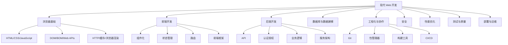

------

## 新手学习路线总览

| 阶段       | 学习重点                        | 目标                   | 常见误区                   |
| ---------- | ------------------------------- | ---------------------- | -------------------------- |
| 入门基础   | HTML、CSS、JavaScript           | 能写静态页面和简单交互 | 一上来只学框架，基础薄弱   |
| 浏览器原理 | DOM、事件、渲染、网络请求       | 理解页面如何运行       | 只会复制代码，无法排查问题 |
| 前端工程   | npm、Vite、模块化、TypeScript   | 能搭建现代前端项目     | 不理解依赖、构建、环境变量 |
| 框架开发   | React / Vue / Svelte 等         | 能开发组件化应用       | 把框架当成全部 Web 开发    |
| 后端基础   | Node.js、API、数据库            | 能做完整 Web 应用      | 前后端边界混乱             |
| 工程实践   | Git、测试、安全、性能、部署     | 能交付可维护项目       | 只追求功能跑通，不管质量   |
| 进阶方向   | SSR、全栈框架、云部署、可观测性 | 能参与真实工程         | 过早追复杂架构             |

------

## Web 的基本工作原理

用户访问一个网站时，背后大致发生这些过程：

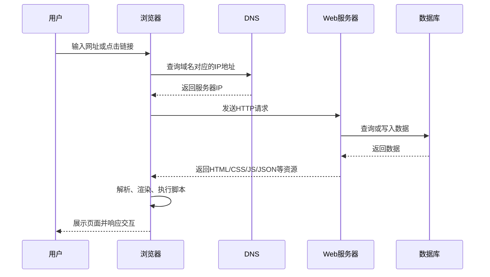

这里涉及几个基础概念：

| 概念       | 作用                     | 新手理解                   |
| ---------- | ------------------------ | -------------------------- |
| 浏览器     | 运行 Web 页面            | Web 应用的“客户端运行环境” |
| DNS        | 把域名转换成 IP          | 类似互联网电话簿           |
| HTTP/HTTPS | 浏览器和服务器通信协议   | 浏览器请求，服务器响应     |
| HTML       | 描述内容结构             | 页面骨架                   |
| CSS        | 描述视觉样式             | 页面皮肤和布局             |
| JavaScript | 描述交互逻辑             | 页面行为                   |
| 服务器     | 接收请求并返回资源或数据 | 网站背后的服务端           |
| 数据库     | 存储业务数据             | 用户、订单、文章等信息仓库 |

------

## HTML：页面结构的基础

HTML 的核心作用是表达内容结构，而不仅是“摆放文字”。

```html
<article>
  <h2>文章标题</h2>
  <p>文章正文内容。</p>
  <a href="/details">查看详情</a>
</article>
```

现代 HTML 的关键原则是 **语义化**。

| 标签      | 语义           | 适合场景             |
| --------- | -------------- | -------------------- |
| `header`  | 页头或区块头部 | 导航、Logo、标题区域 |
| `nav`     | 导航区域       | 主导航、目录         |
| `main`    | 页面主体       | 每页唯一主体内容     |
| `section` | 独立内容区块   | 页面分区             |
| `article` | 可独立分发内容 | 文章、帖子、卡片内容 |
| `aside`   | 辅助内容       | 侧边栏、推荐内容     |
| `footer`  | 页脚或区块底部 | 版权、链接、补充信息 |
| `button`  | 按钮行为       | 表单提交、弹窗打开   |
| `a`       | 链接跳转       | 页面跳转、锚点跳转   |

### HTML 最佳实践

| 做法                        | 原因                             |
| --------------------------- | -------------------------------- |
| 用语义化标签，不滥用 `div`  | 提升可读性、SEO、可访问性        |
| 图片写 `alt`                | 方便屏幕阅读器和图片加载失败场景 |
| 表单元素绑定 `label`        | 提升可访问性和点击体验           |
| 按钮用 `button`，跳转用 `a` | 保持语义正确                     |
| 页面只保留一个主要 `h1`     | 有利于文档结构清晰               |
| 不用表格做页面布局          | 表格用于数据，布局交给 CSS       |

示例：

```html
<label for="email">邮箱</label>
<input id="email" name="email" type="email" autocomplete="email" required>
```

------

## CSS：布局、样式与响应式设计

CSS 负责页面的视觉表现，包括颜色、字体、间距、布局、动画和响应式适配。

现代 CSS 的重点不是“记住所有属性”，而是理解以下核心能力：

| 能力         | 说明             | 常用技术                                 |
| ------------ | ---------------- | ---------------------------------------- |
| 盒模型       | 元素尺寸如何计算 | `content`、`padding`、`border`、`margin` |
| 布局         | 元素如何排列     | Flexbox、Grid                            |
| 响应式       | 适配不同屏幕     | 媒体查询、流式布局                       |
| 层叠与优先级 | 样式如何覆盖     | 选择器权重、层叠规则                     |
| 动画         | 状态变化效果     | `transition`、`animation`                |
| 设计系统     | 统一视觉规范     | CSS 变量、组件样式                       |

### 盒模型

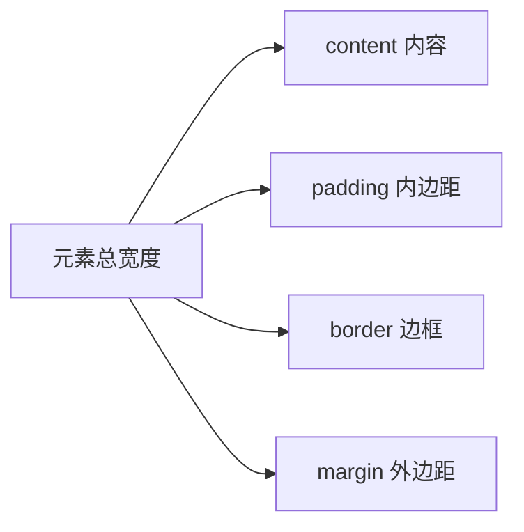

推荐全局设置：

```css
* {
  box-sizing: border-box;
}
```

这样元素宽高更符合直觉，`width` 包含内容、内边距和边框。

### Flexbox 与 Grid 的区别

| 布局方式 | 适合场景 | 特点                                 |
| -------- | -------- | ------------------------------------ |
| Flexbox  | 一维布局 | 横向或纵向排列，例如导航栏、按钮组   |
| Grid     | 二维布局 | 同时控制行和列，例如仪表盘、卡片网格 |

Flexbox 示例：

```css
.nav {
  display: flex;
  align-items: center;
  justify-content: space-between;
  gap: 16px;
}
```

Grid 示例：

```css
.card-list {
  display: grid;
  grid-template-columns: repeat(auto-fit, minmax(240px, 1fr));
  gap: 24px;
}
```

### 响应式设计原则

| 原则         | 解释                                     |
| ------------ | ---------------------------------------- |
| 移动优先     | 先写小屏样式，再逐步增强大屏             |
| 使用相对单位 | 优先考虑 `%`、`rem`、`em`、`vw`、`vh`    |
| 避免固定宽度 | 固定宽度容易导致移动端溢出               |
| 图片自适应   | `max-width: 100%`                        |
| 布局弹性化   | Flex/Grid 比浮动和绝对定位更适合现代布局 |

示例：

```css
.container {
  width: min(100% - 32px, 1200px);
  margin-inline: auto;
}
```

------

## JavaScript：Web 交互的核心语言

JavaScript 让页面从“静态文档”变成“可交互应用”。

核心学习内容：

| 主题       | 必学内容                                         |
| ---------- | ------------------------------------------------ |
| 基础语法   | 变量、函数、条件、循环、对象、数组               |
| DOM 操作   | 查询元素、修改内容、添加事件                     |
| 事件机制   | 点击、输入、提交、冒泡、委托                     |
| 异步编程   | Promise、async/await、fetch                      |
| 模块化     | `import` / `export`                              |
| 错误处理   | `try...catch`、边界判断                          |
| 浏览器 API | localStorage、URL、History、Canvas、WebSocket 等 |

### DOM 与事件

```html
<button id="btn">点击</button>
<p id="result"></p>
const button = document.querySelector('#btn');
const result = document.querySelector('#result');

button.addEventListener('click', () => {
  result.textContent = '按钮被点击了';
});
```

### 异步请求

```javascript
async function loadUser() {
  try {
    const response = await fetch('/api/user');

    if (!response.ok) {
      throw new Error('请求失败');
    }

    const user = await response.json();
    console.log(user);
  } catch (error) {
    console.error(error);
  }
}
```

### JavaScript 新手常见误区

| 误区           | 正确理解                         |
| -------------- | -------------------------------- |
| 只会写同步代码 | 现代 Web 大量依赖异步请求        |
| 忽略错误处理   | 网络请求、用户输入都可能失败     |
| 到处操作 DOM   | 大型应用通常用框架管理状态和视图 |
| 滥用全局变量   | 容易命名冲突和状态混乱           |
| 不理解作用域   | 闭包、模块化、异步回调都会受影响 |

------

## TypeScript：现代前端的重要增强

TypeScript 是 JavaScript 的类型增强版本，可以在开发阶段发现大量错误。

```typescript
type User = {
  id: number;
  name: string;
  email: string;
};

function formatUser(user: User): string {
  return `${user.name} <${user.email}>`;
}
```

| TypeScript 优点  | 说明                       |
| ---------------- | -------------------------- |
| 提前发现错误     | 类型错误在开发阶段暴露     |
| 提升代码提示     | 编辑器能更准确补全         |
| 便于维护大型项目 | 接口、类型、模块边界更清晰 |
| 降低重构风险     | 改字段、改函数签名更安全   |

建议新手学习顺序：

| 阶段                | 建议                 |
| ------------------- | -------------------- |
| JavaScript 基础阶段 | 先理解 JS 运行机制   |
| 做小项目阶段        | 开始接触 TypeScript  |
| 框架项目阶段        | 默认使用 TypeScript  |
| 团队协作阶段        | 必须掌握基础类型设计 |

------

## 浏览器渲染原理

浏览器渲染页面大致经历：

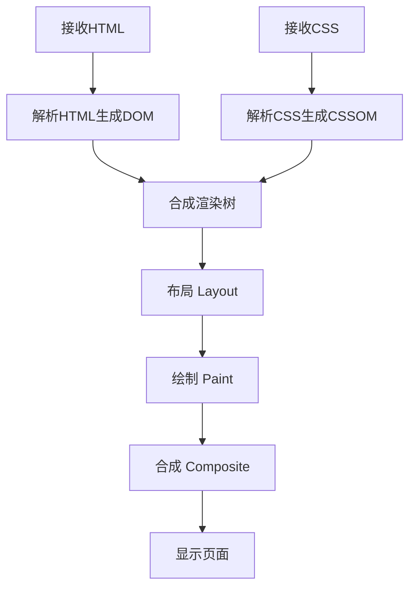

| 阶段        | 含义                       |
| ----------- | -------------------------- |
| DOM         | HTML 结构树                |
| CSSOM       | CSS 样式规则树             |
| Render Tree | 可见元素和样式合并后的树   |
| Layout      | 计算元素位置和尺寸         |
| Paint       | 绘制颜色、文字、边框、阴影 |
| Composite   | 将图层合成最终画面         |

### 性能相关理解

| 行为             | 影响               |
| ---------------- | ------------------ |
| 修改元素尺寸     | 可能触发布局       |
| 修改颜色         | 通常触发绘制       |
| 使用 transform   | 通常更利于动画性能 |
| 频繁读写布局属性 | 可能造成布局抖动   |
| 加载过大 JS      | 延迟交互和渲染     |

------

## HTTP 与网络基础

HTTP 是浏览器和服务器通信的核心协议。

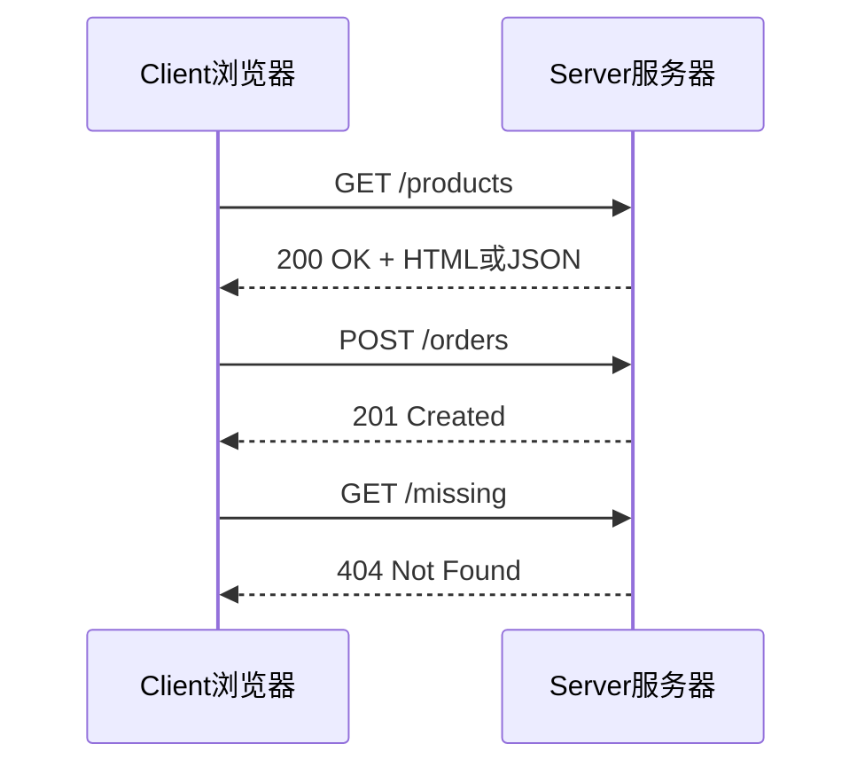

### 常见 HTTP 方法

| 方法    | 用途               | 是否常见      |
| ------- | ------------------ | ------------- |
| GET     | 获取资源           | 很常见        |
| POST    | 创建资源或提交数据 | 很常见        |
| PUT     | 整体更新资源       | 常见          |
| PATCH   | 局部更新资源       | 常见          |
| DELETE  | 删除资源           | 常见          |
| OPTIONS | 预检请求           | CORS 场景常见 |

### 常见状态码

| 状态码 | 含义             |
| ------ | ---------------- |
| 200    | 请求成功         |
| 201    | 创建成功         |
| 204    | 成功但无返回内容 |
| 301    | 永久重定向       |
| 302    | 临时重定向       |
| 400    | 请求参数错误     |
| 401    | 未认证           |
| 403    | 无权限           |
| 404    | 资源不存在       |
| 409    | 资源冲突         |
| 500    | 服务器内部错误   |

### 请求与响应结构

| 部分          | 说明                        |
| ------------- | --------------------------- |
| URL           | 请求地址                    |
| Method        | 请求方法                    |
| Headers       | 元信息，例如认证、内容类型  |
| Body          | 请求体，例如 JSON 表单数据  |
| Status Code   | 响应状态码                  |
| Response Body | 响应内容，例如 HTML 或 JSON |

------

## 前端框架：React、Vue 与现代组件化

现代前端框架的核心目标是：

> 用组件和状态管理复杂 UI，让界面开发更可维护。

| 框架   | 特点                     | 适合场景                       |
| ------ | ------------------------ | ------------------------------ |
| React  | 生态强、函数组件、灵活   | 中大型应用、跨端、复杂 UI      |
| Vue    | 上手快、模板友好、渐进式 | 管理后台、中小型项目、国内生态 |
| Svelte | 编译时框架、运行时代码少 | 轻量应用、交互组件             |
| Solid  | 细粒度响应式             | 高性能交互应用                 |

React 官方文档当前推荐根据项目需求选择框架或从零构建；从零构建时可以使用 Vite、Parcel、Rsbuild 等工具，但路由、数据获取等需要开发者自行选择。([zh-hans.react.dev](https://zh-hans.react.dev/learn/creating-a-react-app?utm_source=chatgpt.com))

### 组件化思想

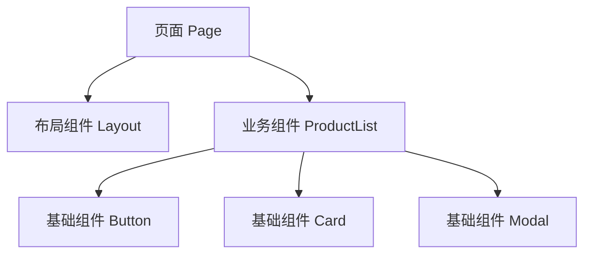

组件通常包含：

| 部分    | 说明                       |
| ------- | -------------------------- |
| Props   | 父组件传入的数据           |
| State   | 组件内部状态               |
| Events  | 用户交互事件               |
| Render  | 根据状态渲染 UI            |
| Effects | 请求数据、订阅事件等副作用 |

### React 简单示例

```tsx
type CounterProps = {
  initialValue?: number;
};

export function Counter({ initialValue = 0 }: CounterProps) {
  const [count, setCount] = useState(initialValue);

  return (
    <button onClick={() => setCount(count + 1)}>
      当前计数：{count}
    </button>
  );
}
```

### 框架学习重点

| 主题     | 说明                       |
| -------- | -------------------------- |
| 组件拆分 | 页面如何拆成可复用模块     |
| 状态管理 | 哪些数据放本地，哪些放全局 |
| 数据请求 | 如何获取、缓存、刷新数据   |
| 路由     | URL 与页面状态如何对应     |
| 表单处理 | 校验、错误提示、提交       |
| 性能优化 | 避免无意义重渲染           |
| 可维护性 | 命名、目录、边界、复用     |

------

## 前端工程化

现代前端项目通常依赖工具链，不再是一个 HTML 文件加几个脚本。


### 常见工具

| 类型     | 工具                          | 作用                   |
| -------- | ----------------------------- | ---------------------- |
| 包管理   | npm、pnpm、yarn               | 安装和管理依赖         |
| 构建工具 | Vite、Webpack、Rspack、Parcel | 开发服务器、打包、优化 |
| 编译     | TypeScript、Babel、SWC        | 语法转换               |
| 代码检查 | ESLint                        | 发现潜在问题           |
| 格式化   | Prettier                      | 统一代码风格           |
| 测试     | Vitest、Jest、Playwright      | 单元测试、端到端测试   |
| 提交规范 | Husky、lint-staged            | 提交前检查             |
| CI/CD    | GitHub Actions、GitLab CI     | 自动测试和部署         |

Vite 近年来是现代前端开发中很常见的工具。其官方发布说明提到，Vite 长期采用开发阶段使用 esbuild 提速、生产构建使用 Rollup 优化输出的策略。([vitejs](https://vite.dev/blog/announcing-vite8?utm_source=chatgpt.com))

### 推荐新项目基础配置

| 配置项   | 推荐                                                      |
| -------- | --------------------------------------------------------- |
| 语言     | TypeScript                                                |
| 构建工具 | Vite 或框架内置工具                                       |
| 包管理器 | pnpm 或 npm                                               |
| 代码规范 | ESLint + Prettier                                         |
| 测试     | Vitest + Testing Library                                  |
| E2E      | Playwright                                                |
| 样式     | CSS Modules / Tailwind CSS / Sass / 组件库                |
| Git 流程 | 小步提交、清晰 commit message                             |
| 部署     | Vercel、Netlify、Cloudflare Pages、Docker、传统服务器均可 |

------

## 后端开发基础

后端负责业务逻辑、数据处理、认证授权、权限控制、文件处理、第三方服务集成等。

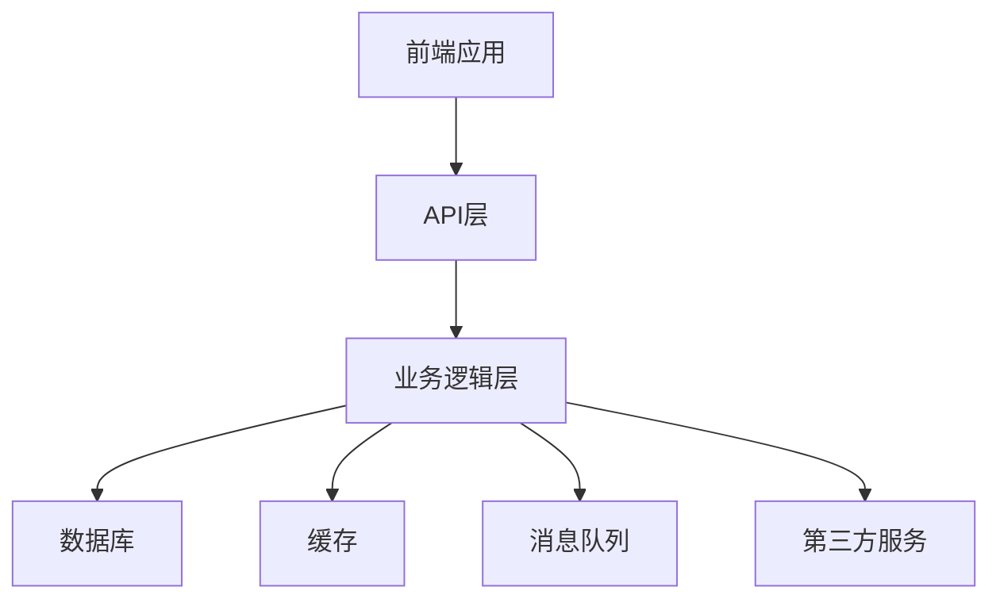

### 后端核心职责

| 职责     | 示例                         |
| -------- | ---------------------------- |
| 处理请求 | 登录、注册、查询订单         |
| 数据校验 | 校验邮箱、密码、金额         |
| 业务规则 | 库存扣减、权限判断           |
| 数据存储 | 用户表、订单表、文章表       |
| 认证授权 | 登录态、Token、角色权限      |
| 安全防护 | 防注入、防越权、防滥用       |
| 日志监控 | 错误日志、访问日志、性能指标 |

### 常见后端技术栈

| 语言                  | 常见框架                 | 特点                     |
| --------------------- | ------------------------ | ------------------------ |
| JavaScript/TypeScript | Express、NestJS、Fastify | 前后端同语言，适合全栈   |
| Python                | Django、FastAPI、Flask   | 语法简洁，适合数据和 API |
| Java                  | Spring Boot              | 企业级生态成熟           |
| Go                    | Gin、Fiber、Echo         | 性能好，部署简单         |
| PHP                   | Laravel                  | Web 传统生态强           |
| Ruby                  | Rails                    | 约定优于配置             |

------

## API 设计

API 是前后端协作的契约。

### REST API 示例

| 操作         | HTTP 方法 | 路径                |
| ------------ | --------- | ------------------- |
| 获取文章列表 | GET       | `/api/articles`     |
| 获取单篇文章 | GET       | `/api/articles/:id` |
| 创建文章     | POST      | `/api/articles`     |
| 更新文章     | PATCH     | `/api/articles/:id` |
| 删除文章     | DELETE    | `/api/articles/:id` |

### API 响应建议

```json
{
  "data": {
    "id": 1,
    "title": "现代 Web 开发"
  },
  "message": "success"
}
```

错误响应：

```json
{
  "error": {
    "code": "VALIDATION_ERROR",
    "message": "标题不能为空"
  }
}
```

### API 设计最佳实践

| 实践                   | 说明                                      |
| ---------------------- | ----------------------------------------- |
| 路径使用名词           | `/users` 比 `/getUsers` 更合理            |
| 状态码语义正确         | 参数错用 400，未登录用 401                |
| 错误结构统一           | 前端更容易处理                            |
| 参数校验前后端都做     | 前端提升体验，后端保证安全                |
| 分页、排序、筛选规范化 | 例如 `?page=1&pageSize=20&sort=createdAt` |
| 敏感字段不返回         | 例如密码哈希、内部权限字段                |
| API 文档同步维护       | OpenAPI / Swagger 很常见                  |

------

## 数据库基础

数据库用于持久化存储数据。

| 类型         | 常见产品                   | 适合场景               |
| ------------ | -------------------------- | ---------------------- |
| 关系型数据库 | PostgreSQL、MySQL          | 订单、用户、权限、交易 |
| 文档数据库   | MongoDB                    | 文档型数据、灵活结构   |
| 键值数据库   | Redis                      | 缓存、限流、会话       |
| 搜索引擎     | Elasticsearch、Meilisearch | 全文搜索               |
| 对象存储     | S3、R2、OSS                | 图片、视频、附件       |

### 关系型数据库基本概念

| 概念 | 说明                       |
| ---- | -------------------------- |
| 表   | 一类数据，例如用户表       |
| 行   | 一条记录，例如一个用户     |
| 列   | 字段，例如用户名、邮箱     |
| 主键 | 唯一标识一条记录           |
| 外键 | 表之间的关系               |
| 索引 | 提高查询速度               |
| 事务 | 保证一组操作同时成功或失败 |

### 简单数据模型示意

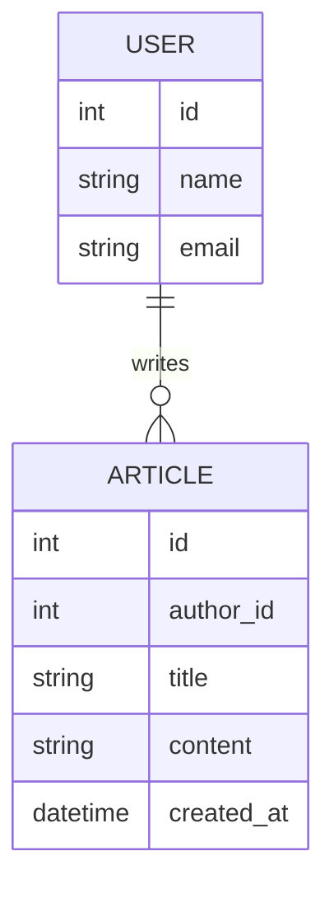

### 数据库最佳实践

| 实践                       | 原因                       |
| -------------------------- | -------------------------- |
| 字段命名统一               | 降低维护成本               |
| 给高频查询字段加索引       | 提升查询性能               |
| 谨慎使用软删除             | 需要配合唯一索引和查询条件 |
| 重要操作使用事务           | 避免数据不一致             |
| 不把所有数据塞进 JSON 字段 | 会削弱查询和约束能力       |
| 定期备份                   | 数据恢复能力非常关键       |
| 不直接拼接 SQL             | 防止 SQL 注入              |

------

## 认证与授权

认证和授权经常被混淆。

| 概念                | 解释             | 例子             |
| ------------------- | ---------------- | ---------------- |
| 认证 Authentication | 判断“你是谁”     | 登录、验证 Token |
| 授权 Authorization  | 判断“你能做什么” | 是否能删除文章   |

### 常见认证方式

| 方式             | 说明             | 适合场景                  |
| ---------------- | ---------------- | ------------------------- |
| Session + Cookie | 服务端保存登录态 | 传统 Web 应用             |
| JWT              | 客户端携带 Token | 前后端分离、移动端        |
| OAuth 2.0        | 第三方授权登录   | 微信、GitHub、Google 登录 |
| SSO              | 单点登录         | 企业内部系统              |
| Passkey/WebAuthn | 无密码登录       | 现代高安全登录体验        |

### 登录流程示意

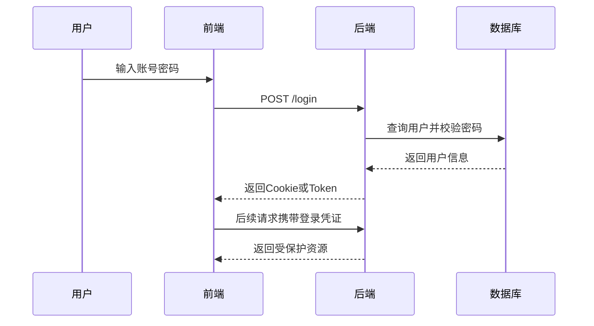

### 认证安全实践

| 实践                   | 说明                     |
| ---------------------- | ------------------------ |
| 密码必须哈希存储       | 使用 bcrypt、argon2 等   |
| HTTPS 必须启用         | 防止凭证被窃听           |
| Cookie 设置 `HttpOnly` | 降低 XSS 窃取风险        |
| Cookie 设置 `Secure`   | 仅 HTTPS 传输            |
| 重要操作二次验证       | 修改密码、提现、删除账号 |
| Token 设置过期时间     | 降低泄露后的风险         |
| 服务端做权限校验       | 不能只依赖前端隐藏按钮   |

------

## Web 安全基础

Web 安全是现代开发的底线。

| 风险         | 含义                     | 防护                             |
| ------------ | ------------------------ | -------------------------------- |
| XSS          | 注入恶意脚本             | 转义输出、CSP、避免直接插入 HTML |
| CSRF         | 借用户身份发起请求       | SameSite Cookie、CSRF Token      |
| SQL 注入     | 拼接 SQL 导致恶意查询    | 参数化查询、ORM                  |
| 越权访问     | 用户访问无权限资源       | 服务端权限校验                   |
| 文件上传风险 | 上传木马或异常文件       | 类型校验、大小限制、隔离存储     |
| 暴力破解     | 枚举密码或验证码         | 限流、验证码、锁定策略           |
| 敏感信息泄露 | 返回密码、密钥、内部错误 | 日志脱敏、错误信息控制           |

### XSS 示例

危险写法：

```javascript
element.innerHTML = userInput;
```

更安全的写法：

```javascript
element.textContent = userInput;
```

### 安全最佳实践清单

| 层面   | 做法                                |
| ------ | ----------------------------------- |
| 前端   | 避免直接渲染不可信 HTML             |
| 后端   | 所有输入都校验                      |
| 数据库 | 使用参数化查询                      |
| 认证   | 密码哈希、Token 过期                |
| 部署   | 强制 HTTPS                          |
| 配置   | 密钥放环境变量                      |
| 日志   | 不记录密码、Token、身份证等敏感信息 |
| 权限   | 每个接口都检查用户权限              |

------

## Web 性能优化

性能优化的目标是让页面 **加载快、响应快、视觉稳定**。

Google 的 Core Web Vitals 目前主要关注 LCP、INP、CLS，其中 INP 已取代 FID 成为交互响应指标。([xtechtools.com](https://xtechtools.com/learn/web-vitals-2026/?utm_source=chatgpt.com)) MDN 的性能学习资料也强调，好的用户体验包含快速加载和及时响应用户交互。([web.nodejs.cn](https://web.nodejs.cn/en-us/docs/learn/performance/?utm_source=chatgpt.com))

| 指标 | 含义           | 优化方向                           |
| ---- | -------------- | ---------------------------------- |
| LCP  | 最大内容绘制   | 优化首屏大图、服务响应、关键 CSS   |
| INP  | 交互到下次绘制 | 减少长任务、优化 JS、拆分计算      |
| CLS  | 累积布局偏移   | 图片预留尺寸、避免动态插入挤压内容 |

### 性能优化地图

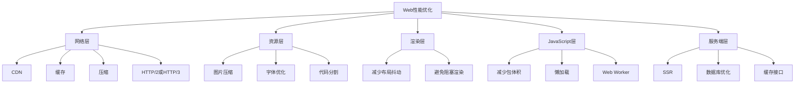

### 常用性能实践

| 方向 | 实践                                    |
| ---- | --------------------------------------- |
| 图片 | 使用 WebP/AVIF，设置宽高，懒加载        |
| JS   | Tree shaking、代码分割、延迟加载        |
| CSS  | 删除未使用样式，关键 CSS 优先           |
| 字体 | 使用 `font-display: swap`，减少字体文件 |
| 缓存 | 静态资源长缓存，HTML 短缓存             |
| CDN  | 静态资源走 CDN                          |
| API  | 分页、缓存、减少重复请求                |
| 渲染 | 避免大列表一次性渲染，使用虚拟列表      |
| 交互 | 避免主线程长任务                        |

------

## 可访问性

可访问性不是“锦上添花”，而是让更多用户正常使用产品的基础能力。

| 方向   | 实践                         |
| ------ | ---------------------------- |
| 语义   | 使用正确 HTML 标签           |
| 键盘   | 所有交互都能用键盘操作       |
| 对比度 | 文本和背景对比足够           |
| 图片   | 提供有意义的 `alt`           |
| 表单   | `label`、错误提示清晰        |
| 焦点   | 弹窗、菜单、表单焦点管理合理 |
| ARIA   | 必要时补充语义，避免滥用     |

### 常见错误

| 错误               | 问题                   |
| ------------------ | ---------------------- |
| 用 `div` 模拟按钮  | 键盘和屏幕阅读器体验差 |
| 只用颜色表达错误   | 色弱用户可能无法识别   |
| 表单没有 label     | 辅助技术难以理解       |
| 弹窗打开后焦点乱跳 | 键盘用户难以操作       |
| 图片没有 alt       | 图片内容不可感知       |

------

## SEO 基础

SEO 主要影响内容被搜索引擎理解和收录的能力。

| 方向       | 实践                        |
| ---------- | --------------------------- |
| 标题       | 每页有明确 `title`          |
| 描述       | 设置合理 `meta description` |
| 结构       | 使用语义化 HTML             |
| 链接       | 使用真实 `a` 标签           |
| 内容       | 页面有高质量、可索引文本    |
| 性能       | 优化 Core Web Vitals        |
| 移动端     | 保证移动端体验              |
| 结构化数据 | 适合时使用 Schema.org       |

单页应用如果依赖客户端渲染，SEO 和首屏性能可能受影响。内容型网站通常更适合 SSR、SSG 或服务端优先方案。

------

## 测试体系

测试的目标是降低修改代码时引入问题的风险。

| 测试类型 | 测试对象           | 工具示例            |
| -------- | ------------------ | ------------------- |
| 单元测试 | 函数、组件局部逻辑 | Vitest、Jest        |
| 组件测试 | UI 组件行为        | Testing Library     |
| 集成测试 | 多模块协作         | Vitest、Jest        |
| E2E 测试 | 用户完整流程       | Playwright、Cypress |
| 接口测试 | API 行为           | Supertest、Postman  |
| 静态检查 | 类型和规范         | TypeScript、ESLint  |

### 测试金字塔

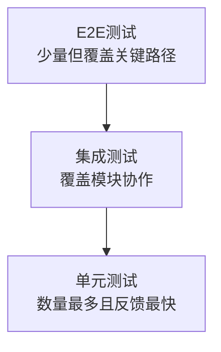

### 新手项目建议测试哪些内容

| 项目     | 建议测试                     |
| -------- | ---------------------------- |
| 登录注册 | 表单校验、错误提示、登录成功 |
| 商品列表 | 加载、空状态、筛选、分页     |
| 购物车   | 添加、删除、数量变化、总价   |
| 后端 API | 参数错误、权限错误、成功响应 |
| 权限页面 | 未登录跳转、无权限提示       |

------

## Git 与协作

Git 是现代开发协作的基础。

| 命令                          | 作用           |
| ----------------------------- | -------------- |
| `git init`                    | 初始化仓库     |
| `git clone`                   | 克隆项目       |
| `git status`                  | 查看状态       |
| `git add`                     | 暂存修改       |
| `git commit`                  | 提交修改       |
| `git branch`                  | 查看或创建分支 |
| `git checkout` / `git switch` | 切换分支       |
| `git merge`                   | 合并分支       |
| `git pull`                    | 拉取远程更新   |
| `git push`                    | 推送到远程     |

### 推荐协作流程

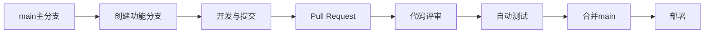

### Commit 建议

| 类型     | 示例                                 |
| -------- | ------------------------------------ |
| feat     | `feat: add user login page`          |
| fix      | `fix: handle empty product list`     |
| docs     | `docs: update API usage`             |
| refactor | `refactor: simplify auth middleware` |
| test     | `test: add order service tests`      |
| chore    | `chore: update dependencies`         |

------

## 部署与上线

部署是把本地代码变成用户可访问服务的过程。

| 类型       | 适合项目           | 平台示例                          |
| ---------- | ------------------ | --------------------------------- |
| 静态部署   | 静态站点、前端 SPA | Vercel、Netlify、Cloudflare Pages |
| Node 服务  | SSR、API 服务      | Render、Railway、Fly.io、VPS      |
| 容器部署   | 中大型服务         | Docker、Kubernetes                |
| 传统部署   | PHP、Java、Nginx   | 云服务器                          |
| Serverless | 函数 API、轻量后端 | AWS Lambda、Cloudflare Workers    |

### 现代部署流程

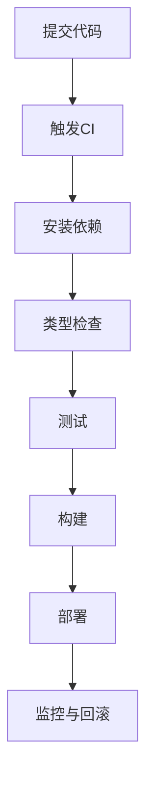

### 上线前检查清单

| 项目     | 检查               |
| -------- | ------------------ |
| 环境变量 | 生产环境配置完整   |
| 构建     | 本地和 CI 构建成功 |
| 测试     | 核心流程测试通过   |
| 安全     | HTTPS、密钥、权限  |
| 性能     | 首屏、图片、缓存   |
| 日志     | 能查看错误日志     |
| 回滚     | 出问题能快速恢复   |
| 备份     | 数据库有备份策略   |

------

## 前端项目目录结构

一个中小型现代前端项目可以这样组织：

```text
src/
  assets/
  components/
  features/
  hooks/
  layouts/
  pages/
  routes/
  services/
  stores/
  styles/
  types/
  utils/
```

| 目录         | 作用                 |
| ------------ | -------------------- |
| `assets`     | 图片、字体等静态资源 |
| `components` | 通用组件             |
| `features`   | 按业务模块组织代码   |
| `hooks`      | 自定义 Hooks         |
| `layouts`    | 页面布局             |
| `pages`      | 页面级组件           |
| `routes`     | 路由配置             |
| `services`   | API 请求             |
| `stores`     | 全局状态             |
| `styles`     | 全局样式             |
| `types`      | 公共类型             |
| `utils`      | 工具函数             |

更推荐业务复杂项目按 feature 组织：

```text
src/
  features/
    auth/
      components/
      api.ts
      types.ts
      hooks.ts
    product/
      components/
      api.ts
      types.ts
      hooks.ts
```

这种结构更接近真实业务边界。

------

## 状态管理

状态是 Web 应用中最容易混乱的部分。

| 状态类型       | 示例                 | 推荐位置              |
| -------------- | -------------------- | --------------------- |
| UI 本地状态    | 弹窗开关、输入框内容 | 组件内部              |
| 页面状态       | 筛选条件、分页       | 页面组件或 URL        |
| 服务端状态     | 用户列表、订单数据   | React Query / SWR     |
| 全局客户端状态 | 登录用户、主题、语言 | Zustand、Redux、Pinia |
| URL 状态       | 搜索关键词、tab      | Query 参数            |
| 表单状态       | 表单值、校验错误     | React Hook Form 等    |

### 状态放置原则

| 问题               | 判断                         |
| ------------------ | ---------------------------- |
| 只有一个组件用？   | 放组件内部                   |
| 多个兄弟组件共享？ | 提升到共同父组件             |
| 全站共享？         | 放全局状态                   |
| 来自服务器？       | 用服务端状态管理             |
| 刷新后应保留？     | URL、localStorage 或后端存储 |

------

## 表单开发

表单是业务系统中最常见、也最容易出错的部分。

| 要点     | 说明             |
| -------- | ---------------- |
| 前端校验 | 提升用户体验     |
| 后端校验 | 保证数据安全     |
| 错误提示 | 明确指出问题     |
| 加载状态 | 防止重复提交     |
| 默认值   | 编辑场景必须处理 |
| 无障碍   | label、错误关联  |
| 数据清洗 | 去空格、格式化   |

### 表单最佳实践

| 做法               | 原因             |
| ------------------ | ---------------- |
| 提交按钮加 loading | 防重复提交       |
| 错误提示靠近字段   | 用户更容易修正   |
| 后端错误映射到字段 | 体验更自然       |
| 密码不明文回显     | 安全             |
| 必填字段明确标识   | 降低误操作       |
| 成功后给反馈       | 用户知道操作完成 |

------

## 样式方案选择

| 方案         | 优点             | 缺点             | 适合               |
| ------------ | ---------------- | ---------------- | ------------------ |
| 原生 CSS     | 简单直接         | 大项目容易冲突   | 小项目、基础学习   |
| CSS Modules  | 局部作用域       | 跨组件复用稍麻烦 | React/Vue 项目     |
| Sass/Less    | 变量、嵌套、函数 | 需编译           | 传统工程           |
| Tailwind CSS | 原子类、高效率   | 初看类名较多     | 快速开发、设计系统 |
| CSS-in-JS    | 样式与组件绑定   | 运行时成本需关注 | 组件库、复杂主题   |
| 组件库       | 开箱即用         | 定制成本可能高   | 后台系统           |

建议新手先掌握原生 CSS 和布局，再选择工具。工具无法替代基础。

------

## 前后端分离与全栈框架

### 前后端分离


优点：

| 优点         | 说明                     |
| ------------ | ------------------------ |
| 职责清晰     | 前端管界面，后端管数据   |
| 团队协作方便 | 前后端可并行             |
| 多端复用 API | Web、App、小程序共享后端 |

缺点：

| 缺点             | 说明                       |
| ---------------- | -------------------------- |
| 首屏可能慢       | JS 加载后才渲染            |
| SEO 处理复杂     | 内容型页面不友好           |
| 认证和跨域更复杂 | Cookie、CORS、Token 需设计 |

### 全栈框架

| 框架      | 技术栈 | 特点                      |
| --------- | ------ | ------------------------- |
| Next.js   | React  | SSR、SSG、API、全栈生态强 |
| Nuxt      | Vue    | Vue 全栈框架              |
| Remix     | React  | Web 标准、服务端优先      |
| SvelteKit | Svelte | 简洁高性能                |
| Astro     | 多框架 | 内容型网站、Island 架构   |

适合内容站、SEO 要求高、首屏性能要求高、前后端边界希望更紧密的项目。

------

## CSR、SSR、SSG 与 ISR

| 渲染方式 | 含义           | 优点             | 缺点               | 适合             |
| -------- | -------------- | ---------------- | ------------------ | ---------------- |
| CSR      | 客户端渲染     | 交互强、部署简单 | 首屏和 SEO 较弱    | 后台、工具型应用 |
| SSR      | 服务端渲染     | 首屏快、SEO 好   | 服务端复杂度高     | 电商、内容站     |
| SSG      | 静态生成       | 性能好、成本低   | 内容更新需重新构建 | 文档、博客       |
| ISR      | 增量静态再生成 | 兼顾静态和更新   | 框架依赖明显       | 商品页、内容页   |

------

## Web 应用架构演进

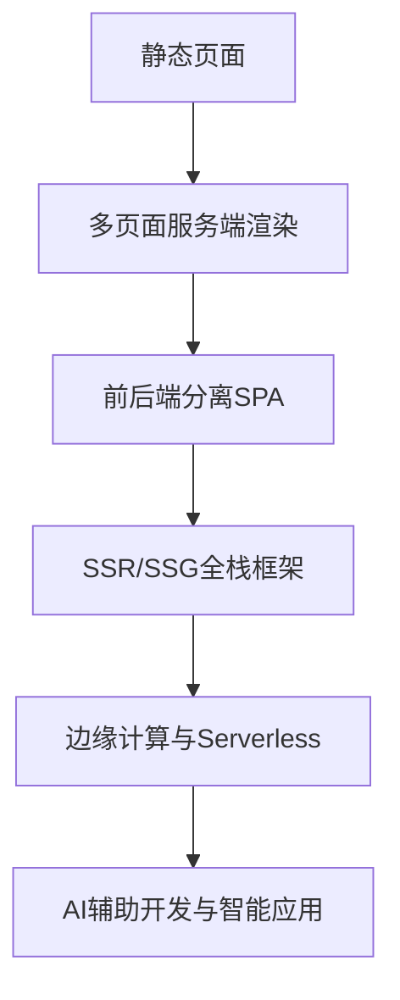

现代趋势不是某一种架构取代所有架构，而是根据场景选择：

| 场景         | 推荐架构                  |
| ------------ | ------------------------- |
| 公司官网     | SSG / Astro / Next.js     |
| 管理后台     | CSR + API                 |
| 电商网站     | SSR + 缓存 + CDN          |
| 博客文档     | SSG                       |
| SaaS 应用    | SPA 或 SSR 混合           |
| 实时协作     | WebSocket + 前端状态管理  |
| 轻量 API     | Serverless                |
| 大型企业系统 | 微服务 / 模块化单体 / BFF |

------

## BFF：Backend For Frontend

BFF 是为特定前端定制的后端层。

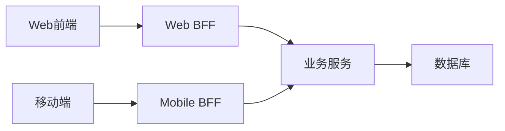

| 优点         | 说明                         |
| ------------ | ---------------------------- |
| 聚合接口     | 前端一次请求拿到所需数据     |
| 隔离复杂后端 | 前端不用理解多个微服务       |
| 适配不同端   | Web、App、小程序可有不同接口 |
| 提升性能     | 减少前端请求次数             |

适合中大型应用，尤其是后端服务较多、前端页面数据复杂的场景。

------

## 包管理与依赖管理

现代项目依赖大量第三方包，因此依赖管理非常重要。

| 文件                                   | 作用                     |
| -------------------------------------- | ------------------------ |
| `package.json`                         | 声明依赖、脚本、项目信息 |
| `package-lock.json` / `pnpm-lock.yaml` | 锁定依赖版本             |
| `node_modules`                         | 依赖安装目录             |
| `.npmrc`                               | 包管理配置               |

### 依赖类型

| 类型             | 示例                     | 说明           |
| ---------------- | ------------------------ | -------------- |
| dependencies     | React、axios             | 运行时需要     |
| devDependencies  | TypeScript、Vite、ESLint | 开发和构建需要 |
| peerDependencies | React 组件库要求 React   | 宿主项目提供   |

### 最佳实践

| 做法               | 原因               |
| ------------------ | ------------------ |
| 提交 lock 文件     | 保证团队依赖一致   |
| 定期升级依赖       | 修复安全和兼容问题 |
| 谨慎安装小包       | 避免依赖膨胀       |
| 区分生产和开发依赖 | 减少部署风险       |
| 使用官方维护活跃包 | 降低弃坑风险       |
| 查看许可证         | 商业项目尤其重要   |

------

## 环境变量与配置

不同环境通常有不同配置。

| 环境        | 示例       |
| ----------- | ---------- |
| development | 本地开发   |
| test        | 自动化测试 |
| staging     | 预发布     |
| production  | 生产环境   |

### 常见环境变量

```text
DATABASE_URL=
API_BASE_URL=
JWT_SECRET=
S3_BUCKET=
NODE_ENV=
```

### 配置原则

| 原则               | 说明                         |
| ------------------ | ---------------------------- |
| 密钥不进代码仓库   | 防止泄露                     |
| 不同环境配置隔离   | 避免误连生产库               |
| 前端公开变量谨慎   | 打包进前端的变量用户可见     |
| 后端密钥放安全平台 | 云平台环境变量或密钥管理服务 |

------

## 错误处理与日志

一个成熟应用必须考虑失败场景。

| 层面           | 处理               |
| -------------- | ------------------ |
| 前端请求失败   | 显示错误提示、重试 |
| 表单提交失败   | 显示字段错误       |
| 后端异常       | 返回统一错误结构   |
| 数据库失败     | 记录日志、事务回滚 |
| 第三方服务失败 | 超时、降级、重试   |
| 生产错误       | 错误监控和告警     |

### 前端错误边界

React 中可使用 Error Boundary 捕获组件渲染错误。Vue 也有全局错误处理机制。

### 日志级别

| 级别  | 含义         |
| ----- | ------------ |
| debug | 调试信息     |
| info  | 普通运行信息 |
| warn  | 潜在问题     |
| error | 已发生错误   |
| fatal | 严重故障     |

------

## 可维护代码原则

| 原则         | 说明                     |
| ------------ | ------------------------ |
| 单一职责     | 一个函数或组件只做一类事 |
| 明确命名     | 名字表达意图             |
| 避免重复     | 抽取公共逻辑             |
| 控制复杂度   | 函数过长要拆分           |
| 边界清晰     | UI、业务、请求、工具分层 |
| 类型明确     | 参数和返回值清楚         |
| 失败可预期   | 错误路径有处理           |
| 少做过度抽象 | 先重复，再抽象           |

### 函数命名示例

| 不佳         | 更好                 |
| ------------ | -------------------- |
| `handleData` | `normalizeUserList`  |
| `doSubmit`   | `submitLoginForm`    |
| `check`      | `validateEmail`      |
| `getData`    | `fetchProductDetail` |

------

## 现代 Web 开发最佳实践总表

| 方向       | 最佳实践                                 |
| ---------- | ---------------------------------------- |
| HTML       | 语义化、可访问、结构清晰                 |
| CSS        | 移动优先、Flex/Grid、避免样式污染        |
| JavaScript | 模块化、异步错误处理、减少全局状态       |
| TypeScript | 明确类型边界，避免滥用 `any`             |
| 框架       | 合理拆组件，避免状态泛滥                 |
| API        | REST 语义清晰，错误结构统一              |
| 数据库     | 设计主键、索引、约束和事务               |
| 安全       | 输入校验、权限校验、HTTPS、密钥保护      |
| 性能       | 图片优化、代码分割、缓存、减少主线程阻塞 |
| 测试       | 关键业务流程必须覆盖                     |
| Git        | 小步提交，分支清晰，PR 审查              |
| 部署       | 自动化构建、环境隔离、可回滚             |
| 监控       | 日志、错误追踪、性能指标                 |
| 文档       | README、API 文档、部署说明               |

------

## 推荐学习顺序

| 顺序     | 内容               | 目标                   |
| -------- | ------------------ | ---------------------- |
| 第一阶段 | HTML + CSS         | 能独立写响应式静态页面 |
| 第二阶段 | JavaScript 基础    | 能实现交互和请求       |
| 第三阶段 | 浏览器与 HTTP      | 理解页面加载和请求响应 |
| 第四阶段 | Git + npm + Vite   | 掌握现代项目开发方式   |
| 第五阶段 | TypeScript         | 提升代码可靠性         |
| 第六阶段 | React 或 Vue       | 掌握组件化应用开发     |
| 第七阶段 | Node.js + API      | 能写简单后端服务       |
| 第八阶段 | 数据库             | 能设计基础数据表       |
| 第九阶段 | 安全 + 性能 + 测试 | 从“能跑”到“可靠”       |
| 第十阶段 | 部署 + CI/CD       | 能上线真实项目         |

------

## 新手练习项目推荐

| 项目          | 练习能力               |
| ------------- | ---------------------- |
| 个人主页      | HTML、CSS、响应式      |
| Todo List     | DOM、状态、事件        |
| 天气查询应用  | fetch、异步、错误处理  |
| 博客列表      | 路由、组件、API        |
| 登录注册页面  | 表单、校验、认证       |
| 商品列表      | 筛选、分页、状态管理   |
| 管理后台      | 表格、权限、CRUD       |
| 个人博客系统  | 前后端、数据库、部署   |
| 小型电商 Demo | 购物车、订单、支付模拟 |
| 实时聊天室    | WebSocket、用户状态    |

------

## 经典完整项目架构示例

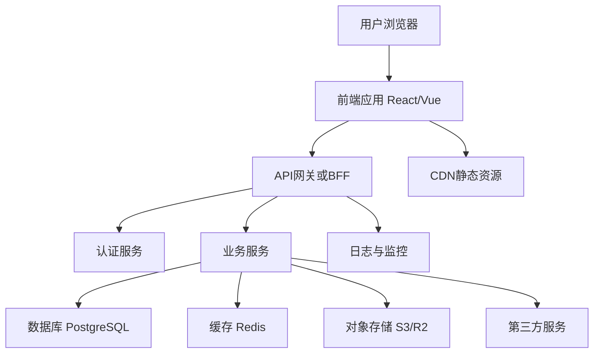

对应技术选择：

| 层级     | 示例选择                    |
| -------- | --------------------------- |
| 前端     | React + TypeScript + Vite   |
| 样式     | Tailwind CSS 或 CSS Modules |
| 状态     | React Query + Zustand       |
| 后端     | Node.js + NestJS / Fastify  |
| 数据库   | PostgreSQL                  |
| ORM      | Prisma / Drizzle            |
| 缓存     | Redis                       |
| 认证     | Session Cookie 或 JWT       |
| 测试     | Vitest + Playwright         |
| 部署     | Docker + 云平台             |
| 静态资源 | CDN                         |
| 监控     | Sentry + 日志平台           |

------

## 新手最容易踩的坑

| 坑                         | 后果                 | 建议                        |
| -------------------------- | -------------------- | --------------------------- |
| 只学框架，不学 HTML/CSS/JS | 遇到问题不会排查     | 先补 Web 基础               |
| 不理解异步                 | 请求、状态、渲染混乱 | 掌握 Promise 和 async/await |
| 滥用全局状态               | 数据流不可控         | 状态尽量就近管理            |
| 组件拆太碎                 | 代码跳转复杂         | 按业务边界拆分              |
| 组件拆太大                 | 难维护               | 超过一定复杂度再拆          |
| 不写错误处理               | 用户看到白屏或无反馈 | 所有请求都考虑失败          |
| 忽略移动端                 | 页面在手机上崩坏     | 移动优先设计                |
| 不做权限校验               | 严重安全风险         | 后端必须检查权限            |
| 密钥写进前端               | 密钥暴露             | 密钥只放服务端              |
| 不看 Network 面板          | 请求问题难定位       | 学会 DevTools               |
| 依赖随便装                 | 项目臃肿、风险增加   | 优先原生能力和成熟库        |
| 上线不监控                 | 出错后无人知道       | 加错误监控和日志            |

------

## 浏览器开发者工具必须掌握

| 面板        | 用途                            |
| ----------- | ------------------------------- |
| Elements    | 查看和调试 HTML/CSS             |
| Console     | 查看日志和运行 JS               |
| Network     | 查看请求、响应、资源加载        |
| Sources     | 调试源码、断点                  |
| Performance | 分析性能瓶颈                    |
| Application | 查看 Cookie、localStorage、缓存 |
| Lighthouse  | 检查性能、SEO、可访问性         |
| Memory      | 分析内存泄漏                    |

学习 Web 开发时，DevTools 是最重要的“显微镜”。

------

## 面向新手的学习建议

先建立“浏览器如何工作”的底层理解，再学框架。HTML、CSS、JavaScript 不是过时基础，而是所有框架的地基。框架会变，浏览器平台和网络协议的基本原理相对稳定。

学习路径上，建议采用“项目驱动”：

| 学习方式     | 效果               |
| ------------ | ------------------ |
| 只看教程     | 容易产生会了的错觉 |
| 边学边做     | 能形成真实能力     |
| 做完复盘     | 能沉淀经验         |
| 模仿优秀项目 | 学习结构和规范     |
| 阅读文档     | 建立准确概念       |
| 改 bug       | 提升排查能力       |

更现实的标准是：

> 新手阶段不用追求掌握所有技术，而是先做到：能写页面、能调接口、能处理状态、能排错、能部署一个真实小项目。

------

## 一套实用的新手技术栈建议

| 场景               | 推荐                        |
| ------------------ | --------------------------- |
| 基础学习           | HTML + CSS + JavaScript     |
| 第一个现代前端项目 | Vite + React + TypeScript   |
| 样式               | CSS Modules 或 Tailwind CSS |
| 请求               | fetch / axios               |
| 服务端状态         | TanStack Query              |
| 简单全局状态       | Zustand                     |
| 后端入门           | Node.js + Fastify / Express |
| 数据库             | PostgreSQL                  |
| ORM                | Prisma                      |
| 测试               | Vitest + Playwright         |
| 部署               | Vercel / Netlify / Render   |
| 文档               | README + API 文档           |

这套组合足够现代，也不会过早引入过重复杂度。

------

## 最后总结

现代 Web 开发可以拆成三层能力：

| 层次   | 核心问题                                   |
| ------ | ------------------------------------------ |
| 基础层 | 页面如何显示、交互和请求数据               |
| 工程层 | 项目如何组织、构建、测试和部署             |
| 产品层 | 应用如何安全、快速、稳定、可维护地服务用户 |

学习时的优先级应当是：


真正的现代 Web 开发能力，不是会背多少框架 API，而是理解 **浏览器、网络、数据、用户体验、工程质量** 之间的关系，并能在具体项目中做出合理取舍。