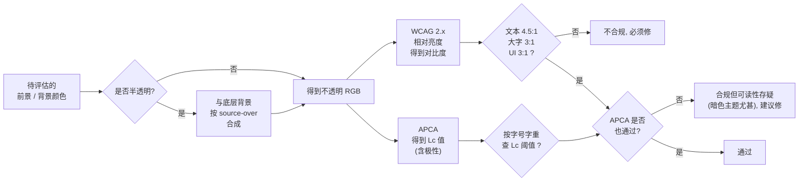
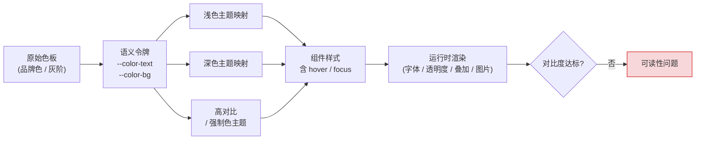
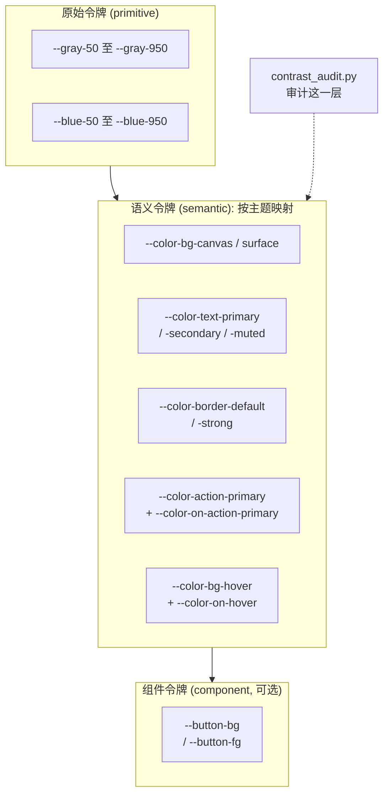
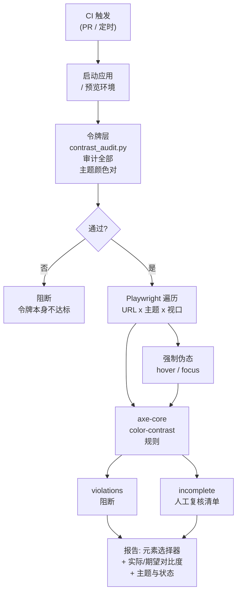

[toc]

**前端可读性:对比度标准、排查工具链与主题配色实践**

> 本文面向需要同时维护浅色与深色主题、并处理悬停与焦点等交互态的前端团队,回答四个问题:对比度按什么标准判定、如何用脚本与浏览器工具分层查出问题、交互态与主题切换为什么会单独失效、如何从令牌层预防不合理配色。
>
> 适用范围:网页与 Web 应用中文字、图标、边框、焦点环与状态表达的配色判定与工程化治理。不覆盖屏幕阅读器语义、键盘导航顺序等与颜色无关的无障碍项;这些缺陷常与对比度问题同时暴露,发现时应一并处理。
>
> 文中口径、脚本参数与示例数值的边界见 **来源与核验声明** 与 **待确认事项** 两节;示例比值属示范数据,不代表任何真实站点的扫描结果。

## 来源与核验声明

| 主题 | 是否本轮联网核实 | 说明 |
| --- | --- | --- |
| WCAG 2.2 阈值、1.4.3、1.4.6、1.4.11、1.4.1 与 2.4.11/2.4.13 条款号 | 否 | 沿用来源文档引述,数值与条款对应关系与 W3C 原文一致;本轮未重新联网比对 |
| APCA 定义、Lc 取值范围、标准化阶段、WCAG 3 路线图日期、DevTools APCA 设置项 | 否 | 沿用来源文档标注的日期与链接,未在本轮复核;引用前以 W3C、ARC 与 Chrome 官方页面为准 |
| `light-dark()`、`contrast-color()`、`color-scheme` 的支持版本与 Baseline 状态 | 否 | 沿用来源文档标注的日期;浏览器版本号时效性强,写入规范前须查 MDN 或 caniuse |
| 示例令牌与比值(1.92:1、3.45:1、Lc 56.2 等) | 否 | 作者环境沙箱运行结果,对应 `tokens.css` 与 `pairs.json` 未随文提供,属示范数据 |
| 悬停态坍塌事故、四象限矩阵、CDP 强制伪态、Vitest 令牌矩阵 | 否 | 来自同主题两个本地工作台项目的文档与设计记录,不是外部实证研究 |
| CJK 大字号等效尺寸、字体细笔画的可用余量 | 否 | 经验共识,无对应标准条款;按项目实测调整 |

## 结论速览

- **合规底线是 WCAG 2.x AA**:正文 4.5:1,大号文本、非文本 UI 与焦点环 3:1,写进团队 Definition of Done。
- **每个主题、每种交互态都必须独立验证**:不存在"浅色过了,深色大概也行",也不存在"常态过了,悬停大概也行"。
- **CI 设两道闸**:令牌层静态审计拦配色设计本身的错误,页面级 axe 多主题扫描拦渲染结果与例外情形。
- **`incomplete` 必须进入人工复核清单**:最严重的缺陷(前景与背景同色)恰恰常落在这个类别里。
- **APCA 只作加严参考**:WCAG 3 至今未定对比度算法,不能作为合规依据,但能补上深底浅字的感知盲区。
- **半透明颜色按合成结果判定**:`rgba()`、`opacity`、`color-mix()` 的最终输出才是用户看到的颜色。
- **自动检测通过不等于合规认证**:工具覆盖不到图片叠字、伪类全量状态、打印样式与真实阅读舒适度。

## 核心概念:对比度到底在量什么

### WCAG 2.x 对比度比值

当前具有法律与行业约束力的标准仍是 **WCAG 2.x**(2.2 版为 W3C 推荐标准)。它用**相对亮度(relative luminance)**计算两色的**对比度比值(contrast ratio)**,公式为 `(L1 + 0.05) / (L2 + 0.05)`,取值范围 1:1(两色完全相同)到 21:1(纯黑对纯白)。相对亮度由 sRGB 分量先做伽马线性化,再按 `0.2126R + 0.7152G + 0.0722B` 加权得到。

| 成功标准(SC) | 级别 | 适用对象 | 最低比值 |
| --- | --- | --- | --- |
| **1.4.3 Contrast (Minimum)** | AA | 普通文本及文字图片 | **4.5:1** |
| 1.4.3 Contrast (Minimum) | AA | 大号文本:≥24px,或 ≥18.66px 且加粗(即 18pt 或 14pt 粗体) | **3:1** |
| **1.4.11 Non-text Contrast** | AA | UI 组件的识别性视觉信息(边框、焦点环、图标、开关状态)及有意义的图形 | **3:1**(对相邻颜色) |
| 1.4.6 Contrast (Enhanced) | AAA | 普通文本 / 大号文本 | 7:1 / 4.5:1 |
| 2.4.11 Focus Not Obscured | AA | 键盘焦点不被固定页头、浮层、贴边元素遮挡 | 非比值条款,需人工核验 |
| 2.4.13 Focus Appearance | AAA | 焦点指示器的面积与前后对比变化 | 面积与对比度双重要求,需人工判定 |

### 大号文本、豁免与半透明:最常被误读的边界

- **大号文本按 CSS 像素换算,不是 pt**:24px ≈ 18pt,18.66px ≈ 14pt。很多团队把 18px 当作大号文本,实际 18px 普通字重仍需 4.5:1。
- **CJK 字形要留余量**:汉字笔画密度高于拉丁字母,同样字号下的实际可读性更差。24px 的判据不能机械套用,细笔画字体在高分屏与小字号组合下应按 4.5:1 要求。
- **豁免范围**:装饰性文字、Logo 或品牌名中的文字、真正禁用(inactive/disabled)的控件不要求满足对比度。**占位符(placeholder)文字不豁免**,这是最高频的失败点;普通辅助文字同样没有豁免。
- **Logo 豁免有边界**:W3C 的限定是,若标志通常本可有足够对比度,作者只是选择以低对比度呈现,而非出于企业识别或品牌规范,则该低对比度呈现不豁免。
- **1.4.11 只管"识别组件所必需"的视觉信息**:输入框若仅靠边框标示边界,边框就要 ≥3:1;若有明显的填充背景区分,则边框可以不达标。字符类符号(如"X"关闭按钮、">"箭头)按非文本处理,刚过 3:1 即可;该条不适用于禁用态控件,但禁用控件的文字说明仍需让用户看清。
- **抗锯齿会让细线看起来更淡**:名义上达标而实际低于阈值观感。边框、分隔线建议至少 1px 实色,并留出余量。
- **半透明颜色必须先与底色合成再算**:`rgba(0,0,0,0.12)` 的边框压在白底上约等于 `#e0e0e0`,对比度只有约 1.32:1。叠层顺序是**先合成背景与画布,再合成前景**;多于一层半透明表面时逐层 source-over 合成。
- **图片、渐变、伪元素与混合模式不能取单个背景色**:必须找出文字实际覆盖位置的最差背景,`background-blend-mode`、`mix-blend-mode` 与背景图同理。

### APCA 与 WCAG 3:现状必须说清楚

WCAG 2.x 公式的公认缺陷是**不考虑极性**(深字浅底与浅字深底得到相同比值),而人眼对两者的感知并不对称:深色主题下同样的比值,实际可读性往往更差;它对中等灰度与细字体的评价也不准确。设计实践中常见的现象是"合格的色对读起来费劲、不合格的色对看着还行",在暗色模式与橙、黄色相上尤其明显。

**APCA(Advanced Perceptual Contrast Algorithm,高级感知对比度算法)**是候选替代方案。它不输出比值,而是输出 **Lc(Lightness Contrast)** 分值,范围约 -108 到 +106,正负号表示极性(深字浅底为负、浅字深底为正),并把字号与字重纳入阈值查表。概略口径为正文 Lc 75 起、优选 90,大标题与非文本元素阈值更低。**不同资料对同一字号的 Lc 门槛并不统一**,落地时以 APCA Readability Criterion 的查表结果为准。

标准化状态需以公开材料为准:

- 视觉对比度相关内容已于 2023 年 7 月移出 WCAG 3 工作草案;工作草案仍写明"WCAG 3 采用的对比度算法尚待确定"。
- WCAG 3 仍是 Working Draft,路线图把候选推荐指向 2027 年第四季度,正式推荐更晚。引用时应按"进行中的草案"对待。
- APCA 自身独立发展为 ARC(APCA Readability Criterion,可读性判据)标准,处于公开草案阶段。
- 工具侧态度已变化:新版 Chrome DevTools 已把 APCA 从实验特性转为普通设置项(Settings > Preferences > Elements),默认仍用 WCAG 2 算法,由用户自行切换。

**结论**:**合规判定以 WCAG 2.x 为准(必须),APCA 作为设计阶段的辅助参考(推荐,尤其在暗色主题)**。两者在深底浅字上经常分歧:一个色对 WCAG 可达 10:1,APCA 却提示偏弱;反之亦然。推荐做法是两者都过才放心。有些项目把 `|Lc| ≥ 60` 定为自身的设计基线,那是项目自定的加严值,不是标准阈值,对外仍应承诺 AA。

### 判定流程



图中的关键分支是**先合成、再判定**,以及**两套判据分别出结论**:WCAG 不达标属于必须修复的违规,WCAG 达标而 APCA 偏弱属于建议优化的可读性问题,两者不能混为一谈。

## 为什么主题切换与交互态会放大颜色问题



图中每一层都可能引入问题,主题与状态越多,组合越容易爆炸:

- **原始色板与语义令牌**:设计师给的深色灰阶在浅色下够用、深色下不够。人眼对深色背景上的浅色更敏感,WCAG 2 公式却是对称的。
- **主题映射**:某个主题漏定义了某个令牌,回落到另一主题的值,造成"文字与背景同色"。这类 **1:1 的灾难反而可能落在 `incomplete` 里**,不会被判为 violations。
- **交互态**:悬停只改背景或只改前景、按下态复用常态色、半透明悬停层叠加,都会让原本达标的色对在状态切换后坍塌。
- **组件与运行时渲染**:半透明叠加、背景图片、渐变、Web 字体加载前后的字重差异、过渡动画中间态。

## 排查工具链:四层互补

按"投入成本与覆盖深度"分四个层级,建议**全部采用,而非四选一**:

| 层级 | 手段 | 适用阶段 | 覆盖面 | 成本 | 典型工具 |
| --- | --- | --- | --- | --- | --- |
| **L0 零安装** | DevTools 取色器、CSS Overview、控制台粘贴脚本、浏览器扩展、设计工具插件 | 现场排查、改造评估 | 单页单主题、设计稿 | 极低 | Chrome/Edge DevTools、控制台初筛脚本、axe DevTools / WAVE、WebAIM 在线检查器、Polypane、Figma 插件、TPGi CCA |
| **L1 令牌级** | 对 CSS 变量或设计令牌做静态审计 | 设计系统、PR 阶段 | 所有主题的语义配对,与页面无关 | 低 | `contrast_audit.py`、Style Dictionary 自定义校验、Vitest 令牌矩阵 |
| **L2 页面级** | Playwright + axe-core,遍历主题矩阵与状态矩阵 | CI、回归 | 真实渲染结果,多页多主题多视口 | 中 | **axe-core**(Playwright / Cypress / Jest 集成)、Lighthouse CI、pa11y-ci、`@axe-core/cli` |
| **L3 人工与辅助** | 色觉模拟、`prefers-contrast` 与强制色测试、最差背景判定、真实用户 | 发布前、定期审计 | 自动化覆盖不了的部分 | 高 | DevTools 渲染面板、真机与放大观察、视力障碍用户测试 |

**核心结论先行**:

- **必须**:把 axe-core 的 `color-contrast` 规则接入 CI(通过 Playwright 或 Lighthouse CI),并且**对每个主题分别跑一遍**。这是目前业界最成熟、误报最少的自动化方案。
- **应该**:在主题系统建立时,用令牌层静态脚本约束所有"语义颜色对",让问题在进入页面之前就被拦住。
- **可以**:用控制台脚本或浏览器扩展做临时排查;用 APCA 做暗色主题的加严检查。
- **避免**:只在浅色主题跑一次审计就认为通过;依赖人眼"看着还行"。

## L0:零安装的现场排查

**Chrome / Edge DevTools** 有三处可直接用:

- **取色器**:在 Elements 面板 Styles 中点击任意 `color` 属性前的色块,会显示与当前背景的对比度、AA/AAA 是否通过,并在色板上画出"达标分界线",拖动即可找到最近的达标色;开启 APCA 后可直接比较两种口径。
- **CSS Overview 面板**:一键汇总整页颜色使用情况,并单列 **Contrast issues**,给出低对比度的文字与背景色对及元素数量。这是**排查现有页面最快的一招**。
- **渲染(Rendering)面板**:可模拟 `prefers-color-scheme: dark`、`prefers-contrast`、`forced-colors: active`,以及色盲(红色盲、绿色盲、蓝色盲)与模糊视觉。切换后重新看 CSS Overview,就是"多主题快速审计"的手工版本。

Firefox 的 Accessibility Inspector 提供 Check for issues 下的 Contrast 检查,可一键列出全页问题。

**浏览器扩展**:

- **axe DevTools**(Deque):规则引擎与 CI 中一致,扫描结果可定位元素并给出实际色值与期望比值。
- **WAVE**(WebAIM):有专门的 Contrast 标签页,直观。
- **Polypane**(付费浏览器):可并排显示浅色与深色主题并实时标注对比度问题,主题切换调试很顺手。

**控制台初筛脚本**:在没装扩展的机器上,或审计内网、需登录的页面时,把脚本整段粘贴到控制台即可。它遍历可见文本元素,读取 `getComputedStyle` 的 `color`,向上查找并合成第一个不透明背景(处理 `rgba()` 叠加),按字号与字重应用 4.5:1 或 3:1 阈值,用 `console.table` 列出不达标项,并在页面上用红框标记可确认的问题、橙色虚线框标记背景含图片或渐变、需复核的元素,结果同时存入 `window.__contrastIssues`。切换主题后再执行一次即可对照两套结果。

它刻意不追求与 axe 同等的严谨(axe 还会处理 `position` 叠层、`opacity` 继承、`text-shadow` 等),定位是**快速定位可疑元素**,结论请用 axe 复核。也可以保存为 DevTools 的 Snippet,或封装成书签脚本分发给测试同学。

**设计工具**:Figma 的 Stark、Contrast 插件,TPGi 的 Colour Contrast Analyser(CCA)桌面版,WebAIM 在线检查器,用于在设计稿阶段拦截问题。设计工具给的是静态色值判定,不覆盖运行时叠加与图片背景。

## L1:令牌级静态审计(推荐作为第一道闸)

### 适用前提

项目用 CSS 自定义属性(或 JSON 令牌)定义主题,例如 `:root { --color-text: ... }` 与 `[data-theme="dark"] { --color-text: ... }`。这是现代主题切换的主流做法,也正是颜色问题"倍增"的地方:每新增一个主题,所有颜色对都要重新验证;而令牌层审计不依赖页面、不依赖浏览器,所有主题的所有语义配对可一次算完。

### 令牌结构与配对清单

颜色系统分三层,**组件代码只允许引用语义层**:



审计脚本只认中间那层:原始色板与组件令牌都不是它的检查对象,前者只描述颜色本身,后者应继承语义层。图中标出的 `--color-on-*` 是"背景类令牌必须配套的前景令牌",配对关系直接构成审计清单。

| 层 | 示例 | 职责 | 是否随主题变化 |
| --- | --- | --- | --- |
| **原始色阶(primitive)** | `--blue-600`、`--gray-50` | 调色板,只描述"是什么颜色" | 否 |
| **语义令牌(semantic)** | `--color-text`、`--color-text-muted`、`--color-bg-canvas`、`--color-border-strong` | 描述"用在哪、做什么" | **是**,每个主题各自映射到原始色阶 |
| **组件令牌(component,可选)** | `--button-primary-bg` | 组件级细分 | 通常继承语义层 |

关键规则:**组件只消费语义令牌,永远不直接写原始色或十六进制**;**每个"背景类"语义令牌都要配一个 `on-` 前缀的前景令牌**(Material Design 的 `on-primary` 命名思路),配对关系天然成为审计清单。这样做的直接好处是:对比度审计的对象从"无限多的组件组合"收敛为"有限的语义颜色对",配对文件能写全;新增主题只需补一份映射并重跑脚本。

**必须避免**组件里直接写 `color: #999` 或引用原始色阶 `var(--gray-400)`:这种颜色在暗色主题下不会跟着变,是暗色主题"灰字糊成一片"的根源。可以用 Stylelint 的 `declaration-property-value-allowed-list`(或 `declaration-property-value-disallowed-list` 匹配十六进制与 `rgb(`)以及 `scale-unlimited/declaration-strict-value` 插件,强制 `color`、`background-color`、`border-color` 只能使用 `var(--color-*)`。

### 脚本参数

```bash
python contrast_audit.py --css tokens.css --pairs pairs.json --apca
# 自定义主题选择器(例如 Tailwind 的 class 策略):
python contrast_audit.py --css tokens.css --pairs pairs.json \
  --theme-selector "light=:root" --theme-selector "dark=.dark" --format json
```

| 字段或参数 | 含义 |
| --- | --- |
| `--css` | 一个或多个 CSS 文件,按顺序合并后解析 `--var: value` 声明 |
| `--pairs` | 配对清单 JSON;每项含 `name`(显示名)、`fg`(前景)、`bg`(背景)、`kind` |
| `kind` | `text`(4.5:1)、`large`(3:1)、`ui`(非文本 3:1);`aaa` 表示显式要求 7:1 |
| `fg` 与 `bg` | 可写变量名(`--color-text`)或字面量(`#fff`、`rgba(...)`、`hsl(...)`);支持 `var(--x, fallback)` 引用链 |
| `--theme-selector` | `主题名=选择器`,默认 `light=:root` 与 `dark=[data-theme="dark"]`;非首个主题默认继承首个主题的变量(模拟层叠覆盖) |
| `--no-inherit` | 关闭主题继承,每个主题只用自己的声明 |
| `--format` | `table`(默认)或 `json` |
| `--apca` | 附加输出 APCA Lc 参考值与参考阈值,**不参与通过判定** |
| `--level AA/AAA` | 可选扩展:按等级统一取阈值;`ui` 类仍为 3:1 |
| `--root` | 可选扩展:指定基础主题选择器,默认 `:root` |
| `--warn-only` | 可选扩展:只告警,退出码恒为 0,用于渐进接入旧项目 |
| 退出码 | 任一配对任一主题不达标返回 1,可直接阻断 CI |

`kind` 与阈值的对应关系:

| `kind` | AA 阈值 | AAA(`--level AAA`)阈值 |
| --- | --- | --- |
| `text` | 4.5:1 | 7:1 |
| `large` | 3:1 | 4.5:1 |
| `ui` | 3:1 | 3:1(1.4.11 无 AAA 对应条款) |
| `aaa` | 7:1 | 7:1 |

配对清单的最小写法:

```json
[
  { "name": "正文 / 卡片", "fg": "--color-text", "bg": "--color-surface", "kind": "text" },
  { "name": "次要文字 / 卡片", "fg": "--color-text-secondary", "bg": "--color-surface", "kind": "text" },
  { "name": "主按钮文字 / 主按钮", "fg": "--color-on-action-primary", "bg": "--color-action-primary", "kind": "text" },
  { "name": "悬停文字 / 悬停背景", "fg": "--color-on-hover", "bg": "--color-bg-hover", "kind": "text" },
  { "name": "输入框边框 / 卡片", "fg": "--color-border-strong", "bg": "--color-surface", "kind": "ui" }
]
```

脚本只需 Python 标准库,Windows、macOS、Linux 通用。半透明前景按 source-over 合成到背景后再算;APCA 按 `apca-w3` 0.1.9 的公开常量实现,已用文档参考值(如 `#888` 对 `#fff` 得 63.06 等四组)校验一致。

### 输出示例与解读

对一套"浅色先行、深色后补"的典型令牌,示范输出如下:

| 主题 | 配对 | 类型 | WCAG 比值 | 要求 | 结果 | APCA Lc |
| --- | --- | --- | --- | --- | --- | --- |
| light | 次要文字 / 卡片 | text | 3.17:1 | 4.5:1 | **不通过** | +56.2 |
| light | 主按钮文字(白字配 `#3b82f6`) | text | 3.68:1 | 4.5:1 | **不通过** | -69.4 |
| light | 输入框边框(`rgba(0,0,0,.12)`) | ui | 1.32:1 | 3:1 | **不通过** | +15.6 |
| light | 占位符文字(`#bbbbbb` 配白底) | text | 1.92:1 | 4.5:1 | **不通过** | 未列出 |
| dark | 链接 / 页面背景 | text | 10.39:1 | 4.5:1 | 通过 | -68.6(低于参考 75) |
| dark | 主按钮文字(白字配 `#60a5fa`) | text | 2.54:1 | 4.5:1 | **不通过** | -54.7 |
| dark | 主色(浅色 `#2563eb` 未换色) | text | 3.45:1 | 4.5:1 | **不通过** | -26 |

这组结果本身就是教科书式的案例:

- **白字配中饱和度蓝色主按钮**(`blue-500` 一类颜色)在浅色主题就不达标;深色主题常见的"把主色调亮"做法(换成 `blue-400`)让它更糟。正确方向是深色下改用**深色文字配浅主色**,或单独定义 `on-primary`。
- **12% 透明度的边框**离 3:1 差得很远。若输入框只靠这条边框标识边界,直接违反 1.4.11。
- **占位符 `#bbbbbb` 只有 1.92:1**。占位符不豁免,这是最高频的违规之一。
- **深色主题的次要文字 `#64748b` 只有 3.75:1**,不达标;即使调到刚好 4.5:1,APCA 仍会提示偏低。**深色主题的次要文字要比浅色主题更亮一档**。
- **深色主题的链接 WCAG 高达 10:1、APCA 却认为偏弱**,正是两种算法在深底浅字上的典型分歧。

### 接入 CI

在 `pre-commit` 或 GitHub Actions、GitLab CI 中加一步即可,脚本无第三方依赖:

```yaml
# .github/workflows/a11y-tokens.yml 片段
- name: Token contrast audit
  run: python scripts/contrast_audit.py --css src/styles/tokens.css --pairs scripts/contrast-pairs.json --apca
```

### 局限

脚本只解析 `#hex`、`rgb()`、`hsl()` 与 `var()` 引用;令牌若用 `oklch()`、`color-mix()`、`light-dark()`,它会报"无法解析",这类颜色请交给浏览器层工具。此外它只检查"你声明过的颜色对",**无法发现组件中临时写死的颜色**——那是 L2 与治理规则的职责。把新主题的准入条件写成"配对清单全部通过",才能保证审计随主题增长而扩展。

## L2:页面级自动化(axe-core + Playwright)

### 为什么选 axe-core

Playwright 驱动真实浏览器,axe-core 是多数自动化可访问性检查器背后的开源规则引擎。不以 jsdom 方案替代的原因很直接:jest-axe 关闭了颜色对比度检查,它在 JSDOM 里无法工作;对比度、布局、缩放与焦点都需要真实渲染。

| 候选 | 性质 | 对比度规则质量 | 多主题与状态支持 | 评价 |
| --- | --- | --- | --- | --- |
| **axe-core**(Deque,MPL-2.0) | 规则引擎,可嵌入任何浏览器自动化 | 最成熟;会正确处理叠层、半透明与 `incomplete` 分类 | 由宿主(Playwright 等)控制;可用 CDP 强制伪态 | **推荐作为核心引擎** |
| Lighthouse / Lighthouse CI | Google 的综合审计,其 a11y 部分内部就是 axe-core | 同 axe | 可通过 `emulatedMediaFeatures` 等设置,多主题需多次运行 | 适合"顺带"审计,不宜作为唯一闸门 |
| pa11y / pa11y-ci | 命令行包装,引擎可选 axe 或 HTML_CodeSniffer | 选 axe 时同上 | 通过 `actions` 脚本切换主题 | 零代码、配置驱动,适合批量 URL |
| IBM equal-access checker | IBM 开源规则集 | 良好 | 需自行编排 | 可作第二意见 |

### 脚本契约

几套常见实现(`a11y-contrast-scan.mjs`、`contrast-audit.mjs` 一类)的参数名不完全一致,但契约可以统一为下表;团队应选定一套并以实际脚本为准,不要并列两套现行规范:

| 参数 | 取值 | 说明 |
| --- | --- | --- |
| `--url` | 可重复 | 目标页面,必须是可加载的本地或预览环境地址 |
| `--themes` | 默认 `light,dark` | 主题名列表 |
| `--switch` | `media` / `data-theme` / `class` | 主题切换机制;`media` 模拟 `prefers-color-scheme`,适合 `light-dark()` 方案 |
| `--theme-attribute` | 如 `data-theme` | 与 `--switch data-theme` 等价的写法,按脚本实际取值 |
| `--widths` | 如 `390,1440`,支持 320 至 3840 | 视口宽度矩阵 |
| `--hover` / `--focus` | 可重复的唯一选择器 | 触发真实悬浮或焦点后再扫整页;不等同完整键盘流程验证 |
| `--all-rules` | 开关 | 跑完整 WCAG 2.x A/AA 标签规则集;默认只跑 `color-contrast` 与 `link-in-text-block` |
| `--fail-on-incomplete` / `--fail-on-review` | 开关 | 把人工复核项也纳入退出码;这不是把 `incomplete` 直接判为规范失败 |
| `--proxy` | 如 `http://127.0.0.1:7890` | 扫描境外部署的页面时使用 |
| `--out` / `--output` | 默认 `contrast-report.json` | JSON 报告 |
| 退出码 | 0 / 1 / 2 | 0 无自动失败(仍可能有人工复核项);1 有失败或复核门禁触发;2 执行异常 |

```bash
npm i -D @playwright/test @axe-core/playwright
npx playwright install chromium
node a11y-contrast-scan.mjs \
  --url http://localhost:3000/ --url http://localhost:3000/settings \
  --themes light,dark --switch media --widths 390,1440 \
  --fail-on-incomplete --out report.json
```

报告应保留完整的 `passes`、`violations`、`incomplete` 三类结果,以及每个结果对应的主题、视口与状态,便于按颜色对聚合。

### 悬停与焦点:axe 的默认盲区

axe-core 的 `color-contrast` 只判定扫描当时渲染出的稳定状态,`:hover`、`:focus-visible`、`:active` 等伪类状态默认不在覆盖范围内。这与"主题只测浅色"是同一种错误的两面:完整的诊断矩阵应是**主题 × 状态**。

补齐方式有三种,按成本从低到高:

- **纯令牌矩阵**:在 Vitest 里直接对令牌与表面的笛卡尔积断言比值,不启动浏览器,毫秒级完成,适合把悬停色对纳入 PR 门禁(见下文交互态一节)。
- **强制伪态**:通过 Chrome DevTools Protocol 的 `CSS.forcePseudoState` 让元素进入 `:hover`、`:focus-visible` 等状态,再调用 axe 扫描。这解决了"必须真实移动鼠标才能验证"的问题。
- **真实交互**:Playwright 用 `hover()` 与 `focus()` 触发真实事件后重扫整页,最接近用户路径,但要处理动画与过渡的时序。

三种方式都不是全量覆盖:它们验证的是被点名的选择器,不能替代对整套状态令牌的审计。

### 自动化盲区与四条对策

| 盲区 | 后果 | 对策 |
| --- | --- | --- |
| 文字压在渐变、图片、视频、半透明毛玻璃上 | 工具无法确定背景色,归入 `incomplete` | 加半透明遮罩或文字底板,并把合成后的颜色纳入审计与配对清单 |
| 前景与背景同色(1:1) | 可能被当作"待复核",CI 只断言 `violations` 时永远是绿的 | 同时收集并打印 `violations` 与 `incomplete`,对主题场景开启 `--fail-on-incomplete` |
| 伪类状态(`:hover`、`:focus-visible`、`:active`) | 默认只测稳定态,状态切换后的坍塌不会被发现 | 强制伪态或真实交互后重扫;状态令牌进令牌矩阵 |
| 字体与过渡时机 | 取到字体加载前的字重,或过渡中间帧的颜色 | 等待 `document.fonts.ready` 后再延时;关闭过渡或只让安全色参与过渡 |

第一条与第二条是后果最严重的:失败模式在最坏的方向上不对称,4.3:1 是一个确定的违规,1:1 却可能只是一个"待复核问题"。

### 配置式替代与补充方案

不想写测试代码时,`pa11y-ci` 用一个 JSON 就能批量扫描,主题切换通过 `actions` 完成:

```json
{
  "defaults": { "runners": ["axe"], "includeWarnings": true, "timeout": 30000 },
  "urls": [
    "http://localhost:3000/",
    {
      "url": "http://localhost:3000/",
      "actions": [
        "set field html[data-theme] to dark",
        "wait for element body to be visible"
      ]
    }
  ]
}
```

`actions` 的语法较受限:复杂的切换逻辑(例如点击设置面板中的开关)可以写成 `"click element #theme-toggle"`;若切换逻辑依赖 `localStorage`,pa11y 的 actions 做不到,这时应改用 Playwright。

其余可用方案:`@axe-core/cli`(一行命令扫单个 URL)、Lighthouse CI(有 `color-contrast` 审计项,但主要用于评分)、Storybook 的 a11y addon(组件级,配合主题装饰器可做"组件 × 主题"矩阵)。

**CI 建议**:固定 axe 版本,并在独立 PR 中升级;不要长期用 `disableRules` 掩盖失败,优先对单个元素用 `exclude` 或快照模式。规则取舍上,`color-contrast`(AA)应阻断,`color-contrast-enhanced`(AAA)可只告警不阻断,`link-in-text-block` 用于正文中仅靠颜色区分的链接。

### 流水线形态



两道闸的分工在图里很清楚:令牌层拦"配色设计本身的错误",页面层拦"渲染结果与例外情形"。后者产出的 `incomplete` 清单必须有人接手,否则最难发现的问题会长期停在"待复核"。

## L3:自动化覆盖不到的部分

必须人工复核的典型项:

- 文字叠加在图片、视频、渐变之上,尤其是最差背景区域。
- 图标与图表(1.4.11 的图形对象),包括图例、走势线与数据标签。
- 焦点指示器:2.4.11 的遮挡判定与 2.4.13 的外观要求。
- 占位符文字、`::selection`、高亮搜索命中、打印样式。
- 混合模式、伪元素装饰、`text-shadow` 与描边构成的"伪对比":这些不被 WCAG 公式计入,只能作为辅助。
- 真实阅读舒适度,包括 CJK 细笔画字体的观感与光晕效应。

辅助手段:DevTools 渲染面板的"模拟视觉缺陷"(色盲、模糊)、`prefers-contrast: more` 与 Windows 高对比度(`forced-colors: active`)模拟、真机放大观察、真实用户测试。

## 交互态对比度:hover、focus、active

### 悬停态为什么会单独失效

状态切换通常只改一侧:悬停时换背景、前景沿用,或换前景、背景沿用。任一侧变动都会改变比值;若背景是半透明,实际合成色还依赖下层表面。深色主题的悬停表面常是"再亮一档",浅色主题是"再深一档",方向相反,同一套状态令牌复用就会造成极性错乱。

### 四象限矩阵

把主题与状态正交展开,每个组合都要给出一组通过审计的色对:

| 象限 | 背景来源 | 前景来源 | 常见失败 |
| --- | --- | --- | --- |
| 浅色 · 常态 | `--color-bg-canvas` / `--color-surface` | `--color-text` 及其 `secondary`、`muted` 变体 | 次要灰字不足 4.5:1 |
| 浅色 · 悬停 | `--color-bg-hover` | `--color-text` 或成对的 `--color-on-hover` | 悬停背景加深后沿用原前景,比值下降 |
| 深色 · 常态 | `--color-bg-canvas` / `--color-surface` | `--color-text` 等的深色映射 | 主色漏换色,白字配浅主色 |
| 深色 · 悬停 | `--color-bg-hover` 的深色映射 | `--color-text` 或成对的 `--color-on-hover` | 半透明叠加坍塌、状态色沿用浅色映射 |

焦点态与按下态是另外两条分支:焦点环要满足 3:1 且不被遮挡,按下态通常是背景再深一档,同样要吃进配对清单。状态数量每增加一个,审计矩阵就多一行,这也是**状态令牌必须收敛到语义层**的现实理由。

### 六类高频事故

- **幽灵按钮(ghost button)悬停反色失败**:常态是透明底加品牌色文字,悬停填充改为品牌色,文字忘了反色,结果同色不可读。
- **深色主题直接复用中性灰**:浅色的 `#6B7280` 一类中性灰搬到深底上,辅助文字与占位符成片不足 4.5:1。
- **半透明悬停层叠加坍塌**:悬停背景写成 `rgba()` 且叠在卡片、表格、浮层等多层表面上,合成后的颜色与预期不同。
- **状态徽章极性错乱**:成功、警告、失败色沿用浅色主题的"浅底深字"组合到深色主题,浅底变成亮块,深字对比度不足。
- **表格行悬停吞噬链接**:行悬停改变背景后,链接与周围文字的色差跌破 3:1,而链接又没有下划线,只能靠颜色区分。
- **表单输入框前缀与占位符低对比度**:输入框前缀图标、单位符号、占位文字被当成"不重要"处理,悬停与聚焦后又进一步变淡。

这六类事故的共同点是**颜色在状态之间继承**。修法不是逐个组件打补丁,而是让每个状态有自己的一对通过审计的令牌。

### 状态令牌的落地方式

- 每个状态一个背景令牌:`--color-bg-hover`、`--color-bg-active`、`--color-bg-selected`,并各自配 `--color-on-*` 前景令牌。
- 悬停规则只改背景令牌,**不单独重写前景色**;前景由 `on-` 令牌成对给出,避免"改了一半"。
- 悬停背景若必须半透明,按合成结果验证,并把最差底层(卡片叠卡片、表格斑马纹)列进配对清单。
- 状态不能只靠颜色表达:悬停补下划线、边框或图标,配合 1.4.1 的非颜色要求。
- 可以为悬停文字设定高于 AA 的内部基线(例如把悬停文字的目标定在 7:1),但对外承诺仍以 AA 为底线,内部基线只作为设计余量。
- **不要对被审计的色对做过渡**:颜色插值的中间帧不在计算结果里,过渡期间用户看到的颜色可能比两端都差。导航等安全区域可以过渡,参与审计的色对直接切换。

### 验证方式

- **令牌矩阵**:在 Vitest 里对"状态 × 表面"的笛卡尔积断言 WCAG 比值,不需要浏览器,适合放进 PR 门禁;失败信息直接给出令牌名与实测比值。
- **强制伪态扫描**:用 CDP 的 `CSS.forcePseudoState` 强制 `:hover`、`:focus-visible`,再用 axe 扫一遍,补上 axe 默认不测的状态。
- **真实交互扫描**:Playwright 对唯一选择器执行 `hover()` / `focus()` 后整页重扫,最接近用户路径,需等待过渡结束。
- **覆盖边界**:`active`、`visited`、动画中间帧、登录态与完整业务流程不在自动覆盖范围内。`active` 应在安全的测试夹具里另写测试,不要对生产环境的危险操作批量按下。

## 预防为主的配色体系

### 必须做(MUST)

- **以 WCAG 2.x AA 为合规底线**:正文 4.5:1,大号文本、UI 组件与焦点环 3:1,写进团队的 Definition of Done。
- **对比度检查进入 CI**:至少令牌级(L1)与关键页面级(L2)各一道,`color-contrast` 违规阻断合并。
- **每个主题、每种交互态都必须被独立验证**:不存在"浅色过了深色大概也行",也不存在"常态过了悬停大概也行"。
- **不要用颜色作为唯一信息载体**(WCAG 1.4.1):错误态要有图标或文字,正文中的链接要有下划线或与周围文字 ≥3:1 的色差并有非颜色提示,图表要有形状或纹理区分。
- **半透明值按最终合成结果验证**:`rgba()`、`opacity`、`color-mix()` 的输出才是用户看到的颜色;叠层顺序为先背景后前景。

### 应该做 / 推荐做(SHOULD)

**用三层令牌结构,把颜色决策收敛到一个地方**:结构、配对规则与反例见 L1 一节的表与图,核心是"组件只消费语义令牌 + 每个背景令牌配 `on-` 前景令牌"。这样审计对象从"无限组件组合"收敛为"有限语义配对",新主题只需补一份映射。

**优先用 `light-dark()` 承载双主题值,并保留回退**:

```css
:root { color-scheme: light dark; }
:root {
  --color-bg-canvas: light-dark(#ffffff, #121212);
  --color-text-primary: light-dark(#1a1a1a, #e6e6e6);
  --color-text-secondary: light-dark(#5c5c5c, #a3a3a3); /* 两侧都 ≥ 4.5:1 */
  --color-primary: light-dark(#2563eb, #60a5fa);        /* 深色下用更浅一档的色阶 */
  --color-bg-hover: light-dark(#f1f5f9, #1e293b);
  --color-on-hover: light-dark(#0f172a, #e2e8f0);
}
/* 用户手动切换: 只改 color-scheme, 不重复定义令牌 */
[data-theme="light"] { color-scheme: light; }
[data-theme="dark"]  { color-scheme: dark; }

@media (prefers-contrast: more) {
  :root { --color-text-secondary: var(--color-text-primary); }
}
@media (forced-colors: active) {
  .card:focus-visible { outline: 2px solid Highlight; }
}
```

`color-scheme` 应声明在 `:root`,取值为 `light dark` 表示支持两种配色。声明后**表单控件、滚动条、画布默认色**会自动适配,避免"深色主题里白色输入框刺眼"的半成品。它也是 `light-dark()` 生效的前提:层叠中必须同时包含 `light` 与 `dark` 两个关键字,只设为 `light` 时函数会静默解析为固定值。手动切换主题时只改 `color-scheme`,不要重复定义整套令牌。

`light-dark()` 于 2024 年进入 Baseline,支持底线为 Chrome 123、Edge 123、Firefox 120、Safari 17.5。推荐流程是:声明 `color-scheme` 并在 `<head>` 加入对应 meta;用 `light-dark()` 定义令牌;把 `light-dark()` 令牌包进 `@supports` 块,并在块外提供 `prefers-color-scheme` 媒体查询回退。

**动态或用户自定义颜色用 `contrast-color()` 兜底,并用 `@supports` 渐进增强**:

```css
.badge {
  --bg: var(--user-brand-color, #2d5a27);
  background-color: var(--bg);
  color: #fff; /* 回退 */
}
@supports (color: contrast-color(red)) {
  .badge { color: contrast-color(var(--bg)); }
}
```

`@supports` 会优雅降级:不识别 `contrast-color()` 的浏览器整体跳过该块,保留回退声明。能力边界要记清:它**一色进、黑白出**,返回值不是比值,也不是输入色的调和变体,以 WCAG AA 普通文本 4.5:1 为目标;草案层面已扩展到"从候选色列表中挑选",扩展语法尚未进入跨浏览器基线,不能作为唯一实现。早期资料里的 `color-contrast()` 是这个函数的旧提议名,两者不要混用;基于旧资料得出的"仍在实验阶段、禁止用于生产"的结论已被 2026 年的 Baseline 状态取代。**中等亮度背景(中灰、中饱和蓝)可能黑白都不够**,这类品牌色应在令牌层调整,而不是指望运行时函数兜底。

**在感知均匀色彩空间中生成色阶**:用 OKLCH(或 OKLab,均为 CSS 原生支持)而不是 HSL 生成灰阶与主色阶。同一 L 值下不同色相的实际亮度接近,因此"所有 `*-600` 在白底上都约 5:1"这类规律可以成立,可以按"步进差达到某值即满足某比值"设计色阶,极大简化多主题审计;HSL 的 L 值没有这个性质(HSL 中 L=50% 的黄色和蓝色实际亮度差异巨大),按百分比"调亮"往往会得到不达标的颜色。Radix Colors 的 12 级色阶、Adobe Leonardo 的"按目标对比度生成颜色"、Tailwind v4 的默认色板都是这一思路的代表。

具体做法是:先确定每个语义角色需要的比值(正文 4.5:1、辅助 4.5:1、边框 3:1),再在 OKLCH 中以固定色相与色度、只调 L 生成候选色,最后用脚本验证。这样得到的色阶在切换主题时只需替换目标 L,不必逐个颜色试错。

**深色主题的专项规则**:

- **不要用纯黑背景配纯白文字**。过高的对比会引起光晕(halation)效应。常见做法是 `#121212` 附近的深灰表面配 `#e6e6e6` 附近的浅灰正文;Material Design 的做法是用约 87% 不透明度的白配次要文字 60%,但**不透明度文字在叠层表面上要重新验证**,合成后的颜色会变。
- **用"海拔(elevation)"而非阴影区分层级**:深色下阴影几乎不可见,越靠前的表面应越亮(`#121212` → `#1e1e1e` → `#2c2c2c`),并保证文字对每一层表面都达标;配对清单应把 `--color-text` 对 `--color-surface`、`--color-surface-raised` 都列进去。
- **主色要去饱和并调亮,但不能只改一半**:浅色主题的 `blue-600` 放到深底上既对比度不足又"震动"刺眼,应切到 `blue-400`、`blue-300` 一档;而调亮后的主色若继续配白字会更差,应改用深色文字配浅主色,或为深色单独定义 `on-primary`。
- **尊重系统偏好**:为 `prefers-contrast: more` 提供增强版令牌;`forced-colors: active` 下改用系统颜色关键字,不要硬抗。系统会**覆盖**页面全部颜色,对只靠 `background-color` 表达的状态(如选中项)要补 `outline` 或 `border`,因为背景会被抹掉。
- **把 APCA 作为深色主题的加严判据**:WCAG 2.x 在深色下偏宽松,APCA 的极性感知能补上这个盲区。

深色主题的具体色值可参考成熟色板,但**第三方色板只是起点**:国内设计系统(Ant Design、Arco Design、TDesign)的暗色方案普遍采用"降低饱和度、提升明度"的策略,仍需按你的实际背景色审计,不能直接当作达标证明。

### 可以做(MAY)

- 在设计阶段用 APCA(Lc)复核深色主题的文字,作为比 WCAG 2 更贴近感知的参考。
- 用 Storybook 的主题装饰器加 a11y addon,对组件库做"组件 × 主题"矩阵测试。
- 在设计工具(Figma 的 Stark、Contrast 插件,TPGi CCA 桌面版,WebAIM 在线检查器)中做早期检查,把问题挡在设计稿阶段。
- 用 OKLCH 重建色阶;为 `prefers-contrast: more` 提供高对比变体。
- 用 `contrast-color()` 配合 `color-mix()`、OKLCH 在 CSS 内构建自校正配色系统,作为探索方向。

### 避免做(AVOID)

- 用 `opacity` 表达"次要文字":它同时降低对比度且难以审计,应改用明确的语义色。
- 在组件内写 `#999`、`gray-400` 这类"看起来差不多"的直接色值。
- 把灰色占位符、帮助文字当成"反正不重要"而低于 3:1。
- 以"品牌色就是这样"为由豁免正文和按钮文字:豁免只针对 Logo 本身。
- 用 `disableRules(['color-contrast'])` 让 CI 变绿。
- 只在浅色主题下审计一次;或文字直接压在图片、渐变上而不加遮罩(若必须,加半透明遮罩或文字底板,并把合成后的颜色纳入审计)。
- 只在常态下验证交互组件,把悬停与焦点的配色留给"上线后看效果"。
- 依赖人眼"看着还行"作为通过依据。

## 改造现有糟糕页面:六步

1. **盘点**:对核心页面在每个主题下各跑一次 L2 扫描,输出 JSON,同时收集 `violations` 与 `incomplete`。现场可用 DevTools 的 CSS Overview 或控制台初筛脚本快速摸底,得到"颜色对 → 元素数"清单;按元素数量排序,少量几对颜色通常覆盖了大部分违规。
2. **归因**:真实项目中九成失败通常集中在三五对颜色(如"次要灰字""主按钮""链接""边框")。用报告里的 `fgColor`、`bgColor` 字段聚合统计,而不是逐个元素修;同时回到 Styles 面板确认该颜色来自哪个变量或哪条写死的规则。
3. **抽取令牌**:先做"无行为改变"的重构——把硬编码值替换为 `var(--color-...)`,此时页面外观不变,但审计有了抓手。
4. **修正令牌值**:在 `:root` 或主题块中调整语义令牌,在色环上沿同一色相调整亮度直至达标(DevTools 取色器可直接拖到 AA 线),每改一次跑一次 `contrast_audit.py`。原则是**尽量保持色相、只动亮度**,视觉改动最小;修令牌而不是逐个改组件,一次改动覆盖所有引用。自动挑色工具通常以 7:1 为目标,当背景本身无法达到该目标时,应明确回退到 4.5:1 并说明原因,不给出"看起来达标"的假结论;自动结果仍需人工确认色相是否偏移。
5. **处理不可自动判断的位置**:文字压图片、渐变的区块,加 `background: rgba(0, 0, 0, 0.5)` 遮罩或文字底板,或改用 `text-shadow`、描边(注意描边不被 WCAG 公式计入,只能作辅助手段)。
6. **回归与治理**:把修复后的颜色对写入配对清单,把两个脚本接入 CI;用 Stylelint 规则禁止组件层再写直接色值;新主题与新状态的准入条件就是通过令牌审计。顺带处理非颜色问题:链接下划线、错误提示图标、焦点可见性(`:focus-visible`),这些与对比度修复几乎总是同时出现。

## 工具与结论的边界

- **沙箱与片段扫描不等于真实站点**:隔离 iframe 只跑剥离脚本与外部资源后的初始渲染,业务脚本、外部字体与样式、iframe 交互生命周期都不会复现。它对"粘贴一段 HTML 查配色"有效,对"整站审计"无效。
- **不抓远程 URL 的工具不要当作爬虫**:需要整站结论时用 Playwright 脚本在可访问环境里跑,并遵守站点授权。
- **自动检测结果分三类,不能只读其中一类**:`violations` 是确定的违规,`incomplete` 是需人工复核,`passes` 只代表该规则在该状态下未命中。丢弃 `incomplete` 会让最严重的缺陷长期隐身。
- **状态覆盖有限**:`active`、`visited`、动画中间帧、登录态与完整业务流程需要单独设计测试,不要用一次扫描的绿灯代替。
- **扫描的是稳定终态**:脚本应等待字体就绪、关闭过渡、按可控时序取值;超时与迟到消息要有取消与重试机制,取消后返回的结果不能覆盖新结果。
- **任何比值与通过徽标都不是合规认证**:完整合规还涉及语义、键盘、屏幕阅读器、缩放与真实用户测试。

## 跨平台与网络环境

- **脚本运行**:`contrast_audit.py` 只用标准库,Windows 下 `python contrast_audit.py ...` 即可;Node 脚本为 ESM(`.mjs`),需 Node 18 及以上。Windows 下注意 `.py` 与 `.mjs` 保存为 UTF-8(无 BOM);如用 Git 同步,建议在 `.gitattributes` 中设置 `*.py text eol=lf` 与 `*.mjs text eol=lf`,避免 CRLF 干扰。
- **浏览器下载**:`npx playwright install chromium` 在国内可能很慢,可把 `PLAYWRIGHT_DOWNLOAD_HOST` 指向可用镜像(地址以其当前官方文档为准,不采用未核验的地址),或在 `*nix` 下 `export HTTPS_PROXY=http://127.0.0.1:7890`、Windows PowerShell 下 `$env:HTTPS_PROXY="http://127.0.0.1:7890"` 后再安装。
- **扫描境外页面**:使用脚本的 `--proxy` 参数;或在 CI(GitHub Actions 等)中直接运行,本就处于境外网络。
- **中文显示**:axe-core 的报告消息默认英文,官方提供 `locales/zh_CN.json`,可在 `axe.run` 配置中通过 `locale` 注入;旧版 Windows 控制台输出中文可能乱码,建议使用 Windows Terminal 或先执行 `chcp 65001`。
- **依赖安装**:国内环境安装 Node 依赖可加 `--registry` 指向可用镜像,安装完成后计算与扫描不依赖运行时网络。

## 待确认事项

- **脚本实现与本文契约的差异**:本文合并了多套脚本的参数,`--css`/`--theme-selector`/退出码契约来自其中一套,`--level`/`--root`/`--warn-only` 是能力需求提出的可选扩展,`--theme-attribute`、`--widths`、`--hover`/`--focus`、`--fail-on-review` 来自另一套。落地时需选定一套实现并据此改写命令与 CI 配置。
- **示例输出无法复核**:文中的比值与 Lc 数值来自作者环境的沙箱运行,对应的 `tokens.css`、`pairs.json` 未随文提供;复现需用相同令牌文件重跑。
- **APCA 阈值口径不一**:不同资料给出的正文 Lc 门槛在 60 至 90 之间,差异来自字号、字重与字体覆盖范围,落地时以 ARC 的查表结果为准;`|Lc| ≥ 60` 是项目基线而非标准。
- **时效条目未复核**:WCAG 3 路线图日期、DevTools 设置项位置与版本、`light-dark()` 与 `contrast-color()` 的 Baseline 版本,引用前须查官方页面;浏览器版本号会随发布推进变化。
- **未逐条核实的条目**:Ant Design、Arco Design、TDesign 暗色色板的算法细节,Stylelint 社区无障碍插件的维护现状,Radix Colors 当前版本的对比度承诺。这些仅作方向性建议。
- **CJK 大字号判据**:汉字笔画密度与拉丁字母不同,24px/18.66px 的阈值在中文场景下的等效尺寸无标准条款,建议按项目实测与用户反馈调整。
- **主题与状态机制因项目而异**:示例用 `data-theme` 属性,若项目用 class、`localStorage` 或纯媒体查询,需同步修改脚本的 `--switch` 取值与 `--theme-selector`。
- **交互态覆盖范围**:强制伪态与真实交互都只验证被点名的选择器,`active`、`visited`、动画帧与复杂业务流程仍需单独设计测试。
- **「算法化主题引擎」尚无工程结论**:用 `contrast-color()` 配合 `color-mix()`、OKLCH 在 CSS 内构建自校正配色系统是新实践方向,缺少稳定的评估结论。

## 参考与依据

- [WCAG 2.2(W3C 推荐标准)](https://www.w3.org/TR/WCAG22/)
- [W3C Accessibility Guidelines (WCAG) 3.0 工作草案](https://www.w3.org/TR/wcag-3.0/)
- [WCAG 3.0 发布历史](https://www.w3.org/standards/history/wcag-3.0/)
- [APCA 文档与常量](https://git.apcacontrast.com/documentation/)
- [MDN:`light-dark()`](https://developer.mozilla.org/docs/Web/CSS/color_value/light-dark)
- [MDN:`contrast-color()`](https://developer.mozilla.org/docs/Web/CSS/color_value/contrast-color)
- [web-features explorer:`contrast-color()` 支持矩阵](https://web-platform-dx.github.io/web-features-explorer/features/contrast-color)
- [Chrome DevTools 新特性(APCA 设置项)](https://developer.chrome.com/blog/new-in-devtools-149)
- [web.dev:CSS color-scheme-dependent colors with light-dark()](https://web.dev/articles/light-dark)
- [axe-core 仓库与规则文档](https://github.com/dequelabs/axe-core)
- [axe-core 规则说明](https://github.com/dequelabs/axe-core/blob/develop/doc/rule-descriptions.md)
- [pa11y-ci 配置与 actions 语法](https://github.com/pa11y/pa11y-ci)
- [Chrome DevTools Protocol:CSS 域(forcePseudoState)](https://chromedevtools.github.io/devtools-protocol/tot/CSS/)
