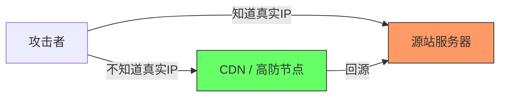
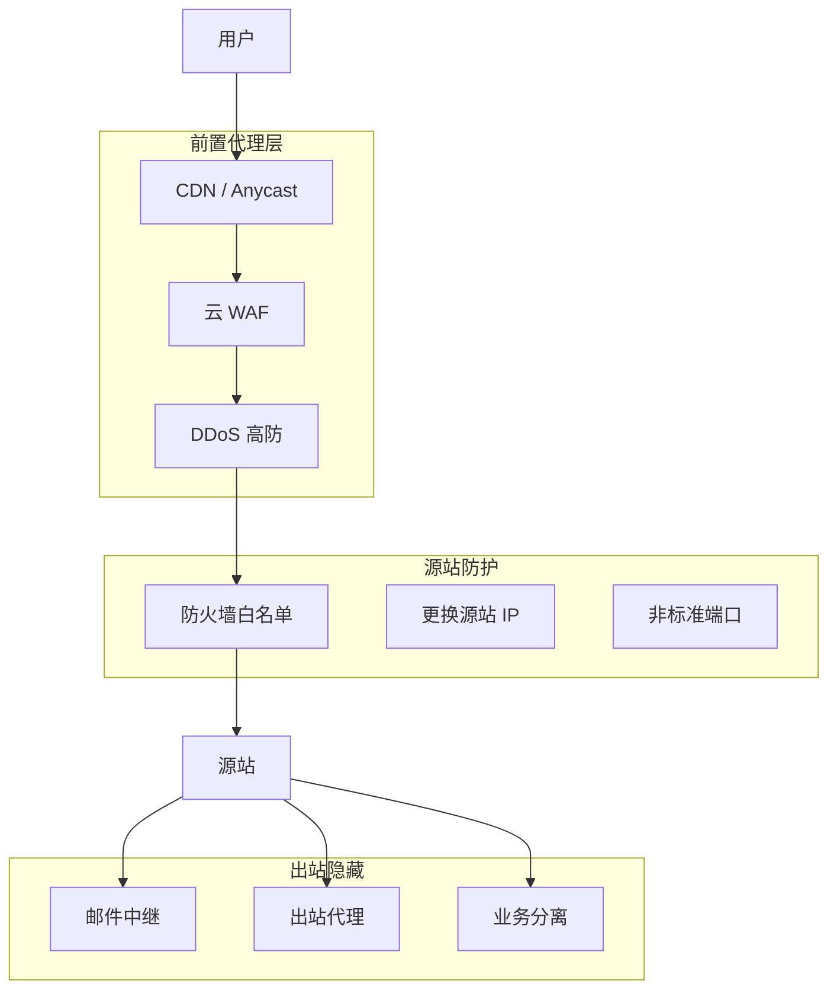
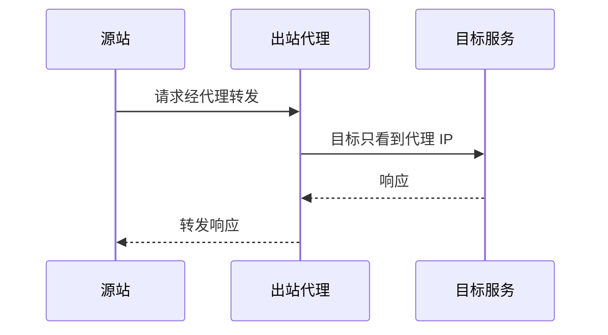
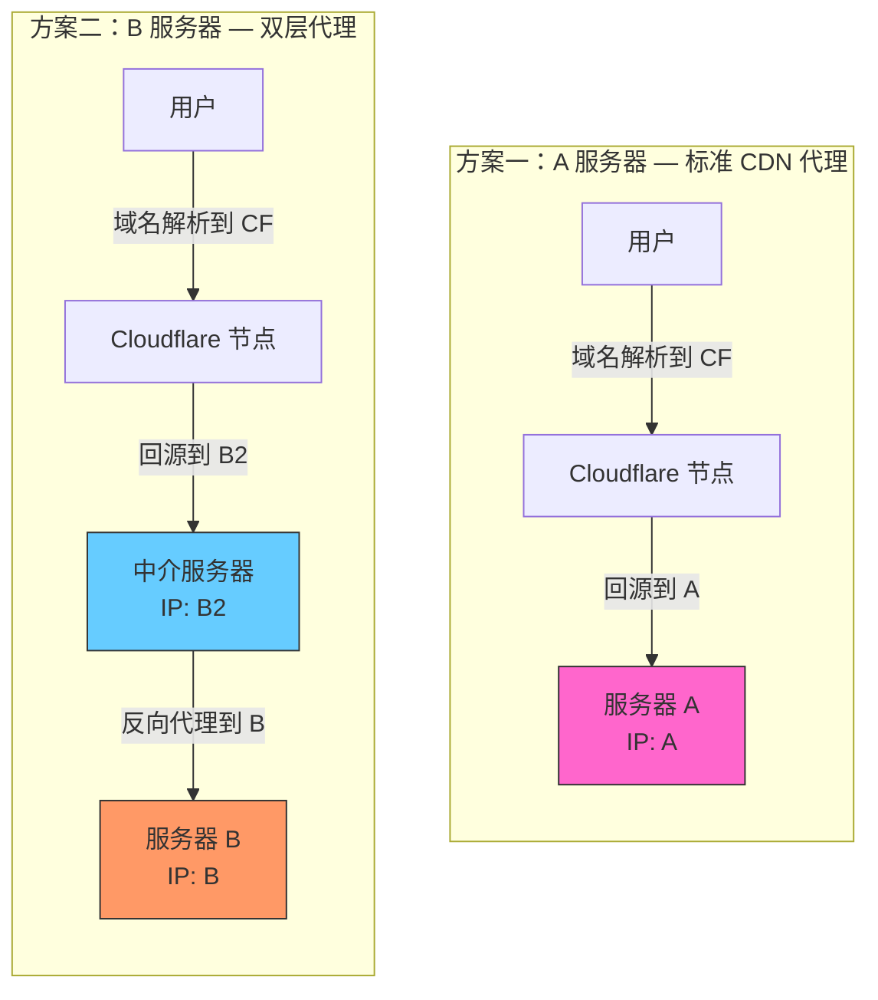
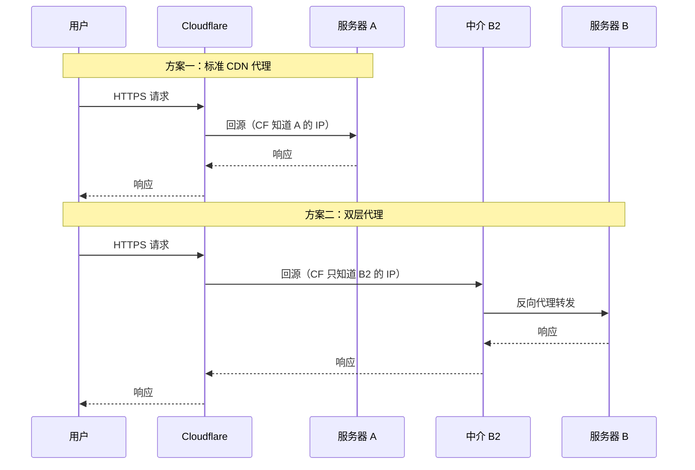

# 服务器 IP 的保护

## 为什么要保护源站 IP

服务器的真实 IP 一旦暴露，攻击者可以绕过所有前置防护（CDN、WAF、高防）直接对源站发起 DDoS、CC 攻击或漏洞探测。保护源站 IP 是纵深防御体系中最基础也最关键的一环。



核心原则：让所有外部流量只能触达代理层，永远无法直连源站。

------

## IP 暴露的常见途径

| 暴露途径         | 说明                                             | 风险等级 |
| ---------------- | ------------------------------------------------ | -------- |
| DNS 历史记录     | 接入 CDN 前的 A 记录被 SecurityTrails 等平台缓存 | 高       |
| 邮件头           | 服务器直接发送邮件，Received 头暴露源 IP         | 高       |
| SSL 证书扫描     | Censys/Shodan 通过证书关联扫描全网 IP            | 高       |
| 子域名未接入 CDN | 主站走 CDN，但某个子域名直接解析到源站           | 中       |
| 服务端主动外连   | Webhook 回调、爬虫出站请求暴露源 IP              | 中       |
| 信息泄露         | phpinfo、错误页面、API 响应中包含 IP             | 低       |
| SSRF 漏洞        | 攻击者利用 SSRF 让服务器向自己发请求             | 中       |

------

## 保护策略全景



------

## 入站流量保护

### 使用 CDN 隐藏源站

CDN 的核心作用不仅是加速，更是将域名解析指向 CDN 节点 IP，隐藏真实源站。

最佳实践：

- 所有域名和子域名都必须接入 CDN，不留"裸奔"的解析记录
- 接入 CDN 前先更换源站 IP（旧 IP 已被历史记录缓存）
- 关闭 CDN 的"直接 IP 访问"回源功能，或设置回源 Host 校验

### 防火墙白名单

源站防火墙只允许 CDN / 高防的回源 IP 段访问，拒绝一切其他来源。

以 iptables 为例：

```bash
# 仅允许 CDN 回源 IP 段访问 80/443
iptables -A INPUT -p tcp --dport 443 -s 198.41.128.0/17 -j ACCEPT
iptables -A INPUT -p tcp --dport 443 -s 173.245.48.0/20 -j ACCEPT
# 拒绝其他所有对 Web 端口的访问
iptables -A INPUT -p tcp --dport 443 -j DROP
iptables -A INPUT -p tcp --dport 80 -j DROP
```

云服务器则通过安全组实现同样效果，只放行 CDN 厂商公布的 IP 段。

### 回源鉴权

在源站 Nginx 中校验自定义回源头，防止攻击者伪造回源请求：

```nginx
server {
    listen 443 ssl;
    
    # 校验 CDN 回源时携带的密钥头
    if ($http_x_origin_secret != "your-random-secret-token") {
        return 403;
    }
}
```

------

## 出站流量隐藏

### 邮件发送

服务器直接发邮件是 IP 泄露的头号元凶。邮件的 `Received` 头会记录发件服务器 IP。

| 方案           | 说明                                                 |
| -------------- | ---------------------------------------------------- |
| 第三方邮件服务 | 使用 SendGrid、SES、Mailgun 等，邮件从它们的 IP 发出 |
| 独立邮件服务器 | 将邮件服务部署在与 Web 不同的 IP 上                  |
| SMTP 中继      | 通过中继转发，源站 IP 不出现在邮件头中               |

### 出站代理

当服务器需要主动发起 HTTP 请求（Webhook、爬虫、第三方 API 调用）时，通过出站代理转发：



可使用 SOCKS5 代理、NAT 网关（云厂商提供）或专用出站 IP 的 VPS。

------

## DNS 层面的防护

### 清理历史记录

接入 CDN 之前的 DNS 记录会被第三方平台（SecurityTrails、ViewDNS）永久缓存。应对方式：

- 接入 CDN 后立即更换源站 IP
- 使用从未关联过该域名的全新 IP

### 避免 DNS 泄露

- 不要在 TXT 记录中包含源站 IP（SPF 记录中用 `include` 而非 `ip4`）
- MX 记录指向独立邮件服务器或第三方服务，不要指向 Web 源站

------

## SSL/TLS 证书防护

Censys 和 Shodan 会扫描全网 IP 的 443 端口，提取 SSL 证书信息，再通过证书中的域名反向关联 IP。

防护措施：

| 措施                        | 原理                               |
| --------------------------- | ---------------------------------- |
| 源站使用 CDN 签发的专用证书 | 不暴露与域名关联的公开证书         |
| 非 443 端口回源             | 规避默认端口扫描                   |
| 默认站点返回空证书          | 直接 IP 访问时不返回真实证书       |
| IP 访问返回无关内容         | 直接访问 IP 时返回默认页或拒绝连接 |

Nginx 配置示例——拦截直接 IP 访问：

```nginx
# 默认 server block，处理直接 IP 或未知 Host 的请求
server {
    listen 443 ssl default_server;
    ssl_certificate /etc/nginx/ssl/dummy.crt;
    ssl_certificate_key /etc/nginx/ssl/dummy.key;
    server_name _;
    return 444;  # 直接关闭连接
}
```

------

## 信息泄露排查

定期检查以下位置是否暴露了源站 IP：

- 应用错误页面（关闭 debug 模式）
- HTTP 响应头（移除 `X-Powered-By`、`Server` 等）
- API 响应体（不要在 JSON 中返回内部 IP）
- `phpinfo()`、健康检查端点等调试接口
- JavaScript 源码中硬编码的 API 地址

------

## 验证与持续监控

保护措施部署后，需要主动验证效果：

```bash
# 检查域名是否还能解析到源站 IP
dig +short example.com

# 利用在线工具检查历史 DNS
# SecurityTrails、ViewDNS.info、DNSHistory

# 用 Censys 搜索证书关联
# https://search.censys.io/

# 从外部 IP 直连源站端口，确认被拒绝
curl -v --connect-timeout 5 https://YOUR_REAL_IP/
```

建议将这些检查纳入定期安全巡检流程，或通过监控脚本自动化。

------

## 总结清单

| 维度 | 关键动作                            |
| ---- | ----------------------------------- |
| 入站 | 全站 CDN + 防火墙白名单 + 回源鉴权  |
| 出站 | 邮件走第三方 + 出站请求走代理       |
| DNS  | 更换 IP + 清理历史 + SPF 用 include |
| 证书 | 默认站点空证书 + 非标准回源端口     |
| 监控 | 定期用外部工具验证 IP 未暴露        |

保护源站 IP 不是一次性操作，而是一个持续维护的过程。每次新增子域名、新增服务、变更架构时，都要重新审视是否引入了新的暴露面。


## 两种源站保护方案对比

### 架构示意



### 流量路径对比



### 详细对比

| 对比维度               | 方案一：A 直接回源                            | 方案二：B2 中介代理                        |
| ---------------------- | --------------------------------------------- | ------------------------------------------ |
| Cloudflare 知道的 IP   | A（源站真实 IP）                              | B2（中介 IP）                              |
| 源站真实 IP 暴露面     | Cloudflare 后台可见，内部员工或配置泄露可暴露 | 仅 B2 知道 B 的 IP，Cloudflare 也不知道    |
| 攻击者绕过 CF 后能打到 | 服务器 A 本身                                 | 中介 B2，B 仍然安全                        |
| B2 被打穿后            | —                                             | 可快速更换 B2，B 无需迁移                  |
| 延迟                   | 用户 → CF → A（一跳回源）                     | 用户 → CF → B2 → B（两跳回源，多一次转发） |
| 成本                   | 无额外服务器                                  | 需要维护 B2 中介服务器                     |
| 运维复杂度             | 低，标准 CDN 配置                             | 中，需维护 B2 的反代配置和安全             |
| 适用场景               | 常规 Web 应用，标准防护即可                   | 高敏感业务，源站 IP 绝对不能暴露           |

### 方案二的核心价值

标准 CDN 代理（方案一）中，Cloudflare 作为可信第三方知道源站 IP。这在绝大多数场景下足够安全，但存在以下风险：

- Cloudflare 后台配置被泄露（账号被盗、内部人员）
- 法律强制要求 Cloudflare 披露回源 IP
- 历史 DNS 记录已经缓存了 A 的 IP

方案二通过引入 B2 中介层，实现了：

- 即使 Cloudflare 被攻破，攻击者只能拿到 B2
- B2 是可牺牲、可快速替换的"挡箭牌"
- B 服务器的 IP 从未出现在任何第三方系统中

### B2 中介服务器的配置要点

B2 上运行反向代理（Nginx 示例）：

```nginx
server {
    listen 443 ssl;
    server_name your-domain.com;

    ssl_certificate /etc/nginx/ssl/cert.pem;
    ssl_certificate_key /etc/nginx/ssl/key.pem;

    # 仅允许 Cloudflare 回源 IP 访问
    allow 173.245.48.0/20;
    allow 103.21.244.0/22;
    allow 103.22.200.0/22;
    allow 103.31.4.0/22;
    allow 141.101.64.0/18;
    allow 108.162.192.0/18;
    allow 190.93.240.0/20;
    allow 188.114.96.0/20;
    allow 197.234.240.0/22;
    allow 198.41.128.0/17;
    allow 162.158.0.0/15;
    allow 104.16.0.0/13;
    allow 104.24.0.0/14;
    deny all;

    location / {
        proxy_pass https://B_REAL_IP;
        proxy_set_header Host $host;
        proxy_set_header X-Real-IP $remote_addr;
        proxy_set_header X-Forwarded-For $proxy_add_x_forwarded_for;
        
        # 传递自定义鉴权头给 B
        proxy_set_header X-Origin-Secret "your-secret-token";
    }
}
```

B 服务器的防火墙则只放行 B2 的 IP：

```bash
# B 服务器上：仅允许 B2 访问
iptables -A INPUT -p tcp --dport 443 -s B2_IP -j ACCEPT
iptables -A INPUT -p tcp --dport 443 -j DROP
```

### 安全加固建议

| 层级        | 措施                                       |
| ----------- | ------------------------------------------ |
| B2 → B 通信 | 使用 WireGuard 隧道或 mTLS，而非裸 IP 直连 |
| B2 本身     | 最小化安装，仅运行反代服务，无业务数据     |
| B2 更换策略 | 准备自动化脚本，被打时 10 分钟内切换新 B2  |
| B 服务器    | 不绑定任何域名，不发送邮件，不主动外连     |
| 监控        | 监控 B2 流量异常，触发告警时自动切换       |

方案二的本质思想是：在信任链中多加一层你自己完全控制的节点，让源站 IP 的知情范围缩小到最小。代价是多一跳延迟和一台服务器的成本，换来的是源站 IP 的绝对隐匿。