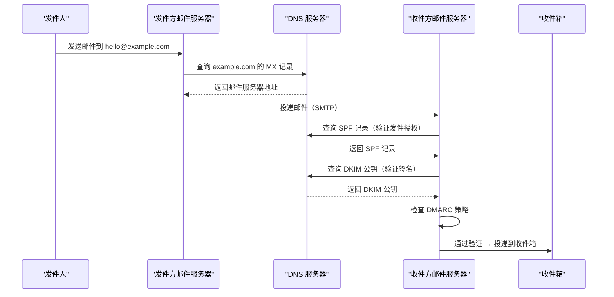
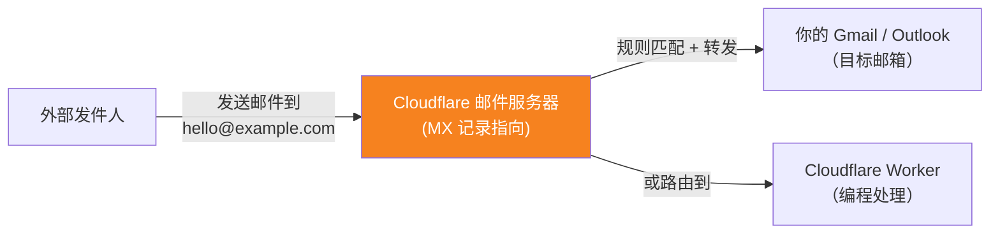
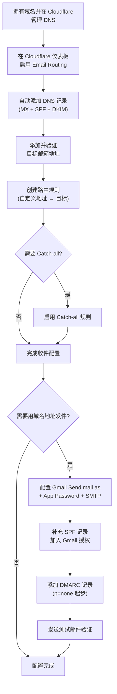

[toc]


## 域名邮箱与邮件转发 

—— 以 Cloudflare Email Routing 为核心的完整指南

> **内容依据**: Cloudflare 官方文档 (developers.cloudflare.com，更新至 2026 年 6 月)、MXToolbox、WPMailSMTP 等权威来源。 
> **知识截止参考日期**: 2026 年 9 月（含联网查询最新信息）

---

## 什么是域名邮箱

**域名邮箱（Domain Email）** 指使用你自己拥有的域名（如 `example.com`）作为邮箱后缀的电子邮件地址，例如 `hello@example.com`。它相对于免费个人邮箱（如 `xxx@gmail.com`、`xxx@qq.com`）而言，具有以下优势：

- 自定义域名的邮箱地址能提供更专业的外观和品牌识别
- 你拥有完整的控制权、所有权，且邮箱地址的数量可以无限扩展
- 不依赖特定邮件服务商的品牌（如 Gmail、Outlook），迁移自由

实现域名邮箱有两种主流路径：

| 方案                    | 说明                                    | 代表产品                                              | 费用           |
| ----------------------- | --------------------------------------- | ----------------------------------------------------- | -------------- |
| **完整邮箱托管**        | 提供完整的收发件、Web 界面、日历等      | Google Workspace, Microsoft 365                       | 按用户按月付费 |
| **邮件转发 + 外部发件** | 仅转发收件到已有邮箱，发件借助外部 SMTP | **Cloudflare Email Routing**、ImprovMX、Forward Email | 免费或低费     |

本文重点讲解第二种 —— **Cloudflare Email Routing** 方案。

---

## 核心概念：邮件相关 DNS 记录

在深入 Cloudflare 配置之前，你必须理解邮件系统背后的几个关键 DNS 记录。你的域名 DNS 就像互联网的电话簿，邮件依赖它完成两个任务：**路由**（邮件该投递到哪里？）和**认证**（收件服务器能否信任这封邮件确实来自你的域名？）

**MX 负责路由，SPF、DKIM 和 DMARC 负责认证** —— 它们共同阻止骗子伪造你的地址，并让你的合法邮件远离垃圾箱。

### 四大邮件 DNS 记录总览

这四种邮件记录各自回答一个清晰的问题：

| 记录                                                         | 类型        | 核心问题                         | 作用                                                         |
| ------------------------------------------------------------ | ----------- | -------------------------------- | ------------------------------------------------------------ |
| **MX** (Mail Exchange)                                       | MX          | "邮件该发到哪？"                 | 指定哪些邮件服务器负责接收你域名的邮件                       |
| **SPF** (Sender Policy Framework)                            | TXT         | "谁可以代表我发件？"             | 列出所有被授权为你的域名发件的服务器                         |
| **DKIM** (DomainKeys Identified Mail)                        | TXT (CNAME) | "这封信真的是我发的且没被篡改？" | 为邮件添加数字签名，使其可追踪并防止伪造                     |
| **DMARC** (Domain-based Message Authentication, Reporting & Conformance) | TXT         | "如果验证不通过怎么办？"         | 允许域名所有者发布策略，告诉收件服务器当邮件未通过 SPF 和 DKIM 检查时该如何处理 |

下面逐一详解。

### MX 记录（Mail Exchange）

**MX 记录是邮件接收的基础**，没有它，你的域名就无法收到任何邮件。

- MX 记录是一种 DNS 记录，指定哪些邮件服务器负责接收发送到你域名的邮件。可以将 MX 记录理解为域名的"邮箱地址"，没有它们，邮件就无处可去。
- MX 记录包含**优先级（Priority）** 值：数字越小优先级越高。当有多条 MX 记录时，发件服务器优先尝试优先级最高的服务器，失败后尝试下一个

示例（Cloudflare Email Routing 配置后的 MX 记录）：

| 类型 | 名称 | 值                        | 优先级 |
| ---- | ---- | ------------------------- | ------ |
| MX   | `@`  | `isaac.mx.cloudflare.net` | 13     |
| MX   | `@`  | `linda.mx.cloudflare.net` | 86     |
| MX   | `@`  | `amir.mx.cloudflare.net`  | 41     |

> **要点**: 一个域名的 MX 记录决定了"谁来收你的邮件"。当你使用 Cloudflare Email Routing 时，MX 记录指向 Cloudflare 的邮件服务器，由 Cloudflare 收到邮件后再转发给你的真实邮箱。

### SPF 记录（Sender Policy Framework）

**SPF 解决的是"发件授权"问题** —— 让收件服务器知道哪些 IP/服务器有权代表你的域名发邮件。

- SPF 帮助邮件服务器验证发件人是否被授权从你的域名发送邮件。你通过在 DNS 中添加一条 TXT 记录来配置 SPF。
- 格式示例：`v=spf1 include:_spf.mx.cloudflare.net ~all`
  - `v=spf1` — 版本声明
  - `include:_spf.mx.cloudflare.net` — 信任 Cloudflare 的邮件服务器
  - `~all` — 对未授权的发件来源执行"软失败"（soft fail），建议标记为可疑但不直接拒绝

**常见 SPF 策略后缀**：

| 后缀   | 含义                         | 适用场景             |
| ------ | ---------------------------- | -------------------- |
| `+all` | 允许所有（极不推荐）         | 几乎不应使用         |
| `~all` | **软失败**，建议标记但不拒绝 | **最常用的起步配置** |
| `-all` | **硬失败**，直接拒绝         | 配置完善后推荐       |
| `?all` | 中性，不做判断               | 测试阶段             |

> **注意**: 一个域名**只能有一条 SPF 记录**。如果你同时使用 Cloudflare 和 Gmail 发件，需要合并到一条记录中，例如：  
> `v=spf1 include:_spf.mx.cloudflare.net include:_spf.google.com ~all`

### DKIM 记录（DomainKeys Identified Mail）

**DKIM 为邮件提供"数字签名"**，接收方可以用它来验证邮件是否确实来自你的域名，且在传输过程中未被篡改。

工作原理：

1. 发件服务器用**私钥**对邮件内容生成签名，附在邮件头部
2. 收件服务器通过 DNS 查询你域名的 **DKIM 公钥记录**
3. 用公钥验证签名 —— 匹配则可信，不匹配则可疑

Cloudflare 会自动为你的域名添加 DKIM 的 TXT 记录，为经过路由的邮件提供认证。

DKIM 记录通常以 `选择器._domainkey.你的域名` 为名称，例如：  
`cf2024-1._domainkey.example.com`

### DMARC 记录（Domain-based Message Authentication, Reporting & Conformance）

**DMARC 是 SPF 和 DKIM 的"执法者"**。

- DMARC 告诉收件服务器当邮件未通过 SPF 和 DKIM 检查时该怎么处理，并要求它们报告所见。没有 DMARC 时，SPF 和 DKIM 只是检查而没有明确的后果。DMARC 将它们变为一个可执行的策略。

DMARC 记录放在 `_dmarc.你的域名`，格式示例：

```
v=DMARC1; p=none; rua=mailto:dmarc-reports@example.com
```

**DMARC 策略（p=）的三个级别**：

| 策略               | 含义               | 推荐使用阶段                 |
| ------------------ | ------------------ | ---------------------------- |
| **`p=none`**       | 仅监控，不采取动作 | **初始配置阶段**，先观察报告 |
| **`p=quarantine`** | 隔离（放入垃圾箱） | 确认合法邮件可正常通过后     |
| **`p=reject`**     | 直接拒绝           | 完全确认无误后的最终策略     |

> **最佳实践**: 按 MX → SPF → DKIM → DMARC 的顺序配置，DMARC 先以监控模式（`p=none`）启动，验证每一步都通过测试邮件确认，确认真实邮件能顺利通过后再逐步收紧执行策略。

### 邮件投递流程图



---

## Cloudflare Email Routing 详解

### 是什么

**Cloudflare Email Routing** 是一个**免费**的服务，用于从你的自定义域名接收邮件并转发到你已有的邮箱。没有按地址或按用户收费。

关键特性：

- Cloudflare **不提供邮箱**（mailbox）。Email Routing 是一个转发服务，而非邮箱。邮件发送到你的域名后被投递到你已有的收件箱（如 Gmail 或 Outlook）。
- Cloudflare Email Routing 保证 100% 隐私，不存储也不访问邮件内容
- 包含钓鱼检测功能，防止垃圾邮件被转发到你的目标邮箱
- Email Routing 包含在所有 Cloudflare 计划中（含免费计划），无需信用卡。唯一的要求是你的域名 DNS 托管在 Cloudflare 上。

### 架构与工作原理



工作流：

1. 外部用户发邮件到 `hello@example.com`
2. 发件方邮件服务器查询你域名的 **MX 记录** → 指向 Cloudflare
3. Cloudflare 收到邮件 → 根据你配置的**路由规则**进行处理
4. 转发到你已验证的**目标地址**（Destination Address），或交给 **Email Worker** 处理

### 前提条件

- 你拥有一个域名
- 你的域名必须使用 Cloudflare DNS（即 nameserver 指向 Cloudflare）
- 你有一个已有的邮箱用于接收转发（如 Gmail、Outlook、QQ 邮箱等）

---

## 实操：配置 Cloudflare Email Routing

### 步骤一：启用 Email Routing 并配置域名

在 Cloudflare 仪表板中，前往 **Compute > Email Service > Email Routing**，选择 **Onboard Domain**，从你的 Cloudflare 帐户中选择一个域名。

可选地查看 Cloudflare 将为你的根域名自动添加的 DNS 记录：用于将收件路由到 Cloudflare 的 **MX 记录**、用于授权邮件路由的 **SPF TXT 记录**、以及用于为路由邮件提供认证的 **DKIM TXT 记录**。然后选择 Done。

> **注意**: DNS 更改最多可能需要 24 小时在全球生效，但对于使用 Cloudflare DNS 的域名通常在 5-15 分钟内完成。

### 步骤二：添加并验证目标地址

**目标地址（Destination Address）** 是 Email Routing 转发消息到的已验证邮箱地址。在创建路由规则之前，你必须先添加并验证至少一个目标地址。

操作：

1. 输入你希望邮件被转发到的收件箱（例如你的 Gmail 地址）。Cloudflare 会发送一封验证邮件，点击其中的链接确认你拥有该邮箱。

> **提示**: 检查你的垃圾邮件文件夹 —— Cloudflare 的验证邮件有时会被归类为垃圾邮件。

### 步骤三：创建路由规则

在 Email Routing 中，一条路由规则将一个邮件模式（email pattern）与一个目标配对 —— 目标可以是一个已验证的邮箱地址或一个 Worker。

前往 **Compute > Email Service > Email Routing > Routing Rules**，选择 **Create routing rule**。

例如，将 `info@example.com` 路由到你已验证的收件箱。可以添加任意多条规则。

**路由规则的配置内容**：

| 配置项             | 说明                                   | 示例                                |
| ------------------ | -------------------------------------- | ----------------------------------- |
| **Custom Address** | 你想创建的域名邮箱地址（@ 前面的部分） | `hello`, `info`, `support`          |
| **Action**         | 对匹配邮件执行的动作                   | 转发到目标地址 / 交给 Worker / 丢弃 |
| **Destination**    | 邮件转发的目标                         | `yourname@gmail.com`                |

你可以创建多个规则，例如：

- `hello@example.com` → `personal@gmail.com`
- `support@example.com` → `work@company.com`
- `billing@example.com` → `finance@company.com`

### 步骤四（可选）：启用 Catch-all 规则

当你启用 Catch-all 功能后，Email Routing 会将发送到你域名的**每一封邮件**都转发到指定目标，包括拼错的本地部分。例如，如果你创建了 `info@example.com` 的规则，而发件人不小心输入了 `ifno@example.com`，启用 Catch-all 后该邮件仍会被处理。

操作：在 Cloudflare 仪表板中，前往 Compute > Email Service > Email Routing，选择 Routing Rules，将 Catch-all 规则启用为 Active。

> **注意**: Catch-all 虽然方便，但可能增加垃圾邮件，请谨慎使用。

### 配置完成后的 DNS 记录一览

完成以上步骤后，你的域名 DNS 中应包含如下自动添加的记录（可在 Cloudflare DNS 面板中查看）：

| 类型 | 名称                  | 值（示例）                                   | 用途                      |
| ---- | --------------------- | -------------------------------------------- | ------------------------- |
| MX   | `@`                   | `isaac.mx.cloudflare.net` (优先级 13)        | 接收邮件路由到 Cloudflare |
| MX   | `@`                   | `linda.mx.cloudflare.net` (优先级 86)        | 备用 MX                   |
| MX   | `@`                   | `amir.mx.cloudflare.net` (优先级 41)         | 备用 MX                   |
| TXT  | `@`                   | `v=spf1 include:_spf.mx.cloudflare.net ~all` | SPF 授权                  |
| TXT  | `cf2024-1._domainkey` | （DKIM 公钥内容）                            | DKIM 签名验证             |

这些 DNS 记录由 Cloudflare 自动创建，并受到保护以防止意外更改。

---

## 进阶：使用域名邮箱发件（回复邮件）

到目前为止，你只实现了**收件**。因为 Email Routing 只处理收件，要让回复邮件看起来是从 `hello@example.com` 发出的，还需要额外一步。

### 方案对比

| 方案                                                   | 复杂度 | 成本                 | 认证可靠性                 | 适合场景                 |
| ------------------------------------------------------ | ------ | -------------------- | -------------------------- | ------------------------ |
| **Gmail "Send mail as" + Gmail SMTP**                  | 低     | 免费                 | 中等（SPF 对齐需额外配置） | 个人或小团队日常使用     |
| **Gmail + 第三方 SMTP**（Resend / Postmark / SMTP2GO） | 中     | 免费档或低费         | 高                         | 需要更好送达率的专业场景 |
| **Cloudflare Email Service（Email Sending）**          | 中高   | 免费档（3000 封/月） | 高                         | 应用自动发件（事务邮件） |
| **完整邮箱托管** (Google Workspace / Microsoft 365)    | 低     | 按月付费             | 最高                       | 企业正式使用             |

### 推荐方案：Gmail "Send mail as" + Gmail SMTP（个人场景最简单）

这是个人用户最常用的方式。你希望用你的专业域名地址发送回复，而不是用个人 Gmail。在 Gmail 中：Settings → Accounts and Import → Send mail as → Add another email address。

**详细步骤**：

**1. 开启 Google 帐户两步验证**

为使用此方法，请确保你的 Google 帐户已启用两步验证（2FA）。如果还没有，前往 Google 帐户设置启用它。

**2. 创建 App Password（应用专用密码）**

在你的 Google 帐户设置中，创建一个专门用于 Mail 的 App Password。

路径：Google 帐户 → 安全性 → 两步验证 → 应用专用密码 → 选择"邮件"

请务必复制生成的密码，后面会用到。

**3. 在 Gmail 中添加发件身份**

打开 Gmail，前往 Settings → Accounts → Send mail as。

点击 "Add another email address"：

- **Name**: 你的显示名称
- **Email address**: 你的域名邮箱地址（如 `hello@example.com`）
- 取消勾选 "Treat as an alias"

**4. 配置 SMTP 服务器**

SMTP Server: `smtp.gmail.com`，Port: `587`，Username: 你的 Gmail 地址（含 `@gmail.com`），Password: 第 2 步生成的 App Password，保持 TLS 启用。点击 Add Account。

**5. 完成验证**

你会收到一封 Gmail 发来的确认邮件，需要输入验证码或点击确认链接完成流程。

**6. 补充 SPF 记录**

由于你通过 Gmail SMTP 发件，需要在 SPF 中加入 Gmail 的授权。修改你域名的 SPF 记录为：

```
v=spf1 include:_spf.mx.cloudflare.net include:_spf.google.com ~all
```

> **重要提醒**: 从 2024 到 2025 年，Gmail、Yahoo 和 Microsoft 收紧了规则。如果你的 From 域名未通过 SPF、DKIM 和 DMARC，你的回复会被过滤到垃圾邮件或直接被退信。Cloudflare 转发不会为你的出站邮件签名。
>
> 如果你发现通过 Gmail SMTP 发出的邮件在对方看来有"无法验证发件人"的警告，说明 SPF/DKIM 对齐存在问题。此时建议考虑使用第三方 SMTP 服务（如 Resend、Postmark、SMTP2GO），它们提供完整的 DKIM 签名，送达率更可靠。

### 补充方案：Cloudflare Email Service（Email Sending）

Cloudflare Email Service 在 2025 年推出了 Email Sending 功能，2026 年 4 月正式可用（GA）。它仅支持编程方式发送——通过 REST API、SMTP 或 Workers 绑定。

没有收件箱，也没有回复按钮。且仅适用于托管在 Cloudflare 上的域名。它为应用发送事务性邮件而设计，不是给个人用户阅读并回复客户邮件用的。

关键信息：

- Email Routing 在 Workers Free 和 Workers Paid 计划上都可用。发送到任意收件人需要 Workers Paid 计划。
- 向你帐户中的已验证目标地址发送邮件在所有计划上都是免费的。3000 封免费额度按帐户按月计算。
- Cloudflare 仅提供端口 465 的隐式 TLS SMTP 提交。不支持明文 SMTP、端口 587 的 STARTTLS 以及端口 25 的未认证中继。

SMTP 连接信息（用于邮件客户端或应用集成）：

| 配置项          | 值                                                         |
| --------------- | ---------------------------------------------------------- |
| **SMTP Server** | `smtp.mx.cloudflare.net`                                   |
| **Port**        | `465`（隐式 TLS）                                          |
| **Username**    | `api_token`（固定字符串）                                  |
| **Password**    | 你的 Cloudflare API Token（需 `Email Sending: Edit` 权限） |

---

## Email Workers：用代码处理邮件

Cloudflare 的一个独特优势是支持将收到的邮件**路由到 Worker**（Cloudflare 的 Serverless 函数平台），用代码进行自定义处理。

适用场景：

- 事务性邮件（欢迎消息、密码重置、订单确认）、认证流程（magic links、邮箱验证、双因素认证）、以邮件作为智能体交互模式（如发邮件创建工单）
- 自定义过滤和分类逻辑
- 自动回复
- 邮件内容存档到数据库

2025 年 3 月，Cloudflare 进一步放宽了 Email Routing 的限制，使 AI 智能体和任务自动化能够更好地处理邮件工作流，包括允许 Worker 回复收件。

---

## DMARC 执行策略与 Cloudflare 的要求

从 2025 年 7 月 3 日起，Cloudflare 要求所有邮件必须通过至少 SPF 或 DKIM 中的一种协议认证才能被转发。同时强烈建议所有发件人实施 DMARC 协议。

这意味着：

- 如果外部发件人发来的邮件**既没有有效 SPF 也没有有效 DKIM**，Cloudflare 会拒绝转发
- 这是整个行业的趋势 —— 主流邮件提供商（Gmail、Yahoo、Microsoft）都在加强认证要求

**对你的影响**：

- **接收方面**：你不需要做额外操作，Cloudflare 会自动处理认证检查
- **发送方面**：确保你的发件渠道（Gmail SMTP 或其他）能通过 SPF + DKIM + DMARC

### DMARC 配置建议

推荐在你的域名上添加 DMARC 记录。最低要求的起步配置：

| 类型 | 名称     | 值                                               |
| ---- | -------- | ------------------------------------------------ |
| TXT  | `_dmarc` | `v=DMARC1; p=none; rua=mailto:dmarc@example.com` |

`rua` 字段指定接收 DMARC 聚合报告的邮箱，你可以通过这些报告了解有谁在冒用你的域名发邮件。

**渐进收紧策略的推荐路径**：

1. `p=none` — 先监控 2-4 周，观察报告
2. `p=quarantine` — 确认合法邮件正常后，隔离未通过认证的邮件
3. `p=reject` — 完全确认后启用最强保护

---

## 常见问题与注意事项

### 收件没有到达目标邮箱

排查清单：

1. **DNS 记录是否正确**：MX 记录是否指向 Cloudflare？SPF 记录是否存在？
2. **目标地址是否已验证**：在 Cloudflare 仪表板检查目标地址状态
3. **目标邮箱的垃圾邮件文件夹**：被转发的邮件可能被目标邮箱标记为垃圾
4. **发件人 DMARC 策略**：如果发件人的邮件未通过认证，Cloudflare 可能会拒绝转发
5. **DNS 传播时间**：新配置后等待 5-15 分钟

### 与已有邮件服务冲突

- **不能同时使用两个服务的 MX 记录**。一旦你开启 Cloudflare Email Routing，MX 记录会指向 Cloudflare。如果你同时使用 Google Workspace 等，需要做选择
- 如果只是想为部分地址用 Cloudflare 转发，而主邮件用 Google Workspace，可以通过子域名（如 `alt.example.com`）区分

### 中国大陆网络环境注意

- Cloudflare 仪表板和 API 从国内可能访问速度较慢，建议使用代理
- **邮件转发本身不受网络影响** —— 因为邮件在 Cloudflare 的服务器间完成转发，不经过你的本地网络
- Gmail 在国内访问受限。如果你的目标邮箱是 Gmail，邮件仍然能正常转发到 Gmail（Cloudflare 直接投递到 Google 服务器），但你**查看 Gmail 需要代理**
- 可以考虑使用国内可达的目标邮箱（如 Outlook/Hotmail、QQ 邮箱、企业邮箱等）作为替代或补充

### Plus Addressing（子地址）

Email Routing 支持**子地址（subaddressing）**，也叫 **plus addressing**，遵循 RFC 5233。

例如：发件到 `hello+newsletter@example.com` 会被匹配到 `hello@example.com` 的规则。这对于追踪不同来源的邮件很有用。

---

## 完整配置流程图



---

## 概念速查表

| 术语                    | 全称                                                         | 一句话解释                                      |
| ----------------------- | ------------------------------------------------------------ | ----------------------------------------------- |
| **MX**                  | Mail Exchange                                                | DNS 记录，指定谁负责收你的邮件                  |
| **SPF**                 | Sender Policy Framework                                      | DNS 记录，声明谁被允许代表你发邮件              |
| **DKIM**                | DomainKeys Identified Mail                                   | 邮件数字签名，证明邮件真实且未被篡改            |
| **DMARC**               | Domain-based Message Authentication, Reporting & Conformance | 执行策略，定义 SPF/DKIM 失败时怎么办            |
| **MTA**                 | Mail Transfer Agent                                          | 邮件传输代理（即邮件服务器软件）                |
| **SMTP**                | Simple Mail Transfer Protocol                                | 邮件发送协议                                    |
| **TLS**                 | Transport Layer Security                                     | 传输层加密，保护邮件传输安全                    |
| **Catch-all**           | —                                                            | 兜底规则，接收域名下所有未明确匹配地址的邮件    |
| **Destination Address** | —                                                            | Cloudflare 中已验证的邮件转发目标地址           |
| **Email Worker**        | —                                                            | Cloudflare 的 Serverless 函数，用于编程处理邮件 |

---

## 总结与推荐实践

**如果你只是想用自己的域名收邮件**（零成本方案）：

1. 将域名 DNS 托管到 Cloudflare（免费计划即可）
2. 启用 Email Routing，Cloudflare 自动配置 MX + SPF + DKIM
3. 验证目标邮箱，创建路由规则
4. 约 5 分钟后即可开始接收邮件

**如果你还想用域名地址回复邮件**：

1. 使用 Gmail 的 "Send mail as" + App Password 方式（最简单）
2. 在 SPF 记录中加入 `include:_spf.google.com`
3. 配置 DMARC（`p=none` 起步）
4. 如果送达率不理想，升级为第三方 SMTP 服务（Resend、SMTP2GO 等）

**如果你是开发者，需要应用级邮件处理**：

1. 收件方向使用 Email Worker 编程处理
2. 发件方向使用 Cloudflare Email Service（SMTP/API/Worker 绑定）
3. 发送到已验证目标地址的邮件免费，不计入配额

---

> **内容来源**: Cloudflare 官方开发者文档 (developers.cloudflare.com/email-service，2026 年 6 月更新)、Cloudflare 产品页面 (cloudflare.com/products/email-routing)、MXToolbox、WPMailSMTP (2026 年版) 等权威来源。联网查询时间为 2026 年 9 月。