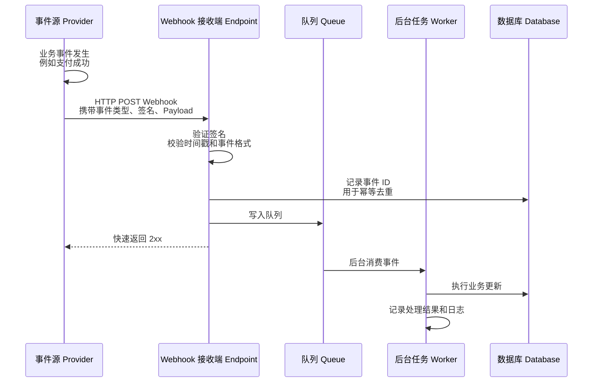
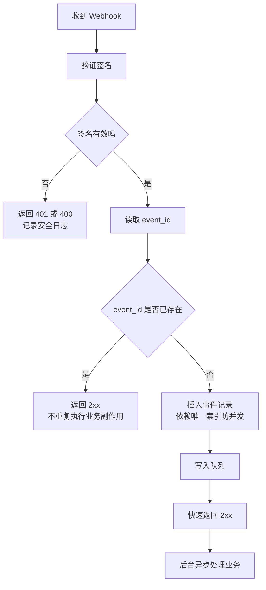
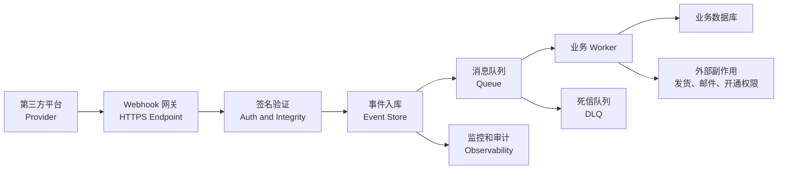
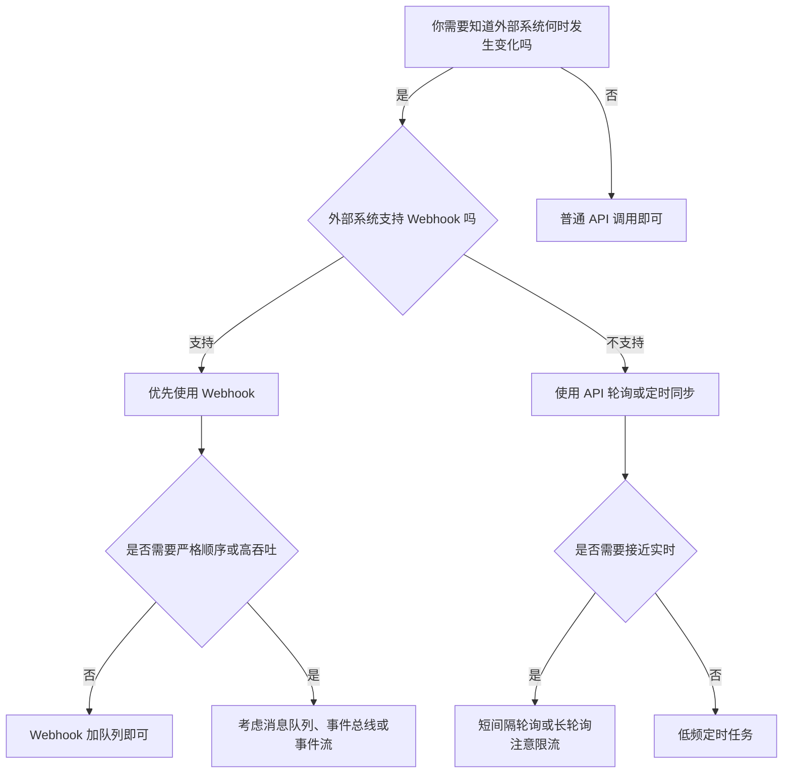
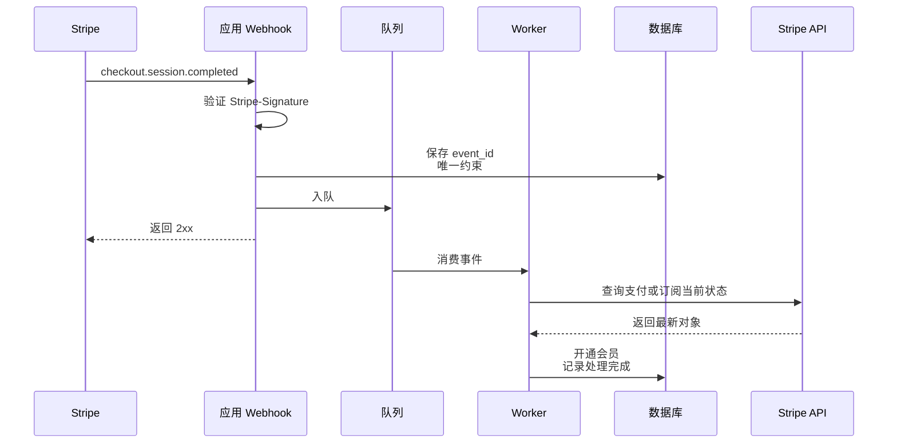
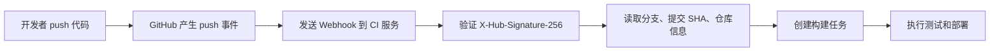

[toc]


## Webhook 是什么

Webhook 可以理解为一种“**事件发生后，由系统主动调用你的 HTTP 地址**”的机制。普通 API 通常是“你去问别人有没有变化”，而 Webhook 是“别人有变化时**主动通知你**”。

更正式地说，Webhook 是一种 HTTP 回调（HTTP Callback）：事件源系统，也叫提供方（Provider），在某个事件发生后，向你预先配置的接收地址（Webhook Endpoint / Callback URL）发送 HTTP 请求，通常是 `POST` 请求，请求体里包含事件数据（Payload）。

例如：

| 场景       | 没有 Webhook 时                    | 使用 Webhook 时                           |
| ---------- | ---------------------------------- | ----------------------------------------- |
| 支付系统   | 你的服务器反复查询订单是否支付成功 | 支付平台在支付成功后主动通知你            |
| Git 仓库   | CI 系统定时检查代码有没有提交      | GitHub 在 `push` 或 PR 事件后通知 CI 系统 |
| 电商订单   | ERP 定时拉取订单状态               | 店铺系统在订单创建、退款、发货时主动推送  |
| 聊天机器人 | 机器人不断查询是否有新消息         | 聊天平台在新消息出现时推送事件            |

GitHub 文档中，Webhook 投递会带有事件类型等特殊请求头；如果配置了密钥，还会使用 `X-Hub-Signature-256` 传递基于请求体和密钥生成的 HMAC SHA-256 签名。Stripe 文档也明确建议使用 `Stripe-Signature` 请求头验证事件确实来自 Stripe，且没有被第三方篡改。([GitHub Docs](https://docs.github.com/en/webhooks/using-webhooks/validating-webhook-deliveries))

## 学习大纲

| 模块         | 学习目标       | 重点问题                                                     |
| ------------ | -------------- | ------------------------------------------------------------ |
| Webhook 基础 | 建立直观理解   | Webhook 是什么？和普通 API 调用有什么不同？                  |
| 工作机制     | 理解完整链路   | 事件如何产生、投递、确认、重试、处理？                       |
| 核心术语     | 掌握沟通语言   | Endpoint、Payload、Signature、Retry、Idempotency 分别是什么？ |
| 可靠性原则   | 避免生产事故   | 为什么会重复、乱序、丢失、延迟？如何设计？                   |
| 安全机制     | 防止伪造和重放 | 如何验证来源？如何保护密钥？                                 |
| 架构实践     | 能落地实现     | 是否需要队列？何时异步处理？如何监控？                       |
| 对比方案     | 会做技术选型   | Webhook、轮询、SSE、WebSocket、消息队列、事件总线分别适合什么场景？ |
| 经典案例     | 建立实战感觉   | 支付成功、代码推送、订单状态变更、聊天事件如何处理？         |

------

------

## 一句话类比

| 概念          | 类比                                     |
| ------------- | ---------------------------------------- |
| 普通 API 查询 | 你每隔一会儿打电话问：“有新消息吗？”     |
| Webhook       | 对方有新消息时直接打电话给你             |
| 消息队列      | 对方把消息放到一个信箱，你按自己的节奏取 |
| WebSocket     | 你和对方一直保持通话，双方都能随时说话   |
| SSE           | 对方保持一条单向广播线路，不断给你推消息 |

Webhook 的优势是简单、实时性较好、资源消耗低；缺点是对接收方的公网可达性、安全验证、幂等处理、失败重试和监控要求较高。

------

## 核心术语

| 术语         | 英文                            | 解释                                                         |
| ------------ | ------------------------------- | ------------------------------------------------------------ |
| 事件源       | Provider / Publisher            | 产生事件并发送 Webhook 的系统，例如 GitHub、Stripe、Shopify  |
| 接收方       | Consumer / Subscriber           | 接收并处理 Webhook 的系统，也就是你的服务                    |
| 回调地址     | Callback URL / Webhook Endpoint | 提供方发送 HTTP 请求的目标地址                               |
| 事件         | Event                           | 某个业务动作，例如 `payment.succeeded`、`push`、`order.created` |
| 负载         | Payload                         | Webhook 请求体，通常是 JSON                                  |
| 投递         | Delivery                        | 提供方把某个事件发送给接收方的一次尝试                       |
| 投递 ID      | Delivery ID / Event ID          | 用于追踪、去重、排查问题的唯一标识                           |
| 签名         | Signature                       | 用密钥对请求内容生成的校验值，用来验证来源和完整性           |
| 重试         | Retry                           | 接收失败或超时后，提供方再次发送事件                         |
| 退避         | Backoff                         | 重试间隔逐渐变长的策略                                       |
| 幂等         | Idempotency                     | 同一个事件处理多次，最终结果仍然和处理一次相同               |
| 死信队列     | Dead Letter Queue / DLQ         | 多次处理失败后存放问题事件的队列                             |
| 事件模式     | Event Schema                    | 事件数据结构定义                                             |
| 乱序         | Out-of-order Delivery           | 后发生的事件可能先到达                                       |
| 至少一次投递 | At-least-once Delivery          | 事件通常不会只保证发送一次，可能重复到达                     |

------

## Webhook 的基本工作机制



生产环境里，推荐把 Webhook 接收和业务处理解耦：接收端只做签名验证、基础校验、去重记录、入队，然后尽快返回 `2xx`；复杂业务由后台 Worker 异步处理。GitHub 文档明确要求服务器应在 10 秒内返回 `2XX`，否则 GitHub 会终止连接并认为投递失败；Stripe 也有自动重试机制，在生产模式下会使用指数退避重试最多三天。([GitHub Docs](https://docs.github.com/en/webhooks/using-webhooks/handling-webhook-deliveries))

------

## Webhook 的典型请求结构

一个典型 Webhook 请求大致如下：

```http
POST /webhooks/payment HTTP/1.1
Content-Type: application/json
User-Agent: PaymentProvider-Webhook/1.0
X-Event-Type: payment.succeeded
X-Delivery-Id: evt_123456
X-Signature: sha256=...

{
  "id": "evt_123456",
  "type": "payment.succeeded",
  "created_at": "2026-07-01T10:30:00Z",
  "data": {
    "payment_id": "pay_987",
    "order_id": "order_001",
    "amount": 19900,
    "currency": "EUR",
    "status": "succeeded"
  }
}
```

不同平台字段名称不同，但通常会包含这些信息：

| 信息     | 作用                             |
| -------- | -------------------------------- |
| 事件 ID  | 去重、追踪、幂等                 |
| 事件类型 | 决定使用哪段业务逻辑处理         |
| 事件时间 | 排查延迟、处理乱序               |
| 资源对象 | 例如订单、支付、用户、仓库、消息 |
| 签名头   | 验证请求来源和完整性             |
| 投递 ID  | 区分同一个事件的多次投递尝试     |
| API 版本 | 判断 Payload 结构是否符合预期    |

------

## Webhook 的核心原理

### 事件驱动，而不是请求驱动

Webhook 属于事件驱动架构（Event-driven Architecture）的一种轻量实现。它的触发点不是“客户端想要数据”，而是“系统内部发生了某件事”。

例如支付成功后，支付平台不需要等你的系统来查询，而是直接发送：

```text
payment_intent.succeeded
checkout.session.completed
invoice.paid
```

这种模式适合处理外部系统状态变化，例如支付、订阅、物流、审批、代码提交、告警、工单、聊天消息等。

------

### HTTP 投递，而不是专用协议

Webhook 通常直接使用 HTTP，因此接入门槛低。你只需要暴露一个 HTTPS 地址，提供方就可以发送请求。

这也是 Webhook 的优点和缺点：

| 方面 | 影响                                                        |
| ---- | ----------------------------------------------------------- |
| 优点 | 容易实现，语言无关，平台无关，能穿过大多数企业网络          |
| 缺点 | HTTP 本身不保证消息持久化、不保证严格顺序、不保证只到达一次 |
| 结果 | 接收方必须自己处理幂等、重试、监控和补偿                    |

AWS EventBridge 的 API Destinations 也体现了类似思路：它可以把事件总线规则或管道匹配到的事件投递到 HTTPS 端点，并支持使用 `POST`、`PUT` 等 HTTP 方法调用外部系统。([AWS 文档](https://docs.aws.amazon.com/eventbridge/latest/userguide/eb-api-destinations.html))

------

### 2xx 代表“收到”，不代表“业务完成”

Webhook 接收方返回 `200`、`202`、`204` 等 `2xx` 状态码，通常只表示“我已经接收到了这次投递”。它不应该等所有业务逻辑都执行完才返回。

推荐语义是：

| 返回码 | 含义                         | 提供方通常如何理解                   |
| ------ | ---------------------------- | ------------------------------------ |
| `2xx`  | 接收成功                     | 不再重试这次投递，或认为本次投递成功 |
| `4xx`  | 请求无效、权限失败、签名错误 | 可能记录失败，有的平台仍会重试       |
| `5xx`  | 接收方内部错误               | 通常会重试                           |
| 超时   | 接收方没有及时响应           | 通常视为失败并重试                   |

GitHub 要求接收方在 10 秒内返回 `2XX`；Stripe 文档说明其事件投递存在自动重试，并且可在事件投递面板中查看投递状态、HTTP 状态码和后续重试时间。([GitHub Docs](https://docs.github.com/en/webhooks/using-webhooks/handling-webhook-deliveries))

------

### Webhook 往往是“至少一次”，不是“恰好一次”

很多新手最容易犯的错误，是假设同一个 Webhook 只会来一次。生产环境不能这样设计。

现实中可能出现：

| 情况                         | 原因                                    |
| ---------------------------- | --------------------------------------- |
| 同一事件重复到达             | 提供方没有收到成功响应，或网络中断      |
| 处理成功但响应失败           | 你的业务已完成，但返回 `2xx` 前连接断了 |
| 人工重发                     | 运维人员在控制台手动重新发送事件        |
| 自动重试                     | 提供方按照重试策略再次投递              |
| 多个事件表达同一业务对象变化 | 同一个订单或支付对象产生多个相关事件    |

Stripe 文档明确说明不保证事件按照生成顺序到达，并建议在需要时通过 API 获取缺失对象或最新对象状态；这也是为什么 Webhook 处理逻辑不能依赖“事件一定按顺序来”。([docs.stripe.com](https://docs.stripe.com/webhooks))

------

## 幂等设计

幂等性（Idempotency）是 Webhook 的生命线。

所谓幂等，就是同一个事件处理一次、两次、十次，最终业务结果都一致。

例如：

| 非幂等处理                              | 可能后果               |
| --------------------------------------- | ---------------------- |
| 收到 `payment.succeeded` 就直接发货     | 重复事件导致重复发货   |
| 收到 `invoice.paid` 就给账户加 100 积分 | 重复事件导致积分翻倍   |
| 收到 `user.created` 就插入用户          | 重复事件导致唯一键冲突 |
| 收到 `message.sent` 就发送邮件          | 重复事件导致重复通知   |

更好的做法：

| 目标             | 做法                                 |
| ---------------- | ------------------------------------ |
| 识别重复事件     | 保存 `event_id` 或 `delivery_id`     |
| 防止并发重复处理 | 数据库唯一约束，而不是单纯先查再插   |
| 避免重复副作用   | 先记录状态，再执行发货、发邮件、发券 |
| 支持重放         | 处理逻辑可以安全地重复执行           |
| 支持补偿         | 失败事件可重新入队，不破坏数据       |

推荐表结构示例：

| 字段              | 说明                                            |
| ----------------- | ----------------------------------------------- |
| `event_id`        | 提供方事件 ID，设置唯一索引                     |
| `event_type`      | 事件类型                                        |
| `payload`         | 原始请求体，便于排查和重放                      |
| `signature_valid` | 签名是否通过                                    |
| `received_at`     | 接收时间                                        |
| `processed_at`    | 处理完成时间                                    |
| `status`          | `received`、`processing`、`processed`、`failed` |
| `retry_count`     | 内部处理重试次数                                |
| `error_message`   | 最近一次错误                                    |

示例流程：



关键点是：**去重记录要比业务副作用更早发生**。对于支付、发货、开通会员、发券、发送邮件这类有外部影响的动作，尤其要谨慎。

------

## 安全机制

Webhook 接收地址暴露在公网，必须假设任何人都可能向它发送伪造请求。生产环境至少需要以下安全措施。

| 安全措施         | 作用                     | 注意点                         |
| ---------------- | ------------------------ | ------------------------------ |
| HTTPS            | 防止明文传输和中间人攻击 | 不要使用自签名证书暴露给第三方 |
| 签名验证         | 验证请求确实来自提供方   | 使用原始请求体计算签名         |
| 时间戳校验       | 防止重放攻击             | 拒绝过旧请求                   |
| IP Allowlist     | 只允许提供方 IP 段访问   | IP 段可能变化，需要维护        |
| 密钥轮换         | 降低密钥泄露风险         | 支持新旧密钥过渡               |
| 最小事件订阅     | 只订阅需要的事件         | 减少攻击面和处理压力           |
| 日志脱敏         | 防止泄露敏感字段         | 不记录完整密钥、卡号、Token    |
| WAF / Rate Limit | 限制恶意流量             | 不要误伤合法重试               |

GitHub 建议使用高熵随机字符串作为 Webhook secret，安全存储，不要硬编码或提交到代码仓库；它会使用 secret 对 Payload 生成 HMAC 签名并放在 `X-Hub-Signature-256` 中。Stripe 也建议结合 IP Allowlisting 和 Signature verification，且其签名头中包含时间戳，用于缓解重放攻击。([GitHub Docs](https://docs.github.com/en/webhooks/using-webhooks/validating-webhook-deliveries))

------

## 签名验证的常见坑

| 错误做法                           | 为什么危险                                    |
| ---------------------------------- | --------------------------------------------- |
| 只检查 `User-Agent`                | 很容易伪造                                    |
| 只检查来源 IP                      | IP 段会变化，代理和网络配置也可能复杂         |
| 使用解析后的 JSON 重新序列化再验签 | JSON 字段顺序、空格、编码变化会导致签名不一致 |
| 把密钥写在代码里                   | 代码泄露等于密钥泄露                          |
| 普通字符串比较签名                 | 存在时序攻击风险，应该使用恒定时间比较        |
| 不校验时间戳                       | 旧请求可能被重放                              |
| 测试环境和生产环境共用 secret      | 测试泄露会影响生产                            |

签名验证应基于**原始请求体（Raw Body）**，而不是已经被框架解析过的对象。很多 Stripe、GitHub、Slack 集成问题都来自框架中间件提前解析 body，导致验签失败。

------

## 推荐的生产级架构



### 接收层应该做什么

| 动作              | 是否推荐放在接收层 | 原因                     |
| ----------------- | ------------------ | ------------------------ |
| 校验 HTTP 方法    | 是                 | 只允许 `POST` 等预期方法 |
| 校验 Content-Type | 是                 | 避免无效请求             |
| 读取原始 Body     | 是                 | 验签需要                 |
| 验证签名和时间戳  | 是                 | 安全边界                 |
| 校验事件类型      | 是                 | 丢弃不关心的事件         |
| 保存原始事件      | 是                 | 支持审计、重放、排查     |
| 写入队列          | 是                 | 解耦业务处理             |
| 执行复杂业务      | 否                 | 容易超时，导致重复投递   |
| 调用多个外部系统  | 否                 | 容易失败和阻塞           |
| 大量数据库更新    | 否                 | 应交给后台任务           |

### Worker 层应该做什么

| 动作             | 说明                              |
| ---------------- | --------------------------------- |
| 再次检查事件状态 | 防止重复消费                      |
| 使用事务         | 保证状态更新和业务变更一致        |
| 处理乱序         | 必要时查询提供方 API 获取当前状态 |
| 处理失败重试     | 区分临时错误和永久错误            |
| 记录处理结果     | 支持排障和审计                    |
| 进入 DLQ         | 多次失败后转人工或补偿流程        |

------

## 事件处理策略

### Snapshot 事件和 Delta 事件

Webhook Payload 通常有两种风格：

| 类型     | 英文           | 含义                       | 示例                           | 处理建议                 |
| -------- | -------------- | -------------------------- | ------------------------------ | ------------------------ |
| 快照事件 | Snapshot Event | Payload 包含对象当前状态   | `subscription.status = active` | 直接以当前状态更新本地   |
| 差量事件 | Delta Event    | Payload 描述发生了什么变化 | `quantity changed from 1 to 3` | 更依赖顺序，处理难度更高 |

对新手来说，优先把 Webhook 当作“通知信号”，而不是绝对可信的完整事实来源。尤其在支付、订阅、库存等关键场景，推荐采用 **Fetch-before-process**：收到 Webhook 后，再调用提供方 API 查询当前对象状态，然后基于最新状态更新本地系统。Stripe 在事件乱序说明中也建议在需要时通过 API 检索相关对象。([docs.stripe.com](https://docs.stripe.com/webhooks))

------

## 事件乱序处理

假设订阅创建会产生这些事件：

```text
customer.subscription.created
invoice.created
invoice.paid
charge.created
```

你不能假设它们一定按这个顺序到达。Stripe 文档明确说明不保证事件按生成顺序投递，并建议不要让事件目的地依赖特定接收顺序。([docs.stripe.com](https://docs.stripe.com/webhooks))

更可靠的处理方式：

| 问题                     | 推荐做法                       |
| ------------------------ | ------------------------------ |
| 后到的旧事件覆盖新状态   | 记录资源版本、更新时间或状态机 |
| 依赖前置事件尚未到达     | 延迟重试，或主动查询当前资源   |
| 同一对象多个事件并发处理 | 按资源 ID 加锁或串行化         |
| 状态转换非法             | 使用有限状态机校验             |
| 无法判断最新状态         | 以提供方 API 当前状态为准      |

------

## Webhook 和其他方案对比

### 总览对比

| 方案         | 通信方式                            | 连接形态             | 实时性         | 可靠性责任                  | 适合场景                          | 不适合场景                   |
| ------------ | ----------------------------------- | -------------------- | -------------- | --------------------------- | --------------------------------- | ---------------------------- |
| Webhook      | 提供方主动 HTTP 推送                | 短连接               | 较高           | 接收方和提供方共同承担      | 第三方事件通知、支付、订单、CI/CD | 严格顺序、高吞吐内部流处理   |
| API 轮询     | 接收方定时请求                      | 短连接               | 取决于轮询间隔 | 接收方承担                  | 对方不支持 Webhook、低频同步      | 高频实时事件                 |
| 长轮询       | 请求挂起直到有数据                  | 半长连接             | 较高           | 双方承担                    | 简单实时通知                      | 大规模连接                   |
| SSE          | 服务端向客户端单向推送              | 长连接               | 高             | 服务端承担                  | 浏览器接收实时流、通知、状态更新  | 客户端需要频繁向服务端发消息 |
| WebSocket    | 双向实时通信                        | 长连接               | 很高           | 双方承担                    | 聊天、协作编辑、游戏、实时控制    | 简单第三方事件通知           |
| 消息队列     | Producer 写入 Broker，Consumer 消费 | 持久连接或客户端协议 | 高             | Broker 和消费者承担         | 内部系统解耦、削峰、可靠处理      | 简单跨公司 HTTP 集成         |
| 事件流 Kafka | 分布式事件日志                      | 持久连接             | 高             | 平台和消费者承担            | 大规模日志、埋点、流处理、回放    | 小型 SaaS 回调               |
| 事件总线     | 事件路由和集成平台                  | 平台托管             | 高             | 云平台承担较多              | 云上事件路由、SaaS 集成           | 简单单点回调可能过重         |
| WebSub       | Hub 中介的发布订阅                  | HTTP Web hooks       | 较高           | Hub、发布者、订阅者共同承担 | Web 内容更新分发                  | 私有业务系统集成             |

MDN 文档说明，SSE 的 `EventSource` 会打开到 HTTP 服务端的持久连接，服务端以 `text/event-stream` 格式单向发送事件；WebSocket 则提供浏览器和服务器之间的双向交互通信，无需通过轮询等待响应。W3C WebSub 是基于 HTTP web hooks 的发布订阅机制，通过 Hub 验证订阅并分发内容更新。([MDN Web Docs](https://developer.mozilla.org/en-US/docs/Web/API/EventSource))

------

## 如何选型



简单经验：

| 需求                        | 推荐方案                               |
| --------------------------- | -------------------------------------- |
| 第三方支付结果通知          | Webhook                                |
| Git push 后触发 CI          | Webhook                                |
| 浏览器实时显示服务端状态    | SSE                                    |
| 聊天、协作编辑、游戏        | WebSocket                              |
| 内部订单系统和库存系统解耦  | 消息队列                               |
| 大规模埋点和实时分析        | Kafka / Pulsar 等事件流                |
| 云服务之间事件路由          | EventBridge / Event Grid 等事件总线    |
| 对方没有事件推送能力        | API 轮询                               |
| 标准化描述事件格式          | CloudEvents                            |
| 标准化描述 Webhook API 文档 | OpenAPI Webhooks / Callbacks、AsyncAPI |

CloudEvents 的目标是用通用方式描述事件数据，降低不同事件源之间格式不一致带来的集成成本；OpenAPI 也支持描述 Webhooks，并把它们视为 API 消费方按照模板实现的 Path Item。OpenAPI 的 Callback 则更偏向某个具体操作触发的异步回调，而 Webhook 更适合通用事件订阅场景。([CloudEvents](https://cloudevents.io/))

------

## Webhook 与 API 轮询对比

| 维度     | Webhook                                 | API 轮询                         |
| -------- | --------------------------------------- | -------------------------------- |
| 触发方式 | 事件发生后提供方主动推送                | 接收方定时查询                   |
| 实时性   | 通常更好                                | 取决于轮询频率                   |
| 流量     | 只有事件发生时有请求                    | 即使没有变化也会请求             |
| 实现难度 | 接收方需要公网 Endpoint、安全验证、幂等 | 实现简单，但要处理限流和游标     |
| 可靠性   | 依赖投递、重试、接收端可用性            | 接收方可主动补拉                 |
| 适合     | 事件稀疏、实时通知                      | 对方不支持 Webhook、需要定期对账 |
| 最佳实践 | Webhook 触发，API 补查                  | 轮询兜底，定期 reconciliation    |

生产中二者经常组合使用：Webhook 负责实时通知，API 轮询或批量对账负责兜底。支付系统、订单系统、账务系统尤其应该有定期对账任务，因为 Webhook 可能延迟、重复或乱序。

------

## Webhook 与 WebSocket 对比

| 维度       | Webhook                  | WebSocket                          |
| ---------- | ------------------------ | ---------------------------------- |
| 主要对象   | 服务器到服务器           | 浏览器或客户端到服务器，也可服务间 |
| 连接       | 每次事件一个 HTTP 请求   | 长连接                             |
| 通信方向   | 通常单向：提供方到接收方 | 双向                               |
| 适合       | 第三方事件通知           | 聊天、实时协作、行情、游戏         |
| 部署复杂度 | 相对低                   | 需要连接管理、心跳、扩容           |
| 可靠性     | 依赖重试和幂等           | 依赖连接状态、重连、消息确认       |
| 示例       | Stripe 通知支付成功      | 在线聊天室实时收发消息             |

MDN 对 WebSocket 的定义强调了“双向交互通信会话”，而 Webhook 更像一次次独立的 HTTP 事件投递。([MDN Web Docs](https://developer.mozilla.org/en-US/docs/Web/API/WebSockets_API))

------

## Webhook 与 SSE 对比

| 维度       | Webhook              | SSE                              |
| ---------- | -------------------- | -------------------------------- |
| 全称       | Webhook              | Server-Sent Events               |
| 方向       | 服务端到服务端       | 服务端到浏览器客户端             |
| 协议       | 普通 HTTP POST       | HTTP 长连接，`text/event-stream` |
| 是否双向   | 通常不是             | 不是，单向                       |
| 适合       | SaaS 系统集成        | 页面实时通知、状态流、新闻流     |
| 浏览器支持 | 不直接依赖浏览器 API | 使用 `EventSource`               |
| 典型问题   | 签名、重试、幂等     | 连接数、断线重连、代理缓冲       |

SSE 的优势是浏览器端使用简单，适合服务端向页面持续推送数据；但它不是第三方系统通知你服务器的主流方式。MDN 说明 SSE 是服务端向网页随时推送数据的机制，而 `EventSource` 连接保持打开直到关闭。([MDN Web Docs](https://developer.mozilla.org/en-US/docs/Web/API/EventSource))

------

## Webhook 与消息队列对比

| 维度     | Webhook                      | 消息队列                        |
| -------- | ---------------------------- | ------------------------------- |
| 边界     | 常用于跨组织、跨 SaaS 集成   | 常用于组织内部系统              |
| 协议     | HTTP                         | AMQP、Kafka 协议、云队列 API 等 |
| 持久化   | 提供方未必提供完整持久化能力 | Broker 通常负责持久化           |
| 消费控制 | 接收方被动接收               | 消费方可按能力拉取或消费        |
| 削峰能力 | 接收方自己加队列             | 天然具备                        |
| 重放能力 | 取决于提供方                 | 通常更强                        |
| 顺序保证 | 通常弱                       | 可按分区或队列提供一定顺序      |
| 适合     | 外部事件入口                 | 内部异步处理主干                |

因此，一个成熟架构经常是：

```text
外部平台 -> Webhook 接收端 -> 内部队列 -> Worker -> 业务系统
```

Webhook 负责接入外部世界，消息队列负责内部可靠处理。

------

## Webhook 与事件总线对比

| 维度     | Webhook                          | 事件总线                                |
| -------- | -------------------------------- | --------------------------------------- |
| 代表     | GitHub Webhooks、Stripe Webhooks | Amazon EventBridge、Azure Event Grid 等 |
| 能力     | 点对点事件推送                   | 路由、过滤、转换、扇出、权限、审计      |
| 使用成本 | 低                               | 中到高                                  |
| 适合     | 单个提供方通知单个接收方         | 多事件源、多消费者、复杂路由            |
| 可观测性 | 取决于提供方和自建系统           | 平台通常提供更多监控能力                |
| 复杂度   | 简单                             | 更适合中大型系统                        |

如果你的系统只有一个支付平台通知一个后端服务，Webhook 足够。如果你有几十个 SaaS、多个内部服务、复杂过滤规则和多消费者分发，事件总线更合适。AWS 文档中 EventBridge API Destinations 就是将事件规则匹配到 HTTPS 端点的一类集成方式。([AWS 文档](https://docs.aws.amazon.com/eventbridge/latest/userguide/eb-api-destinations.html))

------

## Webhook 的最佳实践清单

### 接收端设计

| 实践              | 说明                                                         |
| ----------------- | ------------------------------------------------------------ |
| 使用独立 Endpoint | 例如 `/webhooks/stripe`、`/webhooks/github`，不要和普通业务 API 混在一起 |
| 只接受 HTTPS      | 生产环境不要使用 HTTP                                        |
| 只接受必要方法    | 通常只允许 `POST`                                            |
| 限制请求体大小    | 防止异常大 Payload 打爆服务                                  |
| 保存原始请求体    | 验签、审计、重放都需要                                       |
| 快速返回 `2xx`    | 不要在请求线程里做复杂业务                                   |
| 异步处理          | 使用队列、任务系统、后台 Worker                              |
| 按事件类型分发    | 使用清晰的 handler map                                       |
| 记录事件状态      | 接收、处理中、成功、失败                                     |
| 支持重放          | 能从数据库或日志重新处理某个事件                             |

### 安全实践

| 实践                    | 说明                                          |
| ----------------------- | --------------------------------------------- |
| 必须验签                | 不要相信公网请求                              |
| 使用恒定时间比较        | 防止签名比较泄露信息                          |
| 校验时间戳              | 防止重放攻击                                  |
| 密钥放入 Secret Manager | 不要硬编码                                    |
| 定期轮换密钥            | 尤其是人员变动或泄露风险后                    |
| 区分测试和生产密钥      | 不要混用                                      |
| 最小化事件订阅          | Stripe 也建议只监听集成所需事件，避免额外负载 |
| 日志脱敏                | 不要打印完整请求头和敏感对象                  |

Stripe 文档建议只监听集成所需事件，因为监听额外事件或全部事件会给服务器带来不必要压力。([docs.stripe.com](https://docs.stripe.com/webhooks))

### 可靠性实践

| 实践                 | 说明                                   |
| -------------------- | -------------------------------------- |
| 事件 ID 唯一约束     | 幂等的核心                             |
| 业务副作用前检查状态 | 防止重复发货、重复发券                 |
| 使用事务             | 保证事件状态和业务状态一致             |
| 引入队列             | 削峰、重试、隔离外部平台和内部业务     |
| 设置 DLQ             | 多次失败后不要无限重试                 |
| 定期对账             | Webhook 不是账务系统唯一依据           |
| 支持人工补偿         | 可以手动重发、重放、修复               |
| 监控失败率           | Webhook 失败可能直接影响收入           |
| 监控延迟             | 关注事件发生时间到处理完成时间         |
| 监控重复率           | 重复事件突然增多可能说明响应失败或超时 |

### Schema 和版本实践

| 实践               | 说明                          |
| ------------------ | ----------------------------- |
| 宽容读取           | 不因未知字段失败              |
| 显式校验必需字段   | 缺少关键字段应进入失败处理    |
| 记录 API 版本      | Payload 结构可能随版本变化    |
| 不直接依赖完整对象 | 必要时再调用 API 获取最新状态 |
| 事件类型白名单     | 未知事件记录后跳过            |
| 建立契约测试       | 使用样例 Payload 测试 handler |

Stripe 文档说明，事件对象的结构由事件发生时账户设置的 API 版本决定，后续修改 API 版本不会 retroactively 改变已创建的 Event 对象。([docs.stripe.com](https://docs.stripe.com/webhooks))

------

## 常见错误和正确做法

| 常见错误                 | 后果                       | 正确做法                           |
| ------------------------ | -------------------------- | ---------------------------------- |
| 不验签                   | 任意人可伪造支付成功       | 使用 HMAC 签名验证                 |
| 在请求中直接处理复杂业务 | 超时后提供方重试，导致重复 | 入库入队后快速返回                 |
| 不做幂等                 | 重复发货、重复开通权限     | 使用事件 ID 唯一约束               |
| 假设事件有序             | 状态被旧事件覆盖           | 查询当前状态或使用状态机           |
| 订阅所有事件             | 流量大、逻辑混乱           | 只订阅需要的事件                   |
| 没有 DLQ                 | 失败事件无限重试或丢失     | 多次失败后进入死信队列             |
| 不保存原始 Payload       | 难以排查和重放             | 保存原始 Body、Headers、处理结果   |
| 只看 `200` 数量          | 无法发现业务处理失败       | 同时监控接收成功和处理成功         |
| 测试只测正常路径         | 生产一遇到重试就出错       | 测重复、乱序、超时、签名错误       |
| 把 Webhook 当数据库同步  | 本地状态不一致             | Webhook 通知 + API 补查 + 定期对账 |

------

## 经典用例

### 支付成功后开通会员

推荐流程：



核心注意点：

| 问题                           | 做法                         |
| ------------------------------ | ---------------------------- |
| 同一支付事件重复到达           | `event_id` 去重              |
| 事件顺序不稳定                 | 查询 Stripe 当前对象         |
| 开通会员和记录事件状态需要一致 | 使用数据库事务               |
| 邮件发送失败                   | 单独任务重试，不回滚会员开通 |
| Webhook 漏处理                 | 定期按订单状态对账           |

------

### GitHub push 后触发 CI

流程：



GitHub Webhook 中可以通过 `X-GitHub-Event` 判断事件类型，通过签名头验证 Payload 完整性和来源。GitHub 文档也建议在接收 Webhook 后快速返回 `2XX`，并在代码中根据事件类型分发逻辑。([GitHub Docs](https://docs.github.com/en/webhooks/using-webhooks/handling-webhook-deliveries))

------

### 电商订单状态同步

典型事件：

```text
order.created
order.paid
order.fulfilled
order.cancelled
refund.created
```

处理建议：

| 事件              | 本地处理                 |
| ----------------- | ------------------------ |
| `order.created`   | 创建本地订单草稿         |
| `order.paid`      | 标记已支付，触发库存锁定 |
| `order.fulfilled` | 更新物流状态             |
| `order.cancelled` | 关闭订单，释放库存       |
| `refund.created`  | 记录退款，触发财务流程   |

注意不要简单地“收到什么就覆盖什么”。订单、支付、发货、退款往往有状态机，应该校验状态转换是否合法。

------

## 一个简化的处理伪代码

```pseudo
function handleWebhook(request):
    rawBody = request.rawBody
    headers = request.headers

    if not verifySignature(rawBody, headers):
        return 401

    event = parseJson(rawBody)

    if not isAllowedEventType(event.type):
        return 204

    inserted = insertEventIfNotExists(
        event_id = event.id,
        event_type = event.type,
        payload = rawBody,
        status = "received"
    )

    if not inserted:
        return 200

    enqueue("webhook-events", event.id)

    return 202
```

后台 Worker：

```pseudo
function processEvent(eventId):
    event = loadEvent(eventId)

    if event.status == "processed":
        return

    markAsProcessing(eventId)

    try:
        if event.type == "payment.succeeded":
            currentPayment = providerApi.getPayment(event.data.payment_id)
            activateOrderIfPaid(currentPayment)

        markAsProcessed(eventId)

    catch temporaryError:
        retryLater(eventId)

    catch permanentError:
        moveToDeadLetterQueue(eventId)
```

这个模式的关键是：**Webhook 请求线程只负责可靠接收，业务线程负责可靠处理**。

------

## 文档化与标准化

虽然 Webhook 实现通常是平台自定义的，但现代工程中越来越强调“可文档化、可测试、可治理”。

| 工具或规范        | 作用                                       |
| ----------------- | ------------------------------------------ |
| OpenAPI Webhooks  | 描述消费者需要实现的 Webhook Endpoint 模板 |
| OpenAPI Callbacks | 描述某个 API 操作触发的异步回调            |
| AsyncAPI          | 描述事件驱动或消息驱动 API                 |
| CloudEvents       | 用统一格式描述事件元数据                   |
| WebSub            | 基于 Hub 的 Web 内容发布订阅机制           |

OpenAPI 的 Webhooks 用于描述 API 消费方需要如何实现接收端；Callbacks 则绑定在某个具体 Operation 下，更像某次 API 调用引发的异步回调。CloudEvents 则试图解决“每个事件源都用不同格式描述事件”的问题。([OpenAPI Documentation](https://learn.openapis.org/specification/webhooks.html))

------

## 新手学习路线

| 阶段   | 应掌握内容                     | 练习建议                                 |
| ------ | ------------------------------ | ---------------------------------------- |
| 入门   | HTTP、JSON、POST、状态码       | 写一个 `/webhook/test` 接口接收 JSON     |
| 基础   | 事件类型、Payload、Headers     | 根据 `event.type` 分发不同逻辑           |
| 安全   | HMAC、签名、时间戳             | 实现签名验证和错误拒绝                   |
| 可靠性 | 幂等、重试、乱序               | 重放同一个 Payload，确认不会重复执行业务 |
| 架构   | 队列、Worker、DLQ              | 接收后入队，后台异步处理                 |
| 运维   | 日志、指标、告警               | 统计接收成功率、处理失败率、延迟         |
| 进阶   | 事件总线、CloudEvents、OpenAPI | 为 Webhook 写契约文档和测试用例          |

------

## 面试或设计题回答模板

当被问到“如何设计一个可靠的 Webhook 系统”时，可以按这个顺序回答：

| 层面     | 回答要点                                           |
| -------- | -------------------------------------------------- |
| 接入     | 暴露 HTTPS Endpoint，只接受指定方法和 Content-Type |
| 安全     | 使用签名验证、时间戳、防重放、密钥安全存储         |
| 快速响应 | 验签后保存事件并入队，立即返回 `2xx`               |
| 幂等     | 使用事件 ID 或业务对象 ID 做唯一约束               |
| 异步处理 | Worker 消费队列，执行业务逻辑                      |
| 乱序处理 | 不依赖投递顺序，必要时查询提供方 API               |
| 失败处理 | 内部重试、指数退避、死信队列、人工补偿             |
| 可观测性 | 记录 delivery id、event id、状态、耗时、错误       |
| 对账     | 定时扫描外部系统，补偿漏处理事件                   |
| 文档     | 用 OpenAPI、AsyncAPI 或 CloudEvents 规范事件契约   |

------

## 关键结论

Webhook 最适合用来做“外部系统发生事件后通知我”。它不是数据库同步协议，也不是可靠消息队列的完整替代品。

生产级 Webhook 的核心不是“写一个 HTTP 接口”，而是这几件事：

| 核心能力   | 为什么重要                   |
| ---------- | ---------------------------- |
| 签名验证   | 防止伪造请求                 |
| 快速确认   | 防止提供方超时重试           |
| 持久化事件 | 支持审计和重放               |
| 幂等处理   | 防止重复副作用               |
| 异步队列   | 提升稳定性和吞吐             |
| 乱序容忍   | 防止状态错误                 |
| 失败补偿   | 避免事件永久丢失             |
| 监控告警   | 尽早发现收入、订单、权限异常 |

对新手来说，记住一个最实用的公式：

```text
可靠 Webhook = 验签 + 入库 + 幂等 + 入队 + 快速 2xx + 异步处理 + 监控补偿
```