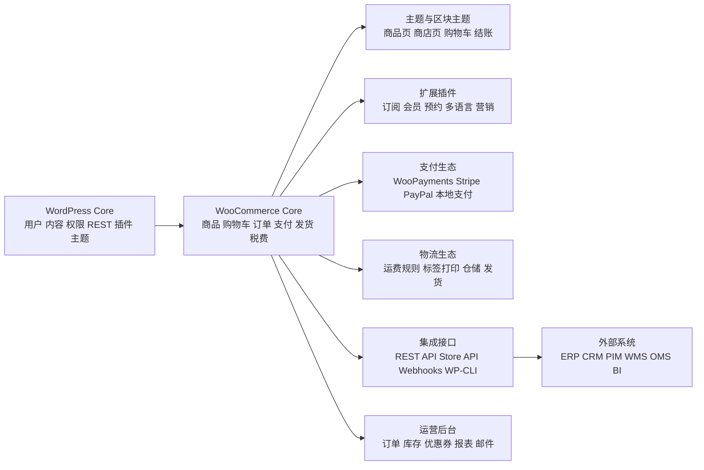
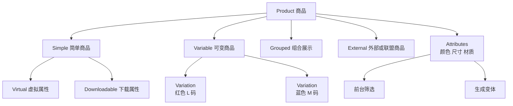
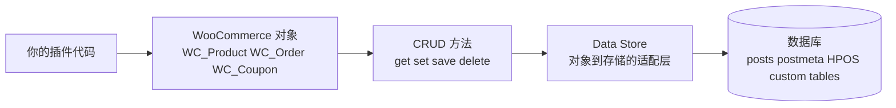
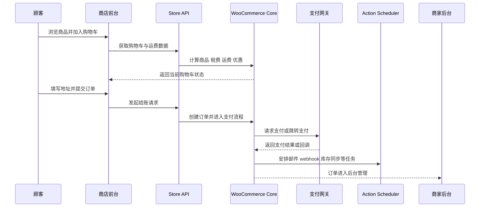
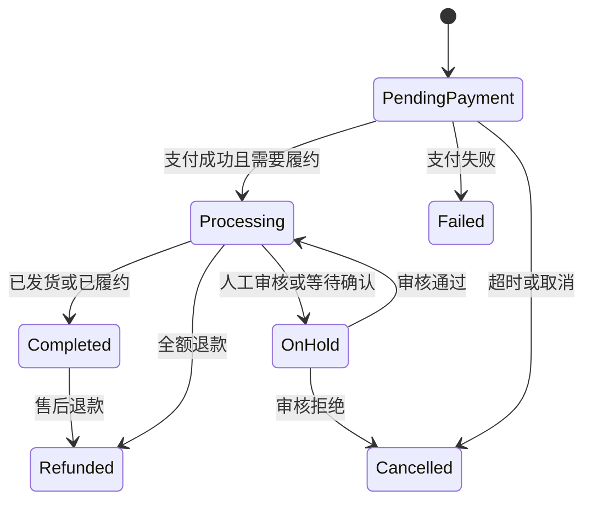
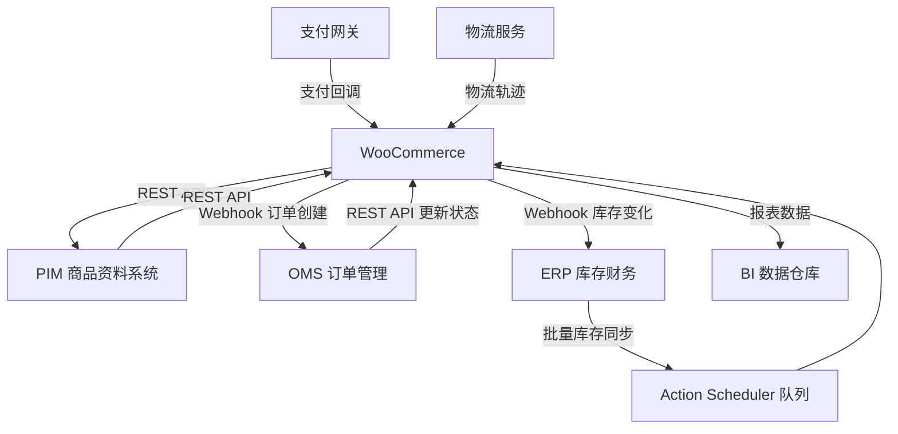

[toc]


## 详细大纲

| 学习模块             | 需要掌握的核心问题                                           | 学完后应能做到                                           |
| -------------------- | ------------------------------------------------------------ | -------------------------------------------------------- |
| WooCommerce 生态定位 | WooCommerce 与 WordPress、主题、插件、支付、物流、外部系统的关系 | 判断一个需求应由配置、主题、插件、API 还是自定义开发解决 |
| 技术运行环境         | PHP、数据库、HTTPS、内存、服务器、缓存、队列的作用           | 搭建适合线上电商的 WordPress/WooCommerce 环境            |
| 商品模型             | 简单商品、可变商品、组合商品、虚拟商品、下载商品、属性、变体、库存 | 正确设计商品结构，避免后期维护困难                       |
| 购物车与结账         | Cart、Checkout、支付网关、运费、税费、优惠券、订单生成流程   | 理解用户从浏览到付款的完整链路                           |
| 数据存储与 HPOS      | 传统 `posts/postmeta` 与 HPOS 订单表、CRUD、Data Store       | 写出兼容现代 WooCommerce 的订单代码                      |
| 扩展机制             | hooks、filters、模板覆盖、Blocks、Slot/Fill、Store API、REST API、Webhooks | 选择合适扩展方式，而不是乱改主题或核心文件               |
| 前端与主题           | 经典主题、区块主题、Woo Blocks、样式覆盖、模板层级           | 构建可维护的店铺前台                                     |
| 后台与运营           | 订单、退款、库存、报表、邮件、客户、优惠券、自动化任务       | 用开发视角理解日常运营功能                               |
| 安全、性能与部署     | 权限、nonce、输入校验、转义、缓存、备份、更新、测试、灰度发布 | 把 WooCommerce 从“能跑”提升到“稳定可维护”                |
| 学习路线与实战项目   | 从配置到二次开发，再到外部系统集成                           | 形成系统学习路径与项目实践能力                           |

------

## WooCommerce 在整个生态中的位置

WooCommerce 是运行在 WordPress 上的开源电商平台，官方对它的定位是“open-source commerce platform for WordPress”，强调商家对结账、数据、成本、支付、功能与主机拥有较高控制权。它不是一个独立 SaaS，而是把电商领域能力叠加到 WordPress 的内容、用户、权限、插件、主题、REST API 与区块编辑器体系之上。([WooCommerce](https://woocommerce.com/))



理解 WooCommerce 最重要的心智模型是：WordPress 提供“网站应用框架”，WooCommerce 提供“电商领域模型”，扩展插件提供“垂直业务能力”，主题与 Blocks 提供“用户界面”，API 和 Webhooks 负责“系统集成”。这也是为什么 WooCommerce 的优点是自由、可扩展、可迁移，缺点是你需要对主机、安全、性能、插件质量和升级流程负更多责任。

------

## 技术栈与运行环境

WooCommerce 当前服务器建议文档面向 WooCommerce 10.8 及以后版本，推荐环境包括 WordPress 6.9+、PHP 8.3+、MySQL 8.0+ 或 MariaDB 10.6+、HTTPS、WordPress 内存限制 256 MB+；文档也说明旧环境可能仍能运行，但老 PHP/MySQL 已到生命周期末期，会带来性能与安全风险。([WooCommerce](https://woocommerce.com/document/server-requirements/))

| 层级       | 现代建议                                          | 新手理解                                           |
| ---------- | ------------------------------------------------- | -------------------------------------------------- |
| Web 服务器 | Nginx 或 Apache                                   | 接收浏览器请求，把 PHP 请求转给 PHP-FPM 或模块处理 |
| PHP        | 8.3+，上线前测试插件兼容性                        | WordPress 与 WooCommerce 的主要后端语言            |
| 数据库     | MySQL 8.0+ 或 MariaDB 10.6+                       | 保存文章、商品、订单、设置、用户、元数据           |
| HTTPS      | 必须用于生产站                                    | 保护登录、结账、支付跳转、API 通信                 |
| 内存       | WordPress memory limit 256 MB+                    | 电商站比普通博客更容易消耗内存                     |
| Cron/队列  | WP-Cron、Action Scheduler，必要时用系统 cron 触发 | 处理异步任务，如邮件、webhook、订阅扣款、订单同步  |
| 缓存       | 页面缓存、对象缓存、OPcache、CDN                  | 减少 PHP 与数据库压力，但购物车/结账页要谨慎排除   |
| 备份       | 文件与数据库都要备份                              | 插件更新、数据迁移、HPOS 切换前尤其重要            |

生产环境的基本原则是：不要把 WooCommerce 当静态展示站部署。商品列表、筛选、购物车、优惠券、库存、支付状态、订单邮件、Webhook、后台报表都会产生动态读写。缓存可以提升性能，但不能破坏购物车、结账、账户页、库存扣减和支付回调。

------

## 生态角色全景

| 角色             | 作用                   | 典型例子                                             | 新手常见误区                                  |
| ---------------- | ---------------------- | ---------------------------------------------------- | --------------------------------------------- |
| WordPress Core   | CMS 与应用框架         | 用户、权限、插件系统、主题系统、REST API、区块编辑器 | 以为 WooCommerce 可以脱离 WordPress 单独运行  |
| WooCommerce Core | 电商核心能力           | 商品、订单、购物车、支付接口、运费、税费、邮件、报表 | 把所有需求都塞进主题 `functions.php`          |
| 主题             | 控制前台展示           | 商店页、商品详情页、购物车、结账样式                 | 用主题实现业务逻辑，换主题后功能丢失          |
| 插件/扩展        | 增加业务能力           | 订阅、会员、发票、多语言、营销、支付、物流           | 安装过多低质量插件导致性能与兼容问题          |
| Blocks           | 现代编辑与前台模块     | Cart Block、Checkout Block、Product Collection       | 继续用旧 checkout hook 改区块结账，结果不生效 |
| REST API         | 后台管理与外部系统集成 | ERP 同步订单、PIM 同步商品、BI 拉报表                | 把管理 API 暴露给前台使用                     |
| Store API        | 面向顾客前台体验       | 商品列表、购物车、结账、运费计算                     | 用它查询任意客户订单或后台设置，这是不允许的  |
| Webhooks         | 事件通知               | 订单创建后通知 ERP，商品更新后通知外部搜索           | 不做重试、签名校验、幂等处理                  |
| Action Scheduler | 后台任务队列           | webhook 投递、邮件、订阅扣款、批量同步               | 把耗时任务放在用户请求中同步执行              |

WordPress hooks 是整个生态可扩展性的基础。官方插件手册说明，hooks 允许开发者在不修改核心文件的情况下改变 WordPress 行为，actions 用于添加或改变功能，filters 用于修改加载或输出的数据。([WordPress Developer Resources](https://developer.wordpress.org/plugins/plugin-basics/))

------

## 商品模型：WooCommerce 学习的第一块地基

WooCommerce 默认商品类型包括 Simple、Grouped、External/Affiliate、Variable，以及可叠加在部分商品上的 Virtual 和 Downloadable。简单商品适合没有变体的普通商品；组合商品用于把多个商品展示在一个页面；外部/联盟商品把购买引导到外部 URL；可变商品用于颜色、尺寸、配置等多变体场景；虚拟商品不需要物流，下载商品提供付款后的文件访问。([WooCommerce](https://woocommerce.com/document/managing-products/))

| 商品概念                   | 解释                            | 典型场景                       | 建模建议                                           |
| -------------------------- | ------------------------------- | ------------------------------ | -------------------------------------------------- |
| Simple Product             | 单一 SKU 或不需要复杂选择的商品 | 一本书、一个杯子、一个课程名额 | 最容易维护，优先考虑                               |
| Variable Product           | 父商品下面有多个 variation      | T 恤的颜色和尺码、手机容量版本 | 颜色、尺码用属性；每个变体可有独立 SKU、价格、库存 |
| Grouped Product            | 把多个商品聚合展示              | 套装推荐、书籍系列             | 它本身更像“展示容器”，库存仍由子商品管理           |
| External/Affiliate Product | 商品展示在本站，购买发生在外部  | 联盟营销、导购站               | 明确按钮文案与跳转 URL                             |
| Virtual                    | 不需要发货                      | 咨询服务、会员权益、线上预约   | 不触发物流计算                                     |
| Downloadable               | 付款后可下载文件                | PDF、音乐、软件、模板          | 注意下载权限、过期时间与文件保护                   |
| Attribute                  | 商品属性                        | 颜色、尺寸、材质、容量         | 可用于筛选，也可用于生成变体                       |
| Variation                  | 可变商品的具体组合              | 红色 + L 码                    | 需要单独维护价格、库存、SKU 时才建变体             |

商品建模的原则是：能用简单商品解决，就不要过早使用复杂变体；能用属性表达筛选，就不要把所有差异都拆成独立商品；真正会影响价格、库存、图片、重量、SKU 的差异，才适合做 variation。这样后期同步 ERP、广告 feed、库存系统和分析报表时会轻松很多。



------

## 订单与 HPOS：现代 WooCommerce 的关键变化

早期 WooCommerce 订单主要依赖 WordPress 的 `wp_posts` 和 `wp_postmeta` 模型，这对生态兼容很友好，但订单量变大后会遇到查询复杂、元数据膨胀、后台订单列表慢等问题。HPOS，全称 High-Performance Order Storage，使用 WooCommerce 的 CRUD 设计，把订单数据存储到为 WooCommerce 查询优化的自定义表中，以降低对性能的影响。([WooCommerce](https://woocommerce.com/document/high-performance-order-storage/))

WooCommerce 8.2 起，新安装站点默认启用 HPOS；已有站点切换时需要先同步 posts 表和订单表，可开启兼容模式，后台会通过计划任务分批回填订单数据，成功同步后再切换到 HPOS。官方还建议迁移后一段时间保留兼容模式，以便发现问题时可以快速回退。([The WooCommerce Developer Blog](https://developer.woocommerce.com/docs/features/high-performance-order-storage/enable-hpos/))

| 对比项       | 传统订单存储                 | HPOS                                                       |
| ------------ | ---------------------------- | ---------------------------------------------------------- |
| 主要存储     | `wp_posts`、`wp_postmeta`    | WooCommerce 专用订单表                                     |
| 优点         | 历史兼容性强，旧插件容易读取 | 更适合订单查询、列表、筛选、扩展                           |
| 风险         | 订单量大时 meta 查询可能慢   | 老插件若直接查 postmeta 可能不兼容                         |
| 推荐开发方式 | 不直接 SQL 查订单            | 使用 WooCommerce CRUD、`wc_get_order()`、`wc_get_orders()` |
| 迁移策略     | 已有站可能仍在使用           | 先测试插件兼容性，再同步、切换、观察                       |

现代开发最重要的规则是：不要直接把订单当作 `shop_order` post 处理，也不要直接查 `wp_postmeta` 来读取订单字段。应该使用 WooCommerce CRUD API、`WC_Order` 对象和 `wc_get_orders()`。官方文档也说明，`field_query`、`meta_query`、`date_query` 等现代订单查询能力与 HPOS 配置有关，使用前可通过 `OrderUtil::custom_orders_table_usage_is_enabled()` 检查。([The WooCommerce Developer Blog](https://developer.woocommerce.com/docs/extensions/core-concepts/wc-get-orders/))

```php
use Automattic\WooCommerce\Utilities\OrderUtil;

$args = array(
    'status'      => array( 'wc-processing', 'wc-completed' ),
    'limit'       => 20,
    'orderby'     => 'date',
    'order'       => 'DESC',
);

if ( OrderUtil::custom_orders_table_usage_is_enabled() ) {
    $args['field_query'] = array(
        array(
            'field'   => 'total',
            'value'   => 100,
            'compare' => '>',
        ),
    );
}

$orders = wc_get_orders( $args );

foreach ( $orders as $order ) {
    echo esc_html( $order->get_order_number() );
}
```

------

## WooCommerce 数据对象与 Data Store 思维

WooCommerce 的现代开发不应该围绕“数据库表长什么样”展开，而应该围绕“领域对象是什么”展开。常见领域对象包括 `WC_Product`、`WC_Order`、`WC_Customer`、`WC_Coupon`、`WC_Order_Item`、`WC_Payment_Token` 等。Data Store 是对象与底层存储之间的适配层，WooCommerce 文档说明，扩展可以通过 `woocommerce_data_stores` 替换或注册数据存储；自定义数据存储应实现 `WC_Object_Data_Store_Interface`，并提供正常 CRUD 方法。([The WooCommerce Developer Blog](https://developer.woocommerce.com/docs/best-practices/data-management/data-stores/))



这种设计的价值是隔离变化。订单从 postmeta 迁移到 HPOS 后，如果代码走 WooCommerce 对象和 CRUD，大概率只需要少量调整；如果代码直接写 SQL 查旧表，就很容易在现代站点中失效。

------

## 购物车与结账机制

购物车与结账是 WooCommerce 最复杂、也最容易被插件冲突影响的部分。现代 WooCommerce 同时存在经典模板结账与区块化 Cart/Checkout Blocks。区块结账的架构原则包括：结账流程中有单一数据源，为扩展集成提供一致接口，结账状态由状态机跟踪，扩展通过订阅事件参与流程；结账区块本身负责与服务器通信处理订单，扩展通过约定接口交互。([The WooCommerce Developer Blog](https://developer.woocommerce.com/docs/block-development/extensible-blocks/cart-and-checkout-blocks/checkout-payment-methods/checkout-flow-and-events/))



区块结账下，很多传统 PHP hook 仍可用，但并不是全部可用。官方 hook 替代文档明确指出，某些旧 hook 在 Cart/Checkout Blocks 中不支持，例如不使用 fragments 的 `woocommerce_update_order_review_fragments`；修改布局通常应使用 Slot/Fill 或注册 inner blocks；添加支付方式不仅要加 PHP 网关，还要注册 React 组件显示在 payments block 中。([The WooCommerce Developer Blog](https://developer.woocommerce.com/docs/block-development/reference/hooks/hook-alternatives/))

------

## REST API、Store API 与 Webhooks 的区别

WordPress REST API 为 WordPress 内容提供 JSON 接口，也是区块编辑器的重要基础；它允许主题、插件、外部应用以结构化方式读写站点内容，但私有内容、用户、元数据等仍受认证与权限限制。([WordPress Developer Resources](https://developer.wordpress.org/rest-api/))

WooCommerce 又在此基础上提供了不同用途的 API。WooCommerce REST API 通常用于后台集成，例如 ERP 拉订单、PIM 推商品、BI 读取销售数据，需要生成 API key；官方文档说明可在 WooCommerce 后台 Advanced 的 REST API 标签页添加 key，选择用户与读写权限。([The WooCommerce Developer Blog](https://developer.woocommerce.com/docs/apis/rest-api/))

Store API 则服务于顾客前台体验，提供面向商品、购物车、结账的公共 REST 端点。官方文档明确说明，Store API 是 unauthenticated，不需要 API keys，不提供敏感店铺数据或其他客户信息，也不能按 ID 查询其他客户和订单；写入当前客户地址等操作需要 nonce token。([The WooCommerce Developer Blog](https://developer.woocommerce.com/docs/apis/store-api/))

| 接口                 | 面向对象                               | 是否通常需要认证                        | 适合做什么                                  | 不适合做什么                         |
| -------------------- | -------------------------------------- | --------------------------------------- | ------------------------------------------- | ------------------------------------ |
| WordPress REST API   | WordPress 内容、用户、媒体、分类等     | 视资源权限而定                          | 自定义后台、Headless 内容站、移动端内容读取 | 直接处理复杂电商业务                 |
| WooCommerce REST API | 商品、订单、优惠券、客户、报表、设置等 | 是                                      | ERP/CRM/PIM/WMS/BI 集成，后台自动化         | 暴露给普通前台访客                   |
| Store API            | 顾客当前会话下的商品、购物车、结账     | 读取通常不需要 key，写入需 nonce 等机制 | 前台购物车、结账、筛选、无刷新交互          | 查询后台敏感数据、任意客户订单       |
| Webhooks             | 事件通知                               | 使用 secret 签名校验                    | 订单创建后通知外部系统，商品更新后同步搜索  | 当作实时可靠消息队列且不做重试和幂等 |
| WP-CLI               | 运维与批处理                           | 服务器命令行权限                        | 数据修复、批量任务、迁移、脚本化部署        | 给前台用户调用                       |

Webhooks 是把 WooCommerce 事件发送到指定 URL 的机制，可用于第三方服务集成。官方文档说明，WooCommerce Webhooks 可在订单、商品、优惠券、客户新增、编辑、删除等事件发生时触发，也可以绑定到 WooCommerce action；如果投递 URL 多次返回失败状态，webhook 默认会在失败后被禁用，并且日志可在 WooCommerce 状态日志中查看。([The WooCommerce Developer Blog](https://developer.woocommerce.com/docs/best-practices/urls-and-routing/webhooks/))

------

## Blocks、Slot/Fill 与现代前端扩展

WordPress 区块编辑器是现代 WordPress 建站和发布的范式，使用模块化 blocks 来组合内容与布局；它不仅是编辑器，也是开发平台，提供大量 API 供插件和主题扩展。([WordPress Developer Resources](https://developer.wordpress.org/block-editor/))

WooCommerce Blocks 的前端扩展通常需要 JavaScript。官方 Cart and Checkout extensibility 文档说明，扩展 Cart/Checkout Blocks 的前端必须使用 JavaScript，并需要把 JS 正确 enqueue 到页面；复杂扩展建议通过构建系统打包、压缩，必要时做 bundle splitting。([The WooCommerce Developer Blog](https://developer.woocommerce.com/docs/block-development/extensible-blocks/cart-and-checkout-blocks/))

Slot/Fill 是区块化 Cart/Checkout 的重要扩展模式。官方文档解释，Slot 是 Cart/Checkout 中预定义的可插入位置，Fill 是第三方开发者渲染到 Slot 中的组件；组件可获得购物车、扩展数据、上下文等信息，并在需要时重新渲染。([The WooCommerce Developer Blog](https://developer.woocommerce.com/docs/block-development/reference/slot-fills/))

| 需求              | 传统方式                    | Blocks 时代更推荐                                      |
| ----------------- | --------------------------- | ------------------------------------------------------ |
| 改商品页小块显示  | PHP hook、模板覆盖          | 仍可用 PHP hook 或区块/模板方式                        |
| 改购物车/结账布局 | 经典模板 hook               | Slot/Fill、Inner Blocks、编辑器配置                    |
| 给结账加字段      | 经典 checkout fields filter | Blocks Additional Checkout Fields 或 Store API 扩展    |
| 修改支付方式显示  | PHP 网关配置                | PHP 网关 + JS payment method integration               |
| 改前端文字        | PHP filter、翻译文件        | Blocks filters、编辑器设置、翻译                       |
| 插入 React 组件   | 不常见                      | enqueue JS，依赖 `@wordpress/*` 与 `@woocommerce/*` 包 |

新手要特别注意：不要把“WooCommerce 有 hook”理解成“任何界面都能用 PHP hook 改”。现代 WooCommerce 前台部分越来越多由 React、Store API、Blocks 和 WordPress data stores 驱动，旧 hook 在区块结账里可能没有执行位置。

------

## 扩展机制选择原则

| 扩展方式          | 适合场景                                   | 优点                       | 风险                         |
| ----------------- | ------------------------------------------ | -------------------------- | ---------------------------- |
| 后台配置          | 运费、税费、邮件、支付、库存、页面设置     | 无代码、升级安全           | 能力有限                     |
| 子主题            | 样式、模板微调                             | 与主题相关，易理解         | 不适合放业务逻辑             |
| 自定义插件        | 业务规则、字段、同步、后台功能             | 可迁移、可测试、可版本控制 | 需要开发规范                 |
| WooCommerce hooks | 修改流程、保存字段、订单状态变化、邮件内容 | 生态核心方式               | hook 时机不对会产生副作用    |
| 模板覆盖          | 商品页、购物车、邮件模板结构               | 控制力强                   | 模板版本升级后要维护         |
| Blocks 扩展       | 购物车、结账、商品集合、编辑器体验         | 适配现代前端               | 需要 JS/React/构建工具       |
| REST API          | 外部系统主动读写                           | 清晰、标准、跨语言         | 认证、权限、速率、分页要设计 |
| Webhooks          | WooCommerce 事件通知外部系统               | 事件驱动、低耦合           | 必须做签名、重试、幂等       |
| Action Scheduler  | 后台异步任务                               | 不阻塞用户请求             | 队列堆积需监控               |

一个实用判断规则是：展示层放主题或 Blocks；业务规则放插件；外部系统同步走 REST API/Webhooks；耗时任务放 Action Scheduler；订单、商品、客户数据访问走 WooCommerce CRUD；支付和物流尽量用成熟网关/承运商扩展，除非你确实需要自研。

------

## Action Scheduler：WooCommerce 后台任务的核心基础设施

Action Scheduler 是 WordPress 内的大规模任务队列，WooCommerce 文档称其为可扩展、可追踪的 job queue，广泛用于 WooCommerce Subscriptions 支付、WooCommerce webhooks、扩展插件的事件或邮件。它会以批次执行任务，文档提到每批 20 个任务，并可同时处理最多五个队列，以避免 PHP 内存耗尽。([WooCommerce](https://woocommerce.com/document/understanding-the-woocommerce-system-status-report/scheduled-actions/))

Action Scheduler 的工作方式是保存 hook 名称、参数和计划执行时间，然后通过 WordPress 内置 WP-Cron 触发 `action_scheduler_run_schedule`，由它运行对应任务。([WooCommerce](https://woocommerce.com/document/understanding-the-woocommerce-system-status-report/scheduled-actions/))

| 适合放入 Action Scheduler 的任务 | 不适合直接同步执行的原因    |
| -------------------------------- | --------------------------- |
| 订单创建后同步 ERP               | 外部 API 慢或失败会拖慢结账 |
| 批量更新商品价格                 | 可能涉及大量数据库写入      |
| 发送营销邮件或通知               | 邮件服务可能限速            |
| 投递 webhook                     | 目标服务可能超时或返回错误  |
| 订阅自动扣款                     | 需要可追踪、可重试          |
| HPOS 迁移回填                    | 数据量大，需要分批          |

截至 2026 年 6 月，Action Scheduler 4.0.0 已在 WordPress.org 可用，并计划捆绑到 WooCommerce 11.0；官方提醒该版本包含向后不兼容变化，因此依赖 Action Scheduler 的扩展应提前测试。([The WooCommerce Developer Blog](https://developer.woocommerce.com/2026/06/17/changes-to-action-scheduler/))

------

## 支付、物流、税费与优惠券

WooCommerce Core 提供支付网关、配送方式、税费、优惠券等抽象层，但具体支付服务和物流规则通常由扩展完成。官方开发文档索引中列出了 Payment Gateway API、Payment Token API 与 Shipping Method API：支付网关以类为基础，可通过插件添加；Payment Token API 用于保存和管理支付 token；Shipping Method API 允许插件添加自己的运费计算方式。([The WooCommerce Developer Blog](https://developer.woocommerce.com/docs/llms.txt))

| 模块     | 关键概念                                            | 新手建议                                           |
| -------- | --------------------------------------------------- | -------------------------------------------------- |
| 支付网关 | 授权、扣款、退款、支付状态、回调、token             | 优先使用成熟网关，避免自己处理银行卡敏感数据       |
| 运费     | Shipping Zones、Shipping Methods、Rates、包裹、地址 | 先用地区和规则建模，再考虑承运商实时费率           |
| 税费     | Tax Class、Tax Status、税率、地区规则               | 不同国家地区差异大，生产前咨询财税规则             |
| 优惠券   | 折扣类型、使用限制、最低消费、排除商品、使用次数    | 复杂营销建议用专门扩展，避免自写脆弱规则           |
| 库存     | SKU、库存数量、库存状态、预留库存                   | 多渠道销售时要设计库存主系统，避免超卖             |
| 退款     | 网关退款与手动退款                                  | 区分“WooCommerce 订单状态”与“支付渠道实际资金状态” |

支付和物流的最佳实践是：业务逻辑应围绕订单状态机设计，而不是只看“按钮点击”。例如“用户提交订单”不等于“已付款”，“网关回调成功”不等于“库存一定已扣减成功”，“后台退款”也不等于“支付渠道资金一定退回”。开发时要处理重复回调、网络失败、部分退款、库存不足和人工干预。

------

## 订单状态与业务流程

WooCommerce 订单状态是运营和开发协作的语言。典型状态包括 pending payment、processing、completed、on-hold、cancelled、refunded、failed 等。不同支付网关和商品类型会影响状态转换，例如虚拟下载商品支付完成后可能直接 completed，实体商品支付完成后常进入 processing，等待发货后再 completed。



开发时应优先监听明确的状态变化 hook，而不是只监听“订单创建”。例如 ERP 同步可能应在 processing 后执行，发票生成可能应在支付成功后执行，下载权限可能跟 completed 或 processing 有关。具体时机取决于业务和支付网关行为。

------

## 安全规则：WooCommerce 开发必须遵守的底线

WordPress 官方安全文档给出的原则很适合 WooCommerce：不要信任任何数据；使用前验证和清理输入；输出时转义；尽量依赖 WordPress API；保持代码更新；并且“验证/拒绝”通常比单纯清理更好。([WordPress Developer Resources](https://developer.wordpress.org/apis/security/))

| 安全点     | 说明                           | 常用做法                                       |
| ---------- | ------------------------------ | ---------------------------------------------- |
| 权限检查   | 后台操作必须确认当前用户有权限 | `current_user_can( 'manage_woocommerce' )`     |
| Nonce      | 防止 CSRF 类误操作             | 表单提交和 AJAX 请求校验 nonce                 |
| 输入验证   | 判断值是否符合业务规则         | 白名单、范围、格式、类型检查                   |
| 输入清理   | 把输入变成安全格式             | `sanitize_text_field()`、`sanitize_email()` 等 |
| 输出转义   | 输出到 HTML/属性/URL/JS 前转义 | `esc_html()`、`esc_attr()`、`esc_url()`        |
| 数据库访问 | 避免拼接 SQL                   | 优先使用 WP/Woo API，必要时 `$wpdb->prepare()` |
| API Key    | 最小权限、定期轮换             | 不把 key 放前端，不提交到 Git                  |
| Webhook    | 校验签名、幂等、重试           | 用 secret 验证来源，记录已处理事件             |
| 支付数据   | 避免存储敏感卡数据             | 使用支付网关 token 与官方 token API            |

```php
add_action( 'admin_post_my_woo_action', 'my_woo_action_handler' );

function my_woo_action_handler() {
    if ( ! current_user_can( 'manage_woocommerce' ) ) {
        wp_die( esc_html__( 'Permission denied.', 'my-plugin' ) );
    }

    check_admin_referer( 'my_woo_action' );

    $raw_value = isset( $_POST['custom_note'] )
        ? wp_unslash( $_POST['custom_note'] )
        : '';

    $custom_note = sanitize_textarea_field( $raw_value );

    // 保存或处理业务数据。
    update_option( 'my_woo_custom_note', $custom_note );

    wp_safe_redirect( admin_url( 'admin.php?page=my-plugin-settings&updated=1' ) );
    exit;
}
```

------

## 性能与可扩展性最佳实践

WooCommerce 性能优化的核心不是“装一个缓存插件就结束”，而是减少不必要查询、避免阻塞结账、控制插件数量、使用合适数据 API、监控后台队列、为动态页面设置缓存例外。服务器层面，官方建议环境已经明确包含较新的 PHP、数据库、HTTPS 与足够内存；此外，cURL/fsockopen、SOAP、多字节字符串、漂亮链接相关组件等也可能因支付、扩展或非英文站点而需要启用。([WooCommerce](https://woocommerce.com/document/server-requirements/))

| 场景       | 推荐做法                                        | 避免做法                       |
| ---------- | ----------------------------------------------- | ------------------------------ |
| 商品列表慢 | 合理分页、索引、对象缓存、减少复杂 meta query   | 一页加载上千商品               |
| 后台订单慢 | 使用 HPOS、减少直接 postmeta 查询               | 用 `WP_Query` 查大量订单 meta  |
| 结账慢     | 支付、物流、风控外部 API 做超时与异步           | 在结账请求里同步调用多个慢 API |
| 队列堆积   | 监控 Scheduled Actions，必要时系统 cron/WP-CLI  | 完全依赖低访问量站点的 WP-Cron |
| 插件过多   | 只保留必要插件，优先选活跃维护扩展              | 为小功能安装大型插件           |
| 缓存配置   | 排除 cart、checkout、my-account、nonce 相关页面 | 缓存购物车页面导致用户数据串扰 |
| 图片资源   | 使用合适尺寸、懒加载、CDN                       | 上传超大原图直接展示           |
| 自定义代码 | 用 CRUD、缓存查询结果、批处理                   | 在每个页面请求中跑全表扫描     |

可扩展性原则是：读多的内容尽量缓存，写多的业务尽量排队，强一致的支付/库存流程要保守处理，外部系统通信要可重试、可追踪、可幂等。

------

## 开发项目结构与工作流

现代 WooCommerce 定制应尽量使用“插件化开发”，而不是把功能写进主题。主题适合展示，插件适合业务。这样换主题、升级主题、迁移站点时，业务功能不会丢失。WooCommerce 开发文档也强调其项目结构遵循 WordPress 标准，开发者应熟悉 WordPress 开发、代码标准、调试工具、版本控制和部署流程。([The WooCommerce Developer Blog](https://developer.woocommerce.com/docs/llms.txt))

| 开发阶段 | 推荐实践                                                     |
| -------- | ------------------------------------------------------------ |
| 本地开发 | 使用本地 WordPress 环境、测试数据库、示例商品和订单          |
| 版本控制 | 自定义插件、主题、构建配置进入 Git；上传目录和生产数据库不直接进 Git |
| 依赖管理 | PHP 依赖用 Composer，前端构建用 npm/pnpm，注意锁文件         |
| 代码规范 | 遵循 WordPress Coding Standards 与 WooCommerce 兼容性实践    |
| 测试     | 至少测试商品页、购物车、结账、支付回调、退款、邮件、移动端   |
| 上线     | 先 staging，再备份，再灰度发布，避免直接在生产后台编辑代码   |
| 升级     | WordPress、WooCommerce、支付插件、主题升级前先在 staging 跑关键流程 |
| 回滚     | 保留文件和数据库备份，重大变更如 HPOS 切换前必须可回退       |

一个简单但正确的插件骨架思路如下：

```php
<?php
/**
 * Plugin Name: My WooCommerce Customizations
 * Description: Site-specific WooCommerce custom business logic.
 * Version: 1.0.0
 * Author: Your Name
 * Requires Plugins: woocommerce
 */

defined( 'ABSPATH' ) || exit;

add_action( 'plugins_loaded', 'my_wc_customizations_bootstrap' );

function my_wc_customizations_bootstrap() {
    if ( ! class_exists( 'WooCommerce' ) ) {
        return;
    }

    add_filter( 'woocommerce_product_get_name', 'my_prefix_product_name', 10, 2 );
}

function my_prefix_product_name( $name, $product ) {
    if ( ! $product instanceof WC_Product ) {
        return $name;
    }

    if ( $product->is_on_sale() ) {
        return sprintf(
            /* translators: %s: product name */
            __( 'Sale: %s', 'my-wc-customizations' ),
            $name
        );
    }

    return $name;
}
```

------

## 经典主题、区块主题与模板覆盖

WooCommerce 前台展示大致有三条路径：经典主题模板、区块主题/站点编辑、WooCommerce Blocks。经典主题常通过 PHP 模板、template hooks 和 CSS 控制输出；区块主题更依赖 Site Editor、block templates、theme.json；WooCommerce Blocks 则用 React、Store API 和 WordPress data packages 提供更现代的购物体验。

| 修改目标             | 优先方案                                 | 何时用模板覆盖               |
| -------------------- | ---------------------------------------- | ---------------------------- |
| 改颜色、间距、字体   | CSS、theme.json、编辑器样式              | 很少需要                     |
| 商品详情页增加小提示 | WooCommerce hook 或 block pattern        | 结构变化很大时               |
| 商品列表布局         | 主题设置、区块、模板文件                 | 主题不提供足够控制时         |
| 购物车/结账字段      | Blocks 官方扩展点或经典 checkout filters | 经典结账项目才考虑旧模板方式 |
| 邮件模板             | WooCommerce 邮件模板覆盖                 | 邮件结构必须重写时           |
| 后台字段             | 自定义插件 + WooCommerce admin hooks     | 不建议放主题                 |

模板覆盖的风险是“版本漂移”：WooCommerce 更新了模板，你覆盖的旧模板可能缺失新逻辑或安全修复。因此覆盖模板后要定期检查模板版本差异，尤其是 cart、checkout、email 相关模板。

------

## 外部系统集成的典型架构



外部集成最常见的失败原因不是“API 不会调”，而是没有处理电商系统的现实复杂性：订单可能重复通知，支付可能延迟回调，库存可能被多个渠道同时修改，退款可能是部分退款，订单地址可能被人工编辑，外部系统可能短暂不可用。因此集成设计必须包含幂等键、重试策略、错误日志、人工补偿入口和数据对账。

| 集成需求           | 推荐模式                              | 关键点                       |
| ------------------ | ------------------------------------- | ---------------------------- |
| ERP 拉订单         | WooCommerce REST API 分页读取         | 记录游标，按更新时间增量同步 |
| 订单创建后通知仓库 | Webhook + 队列消费                    | 校验签名，幂等处理           |
| PIM 推商品         | REST API 写商品与变体                 | SKU 映射，图片处理，属性规范 |
| 多渠道库存同步     | 外部库存主系统 + WooCommerce 更新库存 | 避免多个系统同时当库存主源   |
| BI 分析            | 定时 ETL 或 API 导出                  | 不要在生产站实时跑重报表     |
| 发票系统           | 监听订单支付完成状态                  | 处理退款、取消、重开票       |

------

## 新手最容易踩的坑

| 坑                          | 后果                        | 正确做法                                     |
| --------------------------- | --------------------------- | -------------------------------------------- |
| 直接改 WooCommerce 核心文件 | 更新后全部丢失              | 用 hooks、模板覆盖、自定义插件               |
| 把业务逻辑写进主题          | 换主题功能丢失              | 业务逻辑放插件                               |
| 直接查订单 postmeta         | HPOS 不兼容或性能差         | 用 `wc_get_order()`、`wc_get_orders()`、CRUD |
| 区块结账仍套用所有旧 hook   | 不生效或体验异常            | 查 Blocks 支持的扩展点                       |
| 结账时同步调用慢 API        | 用户支付失败、超时          | 放入队列，关键流程设置短超时                 |
| 缓存购物车和结账页          | 用户数据错乱、nonce 失效    | 对动态页面做缓存排除                         |
| 无 staging 直接更新         | 线上支付/结账中断           | staging 测试后再上线                         |
| 没有监控 Scheduled Actions  | 邮件、webhook、同步任务堆积 | 定期检查 WooCommerce Status                  |
| API key 给管理员全权限      | 泄露后风险巨大              | 最小权限、专用用户、定期轮换                 |
| 安装过多功能重叠插件        | 慢、冲突、难维护            | 能配置不装插件，能小插件不装大插件           |

------

## 推荐学习路线

| 阶段                 | 学习目标                                      | 实战任务                                                  |
| -------------------- | --------------------------------------------- | --------------------------------------------------------- |
| 入门配置             | 熟悉 WooCommerce 后台、商品、订单、支付、运费 | 搭建一个测试店，创建简单商品和可变商品，完成一次测试下单  |
| WordPress 基础       | 理解插件、主题、hooks、REST API、权限         | 写一个小插件，在商品页显示自定义提示                      |
| WooCommerce 基础开发 | 掌握产品、订单、客户、优惠券 CRUD             | 用 `wc_get_orders()` 输出最近订单列表                     |
| 前台定制             | 理解经典模板与 Blocks 差异                    | 修改商品页展示，尝试 Cart/Checkout Blocks 配置            |
| API 集成             | 掌握 REST API、Store API、Webhooks 区别       | 订单创建后 webhook 通知一个测试服务                       |
| 异步任务             | 掌握 Action Scheduler                         | 下单后排队执行一个模拟 ERP 同步任务                       |
| HPOS 兼容            | 不直接依赖 posts/postmeta 订单结构            | 检查自定义代码是否使用 WooCommerce CRUD                   |
| 安全与上线           | 权限、nonce、转义、备份、staging              | 给自定义后台表单加 capability、nonce、sanitize、escape    |
| 性能优化             | 缓存、队列、查询、插件治理                    | 分析慢页面，减少不必要插件与查询                          |
| 综合项目             | 形成完整电商系统思维                          | 做一个“商品 + 订单 + webhook + 后台设置 + 队列”的小型扩展 |

------

## 总结

WooCommerce 的核心不是“一个购物车插件”，而是 WordPress 生态中的电商应用框架。新手要按现代方式学习：商品建模先行，订单代码面向 HPOS，扩展逻辑插件化，前台理解 Blocks 与 Store API，外部集成使用 REST API/Webhooks，耗时任务交给 Action Scheduler，所有代码遵守 WordPress 安全与可维护性规则。