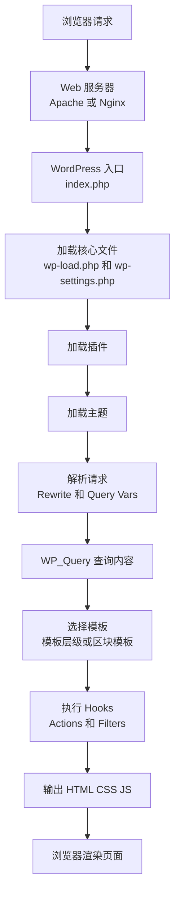
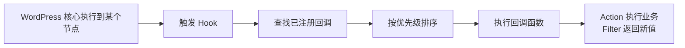
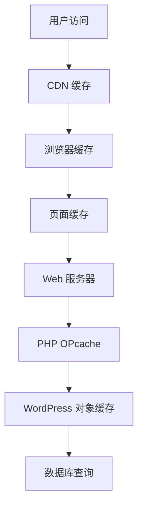
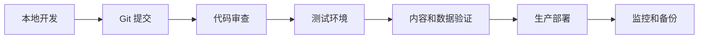
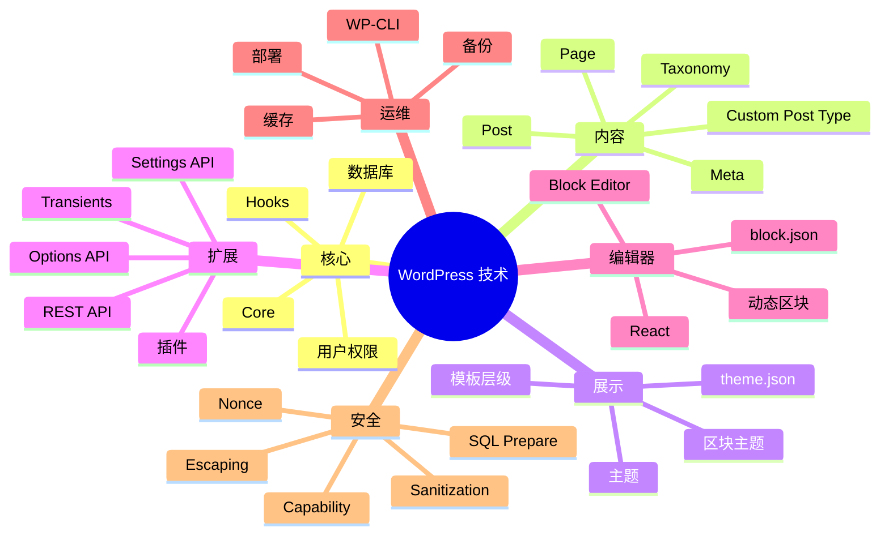

[toc]


## 学习大纲

这份内容按“先建立全局理解，再进入开发细节”的顺序组织：

| 学习模块       | 你需要掌握什么                                           | 学完后能做什么                          |
| -------------- | -------------------------------------------------------- | --------------------------------------- |
| WordPress 定位 | CMS、内容模型、主题、插件、区块编辑器                    | 判断 WordPress 适合做什么，不适合做什么 |
| 运行环境       | PHP、数据库、Web 服务器、HTTPS、缓存                     | 能搭建本地和线上 WordPress              |
| 核心架构       | 请求生命周期、数据库结构、模板加载、钩子系统             | 理解 WordPress 如何响应页面请求         |
| 内容建模       | Post、Page、Custom Post Type、Taxonomy、Meta             | 能设计文章、产品、课程、案例等内容结构  |
| 主题开发       | 区块主题、经典主题、模板层级、`theme.json`               | 能制作站点外观和页面结构                |
| 插件开发       | Hooks、Settings API、Options API、REST API、短代码、区块 | 能扩展 WordPress 功能                   |
| 区块编辑器     | Gutenberg、Block、`block.json`、React、服务端注册        | 能开发现代编辑器区块                    |
| 安全           | 权限、Nonce、输入清理、输出转义、SQL 安全                | 能避免常见漏洞                          |
| 性能           | 页面缓存、对象缓存、图片优化、数据库优化、Transients     | 能优化中小型站点性能                    |
| 工程化         | WP-CLI、Git、Composer、npm、本地开发、部署流程           | 能用更专业的方式维护项目                |
| 实战路线       | 主题、插件、REST API、区块开发项目                       | 能从新手逐步成长为 WordPress 开发者     |

------

## WordPress 是什么

WordPress 最初是博客系统，但现代 WordPress 更像是一个“内容管理系统 + 可扩展应用框架”。它的核心能力包括：

| 能力     | 说明                                         |
| -------- | -------------------------------------------- |
| 内容管理 | 文章、页面、媒体、分类、标签、自定义文章类型 |
| 外观管理 | 主题、模板、区块主题、站点编辑器             |
| 功能扩展 | 插件、钩子、REST API、区块、短代码           |
| 权限系统 | 用户、角色、能力                             |
| 后台管理 | 内容编辑、菜单、媒体库、插件、主题、设置     |
| API 能力 | REST API、Ajax、WP-CLI、Block Editor APIs    |
| 生态能力 | 大量主题、插件、托管服务、学习资源           |

现代 WordPress 的重点已经从“写 PHP 模板”扩展到了“PHP + JavaScript + REST API + 区块编辑器 + 主题配置”。官方开发者资料中，区块编辑器被描述为一种现代站点构建和发布范式，它使用模块化区块来组合内容和布局。([WordPress Developer Resources](https://developer.wordpress.org/block-editor/?utm_source=chatgpt.com))

------

## 现代 WordPress 的技术栈

截至 2026 年 6 月，WordPress.org 新闻页显示最新主版本为 WordPress 7.0，发布时间为 2026 年 5 月 20 日。官方推荐的运行环境是 PHP 8.3 或更高版本、MySQL 8.0 或 MariaDB 10.6 或更高版本，并要求支持 HTTPS。([WordPress.org](https://wordpress.org/news/?utm_source=chatgpt.com))

| 层级       | 常见技术                                     |
| ---------- | -------------------------------------------- |
| 语言       | PHP、JavaScript、HTML、CSS                   |
| 数据库     | MySQL、MariaDB                               |
| Web 服务器 | Nginx、Apache                                |
| 前端编辑器 | Block Editor、React、`@wordpress/*` 包       |
| 后端 API   | WordPress Core APIs、REST API、Ajax          |
| 构建工具   | npm、`@wordpress/scripts`、Vite 或 webpack   |
| 命令行     | WP-CLI                                       |
| 版本控制   | Git                                          |
| 部署       | SSH、CI/CD、托管平台、Docker、本地开发环境   |
| 缓存       | 页面缓存、对象缓存、OPcache、CDN、浏览器缓存 |

------

## WordPress 的整体架构

WordPress 的核心思想是：核心程序负责通用能力，主题负责展示，插件负责扩展，内容存储在数据库中，钩子系统把各部分连接起来。



这个流程可以简化理解为：

| 阶段       | 发生了什么                                       |
| ---------- | ------------------------------------------------ |
| 请求进入   | 用户访问 URL                                     |
| 加载核心   | WordPress 初始化环境                             |
| 加载插件   | 插件注册功能、钩子、区块、接口                   |
| 加载主题   | 主题决定页面结构和样式                           |
| 解析查询   | WordPress 判断这是首页、文章页、分类页还是搜索页 |
| 查询数据库 | 通过 `WP_Query` 获取内容                         |
| 选择模板   | 根据模板层级或区块模板渲染页面                   |
| 输出结果   | 返回 HTML、CSS、JS 给浏览器                      |

------

## 核心概念速览

| 概念             | 新手理解       | 开发者理解                                  |
| ---------------- | -------------- | ------------------------------------------- |
| Core             | WordPress 本体 | 核心框架、API、后台、编辑器、权限系统       |
| Theme            | 网站外观       | 模板、样式、布局、区块样式、`theme.json`    |
| Plugin           | 功能扩展       | 通过 Hooks、API、数据库、REST、区块扩展系统 |
| Post             | 内容记录       | 存在 `wp_posts` 表中的核心内容对象          |
| Page             | 页面           | 一种内置 Post Type                          |
| Custom Post Type | 自定义内容类型 | 用于产品、课程、案例、作品等                |
| Taxonomy         | 分类体系       | 分类、标签、自定义分类法                    |
| Meta             | 附加字段       | 给文章、用户、分类等对象存储额外数据        |
| Hook             | 扩展点         | Action 和 Filter                            |
| REST API         | HTTP 数据接口  | 用 JSON 读写 WordPress 数据                 |
| Block            | 区块           | 编辑器中的内容组件                          |
| Template         | 模板           | 控制不同页面类型的显示方式                  |
| Capability       | 能力           | 判断用户是否能执行某个操作                  |

------

## 数据模型

WordPress 的数据模型非常重要。它不是每种内容都建一张表，而是把很多内容统一存储在少数几张核心表中。

| 表                      | 主要用途                                             |
| ----------------------- | ---------------------------------------------------- |
| `wp_posts`              | 文章、页面、附件、自定义文章类型                     |
| `wp_postmeta`           | 文章、页面、自定义文章类型的附加字段                 |
| `wp_terms`              | 分类项和标签项的基础信息                             |
| `wp_term_taxonomy`      | 分类法关系，例如 category、post_tag、自定义 taxonomy |
| `wp_term_relationships` | 内容和分类项之间的关系                               |
| `wp_users`              | 用户账号                                             |
| `wp_usermeta`           | 用户附加信息                                         |
| `wp_options`            | 网站配置、插件配置、主题配置、缓存项                 |
| `wp_comments`           | 评论                                                 |
| `wp_commentmeta`        | 评论附加字段                                         |

官方插件手册说明，自定义文章类型会被存储在 `posts` 表中，开发者可以注册自己的 Post Type，并像管理文章一样管理这些内容。([WordPress Developer Resources](https://developer.wordpress.org/plugins/post-types/?utm_source=chatgpt.com))

------

## 内容建模

WordPress 学习中最容易混乱的是：什么时候用页面，什么时候用文章，什么时候用自定义文章类型，什么时候用分类法，什么时候用自定义字段。

| 需求           | 推荐做法         | 示例                         |
| -------------- | ---------------- | ---------------------------- |
| 普通新闻、博客 | Post             | 公司新闻、技术文章           |
| 固定页面       | Page             | 关于我们、联系我们、隐私政策 |
| 独立业务实体   | Custom Post Type | 产品、课程、案例、房源、职位 |
| 内容分组       | Taxonomy         | 产品分类、课程难度、案例行业 |
| 内容额外属性   | Post Meta        | 价格、课时、地点、评分       |
| 全站配置       | Options API      | 联系电话、站点公告、API Key  |
| 用户额外属性   | User Meta        | 会员等级、积分、头像扩展字段 |

### 经典示例：课程网站

| 对象     | 设计                                 |
| -------- | ------------------------------------ |
| 课程     | `course` 自定义文章类型              |
| 讲师     | `teacher` 自定义文章类型，或用户角色 |
| 课程分类 | `course_category` 自定义分类法       |
| 难度     | `course_level` 自定义分类法          |
| 价格     | `course_price` post meta             |
| 课时     | `course_duration` post meta          |
| 是否推荐 | `is_featured` post meta              |

### 经验规则

| 问题                         | 判断方式                |
| ---------------------------- | ----------------------- |
| 内容是否需要单独管理列表？   | 是，用 Custom Post Type |
| 是否只是给内容增加一个属性？ | 是，用 Meta             |
| 是否用于筛选、归档、聚合？   | 是，用 Taxonomy         |
| 是否属于全站配置？           | 是，用 Options API      |
| 是否与用户相关？             | 是，用 User Meta        |

官方文档也建议把自定义文章类型放在插件中，而不是主题中，因为内容结构应该随功能存在，不能因为更换主题而丢失。([WordPress Developer Resources](https://developer.wordpress.org/plugins/post-types/registering-custom-post-types/?utm_source=chatgpt.com))

------

## 请求、查询与 The Loop

`WP_Query` 是 WordPress 获取内容的核心类。官方代码参考说明，`WP_Query` 提供了许多用于 The Loop 的常见任务函数，例如 `have_posts()`，用于判断是否还有文章可以展示。([WordPress Developer Resources](https://developer.wordpress.org/reference/classes/wp_query/?utm_source=chatgpt.com))

典型的主题模板中会看到：

```php
<?php if ( have_posts() ) : ?>
    <?php while ( have_posts() ) : the_post(); ?>
        <article>
            <h2><?php the_title(); ?></h2>
            <div><?php the_excerpt(); ?></div>
        </article>
    <?php endwhile; ?>
<?php else : ?>
    <p>暂无内容。</p>
<?php endif; ?>
```

这里的核心逻辑是：

| 函数                  | 作用                         |
| --------------------- | ---------------------------- |
| `have_posts()`        | 判断当前查询是否还有内容     |
| `the_post()`          | 将下一篇内容设为当前内容     |
| `the_title()`         | 输出标题                     |
| `the_content()`       | 输出正文                     |
| `the_excerpt()`       | 输出摘要                     |
| `wp_reset_postdata()` | 自定义查询后恢复全局文章数据 |

自定义查询示例：

```php
$query = new WP_Query([
    'post_type'      => 'course',
    'posts_per_page' => 6,
    'meta_key'       => 'is_featured',
    'meta_value'     => '1',
]);

if ( $query->have_posts() ) {
    while ( $query->have_posts() ) {
        $query->the_post();
        the_title();
    }
    wp_reset_postdata();
}
```

------

## 主题开发

主题负责网站的展示层。现代 WordPress 中有两类主题：区块主题和经典主题。官方主题手册说明，区块主题从 WordPress 5.9 开始可用，主要由 HTML 和主题配置文件组成，整个站点的各个部分都可以通过站点编辑器中的区块编辑；经典主题则主要使用 PHP、JavaScript 和 CSS，并依赖 WordPress PHP 函数、Hooks 和 Filters。([WordPress Developer Resources](https://developer.wordpress.org/themes/?utm_source=chatgpt.com))

| 类型     | 特点                                               | 适合场景                            |
| -------- | -------------------------------------------------- | ----------------------------------- |
| 区块主题 | 使用 HTML 模板、区块、`theme.json`、站点编辑器     | 新项目、内容团队需要可视化编辑      |
| 经典主题 | 使用 PHP 模板、模板层级、Customizer、传统 The Loop | 老项目、复杂 PHP 模板、兼容历史系统 |
| 混合方式 | 经典主题中使用部分区块能力                         | 渐进迁移                            |

------

## 区块主题结构

官方模板文档说明，区块主题的模板放在 `/templates` 目录，且 `index.html` 是最低要求；WordPress 通过这个文件判断主题是否为区块主题。([WordPress Developer Resources](https://developer.wordpress.org/themes/templates/templates/?utm_source=chatgpt.com))

典型区块主题结构：

```text
my-block-theme/
├── style.css
├── theme.json
├── functions.php
├── templates/
│   ├── index.html
│   ├── single.html
│   ├── page.html
│   ├── archive.html
│   └── 404.html
├── parts/
│   ├── header.html
│   └── footer.html
└── patterns/
    └── hero.php
```

### `theme.json`

`theme.json` 是现代主题开发的关键文件。官方文档说明，它用于定义主题的全局设置、样式等，并且可以用于区块主题和经典主题。([WordPress Developer Resources](https://developer.wordpress.org/themes/global-settings-and-styles/introduction-to-theme-json/?utm_source=chatgpt.com))

示例：

```json
{
  "$schema": "https://schemas.wp.org/trunk/theme.json",
  "version": 3,
  "settings": {
    "color": {
      "palette": [
        {
          "slug": "primary",
          "color": "#1e40af",
          "name": "Primary"
        }
      ]
    },
    "typography": {
      "fontSizes": [
        {
          "slug": "large",
          "size": "2rem",
          "name": "Large"
        }
      ]
    }
  },
  "styles": {
    "color": {
      "text": "#111827",
      "background": "#ffffff"
    }
  }
}
```

### 主题开发最佳实践

| 做法                                    | 原因                          |
| --------------------------------------- | ----------------------------- |
| 新项目优先考虑区块主题                  | 更符合现代 WordPress 编辑体验 |
| 使用 `theme.json` 管理全局样式          | 降低 CSS 分散程度             |
| 模板只负责结构，不写业务逻辑            | 保持主题轻量                  |
| 功能放插件，展示放主题                  | 方便换主题                    |
| 使用子主题修改第三方主题                | 避免升级覆盖改动              |
| 不在主题里注册业务型 Custom Post Type   | 更换主题时不应丢失内容类型    |
| 样式尽量使用块样式、全局样式和 CSS 变量 | 方便维护和编辑器一致性        |

------

## 插件开发

插件负责扩展 WordPress 的功能。插件可以做很多事情：

| 功能类型       | 示例                         |
| -------------- | ---------------------------- |
| 注册内容类型   | 产品、课程、案例             |
| 增加后台设置   | SEO 设置、支付设置、站点公告 |
| 修改前台输出   | 面包屑、推荐内容、相关文章   |
| 增加 REST API  | 给前端 App 或小程序提供数据  |
| 增加区块       | 自定义 Hero、卡片、表单      |
| 集成第三方服务 | 支付、邮件、CRM、统计        |
| 自动化任务     | 定时同步、定时清理、发送通知 |

一个最小插件：

```php
<?php
/**
 * Plugin Name: Example Course Plugin
 * Description: 示例课程插件。
 * Version: 1.0.0
 * Author: Your Name
 */

if ( ! defined( 'ABSPATH' ) ) {
    exit;
}

add_action( 'init', 'example_register_course_post_type' );

function example_register_course_post_type() {
    register_post_type( 'course', [
        'labels' => [
            'name'          => '课程',
            'singular_name' => '课程',
        ],
        'public'       => true,
        'has_archive'  => true,
        'show_in_rest' => true,
        'supports'     => [ 'title', 'editor', 'thumbnail', 'excerpt' ],
    ] );
}
```

### 插件结构建议

```text
example-plugin/
├── example-plugin.php
├── includes/
│   ├── post-types.php
│   ├── taxonomies.php
│   ├── rest-api.php
│   └── settings.php
├── assets/
│   ├── css/
│   └── js/
├── src/
│   └── block/
├── build/
└── languages/
```

### 插件开发原则

| 原则                          | 说明                                              |
| ----------------------------- | ------------------------------------------------- |
| 单一职责                      | 一个插件解决一类问题                              |
| 避免污染全局命名空间          | 使用前缀、命名空间或类                            |
| 不直接修改 WordPress 核心文件 | 升级会覆盖，也不安全                              |
| 使用官方 API                  | Options API、Settings API、REST API、Metadata API |
| 所有输入都验证和清理          | 不信任用户提交的数据                              |
| 所有输出都转义                | 避免 XSS                                          |
| 所有敏感操作检查权限和 Nonce  | 防止越权和 CSRF                                   |
| 支持卸载清理                  | 必要时提供 `uninstall.php`                        |
| 为前后端分别加载资源          | 不要全站无差别加载 CSS 和 JS                      |

------

## Hooks：WordPress 扩展机制的核心

Hooks 是 WordPress 插件和主题扩展系统的基础。官方文档说明，Hooks 允许一段代码在预定义位置与另一段代码交互或修改另一段代码；Hooks 主要分为 Actions 和 Filters。([WordPress Developer Resources](https://developer.wordpress.org/apis/hooks/?utm_source=chatgpt.com))

| 类型   | 作用               | 是否返回值         | 典型用途                     |
| ------ | ------------------ | ------------------ | ---------------------------- |
| Action | 在某个时机执行代码 | 通常不返回         | 注册菜单、加载资源、发送邮件 |
| Filter | 修改某个值         | 必须返回修改后的值 | 修改标题、内容、查询参数     |

Action 示例：

```php
add_action( 'wp_enqueue_scripts', 'example_enqueue_assets' );

function example_enqueue_assets() {
    wp_enqueue_style(
        'example-style',
        plugin_dir_url( __FILE__ ) . 'assets/css/style.css',
        [],
        '1.0.0'
    );
}
```

Filter 示例：

```php
add_filter( 'the_title', 'example_add_title_prefix' );

function example_add_title_prefix( $title ) {
    if ( is_admin() ) {
        return $title;
    }

    return '推荐：' . $title;
}
```

### Hooks 的执行顺序



### Hooks 最佳实践

| 做法                            | 原因                 |
| ------------------------------- | -------------------- |
| 给函数名加项目专属前缀          | 避免函数名冲突       |
| Filter 一定返回值               | 否则可能破坏原始数据 |
| 不在 Hook 回调中做过重任务      | 会拖慢请求           |
| 需要条件判断时尽早返回          | 减少不必要执行       |
| 谨慎使用过低或过高优先级        | 避免与其他插件冲突   |
| 能用官方 API 就不要直接操作底层 | 更安全、更兼容       |

------

## REST API

WordPress REST API 让外部应用可以通过 HTTP 和 JSON 与 WordPress 交互。官方 REST API 手册说明，它通过发送和接收 JSON 对象让应用与 WordPress 站点交互，并且是区块编辑器的基础。([WordPress Developer Resources](https://developer.wordpress.org/rest-api/?utm_source=chatgpt.com))

常见用途：

| 场景           | 说明                                        |
| -------------- | ------------------------------------------- |
| 前后端分离     | React、Vue、Next.js 前端读取 WordPress 内容 |
| 小程序或 App   | 移动端获取文章、产品、用户数据              |
| 后台异步操作   | 保存设置、搜索内容、动态加载数据            |
| 第三方系统集成 | CRM、ERP、支付、邮件系统                    |

HTTP 方法含义：

| 方法      | 用途           |
| --------- | -------------- |
| `GET`     | 获取资源       |
| `POST`    | 创建资源       |
| `PUT`     | 更新资源       |
| `DELETE`  | 删除资源       |
| `OPTIONS` | 获取资源上下文 |

官方插件手册也明确说明了这些 HTTP 方法在 REST API 中的典型用途。([WordPress Developer Resources](https://developer.wordpress.org/plugins/rest-api/?utm_source=chatgpt.com))

自定义 REST API 示例：

```php
add_action( 'rest_api_init', function () {
    register_rest_route( 'example/v1', '/courses', [
        'methods'             => 'GET',
        'callback'            => 'example_get_courses',
        'permission_callback' => '__return_true',
    ] );
} );

function example_get_courses() {
    $query = new WP_Query([
        'post_type'      => 'course',
        'posts_per_page' => 10,
    ]);

    $items = [];

    foreach ( $query->posts as $post ) {
        $items[] = [
            'id'    => $post->ID,
            'title' => get_the_title( $post ),
            'link'  => get_permalink( $post ),
        ];
    }

    return rest_ensure_response( $items );
}
```

### REST API 安全原则

| 场景             | 做法                                            |
| ---------------- | ----------------------------------------------- |
| 公开读取         | `permission_callback` 可以允许匿名访问          |
| 创建、更新、删除 | 必须检查用户权限                                |
| 涉及后台操作     | 使用 Nonce 或认证机制                           |
| 返回数据         | 不返回敏感字段                                  |
| 接收参数         | 验证类型、范围、枚举值                          |
| 数据库查询       | 使用 `WP_Query`、官方 API 或 `$wpdb->prepare()` |

------

## 区块编辑器与区块开发

区块编辑器，也常被称为 Gutenberg，是现代 WordPress 内容编辑体验的核心。官方文档说明，Block Editor 是一个 React 单页应用，每个区块在编辑器中都由 `edit` 属性定义的 React 组件展示。([WordPress Developer Resources](https://developer.wordpress.org/block-editor/getting-started/fundamentals/block-in-the-editor/?utm_source=chatgpt.com))

### 区块的基本组成

| 文件或概念   | 作用                     |
| ------------ | ------------------------ |
| `block.json` | 区块元数据               |
| `edit.js`    | 编辑器中的显示和交互     |
| `save.js`    | 前台保存后的静态输出     |
| `render.php` | 动态区块的服务端渲染     |
| `style.css`  | 前台和编辑器都需要的样式 |
| `editor.css` | 仅编辑器样式             |
| `index.js`   | 注册区块入口             |

官方文档建议区块通常通过插件打包，并使用 `block.json` 在服务端和客户端同时注册；这样才能支持动态渲染、Block Supports、Block Hooks 和样式变体等服务端能力。([WordPress Developer Resources](https://developer.wordpress.org/block-editor/getting-started/fundamentals/registration-of-a-block/?utm_source=chatgpt.com))

### 创建区块的推荐方式

官方 `@wordpress/create-block` 是用于脚手架生成区块插件的工具，可以生成 PHP、JS、CSS 和现代构建配置。([WordPress Developer Resources](https://developer.wordpress.org/block-editor/reference-guides/packages/packages-create-block/?utm_source=chatgpt.com))

```bash
npx @wordpress/create-block example-card
cd example-card
npm start
```

### 静态区块和动态区块

| 类型     | 特点                   | 适合场景                                 |
| -------- | ---------------------- | ---------------------------------------- |
| 静态区块 | 保存 HTML 到文章内容中 | 简单卡片、提示框、布局组件               |
| 动态区块 | 前台通过 PHP 实时渲染  | 最新文章、课程列表、价格、库存、会员内容 |

动态区块更适合数据会变化的内容。例如“最新课程列表”不应该把课程 HTML 固定保存到文章内容里，而应该每次渲染时查询最新数据。

------

## Settings API、Options API 与后台配置

WordPress 插件经常需要后台配置，例如 API Key、默认颜色、开关选项、邮件设置。官方插件手册说明，Settings API 用于创建设置表单和管理表单数据，Options API 用于通过键值系统管理数据。([WordPress Developer Resources](https://developer.wordpress.org/plugins/settings/?utm_source=chatgpt.com))

| API            | 作用                                 | 示例                                           |
| -------------- | ------------------------------------ | ---------------------------------------------- |
| Options API    | 读写配置值                           | `get_option()`、`update_option()`              |
| Settings API   | 创建后台设置页和字段                 | `register_setting()`、`add_settings_section()` |
| Metadata API   | 管理文章、用户、评论等对象的附加字段 | `get_post_meta()`、`update_post_meta()`        |
| Transients API | 临时缓存数据                         | `set_transient()`、`get_transient()`           |

Options API 示例：

```php
$phone = get_option( 'example_company_phone', '' );

update_option( 'example_company_phone', '400-000-0000' );
```

Transients API 适合缓存临时数据。官方文档说明，Transients API 类似 Options API，但增加了过期时间；同时要注意，Transient 的过期时间是“最大保留时间”，并不保证在过期前一定存在，因此代码必须能在缓存缺失时重新生成数据。([WordPress Developer Resources](https://developer.wordpress.org/apis/transients/?utm_source=chatgpt.com))

```php
$courses = get_transient( 'example_featured_courses' );

if ( false === $courses ) {
    $courses = new WP_Query([
        'post_type'      => 'course',
        'posts_per_page' => 6,
    ]);

    set_transient( 'example_featured_courses', $courses, HOUR_IN_SECONDS );
}
```

------

## 用户、角色与权限

WordPress 有内置的角色和能力系统。官方插件手册说明，用户角色本质上是一组能力集合，WordPress 默认包含 Super Admin、Administrator、Editor、Author、Contributor、Subscriber 等角色。([WordPress Developer Resources](https://developer.wordpress.org/plugins/users/roles-and-capabilities/?utm_source=chatgpt.com))

| 角色          | 常见权限理解         |
| ------------- | -------------------- |
| Super Admin   | 多站点网络最高权限   |
| Administrator | 单站点管理员         |
| Editor        | 管理和发布所有内容   |
| Author        | 发布和管理自己的内容 |
| Contributor   | 写内容但通常不能发布 |
| Subscriber    | 基本登录用户         |

权限检查示例：

```php
if ( ! current_user_can( 'manage_options' ) ) {
    wp_die( '你没有权限访问此页面。' );
}
```

### 权限最佳实践

| 做法                                | 原因                         |
| ----------------------------------- | ---------------------------- |
| 检查 Capability，而不是只检查角色名 | 能力更灵活                   |
| 后台设置页使用 `manage_options`     | 通常只有管理员可操作         |
| 编辑文章时检查 `edit_post`          | 避免越权编辑                 |
| REST API 写操作必须检查权限         | 防止匿名或低权限用户修改数据 |
| 不把管理员权限给普通业务用户        | 遵守最小权限原则             |

------

## 安全核心规则

WordPress 安全可以浓缩成几句话：

| 环节 | 原则                     |
| ---- | ------------------------ |
| 输入 | 验证和清理               |
| 存储 | 使用官方 API 或安全 SQL  |
| 输出 | 按上下文转义             |
| 操作 | 检查权限                 |
| 表单 | 使用 Nonce               |
| 文件 | 检查类型、大小、权限     |
| 依赖 | 及时更新核心、主题、插件 |

官方安全文档说明，输出转义是在渲染给用户之前清除不需要的数据，例如畸形 HTML 或脚本标签，以保护输出内容。([WordPress Developer Resources](https://developer.wordpress.org/apis/security/escaping/?utm_source=chatgpt.com))

### 常见安全函数

| 场景           | 函数                                         |
| -------------- | -------------------------------------------- |
| 输出 HTML 文本 | `esc_html()`                                 |
| 输出属性       | `esc_attr()`                                 |
| 输出 URL       | `esc_url()`                                  |
| 输出 textarea  | `esc_textarea()`                             |
| 允许有限 HTML  | `wp_kses_post()`                             |
| 清理普通文本   | `sanitize_text_field()`                      |
| 清理邮箱       | `sanitize_email()`                           |
| 清理 URL       | `esc_url_raw()`                              |
| 校验权限       | `current_user_can()`                         |
| 创建 Nonce     | `wp_nonce_field()`、`wp_create_nonce()`      |
| 验证 Nonce     | `check_admin_referer()`、`wp_verify_nonce()` |
| SQL 占位       | `$wpdb->prepare()`                           |

### 错误示例

```php
echo $_GET['name'];
```

问题：用户可以传入恶意脚本。

### 正确示例

```php
$name = isset( $_GET['name'] ) ? sanitize_text_field( wp_unslash( $_GET['name'] ) ) : '';

echo esc_html( $name );
```

### Nonce 示例

表单中输出：

```php
wp_nonce_field( 'example_save_settings', 'example_nonce' );
```

保存时验证：

```php
if (
    ! isset( $_POST['example_nonce'] ) ||
    ! wp_verify_nonce(
        sanitize_text_field( wp_unslash( $_POST['example_nonce'] ) ),
        'example_save_settings'
    )
) {
    wp_die( '安全验证失败。' );
}
```

### 数据库查询安全

错误做法：

```php
$results = $wpdb->get_results(
    "SELECT * FROM {$wpdb->posts} WHERE post_title = '$title'"
);
```

正确做法：

```php
$results = $wpdb->get_results(
    $wpdb->prepare(
        "SELECT * FROM {$wpdb->posts} WHERE post_title = %s",
        $title
    )
);
```

------

## 性能优化

WordPress 性能优化不要一开始就复杂化。先解决高收益问题：主机、缓存、图片、插件数量、数据库查询。

官方性能文档指出，影响 WordPress 性能的因素包括托管环境、WordPress 配置、软件版本、图片数量和大小等；同时也建议减少不必要插件、优化图片、使用缓存等。([WordPress Developer Resources](https://developer.wordpress.org/advanced-administration/performance/optimization/?utm_source=chatgpt.com))

### 性能优化层次



### 优化清单

| 层级   | 优化手段                                   |
| ------ | ------------------------------------------ |
| 主机   | 使用可靠主机、足够 CPU 和内存、SSD 或 NVMe |
| PHP    | 使用较新 PHP、启用 OPcache                 |
| 数据库 | 使用合理索引、减少复杂 meta query          |
| 缓存   | 页面缓存、对象缓存、浏览器缓存、CDN        |
| 图片   | 压缩图片、使用合适尺寸、WebP、懒加载       |
| 插件   | 删除不用插件，避免功能重叠                 |
| 主题   | 使用轻量主题，减少无用 CSS 和 JS           |
| 查询   | 避免在循环中重复查询                       |
| 前端   | 减少阻塞资源、按需加载脚本                 |
| 后台   | 控制自动加载 options，避免 autoload 膨胀   |

官方缓存文档把缓存分为缓存插件、浏览器缓存、对象缓存和服务器缓存，并说明缓存通常是改善 WordPress 性能最快的方式之一。([WordPress Developer Resources](https://developer.wordpress.org/advanced-administration/performance/cache/?utm_source=chatgpt.com))

### 常见性能错误

| 错误                        | 后果                                |
| --------------------------- | ----------------------------------- |
| 安装太多插件                | 页面慢、冲突概率高                  |
| 页面上加载所有插件资源      | CSS 和 JS 臃肿                      |
| 在模板中频繁复杂查询        | 数据库压力大                        |
| 用 post meta 做大量范围筛选 | 查询慢                              |
| 大图直接上传不压缩          | 首屏慢                              |
| 不使用缓存                  | 每次请求都完整执行 PHP 和数据库查询 |
| 把大量配置设为 autoload     | 每个请求都加载无用数据              |

------

## WP-CLI

WP-CLI 是 WordPress 的命令行工具，可以用来安装、更新、管理插件、导入导出数据、执行批处理。官方 WP-CLI 命令文档列出了当前可用命令，`wp core` 可用于下载、安装、更新和管理 WordPress，`wp plugin` 可用于管理插件安装、启用和更新。([WordPress Developer Resources](https://developer.wordpress.org/cli/commands/?utm_source=chatgpt.com))

常见命令：

```bash
wp core version

wp plugin list

wp plugin update --all

wp theme list

wp user list

wp post list --post_type=post

wp db export backup.sql

wp search-replace 'old-domain.com' 'new-domain.com'
```

### WP-CLI 适合做什么

| 场景       | 示例                     |
| ---------- | ------------------------ |
| 批量更新   | 更新插件、主题、核心     |
| 数据迁移   | 搜索替换域名             |
| 自动化部署 | CI/CD 中执行数据库迁移   |
| 内容生成   | 批量创建测试文章         |
| 维护排查   | 查看插件列表、用户、配置 |
| 多站点管理 | 批量处理站点             |

------

## WordPress 工程化开发

新手常把 WordPress 当作“后台点点点”的系统，但专业开发更接近标准 Web 工程。

### 推荐开发流程



### 环境划分

| 环境       | 用途                 |
| ---------- | -------------------- |
| Local      | 开发主题、插件、区块 |
| Staging    | 给客户或团队测试     |
| Production | 正式站点             |
| Backup     | 出问题时恢复         |

### 版本控制建议

| 应该进入 Git    | 不应该进入 Git               |
| --------------- | ---------------------------- |
| 自定义主题      | `wp-config.php` 中的敏感信息 |
| 自定义插件      | 上传目录中的用户图片         |
| `composer.json` | 数据库 dump，除非脱敏        |
| `package.json`  | 缓存文件                     |
| 构建配置        | 服务器密钥                   |

### 部署注意事项

| 项目     | 建议                               |
| -------- | ---------------------------------- |
| 数据库   | 部署前备份                         |
| 插件更新 | 先在测试环境验证                   |
| 主题更新 | 使用 Git 管理                      |
| 上传文件 | 单独同步或使用对象存储             |
| 域名替换 | 使用 WP-CLI `search-replace`       |
| 缓存     | 部署后清理页面缓存、对象缓存和 CDN |
| 回滚     | 保留上一个可用版本                 |

------

## 主题、插件、区块如何分工

这是 WordPress 架构设计中的关键。

| 需求         | 放主题 | 放插件 | 放区块               |
| ------------ | ------ | ------ | -------------------- |
| 页面布局     | 是     | 否     | 可选                 |
| 全站颜色字体 | 是     | 否     | 否                   |
| 产品内容类型 | 否     | 是     | 否                   |
| 课程查询逻辑 | 否     | 是     | 可作为动态区块展示   |
| Hero 组件    | 可     | 可     | 是                   |
| SEO 字段     | 否     | 是     | 否                   |
| 支付功能     | 否     | 是     | 否                   |
| 首页模板     | 是     | 否     | 可由区块组成         |
| 联系表单     | 不推荐 | 是     | 可提供表单区块       |
| API 集成     | 否     | 是     | 可提供编辑器配置界面 |

简单规则：

| 判断问题                   | 结论       |
| -------------------------- | ---------- |
| 换主题后功能还应该存在吗？ | 放插件     |
| 只影响外观吗？             | 放主题     |
| 编辑器中需要可视化插入吗？ | 做区块     |
| 是业务数据结构吗？         | 放插件     |
| 是页面展示组合吗？         | 主题或区块 |

------

## 自定义文章类型实战示例

下面是一个“课程”插件的简化版本。

```php
<?php
/**
 * Plugin Name: Course Manager
 * Description: 管理课程内容。
 * Version: 1.0.0
 */

if ( ! defined( 'ABSPATH' ) ) {
    exit;
}

add_action( 'init', 'cm_register_course_post_type' );
add_action( 'init', 'cm_register_course_taxonomy' );

function cm_register_course_post_type() {
    register_post_type( 'course', [
        'labels' => [
            'name'          => '课程',
            'singular_name' => '课程',
            'add_new_item'  => '添加新课程',
            'edit_item'     => '编辑课程',
        ],
        'public'       => true,
        'has_archive'  => true,
        'show_in_rest' => true,
        'menu_icon'    => 'dashicons-welcome-learn-more',
        'supports'     => [ 'title', 'editor', 'thumbnail', 'excerpt', 'custom-fields' ],
        'rewrite'      => [
            'slug' => 'courses',
        ],
    ] );
}

function cm_register_course_taxonomy() {
    register_taxonomy( 'course_category', [ 'course' ], [
        'labels' => [
            'name'          => '课程分类',
            'singular_name' => '课程分类',
        ],
        'public'       => true,
        'hierarchical' => true,
        'show_in_rest' => true,
        'rewrite'      => [
            'slug' => 'course-category',
        ],
    ] );
}
```

这个例子体现了几个现代实践：

| 写法                     | 意义                            |
| ------------------------ | ------------------------------- |
| `show_in_rest => true`   | 让内容支持区块编辑器和 REST API |
| `has_archive => true`    | 自动拥有归档页                  |
| `rewrite`                | 自定义 URL 结构                 |
| `supports`               | 控制编辑器能力                  |
| Taxonomy 绑定到 `course` | 课程可以被分类筛选              |

------

## 后台菜单与设置页

插件经常需要自己的后台菜单。

```php
add_action( 'admin_menu', 'example_add_admin_menu' );

function example_add_admin_menu() {
    add_options_page(
        '示例设置',
        '示例设置',
        'manage_options',
        'example-settings',
        'example_render_settings_page'
    );
}

function example_render_settings_page() {
    if ( ! current_user_can( 'manage_options' ) ) {
        return;
    }

    ?>
    <div class="wrap">
        <h1>示例设置</h1>
        <form method="post" action="options.php">
            <?php
            settings_fields( 'example_settings_group' );
            do_settings_sections( 'example-settings' );
            submit_button();
            ?>
        </form>
    </div>
    <?php
}
```

注册设置：

```php
add_action( 'admin_init', 'example_register_settings' );

function example_register_settings() {
    register_setting(
        'example_settings_group',
        'example_company_phone',
        [
            'type'              => 'string',
            'sanitize_callback' => 'sanitize_text_field',
            'default'           => '',
        ]
    );

    add_settings_section(
        'example_main_section',
        '基础设置',
        '__return_false',
        'example-settings'
    );

    add_settings_field(
        'example_company_phone',
        '联系电话',
        'example_render_phone_field',
        'example-settings',
        'example_main_section'
    );
}

function example_render_phone_field() {
    $value = get_option( 'example_company_phone', '' );

    echo '<input type="text" name="example_company_phone" value="' . esc_attr( $value ) . '" />';
}
```

------

## 国际化与本地化

如果你的主题或插件可能给不同语言用户使用，就应该从一开始支持国际化。官方国际化文档说明，WordPress 自 5.0 起也可以在 JavaScript 文件中使用与 PHP 类似的 i18n 函数。([WordPress Developer Resources](https://developer.wordpress.org/apis/internationalization/?utm_source=chatgpt.com))

PHP 示例：

```php
echo esc_html__( 'Read more', 'example-textdomain' );
```

带变量：

```php
printf(
    esc_html__( 'Hello, %s.', 'example-textdomain' ),
    esc_html( $user_name )
);
```

JavaScript 示例：

```js
import { __ } from '@wordpress/i18n';

const label = __( 'Read more', 'example-textdomain' );
```

### 国际化实践

| 做法                               | 原因                   |
| ---------------------------------- | ---------------------- |
| 所有用户可见文本都使用 i18n 函数   | 方便翻译               |
| Text Domain 与插件或主题 slug 一致 | 方便 WordPress 识别    |
| 不拼接需要翻译的句子               | 不同语言语序不同       |
| 输出翻译文本时仍然转义             | 翻译文件也不能完全信任 |
| JS 脚本声明 `wp-i18n` 依赖         | 才能使用 JS 国际化能力 |

------

## 多站点 Multisite

WordPress Multisite 允许一个 WordPress 安装管理多个站点。适合：

| 场景        | 示例             |
| ----------- | ---------------- |
| 集团站群    | 总部站、分公司站 |
| 学校系统    | 每个学院一个站   |
| SaaS 型站点 | 每个客户一个子站 |
| 多语言站点  | 不同语言一个子站 |

但 Multisite 不适合所有项目：

| 风险           | 说明                           |
| -------------- | ------------------------------ |
| 复杂度更高     | 插件兼容、权限、部署更复杂     |
| 数据共享有限   | 子站之间默认相对独立           |
| 故障影响面更大 | 核心、插件问题可能影响整个网络 |
| 迁移更复杂     | 单独迁出一个子站比普通站点复杂 |

新手建议先掌握单站点，再学习 Multisite。

------

## WordPress 与前后端分离

WordPress 可以作为传统 CMS，也可以作为 Headless CMS。

| 模式     | 说明                                          | 适合场景                 |
| -------- | --------------------------------------------- | ------------------------ |
| 传统模式 | WordPress 负责后台和前台                      | 企业官网、博客、内容站   |
| 半分离   | WordPress 页面中局部使用 React 或 Vue         | 交互组件、复杂表单       |
| Headless | WordPress 只做内容后台，前台用 Next.js 等     | 多端内容分发、高定制前端 |
| 混合模式 | 核心页面由 WordPress 渲染，部分接口开放给外部 | 常见业务项目             |

### Headless 的优点

| 优点         | 说明                         |
| ------------ | ---------------------------- |
| 前端自由度高 | 可使用 Next.js、Nuxt、移动端 |
| 多端复用内容 | 网站、App、小程序共享内容    |
| 性能可控     | 静态生成、边缘渲染、CDN      |
| 团队分工清晰 | 前端团队和内容团队分离       |

### Headless 的代价

| 代价                 | 说明                              |
| -------------------- | --------------------------------- |
| 预览复杂             | 编辑器预览和前台不同步            |
| SEO 需要额外处理     | 前端框架负责渲染和元信息          |
| 登录和权限复杂       | 认证、Cookie、Token 需要设计      |
| 插件前台能力可能失效 | 很多插件假设由 WordPress 渲染页面 |
| 开发成本更高         | 需要维护前后端两套系统            |

------

## 常见插件类型与实现思路

| 插件类型     | 核心技术                                       |
| ------------ | ---------------------------------------------- |
| SEO 插件     | Meta Box、Options API、前台 Hooks、Schema 输出 |
| 表单插件     | 自定义表、Nonce、邮件、REST API、验证          |
| 会员插件     | 用户角色、Capabilities、支付、内容限制         |
| 电商插件     | Custom Post Type、订单表、支付网关、库存       |
| 缓存插件     | 页面缓存、对象缓存、重写规则                   |
| 安全插件     | 登录限制、文件扫描、权限检查                   |
| 多语言插件   | 内容映射、URL 规则、翻译字段                   |
| 区块插件     | `block.json`、React、动态渲染                  |
| API 集成插件 | REST API、Cron、Options API、日志              |

------

## 常见反模式

| 反模式                        | 为什么不好             | 更好的做法                |
| ----------------------------- | ---------------------- | ------------------------- |
| 直接改核心文件                | 升级会丢失，安全风险高 | 用 Hooks、插件、子主题    |
| 所有功能写进主题              | 换主题功能丢失         | 功能写插件                |
| 不转义输出                    | XSS 风险               | 使用 `esc_html()` 等      |
| 不检查权限                    | 越权操作               | 使用 `current_user_can()` |
| 不验证 Nonce                  | CSRF 风险              | 使用 Nonce                |
| 直接拼 SQL                    | SQL 注入风险           | 使用 `$wpdb->prepare()`   |
| 插件全站加载资源              | 拖慢所有页面           | 按需加载                  |
| 复杂查询放模板中              | 难维护且性能差         | 封装到插件或服务类        |
| 过度依赖页面构建器            | 性能和可迁移性差       | 优先原生区块和轻量实现    |
| 用 post meta 存大量可筛选数据 | 查询慢                 | 必要时设计自定义表        |

------

## 新手学习路线

### 阶段一：会使用 WordPress

目标：理解后台、主题、插件、内容管理。

学习内容：

| 内容           | 练习                     |
| -------------- | ------------------------ |
| 安装 WordPress | 本地搭建一个站点         |
| 使用主题       | 安装、切换、配置主题     |
| 使用插件       | 安装 SEO、表单、缓存插件 |
| 文章和页面     | 创建博客和固定页面       |
| 菜单和小工具   | 做一个完整导航           |
| 媒体库         | 上传、裁剪、插入图片     |

实战项目：个人博客或企业官网。

------

### 阶段二：理解主题

目标：能修改和制作简单主题。

学习内容：

| 内容            | 练习                            |
| --------------- | ------------------------------- |
| 模板层级        | 修改文章页和归档页              |
| The Loop        | 输出文章列表                    |
| `functions.php` | 注册菜单和资源                  |
| 模板部件        | 拆分 header、footer             |
| 区块主题        | 创建简单 `templates/index.html` |
| `theme.json`    | 定义颜色和字体                  |

实战项目：制作一个简洁博客主题。

------

### 阶段三：学习插件开发

目标：能把业务功能写成插件。

学习内容：

| 内容             | 练习               |
| ---------------- | ------------------ |
| 插件头部声明     | 创建第一个插件     |
| Hooks            | 在页面底部输出信息 |
| Custom Post Type | 创建课程类型       |
| Taxonomy         | 创建课程分类       |
| Meta Box         | 给课程增加价格字段 |
| Settings API     | 创建插件设置页     |
| Shortcode        | 输出课程列表       |

实战项目：课程管理插件。

------

### 阶段四：学习 REST API 和现代前端

目标：能用 API 扩展 WordPress。

学习内容：

| 内容              | 练习               |
| ----------------- | ------------------ |
| 默认 REST API     | 获取文章列表       |
| 自定义 REST Route | 输出课程数据       |
| 权限控制          | 只允许管理员写入   |
| Fetch 请求        | 后台异步保存设置   |
| React 基础        | 理解区块编辑器组件 |
| `@wordpress/data` | 理解编辑器数据层   |

实战项目：用 REST API 做课程搜索页面。

------

### 阶段五：学习区块开发

目标：能开发 Gutenberg 区块。

学习内容：

| 内容                      | 练习                 |
| ------------------------- | -------------------- |
| `@wordpress/create-block` | 生成区块插件         |
| `block.json`              | 配置区块元数据       |
| `edit.js`                 | 编辑器界面           |
| `save.js`                 | 保存静态 HTML        |
| 动态区块                  | PHP 渲染课程列表     |
| Inspector Controls        | 侧边栏配置           |
| Block Supports            | 支持颜色、间距、对齐 |

实战项目：课程卡片区块、推荐课程区块。

------

### 阶段六：工程化和性能安全

目标：能维护真实项目。

学习内容：

| 内容   | 练习                         |
| ------ | ---------------------------- |
| Git    | 管理主题和插件代码           |
| WP-CLI | 批量更新和迁移               |
| 缓存   | 配置页面缓存和对象缓存       |
| 安全   | 修复 XSS、CSRF、SQL 注入风险 |
| 部署   | 本地到测试再到生产           |
| 监控   | 错误日志、慢查询、备份       |

实战项目：把课程站部署到线上并优化性能。

------

## 推荐实战项目

| 项目             | 练习重点                         |
| ---------------- | -------------------------------- |
| 个人博客主题     | 模板、The Loop、样式             |
| 企业官网区块主题 | `theme.json`、模板、模式         |
| 课程管理插件     | CPT、Taxonomy、Meta、REST API    |
| 推荐文章区块     | 区块开发、动态渲染               |
| 简单表单插件     | Nonce、权限、邮件、验证          |
| Headless 新闻站  | REST API、前端框架、SEO          |
| 会员内容限制插件 | 用户角色、Capabilities、内容过滤 |
| 性能优化实验站   | 缓存、图片、查询优化             |

------

## WordPress 开发的核心心法

| 心法                     | 解释                                 |
| ------------------------ | ------------------------------------ |
| 内容结构先于页面设计     | 先想清楚内容模型，再做页面           |
| 功能插件化，展示主题化   | 保持系统可迁移                       |
| 优先使用官方 API         | 更安全、更兼容                       |
| 不信任任何输入           | 用户、请求、数据库、翻译文本都要谨慎 |
| 输出必须按上下文转义     | HTML、属性、URL、JS 场景不同         |
| 少写全局副作用代码       | 减少冲突                             |
| 先做简单方案，再逐步优化 | 不要一开始过度架构                   |
| 能缓存但要能失效         | 缓存必须有刷新机制                   |
| 编辑体验也是产品体验     | 后台字段、区块、预览同样重要         |
| 保持升级友好             | 不锁死核心、主题、插件版本           |

------

## 最小知识地图



------

## 给新手的学习建议

先不要急着学所有插件和页面构建器。学习 WordPress 最稳的路径是：

先会使用后台，理解文章、页面、分类、标签；然后学习主题，理解模板和 The Loop；再学习插件，掌握 Hooks、自定义文章类型和后台设置；之后进入 REST API 和区块开发；最后补齐安全、性能、部署和工程化。

真正掌握 WordPress 的标志不是“会装很多插件”，而是能判断：这个需求应该放在主题、插件、区块、REST API、自定义表，还是外部系统中。