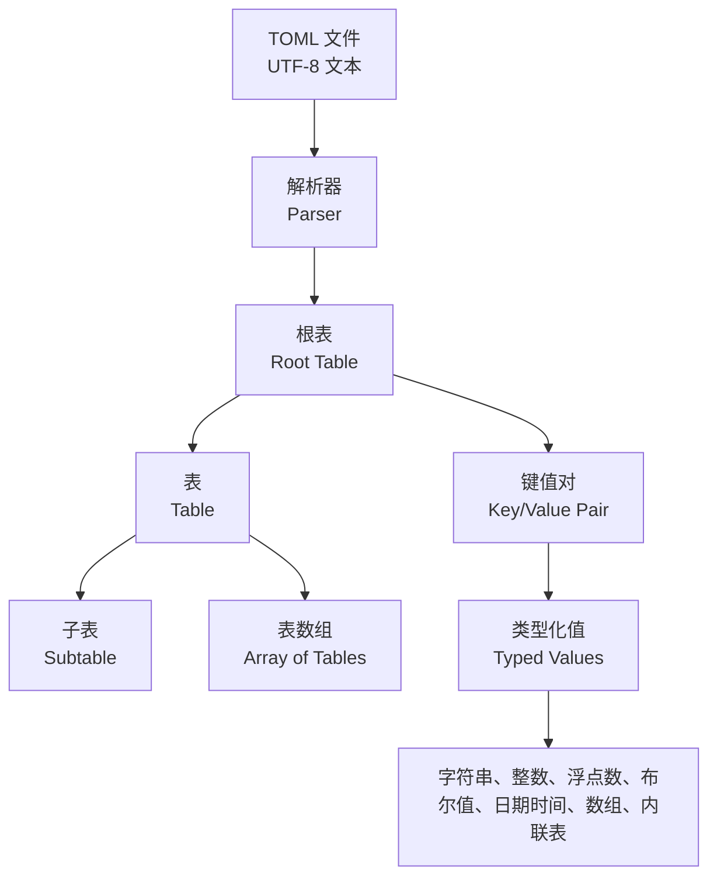
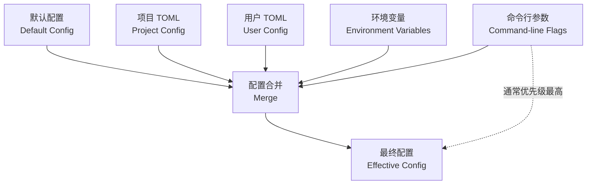

[toc]


## abstract

TOML 是 **Tom’s Obvious, Minimal Language** 的缩写，定位是“清晰、极简、适合人类阅读的配置文件格式”。

> 官方规范强调：TOML 应当能无歧义地映射到哈希表，也应当容易被各种编程语言解析为数据结构。
>
> 当前官方规范已发布 **TOML v1.1.0**，发布日期是 **2025-12-18**；但实践中仍要注意兼容性，因为不少主流工具仍以 **TOML 1.0.0** 为基线，例如 Python 标准库 `tomllib` 仍声明解析 TOML 1.0.0，且只读不写。([toml.io](https://toml.io/en/v1.1.0))

对于新手，可以把 TOML 理解为：**比 JSON 更适合写配置，比 YAML 更克制、更少“魔法”，比 INI 更规范、更有类型系统**。

------

## 详细学习大纲

| 学习模块              | 学习目标                   | 核心内容                                                     | 建议练习                                 |
| --------------------- | -------------------------- | ------------------------------------------------------------ | ---------------------------------------- |
| TOML 的定位           | 知道它适合解决什么问题     | 配置文件、类型化数据、无歧义映射、可读性                     | 把一个简单 JSON 配置改写成 TOML          |
| 基础语法              | 能读懂普通 TOML 文件       | 注释、键值对、字符串、数字、布尔值、数组                     | 写一个应用配置：端口、日志级别、功能开关 |
| 表与层级结构          | 理解 TOML 如何表达嵌套配置 | 表（Table）、点分键（Dotted Key）、根表（Root Table）        | 写数据库、缓存、服务端配置               |
| 数组与对象列表        | 表达列表、插件、服务节点   | 数组（Array）、表数组（Array of Tables）、内联表（Inline Table） | 写多个插件或多个服务器节点               |
| 类型系统              | 避免字符串化配置带来的问题 | 整数、浮点数、布尔值、日期时间、本地时间、数组               | 对比 `"8080"` 和 `8080` 的区别           |
| 与 JSON/YAML/INI 对比 | 选择合适配置方案           | 可读性、类型能力、复杂度、生态、适用场景                     | 同一配置分别用 TOML、YAML、JSON 写一遍   |
| 工程应用              | 知道现代项目中 TOML 怎么用 | `pyproject.toml`、`Cargo.toml`、工具配置、锁文件、格式化     | 阅读一个真实开源项目的 TOML 配置         |
| 最佳实践              | 写出长期可维护配置         | 命名、分组、兼容性、注释、校验、敏感信息处理                 | 为一个小型服务设计完整配置               |
| 常见坑                | 避免解析失败和语义误解     | 重复键、表重定义、数组类型混用、日期时间、内联表限制         | 故意写错 TOML，再用解析器验证            |

------

## TOML 的核心思想

TOML 的设计目标不是“表达一切”，而是“把配置写清楚”。它更适合描述**静态配置数据**，而不是写逻辑、模板、条件判断或复杂脚本。



TOML 文件必须是有效的 UTF-8 文档；它区分大小写，空白主要是空格和制表符，换行可以是 LF 或 CRLF。

注释使用 `#`，但字符串内部的 `#` 不会被当作注释。([toml.io](https://toml.io/en/v1.1.0))

------

## 最小可用示例

```toml
# 应用基础信息
name = "demo-service"
version = "1.0.0"
debug = false

[server]
host = "127.0.0.1"
port = 8080

[database]
url = "postgres://localhost:5432/app"
pool_size = 10
connect_timeout_seconds = 5

[logging]
level = "info"
format = "json"

[[plugins]]
name = "metrics"
enabled = true

[[plugins]]
name = "tracing"
enabled = false
```

这个例子里：

| 语法                    | 含义                                                         |
| ----------------------- | ------------------------------------------------------------ |
| `name = "demo-service"` | 根表中的键值对                                               |
| `[server]`              | **普通表**，表示一个嵌套对象                                 |
| `[database]`            | 另一个普通表                                                 |
| `[[plugins]]`           | **表数组**，表示**多个同类对象**,可以重复出现,可以表示同类型但有区别的对象. |
| `debug = false`         | 布尔值，不是字符串                                           |
| `port = 8080`           | 整数，不是字符串                                             |

对应到类似 JSON 的结构，大致是：

```json
{
  "name": "demo-service",
  "version": "1.0.0",
  "debug": false,
  "server": {
    "host": "127.0.0.1",
    "port": 8080
  },
  "database": {
    "url": "postgres://localhost:5432/app",
    "pool_size": 10,
    "connect_timeout_seconds": 5
  },
  "logging": {
    "level": "info",
    "format": "json"
  },
  "plugins": [
    {
      "name": "metrics",
      "enabled": true
    },
    {
      "name": "tracing",
      "enabled": false
    }
  ]
}
```

------

## 基础语法

### 注释

TOML 使用 `#` 表示注释。

```toml
# 这是整行注释
host = "localhost" # 这是行尾注释
text = "# 这里不是注释，因为它在字符串里"
```

注释只服务于人类阅读者。规范明确指出，解析器不能因为注释内容而修改键或值。([toml.io](https://toml.io/en/v1.1.0))

### 键值对

键值对（Key/Value Pair）是 TOML 的基本构造。键在等号左边，值在等号右边。

**等号两侧的空白**会被忽略；键、等号和值通常必须在**同一行**，除非值本身允许跨行。([toml.io](https://toml.io/en/v1.1.0))

```toml
name = "Alice"
age = 30
enabled = true
```

不允许没有值：

```toml
# 错误
name =
```

TOML 没有 `null` 类型。官方规范列出的值类型包括**字符串、整数、浮点数、布尔值、日期时间、数组、内联表**等，**未指定值是非法的**。([toml.io](https://toml.io/en/v1.1.0))

------

## 键的写法

TOML 的键（Key）主要有三类：**裸键、引号键、点分键**。

| 类型   | 英文术语   | 示例                   | 说明                                                  |
| ------ | ---------- | ---------------------- | ----------------------------------------------------- |
| 裸键   | Bare Key   | `host = "localhost"`   | 最常用，只能包含 **ASCII 字母、数字、下划线、短横线** |
| 引号键 | Quoted Key | `"server.port" = 8080` | 适合**包含空格、点号、特殊字符的键名**                |
| 点分键 | Dotted Key | `server.port = 8080`   | 用点号表达**嵌套结构**                                |

裸键只能包含 `A-Za-z0-9_-`，并且即使裸键全是数字，也仍然被解释为字符串键名。官方最佳实践也是：除非必要，**优先使用裸键**。([toml.io](https://toml.io/en/v1.1.0))

```toml
# 推荐
server_name = "api"
server-port = 8080

# 需要特殊字符时使用引号键
"content-type" = "application/json"
"127.0.0.1" = "localhost"

# 点分键表示嵌套
database.host = "localhost"
database.port = 5432
```

上面的点分键等价于：

```toml
[database]
host = "localhost"
port = 5432
```

------

## 数据类型

TOML 的一个重要优点是：它不是“全都是字符串”。它有明确的数据类型。

| 类型         | 英文术语         | 示例                         | 注意点                               |
| ------------ | ---------------- | ---------------------------- | ------------------------------------ |
| 字符串       | String           | `"hello"`、`'C:\tmp'`        | 双引号支持转义，单引号是字面量字符串 |
| 整数         | Integer          | `42`、`-1`、`1_000`、`0xFF`  | 不允许十进制前导零                   |
| 浮点数       | Float            | `3.14`、`1e6`、`+inf`、`nan` | 用于近似数值，不适合金额精算         |
| 布尔值       | Boolean          | `true`、`false`              | 必须小写                             |
| 偏移日期时间 | Offset Date-Time | `2026-07-01T10:00:00+02:00`  | 表示可定位到具体时刻的时间           |
| 本地日期时间 | Local Date-Time  | `2026-07-01T10:00:00`        | 没有时区，不能单独转换成绝对时刻     |
| 本地日期     | Local Date       | `2026-07-01`                 | 只有日期                             |
| 本地时间     | Local Time       | `10:30:00`                   | 只有时间                             |
| 数组         | Array            | `[1, 2, 3]`                  | 有序列表，可以跨行                   |
| 内联表       | Inline Table     | `{ x = 1, y = 2 }`           | 适合短小对象                         |

官方规范允许数组跨多行，并允许最后一个元素后出现尾随逗号；数组中的元素可以混合类型，但实际项目中通常不建议混用，因为会降低可维护性和类型校验能力。([toml.io](https://toml.io/en/v1.1.0))

------

## 字符串详解

TOML 有四种字符串形式。

| 形式             | 示例              | 适用场景                     |
| ---------------- | ----------------- | ---------------------------- |
| 基本字符串       | `"hello\nworld"`  | 需要转义字符时               |
| 多行基本字符串   | `"""..."""`       | 长文本、说明文档、证书片段   |
| 字面量字符串     | `'C:\Users\name'` | Windows 路径、正则表达式     |
| 多行字面量字符串 | `'''...'''`       | 不希望任何转义生效的多行文本 |

示例：

```toml
message = "hello\nworld"

windows_path = 'C:\Users\alice\project'

regex = '\d{4}-\d{2}-\d{2}'

description = """
这是一个多行字符串。
适合较长说明。
"""
```

字面量字符串（Literal String）没有转义机制，内容基本按原样解释，所以写 Windows 路径和正则表达式时很方便。官方规范也专门用 Windows 路径和正则作为例子说明这种用途。([toml.io](https://toml.io/en/v1.1.0))

------

## 表与嵌套结构

**表**（Table）可以理解为**“对象”或“字典”**。表头使用**方括号**。

```toml
[server] # 标头是server
host = "127.0.0.1"
port = 8080
```

等价于类似 JSON 的：

```json
{
  "server": {
    "host": "127.0.0.1",
    "port": 8080
  }
}
```

**表头下面的键值对属于该表**，直到下一个表头或文件结束。官方规范也说明，**表内键值对不保证具有特定顺序**，所以不要依赖配置项出现顺序表达业务语义。([toml.io](https://toml.io/en/v1.1.0))

### 根表

第一个表头之前的内容属于**根表**（Root Table）。

```toml
name = "demo"
debug = false

[server]
host = "localhost"
```

这里 `name` 和 `debug` 在根表中，`host` 在 `server` 表中。

### 子表

```toml
[server.http]
host = "0.0.0.0"
port = 8080

[server.grpc]
host = "0.0.0.0"
port = 9090
```

等价于：

```json
{
  "server": {
    "http": {
      "host": "0.0.0.0",
      "port": 8080
    },
    "grpc": {
      "host": "0.0.0.0",
      "port": 9090
    }
  }
}
```

TOML 不要求你先显式声明所有父表；例如可以直接写 `[x.y.z]`，**父级表会被隐式创建**。([toml.io](https://toml.io/en/v1.1.0))

------

## 点分键与表头的选择

**同一个结构**可以用**点分键**，也可以用**表头**。

```toml
# 点分键写法
database.host = "localhost"
database.port = 5432
database.pool_size = 10
# 表头写法
[database]
host = "localhost"
port = 5432
pool_size = 10
```

建议：

| 场景                 | 推荐写法       | 原因         |
| -------------------- | -------------- | ------------ |
| 配置项很少，层级很浅 | 点分键         | 简洁         |
| 同一组配置有多个字段 | 表头           | 更清晰       |
| 嵌套超过两层         | 表头或拆分结构 | 避免一行太长 |
| 需要给一组配置加注释 | 表头           | 注释更自然   |
| 工具自动生成配置     | 视工具约定而定 | 保持稳定格式 |

不建议在同一块配置中混用过多点分键和表头，否则读者需要不断在脑中还原结构。

------

## 内联表

内联表（Inline Table）用 `{}` 表示一个短小对象。

```toml
point = { x = 1, y = 2 }

user = { name = "Alice", email = "alice@example.com" }
```

TOML v1.1.0 允许内联表跨多行，**并允许最后一个键值对后有尾随逗号**；这是 v1.1.0 实用性很强的改进之一。([toml.io](https://toml.io/en/v1.1.0))

```toml
contact = {
  personal = {
    name = "Alice",
    email = "alice@example.com",
  },
  work = {
    name = "Alice Zhang",
    email = "alice@company.example",
  },
}
```

但需要注意：**如果你的项目需要兼容 TOML 1.0.0 解析器，不要使用 TOML 1.1 才支持的写法**。例如 Python 标准库 `tomllib` 当前仍说明自己解析 TOML 1.0.0。([Python documentation](https://docs.python.org/3/library/tomllib.html))

内联表是自包含的。定义后不能再从外部往里面追加键或子表。([toml.io](https://toml.io/en/v1.1.0))

```toml
[product]
type = { name = "book" }

# 错误：不能再给 product.type 追加字段
# type.category = "education"
```

------

## 表数组

表数组（Array of Tables）用于表达**多个同类对象**。语法是双中括号。

```toml
[[servers]]
name = "alpha"
host = "10.0.0.1"
port = 8080

[[servers]]
name = "beta"
host = "10.0.0.2"
port = 8080
```

对应 JSON：

```json
{
  "servers": [
    {
      "name": "alpha",
      "host": "10.0.0.1",
      "port": 8080
    },
    {
      "name": "beta",
      "host": "10.0.0.2",
      "port": 8080
    }
  ]
}
```

官方规范说明，表数组中的每个 `[[name]]` 会创建数组中的一个新表元素，并按出现顺序插入数组。([toml.io](https://toml.io/en/v1.1.0))

适合使用表数组的场景：

| 场景         | 示例              |
| ------------ | ----------------- |
| 多个服务节点 | `[[servers]]`     |
| 多个插件     | `[[plugins]]`     |
| 多个数据源   | `[[datasources]]` |
| 多个路由规则 | `[[routes]]`      |
| 多个任务     | `[[jobs]]`        |

------

## 关键规则与常见错误

### 不能重复定义键

```toml
# 错误
port = 8080
port = 9090
```

配置文件应该表达确定含义。重复键会造成歧义，所以 TOML 不允许。

### 不能重复定义同一个表

```toml
[server]
host = "localhost"

# 错误：同一个表不能再次定义
[server]
port = 8080
```

规范明确说明，表不能定义超过一次。([toml.io](https://toml.io/en/v1.1.0))

正确写法：

```toml
[server]
host = "localhost"
port = 8080
```

### 表的顺序不要乱跳

虽然有些乱序写法合法，但官方规范也指出，乱序定义表是不推荐的。([toml.io](https://toml.io/en/v1.1.0))

不推荐：

```toml
[fruit.apple]
color = "red"

[animal]
name = "dog"

[fruit.orange]
color = "orange"
```

推荐：

```toml
[fruit.apple]
color = "red"

[fruit.orange]
color = "orange"

[animal]
name = "dog"
```

### 小心字符串和数字的区别

```toml
port = 8080      # 整数
port_text = "8080" # 字符串
```

这两个值在程序中不是同一类型。配置读取后，`8080` 通常会变成整数，`"8080"` 会变成字符串。

### 小心本地时间和带时区时间

```toml
# 有时区偏移，可以定位到具体时刻
start_at = 2026-07-01T10:00:00+02:00

# 没有时区，只是一个本地日期时间
local_start_at = 2026-07-01T10:00:00
```

本地日期时间没有时区信息，不能单独转换为绝对时间点；如果需要任务调度、审计、日志时间，通常应优先使用带偏移的日期时间。官方规范也说明，不带 offset 的本地日期时间无法在缺少额外信息时转换成具体时刻。([toml.io](https://toml.io/en/v1.1.0))

------

## TOML 与其他配置格式对比

| 格式   | 优点                                                      | 缺点                                                 | 适合场景                                    |
| ------ | --------------------------------------------------------- | ---------------------------------------------------- | ------------------------------------------- |
| TOML   | 可读性好；有明确类型；支持注释；比 YAML 简单；比 INI 规范 | 不适合特别复杂的层级；无内置表达式、变量、条件、引用 | 应用配置、工具配置、项目元数据              |
| JSON   | 标准化强；机器友好；生态极广；适合 API 数据交换           | 不支持标准注释；手写配置可读性一般；尾随逗号不标准   | 数据交换、接口响应、机器生成配置            |
| YAML   | 表达能力强；支持复杂结构；注释友好                        | 语法复杂；缩进敏感；隐式类型容易踩坑                 | Kubernetes、CI/CD、需要复杂层级的声明式配置 |
| INI    | 简单直观；历史悠久                                        | 标准不统一；类型弱；嵌套能力差                       | 很简单的传统配置                            |
| `.env` | 极简；适合环境变量                                        | 基本都是字符串；无嵌套；不适合复杂配置               | 密钥注入、部署环境差异                      |
| HCL    | 表达力强；支持块、变量、表达式                            | 学习成本更高；生态更集中                             | Terraform、基础设施即代码                   |
| XML    | 结构严谨；可验证；历史生态强                              | 冗长；手写体验差                                     | 老系统、企业集成、需要严格文档结构          |

选择建议：

| 需求                                      | 更推荐           |
| ----------------------------------------- | ---------------- |
| 人手写应用配置                            | TOML             |
| 机器间数据交换                            | JSON             |
| Kubernetes、GitHub Actions 等生态已有约定 | YAML             |
| 只有环境变量                              | `.env`           |
| 基础设施声明和表达式                      | HCL              |
| 老系统兼容或文档型数据                    | XML              |
| 极简单配置，只有几个键                    | INI 或 `.env`    |
| Python 项目元数据与工具配置               | `pyproject.toml` |
| Rust 包配置                               | `Cargo.toml`     |

------

## 现代工程中的典型应用

### Python 的 `pyproject.toml`

Python 生态中，`pyproject.toml` 已经成为非常重要的**项目配置入口**。官方 Python Packaging 文档说明，`pyproject.toml` 既用于打包相关工具，也可用于其他工具配置；当前规范定义了 `[build-system]`、`[project]` 和 `[tool]` 三类表，其他工具专属配置应放在 `[tool]` 下。([packaging.python.org](https://packaging.python.org/en/latest/specifications/pyproject-toml/))

典型结构：

```toml
[build-system]
requires = ["hatchling"]
build-backend = "hatchling.build"

[project]
name = "demo-package"
version = "0.1.0"
description = "A demo Python package"
requires-python = ">=3.11"
dependencies = [
  "requests>=2.32",
]

[tool.ruff]
line-length = 100
target-version = "py311"

[tool.pytest.ini_options]
testpaths = ["tests"]
```

Python Packaging 用户指南也说明，`[build-system]` 表强烈推荐出现，用于**声明构建后端和构建依赖**；`[project]` 用于项目基本元数据；`[tool]` 用于工具自己的子表，例如 `[tool.hatch]`、`[tool.black]`、`[tool.mypy]`。([packaging.python.org](https://packaging.python.org/en/latest/guides/writing-pyproject-toml/))

Ruff 这类现代 Python 工具也支持通过 `pyproject.toml`、`ruff.toml` 或 `.ruff.toml` 配置。([docs.astral.sh](https://docs.astral.sh/ruff/configuration/?utm_source=chatgpt.com))

### Rust 的 `Cargo.toml`

Rust 的包管理器 Cargo 使用 `Cargo.toml` 作为包清单（Manifest）。Cargo 官方文档说明，`Cargo.toml` 使用 TOML 格式，包含编译包所需的元数据。([Rust 文档](https://doc.rust-lang.org/cargo/reference/manifest.html))

示例：

```toml
[package]
name = "hello_world"
version = "0.1.0"
edition = "2024"

[dependencies]
serde = { version = "1", features = ["derive"] }
tokio = { version = "1", features = ["full"] }

[dev-dependencies]
pretty_assertions = "1"
```

Cargo 文档中的 `[package]` 表包含名称、版本、作者、edition、许可证、仓库、构建脚本、发布控制等元数据；其中当前 Cargo 只要求 `name` 字段，但发布到 registry 时可能需要更多字段。([Rust 文档](https://doc.rust-lang.org/cargo/reference/manifest.html))

### uv、Ruff、Taplo 等现代工具

`uv` 支持项目级和用户级持久配置文件，并会在当前目录或父目录中查找 `pyproject.toml` 或 `uv.toml`。([docs.astral.sh](https://docs.astral.sh/uv/concepts/configuration-files/?utm_source=chatgpt.com))

```toml
[tool.uv]
required-version = ">=0.7"

[[tool.uv.index]]
url = "https://pypi.org/simple"
default = true
```

Taplo 是常见的 TOML 工具链之一，提供语法验证、格式化、基于 JSON Schema 的校验和语言服务器等能力。([Taplo](https://taplo.tamasfe.dev/?utm_source=chatgpt.com))

------

## 配置分层与优先级设计

真实项目里，TOML 通常不会单独承担所有配置来源。更常见的是多来源合并。



常见优先级从低到高：

| 优先级 | 来源       | 示例                              |
| ------ | ---------- | --------------------------------- |
| 低     | 内置默认值 | 程序代码中的默认配置              |
| 中     | 系统级配置 | `/etc/myapp/config.toml`          |
| 中     | 用户级配置 | `~/.config/myapp/config.toml`     |
| 中高   | 项目级配置 | `./config.toml`、`pyproject.toml` |
| 高     | 环境变量   | `MYAPP_PORT=8080`                 |
| 最高   | 命令行参数 | `--port 8080`                     |

建议：
TOML 负责**结构化、可读、可版本管理**的配置；环境变量负责**部署环境差异和敏感信息引用**；命令行参数负责**临时覆盖**。

------

## 最佳实践

### 优先使用 TOML 1.0 兼容写法

虽然 TOML v1.1.0 已发布，但如果你的配置会被多种工具读取，尤其是 Python、老版本构建工具、CI 环境、编辑器插件，建议默认使用 TOML 1.0 兼容语法。只有在明确目标工具支持 v1.1 时，再使用多行内联表等新特性。Python 标准库 `tomllib` 当前仍说明它解析 TOML 1.0.0。([Python documentation](https://docs.python.org/3/library/tomllib.html))

### 配置结构要稳定

推荐：

```toml
[server]
host = "0.0.0.0"
port = 8080

[database]
host = "localhost"
port = 5432
name = "app"

[cache]
backend = "redis"
ttl_seconds = 300
```

不推荐：

```toml
server.host = "0.0.0.0"

[database]
host = "localhost"

server.port = 8080

[cache.redis]
ttl_seconds = 300
```

问题在于结构跳跃，读者需要来回寻找同一组配置。

### 命名保持一致

| 推荐                    | 不推荐                          |
| ----------------------- | ------------------------------- |
| `snake_case` 统一       | `snake_case`、`kebab-case` 混用 |
| `timeout_seconds`       | `timeout` 但不知道单位          |
| `enabled = true`        | `enable = "yes"`                |
| `max_connections = 100` | `maxConn = "100"`               |
| `log_level = "info"`    | `logLevel = "INFO"`             |

TOML 对大小写敏感，所以 `log_level`、`Log_Level`、`LOG_LEVEL` 是不同键。

### 单位写进键名

推荐：

```toml
timeout_seconds = 30
max_body_size_mb = 10
retry_interval_ms = 500
```

不推荐：

```toml
timeout = 30
max_body_size = 10
retry_interval = 500
```

配置文件经常被不同背景的人维护，单位不明确会造成事故。

### 布尔值不要字符串化

推荐：

```toml
debug = false
feature_enabled = true
```

不推荐：

```toml
debug = "false"
feature_enabled = "yes"
```

字符串 `"false"` 在很多语言里可能仍是“非空字符串”，容易造成逻辑错误。

### 敏感信息不要直接写入 TOML

不推荐：

```toml
[database]
password = "super-secret-password"
```

推荐：

```toml
[database]
user = "app"
password_env = "APP_DATABASE_PASSWORD"
```

然后从环境变量读取真实密码。TOML 文件通常会进入 Git 仓库，直接写密钥风险很高。

### 长数组优先多行

推荐：

```toml
allowed_hosts = [
  "localhost",
  "127.0.0.1",
  "api.example.com",
]
```

不推荐：

```toml
allowed_hosts = ["localhost", "127.0.0.1", "api.example.com"]
```

短数组单行没问题；长数组多行更利于 diff、审查和追加。

### 列表对象优先使用表数组

推荐：

```toml
[[routes]]
path = "/health"
method = "GET"
auth_required = false

[[routes]]
path = "/users"
method = "POST"
auth_required = true
```

不推荐：

```toml
routes = [
  { path = "/health", method = "GET", auth_required = false },
  { path = "/users", method = "POST", auth_required = true },
]
```

后者适合很短的对象；字段较多时，表数组更清楚。

### 用工具格式化和校验

建议至少配置：

| 工具能力    | 作用                             |
| ----------- | -------------------------------- |
| 语法检查    | 防止 CI 或运行时才发现解析失败   |
| 格式化      | 保持团队风格一致                 |
| Schema 校验 | 检查字段名、类型、必填项、枚举值 |
| 编辑器插件  | 提供补全、跳转、错误提示         |

Taplo 这类工具可以验证 TOML 文档语法，也支持基于 JSON Schema 的校验和语言服务器能力。([Taplo](https://taplo.tamasfe.dev/?utm_source=chatgpt.com))

------

## 设计一个实用配置文件

下面是一个较完整的服务配置示例，适合新手模仿。

```toml
# 应用信息
name = "orders-service"
environment = "development"
debug = true

[server]
host = "0.0.0.0"
port = 8080
read_timeout_seconds = 10
write_timeout_seconds = 10

[logging]
level = "info"
format = "json"
include_caller = true

[database]
driver = "postgres"
host = "localhost"
port = 5432
database = "orders"
user = "orders_app"
password_env = "ORDERS_DATABASE_PASSWORD"
pool_size = 20
connect_timeout_seconds = 5

[cache]
backend = "redis"
url = "redis://localhost:6379/0"
default_ttl_seconds = 300

[features]
new_checkout_flow = false
async_invoice_generation = true

[security]
allowed_origins = [
  "http://localhost:3000",
  "https://admin.example.com",
]
jwt_public_key_path = "./secrets/jwt-public.pem"

[[workers]]
name = "email"
queue = "emails"
concurrency = 4
enabled = true

[[workers]]
name = "invoice"
queue = "invoices"
concurrency = 2
enabled = true
```

这个例子体现了几个好习惯：

| 设计点                   | 好处                   |
| ------------------------ | ---------------------- |
| 按主题分表               | 读者能快速定位配置     |
| 单位写进键名             | 避免秒、毫秒、分钟混淆 |
| 密码使用环境变量引用     | 避免密钥进入仓库       |
| 表数组表达多个 worker    | 结构清晰，便于扩展     |
| 布尔值使用真正的布尔类型 | 避免字符串真假值陷阱   |
| 长数组多行               | 便于代码审查和修改     |

------

## 什么时候不该用 TOML

TOML 很好，但不是万能格式。

| 情况                       | 原因                      | 更合适选择                                  |
| -------------------------- | ------------------------- | ------------------------------------------- |
| 配置需要条件、变量、表达式 | TOML 没有逻辑能力         | HCL、Jsonnet、Cue、模板系统                 |
| 数据主要用于 API 传输      | TOML 不是主流接口交换格式 | JSON                                        |
| 配置天然依赖缩进式声明生态 | 生态已经围绕 YAML 建立    | YAML                                        |
| 需要极简环境变量注入       | TOML 太重                 | `.env`、系统环境变量                        |
| 文档结构很复杂且需要强约束 | TOML 表达能力有限         | XML、JSON Schema 配合 JSON                  |
| 需要保留注释并程序化编辑   | 普通解析器通常只保留数据  | 使用保留格式的库，如 TOML Kit、Taplo 类工具 |

Python 官方文档也提醒，`tomllib` 不支持写 TOML；如果要编辑已有 TOML 并保留风格，文档推荐使用 TOML Kit 这类能读写且保留样式的库。([Python documentation](https://docs.python.org/3/library/tomllib.html))

------

## 新手最容易混淆的点

| 问题                                  | 正确认知                                                     |
| ------------------------------------- | ------------------------------------------------------------ |
| TOML 是不是 JSON 的替代品？           | 部分场景是，但 TOML 更偏配置，JSON 更偏数据交换              |
| TOML 是不是 YAML 的简化版？           | 可以这样粗略理解，但 TOML 更强调无歧义和类型清晰             |
| TOML 支持 `null` 吗？                 | 不支持；需要用缺省、空字符串、空数组或业务约定表达           |
| TOML 能写变量吗？                     | 不能；它不是模板语言                                         |
| TOML 能引用另一个 TOML 文件吗？       | 规范本身没有 include 机制                                    |
| TOML 的顺序有业务意义吗？             | 普通表内键值对不应依赖顺序；数组和表数组有顺序               |
| 表可以重复写吗？                      | 不可以重复定义同一个表                                       |
| `8080` 和 `"8080"` 一样吗？           | 不一样，前者是整数，后者是字符串                             |
| 多行内联表能随便用吗？                | TOML 1.1 支持，但要考虑解析器是否仍停留在 1.0                |
| `pyproject.toml` 里能随便建顶层表吗？ | 不建议；Python 规范当前定义 `[build-system]`、`[project]`、`[tool]`，工具配置应放在 `[tool]` 下。([packaging.python.org](https://packaging.python.org/en/latest/specifications/pyproject-toml/)) |

------

## 推荐学习路径

| 阶段   | 学什么                                   | 达标标准                 |
| ------ | ---------------------------------------- | ------------------------ |
| 入门   | 键值对、注释、基本类型                   | 能读懂普通 `config.toml` |
| 初级   | 表、点分键、数组                         | 能写服务配置             |
| 中级   | 表数组、内联表、日期时间                 | 能设计多插件、多任务配置 |
| 工程化 | `pyproject.toml`、`Cargo.toml`、工具配置 | 能理解真实项目配置       |
| 进阶   | Schema 校验、配置分层、兼容性策略        | 能维护团队级配置规范     |

------

## 总结

TOML 的核心价值是：**清晰、克制、类型明确、适合人手写配置**。它特别适合项目元数据、工具配置、服务配置和中小型结构化配置。与 JSON 相比，它更适合人写；与 YAML 相比，它更少隐式规则；与 INI 相比，它有更正式的语法和类型系统。

实际工程中最重要的建议是：**默认写 TOML 1.0 兼容配置，结构按主题分组，类型不要字符串化，敏感信息不要入库，复杂配置配合 Schema 和格式化工具管理。**