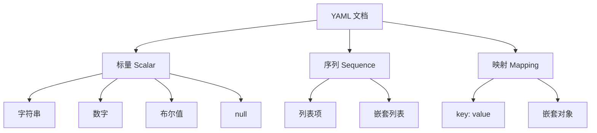
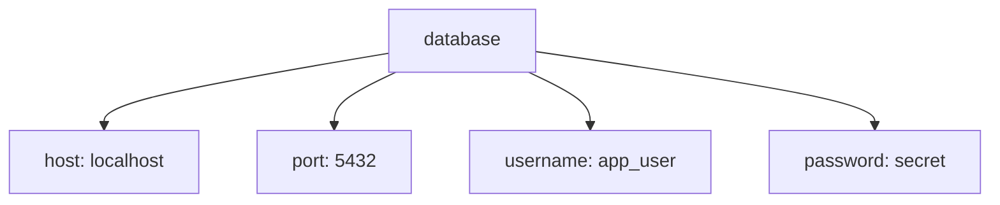
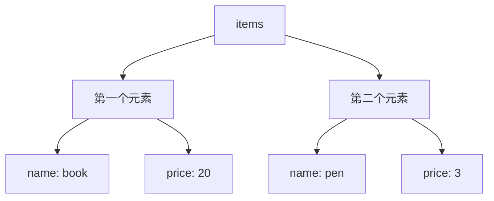
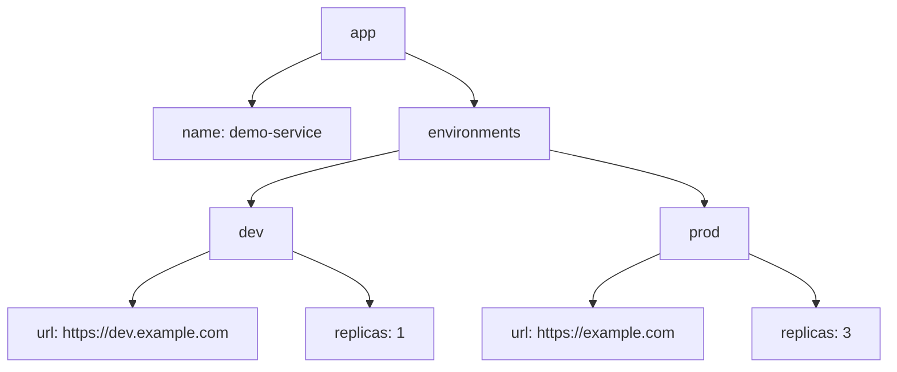
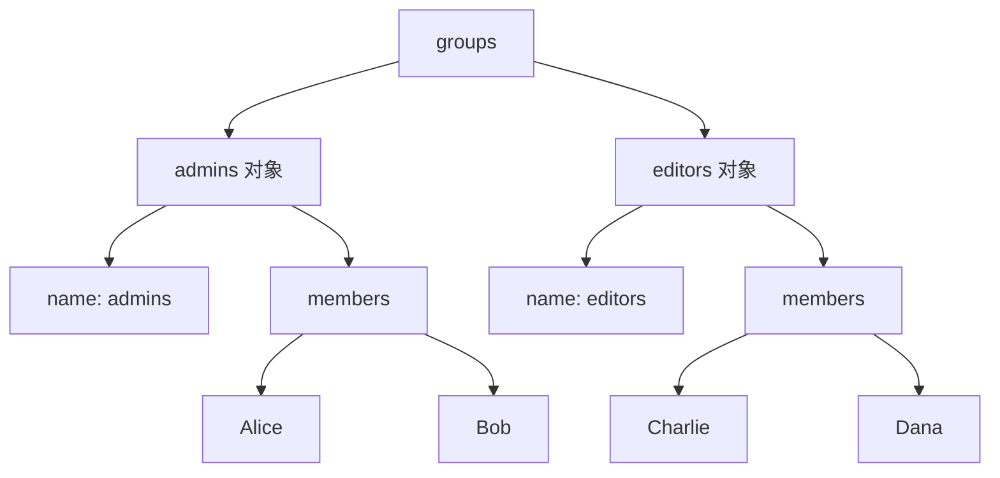

[toc]

## YAML 学习指南

YAML 是一种面向人类阅读和编写的数据序列化语言，常用于配置文件、CI/CD、Kubernetes、Docker Compose、Ansible、OpenAPI、GitHub Actions 等场景。它的官方最新规范版本是 **YAML 1.2，Revision 1.2.2**；该修订版发布于 2021-10-01，主要是澄清和修正文档，没有改变 YAML 1.2 的规范语义。([yaml.org](https://yaml.org/spec/1.2.2/?utm_source=chatgpt.com))

YAML 的核心思想可以概括为：

> 用缩进表达层级，用 `key: value` 表达映射，用 `- item` 表达列表，用更少的符号描述结构化数据。

------

## YAML 适合做什么

| 场景                | 是否适合 | 说明                                             |
| ------------------- | -------- | ------------------------------------------------ |
| 配置文件            | 很适合   | 人类可读，易注释，适合手写                       |
| CI/CD 配置          | 很适合   | GitHub Actions、GitLab CI 等广泛使用             |
| Kubernetes 资源清单 | 很适合   | Kubernetes YAML 是典型应用                       |
| 简单数据交换        | 适合     | YAML 1.2 以 JSON 为子集目标，JSON 思维容易迁移   |
| 复杂程序逻辑        | 不适合   | YAML 是数据格式，不是编程语言                    |
| 高频机器间通信      | 一般     | 解析通常比 JSON 更复杂、更慢                     |
| 安全边界不可信输入  | 谨慎     | 某些语言库支持对象反序列化，配置不当会有安全风险 |

YAML 官方将它描述为“human-friendly data serialization language”，即对人类友好的数据序列化语言。([yaml.org](https://yaml.org/?utm_source=chatgpt.com))

------

## YAML 的基本结构

YAML 主要由三类数据结构组成：

| 类型          | 含义       | 类似于                     |
| ------------- | ---------- | -------------------------- |
| 标量 Scalar   | 单个值     | 字符串、数字、布尔值、null |
| 序列 Sequence | 有序列表   | 数组、List                 |
| 映射 Mapping  | 键值对集合 | 对象、字典、Map            |

示意图：



示例：

```yaml
name: Alice
age: 28
active: true
skills:
  - YAML
  - Docker
  - Kubernetes
address:
  city: Madrid
  country: Spain
```

它表示的数据结构大致是：

| 键        | 值                                     |
| --------- | -------------------------------------- |
| `name`    | `"Alice"`                              |
| `age`     | `28`                                   |
| `active`  | `true`                                 |
| `skills`  | `["YAML", "Docker", "Kubernetes"]`     |
| `address` | `{ city: "Madrid", country: "Spain" }` |

------

## 最重要的规则：缩进

YAML 最关键、也最容易出错的地方就是 **缩进**。

YAML 使用缩进表示层级关系，而不是 `{}` 或 `end`。规范和主流实践都要求：**缩进只能使用空格，不能使用 Tab 作为缩进**。([维基百科](https://en.wikipedia.org/wiki/YAML?utm_source=chatgpt.com))

### 缩进核心规则

| 规则                      | 推荐做法                                |
| ------------------------- | --------------------------------------- |
| 只能用空格缩进            | 不要用 Tab                              |
| 同级元素缩进必须一致      | 同一层级左边对齐                        |
| 子级元素必须比父级多缩进  | 常用 2 个空格                           |
| 不要混用 2 空格和 4 空格  | 项目中统一一种                          |
| 列表项 `-` 也参与层级判断 | 注意 `-` 后面通常有一个空格             |
| 冒号后面通常需要空格      | 写成 `key: value`，不要写成 `key:value` |

推荐：

```yaml
server:
  host: localhost
  port: 8080
```

不推荐：

```yaml
server:
    host: localhost
  port: 8080
```

上面这个例子中，`host` 和 `port` 看似都是 `server` 的子项，但缩进不一致，容易解析失败或造成误解。

------

## 缩进规则详解

### 映射中的缩进

映射就是键值对：

```yaml
database:
  host: localhost
  port: 5432
  username: app_user
  password: secret
```

含义：



`host`、`port`、`username`、`password` 都是 `database` 的子级，所以它们必须缩进，并且缩进宽度一致。

------

### 列表中的缩进

列表使用 `-` 表示：

```yaml
fruits:
  - apple
  - banana
  - orange
```

等价于：

```json
{
  "fruits": ["apple", "banana", "orange"]
}
```

注意：`-` 本身属于缩进结构的一部分。通常写成：

```yaml
items:
  - name: book
    price: 20
  - name: pen
    price: 3
```

这里有两个列表项，每个列表项都是一个对象：



容易写错的版本：

```yaml
items:
  - name: book
  price: 20
```

这个写法看起来像 `price` 属于 `book`，但实际上 `price` 的缩进和 `- name` 不匹配，通常会导致结构错误或解析错误。

正确写法：

```yaml
items:
  - name: book
    price: 20
```

------

### 列表嵌套映射

这是最常见的 YAML 结构之一：

```yaml
users:
  - name: Alice
    role: admin
    active: true
  - name: Bob
    role: editor
    active: false
```

可以理解为：

```json
{
  "users": [
    {
      "name": "Alice",
      "role": "admin",
      "active": true
    },
    {
      "name": "Bob",
      "role": "editor",
      "active": false
    }
  ]
}
```

学习 YAML 时，建议经常把 YAML 转成 JSON 来理解结构。

------

### 映射嵌套列表

```yaml
project:
  name: yaml-guide
  maintainers:
    - Alice
    - Bob
    - Charlie
```

含义是：

```json
{
  "project": {
    "name": "yaml-guide",
    "maintainers": ["Alice", "Bob", "Charlie"]
  }
}
```

------

### 多层嵌套

```yaml
app:
  name: demo-service
  environments:
    dev:
      url: https://dev.example.com
      replicas: 1
    prod:
      url: https://example.com
      replicas: 3
```

结构：



------

## 缩进检查清单

写 YAML 时，优先检查这些：

| 检查项                        | 正确标准                           |
| ----------------------------- | ---------------------------------- |
| 是否使用 Tab                  | 不应该有 Tab                       |
| 同级键是否对齐                | 必须对齐                           |
| 子级是否比父级多缩进          | 必须更多                           |
| 列表项下面的属性是否对齐      | 属性通常和 `- name` 的 `name` 对齐 |
| 冒号后是否有空格              | 推荐 `key: value`                  |
| 是否混用了不同缩进宽度        | 不推荐                             |
| 编辑器是否显示不可见字符      | 推荐开启                           |
| 是否通过 linter / parser 校验 | 推荐                               |

非常推荐在编辑器中开启：

| 编辑器设置                  | 作用               |
| --------------------------- | ------------------ |
| 显示空白字符                | 发现 Tab、尾随空格 |
| 自动将 Tab 转为空格         | 避免缩进错误       |
| 每级缩进 2 空格             | YAML 常见风格      |
| 保存时格式化                | 保持团队一致       |
| YAML 插件 / Language Server | 实时提示错误       |

------

## 键值对

YAML 的映射使用 `key: value`：

```yaml
name: Alice
age: 28
city: Madrid
```

注意冒号后面的空格：

```yaml
name: Alice
```

不推荐：

```yaml
name:Alice
```

因为 `name:Alice` 可能会被当成普通字符串，而不是键值对。

------

## 键的写法

普通键可以不加引号：

```yaml
name: Alice
user_name: alice
user-id: 1001
```

如果键中包含特殊字符、冒号、前后空格，建议加引号：

```yaml
"content-type": application/json
"key:with:colon": value
" leading space": value
```

最佳实践是：

| 场景         | 建议                               |
| ------------ | ---------------------------------- |
| 普通配置键   | 使用小写字母、数字、连字符或下划线 |
| 跨语言配置   | 避免奇怪字符                       |
| 需要特殊字符 | 使用引号                           |
| 团队项目     | 统一命名风格                       |

------

## 字符串

YAML 字符串可以不加引号：

```yaml
name: Alice
message: hello world
```

但在实际项目中，很多值建议加引号，避免被解析成其他类型。

### 字符串写法对比

| 写法     | 示例            | 说明                 |
| -------- | --------------- | -------------------- |
| 裸字符串 | `name: Alice`   | 简洁，但要注意特殊值 |
| 单引号   | `name: 'Alice'` | 内容基本按字面值处理 |
| 双引号   | `name: "Alice"` | 支持转义字符         |
| 字面量块 | `text: |`       | 保留换行             |
| 折叠块   | `text: >`       | 换行折叠为空格       |

------

### 裸字符串

```yaml
message: hello world
url: https://example.com
```

裸字符串简单易读，但某些值可能被解析成布尔值、数字或 null，尤其是在不同 YAML 版本或不同解析器中。

例如：

```yaml
enabled: true
count: 123
empty: null
```

这些通常不是字符串，而是布尔值、数字和 null。

如果你希望它们是字符串，写成：

```yaml
enabled: "true"
count: "123"
empty: "null"
```

------

### 单引号字符串

单引号适合表示普通文本：

```yaml
message: 'hello world'
path: 'C:\Users\Alice\Documents'
```

单引号里的反斜杠一般不作为转义字符处理，所以 Windows 路径常用单引号。

如果字符串中要包含单引号，需要写两个单引号：

```yaml
message: 'It''s YAML'
```

含义是：

```text
It's YAML
```

------

### 双引号字符串

双引号支持转义：

```yaml
message: "hello\nworld"
tabbed: "a\tb"
quote: "She said: \"Hello\""
```

适合需要换行、制表符、Unicode 转义等场景。

------

## 多行字符串

YAML 的多行字符串非常实用，常用于脚本、证书、SQL、说明文本、配置片段。

### 字面量块：保留换行

使用 `|`：

```yaml
description: |
  This is line one.
  This is line two.
  This is line three.
```

结果大致是：

```text
This is line one.
This is line two.
This is line three.
```

适合：

| 场景       | 示例       |
| ---------- | ---------- |
| Shell 脚本 | CI/CD 脚本 |
| 证书       | PEM 证书   |
| Markdown   | 多行说明   |
| SQL        | 多行 SQL   |

示例：

```yaml
script: |
  echo "Start"
  npm install
  npm test
```

------

### 折叠块：换行折叠为空格

使用 `>`：

```yaml
summary: >
  YAML is a human-friendly
  data serialization language
  commonly used for configuration.
```

结果大致是：

```text
YAML is a human-friendly data serialization language commonly used for configuration.
```

适合写长段落说明。

------

### 多行字符串的尾部换行控制

YAML 还支持控制末尾换行：

| 写法 | 含义                       |
| ---- | -------------------------- |
| `    | `                          |
| `    | -`                         |
| `    | +`                         |
| `>`  | 折叠换行，保留一个结尾换行 |
| `>-` | 折叠换行，去掉结尾换行     |
| `>+` | 折叠换行，保留所有结尾换行 |

示例：

```yaml
script: |-
  echo "hello"
  echo "world"
```

`|-` 常用于不希望字符串末尾多一个换行的场景。

------

## 数字

```yaml
integer: 42
float: 3.14
negative: -10
```

如果数字只是编号、版本号、邮编、手机号、订单号，建议加引号：

```yaml
version: "1.20"
zip_code: "00123"
phone: "+34123456789"
order_id: "000987"
```

否则可能出现：

| 原始值         | 可能问题               |
| -------------- | ---------------------- |
| `00123`        | 前导零丢失             |
| `1.20`         | 被当成数字后变成 `1.2` |
| `+34123456789` | 被当成数字或解析异常   |
| `2024-01-01`   | 被某些解析器当成日期   |

------

## 布尔值

YAML 1.2 更接近 JSON，标准布尔值主要是：

```yaml
enabled: true
disabled: false
```

但很多工具、语言库或历史配置仍可能受到 YAML 1.1 行为影响。在 YAML 1.1 中，`yes`、`no`、`on`、`off` 等可能被解析为布尔值。这也是 YAML 的常见坑之一。YAML 官方资源列出当前版本为 YAML 1.2，且 YAML 1.2 的目标之一是改进与 JSON 的兼容性。([yaml.org](https://yaml.org/?utm_source=chatgpt.com))

为了兼容不同工具，建议：

```yaml
enabled: true
debug: false
```

不要写：

```yaml
enabled: yes
debug: off
```

如果你确实想表示字符串：

```yaml
answer: "yes"
mode: "off"
```

------

## null

常见 null 写法：

```yaml
value1: null
value2: ~
value3:
```

其中：

```yaml
value3:
```

通常表示 `value3` 的值为空。

为了可读性，推荐显式写：

```yaml
value: null
```

------

## 列表

### 普通列表

```yaml
languages:
  - Python
  - JavaScript
  - Go
```

### 对象列表

```yaml
services:
  - name: api
    port: 8080
  - name: worker
    port: 9000
```

### 嵌套列表

```yaml
matrix:
  - - linux
    - amd64
  - - linux
    - arm64
  - - windows
    - amd64
```

虽然 YAML 支持嵌套列表，但可读性较差。很多时候改成对象列表更清楚：

```yaml
matrix:
  - os: linux
    arch: amd64
  - os: linux
    arch: arm64
  - os: windows
    arch: amd64
```

------

## 行内写法

YAML 支持类似 JSON 的行内写法：

```yaml
user: { name: Alice, age: 28 }
skills: [YAML, Docker, Kubernetes]
```

适合短小结构。

但复杂结构不建议这样写：

```yaml
users: [{ name: Alice, roles: [admin, editor] }, { name: Bob, roles: [viewer] }]
```

更推荐：

```yaml
users:
  - name: Alice
    roles:
      - admin
      - editor
  - name: Bob
    roles:
      - viewer
```

------

## 注释

注释使用 `#`：

```yaml
# Application config
app:
  name: demo
  port: 8080 # default port
```

注释从 `#` 开始直到行尾。YAML 注释不会进入解析后的数据结构。

注意，如果 `#` 是字符串内容的一部分，最好加引号：

```yaml
password: "abc#123"
```

------

## 文档开始和结束

YAML 可以在一个文件中包含多个文档。

| 标记  | 作用           |
| ----- | -------------- |
| `---` | 文档开始       |
| `...` | 文档结束，可选 |

示例：

```yaml
---
name: document-1
---
name: document-2
...
```

在 Kubernetes 中，一个 YAML 文件经常包含多个资源：

```yaml
---
apiVersion: v1
kind: ConfigMap
metadata:
  name: app-config
---
apiVersion: v1
kind: Service
metadata:
  name: app-service
```

`---` 很适合分隔多个独立资源。

------

## 锚点和别名

YAML 支持锚点 `&` 和别名 `*`，用于复用结构。官方 YAML 示例和说明中也展示了锚点与引用的能力。([维基百科](https://en.wikipedia.org/wiki/YAML?utm_source=chatgpt.com))

```yaml
default_config: &default
  timeout: 30
  retries: 3
  log_level: info

service_a:
  <<: *default
  port: 8080

service_b:
  <<: *default
  port: 9090
```

这里：

| 语法       | 含义                       |
| ---------- | -------------------------- |
| `&default` | 定义锚点                   |
| `*default` | 引用锚点                   |
| `<<`       | 合并映射，常见于许多解析器 |

展开后大致相当于：

```yaml
service_a:
  timeout: 30
  retries: 3
  log_level: info
  port: 8080

service_b:
  timeout: 30
  retries: 3
  log_level: info
  port: 9090
```

不过要注意：不同工具对合并键 `<<` 的支持可能不同。尤其是 Kubernetes、CI 工具或某些 YAML 解析器，不一定完全按你预期处理复杂锚点。

最佳实践：

| 场景            | 建议                     |
| --------------- | ------------------------ |
| 小范围复用      | 可以使用锚点             |
| 跨团队配置      | 谨慎使用                 |
| Kubernetes 清单 | 不建议过度依赖锚点       |
| 初学者配置      | 优先写清楚，不追求“高级” |
| 工具链不确定    | 先验证解析结果           |

------

## 标签 Tags

YAML 支持显式类型标签：

```yaml
value: !!str 123
```

这表示把 `123` 明确作为字符串。

常见标签：

| 标签      | 含义   |
| --------- | ------ |
| `!!str`   | 字符串 |
| `!!int`   | 整数   |
| `!!float` | 浮点数 |
| `!!bool`  | 布尔值 |
| `!!null`  | null   |
| `!!seq`   | 序列   |
| `!!map`   | 映射   |

示例：

```yaml
id: !!str 00123
count: !!int "42"
```

不过，实际项目中更推荐用引号提升可读性：

```yaml
id: "00123"
count: 42
```

标签在复杂场景下有用，但新手不需要一开始就深入使用。

------

## YAML 与 JSON 的关系

YAML 1.2 的目标之一是让 JSON 成为 YAML 的子集，因此大多数 JSON 文档也可以作为 YAML 解析。官方和相关资料都提到 YAML 1.2 与 JSON 兼容性的目标。([维基百科](https://en.wikipedia.org/wiki/YAML?utm_source=chatgpt.com))

JSON：

```json
{
  "name": "Alice",
  "skills": ["YAML", "Docker"]
}
```

也是合法的 YAML 风格：

```yaml
{
  "name": "Alice",
  "skills": ["YAML", "Docker"]
}
```

但 YAML 更常写成：

```yaml
name: Alice
skills:
  - YAML
  - Docker
```

对比：

| 特性       | YAML   | JSON     |
| ---------- | ------ | -------- |
| 注释       | 支持   | 不支持   |
| 人类手写   | 更友好 | 一般     |
| 机器解析   | 更复杂 | 更简单   |
| 严格性     | 较宽松 | 更严格   |
| 配置文件   | 常用   | 也常用   |
| 数据 API   | 较少   | 非常常用 |
| 多行字符串 | 很方便 | 需要转义 |
| 缩进敏感   | 是     | 否       |

------

## 常见 YAML 文件扩展名和媒体类型

YAML 常见扩展名是 `.yaml` 和 `.yml`。现在 IETF 已经注册了 `application/yaml` 媒体类型和 `+yaml` 结构化语法后缀，RFC 9512 发布于 2024-02-14。([IETF Datatracker](https://datatracker.ietf.org/doc/rfc9512/?utm_source=chatgpt.com))

推荐：

| 项目              | 建议               |
| ----------------- | ------------------ |
| 文件扩展名        | 优先 `.yaml`       |
| 兼容老项目        | 可使用 `.yml`      |
| HTTP Content-Type | `application/yaml` |
| 新项目命名        | 统一一种，不混用   |

------

## 常见坑

### 缩进错误

错误：

```yaml
app:
  name: demo
    port: 8080
```

`port` 多缩进了，结构不正确。

正确：

```yaml
app:
  name: demo
  port: 8080
```

------

### Tab 缩进

错误：

```yaml
app:
	name: demo
```

这里 `name` 前如果是 Tab，会导致很多解析器报错。

正确：

```yaml
app:
  name: demo
```

------

### 冒号后缺少空格

不推荐：

```yaml
name:Alice
```

推荐：

```yaml
name: Alice
```

------

### 布尔值歧义

容易出问题：

```yaml
feature: on
answer: yes
```

更安全：

```yaml
feature: true
answer: "yes"
```

------

### 数字字符串被误解析

容易出问题：

```yaml
version: 1.20
zip: 00123
```

更安全：

```yaml
version: "1.20"
zip: "00123"
```

------

### 日期被自动解析

某些解析器可能把日期样式的值解析为日期对象：

```yaml
release_date: 2026-06-05
```

如果你只是想要字符串：

```yaml
release_date: "2026-06-05"
```

------

### 特殊字符没有加引号

容易出问题：

```yaml
pattern: [a-z]+
```

因为 `[]` 在 YAML 中也可表示行内列表。

更安全：

```yaml
pattern: "[a-z]+"
```

------

### 多行字符串缩进错误

错误：

```yaml
script: |
echo "hello"
echo "world"
```

正确：

```yaml
script: |
  echo "hello"
  echo "world"
```

多行内容必须缩进到 `script` 的子级。

------

## 最佳实践

### 使用 2 个空格缩进

```yaml
app:
  name: demo
  server:
    host: localhost
    port: 8080
```

不要混用：

```yaml
app:
    name: demo
  server:
      port: 8080
```

------

### 字符串有歧义就加引号

建议加引号的值：

| 值类型           | 示例                            |
| ---------------- | ------------------------------- |
| 版本号           | `"1.20"`                        |
| 日期             | `"2026-06-05"`                  |
| 带前导零编号     | `"00123"`                       |
| yes/no/on/off    | `"yes"`、`"off"`                |
| 正则表达式       | `"[a-z]+"`                      |
| URL 中有特殊符号 | `"https://example.com?a=1&b=2"` |
| 环境变量模板     | `"${DATABASE_URL}"`             |
| 端口字符串       | `"8080"`，如果不是数字语义      |

------

### 配置结构要稳定

不推荐频繁变化的数据结构：

```yaml
database: localhost:5432
```

更推荐结构化：

```yaml
database:
  host: localhost
  port: 5432
```

这样后续扩展更容易：

```yaml
database:
  host: localhost
  port: 5432
  username: app
  pool:
    min: 2
    max: 10
```

------

### 同类列表项保持字段一致

不推荐：

```yaml
users:
  - name: Alice
    role: admin
  - username: bob
    permissions:
      - read
```

推荐：

```yaml
users:
  - name: Alice
    role: admin
    permissions:
      - read
      - write
  - name: Bob
    role: user
    permissions:
      - read
```

字段一致，后续程序处理更简单。

------

### 不要过度嵌套

可读性差：

```yaml
a:
  b:
    c:
      d:
        e:
          value: 1
```

更好：

```yaml
feature:
  enabled: true
  options:
    value: 1
```

如果嵌套超过 4 层，要考虑是否可以拆分配置。

------

### 大文件拆分

大型项目中，不建议把所有配置写进一个 YAML 文件。

可以按功能拆分：

```text
config/
  app.yaml
  database.yaml
  logging.yaml
  cache.yaml
```

或者按环境拆分：

```text
config/
  base.yaml
  dev.yaml
  staging.yaml
  prod.yaml
```

------

### 使用 linter 和 schema

推荐工具：

| 工具                              | 用途                 |
| --------------------------------- | -------------------- |
| yamllint                          | 检查 YAML 格式和风格 |
| prettier                          | 格式化 YAML          |
| VS Code YAML 插件                 | 实时校验和提示       |
| JSON Schema                       | 校验配置结构         |
| kubeconform / kubeval             | 校验 Kubernetes YAML |
| docker compose config             | 校验 Docker Compose  |
| GitHub Actions workflow validator | 校验 workflow        |

如果是团队项目，建议把 YAML 校验加入 CI。

------

## 经典示例

### 应用配置

```yaml
app:
  name: user-service
  environment: production
  debug: false

server:
  host: "0.0.0.0"
  port: 8080

database:
  host: db.example.com
  port: 5432
  name: users
  username: user_service
  password: "${DATABASE_PASSWORD}"

logging:
  level: info
  format: json
```

说明：

| 配置项                   | 说明                                       |
| ------------------------ | ------------------------------------------ |
| `app`                    | 应用基本信息                               |
| `server`                 | 服务监听配置                               |
| `database`               | 数据库配置                                 |
| `logging`                | 日志配置                                   |
| `"0.0.0.0"`              | 加引号避免歧义                             |
| `"${DATABASE_PASSWORD}"` | 表示从环境变量注入，具体是否生效取决于工具 |

------

### Docker Compose 风格示例

```yaml
services:
  api:
    image: my-api:latest
    ports:
      - "8080:8080"
    environment:
      NODE_ENV: production
      DATABASE_URL: "${DATABASE_URL}"
    depends_on:
      - db

  db:
    image: postgres:16
    environment:
      POSTGRES_DB: app
      POSTGRES_USER: app
      POSTGRES_PASSWORD: "${POSTGRES_PASSWORD}"
    volumes:
      - db_data:/var/lib/postgresql/data

volumes:
  db_data:
```

注意：

| 写法                | 原因                        |
| ------------------- | --------------------------- |
| `"8080:8080"`       | 避免冒号引起误解            |
| `"${DATABASE_URL}"` | 环境变量模板建议加引号      |
| `db_data:`          | 空映射，表示声明一个 volume |

------

### GitHub Actions 风格示例

```yaml
name: CI

on:
  push:
    branches:
      - main
  pull_request:

jobs:
  test:
    runs-on: ubuntu-latest

    steps:
      - name: Checkout source code
        uses: actions/checkout@v4

      - name: Set up Node.js
        uses: actions/setup-node@v4
        with:
          node-version: "20"

      - name: Install dependencies
        run: npm ci

      - name: Run tests
        run: npm test
```

注意：

| 配置                 | 建议                 |
| -------------------- | -------------------- |
| `node-version: "20"` | 版本号建议作为字符串 |
| `run`                | 短命令可单行         |
| 多行脚本             | 用 `                 |

多行脚本示例：

```yaml
- name: Build and test
  run: |
    npm ci
    npm run build
    npm test
```

------

### Kubernetes 风格示例

```yaml
apiVersion: apps/v1
kind: Deployment
metadata:
  name: demo-api
spec:
  replicas: 3
  selector:
    matchLabels:
      app: demo-api
  template:
    metadata:
      labels:
        app: demo-api
    spec:
      containers:
        - name: api
          image: demo-api:1.0.0
          ports:
            - containerPort: 8080
          env:
            - name: LOG_LEVEL
              value: "info"
            - name: PORT
              value: "8080"
```

注意：

| 配置            | 说明                                |
| --------------- | ----------------------------------- |
| `replicas: 3`   | 数字语义，保持数字                  |
| `value: "8080"` | Kubernetes 环境变量值通常应是字符串 |
| `containers`    | 列表，每个元素是一个容器对象        |
| `env`           | 列表，每个元素是一个环境变量对象    |

------

## YAML 学习路线


------

## 新手最该记住的规则

| 规则                      | 记忆方式                    |
| ------------------------- | --------------------------- |
| 缩进只用空格              | 不要 Tab                    |
| 同级必须对齐              | 横向对齐才是同一层          |
| 子级必须多缩进            | 向右缩进表示属于它          |
| `key: value` 冒号后有空格 | 冒号后留一格                |
| 列表用 `- item`           | 短横线后有空格              |
| 有歧义的值加引号          | 版本号、日期、yes/no/on/off |
| 多行文本用 `              | `或`>`                      |
| 配置文件要校验            | 不要只靠肉眼                |
| 少用高级特性              | 锚点等功能要克制            |
| YAML 是数据，不是程序     | 不要在 YAML 中塞复杂逻辑    |

------

## 缩进专题总结

YAML 的缩进可以用一句话理解：

> 同一层级左对齐，下一层级向右缩进。

### 映射缩进

```yaml
parent:
  child1: value1
  child2: value2
```

`child1` 和 `child2` 是同级。

------

### 列表缩进

```yaml
items:
  - item1
  - item2
  - item3
```

三个 `-` 对齐，表示同一个列表的三个元素。

------

### 列表对象缩进

```yaml
users:
  - name: Alice
    age: 28
  - name: Bob
    age: 30
```

`age` 要和 `name` 对齐，而不是和 `-` 对齐。

视觉上可以这样理解：

```text
users:
  - name: Alice
    age: 28
  - name: Bob
    age: 30
    ↑
    age 与 name 属于同一个对象，所以对齐到 name 的层级
```

------

### 嵌套列表缩进

```yaml
groups:
  - name: admins
    members:
      - Alice
      - Bob
  - name: editors
    members:
      - Charlie
      - Dana
```

结构是：



------

## 常用模板

### 基础配置模板

```yaml
app:
  name: my-app
  version: "1.0.0"
  environment: development

server:
  host: localhost
  port: 8080

features:
  enable_cache: true
  enable_metrics: false
```

------

### 环境区分模板

```yaml
environments:
  development:
    debug: true
    replicas: 1
    database:
      host: localhost
      port: 5432

  production:
    debug: false
    replicas: 3
    database:
      host: db.example.com
      port: 5432
```

------

### 列表对象模板

```yaml
users:
  - name: Alice
    email: alice@example.com
    roles:
      - admin
      - editor

  - name: Bob
    email: bob@example.com
    roles:
      - viewer
```

------

### 多行脚本模板

```yaml
steps:
  - name: Run checks
    script: |
      echo "Installing dependencies"
      npm ci

      echo "Running tests"
      npm test
```

------

## 实战建议

刚开始学习 YAML，不要追求写得“短”，而要追求写得“清楚”。

优先这样写：

```yaml
database:
  host: localhost
  port: 5432
  username: app
```

少写这种紧凑形式：

```yaml
database: { host: localhost, port: 5432, username: app }
```

团队协作中，YAML 的可读性比炫技重要得多。最好的 YAML 通常具备这些特点：

| 特点           | 表现                       |
| -------------- | -------------------------- |
| 缩进统一       | 全部 2 空格                |
| 层级清晰       | 不超过必要深度             |
| 字段命名一致   | 同类对象字段相同           |
| 有必要注释     | 解释原因，而不是重复字段名 |
| 有校验工具     | 提交前能发现错误           |
| 不依赖隐式魔法 | 有歧义就加引号             |
| 少用复杂锚点   | 避免维护困难               |

------

## 一句话总结

YAML 的学习重点不是记住所有高级语法,但至少zhang'wo：

> **缩进表示结构，冒号表示键值，短横线表示列表，引号消除歧义，校验工具保证可靠。**