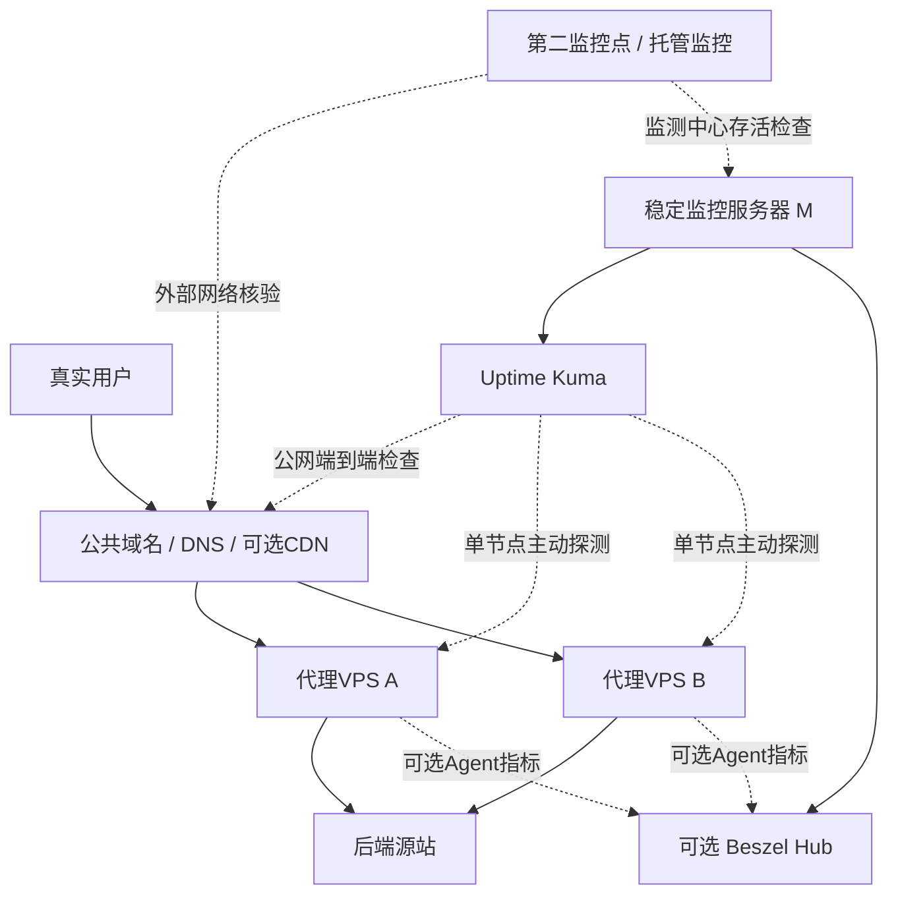

[toc]


## abstract

我通过一个或多个vps作为反向代理服务器为一批后端服务网站做反向代理。但是vps的稳定性和可靠性不如一般的服务器，遇到网络波动过宕机的几率和风险不可忽视。

我打算在一台相对稳定的服务器上长期和持续检测vps是否存活甚至健康状况，信息程度用户可以灵活配置选择方案(从无依赖或少依赖,到有依赖,免费成熟的方案也可以推荐,简单易用直观优先)。为我构思和推荐方案，并对比。

## 核心结论

对于你描述的场景，我最推荐采用 **“稳定监控服务器上的Uptime Kuma + 按需部署的VPS主机监控 + 可选异地监测”**这一渐进式架构。

它的优点是：初期安装简单、无需在VPS上部署Agent、可以集中管理多台VPS和多个网站、可以报警、可以长期积累状态历史。以后想查看CPU、内存、磁盘、网络吞吐量，或者分析网络丢包、抖动，再补充专门工具即可。

首选：Uptime Kuma

可视化管理HTTP、TCP、Ping等探测，适合作为整套系统的可用性监控中心。

轻量、自动化优先：Gatus 或curl + systemd timer

如果更希望用配置文件或脚本管理，而不是在网页中逐个添加监控项，这类方案更适合。

需要VPS健康指标：Beszel

通过轻量Agent监控各VPS的CPU、内存、磁盘、网络及容器状态，与Uptime Kuma互补。

需要深入网络诊断：SmokePing或Prometheus + Blackbox Exporter

用于持续观察网络时延、丢包，或积累更详细的探测指标及趋势。

以上不是按照功能数量简单排名，而是按你的实际运维目标、管理成本与部署侵入性进行选择。Uptime Kuma的官方仓库证实了多种探测方式和通知能力；Beszel的官方文档明确采用Hub/Agent架构，并提供主机与网络指标。

最重要的设计原则：VPS存活，不等于代理服务正常；代理服务正常，也不等于用户能够访问网站。 整套方案需要围绕这一区别展开。

## 先明确：究竟要监控什么？

假设有如下生产环境：

- 稳定监控服务器`M`：长期运行，负责定时探测和报警。
- 代理VPS `A`、`B`：分别部署Nginx或Caddy等反向代理。
- 后端源站`O`：实际提供网站、API等服务。
- 公网域名`app.example.com`：通过代理VPS向用户提供服务。

一台VPS可能存在以下情况：

| 实际故障                      | Ping     | TCP 443  | HTTP健康检查         | VPS主机指标  |
| ----------------------------- | -------- | -------- | -------------------- | ------------ |
| VPS关机、内核崩溃             | 通常失败 | 失败     | 失败                 | 无法获取     |
| ICMP被禁用                    | 失败     | 可能正常 | 可能正常             | 正常         |
| Nginx进程停止                 | 可能正常 | 可能失败 | 失败                 | 可显示异常   |
| Nginx正常、源站无法访问       | 正常     | 正常     | 可能返回502/504      | 可能正常     |
| 网站返回200，但实际是错误页面 | 正常     | 正常     | 仅检查状态码可能误判 | 可能正常     |
| VPS CPU或内存压力过高         | 可能正常 | 可能正常 | 可能变慢             | 可能提前预警 |
| 监控服务器到VPS的网络异常     | 可能失败 | 可能失败 | 可能失败             | 可能失联     |
| 用户所在运营商线路异常        | 可能正常 | 可能正常 | 可能正常             | 正常         |

因此，建议将监控能力划分为四个层次：

| 层次                        | 要回答的问题                        | 推荐手段                   | 优先级 |
| --------------------------- | ----------------------------------- | -------------------------- | ------ |
| 存活监控（Liveness）        | VPS是否还能够从监控点访问？         | ICMP Ping、TCP连接         | 必备   |
| 服务监控（Service Health）  | HTTPS、反向代理、源站业务是否正常？ | HTTP状态码、响应内容、延迟 | 最高   |
| 资源监控（Host Health）     | 是否即将因为资源不足发生故障？      | CPU、RAM、磁盘、网络指标   | 推荐   |
| 多地点监控（Multi-vantage） | 是否只是某条线路或地区访问异常？    | 第二监控点、外部监控服务   | 按需   |

这里特别需要注意：不要仅仅因为Ping失败就认定VPS宕机，也不要因为HTTP返回200就断定业务正常。

真正有价值的监控系统，应当不仅告诉你“发生了故障”，还要尽可能帮助你判断故障发生在哪一层。

## 推荐监控架构

针对多台反向代理VPS，我建议采用中心化管理、分层监控、按需扩展、异常交叉验证的方式，而不是一开始部署大型监控平台。

### 监控拓扑与数据流

示意图候选评估：采用一张架构拓扑图展示多代理分支、主动探测与Agent指标的并行路径，以及异地核验。




图中的连接有三类，不能混淆：

- 实线：生产流量路径。 用户通过公网入口访问VPS，再由VPS访问源站。
- 指向VPS的虚线：主动探测（Active Probing）。 监控服务器主动向目标发送Ping、TCP连接和HTTP请求，目标无需安装任何软件。
- Agent指标虚线：内部健康信息。 VPS上的Agent将CPU、内存、磁盘等数据提供给中心监控平台。

第二监控点并不是必需的，但它能补足单一网络视角的不足。例如，监控服务器位于德国、代理VPS位于美国，而用户主要位于中国大陆，仅德国到美国的探测结果就不足以全面代表用户体验。

此外，生产网站的监控路径和单台VPS的监控路径应当分开。当DNS、负载均衡器或CDN在多个VPS之间切换时，普通域名检查只能告诉你整体入口是否可用，不能保证每台VPS都得到检测。

## 方案横向比较

以下按照部署复杂度与监控能力，将方案分成三个梯度，而不是按照项目知名度简单罗列。

### 低依赖与无Agent方案

| 方案                 | 部署依赖            | 管理方式     | 主要能力                       | 优势                         | 局限                         |
| -------------------- | ------------------- | ------------ | ------------------------------ | ---------------------------- | ---------------------------- |
| Bash + `ping`/TCP    | 极低                | 脚本         | 节点可达性                     | 简单、灵活                   | 没有现成的历史、报警和UI     |
| curl + systemd timer | 低                  | 脚本、定时器 | HTTPS及业务健康检查            | 可测试指定IP、域名、响应内容 | 报警和数据存储需自行实现     |
| Uptime Kuma          | Docker或Node.js环境 | Web UI       | 多协议检查、历史、报警、状态页 | 上手最容易、综合体验好       | 不擅长主机资源和复杂指标分析 |
| Gatus                | Go程序或容器        | YAML配置     | HTTP、TCP、DNS等端点检查及断言 | 适合批量配置和版本管理       | 管理配置不如Kuma直观         |
| SmokePing            | Web服务、RRDtool等  | 配置文件     | 长期延迟、抖动、丢包           | 网络质量分析专业             | 不能代替HTTPS业务健康检查    |
| UptimeRobot          | 无需自建监控端      | 托管Web UI   | 公网可用性与报警               | 免运维，可作第二观测点       | 免费检查间隔较长，依赖第三方 |

适用结论： 只需要判断在线/离线时，脚本足够；需要友好的统一面板和通知时，Uptime Kuma更合适；如果喜欢声明式、可复制的配置方式，Gatus值得优先考虑。

依据：[Uptime Kuma官方仓库](https://github.com/louislam/uptime-kuma?utm_source=chatgpt.com)、[Gatus官方端点文档](https://gatus.io/docs/endpoints?utm_source=chatgpt.com)、[SmokePing官方说明](https://oss.oetiker.ch/smokeping/?utm_source=chatgpt.com)，以及独立于项目开发团队的[Better Stack横向比较](https://betterstack.com/community/comparisons/uptime-kuma-alternative/?utm_source=chatgpt.com)。

### 内部健康与完整可观测性方案

| 方案                             | VPS上是否需Agent     | 指标深度                                 | 使用复杂度 | 推荐定位                 |
| -------------------------------- | -------------------- | ---------------------------------------- | ---------- | ------------------------ |
| Beszel                           | 主机指标需要         | CPU、RAM、磁盘、网络、容器、基础网络监测 | 低         | 轻量资源监控首选         |
| Monit                            | 通常每台VPS安装      | 进程、文件、文件系统、服务检查           | 低至中     | 本机故障检测及自动恢复   |
| Netdata                          | 深入主机监控通常需要 | 实时系统指标、服务指标及告警             | 中         | 深入排查性能瓶颈         |
| Prometheus + Exporters + Grafana | 可选，取决于采集目标 | 时序指标、网络探测、主机指标、趋势分析   | 中至高     | 自定义指标与长期趋势     |
| Zabbix                           | 可选                 | 网络、主机、服务、Web场景、设备等        | 高         | 多服务器统一基础设施监控 |

Beszel和Uptime Kuma不是互相取代，而是非常适合组合。 一个主要从网络外部观察目标是否可用，另一个主要观察目标机器内部是否健康。

值得注意的是，Beszel目前的官方文档还确认了Agent端网络监测，可从每台被监控主机发起ICMP、TCP、HTTP和DNS检测，并记录响应时间和探测失败情况。这使它除了监控主机资源外，还能辅助观察各VPS到源站的网络状况。该功能要求Agent版本不低于`0.20.0`。依据：[Beszel官方网络监测文档](https://beszel.dev/guide/network-monitors?utm_source=chatgpt.com)。

Prometheus的Blackbox Exporter则适合需要更系统的端点探测指标的场景，官方确认支持HTTP、HTTPS、DNS、TCP、ICMP及gRPC。Zabbix也有官方Web场景监控体系。依据：[Blackbox Exporter](https://github.com/prometheus/blackbox_exporter?utm_source=chatgpt.com)、[Prometheus多目标探测指南](https://prometheus.io/docs/guides/multi-target-exporter/?utm_source=chatgpt.com)、[Zabbix Web Monitoring](https://www.zabbix.com/documentation/current/en/manual/web_monitoring?utm_source=chatgpt.com)。

### 按需求直接选择

| 你的实际偏好                             | 最值得考虑的方案                         |
| ---------------------------------------- | ---------------------------------------- |
| 完全不希望在VPS安装任何东西              | Uptime Kuma                              |
| 尽可能不安装第三方常驻程序               | Bash/curl + systemd timer                |
| 希望通过浏览器管理所有检查项             | Uptime Kuma                              |
| 希望监控配置能纳入Git并自动化部署        | Gatus                                    |
| 希望同时知道VPS的CPU、内存、磁盘是否异常 | Uptime Kuma + Beszel                     |
| 主要担心跨国线路抖动、间歇性丢包         | SmokePing或Beszel网络监测                |
| 希望分析长期趋势、复杂异常、百分位延迟   | Prometheus + Blackbox Exporter + Grafana |
| 未来管理数十至数百台复杂服务器           | Zabbix                                   |
| 希望完全免维护一部分监控能力             | 外部托管可用性监控                       |

这里的判断是适用性建议，不是对每个产品性能或可靠性的实测排名。尤其是部署开销，需要结合监控数量、数据保留期限以及运行方式进行实际测量。

## 最推荐的实施方案：Uptime Kuma作为监控中心

### 为什么它最符合当前场景

Uptime Kuma最大的优势是不用先学习完整的可观测性体系，就能构建可长期工作的监控与报警系统。

根据其官方仓库，当前2.x系列支持HTTP(S)、TCP、Ping、DNS记录、关键词、JSON Query、Push心跳、WebSocket和Docker容器等监控形式，并提供通知、证书信息和状态页。官方列出的最短监控间隔可到20秒。第三方2026年对比文章也将其定位为个人和小型系统易用性较好的方案。

在你的环境中，可以做到：

- 一个管理后台维护所有代理节点。
- 不同VPS按照地区、运营商、服务组分类。
- 每个VPS分别监控网络连通、HTTPS服务和业务可用性。
- 某台VPS故障后自动通知。
- 查看故障时段、恢复时间和历史响应延迟。
- 按需再增加外部监控与主机指标。

不过，它不是完整的资源监控和网络诊断平台。其Ping延迟图也不等同于专业的多样本丢包、抖动或链路质量分析。

### 部署方式

假设稳定监控服务器采用Debian或Ubuntu，并且已经安装Docker Engine。

推荐先使用Docker运行，而不是为了它专门维护Node.js及PM2运行环境。

以下命令基于[Uptime Kuma官方Docker部署说明](https://github.com/louislam/uptime-kuma?utm_source=chatgpt.com)，但特意将后台监听限制在服务器回环接口，避免直接暴露管理页面。

```shell

docker volume create uptime-kuma

docker run -d \
  --name uptime-kuma \
  --restart unless-stopped \
  -p 127.0.0.1:3001:3001 \
  -v uptime-kuma:/app/data \
  louislam/uptime-kuma:2

```

主要参数解释：

| 参数                       | 含义                                             |
| -------------------------- | ------------------------------------------------ |
| `--name uptime-kuma`       | 容器名称，方便管理                               |
| `--restart unless-stopped` | 容器异常退出或宿主机重启后自动恢复，除非人为停止 |
| `127.0.0.1:3001:3001`      | 仅开放在宿主机本地的3001端口                     |
| `uptime-kuma:/app/data`    | 使用Docker命名卷持久化数据                       |
| `louislam/uptime-kuma:2`   | 使用官方提供的2.x主版本镜像标签                  |

生产环境最好固定经过验证的具体镜像版本或Digest，而不是长期依赖可变化的主版本标签。升级之前应保存配置数据，并制定回滚方法。

首次访问后台，可以在管理员电脑上建立SSH端口转发：

```

ssh -N -L 3001:127.0.0.1:3001 admin@monitor.example.com

```

随后，在管理员电脑浏览器中访问`http://127.0.0.1:3001`，即可进入初始化界面。

其中：

- `admin`是监控服务器的SSH用户名。
- `monitor.example.com`是稳定监控服务器的主机名或可访问地址。
- 第一个`3001`是管理员电脑本地监听端口。
- `127.0.0.1:3001`是监控服务器上的目标地址和端口。

若需要多设备远程管理，建议通过WireGuard、Tailscale等受控网络，或正确配置HTTPS与身份认证后访问。不建议直接将未额外保护的管理端口暴露给公网。

### 应该创建哪些检查项？

假设有两台代理VPS：

| 节点          | 示例IP          | 代理业务          |
| ------------- | --------------- | ----------------- |
| `proxy-us-01` | `203.0.113.10`  | `app.example.com` |
| `proxy-jp-01` | `198.51.100.20` | `app.example.com` |

这些IP属于文档示例地址，部署时必须替换为真实地址。

推荐按下表设置初始监控项。

| 监控名称     | 监控类型      | 目标                              | 建议间隔       |
| ------------ | ------------- | --------------------------------- | -------------- |
| US-节点连通  | Ping          | `203.0.113.10`                    | 60秒           |
| US-HTTPS端口 | TCP           | `203.0.113.10:443`                | 60秒           |
| JP-节点连通  | Ping          | `198.51.100.20`                   | 60秒           |
| JP-HTTPS端口 | TCP           | `198.51.100.20:443`               | 60秒           |
| 公开网站健康 | HTTP(S)       | `https://app.example.com/healthz` | 60秒           |
| 公开网站证书 | HTTPS证书监测 | `app.example.com`                 | 按工具能力配置 |

这组配置的重点在于：把网络层、TCP端口和公开网站业务层分开看。

如果HTTP业务检查失败，但两台VPS的Ping及TCP检查均正常，则应先怀疑代理配置、源站连接、TLS、上层网关、应用响应等问题，而不应立即判断VPS宕机。

注意，表中的公共网站健康检查是整体业务检查，不是两台VPS各自的业务检查。如果它们承担同一个域名的流量，还应增加下一节的单节点检查方案。

## 关键实践：如何准确检查每一台反向代理VPS？

这是你的场景中比选哪个监控软件更重要的技术问题。

### 公共域名检查与指定VPS检查的区别

假设：

- `app.example.com`是用户访问的域名。
- VPS A的IP为`203.0.113.10`。
- VPS B的IP为`198.51.100.20`。
- 两台VPS均配置了`app.example.com`对应的HTTPS虚拟主机，并代理同一后端业务。

直接检查`https://app.example.com/healthz`，会受到DNS解析、CDN和流量调度的影响。即使VPS A发生故障，监控请求也可能一直命中正常的VPS B。

而直接检查`https://203.0.113.10/healthz`，又可能出现TLS证书域名不匹配、SNI（Server Name Indication，服务器名称指示）不正确，以及进入默认虚拟主机等问题。

更严谨的办法是：保留原始HTTPS域名，但将本次连接强制指向指定VPS的IP地址。

### 推荐使用curl的`--resolve`

在稳定监控服务器上执行：

```shell

curl --noproxy '*' \
  --fail --silent --show-error \
  --connect-timeout 3 \
  --max-time 8 \
  --resolve app.example.com:443:203.0.113.10 \
  --output /dev/null \
  --write-out 'HTTP=%{http_code} total=%{time_total}s\n' \
  https://app.example.com/healthz

```

这一方法有明确的官方依据：[curl命令手册：](https://curl.se/docs/manpage.html?utm_source=chatgpt.com)[`--resolve`](https://curl.se/docs/manpage.html?utm_source=chatgpt.com)。该选项允许指定某个主机名与端口对应的连接地址，不需要更改系统全局DNS或`/etc/hosts`。

| 参数                    | 作用                                                         |
| ----------------------- | ------------------------------------------------------------ |
| `--noproxy '*'`         | 忽略环境中的HTTP(S)代理，确保直接连接目标；如果本来就需要通过代理检测，则不应使用 |
| `--fail`                | HTTP状态码达到400及以上时返回失败状态（有少数认证相关例外）  |
| `--silent --show-error` | 不显示进度条，但保留错误提示                                 |
| `--connect-timeout 3`   | TCP等连接建立阶段的超时阈值为3秒                             |
| `--max-time 8`          | 整个请求最长执行8秒                                          |
| `--resolve`             | 将指定域名和端口的连接目标改为指定IP                         |
| `--output /dev/null`    | 不保留响应正文                                               |
| `--write-out`           | 输出请求结束后的HTTP状态和耗时                               |
| `%{http_code}`          | curl得到的HTTP响应状态码                                     |
| `%{time_total}`         | 从请求开始到结束的总耗时，单位为秒                           |

这条命令既能保留`app.example.com`对应的TLS名称及HTTP主机语义，又能绕过普通DNS解析结果直接探测VPS A。

把`203.0.113.10`换成`198.51.100.20`，即可对VPS B做同样的检查。

使用前提：两台VPS都必须能以目标域名正确提供HTTPS服务。 如果源站TLS证书、虚拟主机或路由本身有特殊设计，需要相应调整测试路径。

还要注意，`--fail`并不表示“只有HTTP 200才算成功”，例如重定向响应也可能被视为成功。对于严格健康检查，应明确断言期望状态码和响应内容，而且不要通过`-k`关闭证书验证来掩盖TLS问题。

### 一个合格的健康检查端点

建议每个关键后端提供类似`/healthz`的专用接口，正常情况下返回HTTP 200以及可识别的JSON数据，例如：

```shell

{
  "status": "ok",
  "service": "main-api"
}

```

这里的`status`表示业务检查结果，`service`表示被检查的业务标识。它们只是示例字段，并非某款监控软件强制要求的协议。

检查路径可以分为两种：

- 代理本身健康检查： 由Nginx或Caddy本地直接响应，判断代理服务是否工作。
- 端到端健康检查： 请求经过代理到达后端业务，判断整条服务路径是否工作。

推荐两种都保留，这样可以更好地区分代理进程故障与源站/业务故障。端到端检查应覆盖至少一个关键依赖，但避免让健康接口执行重型数据库操作或产生业务副作用。

对于启用了CDN缓存的服务，还需要保证健康检查不会被缓存的旧结果误导。

## 其他值得认真考虑的替代方案

### Gatus：更适合配置文件管理

如果你之后希望使用Ansible、Git、脚本批量生成监控项目，我会将Gatus排在Uptime Kuma之前考虑。

Gatus官方支持通过配置文件定义端点、探测周期和健康条件。第三方产品对比也确认了它在YAML配置、HTTP响应断言等方面的特点。参考：[Gatus文档](https://gatus.io/docs/endpoints?utm_source=chatgpt.com)、[Better Stack对Gatus的分析](https://betterstack.com/community/comparisons/uptime-kuma-alternative/?utm_source=chatgpt.com)。

下面是一个用于演示的简化配置：

```conf

endpoints:
  - name: app-public
    group: production
    url: https://app.example.com/healthz
    interval: 1m
    conditions:
      - "[STATUS] == 200"
      - "[RESPONSE_TIME] < 2000"

```

配置中：

| 字段              | 含义                               |
| ----------------- | ---------------------------------- |
| `endpoints`       | 需要重复检查的服务端点集合         |
| `name`            | 监控项目名称                       |
| `group`           | 逻辑分组                           |
| `url`             | 被监控目标URL                      |
| `interval`        | 检查间隔，此处为1分钟              |
| `conditions`      | 判定健康的条件集合                 |
| `[STATUS]`        | 实际HTTP响应状态码                 |
| `[RESPONSE_TIME]` | 响应时间，示例条件要求低于2000毫秒 |

这是一份单个公网网站检查的示例，不包含持久化、报警提供者和指定VPS的网络覆盖配置。已经用PyYAML验证了YAML语法，但未在Gatus程序中进行完整应用配置校验。

Gatus的主要优势在于声明式配置（Declarative Configuration）：监控清单可以纳入Git仓库，提交审核、批量生成、重复部署和回滚都比较方便。

相比之下，Uptime Kuma更适合需要随时打开网页、点击添加或调整监控项的用户。

### Beszel：补全VPS内部健康指标

如果你担心的故障不仅是整机宕机，还包括OOM（内存耗尽）、磁盘空间耗尽、CPU持续高负载、Docker容器退出等，建议增加Beszel。

它通过中心Hub与VPS上的Agent协作，提供主机及容器指标，并支持可配置报警。其官方文档还提供简体中文界面与指南。参考：[Beszel功能说明](https://beszel.dev/guide/what-is-beszel?utm_source=chatgpt.com)、[Beszel部署指南](https://beszel.dev/guide/getting-started?utm_source=chatgpt.com)。

建议优先配置以下指标。

| 指标       | 初始参考阈值             | 目的                   |
| ---------- | ------------------------ | ---------------------- |
| 磁盘使用率 | 超过80%预警，超过90%严重 | 防止日志及缓存填满磁盘 |
| 内存使用率 | 持续超过90%              | 检测内存压力及泄漏风险 |
| CPU使用率  | 持续超过90%，10至15分钟  | 识别持续高负载         |
| 主机失联   | 多次连续采集失败         | 识别Agent或机器不可达  |
| 网络吞吐量 | 接近已知带宽上限         | 辅助发现拥塞           |
| 容器状态   | 关键容器意外退出         | 识别进程和容器故障     |

这些数字是初始工程建议，并非Beszel官方默认阈值。例如Linux可以合理利用空闲内存作为文件缓存，不能单凭“内存占用高”判断即将OOM。

如果部署Beszel后发现它的网络监测已足以满足需求，就不一定需要再安装SmokePing。

### 哪吒监控与Apache HertzBeat：中文生态中值得考虑的方案

不能忽略中文开源生态中的选择。

| 项目                         | 已核实能力                                                   | 更适合的场景                          | 与前面方案的关系                   |
| ---------------------------- | ------------------------------------------------------------ | ------------------------------------- | ---------------------------------- |
| 哪吒监控（Nezha Monitoring） | 服务器状态、HTTP、TCP、Ping、告警、任务及Web终端             | 喜欢中文界面，希望一套系统集中管理VPS | 可作为Beszel或部分可用性监控的替代 |
| Apache HertzBeat             | 无Agent协议采集、HTTP/JMX/SSH/SNMP/JDBC、报警、监控面板、分布式采集能力 | 需要中文友好、更多协议与扩展能力      | 可作为更综合的平台候选             |

哪吒监控的[官方仓库](https://github.com/nezhahq/nezha?utm_source=chatgpt.com)明确列出服务器状态监控、HTTP、TCP、Ping和告警能力，并提供中文文档。

[Apache HertzBeat官方网站](https://hertzbeat.apache.org/?utm_source=chatgpt.com)和[官方仓库](https://github.com/apache/hertzbeat?utm_source=chatgpt.com)确认其面向多协议无Agent监控，支持Web化配置、自定义YAML模板、报警及采集器扩展。它并不是“完全不需要任何采集服务”，而是指针对多类目标可以使用无需安装目标端Agent的协议采集方式。

我对你的推荐顺序依然是先Uptime Kuma、Gatus或Beszel，再考虑统一监控平台。 主要原因是目前的核心问题相对集中，没有必要一开始引入较大范围的功能和管理成本。

但如果你特别偏爱中文控制台、需要管理服务器本身，而且愿意在VPS上安装Agent，哪吒监控非常值得与你所选的Beszel组合进行一轮实际比较。

这两款产品的上述功能已从官方页面确认；其具体资源消耗、长期稳定性和与你现有代理架构的兼容程度，本次未做实测，不能直接认定其中一款优于另一款。

## 免费外部监控：用来减少单点盲区

即使监控中心部署在稳定服务器上，它仍可能遭遇自身宕机、网络异常、Docker故障或报警通道故障。

因此，建议给监控中心再配置一个独立的外部健康检查。

### UptimeRobot

截至本次核查，[UptimeRobot官方价格页](https://uptimerobot.com/pricing/?utm_source=chatgpt.com)列出的免费方案包含：

- 50个监控项。
- 5分钟监控间隔。
- HTTP、端口、Ping等基础监控。
- 基础状态页及有限的通知集成。

这两项关键数字——50个监控项、5分钟间隔——也见于它的[官方帮助中心](https://help.uptimerobot.com/en/articles/11604710-who-should-use-uptimerobot-s-free-plan?utm_source=chatgpt.com)。但两者同属于一个服务商，按照独立来源原则，只能视作同一官方来源的交叉核对，不是两项独立证据。

对你而言，UptimeRobot更适合检查监控服务器和最重要的公开业务，而不一定适合作为所有VPS的唯一监控系统。

此外，部分公开帮助页与价格页对免费套餐中的高级功能描述不完全一致。因此，不建议在没有实际账户核验的前提下，把免费套餐的SSL高级检测、API权限或细分监控能力当作已确认权益。

### Healthchecks.io

[Healthchecks.io](https://healthchecks.io/?utm_source=chatgpt.com)更专注于心跳与周期任务监测（Heartbeat / Dead Man's Switch），官网当前列出免费监控20个定时任务的方案。

它与普通主动监控的逻辑不同：

主动监控： 外部服务器定期来访问你。

心跳监控： 你的监控进程定期向外发送一个“我还在工作”的请求；如果连续一段时间没有收到，外部平台报警。

你可以让稳定监控服务器每分钟向Healthchecks.io发送心跳，并设置适当的宽限时间。这样即使Uptime Kuma或整台监控服务器意外停止，仍有机会得到独立通知。

不过，心跳发送者应当与真正的监控执行状态关联。单独让一台仍然存活的机器发送心跳，并不能证明Uptime Kuma中的所有检查任务都正常运行。

以上托管方案均涉及外部服务依赖以及监控目标信息的隐私问题。生产部署前，应确认访问来源、数据留存与报警通道是否符合自身要求。

## 报警策略与故障分类

监控系统不应因为一次短暂丢包就频繁报警，否则容易产生告警疲劳（Alert Fatigue）。

建议采用“连续失败、分级处理、恢复确认”的规则。

| 事件                 | 初始规则建议               | 级别      |
| -------------------- | -------------------------- | --------- |
| Ping连续失败         | 3次连续失败                | 警告      |
| TCP 443连续失败      | 3次连续失败                | 严重      |
| 核心HTTP健康检查失败 | 2至3次连续失败             | 严重      |
| HTTPS响应明显变慢    | 超过正常基线持续若干分钟   | 警告      |
| TLS证书即将过期      | 剩余14天、7天分级提醒      | 警告      |
| VPS磁盘空间不足      | 超过80%及90%               | 警告/严重 |
| 监控系统失联         | 外部监控连续未收到有效响应 | 严重      |

以60秒检查间隔、连续3次失败触发告警为例，通常需要若干分钟才能确认异常。准确延迟取决于故障发生时刻、检查排程、超时以及监控软件的重试机制，不应将“三次失败”简单解释为固定180秒后必定报警。

如果你的故障成本很高，可以缩短关键业务检查的间隔，但不建议所有服务都以极高频率执行重型业务请求。

### 如何根据组合结果定位故障？

| 网络存活 | TCP 443 | 代理本地健康 | 端到端业务健康 | 优先排查方向                                     |
| -------- | ------- | ------------ | -------------- | ------------------------------------------------ |
| 失败     | 失败    | 失败         | 失败           | VPS宕机、节点网络中断、防火墙或监控线路          |
| 正常     | 失败    | 失败         | 失败           | 代理进程、端口监听、防火墙                       |
| 正常     | 正常    | 正常         | 失败           | 源站、反向代理上游链路、应用故障                 |
| 正常     | 正常    | 正常         | 正常           | 该监控路径未发现异常，仍需考虑其他地区或用户问题 |

这是一张优先排查表，而非逻辑上的确定性诊断表。例如，ICMP被过滤时第一列可能失败；TCP正常也不能证明代理能够完成TLS握手。

如果出现多台VPS的端到端业务检查同时失败，但各VPS网络和代理本地健康检查正常，共享后端或共享依赖就应当成为优先调查对象。

反过来，如果只有某一台VPS异常，而另一台正常，就可以优先查看异常节点及它与源站之间的路径。

### 报警通道的选择

个人运维建议至少配置两条相互独立的通知路径，例如邮件加即时消息。

Uptime Kuma官方已经列出Telegram、Discord、Gotify、Slack、SMTP等通知方式；Beszel也支持多种通知服务。

考虑中国大陆网络环境，应当实际测试通知通道的可达性，而不是只在控制台完成配置。Telegram等境外服务的接收条件，可能因用户网络而不同。

重要报警还应验证恢复通知、抑制重复通知和维护窗口。 否则系统可能在预定重启时产生不必要的告警。

## 生产部署中的其他关键注意事项

### 外部网络监控不能替代内部指标

当VPS完全失联时，Agent也可能无法把内部指标送到中心。因此内部监控和外部探测应该互相补充，而不是相互替代。

### 不要把监控误当成自动故障转移

监控仅提供故障信号。它并不自动保证把用户从VPS A切换到VPS B。

如果以后要实现高可用（High Availability），还需要单独设计DNS故障转移、负载均衡健康检查、故障摘除和恢复条件。

尤其不要把一次Ping失败直接作为切换生产流量的唯一依据。

### 注意被监控VPS到源站的连接

对反向代理而言，一个常见的隐患是代理VPS仍在线，却已经无法正常访问后端。

如果监控目标位于海外多个地区，应额外关注每个VPS到源站的网络质量。这时从VPS本机运行Agent或主动探针，比仅在稳定服务器上探测VPS更有诊断价值。

### 保证监控历史可恢复

Uptime Kuma的持久化目录必须备份。对于其默认的本地数据存储，避免在数据库仍被写入时简单复制文件而不考虑一致性。可以通过停机备份、应用支持的备份方式或具备一致性保障的快照完成备份。

监控数据本身也是长期运维资产，尤其是用于追溯偶发性断网、比较VPS供应商和线路的情况。

### 验证IPv4和IPv6

如果网站同时发布A和AAAA记录，应分别考虑IPv4与IPv6的可用性。Prometheus官方的Blackbox Exporter指南就专门举例说明了探测器使用IPv6、而容器环境不能正确访问IPv6时出现的失败。参考：[官方多目标探测指南](https://prometheus.io/docs/guides/multi-target-exporter/?utm_source=chatgpt.com)。

### 监控端点应限制攻击面

健康检查接口不应泄露数据库凭据、内部地址、组件版本或详细堆栈信息。需要身份认证时，应使用权限最小化的访问令牌或受限制的监控网络。

对于监控系统自身，也应启用强认证、控制管理接口访问范围，并定期更新镜像。

## 分阶段实施建议

结合你的“简单易用优先，同时可以灵活选择信息程度”的要求，我建议采用以下三个阶段。

第一阶段：建立可靠的可用性监控

先部署Uptime Kuma，每台VPS建立Ping、TCP检查，再为各核心网站建立HTTP健康检查，并配置报警。为共用域名的多VPS额外设置节点级检查。

目标：快速、准确地知道哪台代理或哪个业务发生异常。

第二阶段：补充主机资源与网络质量

对关键VPS安装Beszel Agent，监控CPU、内存、磁盘、网络和容器状态。必要时增加从VPS到源站的网络探测；当长期丢包、抖动分析成为重点时再考虑SmokePing。

目标：从“知道发生故障”提升到“知道可能因为什么发生故障”。

第三阶段：增加独立观测与监控自身保障

通过托管监控或第二地区探测点，验证公开网站以及监控服务器自身的健康，并定期执行模拟故障测试。

目标：减少单一监控位置造成的盲区和错误判断。

### 最后必须做的验收测试

部署完成后，至少应分别模拟以下事件：停止一台VPS上的反向代理服务；让代理暂时无法连接源站；短暂阻断某台VPS到监控服务器的路径；停止Uptime Kuma容器；恢复所有服务。

重点验收告警是否触发、是否误判、能否定位故障层、恢复后是否正常通知。

这一轮没有真正部署上述监控系统，因此这些验收测试是实施建议，不是已完成的测试结果。

## 取证与环境核验记录

本轮按你的“正常”搜索等级执行了1轮集中联网搜索，包含12条不同主题的检索查询，之后针对官方仓库、官方文档、定价页及第三方比较页面进行了页面级核查，没有启动第二轮关键词迭代。

核查范围覆盖轻量脚本、Uptime Kuma、Gatus、Beszel、Prometheus/Blackbox Exporter、Zabbix、Netdata、SmokePing、托管监控、心跳监控及监控软件的替代方案。另通过已知官方项目地址补查了哪吒监控与Apache HertzBeat。

证据与校验情况如下：

| 检查项目                | 实际结果                                             |
| ----------------------- | ---------------------------------------------------- |
| 核心项目功能            | 已核对主要项目官方仓库或文档；部分辅以独立第三方比较 |
| UptimeRobot免费套餐数字 | 已核对官方价格页及帮助中心；仍是同一机构来源         |
| Healthchecks.io免费数量 | 官网已确认；缺少第二独立来源                         |
| curl `--resolve`语义    | 已核对官方手册                                       |
| curl示例Shell语法       | 使用`bash -n`检查通过                                |
| curl参数是否存在        | 本地curl帮助输出已确认                               |
| Gatus示例YAML语法       | PyYAML 6.0.3解析通过                                 |
| Docker容器实际启动      | 未执行，本环境未安装Docker                           |
| `shellcheck`及`shfmt`   | 环境未安装，未执行                                   |
| Gatus应用级配置校验     | 未执行                                               |
| 真实VPS和跨地区探测     | 未执行，没有实际目标地址和部署环境                   |

需要强调，官方规格能够证实软件提供某项能力，但不能直接证明某方案在你的服务器、网络和故障模型下最可靠。本轮推荐属于基于功能、架构特点、部署成本与使用门槛的工程判断，不是各软件的性能实测。

## 最终建议

综合权衡之后，不建议一开始就引入Zabbix或完整Prometheus/Grafana体系。你的核心需求是可用性监控、问题早发现和基础故障定位，轻量工具能够以更低的维护成本先覆盖主要风险。

我建议初始组合为：

Uptime Kuma（主监控） + curl定制节点级HTTPS检查（针对特殊反向代理拓扑） + 一个独立外部检查点（监控自身及重要业务）。

以后如果发现CPU、内存、磁盘或VPS到源站的网络质量经常成为故障来源，再增加Beszel。如果大量监控项目需要通过自动化生成和版本控制，则考虑将核心端点检查迁移至Gatus。

这套思路的关键不是工具数量，而是每个工具负责不同的、明确的故障观测层次。这样既不会一开始就过度设计，也为后续扩展保留了空间。