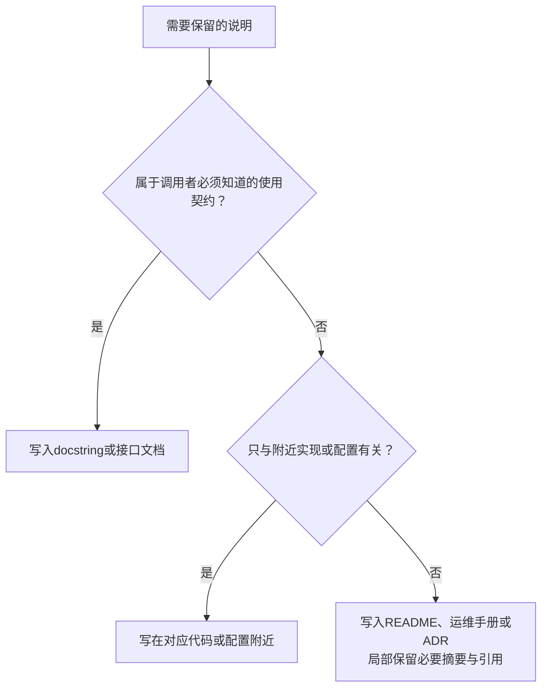

[toc]


## 通用原则：写什么，放在哪里

### 区分语法要求、风格约定与工程建议

不要把所有“最佳实践”都说成语言强制要求。

| 层次         | 示例                                                         | 如何理解                               |
| ------------ | ------------------------------------------------------------ | -------------------------------------- |
| **语法要求** | Python普通注释以`#`开始；Nginx简单指令以`;`结束              | 写错可能导致解析失败                   |
| **风格约定** | Python行尾注释与代码至少间隔两个空格；docstring通常使用三重双引号 | 用于统一阅读和工具处理，不全是语法限制 |
| **工程建议** | 注释解释原因；TODO关联工单；修改实现时同步更新说明           | 建议纳入项目审查规范                   |

上述Python注释语法、Nginx指令结构，以及Python排版约定分别来自语言参考、Nginx官方指南和PEP8。

### 优先写有信息增量的内容

下面是建议采用的优先级，不是某个官方标准的逐字规定。

| 优先级       | 应当记录什么                           | 例子                                       |
| ------------ | -------------------------------------- | ------------------------------------------ |
| **必须维护** | 与实现一致的接口行为、关键运行限制     | 空值表示缺省还是错误；超限时截断还是拒绝   |
| **应该写清** | 单位、范围、边界、重要副作用           | 秒还是毫秒；是否修改传入对象；是否覆盖文件 |
| **推荐补充** | 非显然的选择依据、兼容性要求、不变量   | 为什么不能排序；为什么保留旧参数           |
| **可以添加** | 理解复杂逻辑所需的概念、公式、简短示例 | 算法阶段说明；协议字段含义                 |
| **避免**     | 逐行复述语法、未经核实的断言、空泛赞美 | “循环列表”“为了性能”“保证绝对安全”         |

尤其要避免两种情况：

- **用注释弥补本来可以改好的命名和结构。**先改好变量名、常量名、函数边界，再判断是否仍需解释。
- **用注释代替约束。**“参数必须为正数”应当有相应校验；“仅本机访问”应当由监听地址或访问控制落实。

注释也不必追求固定比例。建议把审查问题设为：**没有这段说明，维护者是否容易误用接口、误改实现或误操作系统？**

### 按读者需要选择位置



这里的**ADR(Architecture Decision Record，架构决策记录)**用于保存重要设计选择及其理由。建议不要把跨模块讨论全部塞进函数注释，也不要只留一个链接：**关键约束在本地说清，完整背景再引用外部文档。**

## Python：区分普通注释与docstring

### 普通注释与文档字符串不是一回事

| 形式                       | 主要用途                       | 注意事项                       |
| -------------------------- | ------------------------------ | ------------------------------ |
| `# ...`                    | 局部实现说明、设计原因、警告   | 多行说明使用连续的`#`行        |
| 行尾`# ...`                | 与单条语句紧密相关的短说明     | 宜短，复杂说明移到上一行       |
| `"""..."""`形式的docstring | 模块、类、函数、方法的使用文档 | 应放在相应定义体的首条语句位置 |

Python普通注释从字符串之外的`#`延续到物理行末。**三引号本身是字符串语法，不是“多行注释语法”**；位于模块、类或函数体首条语句位置的字符串才构成常规docstring，通常可通过对象的`__doc__`读取。前置的普通注释不算语句。

因此，不推荐用一对三引号来“注释掉”旧代码。需要暂时停用几行时使用编辑器的行注释功能；不再需要的实现则交给版本控制保存。

### 排版保持简单、一致

建议采用：

- **块注释放在相关代码之前，与代码保持相同缩进。**
- **普通注释使用`# `，即`#`后留一个空格。**
- **行尾注释与代码至少间隔两个空格。**
- **docstring统一使用`"""三重双引号"""`；多行内容采用“摘要、空行、详细说明”的结构。**
- 不要为了让行尾注释排成一列而填充大量空格。

PEP8对流式注释和docstring建议采用72字符行宽；Ruff常见的88列代码格式是另一套工具约定。**两者都不是Python语法限制，不应混称为“Python强制规定”。**

### docstring面向调用者，而不是逐步解释实现

公共接口的文档应让调用者**不阅读函数实现也能正确调用**。根据实际需要说明参数、返回值、异常、副作用和调用限制；实现中的局部技巧则放在附近的普通注释中。

常用章节如下，不要求每个函数全部填写：

| 章节                  | 应写内容                               | 避免                             |
| --------------------- | -------------------------------------- | -------------------------------- |
| `Args:`               | 参数含义、单位、合法范围、特殊值含义   | 只把参数名换一种说法             |
| `Returns:`            | 返回结果的业务含义、空值约定、结构关系 | 只重复`int`、`str`等类型         |
| `Yields:`             | 生成器每次产出的内容                   | 误写成生成器对象本身的说明       |
| `Raises:`             | 与接口使用有关的异常及触发条件         | 罗列所有理论上可能出现的内部异常 |
| `Attributes:`         | 类的重要公开属性及含义                 | 重复内部实现细节                 |
| `Examples:`、`Notes:` | 有帮助的用例或补充约束                 | 大量不能维护的演示               |

已有类型标注时，通常不用在docstring里再重复类型。应把篇幅留给类型表达不了的内容，例如**单位、默认策略、取值范围、是否修改输入、资源由谁关闭**。Google风格指南明确允许在已有类型标注时省略重复的类型说明。

### 风格选择：先遵循项目现状

| 风格                     | 本文建议的适用场景                         |
| ------------------------ | ------------------------------------------ |
| **Google风格**           | 一般应用和服务项目的起步选择，章节紧凑     |
| **NumPy风格**            | 科学计算、数组接口、需要较长参数说明的项目 |
| **reStructuredText风格** | 已经采用`:param:`、`:returns:`等写法的项目 |

**PEP257规定的是docstring的高层结构与内容约定，不强制使用Google或NumPy格式。**Sphinx的Napoleon扩展支持解析这两种风格；项目内部宜保持一致，不要随函数随意切换。

中文项目可以保留`Args:`、`Returns:`等工具熟悉的英文节名，正文使用中文。

### 完整示例：报表API的分页参数

假设接口有以下约定：

- 未传参数时，每页50条。
- 大于200时截断为200；历史客户端依赖这一行为。
- 空字符串、不能解析的整数和小于1的值属于错误。

下面的`pagination.py`面向Python3.11及以上，不依赖第三方运行库：

```python
"""解析报表API的分页参数。"""

DEFAULT_PAGE_SIZE = 50

# 限制单次查询规模；调整上限前需要重新评估数据库负载。
MAX_PAGE_SIZE = 200


def parse_page_size(raw: str | None) -> int:
    """解析每页条数，并限制单次查询规模。

    Args:
        raw: 原始查询参数。None表示未提供，使用默认值50；
            其他字符串按int()的规则解析，空字符串不视为缺省。

    Returns:
        1到200之间的整数。超过上限的请求按200处理。

    Raises:
        ValueError: raw不能被int()解析，或解析结果小于1。

    Examples:
        >>> parse_page_size(None)
        50
        >>> parse_page_size("500")
        200
    """
    page_size = DEFAULT_PAGE_SIZE if raw is None else int(raw)
    if page_size < 1:
        raise ValueError("page_size必须大于0")

    # 保持历史客户端的截断行为；直接改为报错会破坏兼容性。
    return min(page_size, MAX_PAGE_SIZE)
```

这个例子展示了三种信息分工：

| 位置          | 表达的信息                             |
| ------------- | -------------------------------------- |
| **类型标注**  | `raw`是字符串或`None`，返回值是整数    |
| **docstring** | 如何处理缺省值、非法值和超限值         |
| **普通注释**  | 为什么限制规模、为什么选择截断而不报错 |

**不是一概禁止文档重复数值。**影响调用方的重要默认值和边界值得明确记录，但改动时必须同步文档与测试。相比之下，给`int(raw)`添加“转换为整数”通常没有多少信息增量。

## Nginx：记录运行意图和配置边界

### 先保证原生配置语法正确

Nginx原生配置使用`#`引出行注释；简单指令以`;`结束，块指令使用花括号。多行说明使用连续的`#`行，不要用`//`或`/* ... */`代替。

行尾注释应放在完整指令之后：

```nginx
proxy_read_timeout 30s;  # 两次上游读取之间的等待上限。
```

**分号必须位于`#`之前**，不能把它写进注释部分。

### 配置注释重点回答这些问题

以下是建议采用的配置审查框架：

| 问题                 | 推荐说明                                     |
| -------------------- | -------------------------------------------- |
| **适用于哪里？**     | 开发、预发布还是生产；公网入口还是本机入口   |
| **放在哪个上下文？** | `http`、`server`、`location`；片段由哪里加载 |
| **值的含义是什么？** | 时间或容量单位；限制整个请求还是某个阶段     |
| **为什么选这个值？** | 业务预算、兼容性要求、容量验证或故障经验     |
| **改动有什么影响？** | 路由变化、访问范围变化、超时行为变化         |
| **维护入口在哪里？** | 手工配置还是生成文件；应修改哪个模板         |

建议让运行配置聚焦**有效设置与必要解释**。全部可选项的百科式说明，可以放在示例模板或文档里，不必全部堆进生产配置。

### 综合示例：本机报表API代理

假设Python服务已经监听`127.0.0.1:8000`，后端路由本身包含`/api/`前缀。

下面是**应由`http {}`内部加载的`server`片段，不是完整的`nginx.conf`，也不是公网TLS部署方案**。其中2秒和30秒只是本例策略，不是通用推荐值。

```nginx
# 用途：同机报表API的本地调试入口。
# 加载位置：http{}内的include。
server {
    # 仅监听回环地址，避免将调试入口直接暴露到公网。
    listen 127.0.0.1:8080;
    server_name localhost;

    location /api/ {
        # 同机服务应快速建连，连接异常时尽快暴露故障。
        proxy_connect_timeout 2s;

        # 限制两次读取上游响应之间的等待时间。
        # 这是空闲超时，不是整个请求的总耗时限制。
        proxy_read_timeout 30s;

        # 后端路由包含/api/，因此不指定URI，以保留请求路径。
        proxy_pass http://127.0.0.1:8000;
    }
}
```

相关字段的含义：

| 字段或取值                         | 本例含义                                         |
| ---------------------------------- | ------------------------------------------------ |
| `listen 127.0.0.1:8080`            | Nginx入口，只绑定本机回环地址和8080端口          |
| `server_name localhost`            | 本例虚拟主机的名称                               |
| `location /api/`                   | 普通URI前缀匹配                                  |
| `proxy_connect_timeout 2s`         | 与上游建立连接的超时；`s`表示秒                  |
| `proxy_read_timeout 30s`           | 相邻两次上游读取之间的超时，不是完整响应的总时长 |
| `proxy_pass http://127.0.0.1:8000` | 上游HTTP服务地址，未指定URI部分                  |

这些监听、匹配和代理参数的含义分别见Nginx核心模块和代理模块文档。

本例特别值得注释的地方有两个：

- **超时的准确含义。**把`proxy_read_timeout`注释成“请求最多执行30秒”是错误的；持续有数据传输的响应，可能超过30秒。
- **`proxy_pass`是否包含URI。**在本例这个没有`rewrite`、没有变量、没有正则匹配的普通前缀配置中，改成`http://127.0.0.1:8000/`后，匹配到的`/api/`前缀会被替换为`/`。因此，“为什么不加末尾斜杠”比“转发到后端”更值得解释。

### 避免几种配置注释陷阱

**注释掉，不等于关闭。**注释掉一条设置，只表示不再显式提供这条设置；接下来可能采用上级设置或默认值，具体要看该指令。例如，不能把注释掉`proxy_read_timeout`理解成“永不超时”。

**不要假定所有指令都逐项继承。**例如，`proxy_set_header`只有在当前层级完全没有该类指令时，才继承上一级的这一组设置；不能简单理解为“只覆盖同名请求头”。涉及继承的注释，应按具体指令核对。

**停用配置块时，要处理整个块。**不要只注释掉`location ... {`和结束的`}`，却留下内部指令；它们可能落入不同作用域，或者导致语法错误。建议删除不再需要的块，或完整地逐行注释，并重新检查配置。

**默认值不是永久事实。**如需记录默认值，应说明对应版本或依据。更推荐解释“本项目为什么显式固定这个值”，而不是复制整段官方手册。

## 维护：让注释可追溯，也可删除

### TODO应当能找到背景与结束条件

不推荐：

```python
# TODO: 以后优化一下。
```

推荐：

```python
# TODO(API-231): 所有客户端迁移到v2接口后，删除旧参数兼容逻辑。
```

其中：

| 部分       | 作用                                   |
| ---------- | -------------------------------------- |
| `TODO`     | 可统一检索的待办标记                   |
| `API-231`  | 示例工单编号，用于查找背景、讨论和进度 |
| 后面的说明 | 要做什么，以及何时可以做               |

**优先关联工单，而不是只写人名。**责任人可以变化，问题上下文和移除条件更值得长期保留。Google当前的风格指南也倾向于使用可追踪的问题引用，并要求时间型TODO写清具体日期或事件。

团队可以约定：

- `TODO`：待完成的改进。
- `FIXME`：已知问题，需要修复。
- `NOTE`：重要但不一定需要改动的说明。

这些是**项目标记约定，不是Python语法标准**。不要用`FIXME`代替真实缺陷记录，也不要在问题解决后留下过期TODO。

### 检查豁免注释要有理由、范围要小

某些注释会被工具解释，不能当作普通文字随意删除。例如：

```python
# 导入时注册内置插件；本模块不直接调用其中的对象。
from . import builtin_plugins  # noqa: F401
```

这是一个包内导入的局部示意：`F401`对应未使用导入的检查，`noqa`要求Ruff忽略该行的指定规则。**写明为什么允许这个例外，而不是只写“忽略检查”。**Ruff也支持使用`RUF100`识别已经不再需要的`noqa`。

推荐遵循：

- **先考虑修正实现，再考虑豁免。**
- **指定规则，不随意使用无规则编号的全面屏蔽。**
- **尽量限制在单行或必要范围。**
- **原因消失时，同时移除豁免。**

### 其他值得设为审查要求的事项

- **代码、配置、注释和相关测试一起修改。**
- **不要长期保存大段被注释掉的旧实现**；有文档价值的替代写法，应明确标为示例并说明适用条件。
- **不要在注释中保存密码、令牌、真实个人信息或带凭据的链接。**
- **自动生成文件要标明维护入口**，避免修改生成结果却遗漏源模板。
- **保留项目要求的许可证头和工具指令**，不要因为它们“也是注释”就删除。
- 不建议手工维护逐文件作者、修改日期和完整变更历史；这类信息优先交给版本控制。

## 语言与编码：让目标读者真正读得懂

**先确定读者，再确定语言。**PEP8倾向使用英语以方便广泛协作；中文团队可以将中文设为明确的项目约定，但不要随意混用术语，或把标识符翻译成难以对应代码的名称。

建议采用：

| 项目           | 推荐约定                                                     |
| -------------- | ------------------------------------------------------------ |
| **自然语言**   | 统一主要语言，关键术语首次说明中英文对应关系                 |
| **标识符**     | 原样写`proxy_read_timeout`、`page_size`等名称，不改变大小写  |
| **文件编码**   | 统一UTF-8，并确认编辑器、终端、文档构建能显示中文            |
| **换行与排版** | 跨平台协作统一约定，例如UTF-8、LF、文件末尾换行；不要把团队选择误认为所有工具的语法要求 |

Python3源码默认使用UTF-8，通常不必仅为了中文注释添加编码声明；但文件实际保存的编码必须与声明或默认编码一致。

## 检查与落地：自动化检查形式，人工核对含义

### Python：使用小而明确的规则集

下面是可以放入`pyproject.toml`的起步配置：

```toml
[tool.ruff.lint]
# 关注文档缺失、摘要分段、参数说明，以及失效的检查豁免。
extend-select = ["D1", "D205", "D417", "RUF100"]

[tool.ruff.lint.pydocstyle]
convention = "google"
```

| 配置或规则              | 含义                                                    |
| ----------------------- | ------------------------------------------------------- |
| `extend-select`         | 在已有规则基础上追加检查，而不是替换整套规则            |
| `D1`                    | 一组缺失docstring的检查                                 |
| `D205`                  | 检查摘要与后续说明之间的空行                            |
| `D417`                  | 检查参数描述缺失                                        |
| `RUF100`                | 检查不再需要的`noqa`                                    |
| `convention = "google"` | 采用Google文档约定；**不等于自动启用全部docstring检查** |

这是一套有意收敛的起步规则，不是“启用所有D规则”，也没有把全部英文写作检查机械套到中文文档。规则及配置含义见Ruff官方文档。

在已安装Ruff的项目环境中，可以执行：

```sh
ruff check .
ruff format --check .
python -m doctest -v pagination.py
```

- `ruff check`执行已启用的静态检查。
- `ruff format --check`只检查格式，不改写文件。
- `doctest`执行文档里的交互示例，帮助发现示例与实现不一致；但示例测试不代替完整的边界测试。

上述`python`表示项目实际使用的解释器命令，请按本机环境调整。分页示例还应补充空字符串、零、负数、正常值和上限边界等测试。

### Nginx：检查实际实例使用的配置

常用检查命令：

```sh
nginx -t
nginx -T
```

| 命令       | 能确认什么                             | 不能据此保证什么                     |
| ---------- | -------------------------------------- | ------------------------------------ |
| `nginx -t` | 配置语法，并尝试打开配置中引用的文件   | 后端可达、业务路由正确、注释描述正确 |
| `nginx -T` | 执行配置检查，并输出读取的配置文件内容 | 业务行为已经验证                     |

应使用实际部署实例对应的二进制、配置路径、前缀路径和权限；不要检查另一份默认配置后，就认为生产实例已经通过验证。`-T`会输出配置内容，**分享输出前应检查敏感信息**。

配置行为还应通过集成测试确认，例如：

- `/api/`前缀是否按预期保留。
- 后端无响应时，触发的是哪一种超时。
- 修改监听地址后，实际访问范围是否符合注释。

Nginx配置变更需要重载或重启后才应用。因此，也不应仅凭磁盘配置输出就认定正在运行的实例已经采用新设置。

### 不要把所有配置格式都当作支持注释

**标准JSON不包含注释语法。**不能因为Python和Nginx支持`#`，就给任意JSON文件添加`#`或`//`。应用是否接受带注释的扩展格式，需要核对它实际使用的解析器。

## 可直接采用的审查清单

- [ ] **有信息增量**：不是仅仅复述代码或配置项名称。
- [ ] **分工正确**：使用契约在docstring，局部理由就近解释，长篇背景外置。
- [ ] **边界明确**：单位、缺省值、范围、异常、重要副作用说明完整。
- [ ] **事实准确**：超时、继承、路径替换等行为已经核对，而非凭印象描述。
- [ ] **同步维护**：实现、配置、注释、示例与测试一起更新。
- [ ] **临时措施可退出**：TODO和兼容逻辑有背景、工单及结束条件。
- [ ] **例外可解释**：工具豁免范围最小，理由仍然有效。
- [ ] **约束可执行**：重要要求不只写在注释里，也有校验、配置或测试落实。

**最终标准：让后来的人知道怎样正确使用、为什么不能随意修改，以及修改后应该验证什么。**