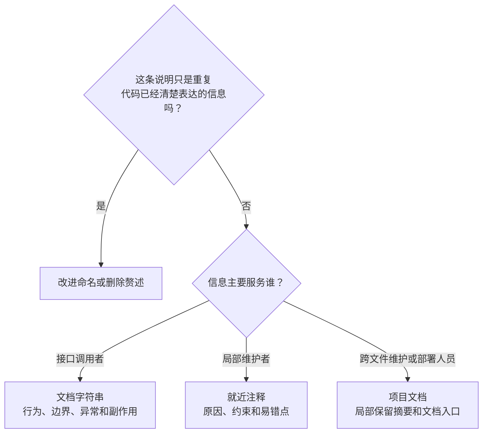

[toc]


## 通用原则：让注释提供“信息增量”

### 先区分不同信息的归属

建议将说明分成以下几类。尤其不要混淆**面向调用者的接口文档**与**面向维护者的实现注释**：调用者需要知道怎样正确使用接口，维护者需要知道实现为什么这样安排。

| 信息类型                 | 推荐位置                              | 主要回答的问题                                   |
| ------------------------ | ------------------------------------- | ------------------------------------------------ |
| **接口契约**             | Python文档字符串（Docstring）         | 做什么？参数有什么限制？返回什么？有什么副作用？ |
| **局部实现意图**         | 相关代码之前或简短行尾注释            | 为什么这样实现？什么地方不能随意修改？           |
| **配置决策**             | 对应配置段附近                        | 为什么选这个值？影响什么范围？依赖什么前提？     |
| **跨文件设计、部署流程** | README、架构决策记录（ADR）、运维文档 | 整体如何协作？如何部署、验证和回滚？             |
| **工具控制指令**         | 按工具要求放置                        | 要让检查器忽略什么？为什么允许例外？             |

其中，`# noqa`等内容虽然采用注释语法，却会被开发工具识别，**不能一概当作“只给人看的文字”**。

### 推荐采用的写作准则

下面是工程建议，不是所有语言都强制执行的语法规则。

| 优先级   | 准则                         | 实践方式                                         |
| -------- | ---------------------------- | ------------------------------------------------ |
| **必须** | **保持真实、与变更同步**     | 修改行为时，同时检查相关注释和文档               |
| **应该** | **解释原因，而不是复述语句** | 写“为何多读1字节”，不写“读取文件”                |
| **应该** | **说明重要边界**             | 单位、范围、等号边界、空值含义、异常和副作用     |
| **应该** | **就近说明，明确作用范围**   | 局部约束放在相关代码前，不集中到远处文件头       |
| **推荐** | **先改善命名和结构**         | 用`timeout_seconds`表达单位，而不是用注释补救`t` |
| **可以** | 解释复杂的“如何工作”         | 算法推导、位操作、协议布局等确实需要说明时       |
| **避免** | 无依据的结论                 | 不只写“提高性能”，应说明适用场景或测量依据       |
| **避免** | 重复维护同一事实             | 当前数值让代码或配置表达；注释解释选择依据       |

这些建议与PEP8强调的准确性、减少显而易见的行尾注释，以及Google风格指南对复杂实现进行就近说明的方向一致。

**“注释只写为什么，不写是什么”也过于绝对。**公共接口的文档就必须说明行为；复杂数据格式也可能需要解释结构。真正应该避免的是**没有新增信息的重复描述**。

下面的判断图用于决定**某条说明应该放在哪里**，不是用来取消公共接口文档：



## Python：分清普通注释与文档字符串

### 基本格式

Python普通注释以字符串之外的`#`开始，到物理行末结束；**三引号表示字符串，不是另一种多行注释语法**。文档字符串则是位于模块、类、函数或方法定义中第一条语句位置的字符串字面量，可成为对象的`__doc__`属性。

| 场景                 | 推荐写法               | 注意事项                                   |
| -------------------- | ---------------------- | ------------------------------------------ |
| 独立注释             | `# 说明文字。`         | `#`之后通常留一个空格                      |
| 多行普通注释         | 每行使用`#`            | 与所说明的代码保持相同缩进                 |
| 行尾注释             | `value = 10  # 说明。` | 代码与`#`之间至少两个空格，少量使用        |
| 文档字符串           | `"""说明。"""`         | 统一采用三重双引号                         |
| 多行文档字符串       | 摘要、空行、详细说明   | 结束引号单独占一行                         |
| 长段注释、文档字符串 | 合理换行               | PEP8建议文本行控制在72字符；这不是语法限制 |

以上格式主要来自PEP8和PEP257；已有项目应优先保持项目内部一致，不必为了外观统一而修改大量无关代码。

### 文档字符串应写“调用者需要知道的内容”

**公共接口通常应该提供文档字符串；简单接口可以只有一句摘要，不需要机械地填满所有章节。**PEP257建议按实际需要描述行为、参数、返回值、异常、副作用和调用限制，但并不规定必须使用哪一种章节标记格式。

本文采用Google风格：

| 章节       | 含义           | 应重点补充的信息                     |
| ---------- | -------------- | ------------------------------------ |
| `Args:`    | 参数说明       | 单位、范围、特殊值、是否修改传入对象 |
| `Returns:` | 返回值说明     | 返回值的业务含义、空结果、顺序等     |
| `Raises:`  | 异常说明       | 调用者需要处理的异常及触发条件       |
| `Yields:`  | 生成器产出的值 | 用于生成器，而不是普通返回值         |

**已有类型注解时，不必再机械地重复类型名称；应补充类型无法表达的语义。**例如，`int`不能说明这个整数代表字节数、秒数，还是允许为负的偏移量。

### 综合示例：读取大小受限的任务文件

**场景**：程序需要读取可信的本地普通文件，但不希望意外把大文件完整装入内存。这里假设文件在读取期间不被其他进程修改。

```python
"""读取大小受限的任务输入文件。"""

from pathlib import Path


def read_payload(
    path: Path,
    *,
    max_bytes: int = 1024 * 1024,
) -> bytes:
    """读取任务文件，并拒绝超过大小上限的内容。

    Args:
        path: 本地普通文件的路径；从文件开头读取。
        max_bytes: 大小上限，单位为字节，必须大于或等于0。

    Returns:
        文件的原始字节。空文件返回b""，大小恰好等于上限时允许读取。

    Raises:
        ValueError: max_bytes为负，或文件内容超过上限。
        OSError: 打开或读取文件失败。

    不修改源文件，也不负责文本解码。
    """
    if max_bytes < 0:
        raise ValueError("max_bytes必须大于或等于0")

    with path.open("rb") as stream:
        # 多读1字节用于判断是否超限，避免先无上限读取整个文件。
        payload = stream.read(max_bytes + 1)

    if len(payload) > max_bytes:
        raise ValueError("文件超过大小上限")

    return payload
```

本例使用`Path.open()`打开文件；它采用与内置`open()`相同的文件打开机制。

关键字段与语法说明：

| 内容            | 含义                                                  |
| --------------- | ----------------------------------------------------- |
| `path`          | 使用`Path`对象表示的文件路径                          |
| `max_bytes`     | 允许的文件大小上限；示例默认值为1MiB，即1,048,576字节 |
| 签名中的`*`     | 后面的参数只能通过关键字传入，如`max_bytes=4096`      |
| `"rb"`          | 以二进制只读模式打开文件                              |
| `bytes`         | 返回原始字节，不代表已经解码的文本                    |
| `max_bytes + 1` | 用一个额外字节区分“恰好达到上限”和“已经超限”          |

这个例子的注释设计重点是：

- **文档描述契约**：单位、边界、空文件、异常、不修改源文件。
- **普通注释解释非显然的实现原因**：为什么多读取1字节。
- **不逐行翻译语法**：没有添加“判断大小”“打开文件”“返回结果”等赘述。
- **边界可以直接转化为测试**：负数上限、空文件、恰好达到上限、超出1字节。

### 工具抑制注释：范围要小，理由要具体

Ruff支持`# noqa: 规则编号`抑制指定检查；mypy支持`# type: ignore[错误代码]`。两者面向不同工具，**不要相互替代，也不要无理由地屏蔽全部检查**。

例如，假设项目已有`app.export_plugins`模块，导入时会完成插件注册：

```python
# 导入操作会注册导出插件；改为显式注册后可删除，见APP-142。
import app.export_plugins  # noqa: F401
```

这里：

- `F401`是未使用导入检查。
- `APP-142`是示例工单编号，应替换为真实追踪项。
- 说明解释了**为什么保留导入**，而不只是写“忽略警告”。

推荐把理由放在上一行：Ruff官方文档提示，清理无效`noqa`时，同一行后面的说明可能一并被删除。

## Nginx：注释应解释部署决策

### 先保证注释没有破坏语法

Nginx原生配置使用`#`写单行注释；多行说明应逐行添加`#`。普通指令仍需要以`;`结束，块指令则使用花括号。**行尾注释不能代替指令结束符。**

推荐：

```nginx
# 后端响应数据允许的最大静默等待时间。
proxy_read_timeout 30s;
```

短注释也可以放在完整指令之后：

```nginx
proxy_read_timeout 30s;  # 不是整个响应的总时限。
```

**不要照搬其他语言的`//`或`/* ... */`注释习惯。**

### 配置注释优先说明这些内容

下面是建议采用的配置说明框架：

| 内容           | 应回答的问题                 | 示例                                 |
| -------------- | ---------------------------- | ------------------------------------ |
| **适用环境**   | 本机测试、生产还是特定集群？ | 仅供本机调试访问                     |
| **放置上下文** | 应放进哪个配置块？由谁包含？ | 由主配置的`http {}`包含              |
| **选择依据**   | 为什么显式设置这个值？       | 同机后端应快速建连，异常时尽早失败   |
| **准确语义**   | 单位是什么？限制什么阶段？   | 读取响应时的等待，不是请求总时限     |
| **联动关系**   | 修改时还需要检查什么？       | 后端路由是否包含`/api/`前缀          |
| **维护入口**   | 是手工维护还是自动生成？     | 应修改哪个源模板、通过什么流程发布？ |

Nginx支持通过`include`拆分配置，而且指令有各自允许出现的上下文。因此，**片段应该放在哪里**是值得保留的信息，不应只给出孤立配置。

另外，**不是只有非默认值才值得说明**：如果显式写出某个默认值是为了固定部署行为，也可以保留，但应该说明这一决策，而不是复制整段指令手册。

### 综合示例：代理同机Python API

**场景与边界：**

- Python服务已经监听`127.0.0.1:8000`，路由包含`/api/`前缀。
- Nginx通过本机端口`8080`提供测试入口。
- 以下是**由主配置的`http {}`包含的片段，不是完整的`nginx.conf`**。
- 示例没有`rewrite`、正则`location`或变量形式的`proxy_pass`；不要将结论直接推广到这些情况。

```nginx
# 由主配置的http块包含；不要在本文件中再包一层http块。
# 本机测试入口；生产域名、TLS和公网监听需另行配置。
server {
    listen 127.0.0.1:8080;
    server_name localhost;

    location /api/ {
        # 后端路由包含/api/前缀，需要原样保留。
        # 此处proxy_pass不带URI，不要随意追加尾部斜杠。
        proxy_pass http://127.0.0.1:8000;

        # 同机后端应快速建连，异常时尽早失败。
        proxy_connect_timeout 2s;

        # 后端响应数据的静默等待上限；不是整个响应的总时限。
        proxy_read_timeout 30s;
    }
}
```

这里最值得解释的不是“开启代理”，而是**路径为什么这样转发，以及超时究竟约束什么**。官方文档区分了代理建连超时与响应读取超时，其中`proxy_read_timeout`不是整个响应的总传输时限。

本例字段说明：

| 字段或值         | 含义                                       |
| ---------------- | ------------------------------------------ |
| `127.0.0.1:8080` | Nginx的本机测试监听地址                    |
| `localhost`      | 此示例虚拟服务器的名称                     |
| `location /api/` | 匹配`/api/`路径前缀                        |
| `127.0.0.1:8000` | 已运行的Python后端服务地址                 |
| `2s`、`30s`      | 示例选择的时间值，单位为秒，不是普适调优值 |

对于上述普通前缀匹配场景，`proxy_pass`是否包含URI会影响转发路径：

| 配置                                 | 请求路径      | 后端收到的路径 |
| ------------------------------------ | ------------- | -------------- |
| `proxy_pass http://127.0.0.1:8000;`  | `/api/orders` | `/api/orders`  |
| `proxy_pass http://127.0.0.1:8000/;` | `/api/orders` | `/orders`      |

第二行指定了URI`/`，会替换匹配到的`/api/`部分。因此，“不要追加尾部斜杠”应该写成**有业务原因的局部约束**，而不是所有`proxy_pass`都适用的口号。

### 三个特别容易误导维护者的地方

**注释掉配置，不等于关闭对应功能。**

例如，注释掉`proxy_read_timeout 30s;`只是取消本层的显式设置，之后可能使用继承值或默认值，**不能解释成“关闭超时”**。

**继承规则不能一概而论。**

例如，官方文档规定，只有当前层没有定义任何`proxy_set_header`时，才从上一层继承这些指令。不能仅凭“父级配置过”就认定当前层仍然保留整组请求头设置。

**自动生成文件应该标明真正的修改入口。**

建议在确实由发布流程生成的文件头部注明源模板和部署说明。不要仅写“禁止修改”，也不要把普通手工文件误标成自动生成文件。维护者需要知道：**应该去哪里改，怎样让修改生效。**

## 长期维护：让注释能够被追踪和清理

### TODO应有上下文和完成条件

Google风格指南建议，TODO引用可追踪的上下文，优先使用问题记录；涉及未来处理时，应给出具体日期或具体事件，而不是模糊的“以后”。

不推荐：

```python
# TODO: 以后优化。
```

推荐：

```python
# TODO(APP-142): 所有客户端完成v2迁移后，删除v1兼容分支。
```

建议的团队约定：

| 标记    | 用途                 | 应补充的信息       |
| ------- | -------------------- | ------------------ |
| `TODO`  | 待完成的工作         | 追踪项、处理条件   |
| `FIXME` | 已知缺陷或不正确行为 | 影响范围、追踪项   |
| `NOTE`  | 容易被忽略的重要事实 | 具体事实及适用前提 |

这些标记应按团队约定使用，**不必给每段普通解释都加一个大写标签**。

### 避免把注释变成历史档案

建议：

- **删除不再使用的代码**，不要长期保留大段“暂时注释掉的旧实现”。
- 作者、逐次修改日期、变更流水优先交给版本控制；许可证和必要版权声明另行遵守项目要求。
- 长篇设计背景放进项目文档，局部保留必要摘要与入口。
- 临时兼容措施写明**删除条件**，不能只写“不要删”。
- 不在注释中放真实密码、令牌、个人敏感数据或生产环境凭据。

对于Python，Ruff的`ERA001`可以发现疑似被注释掉的代码，但官方也说明该规则可能误报，**检查结果需要人工判断**。

### 中文与跨平台约定

面向中文内部团队，可以统一使用中文说明；面向国际协作项目，优先遵循项目的英文约定。PEP8本身倾向于为国际读者使用英文注释。

建议仓库统一采用**UTF-8无BOM和LF换行**，减少跨平台协作差异。这里应区分建议与限制：Python3源码默认使用UTF-8，也接受CRLF换行，**不是中文注释必须添加`# coding: utf-8`，也不是Python只能读取LF**。

## 自动检查：检查结构，再验证行为

### Python：用Ruff检查文档和抑制项

下面是一份可作为起点的`pyproject.toml`配置。**已有配置时应合并列表项，不要重复追加同名配置节或覆盖既有规则。**

```toml
[tool.ruff.lint]
# 在现有规则基础上添加文档和抑制项维护检查。
extend-select = ["D", "PGH004", "RUF100"]

# 本项目使用中文句号，摘要标点改由人工评审检查。
ignore = ["D415"]

[tool.ruff.lint.pydocstyle]
convention = "google"
```

配置字段说明：

| 字段或规则              | 作用                                           |
| ----------------------- | ---------------------------------------------- |
| `extend-select`         | 在基础规则之外增加检查，而不是替换基础规则集   |
| `D`                     | 启用文档字符串相关检查，并结合选定风格筛选规则 |
| `PGH004`                | 检查未指定具体规则的宽泛`noqa`                 |
| `RUF100`                | 检查已经不再需要的`noqa`                       |
| `convention = "google"` | 采用Google文档字符串约定                       |
| `ignore = ["D415"]`     | 在此中文项目中不强制执行该摘要结束标点检查     |

这些字段和规则均有Ruff官方文档依据。

其中，核验时的`D415`实现检查英文标点`.`、`!`、`?`，不会把中文句号`。`识别为这三种结束标点。因此这里针对中文项目明确关闭该规则，**不是为了绕过所有文档检查**。英文项目通常不需要这一例外。

在已经安装Ruff的项目根目录执行：

```bash
ruff check .
ruff format --check .
```

前者执行静态检查；后者检查格式但不改写文件。建议将它们接入持续集成（CI），并让本地与CI使用相同工具版本。

**已有大项目不必一次性补齐所有文档规则**：可以先选择公共接口目录或部分规则试点，明确测试、生成文件等例外，避免用大量`noqa`掩盖迁移成本。

### Nginx：检查完整主配置，并补充请求测试

以下命令中的路径是Linux环境示例，应替换为实际主配置路径；执行时需要具备读取相关配置和引用文件的权限。

```bash
nginx -t -c /etc/nginx/nginx.conf
nginx -T -c /etc/nginx/nginx.conf
```

| 参数 | 含义                                           |
| ---- | ---------------------------------------------- |
| `-c` | 指定完整主配置文件，而不是仅含`server`块的片段 |
| `-t` | 检查配置语法，并尝试打开配置中引用的文件       |
| `-T` | 执行相同检查，并额外输出配置文件内容           |

若运行环境使用了自定义`-p`前缀，检查时也应保持一致。Windows应使用实际的`nginx.exe`和配置路径，不要照搬`/etc/nginx`。这些参数的行为以Nginx官方命令行文档为准。

注意两个边界：

- **`nginx -T`输出的是配置文件内容，不是已经计算完所有继承和匹配结果的“最终有效配置”。**分享输出前也应检查并脱敏。
- **通过`nginx -t`不能证明注释描述的业务行为正确**。仍应通过请求测试确认路径转发、访问范围和超时行为；这是由其检查范围得出的边界。

## 可直接用于评审的检查清单

- [ ] **注释提供了代码之外的信息**，而不是逐行翻译。
- [ ] **注释与当前实现一致**，没有保留失效描述。
- [ ] 公共接口说明了重要的单位、边界、返回语义、异常和副作用。
- [ ] 关键配置说明了适用环境、作用范围、选择依据和联动关系。
- [ ] 没有把“注释掉设置”误写成“关闭功能”。
- [ ] 工具抑制指令范围足够小，并解释了原因。
- [ ] TODO有真实追踪项和明确处理条件。
- [ ] 没有长期堆积旧代码、重复变更记录或敏感信息。
- [ ] 生成文件能够找到真正的维护入口。
- [ ] **能执行验证的约束，已经尽量落实为校验或测试，而不只是注释。**

**最终原则：代码表达行为，文档描述契约，注释保留意图与约束；三者共同维护，而不是互相替代。**