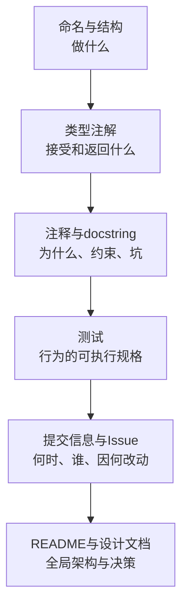
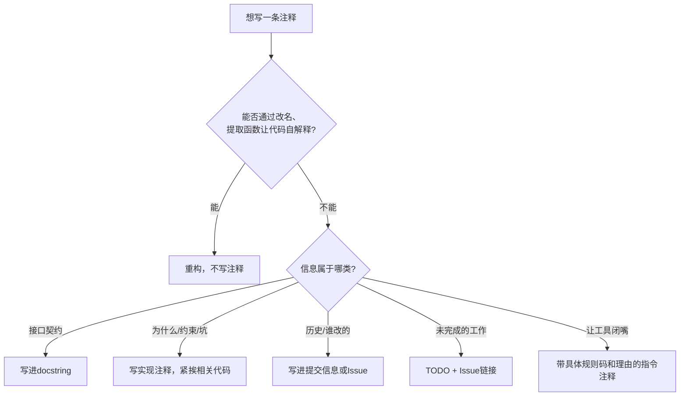
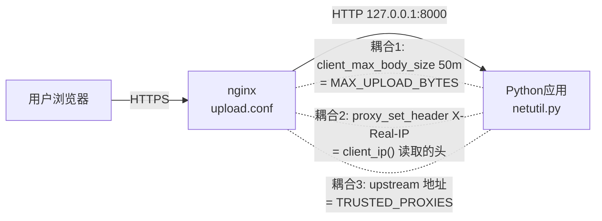

[toc]

## abstract

**核心理念：注释回答代码回答不了的问题**

Stack Overflow官方博客的 ***Best practices for writing code comments***（2021-12）引用了Jeff Atwood的一句话：**“Code Tells You How, Comments Tell You Why”**（代码说明怎么做，注释说明为什么）。文章也指出写注释和维护注释都有成本，编译器不会检查注释，没有任何办法证明注释是对的。所以注释应该**少而准**，只写代码表达不出来的信息。

一个项目里，信息应该放在最合适的地方，注释只是其中一层：



**怎么读这张图**：越往上，信息越贴近代码，也越不容易过时。能用好名字说清楚的，就不要写注释；能用类型表达的，就不要在注释里重复类型；“三个月前为什么改过这行”这类历史信息，应该写进提交信息，而不是堆在注释里。

## 注释的分类

| 类别                                              | 读者     | 内容                                 | Python示例                                     | nginx示例                           |
| ------------------------------------------------- | -------- | ------------------------------------ | ---------------------------------------------- | ----------------------------------- |
| **文档注释**（Documentation comment / docstring） | 调用方   | 接口契约：做什么、参数、返回值、异常 | `"""Return the client IP."""`                  | 文件头说明块                        |
| **实现注释**（Implementation comment）            | 维护者   | 为什么这样实现、非常规写法、坑       | `# Prefer X-Real-IP because...`                | `# 与应用侧上限保持一致`            |
| **标记注释**（Marker comment）                    | 团队     | 待办、已知缺陷                       | `# TODO: <链接> - 描述`                        | `# TODO: <链接> - 启用HSTS`         |
| **指令注释**（Pragma / directive comment）        | 工具     | 让lint、类型检查、格式化工具改变行为 | `# noqa: E501`、`# type: ignore[attr-defined]` | 无                                  |
| **元信息注释**（Metadata）                        | 人和工具 | 许可证、托管来源、生成声明           | `# SPDX-License-Identifier: MIT`               | `# 由Ansible管理，手工修改会被覆盖` |

**辨析：docstring和`#`注释不是一回事**。docstring是运行时可以拿到的字符串对象（`help()`、`obj.__doc__`、Sphinx/mkdocstrings都会读它），面向**调用方**。`#`注释在解析时就被丢弃了，面向**读源码的维护者**。所以接口说明写在docstring里，实现细节写在`#`注释里，不要混用。

## 通用规则

### 必须

- **注释和代码同步更新**。过时的注释比没有注释更糟，因为它会误导人。代码评审要把注释当成代码一起审。
- **不在注释里写密钥、口令、内网凭据**。注释会进入Git历史，还会被`nginx -T`这类命令原样打印出来。
- **指令注释写明具体规则码，并说明原因**，例如写`# noqa: E501`而不是笼统的`# noqa`。
- **对非常规写法给出解释**，这是Stack Overflow博客的Rule 5（Explain unidiomatic code in comments）。看起来像错误、其实是故意这样写的代码，一定要注释，否则下一个人会“顺手修掉”它。

### 推荐

- **写“为什么”和“约束”，不写“做什么”**。
- **给出处**：抄来的代码注明来源链接（Rule 6），参考的RFC或文档放在最有用的位置（Rule 7），修bug时附上Issue链接（Rule 8）。
- **写清单位、取值范围、默认值和副作用**，这在配置文件里尤其重要。
- **跨文件的耦合要双向标注**。例如nginx的`client_max_body_size`和应用的上传上限，两边都要写“改这里要同时改那里”。
- **TODO要有可追踪的锚点**（Issue链接），不要写成无主的愿望清单。

### 可以

- 在长函数或长配置里用**分节注释**做导航。如果分节太多，通常说明应该拆函数或拆文件了。
- 在团队内部、确定只有中文读者的项目里**用中文注释**（见后文“中文注释与跨平台”）。

### 避免

- **复述代码**，例如`i += 1  # i加1`。Stack Overflow博客Rule 1的观点是：不增加信息的注释价值是负的，它带来视觉噪音、阅读成本和过时风险。
- **用注释掩盖烂代码**（Rule 2）。如果写不出清楚的注释，往往说明代码本身有问题（Rule 3）。
- **留着大段被注释掉的代码**。Git记得历史，删掉就好。
- **在注释里写变更日志**，比如“2023-05 张三改”。这是`git log`和`git blame`的职责。
- **署名式TODO**，例如`TODO(张三)`。人会离职，Issue不会消失。

想加一条注释时，可以按这个流程判断：



## Python：块注释与行内注释

以下是PEP 8的要点（本轮没有联网核实PEP 8原文，依据是PEP 8长期稳定的内容）：

- **块注释**（block comment）：和它说明的代码保持同样的缩进；每行以`# `开头（井号后跟一个空格）；段落之间用一行只有`#`的注释隔开。
- **行内注释**（inline comment）：**少用**；和语句之间**至少隔两个空格**；同样以`# `开头；不要解释显而易见的东西。
- 注释写成**完整的句子**，英文句首大写（如果句首是小写开头的标识符，保持原样）。
- 注释和docstring每行建议**不超过72个字符**（代码行是79个）。
- 对非英语母语的开发者，PEP 8建议用英文写注释，**除非你120%确定读代码的人都懂你的语言**。

反例和正例对比：

```python
# 反例：复述代码，信息量为零
retries = 3  # 设置重试次数为3
time.sleep(2 ** attempt)  # 睡眠2的attempt次方秒

# 正例：解释取值依据和设计意图
# The payment gateway rate-limits bursts; exponential backoff with at most
# 3 retries keeps the worst case under its 15s request timeout.
retries = 3
time.sleep(2 ** attempt)
```

**解读**：反例的注释只是把代码换成了中文，删掉也不会损失任何信息。正例回答了“为什么是3次”“为什么用指数退避”，这些在代码里看不出来。将来有人想把重试次数改成5，看到注释就知道会超过网关的15秒超时。

## Python：文档字符串（docstring）

### PEP 257规范的结构

根据 ***PEP 257 – Docstring Conventions***：

- docstring是模块、函数、类或方法定义里的**第一条语句**。
- **一律使用三重双引号`"""..."""`**。如果内容里有反斜杠，用原始字符串`r"""..."""`。
- **单行docstring**：前后都不留空行，引号和文字放在同一行。
- **多行docstring**：先写一行和单行docstring一样的**摘要行**，接一个**空行**，再写详细说明。

另外两条要点（本轮没有逐字核实）：摘要行用**祈使语气**，写“Return the ...”，不写“Returns the ...”或“This function returns”；以句号结尾。

### Google风格的分节

***Google Python Style Guide***（3.8节）要求摘要行只占一个物理行，以句号、问号或感叹号结尾，后面接空行，然后是正文。函数的常用分节如下：

| 分节          | 何时写               | 写什么                                   | 注意                         |
| ------------- | -------------------- | ---------------------------------------- | ---------------------------- |
| `Args:`       | 有参数时             | 每行“参数名: 描述”，描述太长时换行并缩进 | 有类型注解时不用重复写类型   |
| `Returns:`    | 有返回值时           | 返回值的**含义**，比如是否可能为`None`   | 返回`None`时省略             |
| `Yields:`     | 生成器               | 每次产出的值                             | 替代`Returns:`               |
| `Raises:`     | 调用方需要处理的异常 | 异常名和**触发条件**                     | 违反接口约定导致的异常不必列 |
| `Attributes:` | 类的公共属性         | 属性名: 描述                             | 写在类docstring里            |
| `Examples:`   | 用法不直观时         | 可运行的示例，可配合`doctest`            | 可选                         |

Google指南还特别说明：**不提供新信息的docstring就不要写**，比如测试模块里的`"""Tests for foo.bar."""`。

### 类型注解和docstring的分工

- **推荐**：类型交给注解（`def f(x: int) -> str`），docstring只写**语义**，比如单位、取值范围、为空时的含义。
- **避免**：在docstring里写`x (int): ...`的同时又写了类型注解。两处重复，迟早会不一致。
- 风格三选一，全项目统一：**Google风格**（可读性好，推荐）、**NumPy风格**（科学计算生态常用）、**reST/Sphinx风格**（老项目常见）。Sphinx通过`sphinx.ext.napoleon`扩展支持前两种，mkdocstrings也都支持。

### 模块头部

```python
#!/usr/bin/env python3
# SPDX-License-Identifier: MIT
"""Sync user avatars from the CDN to local cache.

Usage:
    python sync_avatars.py --since 2024-01-01
"""
```

- 第一行**shebang**只有可执行脚本才需要。**Windows用户注意**：脚本文件必须保存为`LF`换行，否则在Linux上会报`/usr/bin/env: 'python3\r': No such file or directory`。
- **Python 3的源码默认就是UTF-8编码**（PEP 3120），`# -*- coding: utf-8 -*-`是Python 2时代的遗留，**新代码不必写**。
- 脚本的模块docstring可以兼作用法说明（`argparse`的`description=__doc__`）。

## Python：TODO与指令注释

### TODO格式

Google风格指南的**新版推荐格式**是：`TODO:`后面跟上下文（优先用bug或Issue链接），再用连字符`-`引出说明，例如：

```python
# TODO: https://github.com/acme/upload/issues/42 - Support resumable uploads.
```

旧格式`# TODO(crbug.com/192795): ...`或`# TODO(用户名): ...`已经**不推荐在新代码里使用**。指南还明确反对用个人或团队名作为TODO的上下文。

**`FIXME`、`XXX`、`HACK`**：团队可以自行约定含义（例如`FIXME`表示已知bug，`HACK`表示临时绕过）。但关键是**统一，并且能被工具扫描到**。

### 指令注释必须精确且有理由

```python
import legacy_sdk  # type: ignore[import-untyped]  # vendor ships no stubs, see #87

URL = "https://example.com/very/long/..."  # noqa: E501  # URL cannot be wrapped

if TYPE_CHECKING:  # pragma: no cover
    from .models import User
```

- **必须写具体规则码**：`# type: ignore[code]`（mypy）、`# pyright: ignore[rule]`、`# noqa: CODE`（Ruff/flake8）。笼统的`# noqa`会把将来出现的新问题一起屏蔽掉。
- **推荐在后面补一句原因**。
- `# fmt: off`和`# fmt: on`（Black或Ruff formatter）要成对使用，**范围尽量小**。

### 被注释掉的代码

**避免**。如果确实要临时保留（比如排查问题期间），加一条带Issue链接的TODO，说明什么时候删。可以用Ruff的`ERA001`规则自动检测。

## Python：用工具执行规范

本节的Ruff规则编号**没有在本轮联网核实**，依据是我对Ruff文档的已有了解，启用前请对照Ruff官方规则页实测。

```toml
# pyproject.toml
[tool.ruff.lint]
select = [
    "E", "F",    # pycodestyle / pyflakes 基础规则
    "D",         # pydocstyle: docstring 规范
    "ERA",       # eradicate: 检测被注释掉的代码
    "TD", "FIX", # flake8-todos / flake8-fixme: TODO 格式与存量
    "PGH",       # pygrep-hooks: 禁止笼统的 noqa / type: ignore
    "RUF100",    # 发现已失效的 noqa 指令
]
ignore = [
    "TD002",     # 要求 TODO 署名, 与 Google 新版"不署名"建议冲突
    "FIX002",    # 允许带 Issue 链接的 TODO 存在, 由 TD003 约束格式
]

[tool.ruff.lint.pydocstyle]
convention = "google"   # 可选 "google" | "numpy" | "pep257"
```

**配置说明**：

- `convention`会自动启用或关闭与所选风格冲突的D系列规则，省得逐条调整。
- **注意冲突**：flake8-todos的格式要求（作者写在括号里，链接写在下一行）和Google新版TODO格式不完全一致。团队要选定一种，再关掉冲突的规则。
- 配合`pre-commit`在提交时检查，在CI里再查一遍。

## 配置文件注释通用原则

配置文件比代码**更需要注释**。代码有函数名、类型和测试可以佐证，而配置里一个`120s`，背后往往是一次线上事故的教训。

### 配置注释应该写什么

| 要素               | 说明                           | 示例                                 |
| ------------------ | ------------------------------ | ------------------------------------ |
| **为什么是这个值** | 取值依据：压测、事故、上游限制 | `# P99实测约40s，留3倍余量`          |
| **单位与范围**     | 尤其是不带单位的数字           | `# 单位：秒；0表示不限制`            |
| **耦合关系**       | 改这里还必须改哪里             | `# 必须与app的MAX_UPLOAD_BYTES一致`  |
| **来源与追踪**     | Issue、工单、官方文档链接      | `# 见OPS-1423`                       |
| **风险提示**       | 改错的后果                     | `# 关闭后上传会先写入/var，磁盘较小` |
| **托管声明**       | 文件由谁生成或管理             | `# 由Ansible渲染，勿手工修改`        |

### 常见配置格式的注释语法

| 格式         | 注释符     | 注意                                                         |
| ------------ | ---------- | ------------------------------------------------------------ |
| nginx        | `#`        | 注释到行尾为止，**没有块注释**                               |
| YAML         | `#`        | `#`前面必须有空白，否则会被当成值的一部分                    |
| TOML         | `#`        | 可以写在行尾                                                 |
| INI          | `;`或`#`   | 各解析器支持程度不同，Python的`configparser`默认两者都认     |
| systemd unit | `#`或`;`   | 只支持整行注释，不支持行尾注释                               |
| Dockerfile   | `#`        | 只支持行首注释；`# syntax=`这类解析器指令必须放在文件最开头  |
| `.env`       | `#`        | 不同加载库对行尾注释的处理不一致，**建议只用整行注释**       |
| JSON         | **不支持** | 需要注释时改用JSONC、JSON5、YAML或TOML；不得已时用`"_comment"`字段 |

### 两种“注释掉的配置”要区分

- **随软件分发的默认配置**（例如`sshd_config`）用注释掉的行展示默认值，这是**合理的惯例**，方便用户知道有哪些选项。
- **你自己仓库里的部署配置**要**避免**留下注释掉的指令。读者分不清它是“默认值说明”“临时关掉的”还是“忘了删的”。不用的就删掉，需要说明默认值时直接写成文字。

## nginx：语法要点

- **`#`之后到行尾都是注释**，nginx不会解析。指令行必须以分号`;`结尾。
- **没有块注释语法**。要注释多行只能逐行加`#`，多数编辑器的快捷键（如`Ctrl+/`）可以批量处理。
- nginx官方入门指南提到，默认配置文件里已经有几个`server`块的示例，**大多是注释掉的**，指南让读者先把它们都注释掉再新建`server`块。这正是上一节说的“分发默认配置”惯例。到了生产环境，应该改成精简、干净的配置。
- **参数值里包含`#`或空格时，用引号包起来**，比如`return 200 "ok#1";`，避免被误读，也方便人阅读。
- **小心UTF-8 BOM**（未本轮核实，属于社区常见问题）。如果用某些Windows编辑器把配置保存成“带BOM的UTF-8”，nginx会把BOM当成第一个指令的一部分，报`unknown directive`。**用UTF-8无BOM和`LF`换行保存**，可以用`.editorconfig`统一。
- **`nginx -T`会把完整配置连同注释一起打印出来**，所以注释里绝对不要放敏感信息，因为这类输出经常被贴进工单或聊天群。

### 文件头模板

```nginx
# =====================================================================
# <站点或服务名> - <一句话用途>
#
# 用途:     <这个文件负责什么>
# 负责人:   <团队 / 值班渠道>
# 管理方式: <手工维护 | 由 Ansible/Terraform/Helm 渲染, 手工修改会被覆盖>
# 关联代码: <应用侧与本配置耦合的文件和常量>
# 变更记录: 见 Git 历史, 不在此维护
# =====================================================================
```

| 字段         | 含义               | 为什么需要                                     |
| ------------ | ------------------ | ---------------------------------------------- |
| 用途         | 这个文件是干什么的 | `conf.d/`下文件一多，光看文件名不够            |
| 负责人       | 出了问题找谁       | 运维交接、事故响应时有用                       |
| **管理方式** | 是否由工具生成     | **最重要**：防止有人手工改了，下次部署又被覆盖 |
| 关联代码     | 双向耦合的锚点     | 改nginx时提醒同步改应用                        |
| 变更记录     | 指向Git            | 明确**不在**文件里写历史                       |

## 综合示例：上传服务的应用和nginx互相标注

**场景**：一个文件上传服务，用gunicorn跑在`127.0.0.1:8000`，前面挡一层nginx做HTTPS终止和反向代理，部署在海外服务器上。这个场景里有**三处跨文件耦合**，最容易因为“只改了一边”出故障：



**看图说明**：实线是请求路径，虚线是“改一边必须改另一边”的约束。这些约束编译器和`nginx -t`都检查不出来，**只能靠注释在两边互相标注**（再加上测试）。

### 应用侧：`app/netutil.py`

```python
"""Helpers for resolving the real client IP behind a reverse proxy.

The service runs behind exactly one nginx hop (see deploy/nginx/upload.conf).
nginx overwrites X-Real-IP with $remote_addr, so we trust that header only
when the TCP peer is one of TRUSTED_PROXIES.
"""

from __future__ import annotations

import ipaddress
from collections.abc import Mapping

# Peers allowed to set X-Real-IP. nginx connects from localhost, see the
# `upstream upload_app` block in deploy/nginx/upload.conf.
TRUSTED_PROXIES = frozenset({"127.0.0.1", "::1"})

# 50 MiB. Keep equal to `client_max_body_size 50m` in nginx; otherwise users
# see nginx's 413 page instead of our JSON error.
MAX_UPLOAD_BYTES = 50 * 1024 * 1024


def client_ip(headers: Mapping[str, str], peer_addr: str) -> str:
    """Return the IP address of the end user.

    Args:
        headers: Request headers. Keys are expected to be lower-cased.
        peer_addr: Address of the TCP peer, i.e. nginx when proxied.

    Returns:
        The client IP as a normalized string.

    Raises:
        ValueError: If the selected address is not a valid IP.
    """
    candidate = peer_addr
    if peer_addr in TRUSTED_PROXIES:
        # Prefer X-Real-IP over X-Forwarded-For: nginx sets the former to a
        # single value, while the latter can be appended to by the client.
        candidate = headers.get("x-real-ip", peer_addr)
    return str(ipaddress.ip_address(candidate.strip()))
```

**逐条解读**：

- **模块docstring**交代全局前提：只有一层nginx、信任链怎么成立。这类假设一旦变化（比如前面再加一层CDN），整个模块都要重新审视，所以写在最显眼的位置。
- **常量注释**写的都是“为什么”和“耦合在哪”。`50 * 1024 * 1024`本身已经说明了数值，注释补充的是**改错的后果**：用户会看到nginx的413 HTML页面，而不是应用返回的JSON错误。
- **函数docstring**用Google风格。参数类型交给注解，`Args:`只写语义，比如“键应为小写”这个调用约定。`Raises:`说明了什么情况下抛`ValueError`。
- **行内块注释**解释了一个看起来可以随意选择、其实有安全含义的决定：`X-Forwarded-For`可能被客户端伪造追加内容，`X-Real-IP`由nginx覆盖为单个值。这正对应“解释非常规或有意为之的代码”这条规则。
- 沙箱验证：受信代理传入`X-Real-IP: 203.0.113.7`时返回`203.0.113.7`；非受信对端`198.51.100.2`伪造头部时，返回的是对端地址本身。

### nginx侧：`deploy/nginx/upload.conf`

```nginx
# =====================================================================
# upload.example.com - 文件上传服务反向代理
#
# 用途:     HTTPS 终止, 并转发到本机 gunicorn (127.0.0.1:8000)
# 负责人:   platform-team (值班频道 #ops-oncall)
# 管理方式: 由 Ansible role `nginx_upload` 渲染, 手工修改会被覆盖
# 关联代码: app/netutil.py (TRUSTED_PROXIES, MAX_UPLOAD_BYTES, client_ip)
# 变更记录: 见 Git 历史, 不在此维护
# =====================================================================

upstream upload_app {
    # 应用只信任来自本机的 X-Real-IP (TRUSTED_PROXIES).
    # 若改为跨主机转发, 必须同步修改 app/netutil.py, 否则真实 IP 全部丢失.
    server 127.0.0.1:8000;
    keepalive 16;
}

server {
    listen 443 ssl;
    http2 on;    # 需要 nginx >= 1.25.1; 旧版本写法为 `listen 443 ssl http2;`
    server_name upload.example.com;

    ssl_certificate     /etc/letsencrypt/live/upload.example.com/fullchain.pem;
    ssl_certificate_key /etc/letsencrypt/live/upload.example.com/privkey.pem;

    # 必须等于 app/netutil.py 的 MAX_UPLOAD_BYTES (50 MiB).
    # 若此值更小, 超限请求被 nginx 直接拒绝, 用户看到 413 HTML 而非 JSON 错误.
    client_max_body_size 50m;

    location /api/upload {
        # 流式转发请求体, 不先写入 client_body_temp: 系统盘仅 20G (见 OPS-1423).
        proxy_request_buffering off;

        # 50 MiB 文件处理 P99 实测约 40s, 默认 60s 偶发 504; 取 3 倍余量.
        # 单位: 秒. 调大前先确认应用侧 gunicorn --timeout 不小于此值.
        proxy_read_timeout 120s;

        # 以下两行配合 upstream keepalive 使用, 缺一不可.
        proxy_http_version 1.1;
        proxy_set_header Connection "";

        # 覆盖 (而非追加) 客户端传来的同名头, client_ip() 只读这个头.
        proxy_set_header X-Real-IP $remote_addr;
        proxy_set_header Host $host;

        proxy_pass http://upload_app;
    }
}
```

**逐条解读**：

- **文件头**的“管理方式”一栏防止了最常见的运维事故：有人在服务器上直接改配置并reload，下次Ansible部署又把改动覆盖掉。
- **`upstream`块的注释**对应耦合3，并写明了**改错的后果**（真实IP全部丢失）。
- **`http2 on;`的行内注释**标注了版本边界。这类兼容性信息只能靠注释传达，否则在旧版nginx上会直接报`unknown directive`。
- **`client_max_body_size`**和Python常量的注释**互相指向对方**，这就是双向标注。
- **`proxy_read_timeout`**的注释完整示范了配置注释该有的几个要素：取值依据（P99实测）、事故背景（偶发504）、余量策略、单位，以及另一个隐含的耦合（gunicorn的`--timeout`）。
- **“以下两行……缺一不可”**是分组注释，把有依赖关系的指令绑在一起，防止有人只删掉其中一行。
- **没有写的注释同样重要**：`server_name`、`ssl_certificate`、`proxy_pass`这些指令一看就懂，所以不加注释。

改完配置要验证：`sudo nginx -t`检查语法，没问题再`sudo systemctl reload nginx`。再强调一次，`nginx -T`会打印出包括注释在内的全部配置。

## 中文注释与跨平台注意事项

- **语言选择**：开源项目或跨国团队，**推荐英文**（PEP 8的立场）。纯国内团队可以用中文，但要**在`CONTRIBUTING.md`里写明约定**，一个文件里不要中英文混杂着写段落。
- **标点**：中文注释可以用全角标点。但如果配置文件可能被老旧工具或终端处理，**用半角标点更稳妥**。本文nginx示例就用了半角标点。
- **编码与换行**：在仓库根目录放`.editorconfig`，统一`charset = utf-8`、`end_of_line = lf`；同时配合`.gitattributes`的`* text=auto eol=lf`，防止Windows下`core.autocrlf`把脚本和配置转成`CRLF`。
- **显示宽度**：一个中文字符在等宽终端里占两列。PEP 8的“72字符”按字符数算，中文注释实际显示宽度会接近两倍，可以适当缩短每行。
- **BOM**：Windows编辑器要选“UTF-8”而不是“UTF-8 with BOM”。nginx和shell脚本都会受BOM影响。

## 注释评审清单

提交前或做代码评审时，逐条过一遍：

- **这条注释删掉后，信息会不会丢**？不会，就删掉。
- 它回答的是**为什么、约束或风险**，而不是重复代码在做什么吗？
- **跨文件耦合两边都标注了吗**？
- 有没有**过时的注释**（和代码对不上）？
- **TODO都有Issue链接吗**？
- 指令注释是否**写了具体规则码和理由**？
- 注释里有没有**密钥、内网地址等敏感信息**？
- 配置注释是否写明了**单位、取值依据、改错后果**？
- 有没有**残留被注释掉的代码或配置**？

## AI辅助编程时代的补充（个人观点）

AI编码助手生成的代码常常带着“复述型”注释，比如`# Loop through the list`。**推荐**评审时像对待人写的注释一样删掉这些冗余内容。也可以在项目的`AGENTS.md`或类似的AI指令文件里写明注释规范，例如“只写why，不复述代码；TODO必须带Issue链接”，让AI一开始就按规范生成。本节是我的经验总结，本轮没有搜到资料支持。

## 依据与知识截止

- ***Best practices for writing code comments***，Stack Overflow Blog，2021-12-23：https://stackoverflow.blog/2021/12/23/best-practices-for-writing-code-comments/
- ***Google Python Style Guide***（3.8 Comments and Docstrings、3.12 TODO Comments）：https://google.github.io/styleguide/pyguide.html
- ***PEP 257 – Docstring Conventions***：https://peps.python.org/pep-0257/
- ***nginx Beginner's Guide***：https://nginx.org/en/docs/beginners_guide.html
- 本轮没有联网核实、依据我已有知识的部分：PEP 8注释细则、PEP 3120、Ruff规则编号（D/ERA/TD/FIX/PGH/RUF100）、mypy/coverage/Black的指令注释、`http2 on`的版本号（1.25.1）、nginx BOM问题、YAML/systemd/Dockerfile/`.env`的注释细节。
- **知识截止**：本文内容截至2025年前后。

