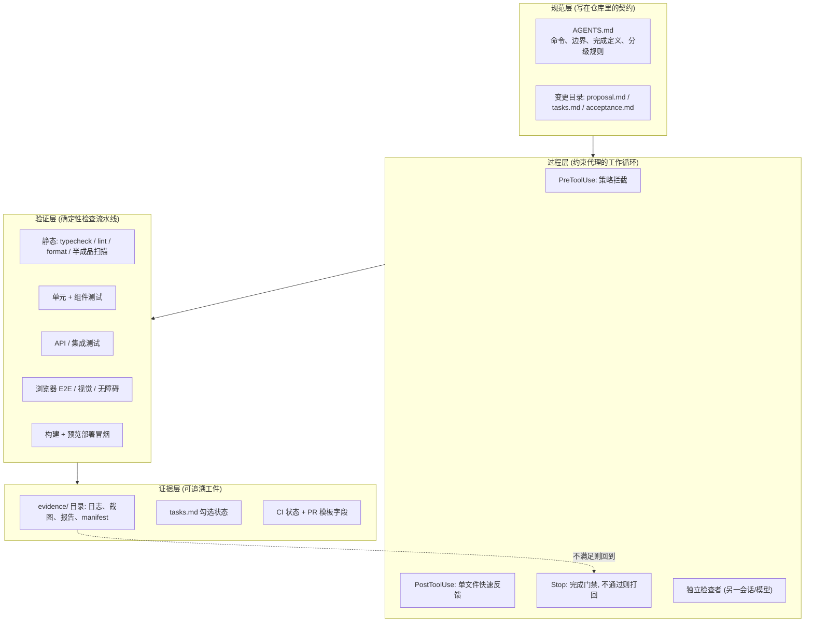
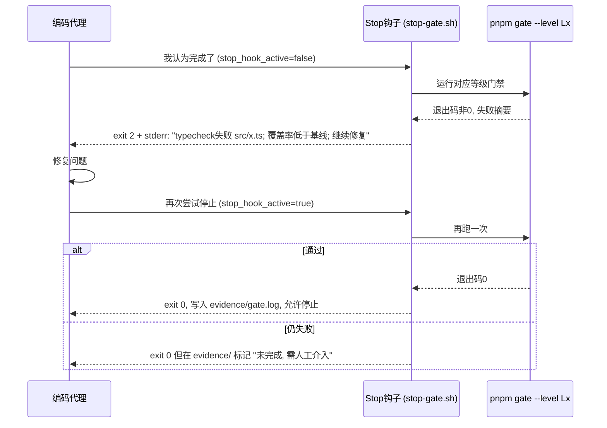
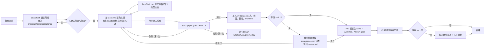

[toc]


## 问题的本质:AI的"完成"只是自述,不是证据

先把病根说清楚,后面所有设计都围绕它展开。

学术基准测试已经把"做一半"拆成了可命名的失败模式。NL2Repo-Bench把未完成任务分为两种行为:提前终止(过度自信),即代理明确调用finish动作声称任务完成但为时过早,通常表示对进度的"假阳性"估计;以及未完成(被动失败),即代理从不调用finish工具,会话因为代理停下来等待用户输入或达到系统超时而结束,反映出缺乏主动性。更值得警惕的是对推理型模型的观察:模型不是对照需求验证实现细节,而是"认为"自己完成了工作,导致仓库不完整;研究者推测这源于内部独白中的"验证幻觉",思考过程成了自我强化的回音室,模型通过推理链说服自己代码正确,实际绕过了真正的执行与测试。

WebCanvas对网页代理的观察补充了第三种机制:当沿当前路径难以继续时,代理可能降低任务完成标准,错误地判定任务已完成,从而提前终止。而在超长任务上,当前前沿编码代理解决不到30%的任务,失败常源于自我验证薄弱、自报不可行以及提前终止。

好消息是,**把判断权从模型手里拿走是有效的**。ECLoop这类"证据条件化执行层"介于代理提议的动作与实际执行之间,在四种配置下都把Pass@1提高了4.8到11.8个百分点。社区整理的缓解措施中,"复现优先"提示词要求代理先触发bug再修补,把GPT-5.4 mini在"正确代码"任务上的表现从24%提高到77%。

把这些事实翻译成工程原则,就是本文的三条总纲:

- **完成的判定权必须交给确定性的外部检查**(编译器、测试运行器、浏览器断言、脚本),或至少交给一个独立的审查者。Stop钩子的价值正是用一次测试运行来回应"完成"声明,而不是用代理自己的总结。
- **验收强度必须与变更风险成比例**,否则要么处处卡死(模型放弃或绕过),要么处处放水(用户拿到不能用的东西)。
- **所有检查都要留下可追溯的工件(artifact)**,而不是停留在对话记录里。

## 总体架构:四层防线



讲解:规范层回答"做什么、做到什么程度算完";过程层让代理在工作时无法绕过检查;验证层是具体工具;证据层确保"说完成了"背后有可复核的文件。四层缺一不可:只有规范没有过程,模型会"忘记";只有过程没有分级,会因过重而被跳过;没有证据层,人类复核无从下手。

## 第一支柱:仓库级契约 `AGENTS.md`

`AGENTS.md`是目前跨工具的事实标准。该标准于2025年8月在OpenAI主导、Google、Cursor和Factory参与下被正式化为开放规范;2025年12月捐赠给Linux基金会的Agentic AI Foundation;截至2025年12月已有超过6万个开源项目采用,超过20个AI编码工具支持。格式上它是纯Markdown,没有必填字段;推荐章节包括概览、构建/测试命令、代码风格、测试、安全、提交/PR规则。

两个实操细节:

- Claude Code读取的是`CLAUDE.md`,它不使用AGENTS.md,可以在两者之间建立符号链接让所有工具行为一致。推荐做法是`AGENTS.md`为唯一事实来源,`CLAUDE.md`只写一行指向它。
- 规范本身已经暗含"完成前自检"的期望:规范的FAQ指出代理"会尝试执行相关的程序化检查并在完成任务前修复失败"。但这只是期望,不是强制;强制要靠后文的钩子。

**本文对`AGENTS.md`的增强要求**:除常规章节外,**必须**加入下面四个与可靠性直接相关的章节,它们是后续所有机制的"法律依据"。

| 章节                         | 必须包含的内容                                               | 为什么重要                              |
| ---------------------------- | ------------------------------------------------------------ | --------------------------------------- |
| 完成定义(Definition of Done) | 列出客观判据:哪些命令必须退出码为0、`tasks.md`全部勾选、`evidence/`存在对应报告 | 把"完成"从主观判断变成可检查条款        |
| 变更分级规则                 | L0到L3的判定规则(见后文矩阵)及每级要跑的命令                 | 让模型能机械地判断该走哪条验收链路      |
| 工具缺失协议                 | 发现工具未安装时:先运行`scripts/doctor.sh`,再按固定格式向用户请求安装,**禁止静默跳过或改用更弱的替代** | 弱模型最容易"没装Playwright就不做E2E了" |
| 禁止的半成品模式             | 禁止`TODO`占位实现、禁止注释掉或`skip`测试、禁止新页面不注册路由、禁止新增文案不加i18n键、禁止把"请手动验证"写进完成报告 | 直接针对"做一半"的常见形态              |

一个WebUI项目的`AGENTS.md`骨架(省略常规的项目介绍):

```markdown
## 命令
- 安装依赖: `pnpm install --frozen-lockfile`
- 开发服务器: `pnpm dev` (http://localhost:5173)
- 类型检查: `pnpm typecheck`
- 检查与格式: `pnpm lint` / `pnpm format:check`
- 单元与组件测试: `pnpm test` ; 单个文件: `pnpm test -- src/features/export/Export.test.tsx`
- E2E: `pnpm e2e` ; 单个: `pnpm e2e -- tests/e2e/export.spec.ts`
- 按等级门禁: `pnpm gate --level L2`

## 完成定义 (Definition of Done)
一个任务只有同时满足以下条件才算完成:
1. `openspec/changes/<id>/tasks.md` 中所有条目已勾选,且没有新增未勾选条目。
2. `pnpm gate --level <本任务等级>` 退出码为 0,输出保存在 `evidence/<id>/gate.log`。
3. 涉及 UI 的任务: `evidence/<id>/` 下存在关键页面截图与 Playwright 报告。
4. 本次 diff 新增行中没有 `TODO`/`FIXME`/`not implemented`/`test.skip`,否则必须在 PR 描述逐条说明。
5. 最终回复必须引用上述文件路径作为证据,而不是仅陈述"已完成"。
6. 允许"未完成"但必须显式列出: 回复固定分为 已完成(含证据路径)/未完成/阻塞原因/下一步 四段。

## 变更分级
- L0 文案/样式/注释级微调,不改逻辑 -> `pnpm gate --level L0`
- L1 单个组件或函数内部逻辑,不改接口 -> `pnpm gate --level L1`
- L2 跨模块改动、改接口/状态/路由、依赖升级 -> `pnpm gate --level L2`
- L3 新功能页面/新数据模型/鉴权/支付/数据迁移 -> `pnpm gate --level L3` + 人工验收
运行 `bash scripts/classify.sh` 获取建议等级; 自评不得低于建议值; 不确定时上调一级。

## 工具缺失协议
1. 任何命令报 "command not found"/模块缺失/浏览器未安装时,先运行 `bash scripts/doctor.sh --level <等级> --print-install`。
2. 把输出原样贴给用户,按"缺失工具/触发场景/建议命令/影响范围/网络备注"格式提出安装请求。
3. 用户确认安装前,不得宣称该等级验收通过; 可以继续做不依赖该工具的工作,但相应 `tasks.md` 条目保持未勾选。

## 修 bug 的固定顺序
先写一个能复现该 bug 的失败测试,确认它失败,再修改代码,再确认它通过。禁止先改代码。

## 边界
- 总是做: 改动后运行受影响文件的类型检查; 提交前运行 `pnpm gate`。
- 先问: 新增依赖、修改 `package.json` scripts、修改数据库 schema、删除文件。
- 绝不做: 修改 `tests/e2e/fixtures/` 下的黄金数据以让测试通过; 使用 `--no-verify`; 降低覆盖率阈值; 修改 `scripts/gate.mjs` 来放宽门禁。
```

**推荐**把`AGENTS.md`控制在300行以内,长篇内容放`docs/`并给出路径;一份庞大的单体文件会在每次调用时把所有规则加载进上下文,应保持条目聚焦并去掉很少适用的边缘情况。

## 第二支柱:规范驱动的任务拆解与验收标准前置

"做一半"的另一个根源是任务没有被拆成可核对的条目。规范驱动开发(SDD, Spec-Driven Development)框架提供了成熟的目录结构,目前主流两个:

| 维度       | OpenSpec(Fission AI)                                       | GitHub Spec Kit                                              |
| ---------- | ---------------------------------------------------------- | ------------------------------------------------------------ |
| 运行时     | Node.js / TypeScript,`npm install -g @fission-ai/openspec` | Python,`uv tool install specify-cli`                         |
| 工作流     | 三步:Propose、Apply、Archive;约4个文件每次变更             | 完整流水线(constitution、specify、clarify、plan、analyze、tasks、implement),每个功能产出一叠密集的Markdown文档 |
| 适合       | 已有代码库,把变更写成针对当前行为的增量                    | 需要引导式工作流、强护栏和大扩展目录的新项目                 |
| 门禁性质   | 流动式,设计上没有阶段门禁                                  | 顺序被强制,但审批不被强制                                    |
| 上下文成本 | 上下文轻量,增量规范是最小diff                              | 上下文重,单个plan.md可达数百行                               |

**推荐决策**:WebUI应用的持续迭代选OpenSpec;全新项目的前几周可用Spec Kit起步,之后切回OpenSpec。一条实用的判断标准:加载完整命令集后检查有多少token用于框架开销,若超过上下文窗口的15到20%,考虑OpenSpec或精简的Spec Kit配置。

但要清醒:两者都是"把需求说清楚"的工具,**都不验证代理产出的代码真的符合规范**。OpenSpec明确不设门禁,Spec Kit的审批只是约定。所以SDD框架负责"说清楚要做什么",真正的验收门禁要靠第三、四支柱自己搭建。

每个变更目录固定三份文件,这是后续分级验收的输入:

| 文件            | 内容                                                         | 用途                                          |
| --------------- | ------------------------------------------------------------ | --------------------------------------------- |
| `proposal.md`   | 背景、目标、**非目标**、影响范围(文件/模块/接口)、`Level: Lx`及理由 | 确定验收等级;非目标防止范围蔓延               |
| `tasks.md`      | 带复选框的原子任务,每条可在一次会话内完成并单独验证          | 完整性追踪                                    |
| `acceptance.md` | 用Given/When/Then写的验收场景,每条标注对应的测试文件路径     | 验收"考卷",E2E测试的来源,独立检查者的核对清单 |

**必须**:`tasks.md`每一条以"可验证的动词"结尾,例如"实现导出按钮并通过`Export.test.tsx`",而不是"做导出功能"。**避免**"优化"、"完善"这类没有终点的描述,这是做一半的温床。

## 第三支柱:完成定义的强制执行机制

有了书面的完成定义,还要让代理"停不下来直到真的完成",又不能陷入死循环。手段按强度分四档,可叠加。

| 档位 | 机制                                                        | 适用                         | 局限                        |
| ---- | ----------------------------------------------------------- | ---------------------------- | --------------------------- |
| 1    | 外层shell循环:门禁不过就再调一次代理,带迭代上限             | 任何CLI代理                  | 粗糙,模型可能反复犯同样的错 |
| 2    | 代理的Stop钩子:门禁不通过就打回                             | Claude Code等支持hooks的工具 | 需要防死循环                |
| 3    | 证据清单(manifest):改了哪些文件就必须重新提交对应检查的证据 | 任何代理                     | 需要几十行脚本              |
| 4    | 独立检查者:另一个会话/模型按`acceptance.md`逐条审核         | L2以上                       | 成本高                      |

### Stop钩子:让代理不能单方面宣布完成

Stop钩子在Claude结束一轮时运行,可以拒绝让这一轮结束;它是唯一反转控制权的钩子:Claude必须通过你的检查才能结束。关键规则:

- 退出码0放行,退出码2阻断(在可阻断的事件上),而退出码1这个常规的Unix失败码什么都不阻断,这是最大的钩子陷阱。
- Stop钩子在每次回复后都运行,不只是任务结束时,例如代理停下来提问时也会触发;开发者中断代理时不运行。这意味着门禁脚本要足够快,或者按等级分层。
- 防死循环:`stop_hook_active`在当前停止是由上一次钩子阻断导致时为真;此时钩子不得再次阻断,应在脚本开头检查并立即退出0。另外Claude Code v2.1.143以上在连续8次Stop钩子阻断后会带警告结束回合,可用`CLAUDE_CODE_STOP_HOOK_BLOCK_CAP=20`覆盖。
- "作者与考官分离"的具体形态:执行者是Sonnet或Opus,裁判是Haiku,harness做仲裁;代理不再声称未赢得的胜利,直到验证者放行才能停。



讲解:第一次停止被打回时,钩子通过stderr回传失败摘要,代理据此修复;第二次停止时`stop_hook_active`为真,钩子按设计放行但把未通过项写入证据文件,让人类知道任务状态是"未完成"而非"完成"。对弱模型这尤其重要:无限打转只会消耗token并停在更糟的状态。

`.claude/settings.json`(项目级,团队共享):

```json
{
  "hooks": {
    "PostToolUse": [
      {
        "matcher": "Edit|Write|MultiEdit",
        "hooks": [
          { "type": "command", "command": "bash \"$CLAUDE_PROJECT_DIR\"/scripts/hooks/post-edit.sh", "timeout": 30 }
        ]
      }
    ],
    "Stop": [
      {
        "hooks": [
          { "type": "command", "command": "bash \"$CLAUDE_PROJECT_DIR\"/scripts/hooks/stop-gate.sh", "timeout": 900 }
        ]
      }
    ]
  }
}
```

`scripts/hooks/stop-gate.sh`:

```bash
#!/usr/bin/env bash
# Stop 钩子: 代理想结束回合时运行门禁, 不通过则打回一次.
# 输入: stdin 的 JSON (含 stop_hook_active 字段)
# 退出码: 0 允许停止; 2 打回并把 stderr 作为提示回传给代理
set -u
input="$(cat)"
active="$(printf '%s' "$input" | jq -r '.stop_hook_active // false')"
cd "${CLAUDE_PROJECT_DIR:-.}" || exit 0

# 当前活跃变更目录; 没有变更目录时视为日常问答, 直接放行
change_dir="$(ls -d openspec/changes/*/ 2>/dev/null | head -n1)"
[ -z "$change_dir" ] && exit 0
id="$(basename "$change_dir")"
level="$(grep -oE 'Level:\s*L[0-3]' "${change_dir}proposal.md" 2>/dev/null | grep -oE 'L[0-3]' || echo L1)"
mkdir -p "evidence/$id"
log="evidence/$id/gate.log"

if pnpm gate --level "$level" >"$log" 2>&1; then
  exit 0
fi

if [ "$active" = "true" ]; then
  echo "UNFINISHED: 门禁未通过, 见 $log" >"evidence/$id/STATUS"
  echo "[stop-gate] 门禁仍未通过, 本次放行以避免循环; 任务状态=未完成, 需人工介入." >&2
  exit 0
fi

echo "[stop-gate] 等级 $level 门禁未通过, 失败摘要:" >&2
tail -n 40 "$log" >&2
echo "请修复后再结束; 不得通过 skip/注释测试/降低阈值/修改门禁脚本的方式绕过." >&2
exit 2
```

`post-edit.sh`只做"便宜"的事:对被编辑的单个文件跑格式化和类型检查,并且只回传最后几十行输出,代理不需要完整测试输出,只需要足够调试的信息,保持上下文窗口精简。全量测试、构建、E2E这类昂贵操作只放在Stop钩子。

安全提醒:钩子以你的权限在本机执行shell。脚本里只用`jq`读取布尔字段,**绝不**把JSON中的任何字符串拼接进命令。

### 证据清单:改了什么就必须重新证明什么

Stop钩子解决"不能提前停",但对"跑完测试又改了一行"无能为力。**推荐**自己实现简化版的内容指纹清单:`pnpm gate`成功后把本次门禁覆盖的源文件列表与哈希写入`evidence/<id>/manifest.json`;Stop钩子比较当前工作区哈希与manifest,不一致则门禁视为过期并重跑。几十行Node脚本即可,它堵住的是最高频的漏洞。

### 独立检查者:把"作者"和"考官"分开

对L2以上的变更,**必须**由一个不带实现上下文的新会话(最好是你可用的最强模型)按`acceptance.md`逐条核对,产出`evidence/<id>/review.md`。检查者的提示词要点:只读权限、只能运行测试和浏览器、输出格式固定为"场景编号 / 通过或失败 / 证据文件路径 / 复现步骤"。验证比生成更需要判断力,而验证的token消耗远小于生成,所以"弱模型干活、强模型考试"是性价比最高的组合。

## 第四支柱:分级验收矩阵

核心思想是**用确定性规则把改动归入四个等级,每级绑定一组门禁**,让能力较弱的模型也能机械执行。

### 等级定义与判定规则

| 等级 | 名称           | 典型改动(WebUI案例)                                          | 判定触发条件(任一命中即至少该级)                             |
| ---- | -------------- | ------------------------------------------------------------ | ------------------------------------------------------------ |
| L0   | 微调           | 改按钮文案、调整间距颜色、修改注释、更新文档、翻译键值       | diff仅涉及`*.md`、样式文件、i18n资源文件、注释;不含逻辑代码  |
| L1   | 局部修改       | 修复某组件内的bug、调整某函数的边界处理、改表单校验规则      | 改动限于1到3个文件且在同一功能目录;不改导出接口签名、不改路由、不改全局状态结构 |
| L2   | 跨模块调整     | 重构状态管理、改API请求层、升级框架或主要依赖、修改共享组件、改路由结构 | 涉及`shared/`、`api/`、`store/`、路由等公共目录;或改变任何导出接口签名;或修改`package.json`依赖;或改动跨越3个以上目录 |
| L3   | 新功能或高风险 | 新增页面/功能模块、新数据模型或迁移、鉴权与权限、支付、文件上传下载、用户数据删除 | 新增路由或页面;新增数据表或改schema;触及`auth/`、`billing/`、迁移脚本;或`proposal.md`声明为新功能 |

**执行方式**:`scripts/classify.sh`根据`git diff --name-only`和路径规则给出"建议等级";AI在`proposal.md`填写`Level:`并说明理由;若AI填写的等级低于脚本建议值,门禁直接拒绝。"升级"由人或AI决定,"降级"受机械约束,**不确定时一律上调**。

### 每级门禁内容

"必须"为阻断项,"推荐"为生成报告但不阻断。

| 检查项                                             | L0             | L1         | L2           | L3   |
| -------------------------------------------------- | -------------- | ---------- | ------------ | ---- |
| 格式化检查                                         | 必须           | 必须       | 必须         | 必须 |
| 类型检查(`tsc --noEmit`)                           | 必须           | 必须       | 必须         | 必须 |
| Lint                                               | 必须           | 必须       | 必须         | 必须 |
| 半成品扫描(新增行的TODO/skip/stub)                 | 必须           | 必须       | 必须         | 必须 |
| 结构完整性(路由注册、i18n键、mock、`.env.example`) | 必须           | 必须       | 必须         | 必须 |
| 受影响文件的单元/组件测试                          | 不需要         | 必须       | 必须         | 必须 |
| 全量单元/组件测试                                  | 不需要         | 推荐       | 必须         | 必须 |
| bug修复附带复现用例                                | 不需要         | 必须       | 必须         | 必须 |
| 新增测试覆盖新增逻辑;覆盖率不低于基线              | 不需要         | 推荐       | 必须         | 必须 |
| API/集成测试(MSW或真实后端)                        | 不需要         | 涉及时必须 | 必须         | 必须 |
| E2E冒烟(核心路径3到5条)                            | 不需要         | 推荐       | 必须         | 必须 |
| E2E完整验收场景(对应`acceptance.md`)               | 不需要         | 不需要     | 涉及页面必须 | 必须 |
| 视觉回归截图对比                                   | 样式改动时推荐 | 推荐       | 必须         | 必须 |
| 无障碍检查(axe-core)                               | 不需要         | 推荐       | 推荐         | 必须 |
| 生产构建成功                                       | 推荐           | 必须       | 必须         | 必须 |
| 构建产物体积预算                                   | 不需要         | 不需要     | 推荐         | 必须 |
| 依赖安全审计                                       | 不需要         | 不需要     | 改依赖时必须 | 必须 |
| 证据manifest一致                                   | 必须           | 必须       | 必须         | 必须 |
| 独立检查代理审核                                   | 不需要         | 不需要     | 必须         | 必须 |
| 人工验收(真人在浏览器走一遍)                       | 不需要         | 不需要     | 推荐         | 必须 |
| 预览环境部署冒烟                                   | 不需要         | 不需要     | 推荐         | 必须 |

`package.json`中把等级映射为命令(`scripts/gate.mjs`读取`--level`后依次执行,任一步失败即退出非0):

```json
{
  "scripts": {
    "gate": "node scripts/gate.mjs",
    "gate:static": "pnpm format:check && pnpm typecheck && pnpm lint && bash scripts/scan-stubs.sh && node scripts/check-structure.mjs",
    "gate:unit:changed": "vitest run --changed origin/main",
    "gate:unit": "vitest run --coverage",
    "gate:e2e:smoke": "playwright test --grep @smoke",
    "gate:e2e:full": "playwright test",
    "gate:build": "vite build && node scripts/check-bundle-size.mjs"
  }
}
```

### 半成品扫描脚本

针对"做一半"最直接的机械检查,成本极低,所有等级都跑。它只扫描本次diff**新增的行**,避免历史债务阻断:

```bash
#!/usr/bin/env bash
# scan-stubs.sh: 扫描本次改动新增行中的半成品与绕过标记
# 用法: scan-stubs.sh [base_ref]   默认与 origin/main 比较
base="${1:-origin/main}"
pattern='TODO|FIXME|XXX|HACK|not implemented|NotImplemented|throw new Error\("TODO|test\.skip|it\.skip|describe\.skip|xit\(|xdescribe\(|@ts-ignore|@ts-expect-error|eslint-disable'
hits="$(git diff "$base"... --unified=0 -- . ':!*.md' | grep -E '^\+' | grep -vE '^\+\+\+' | grep -nE "$pattern" || true)"
if [ -n "$hits" ]; then
  echo "发现半成品/绕过标记 (仅新增行):"
  echo "$hits"
  echo "若确有必要, 请在 PR 描述逐条说明并获得人工批准."
  exit 1
fi
echo "stub scan: clean"
```

`check-structure.mjs`补上WebUI特有的收尾检查:新建页面组件是否在路由表注册;新增i18n键在所有语言文件是否都存在;新增API调用在MSW handlers是否有对应mock;新增环境变量是否写入`.env.example`。这些都是模型最爱"忘记"的收尾工作。

## 验收链路:从编辑到交付



讲解要点:

- **本地与CI跑同一个`pnpm gate`**,避免双轨。CI的价值在于不受代理控制,是真正的外部裁判。
- `tasks.md`的勾选必须发生在对应测试通过之后。可在`post-edit.sh`加一条:若本次编辑把`tasks.md`某项勾上,检查`evidence/`是否存在该项引用的测试报告,没有则通过stderr提醒"先跑测试再勾选"。
- PR模板强制三个字段:`Level`、`Evidence`(文件路径列表)、`Known gaps`(明确列出没做的事)。**"没做的事写出来"比"假装做完"更可接受**,这要在`AGENTS.md`明说,否则弱模型会因害怕"不完整"而编造。

## WebUI验收工具方案:发现与选择

下表的工具链部分主要依据我自身知识(截止约2025年初),版本与命令请核对官方文档;Playwright MCP部分有本轮搜索资料支撑。

| 层次               | 推荐                                                   | 备选                              | 选择理由与注意                                              |
| ------------------ | ------------------------------------------------------ | --------------------------------- | ----------------------------------------------------------- |
| 格式化             | Prettier                                               | Biome(格式化+lint二合一,Rust实现) | 已有ESLint体系保留Prettier+ESLint;新项目可用Biome减少配置   |
| Lint               | ESLint(`typescript-eslint`、`react-hooks`、`jsx-a11y`) | Biome、oxlint                     | 未处理的Promise、依赖数组遗漏这类规则要开成error            |
| 类型检查           | `tsc --noEmit`,`strict: true`                          | Vue用`vue-tsc`                    | 类型是最便宜的"规格";禁止新增`any`                          |
| 单元/组件测试      | Vitest + Testing Library                               | Jest                              | Testing Library强制按用户视角查询(`getByRole`),与无障碍一致 |
| 组件真实浏览器测试 | Vitest Browser Mode                                    | Storybook interaction tests       | jsdom模拟不足(布局、剪贴板)时使用                           |
| API mock           | MSW(Mock Service Worker)                               | 手写fetch mock                    | 同一套handlers用于单元、组件、E2E和开发期                   |
| E2E                | Playwright(`@playwright/test`)                         | Cypress                           | 多浏览器、trace viewer、内置视觉对比、官方MCP               |
| 视觉回归           | Playwright `toHaveScreenshot`                          | Lost Pixel、Chromatic             | 基线必须在同一Docker镜像中生成                              |
| 无障碍             | `@axe-core/playwright`                                 | Lighthouse a11y                   | E2E中每个页面注入一次扫描                                   |
| 性能预算           | Lighthouse CI、`size-limit`                            | bundlesize                        | 防止弱模型把整个图表库引进来                                |
| 安全               | `pnpm audit`、gitleaks                                 | Semgrep                           | PreToolUse钩子拦截把`.env`写入git                           |
| 变异测试           | Stryker Mutator                                        | 无                                | 检验"测试是否真的在测",L3核心逻辑推荐跑;不进常规门禁        |
| 代理用浏览器       | Playwright MCP(`--caps=testing`)                       | Chrome DevTools MCP               | 见下文                                                      |
| Git钩子            | lefthook                                               | husky + lint-staged               | 单二进制、跨平台;Windows上husky的shell脚本常踩坑            |

### Playwright MCP在验收中的位置

`--caps=testing`提供`browser_verify_element_visible`(按角色与可访问名称断言元素可见)、`browser_verify_text_visible`、`browser_verify_list_visible`、`browser_verify_value`(断言表单字段值)和`browser_generate_locator`(为测试代码生成定位器)。它的设计直接服务于"探索转测试":每个verify工具成功返回Done、失败返回错误信息,并在生成代码中记录对应的`expect(...)`行,因此一段通过的序列可以被组装成测试。

**关键原则**:MCP驱动的浏览器探索只是开发期自检,不是验收。一次实时检查不会自动成为已提交的测试;它不替代测试设计、Playwright Test配置、fixture或人工评审,只是把浏览器证据变成更强的起点。所以在本文链路里,**MCP的产出必须落地为`tests/e2e/*.spec.ts`并由`pnpm gate`运行**,否则不计入证据。

两条安全注意:核心工具集不是低风险只读集合,当前生成的参考文档把`browser_run_code_unsafe`标记为等同远程代码执行。对弱模型,不要开放该能力。另外交互元素没有暴露到无障碍树的应用会让代理几乎无从下手,这也是从一开始就要求组件带正确`role`与可访问名称的理由。

### 一个可读的E2E验收用例

对应`acceptance.md`的场景"报表导出":

```typescript
// tests/e2e/export.spec.ts
import { test, expect } from '@playwright/test';
import AxeBuilder from '@axe-core/playwright';

test.describe('报表导出 @acceptance @L3', () => {
  test.beforeEach(async ({ page }) => {
    await page.goto('/reports'); // baseURL 在 playwright.config.ts 由环境变量注入
  });

  test('场景1: 选择日期范围后导出 CSV', async ({ page }) => {
    await test.step('Given 用户在报表页且有数据', async () => {
      await expect(page.getByRole('table')).toBeVisible();
    });
    await test.step('When 选择最近7天并点击导出', async () => {
      await page.getByRole('combobox', { name: '时间范围' }).selectOption('7d');
      const download = page.waitForEvent('download');
      await page.getByTestId('export-csv').click();
      expect((await download).suggestedFilename()).toMatch(/report-.*\.csv$/);
    });
    await test.step('Then 页面提示成功且无无障碍违规', async () => {
      await expect(page.getByRole('status')).toHaveText(/导出成功/);
      const a11y = await new AxeBuilder({ page }).analyze();
      expect(a11y.violations).toEqual([]);
    });
  });

  test('场景2: 无数据时导出按钮禁用', async ({ page }) => {
    await page.route('**/api/reports*', r => r.fulfill({ json: { items: [] } }));
    await page.reload();
    await expect(page.getByTestId('export-csv')).toBeDisabled();
  });
});
```

讲解:`@acceptance @L3`标签让门禁按等级过滤;`test.step`文字直接对应Given/When/Then,审查者无需读代码就能核对场景覆盖;场景2用`page.route`构造边界条件,不依赖后端状态。按钮用`getByTestId`而非文案,是为了避免L0改文案时E2E失效(见后文案例二的教训)。

## 工具探测与"请求安装"协议

弱模型遇到工具缺失时的典型行为是悄悄跳过、换成更弱的检查、或者在聊天里写"请手动验证"。对策是**把探测做成脚本,把请求做成固定格式**。

### `scripts/doctor.sh`

设计目标:跨平台(Git Bash/WSL/macOS/Linux)、按等级给出缺失清单、可输出JSON供代理解析、不自动安装(安装需人批准)但能生成安装命令。

```bash
#!/usr/bin/env bash
# doctor.sh - 检查当前环境是否具备指定验收等级所需的工具
#
# 用法:
#   bash scripts/doctor.sh [--level L0|L1|L2|L3] [--json] [--print-install]
#
# 选项:
#   --level          要检查的验收等级, 默认 L3 (检查全部)
#   --json           以 JSON 输出, 便于代理解析
#   --print-install  对缺失项输出建议的安装命令 (只打印, 不执行)
#
# 退出码: 0 全部具备; 1 有缺失; 2 参数错误
set -u
level="L3"; json=0; print_install=0
while [ $# -gt 0 ]; do
  case "$1" in
    --level) level="$2"; shift 2 ;;
    --json) json=1; shift ;;
    --print-install) print_install=1; shift ;;
    *) echo "未知参数: $1" >&2; exit 2 ;;
  esac
done

missing=(); present=()
# check <name> <min_level> <detect_cmd> <install_cmd>
check() {
  local name="$1" min="$2" detect="$3" install="$4"
  if [[ "${level:1}" -lt "${min:1}" ]]; then return; fi
  if bash -c "$detect" >/dev/null 2>&1; then present+=("$name"); else missing+=("$name|$install"); fi
}

check "node>=20"   L0 'node -e "process.exit(+process.versions.node.split(\".\")[0] >= 20 ? 0 : 1)"' "用 fnm/nvm 安装 Node 20 LTS"
check "pnpm"       L0 'command -v pnpm'                 "corepack enable && corepack prepare pnpm@latest --activate"
check "deps"       L0 'test -d node_modules'            "pnpm install --frozen-lockfile"
check "typescript" L0 'pnpm exec tsc --version'         "pnpm add -D typescript"
check "eslint"     L0 'pnpm exec eslint --version'      "pnpm add -D eslint"
check "jq"         L0 'command -v jq'                   "Linux: apt/dnf 安装 jq; macOS: brew install jq; Windows: winget install jqlang.jq"
check "vitest"     L1 'pnpm exec vitest --version'      "pnpm add -D vitest @testing-library/react @testing-library/jest-dom"
check "lefthook"   L1 'test -f node_modules/.bin/lefthook' "pnpm add -D lefthook && pnpm exec lefthook install"
check "playwright" L2 'pnpm exec playwright --version'  "pnpm add -D @playwright/test"
check "pw-chromium" L2 'ls "${HOME}/.cache/ms-playwright" 2>/dev/null | grep -q chromium || ls "${LOCALAPPDATA:-/nonexistent}/ms-playwright" 2>/dev/null | grep -q chromium' "pnpm exec playwright install --with-deps chromium"
check "axe-core"   L3 'test -d node_modules/@axe-core/playwright' "pnpm add -D @axe-core/playwright"

if [ "$json" -eq 1 ]; then
  printf '{"level":"%s","present":[' "$level"
  { for p in "${present[@]:-}"; do [ -n "$p" ] && printf '"%s",' "$p"; done; } | sed 's/,$//'
  printf '],"missing":['
  { for m in "${missing[@]:-}"; do [ -n "$m" ] && printf '{"name":"%s","install":"%s"},' "${m%%|*}" "${m#*|}"; done; } | sed 's/,$//'
  printf ']}\n'
else
  echo "验收等级 $level 工具检查:"
  for p in "${present[@]:-}"; do [ -n "$p" ] && echo "  [ok]      $p"; done
  for m in "${missing[@]:-}"; do [ -n "$m" ] && echo "  [missing] ${m%%|*}"; done
  if [ "$print_install" -eq 1 ] && [ "${#missing[@]}" -gt 0 ]; then
    echo; echo "建议安装命令 (需人工确认后执行):"
    for m in "${missing[@]}"; do echo "  ${m#*|}"; done
  fi
fi
[ "${#missing[@]}" -eq 0 ]
```

字段说明:

| 占位符          | 含义                                                         |
| --------------- | ------------------------------------------------------------ |
| `<name>`        | 工具展示名,也是JSON中的`name`                                |
| `<min_level>`   | 该工具从哪个等级起必需;低于此等级的检查被跳过,因此L0任务不会被"没装Playwright"卡住 |
| `<detect_cmd>`  | 判断是否存在的命令,退出码0视为存在;Playwright浏览器同时检查Linux/macOS与Windows的缓存路径 |
| `<install_cmd>` | 建议的安装命令,只打印不执行                                  |

Windows原生PowerShell可写一份等价的`doctor.ps1`,或统一要求在Git Bash/WSL运行并在`AGENTS.md`说明。

### 代理的请求安装模板

写进`AGENTS.md`,要求代理在工具缺失时**必须**按此格式回复:

- 缺失工具:名称与版本要求
- 触发场景:执行哪一条验收步骤时发现
- 建议命令:来自`doctor.sh --print-install`的输出,逐条列出
- 影响范围:不安装则哪些验收项无法完成,`tasks.md`哪些条目将保持未勾选
- 国内网络备注:如需镜像或代理,给出具体环境变量

### 国内网络环境下的安装要点(依据自身知识,请核实)

- npm仓库:`pnpm config set registry https://registry.npmmirror.com`;Playwright浏览器下载设置`PLAYWRIGHT_DOWNLOAD_HOST`指向npmmirror的playwright镜像(路径以npmmirror官方说明为准)。
- 代理:*nix下`export HTTPS_PROXY=http://127.0.0.1:7890`(端口按你的mihomo配置);Windows PowerShell下`$env:HTTPS_PROXY="http://127.0.0.1:7890"`。脚本里用`${HTTPS_PROXY:-}`判空,避免在海外CI误用代理。
- GitHub上的脚本或二进制可用镜像前缀加速,但**推荐**优先用npm包形式安装(如lefthook的npm包),减少对镜像站可用性的依赖。

## 针对能力较弱模型的额外约束

弱模型的问题不是"不会写",而是"不会判断什么时候该停、该问、该查"。所以把判断外包给规则。

| 措施                       | 做法                                                         | 原因                                           |
| -------------------------- | ------------------------------------------------------------ | ---------------------------------------------- |
| 任务粒度更小               | `tasks.md`每条控制在一个文件、一个组件、一次会话内可验证;L3功能拆成5到15条 | 减少单次上下文中需要保持一致的状态             |
| 复现优先                   | 修bug先写失败测试再改代码(已写入`AGENTS.md`)                 | 有证据表明这是提升最大的单项措施               |
| 确定性检查优先于提示词判断 | Stop钩子用`command`类型;`prompt`型钩子只作补充               | 弱模型当"考官"同样不可靠                       |
| 考官用强模型               | 独立检查者用你可用的最强模型                                 | 验证比生成更需要判断力,且验证的token消耗更小   |
| 禁止并行子代理             | 单线程顺序推进,配合`tasks.md`追踪                            | 弱模型协调多个子代理极易丢失状态               |
| 更频繁的检查点提交         | 每勾选一条任务做一次`git commit`,提交信息引用任务编号        | 失败时可回退到最近的好状态                     |
| 固定回复结构               | "已完成(含证据路径)/未完成/阻塞原因/下一步"四段              | 把"做一半"显性化                               |
| 提供模板文件               | `templates/`放组件、测试、E2E、proposal模板                  | 弱模型照抄模板的质量远高于自由发挥             |
| 迭代上限                   | Stop钩子打回最多1次(由`stop_hook_active`保证);外层循环最多5轮;超过即停止并标记"需人工介入" | 避免烧token且停在更糟的状态                    |
| 压缩后重注入               | 用SessionStart(compact)钩子在上下文压缩后重新注入当前任务、等级、未完成条目 | 长会话中"忘记在做什么"是弱模型做一半的常见原因 |

## 综合案例

### 案例一:L3新功能"报表导出"

背景:React + Vite + TypeScript的后台管理WebUI,新增"报表导出为CSV":导出按钮、日期范围选择、调用`/api/reports/export`、下载文件、成功/失败提示。

| 阶段     | AI的动作                                                     | 产出工件                                                     | 门禁/人工介入                                                |
| -------- | ------------------------------------------------------------ | ------------------------------------------------------------ | ------------------------------------------------------------ |
| 提案     | `classify.sh`建议L3(新增路由与API调用);起草`proposal.md`(Level: L3,非目标:超过1万行的异步导出)、`tasks.md`(9条)、`acceptance.md`(4场景:正常导出、无数据禁用、接口失败提示、权限不足隐藏) | `openspec/changes/report-export/`                            | 人确认场景完整                                               |
| 环境     | `doctor.sh --level L3 --print-install`,发现`@axe-core/playwright`缺失,按模板请求安装 | doctor输出                                                   | 人执行安装                                                   |
| 实现1    | 任务1:MSW handlers添加`/api/reports/export`的mock(成功、空、500三种) | `src/mocks/handlers/reports.ts`                              | PostToolUse类型检查                                          |
| 实现2到4 | `ExportButton`、日期范围组件、hook `useExportReport`,各附Testing Library测试 | 源码 + `*.test.tsx`                                          | 每条任务后`vitest run --changed`通过才勾选                   |
| 实现5    | 接入`ReportsPage`,注册路由并加i18n键                         | 页面改动                                                     | 结构检查:路由注册、i18n键在zh-CN与en都存在                   |
| 实现6到7 | 用Playwright MCP走一遍确认定位器,然后写`tests/e2e/export.spec.ts`覆盖4场景并打`@acceptance @L3` | E2E用例                                                      | 定位器用`getByRole`/`getByTestId`                            |
| 实现8    | 截图基线、axe扫描                                            | `tests/e2e/__screenshots__/`                                 | 在Docker镜像内生成基线                                       |
| 实现9    | 更新`docs/features/export.md`与`.env.example`                | 文档                                                         |                                                              |
| 结束     | 代理尝试停止,Stop钩子跑`pnpm gate --level L3`                | `evidence/report-export/gate.log`、Playwright报告、`manifest.json` | 第一次失败:覆盖率低于基线(`useExportReport`错误分支未测);打回;补测后通过 |
| 独立审核 | 新会话的检查者只读仓库,按`acceptance.md`逐场景核对           | `evidence/report-export/review.md`                           | 发现场景4只测了按钮隐藏,没测直接访问URL;打回补一条           |
| PR       | 模板填Level/Evidence/Known gaps("异步导出未做,见proposal非目标") | PR                                                           | CI重跑L3门禁;预览部署                                        |
| 人工验收 | 产品同事在预览环境按`acceptance.md`走一遍                    | 签字记录                                                     | 合并                                                         |

三个"做一半"被机制拦下:覆盖率门禁拦住未测的错误分支;结构检查拦住可能漏掉的i18n键;独立审核拦住验收场景理解不全。没有任何一步依赖代理"自觉"。

### 案例二:L0微调与它暴露的规则漏洞

需求:把"导出 CSV"按钮文案改成"下载 CSV"。

- `classify.sh`看到只改了`src/locales/zh-CN.json`,建议L0。
- 代理修改文案,Stop钩子跑`pnpm gate --level L0`:格式化、类型检查、lint、半成品扫描、结构检查,约20秒通过。
- 陷阱:若E2E测试里用的是`getByRole('button', { name: '导出 CSV' })`,它会失效,而L0不跑E2E,问题会漏到CI。**对策**有两层:一是从一开始就要求交互关键元素用`data-testid`或从i18n资源读取文案(上文用例已这样做);二是在`classify.sh`加规则"修改i18n文件且其值被`tests/e2e/`字面量引用时,升为L1并加跑`gate:e2e:smoke`"。这正说明**`AGENTS.md`和`classify.sh`是活文档**,每次踩坑都应回写规则。

## 跨平台与网络环境注意事项

- 换行符:仓库根目录放`.gitattributes`,内容`* text=auto eol=lf`,并对`*.sh`显式`eol=lf`;否则Windows检出的shell钩子脚本会因CRLF无法执行。Prettier的`endOfLine: "lf"`与之配合。
- Git钩子:lefthook在Windows以单二进制运行;钩子脚本统一用`bash`而非`sh`,`AGENTS.md`注明Windows用户需要Git Bash。Claude Code钩子中"command not found"常因相对路径问题,应使用带`$CLAUDE_PROJECT_DIR`的绝对路径;`jq`未安装时可改用Python/Node.js替代。
- 中文截图基线:Linux CI容器默认无中文字体,截图出现方块导致视觉回归全部失败。**必须**在Dockerfile安装`fonts-noto-cjk`,并在同一镜像内生成基线,或在`playwright.config.ts`按平台区分快照目录。
- Playwright浏览器缓存:Linux/macOS在`~/.cache/ms-playwright`,Windows在`%LOCALAPPDATA%\ms-playwright`;`doctor.sh`已同时检查。
- 开发在国内、生产在海外:E2E的`baseURL`通过环境变量注入,本地指向`localhost`,CI指向预览环境;不要在测试中硬编码域名。

## 实践要求总览

| 级别 | 要求                                                         |
| ---- | ------------------------------------------------------------ |
| 必须 | 仓库根目录有`AGENTS.md`,包含完成定义、分级规则、工具缺失协议、禁止的半成品模式、修bug的复现优先顺序 |
| 必须 | 每个变更有`proposal.md`/`tasks.md`/`acceptance.md`,等级由脚本建议且不可低于建议值 |
| 必须 | `pnpm gate --level Lx`作为唯一门禁入口,本地Stop钩子与CI跑同一命令 |
| 必须 | Stop钩子检查`stop_hook_active`,退出码用0/2而非1              |
| 必须 | 门禁成功后写入`evidence/`,最终回复引用证据路径;回复固定四段结构 |
| 必须 | 半成品扫描、结构完整性检查、manifest一致性在所有等级运行     |
| 必须 | L2以上有独立检查者;L3有人工验收                              |
| 推荐 | OpenSpec管理变更目录;lefthook管理Git钩子;MSW统一mock;Playwright MCP用于探索,产出落地为spec文件 |
| 推荐 | 弱模型干活、强模型当考官;每勾选一条任务提交一次              |
| 可以 | 引入内容指纹型证据台账工具;对L3核心逻辑跑变异测试            |
| 避免 | 在PostToolUse跑全量测试;用prompt型钩子作为唯一完成判定;让弱模型当考官;开放`browser_run_code_unsafe` |
| 避免 | `--no-verify`、`test.skip`、降低覆盖率阈值、修改黄金数据或门禁脚本来"通过"门禁 |
| 避免 | 把"请手动验证"写进完成报告而不同时标记任务为未完成           |

