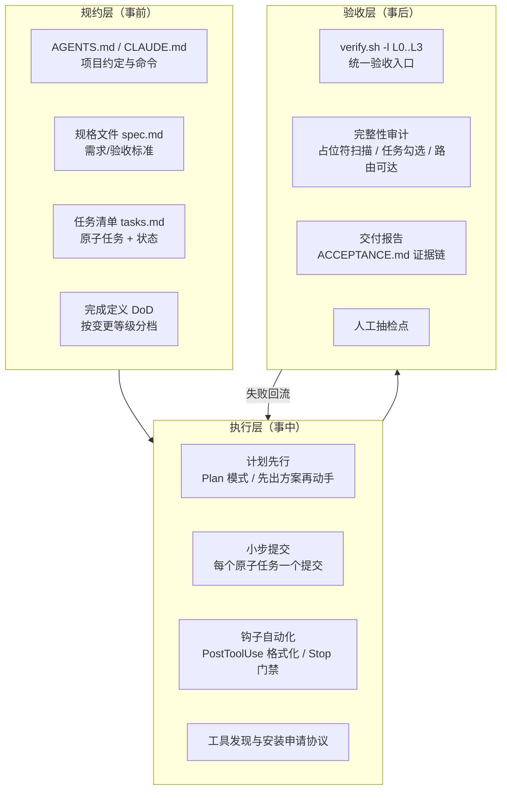
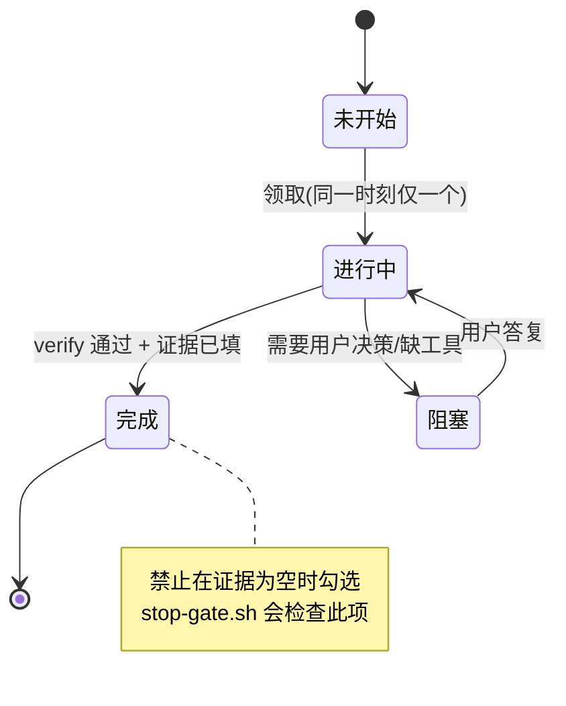
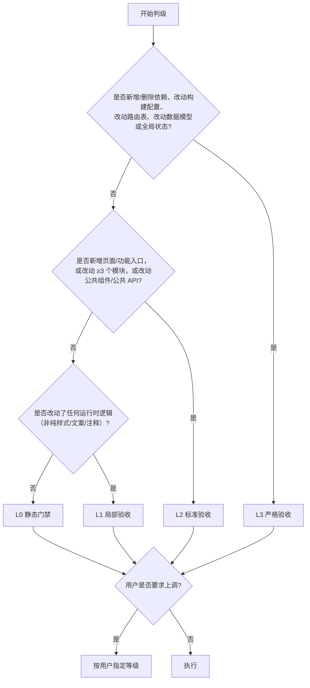
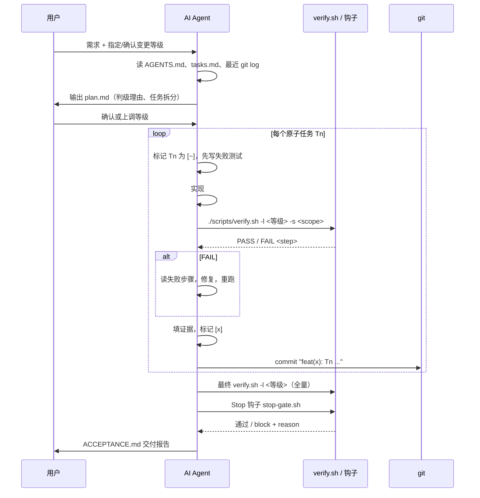

[toc]

## abstract

ai coding**问题:AI做任务为什么会"做一半"**?

在设计方案之前，先把病因说清楚，否则会陷入"加更多提示词"的无效循环。

| 根因                                        | 表现                                                         | 对应的治理手段（后文展开）      |
| ------------------------------------------- | ------------------------------------------------------------ | ------------------------------- |
| **缺少可运行的验证闭环**                    | AI在"看起来完成"时就停下；Claude Code官方文档明确指出，没有可运行的检查时，用户自己就成了验证回路 | 统一的`verify.sh`、钩子强制运行 |
| **完成定义（Definition of Done, DoD）隐式** | 用户心里的"做完"包含UI、接口、测试、文档，AI理解的"做完"只是"代码写了" | 显式DoD + 任务清单文件          |
| **任务粒度过大 / 上下文耗尽**               | 长任务中途上下文被挤占，后半截质量骤降甚至遗忘前文           | 原子化任务、断点续作协议        |
| **无法感知运行时**                          | 只改了代码没跑过页面，路由不可达、按钮无响应                 | 浏览器级E2E、冒烟脚本           |
| **弱模型倾向于"占位符式完成"**              | 留下`TODO`、`// 待实现`、空函数、硬编码假数据                | 完整性扫描（反占位符门禁）      |
| **验收强度与变更风险不匹配**                | 小改动过度测试浪费预算，大改动却只跑了lint                   | 变更分级矩阵（L0-L3）           |

**核心原则（必须记住）**：**让"完成"成为一个由机器判定的、可重复执行的事实，而不是AI的自我声明。**

---

## 总体框架：三层防线



三层的分工：

- **规约层**回答"做什么、做到什么程度算完"。这是AI最容易偷工减料的地方，因此必须**写进文件**而不是停留在对话里。
- **执行层**回答"怎么推进不跑偏"。核心是**让每一步都留下可检查的痕迹**（提交、任务状态、钩子输出）。
- **验收层**回答"怎么证明做完了"。核心是**分级的、可脚本化的门禁**，以及一份带证据的交付报告。

---

## 规约层：把"完成"写成文件

### 项目指令文件：AGENTS.md与CLAUDE.md

AGENTS.md是一个由OpenAI、Google、Cursor、Sourcegraph等组成的工作组推动的开放格式，2025年12月被捐赠给Linux基金会下的Agentic AI Foundation，定位是"给机器看的README"，用来告诉Agent项目的构建步骤、测试流程、代码规范（来源：agentic-ai.readthedocs.io；socket.dev）。Claude Code读取`CLAUDE.md`，Cursor读取`.cursor/rules/`，但多数工具已兼容`AGENTS.md`。**推荐做法**：以`AGENTS.md`为唯一事实源，`CLAUDE.md`只写一行`@AGENTS.md`引用（Claude Code支持该导入语法），避免多份文件漂移。

一个面向WebUI项目、专门强化"验收与完整性"的`AGENTS.md`骨架：

```markdown
# AGENTS.md

## 项目概览
React 18 + TypeScript + Vite 的待办管理 WebUI，后端为 REST API（见 docs/openapi.yaml）。

## 常用命令（必须使用这些，不要自己发明）
- 安装依赖: `pnpm install --frozen-lockfile`
- 启动开发: `pnpm dev`（端口 5173）
- 统一验收: `./scripts/verify.sh -l <L0|L1|L2|L3> [-s <scope>]`
- 环境自检: `./scripts/doctor.sh`

## 变更分级与验收等级（必须遵守）
按 docs/CHANGE_LEVELS.md 判定等级；在开始编码前，先在回复中声明本次变更等级及理由。

## 完成定义（DoD）
一个任务只有在以下全部满足时才能标记为 [x]：
1. `./scripts/verify.sh -l <本次等级>` 输出 `ALL PASS`
2. 变更文件中不存在 TODO / FIXME / 占位实现（见 scripts/completeness-check.sh）
3. tasks.md 中该任务的"验收标准"逐条有证据（测试名或截图路径）
4. 新增的 UI 入口在页面上可达（有路由、有导航、有 E2E 冒烟覆盖）

## 禁止事项
- 禁止在没有运行 verify.sh 的情况下宣称"已完成"
- 禁止用 `// @ts-ignore`、`eslint-disable`、`test.skip` 绕过门禁，除非在 tasks.md 中记录原因并获用户确认
- 禁止安装新依赖而不先走"安装申请"流程（见下）

## 工具安装申请协议
若需要的工具不存在，先运行 `command -v <tool>` 或 `pnpm ls <pkg>` 确认，然后输出：
用途 / 候选方案与取舍 / 安装命令 / 影响范围（dev 还是 prod 依赖）/ 是否可逆，等待用户确认后再执行。

## 断点续作
每完成一个原子任务，更新 tasks.md 状态并提交（conventional commits）。
会话重启时，先读 tasks.md 与最近 3 条 git log，从第一个未完成任务继续。
```

**应该**把`AGENTS.md`控制在一两百行内，细节放到`docs/`下用链接引用；过长的指令文件会被弱模型"选择性遗忘"。

### 规格与任务：规约驱动开发（Spec-Driven Development）

GitHub Spec Kit把流程固定为**Specify → Plan → Tasks → Implement → Converge**，并提供`constitution.md`（项目宪法，即不可妥协的原则）、`spec-template.md`、`plan-template.md`、`tasks-template.md`等模板和脚本（来源：GitHub Spec Kit官方站；微软开发者博客）。你不一定要用这个工具，但**应该**借用它的三份文件思想：

| 文件       | 回答的问题                                       | 对完整性的作用                 |
| ---------- | ------------------------------------------------ | ------------------------------ |
| `spec.md`  | 用户要什么、验收标准是什么（**用可测的句式写**） | 验收标准即测试用例的来源       |
| `plan.md`  | 技术方案、影响面、风险、变更等级                 | 事前确定验收等级，避免事后争论 |
| `tasks.md` | 拆成的原子任务、依赖顺序、每条的验收证据         | 状态机式推进，防止"做一半"     |

验收标准**推荐**用EARS句式（Easy Approach to Requirements Syntax）或Given-When-Then，例如："**当**用户在筛选框选择标签"工作"**时**，**系统应**只显示含该标签的待办，**且**URL查询参数更新为`?tag=工作`"。这类句子可以几乎一对一翻译成Playwright用例，弱模型也不容易理解偏差。

### 任务清单的格式与状态机

`tasks.md`是防止"做一半"的**最关键文件**。推荐格式：

```markdown
# tasks.md — 功能: 待办标签筛选（变更等级: L2）

## T1 [x] 数据层: Todo 类型新增 tags 字段
- 验收: `vitest run src/models` 通过；`tsc --noEmit` 通过
- 证据: 提交 a1b2c3d；测试 `todo.model.test.ts > tags 默认为空数组`

## T2 [x] API 层: GET /todos 支持 ?tag= 查询
- 验收: MSW mock 更新；`todos.api.test.ts` 新增 2 个用例
- 证据: 提交 d4e5f6a

## T3 [ ] UI: 筛选下拉组件 TagFilter
- 验收: 组件测试覆盖"选择后触发 onChange"；a11y 无 violations
- 证据: （待填）

## T4 [ ] 集成: 筛选与列表联动 + URL 同步
- 验收: E2E `@smoke` 用例 "选择标签后列表只剩匹配项且 URL 含 tag"
- 证据: （待填）

## T5 [ ] 收尾: 文档、CHANGELOG、verify.sh -l L2 全绿
```

状态语义：`[ ]`未开始、`[~]`进行中（**同一时刻最多一个**）、`[x]`完成且有证据、`[!]`阻塞（必须写阻塞原因与需要用户决定的问题）。



---

## 变更分级与验收等级矩阵

这是你特别关心的部分：**不同程度的改动走不同强度的验收**。

### 四个验收等级

| 等级   | 名称     | 必跑内容                                                     | 典型耗时  | 适用场景                                                     |
| ------ | -------- | ------------------------------------------------------------ | --------- | ------------------------------------------------------------ |
| **L0** | 静态门禁 | 格式化、Lint、类型检查                                       | 秒级      | 文案、样式微调、注释、纯重命名                               |
| **L1** | 局部验收 | L0 + 受影响目录的单元/组件测试                               | 1-2分钟   | 已有功能的逻辑微调、修小bug                                  |
| **L2** | 标准验收 | L1 + 全量单测（含覆盖率）+ 集成测试 + 生产构建 + E2E冒烟（`@smoke`） | 5-10分钟  | 中等功能迭代、跨2-3个模块的修改、新增页面                    |
| **L3** | 严格验收 | L2 + 全量E2E + 视觉回归 + 无障碍 + 性能预算 + 依赖审计 + 人工抽检 | 15-40分钟 | 新的大功能、数据模型/路由/状态管理重构、升级框架、引入新依赖 |

### 自动判级规则

**必须**在`docs/CHANGE_LEVELS.md`中写成可判定的规则，让AI在计划阶段自己判级并说明理由，用户只需确认或上调（**只允许上调，不允许AI自行下调**）。



判级规则中各判据的说明：

| 判据                       | 为什么它决定等级                                         |
| -------------------------- | -------------------------------------------------------- |
| 依赖/构建配置变更          | 影响整个产物，且是供应链风险入口，必须审计并全量回归     |
| 路由表、数据模型、全局状态 | 属于"地基"，一处错误会让用户"根本无法使用"               |
| 新增功能入口               | 用户可见面扩大，必须验证"可达性"（有导航、能打开、能用） |
| 公共组件/公共API           | 影响面不可预知，需要全量单测而非局部                     |
| 模块数阈值（≥3）           | 经验值，用来识别"看似小改实则横跨多处"的情况             |

**避免**让AI以"改动行数少"作为降级理由——改一行路由守卫可能让全站白屏。

### 不同变更类型的额外要求

| 变更类型                           | 等级下限 | 额外要求                                                     |
| ---------------------------------- | -------- | ------------------------------------------------------------ |
| 微调已有功能（文案、间距、默认值） | L0/L1    | 若涉及快照，更新并在报告中附截图对比                         |
| 修复bug                            | L1       | **必须先写复现测试（红）再修（绿）**，报告中附该测试名       |
| 中等功能迭代                       | L2       | tasks.md至少含"集成"与"收尾"两个任务                         |
| 新大功能                           | L3       | 必须有`spec.md`与`plan.md`；人工走查用户旅程；灰度/特性开关建议 |
| 重构（无行为变化）                 | L2起     | 重构前后E2E用例集不得修改（"黄金用例"锁定行为）              |
| 升级框架/大依赖                    | L3       | 在独立分支进行，附升级日志与破坏性变更清单                   |
| 安全相关（鉴权、输入处理）         | L3       | 增加Semgrep扫描与人工审查                                    |

---

## 验收层：WebUI的测试分层与工具选型

### 测试分层（WebUI版测试金字塔）

| 层          | 验证对象                     | 推荐工具                                                     | 典型用例（以待办应用为例）                            |
| ----------- | ---------------------------- | ------------------------------------------------------------ | ----------------------------------------------------- |
| 静态        | 格式、Lint、类型、死代码     | Biome（或ESLint+Prettier）、`tsc --noEmit`、knip             | `tags`字段类型未在所有使用处更新会被`tsc`拦下         |
| 单元        | 纯函数、store、工具          | Vitest                                                       | `filterByTag(todos, "工作")`只返回匹配项              |
| 组件        | 渲染、交互、可访问性属性     | Vitest + Testing Library（React/Vue）+ jsdom 或 Vitest Browser Mode | `TagFilter`选择后触发`onChange`且有`aria-label`       |
| 集成        | 组件 + 网络层 + 路由         | Vitest + MSW（Mock Service Worker）                          | 选择标签后发起`GET /todos?tag=工作`并渲染结果         |
| E2E         | 真实浏览器中的用户旅程       | Playwright                                                   | 打开首页 → 选"工作" → 列表仅剩匹配项 → 刷新后筛选保留 |
| 视觉回归    | 像素级/布局回归              | Playwright `toHaveScreenshot()`                              | 筛选栏在移动端不换行溢出                              |
| 无障碍      | WCAG违规                     | `@axe-core/playwright`                                       | 下拉无可访问名称会被报出                              |
| 性能        | 包体积、Web Vitals           | size-limit、Lighthouse CI                                    | 新增依赖导致首包增加超过预算                          |
| 安全/供应链 | 已知漏洞、密钥泄露、危险模式 | `pnpm audit`、gitleaks、Semgrep                              | 误提交`.env`被拦截                                    |

**对弱模型的建议**：把精力集中在**类型检查 + 组件测试 + E2E冒烟**这三层。类型检查对AI代码的"拦截性价比"最高；E2E冒烟能直接证明"用户能用"。

### 工具选型与权衡

| 用途            | 推荐                                    | 备选                             | 取舍说明                                                     |
| --------------- | --------------------------------------- | -------------------------------- | ------------------------------------------------------------ |
| 格式+Lint       | **Biome**                               | ESLint + Prettier                | Biome单二进制、速度快、配置少，对AI友好；但部分框架插件生态（如某些Vue规则）仍是ESLint更全，可按需保留ESLint |
| 单元/组件测试   | **Vitest**                              | Jest                             | 与Vite同构、ESM原生、速度快；Jest生态更老但在非Vite项目仍常见 |
| E2E             | **Playwright**                          | Cypress                          | Playwright多浏览器、并行好、自带trace与截图断言；Cypress调试体验好但并行需付费 |
| 网络Mock        | **MSW**                                 | 手写fetch mock                   | MSW在组件测试与浏览器中同一套handler，减少重复               |
| Git钩子         | **lefthook**                            | husky + lint-staged              | lefthook跨平台单二进制、配置为YAML、并行执行；husky依赖shell脚本，Windows上偶有兼容问题 |
| 提交规范        | commitlint + Conventional Commits       | 无                               | 让AI的提交消息可被机器解析，便于生成CHANGELOG                |
| 死代码          | knip                                    | ts-prune                         | 发现AI新增但从未接入的组件/导出，这是"做一半"的典型痕迹      |
| 浏览器给Agent用 | **Playwright CLI**（大代码库、低token） | Playwright MCP（探索型、headed） | Playwright官方文档对比：MCP的token开销更高（工具schema与快照进入上下文），CLI输出更简洁、默认无头，更适合Claude Code/Copilot这类编码Agent |

关于Playwright MCP与CLI的选择再强调一下：**对弱模型，优先CLI方式**。弱模型在面对大量MCP工具schema时更容易混乱；而让它运行`pnpm exec playwright test --grep @smoke`并阅读失败输出，路径更短。MCP适合在"探索性走查"阶段由较强模型使用。

### 工具发现与安装申请协议

AI经常在"工具不存在"时做出两种错误行为：静默跳过该步骤（导致验收缺失），或擅自安装大量依赖。**应该**用一个环境自检脚本和一份协议解决：

```bash
#!/usr/bin/env bash
# scripts/doctor.sh - 环境自检: 列出验收链路所需工具的存在性与版本
# 用法: ./scripts/doctor.sh [--json]
# 退出码: 0 全部存在; 1 存在缺失(缺失项以 "MISSING <name> : <install hint>" 输出)
set -uo pipefail

JSON=0; [[ "${1:-}" == "--json" ]] && JSON=1
missing=0

check_bin() {   # check_bin <命令> <安装提示>
  if command -v "$1" >/dev/null 2>&1; then
    echo "OK      $1 : $("$1" --version 2>/dev/null | head -1)"
  else
    echo "MISSING $1 : $2"; missing=1
  fi
}
check_pkg() {   # check_pkg <npm包名> <安装提示>
  if pnpm ls "$1" --depth 0 >/dev/null 2>&1 && pnpm ls "$1" --depth 0 | grep -q "$1"; then
    echo "OK      $1"
  else
    echo "MISSING $1 : $2"; missing=1
  fi
}

check_bin node   "安装 Node.js >= 20 (建议 fnm/nvm 管理)"
check_bin pnpm   "corepack enable && corepack prepare pnpm@latest --activate"
check_bin git    "安装 git"
check_pkg vitest "pnpm add -D vitest @testing-library/react jsdom"
check_pkg "@playwright/test" "pnpm add -D @playwright/test && pnpm exec playwright install chromium"
check_pkg "@biomejs/biome"   "pnpm add -D @biomejs/biome"
check_pkg msw    "pnpm add -D msw"

# Playwright 浏览器二进制是否已下载(仅检查 chromium)
if pnpm exec playwright --version >/dev/null 2>&1; then
  if ! ls "${PLAYWRIGHT_BROWSERS_PATH:-$HOME/.cache/ms-playwright}" 2>/dev/null | grep -q chromium; then
    echo "MISSING playwright-chromium : pnpm exec playwright install chromium (国内可设 PLAYWRIGHT_DOWNLOAD_HOST 镜像)"
    missing=1
  fi
fi

exit $missing
```

脚本中关键占位与约定说明：

| 项                            | 含义                                                         |
| ----------------------------- | ------------------------------------------------------------ |
| `check_bin <命令> <安装提示>` | 检查系统级可执行文件；提示文本会原样输出给AI作为"安装申请"的素材 |
| `check_pkg <包名> <安装提示>` | 检查项目级npm依赖（通过`pnpm ls`）                           |
| `PLAYWRIGHT_BROWSERS_PATH`    | Playwright浏览器缓存目录环境变量，CI中常自定义以便缓存       |
| `MISSING xxx : hint` 行格式   | 固定格式，便于AI或钩子用`grep ^MISSING`解析                  |

**安装申请协议**（写入`AGENTS.md`，上文已给出）要求AI在发现`MISSING`后，输出一段结构化申请而不是直接安装：

- 用途：为什么这个步骤需要该工具（对应哪条验收标准）
- 候选与取舍：至少两个候选及选择理由（给用户决策空间）
- 安装命令与影响范围：dev依赖还是prod依赖、是否改动lockfile、是否需要下载二进制（如浏览器）
- 可逆性：如何卸载
- 然后**等待用户确认**

在Claude Code中，**可以**把高频且安全的安装命令加入`.claude/settings.json`的`permissions.allow`（如`Bash(pnpm add -D *)`）减少打断；但`pnpm add`（非`-D`）、`npm i -g`、`curl | sh`这类**应该**保持需要确认。

---

## 执行层：钩子、统一验收入口与推进纪律

### 统一验收入口`scripts/verify.sh`

Claude Code官方最佳实践的第一条就是"给Claude一个它能运行的检查"——测试、构建或截图对比——这样它会执行工作、运行检查、读取结果、迭代直到通过，而不是在"看起来完成"时停下。统一入口的价值在于：**AI不需要记住十几条命令，只需记住一条和一个等级参数**。

完整脚本如下（我已在沙箱中做过语法检查；它假设pnpm + Biome + Vitest + Playwright技术栈，其他栈替换对应命令即可）：

```bash
#!/usr/bin/env bash
# verify.sh - 统一验收入口脚本（供人类与 AI Agent 共用）
#
# 用法:
#   ./scripts/verify.sh [-l LEVEL] [-s SCOPE] [--no-e2e] [--ci]
#
# 选项:
#   -l, --level LEVEL   验收等级: L0 | L1 | L2 | L3 (默认: L1)
#   -s, --scope SCOPE   限定测试范围(目录或 glob), 仅对 L0/L1 生效, 例: src/features/todo
#       --no-e2e        跳过 E2E(浏览器)步骤, 用于无浏览器的环境
#       --ci            CI 模式: 不启动 dev server, 使用 CI 报告格式
#
# 退出码: 0 = 全部通过; 非 0 = 存在失败步骤(第一处失败即停止, fail-fast)
# 约定: 每个步骤成功打印 "==> PASS <step>", 失败打印 "==> FAIL <step>", 便于 AI 解析。

set -euo pipefail

LEVEL="L1"; SCOPE=""; RUN_E2E=1; CI_MODE=0

while [[ $# -gt 0 ]]; do
  case "$1" in
    -l|--level) LEVEL="$2"; shift 2 ;;
    -s|--scope) SCOPE="$2"; shift 2 ;;
    --no-e2e) RUN_E2E=0; shift ;;
    --ci) CI_MODE=1; shift ;;
    -h|--help) sed -n '2,16p' "$0"; exit 0 ;;
    *) echo "未知参数: $1" >&2; exit 2 ;;
  esac
done

step() {                      # step <名称> <命令...>
  local name="$1"; shift
  echo "==> RUN  $name"
  if "$@"; then echo "==> PASS $name"; else echo "==> FAIL $name" >&2; exit 1; fi
}
level_ge() {                  # level_ge L2 : 当前 LEVEL >= L2 时为真
  local want="${1#L}" cur="${LEVEL#L}"; [[ "$cur" -ge "$want" ]]
}

# ---------- L0: 静态检查 ----------
step "format-check" pnpm exec biome format .
step "lint"         pnpm exec biome lint .
step "typecheck"    pnpm exec tsc --noEmit

# ---------- L1: 单测 ----------
if level_ge L1; then
  if [[ -n "$SCOPE" ]] && ! level_ge L2; then
    step "unit-test(scope)" pnpm exec vitest run "$SCOPE"
  else
    step "unit-test(all)"   pnpm exec vitest run --coverage
  fi
fi

# ---------- L2: 集成 + 构建 + 冒烟 ----------
if level_ge L2; then
  step "integration-test" pnpm exec vitest run --project integration
  step "build"            pnpm run build
  [[ "$RUN_E2E" -eq 1 ]] && step "e2e-smoke" pnpm exec playwright test --grep "@smoke"
fi

# ---------- L3: 全量 + 质量门禁 ----------
if level_ge L3; then
  if [[ "$RUN_E2E" -eq 1 ]]; then
    step "e2e-full"          pnpm exec playwright test
    step "visual-regression" pnpm exec playwright test --project visual
    step "a11y"              pnpm exec playwright test --grep "@a11y"
  fi
  step "bundle-size" pnpm exec size-limit
  step "dep-audit"   pnpm audit --audit-level=high
  [[ "$CI_MODE" -eq 0 ]] && step "lighthouse" pnpm exec lhci autorun
fi

echo "==> ALL PASS (level=$LEVEL scope=${SCOPE:-all})"
```

脚本中各占位符与约定说明：

| 占位符/约定                                  | 含义与注意                                                   |
| -------------------------------------------- | ------------------------------------------------------------ |
| `LEVEL`（`L0`-`L3`）                         | 验收等级，与变更分级矩阵一一对应；`level_ge`通过去掉前缀`L`后比较数字实现"向上包含" |
| `SCOPE`                                      | 仅在L0/L1生效的测试范围（目录或glob），用于"局部小验收"；L2及以上强制全量，防止AI借范围缩小逃避 |
| `--project integration` / `--project visual` | Vitest与Playwright的"项目"概念，分别在`vitest.config.ts`的`test.projects`与`playwright.config.ts`的`projects`中定义 |
| `--grep "@smoke"` / `"@a11y"`                | Playwright按用例标题中的标签筛选；要求AI在写用例时把核心旅程标为`@smoke` |
| `==> PASS/FAIL <step>`                       | 固定输出格式，弱模型读取失败步骤名比读完整日志容易得多       |
| `--ci`                                       | CI下跳过需要本地服务的步骤（如Lighthouse），改由CI工作流单独处理 |

**跨平台提示**：Windows用户用Git Bash或WSL运行该脚本；若团队以Windows为主，**可以**改写为`scripts/verify.ps1`或用Node脚本（`scripts/verify.mjs`）实现同样逻辑，`package.json`中统一暴露为`pnpm verify -- -l L2`。

### 用钩子把门禁变成"无法绕过"

Claude Code的钩子生命周期：每会话的`SessionStart`/`SessionEnd`，每轮的`UserPromptSubmit`/`Stop`/`StopFailure`，每次工具调用的`PreToolUse`/`PostToolUse`（以及`PostToolUseFailure`、`PostToolBatch`）。钩子可以返回`{"continue": false, "stopReason": "..."}`来完全停止，或在`Stop`事件中注入`additionalContext`提示（如"完成前请运行测试套件"）；官方文档也给出了`PostToolUse`匹配`Write`后异步跑测试脚本的示例（来源：Claude Code Hooks reference）。

两条最有价值的钩子：

```json
{
  "hooks": {
    "PostToolUse": [
      {
        "matcher": "Edit|Write|MultiEdit",
        "hooks": [
          {
            "type": "command",
            "command": "pnpm exec biome check --write \"$(jq -r '.tool_input.file_path')\" >/dev/null 2>&1; true"
          }
        ]
      }
    ],
    "Stop": [
      {
        "hooks": [
          { "type": "command", "command": "./scripts/stop-gate.sh" }
        ]
      }
    ]
  }
}
```

说明：

| 字段                   | 含义                                                         |
| ---------------------- | ------------------------------------------------------------ |
| `matcher`              | 匹配工具名的正则；`Edit|Write|MultiEdit`表示所有写文件操作   |
| `tool_input.file_path` | 钩子从标准输入收到的JSON中，被编辑文件的路径（用`jq`提取）   |
| `; true`               | 保证格式化失败不打断会话（格式问题留给`verify.sh`正式报告）  |
| `Stop`钩子             | Claude准备结束回合时触发；`stop-gate.sh`在此检查完整性，不满足则**阻止结束并把原因回灌** |

`stop-gate.sh`的核心逻辑（简化示例）：

```bash
#!/usr/bin/env bash
# scripts/stop-gate.sh - Stop 钩子: 结束回合前的完整性门禁
# 输入: 标准输入为钩子 JSON(含 stop_hook_active 等字段)
# 输出: 若需阻止结束, 打印 {"decision":"block","reason":"..."} 并退出 0
set -uo pipefail
input="$(cat)"
# 防止无限循环: 若本次已是由 stop 钩子触发的继续, 放行
if echo "$input" | jq -e '.stop_hook_active == true' >/dev/null 2>&1; then exit 0; fi

reasons=()
# 1) tasks.md 存在"进行中"任务
if [[ -f tasks.md ]] && grep -qE '^\#\# T[0-9]+ \[~\]' tasks.md; then
  reasons+=("tasks.md 存在状态为 [~] 的任务，请完成并填入证据后再结束")
fi
# 2) 已完成任务缺少证据
if [[ -f tasks.md ]] && awk '/^\#\# T[0-9]+ \[x\]/{f=1} f&&/证据: （待填）/{print; exit 1}' tasks.md >/dev/null; then :; else
  reasons+=("tasks.md 存在已勾选但证据为（待填）的任务")
fi
# 3) 工作区变更文件中的占位符
if ! ./scripts/completeness-check.sh >/tmp/completeness.log 2>&1; then
  reasons+=("完整性扫描未通过: $(head -5 /tmp/completeness.log | tr '\n' ' ')")
fi

if [[ ${#reasons[@]} -gt 0 ]]; then
  msg=$(printf '%s; ' "${reasons[@]}")
  jq -nc --arg r "$msg" '{"decision":"block","reason":$r}'
fi
exit 0
```

`stop_hook_active`字段用于**避免钩子与模型互相触发形成死循环**，这是官方文档强调的注意点；若你的工具版本字段名不同，请以其钩子文档为准。

Cursor、Windsurf、Codex CLI等其他工具若无等价钩子机制，退而求其次的做法是：**用lefthook的`pre-commit`/`pre-push`钩子跑同样的门禁**，并在`AGENTS.md`中规定"每个任务必须以提交结束"——提交就被迫过门禁。

```yaml
# lefthook.yml
pre-commit:
  parallel: true
  commands:
    verify-l0:
      run: ./scripts/verify.sh -l L0
    completeness:
      run: ./scripts/completeness-check.sh
pre-push:
  commands:
    verify-l1:
      run: ./scripts/verify.sh -l L1
```

### 推进纪律：计划先行、小步提交、断点续作

- **必须**先计划后编码：对L2及以上变更，要求AI先输出`plan.md`（含判级理由、影响文件清单、tasks拆分），用户确认后再开始。Claude Code有Plan模式，其他工具可在提示中要求"只输出计划，不要改代码"。
- **必须**一任务一提交：提交消息遵循Conventional Commits并带任务编号，例如`feat(todo): T3 add TagFilter component`。这让"做到哪了"可以从`git log`中恢复。
- **应该**限制单任务规模：一个原子任务改动不超过约5个文件、一个会话不超过约5个任务；超出则拆分。弱模型尤其需要更小的粒度。
- **应该**采用"红-绿-重构"顺序修bug和加功能：先写失败测试，再实现，让AI无法跳过测试。
- **避免**在一个会话里混合多个不相关变更；上下文污染会显著降低完成度。



---

## 完整性专项：反"做一半"的硬机制

完整性是你最强调的点，它需要**几道互相独立的防线**，任何一道单独都会被弱模型绕过。

### 完整性扫描脚本

```bash
#!/usr/bin/env bash
# scripts/completeness-check.sh - 扫描本次变更中的"未完成痕迹"
# 用法: ./scripts/completeness-check.sh [BASE_REF]   (默认与 origin/main 比较; 工作区未提交改动也包含)
# 退出码: 0 无问题; 1 发现问题(逐行输出 文件:行:内容)
set -uo pipefail
BASE="${1:-origin/main}"
files=$( { git diff --name-only "$BASE"...HEAD; git diff --name-only; git ls-files --others --exclude-standard; } \
        | sort -u | grep -E '\.(ts|tsx|js|jsx|vue|svelte|css|scss|md)$' | grep -v -E '^(node_modules|dist)/' || true)
[[ -z "$files" ]] && { echo "无变更文件"; exit 0; }

bad=0
# 1) 占位符与逃逸标记
pat='TODO|FIXME|XXX|HACK|待实现|占位|placeholder|not implemented|throw new Error\("TODO|@ts-ignore|@ts-expect-error|eslint-disable|biome-ignore|\.skip\(|\.only\(|console\.log\('
# shellcheck disable=SC2086
if grep -nE "$pat" $files; then bad=1; fi
# 2) 空实现: 形如 "=> {}" 或函数体仅有 return null/undefined (启发式)
# shellcheck disable=SC2086
if grep -nE '=>\s*\{\s*\}|\{\s*return (null|undefined);?\s*\}' $files | grep -vE 'noop|test'; then bad=1; fi
# 3) 新增组件未被任何地方引用(依赖 knip)
if command -v knip >/dev/null 2>&1 || pnpm ls knip --depth 0 >/dev/null 2>&1; then
  pnpm exec knip --no-progress --reporter compact || bad=1
fi
exit $bad
```

正则中各模式的意图：

| 模式                                             | 捕获的"做一半"形态                                  |
| ------------------------------------------------ | --------------------------------------------------- |
| `TODO/FIXME/待实现/占位/placeholder`             | 显式承认未完成                                      |
| `not implemented` / `throw new Error("TODO`      | 桩函数                                              |
| `@ts-ignore` / `eslint-disable` / `biome-ignore` | 绕过静态门禁                                        |
| `.skip(` / `.only(`                              | 绕过或缩小测试集                                    |
| `console.log(`                                   | 调试残留（可按团队规范放宽）                        |
| `=> {}`、`{ return null; }`                      | 空实现（启发式，允许`noop`命名例外）                |
| knip                                             | 新建但从未接入的文件/导出，即"组件写了但没放进页面" |

**注意**：该脚本在L0就应运行（见lefthook配置），且弱模型越弱，这道扫描越重要。

### 可达性验证（WebUI特有）

"功能写了但用户找不到入口"是WebUI开发中最隐蔽的半成品。要求：

- 每个新增页面或功能入口，在`tasks.md`中必须有一条"可达性"验收：从首页通过**真实点击路径**到达，并有`@smoke`标签的E2E用例。
- **可以**维护一个`e2e/routes.spec.ts`，遍历路由表逐个访问并断言无控制台错误、无"404"文案、主标题存在；新增路由却没有加导航时，该用例的"导航可达"断言会失败。

```ts
// e2e/routes.spec.ts（示意）
import { test, expect } from "@playwright/test";
import { routes } from "../src/router/routes"; // 路由表作为单一事实源

for (const r of routes.filter(x => !x.hidden)) {
  test(`@smoke 路由可达: ${r.path}`, async ({ page }) => {
    const errors: string[] = [];
    page.on("pageerror", e => errors.push(e.message));
    await page.goto(r.path);
    await expect(page.getByRole("heading", { level: 1 })).toBeVisible();
    expect(errors).toEqual([]);
  });
}
```

### 交付报告模板`ACCEPTANCE.md`

要求AI在任务结束时**生成而非口述**一份带证据的报告，弱模型尤其需要模板约束：

```markdown
# 验收报告 — 待办标签筛选

- 变更等级: L2（理由: 新增功能入口 + 改动 3 个模块；未改动路由表/数据模型外的地基）
- 验收命令: `./scripts/verify.sh -l L2`
- 结果: ALL PASS（输出见 reports/verify-20xx-xx-xx.log）
- 提交范围: a1b2c3d..f7e8d9c（5 个提交，对应 T1-T5）

## 验收标准逐条对照
| 标准 | 证据 |
| --- | --- |
| 选择标签后仅显示匹配待办 | e2e/todo-filter.spec.ts > "@smoke 按标签筛选" |
| URL 同步 ?tag= | 同上，断言 `expect(page).toHaveURL(/tag=/)` |
| 刷新保留筛选 | e2e/todo-filter.spec.ts > "刷新后保留" |
| 下拉可访问 | e2e/a11y.spec.ts > "@a11y 筛选栏无 violations" |

## 完整性
- completeness-check.sh: 通过
- knip: 无未引用导出
- tasks.md: 5/5 完成，证据齐全

## 未做与风险（必须如实填写）
- 未做: 标签多选（不在本次 spec 范围）
- 风险: 标签数超过 50 时下拉未虚拟化，性能未测

## 需要用户决策
- 无
```

**"未做与风险"一节必须存在且允许非空**。给AI一个合法的"说没做"的地方，它才不会把没做的事伪装成做了。

---

## 弱模型适配策略

当你使用的模型能力有限（本地小模型、低价位模型、或某些工具中的"快速模式"）时，**应该**系统性地降低对模型判断力的依赖，提高对机制的依赖：

| 维度       | 强模型做法           | 弱模型做法                                                   |
| ---------- | -------------------- | ------------------------------------------------------------ |
| 任务粒度   | 一个任务可跨多个文件 | **一个任务 = 一个文件或一个组件**，tasks.md由人或强模型预先拆好 |
| 判级       | AI自判，用户确认     | **用户指定**等级，AI只执行                                   |
| 验收命令   | 自己选择范围         | 固定命令，由`AGENTS.md`给出"复制即可用"的命令行              |
| 输出格式   | 自由                 | **模板化**（计划模板、报告模板、提交消息模板）               |
| 浏览器工具 | MCP或CLI皆可         | Playwright CLI + 预写好的`@smoke`用例，不要求它即兴探索      |
| 失败处理   | 读完整日志自修       | `verify.sh`输出`FAIL <step>`，要求"只修这一步，重跑，连续3次失败则标记`[!]`并停止" |
| 代码评审   | 可省略               | **强模型或人类做二次评审**（可用另一会话，提示"只审查不修改，列出问题清单"） |
| 上下文     | 可长会话             | 一任务一会话，靠`tasks.md` + `git log`续作                   |

一个专门给弱模型的任务提示模板（放在`docs/prompts/task.md`，每次复制使用）：

```markdown
你正在执行 tasks.md 中的任务 T3。只做 T3，不要碰其他任务。
步骤（严格按顺序）：
1. 把 T3 标记为 [~]。
2. 先在 src/components/TagFilter.test.tsx 写出 T3 验收标准对应的失败测试。
3. 实现 src/components/TagFilter.tsx 使测试通过。
4. 运行 `./scripts/verify.sh -l L1 -s src/components`，把输出最后 20 行贴出来。
5. 若出现 `==> FAIL`，只修复该步骤，最多重试 3 次；仍失败则把 T3 标记为 [!] 并写明原因，停止。
6. 通过后，在 tasks.md 的 T3 填写证据（测试名），标记 [x]，执行 `git commit -m "feat(todo): T3 add TagFilter"`。
禁止：留下 TODO；使用 test.skip；修改 verify.sh 或测试断言以让其通过。
```

---

## 综合案例：为待办WebUI新增"标签筛选"功能（L2全流程）

**场景**：一个React + TypeScript + Vite的待办应用已上线，有列表、新增、完成三个功能。现在要加"按标签筛选"，涉及数据类型、API查询参数、新组件、与列表联动、URL同步。

**判级**：新增功能入口、改动模型层/接口层/UI层三个模块，但未新增依赖、未改路由表（筛选在现有页面上）、数据模型只是**新增可选字段**（非破坏性）。按规则落在**L2**；若`tags`改成必填字段并需要数据迁移，则升为L3。

**流程**：

- AI读取`AGENTS.md`，输出`plan.md`：判级L2及理由、影响文件清单（`src/models/todo.ts`、`src/api/todos.ts`、`src/mocks/handlers.ts`、`src/components/TagFilter.tsx`、`src/pages/TodoList.tsx`、`e2e/todo-filter.spec.ts`）、拆成T1-T5（见前文`tasks.md`示例）。用户确认。
- T1数据层：先写`todo.model.test.ts`断言`tags`默认空数组，`tsc`报错指出所有构造`Todo`的地方——这正是类型检查替弱模型"找全改动点"。`verify.sh -l L1 -s src/models`通过，提交。
- T2接口层：更新MSW handler支持`?tag=`，写集成测试；提交。
- T3组件：组件测试 + `aria-label`；提交。
- T4联动与URL：E2E用例标`@smoke`，覆盖"选择→列表变化→URL变化→刷新保留"。这里AI第一次运行`verify.sh -l L2`，`e2e-smoke`失败：刷新后筛选丢失（因为只改了state没读URL）。AI按`FAIL e2e-smoke`修复后重跑通过；提交。
- T5收尾：CHANGELOG、`verify.sh -l L2`全量`ALL PASS`、`completeness-check.sh`通过、生成`ACCEPTANCE.md`。
- `Stop`钩子检查`tasks.md`：5/5有证据，放行。
- 人工抽检（L2建议抽检一条用户旅程）：用户在浏览器实际点一遍，核对报告中"未做与风险"一节。

**这个案例中，各机制分别拦住了什么**：类型检查拦住了漏改的构造点；E2E冒烟拦住了"刷新丢失"这种只看代码看不出来的bug；`tasks.md`证据栏迫使AI给每条验收标准指出测试名；`Stop`钩子保证它不会在T4失败时"先总结一下"然后结束。

---

## 跨平台、网络与非ASCII注意事项

### 跨平台

- **必须**在仓库根放`.gitattributes`：`* text=auto eol=lf`，并为`*.sh`追加`eol=lf`；否则Windows上检出的脚本带CRLF，在CI或WSL中会报`\r: command not found`。同时在`biome.json`/`.editorconfig`中固定`end_of_line = lf`。
- Windows本地推荐用WSL2或Git Bash运行脚本；若团队纯Windows，验收入口改为Node脚本以消除shell差异。
- lefthook比husky在Windows上更省心（单二进制，不依赖sh）。

### 网络（国内环境）

- npm源：`pnpm config set registry https://registry.npmmirror.com`；生产服务器在国外则在CI中不要带这项配置（用`.npmrc`按环境区分）。
- Playwright浏览器下载：设置`PLAYWRIGHT_DOWNLOAD_HOST`指向国内镜像（npmmirror提供Playwright二进制镜像，具体地址请以npmmirror站点当前说明为准）；或在能访问的机器上下载后设`PLAYWRIGHT_BROWSERS_PATH`共享缓存。
- 代理：*nix下`export HTTPS_PROXY=http://127.0.0.1:7890`（mihomo默认混合端口常为7890，以你的配置为准）；Windows PowerShell下`$env:HTTPS_PROXY="http://127.0.0.1:7890"`；CMD下`set HTTPS_PROXY=...`。Git可单独设`git config --global http.proxy`。
- GitHub资源（如从Release下载lefthook二进制）无代理时可用`gh-proxy`类镜像包裹原链接；镜像站可用性会变化，使用前请自行核实。

### 非ASCII字符

- **视觉回归在Linux CI上必须安装CJK字体**（如Debian系`fonts-noto-cjk`），否则中文渲染成方框，截图基线与本地不一致导致误报。
- Playwright截图基线按平台分目录（默认文件名带平台后缀），团队混用macOS/Windows/Linux时**应该**统一在Docker容器内生成基线。
- Windows终端运行测试时若中文输出乱码，用`chcp 65001`或设置PowerShell的`[Console]::OutputEncoding`为UTF-8；AI解析日志时乱码会误判。
- 测试用例标题中的中文完全可用（本文示例即如此），但`--grep`传中文在部分Windows shell下需要注意引号与编码。

---

## 落地清单

**必须**：

- 仓库内有`AGENTS.md`（含命令、DoD、禁止事项、安装申请协议）
- 有统一验收入口`scripts/verify.sh`（或等价Node脚本）支持`-l L0..L3`
- 有`docs/CHANGE_LEVELS.md`判级规则，AI只能上调不能下调
- 每个L1及以上变更有`tasks.md`，任务带验收标准与证据栏
- 有完整性扫描（占位符、逃逸标记、未引用导出）并接入pre-commit
- L2及以上必须包含生产构建 + 浏览器级冒烟
- 交付以`ACCEPTANCE.md`为准，含"未做与风险"一节

**应该**：

- 使用Claude Code钩子（`PostToolUse`格式化、`Stop`门禁）或lefthook实现"无法绕过"
- 修bug先写复现测试；重构锁定黄金E2E用例
- 弱模型采用一任务一会话、模板化提示、强模型/人类二审
- 新增路由走"路由表遍历可达性"用例
- `.gitattributes`固定LF；CI安装CJK字体

**可以**：

- 引入GitHub Spec Kit或Kiro式的spec/plan/tasks模板
- L3增加Lighthouse CI、size-limit、Semgrep、gitleaks、Stryker变异测试（仅核心逻辑）
- 用Playwright MCP做探索性走查（强模型、headed模式）

**避免**：

- 让AI口头宣称"已通过测试"而不贴命令输出
- 以改动行数作为降级理由
- 在一个会话里混合多个变更
- 允许`test.skip`/`@ts-ignore`无记录地出现
- 让AI擅自安装依赖或修改验收脚本与测试断言"让它变绿"
