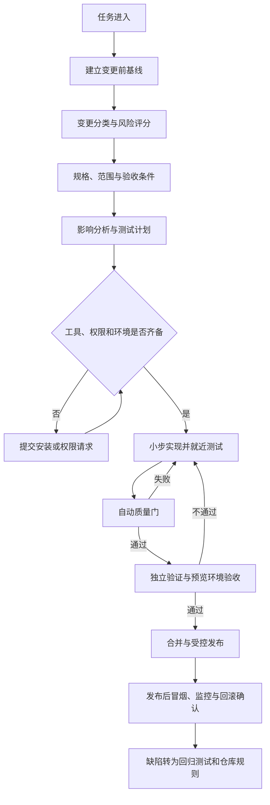
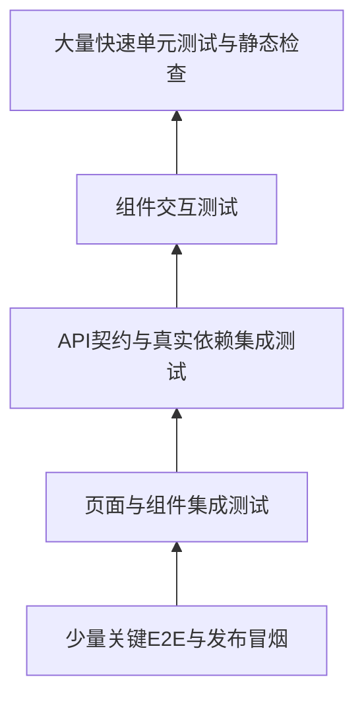

[toc]


## 核心结论

**提高AI Coding可靠性的关键，不是把提示词写得更长，也不是反复要求模型“认真检查”，而是把AI放进一个无法轻易跳过验证的工程系统。**

建议建立一套**可验证交付系统（Verifiable Delivery System，VDS）**：

> **可信交付 = 明确规格 × 风险分级 × 可执行验证 × 独立复核 × 证据留存 × 可回滚发布**

这里使用乘法，是为了强调：任何一项接近零，整体可靠性都会显著下降。

必须落实以下原则：

- **AI的文字声明不是完成证据。**
- **“测试通过”必须意味着测试命令真实执行并产生退出码、日志和报告。**
- **“功能完成”必须意味着所有验收条件都映射到了实现和测试证据。**
- **实现者不能单独担任最终验收者。**
- **测试等级必须由变更风险决定，不能由AI自行降低。**
- **任何被跳过的测试、缺少的工具和无法验证的项目都必须显式报告。**
- **遇到阻塞时允许停下并请求权限，但不允许将“部分完成”包装成“已完成”。**
- **大功能和高风险功能必须经过预览环境、独立验收、发布保护、监控和回滚验证。**

NIST SSDF强调把安全开发实践整合进整个软件生命周期，并根据具体风险选择适当措施；OWASP ASVS提供“验证什么”的安全要求基线，WSTG提供“如何测试”的Web安全测试方法。这些都支持采用**风险驱动、贯穿生命周期、结果可验证**的开发方式。

---

## 调研方法与主要发现

本轮采用了多轮迭代检索，主要覆盖以下类别：

| 类别         | 初始搜索方向                              | 后续发现的新线索                                          | 对方案的影响                                   |
| ------------ | ----------------------------------------- | --------------------------------------------------------- | ---------------------------------------------- |
| 安全开发标准 | NIST SSDF、OWASP ASVS、WSTG               | ASVS 5.0、风险分级验证、版本化测试场景                    | 将安全要求纳入验收矩阵，而不是发布前临时扫描   |
| AI编码可靠性 | Agent workflow、Coding agent instructions | Harness Engineering、Agent Legibility、Structured Handoff | 仓库必须成为AI可读取的“工程事实源”             |
| 长任务完整性 | Long-running agents                       | 初始化代理、任务清单、进度文件、上下文重置                | 大任务必须分片、持久化状态并逐项关闭           |
| AI评估       | Agent evals、graders                      | Outcome、trace、multiple trials、eval-driven development  | 验收应检查环境最终状态，而不是AI的过程描述     |
| WebUI测试    | Playwright、Testing Library、Storybook    | Auto-wait、用户语义定位、交互测试、视觉测试               | 建立组件—集成—E2E—视觉—可访问性分层            |
| 接口与依赖   | Contract testing、API mocking             | Pact、MSW、Testcontainers                                 | 避免所有接口只用假数据，也避免全部依赖昂贵E2E  |
| 测试有效性   | Coverage、mutation testing                | Stryker、变异测试、按文件覆盖阈值                         | 覆盖率仅作底线，关键逻辑用变异测试验证断言质量 |
| 供应链与发布 | SLSA、SBOM、CI gates                      | Provenance、SPDX、依赖审查、部署保护                      | 发布物应可追溯，并受合并及部署门禁保护         |
| 替代方案发现 | Playwright/Cypress/WebdriverIO等          | 自托管与SaaS视觉测试候选                                  | 不做“唯一最佳工具”结论，要求真实项目PoC        |

发现的关键术语包括：

- **Harness Engineering（代理支架工程）**
- **Agent Legibility（代理可理解性）**
- **Eval-driven Development（评估驱动开发）**
- **Structured Handoff（结构化交接）**
- **Progressive Disclosure（渐进式信息披露）**
- **Outcome-based Grading（结果状态评分）**
- **Requirements Traceability Matrix，RTM（需求追踪矩阵）**
- **Mutation Testing（变异测试）**
- **Consumer-driven Contract Testing（消费者驱动契约测试）**
- **Software Provenance（软件来源证明）**

OpenAI和Anthropic公开的工程实践都指向类似结论：长时间编码代理需要**可读的仓库结构、分解后的任务、结构化状态、工具反馈、测试、评估者以及持续纠偏机制**；仅给一个高层目标让模型一次完成完整应用，容易提前宣告胜利、遗漏功能或留下无法运行的状态。

---

## 可验证交付的整体流程



这个流程有三个重要性质：

- **测试在编码前规划，而不是编码后临时补充。**
- **完成状态由质量门决定，而不是由AI自己决定。**
- **线上缺陷必须反馈成自动测试、规则或文档，防止同类错误反复出现。**

---

## 角色和职责隔离

即使只有一个AI，也应当通过**上下文重置、独立提示词和阶段隔离**模拟不同角色；有多个模型或代理时，应该真正分离。

| 角色            | 主要职责                                         | 不允许做的事情                     |
| --------------- | ------------------------------------------------ | ---------------------------------- |
| 产品/需求负责人 | 定义目标、范围、验收条件和业务优先级             | 用模糊的“看起来差不多”代替验收标准 |
| 规划代理        | 阅读仓库、影响分析、风险评级、制定实施与测试计划 | 直接大规模编码；自行缩小用户需求   |
| 实现代理        | 按计划实现、编写测试、保持小步变更               | 自行宣布最终验收通过               |
| 验证代理        | 从规格出发检查差异、执行测试、操作预览程序       | 依赖实现代理的主观解释作为证据     |
| CI系统          | 执行确定性质量门并保存报告                       | 因AI声称“只是小改动”而跳过必须检查 |
| 安全/架构审核者 | 审核高风险边界、数据、安全和架构影响             | 只看代码风格，不检查业务与系统风险 |
| 发布负责人      | 检查发布、监控、灰度和回滚条件                   | 在证据不完整时批准高风险发布       |

**独立验证代理应优先接收：**

- 原始需求；
- 验收条件；
- 风险等级；
- 代码差异；
- 测试入口；
- 运行环境。

不应先阅读实现代理长篇解释，因为这会产生**锚定效应**。验证者应该先独立判断“应该验证什么”，再查看实现者的说明。

---

## 变更类型和风险评分

### 变更类型提供最低验收等级

| 类型 | 典型变更                                                 | 最低等级 |
| ---- | -------------------------------------------------------- | -------: |
| `T0` | 文档、注释、无运行时影响的拼写修复                       |     `L0` |
| `T1` | 文案、颜色、局部样式、小范围无状态UI调整                 |     `L1` |
| `T2` | 局部逻辑修复、表单规则、单组件行为、普通缺陷修复         |     `L2` |
| `T3` | 跨模块调整、新增中等功能、接口变化、依赖升级             |     `L3` |
| `T4` | 大型新功能、认证授权、支付、隐私、数据迁移、部署架构调整 |     `L4` |

**类型只设置最低等级，风险评分可以提高等级，但不能降低。**

例如：

- 修改一个按钮颜色通常是`T1/L1`。
- 修改按钮点击后的权限校验即使代码只有三行，也至少是`T3`或`T4`。
- 大型新功能应直接进入`L4`，而不是因为“先做MVP”就降低测试等级。

### 风险评分模型

本文建议使用以下评分：

`R = 3Sec + 3Data + 2Blast + 2Crit + 2Contract + 2Novel + UX + Recover`

每项取值为`0`至`3`。

| 字段       | 含义                                   | `0`分示例          | `3`分示例                    |
| ---------- | -------------------------------------- | ------------------ | ---------------------------- |
| `Sec`      | 安全、隐私、合规风险                   | 静态文案           | 登录、授权、支付、隐私数据   |
| `Data`     | 数据状态和迁移风险                     | 不读写数据         | 不可逆迁移、批量更新         |
| `Blast`    | 影响范围                               | 单一内部页面       | 全部用户、公共组件、核心入口 |
| `Crit`     | 业务关键程度                           | 辅助信息           | 无法登录、无法下单、数据丢失 |
| `Contract` | API、事件、依赖和兼容风险              | 无接口变化         | 公共API或消息格式变化        |
| `Novel`    | 新颖性和不确定性                       | 成熟既有模式       | 新框架、新依赖、需求含糊     |
| `UX`       | 浏览器、响应式、可访问性和国际化复杂度 | 无UI变化           | 多端复杂交互、输入法、拖放   |
| `Recover`  | 恢复难度；分数越高越难恢复             | 功能开关可立即关闭 | 无回滚、缺少监控、状态不可逆 |

等级映射建议：

|    分数 | 验收等级 |
| ------: | -------: |
|   `0–6` |     `L0` |
|  `7–14` |     `L1` |
| `15–24` |     `L2` |
| `25–34` |     `L3` |
| `35–48` |     `L4` |

NIST SSDF本身不要求所有项目采用同一套工具，而是强调根据风险选择适当、有效的安全开发实践；上述评分是对这一原则的工程化实现。

---

## 不同验收等级的要求

| 等级 | 适用场景                               | 必须执行                                                     | 人工验收                   | 发布要求                                      |
| ---- | -------------------------------------- | ------------------------------------------------------------ | -------------------------- | --------------------------------------------- |
| `L0` | 纯文档、注释                           | 格式、链接、文档构建或模式校验                               | 抽查                       | 正常合并                                      |
| `L1` | 微小局部调整                           | 受影响文件格式、Lint、类型检查、定向测试；浏览器局部确认     | 实现者自检或轻量复核       | 正常合并                                      |
| `L2` | 普通功能和缺陷                         | 全部静态检查、相关单元/组件测试、构建、Chromium关键路径E2E、错误路径、变更UI自动可访问性检查 | PR复核和预览环境冒烟       | 常规发布，可快速回滚                          |
| `L3` | 跨模块、新增中型功能、接口或依赖变化   | 完整相关测试、集成/契约测试、多浏览器关键路径、视觉回归、安全与依赖扫描、性能回归检查 | 独立验证者执行探索性测试   | 预览/测试环境、发布审批、监控                 |
| `L4` | 大功能、认证、支付、数据迁移、基础设施 | 威胁建模、全量回归、迁移演练、回滚演练、隔离环境DAST、负载/恢复测试、人工安全与可访问性检查 | 双人或跨角色审批、产品验收 | 功能开关、灰度、明确SLO、自动监控和可验证回滚 |

### 不允许根据等级降低的通用底线

所有运行时代码变更都必须满足：

- 不包含新引入的明文密钥；
- 不遗留未经批准的`TODO`、占位实现或假按钮；
- 不通过删除测试、降低断言、增加任意等待时间掩盖失败；
- 不将测试失败改成警告或使用`|| true`吞掉退出码；
- 不在未说明的情况下跳过构建、类型检查或必要测试；
- 不把“现有测试本来就失败”作为不记录基线的理由；
- 不声称执行了实际未执行的命令。

---

## 完整的验收链路

### 质量门总表

| 质量门          | 必须完成的工作                                | 证据                 | 阻塞条件               |
| --------------- | --------------------------------------------- | -------------------- | ---------------------- |
| `G0`任务准入    | 明确任务目标、用户、业务背景                  | 任务说明             | 目标无法解释           |
| `G1`变更前基线  | 检查Git状态，执行当前测试或最小健康检查       | 基线日志、失败清单   | 仓库无法启动且原因未知 |
| `G2`风险分级    | 确定`T0–T4`、风险分数和`L0–L4`                | 风险表               | 无法确定影响范围       |
| `G3`规格冻结    | 定义范围、非范围、验收条件和非功能预算        | 规格与RTM            | 验收条件含糊或冲突     |
| `G4`影响分析    | 找出路由、组件、API、数据、权限、CI和部署影响 | 影响地图             | 存在未知关键依赖       |
| `G5`测试规划    | 验收条件映射到测试类型和工具                  | 测试计划             | 关键要求没有验证方式   |
| `G6`工具预检    | 检查现有脚本、依赖、浏览器、容器和权限        | 工具清单             | 缺工具但未获安装批准   |
| `G7`实现        | 小步垂直切片，实现与测试同步                  | 提交、差异、局部测试 | 变更明显超出计划       |
| `G8`静态验证    | 格式、Lint、类型、构建、结构、安全、依赖      | CI报告               | 必须检查未通过         |
| `G9`动态验证    | 单元、组件、集成、契约、E2E等                 | 测试报告和产物       | 关键场景失败           |
| `G10`独立验收   | 新上下文复核规格、差异和运行结果              | 验收报告             | 要求与实现不一致       |
| `G11`发布准备   | 发布说明、功能开关、监控、数据兼容、回滚      | 发布清单             | 无可接受回滚方案       |
| `G12`发布后验证 | 冒烟、指标、日志、告警、用户关键路径          | 部署记录             | 指标恶化或核心功能失败 |
| `G13`闭环改进   | 将遗漏和线上缺陷转成测试、规则或文档          | 回归测试、规则PR     | 缺陷仅修代码而未防复发 |

### 变更前基线非常重要

AI开始修改之前必须：

- 记录当前分支和提交；
- 检查工作区是否已有未提交修改；
- 运行已有的快速验证命令；
- 记录变更前已经失败的测试；
- 确认应用是否能够启动；
- 对缺陷修复任务，优先复现问题并保存失败证据。

这样能够区分：

- **历史遗留失败；**
- **本次变更新增失败；**
- **环境问题；**
- **AI实现错误。**

如果无法建立基线，状态应当是`BLOCKED`或`PARTIAL`，而不是`DONE`。

### 规格必须覆盖正常和异常状态

WebUI功能至少检查：

- 初始状态；
- 加载状态；
- 成功状态；
- 空数据状态；
- 部分数据状态；
- 服务端错误；
- 超时；
- 离线或网络中断；
- 重复提交；
- 权限不足；
- 登录过期；
- 取消操作；
- 重试；
- 并发更新冲突；
- 窄屏、宽屏和缩放；
- 键盘操作；
- 中文、长文本和非ASCII字符；
- 用户刷新、后退、前进和直接访问URL。

---

## 用需求追踪矩阵保证完整性

每项要求都必须对应实现位置、测试和证据。

| `REQ-ID` | 要求                       | 关键程度 | 实现位置 | 测试ID             | 证据   | 状态      |
| -------- | -------------------------- | -------- | -------- | ------------------ | ------ | --------- |
| `AC-01`  | 管理员可以停用用户         | 高       | 待填写   | `UT-04`、`E2E-02`  | 待填写 | `pending` |
| `AC-02`  | 普通用户不可访问管理页     | 严重     | 待填写   | `SEC-01`、`E2E-05` | 待填写 | `pending` |
| `AC-03`  | 请求失败时不得显示成功状态 | 高       | 待填写   | `CT-07`            | 待填写 | `pending` |
| `NFR-01` | 页面支持键盘操作           | 高       | 待填写   | `A11Y-03`          | 待填写 | `pending` |
| `OPS-01` | 功能可由开关关闭           | 高       | 待填写   | `E2E-09`           | 待填写 | `pending` |

**完成公式：**

`DONE = 范围覆盖 ∧ 场景覆盖 ∧ 质量门通过 ∧ 证据完整 ∧ 发布就绪`

任何一项不满足，都不能标记为`DONE`。

---

## 长任务的持久化状态

对需要跨上下文、多轮代理或数小时完成的任务，建议维护机器可读状态文件，例如`task-state.json`：

```json
{
  "taskId": "USER-ADMIN-2026-10",
  "acceptanceLevel": "L4",
  "status": "in_progress",
  "requirements": [
    {
      "id": "AC-01",
      "state": "passing",
      "evidence": [
        "artifacts/e2e/admin-disable-user-trace.zip"
      ]
    },
    {
      "id": "AC-02",
      "state": "pending",
      "evidence": []
    }
  ],
  "blockers": [],
  "nextAction": "Implement non-admin route denial test"
}
```

| 字段              | 含义                                                         |
| ----------------- | ------------------------------------------------------------ |
| `taskId`          | 稳定的任务标识，关联规格、PR和报告                           |
| `acceptanceLevel` | 当前任务必须达到的验收等级                                   |
| `status`          | 只能取`planned`、`in_progress`、`blocked`、`failed`、`verified` |
| `requirements`    | 每条验收条件及其真实状态                                     |
| `state`           | 只能依据证据更新，不能依据“已经写了代码”更新                 |
| `evidence`        | 日志、测试报告、截图、视频、Trace或部署记录                  |
| `blockers`        | 缺工具、缺权限、环境故障、需求冲突等                         |
| `nextAction`      | 下一次代理会话应执行的具体动作                               |

长任务代理实践表明，使用结构化功能清单、进度记录、启动脚本、Git提交和逐项自证，可以缓解提前宣告完成、上下文丢失和环境残缺问题。

---

## 测试设计方法

不能只写“正常情况测试”。应根据功能选择以下方法。

| 方法         | 适合发现的问题       | WebUI示例                               | 推荐等级 |
| ------------ | -------------------- | --------------------------------------- | -------: |
| 等价类划分   | 输入类别遗漏         | 有效邮箱、无效邮箱、空邮箱              |    `L1+` |
| 边界值分析   | 长度、范围和分页错误 | `0`、`1`、最大长度、最大长度加一        |    `L1+` |
| 决策表       | 多条件组合           | 角色×资源所有者×操作类型                |    `L2+` |
| 状态转换测试 | 非法状态跳转         | 活跃→停用→恢复；处理中不可重复提交      |    `L2+` |
| 负面测试     | 错误处理缺陷         | `401`、`403`、`404`、`409`、`500`、超时 |    `L2+` |
| 属性测试     | 大量输入组合         | 查询参数序列化后再解析保持等价          |    `L3+` |
| 差分测试     | 新旧实现行为不一致   | 重构前后相同输入得到相同结果            |    `L3+` |
| 故障注入     | 恢复和幂等性问题     | 响应延迟、断网、重复响应、部分失败      |    `L3+` |
| 变异测试     | 测试有覆盖但断言无效 | 修改权限判断后测试必须失败              |    `L3+` |
| 探索性测试   | 未预见的交互问题     | 快速连续点击、后退、刷新、切换账号      |    `L2+` |
| 威胁建模     | 设计层安全问题       | IDOR、越权、CSRF、敏感信息泄漏          |     `L4` |

代码覆盖率只能说明代码被执行过，不能证明断言能够识别错误。Stryker等变异测试工具通过修改生产代码并检查测试是否失败，可以发现“有覆盖但没有保护能力”的测试。Vitest支持覆盖率阈值和按文件检查，可作为基线门禁。

---

## WebUI推荐测试分层



推荐原则是：

- **底层测试数量多、速度快、定位明确；**
- **顶层测试数量少，但覆盖用户关键路径；**
- **不要把所有问题都塞进E2E；**
- **不要因为单元测试很多就完全省略真实浏览器和真实接口验证。**

---

## 工具方案与选择建议

### TypeScript/WebUI项目的推荐基线

| 能力         | 推荐起点                                 | 候选或补充                  | 选择原则                                      |
| ------------ | ---------------------------------------- | --------------------------- | --------------------------------------------- |
| 格式与规范   | 项目现有Formatter和Linter                | ESLint、Prettier、Biome     | **沿用现有工具优先，不重复安装功能重叠工具**  |
| 类型检查     | `tsc --noEmit`或框架官方类型检查         | Vue/Angular专用检查器       | 必须独立于打包命令存在                        |
| 单元测试     | Vite项目优先评估Vitest                   | Jest、Node Test Runner      | 不为追逐趋势强制迁移成熟测试集                |
| DOM组件测试  | Testing Library                          | 框架测试工具                | 优先按角色、标签和可见文本定位                |
| 组件工作台   | Storybook                                | 项目已有组件沙箱            | 适合状态、交互、视觉和可访问性检查            |
| API模拟      | MSW                                      | 框架内置Mock、Mock Server   | 同一套网络行为尽量复用于开发、测试和Storybook |
| 真实依赖集成 | Testcontainers                           | Docker Compose、测试数据库  | 涉及数据库行为时避免全部Mock                  |
| API契约      | Pact或OpenAPI校验                        | Schemathesis等              | 前后端独立发布或多服务时价值较高              |
| 浏览器E2E    | Playwright                               | Cypress、WebdriverIO        | 新项目优先做小型PoC，不凭流行度决定           |
| 视觉回归     | Playwright截图                           | Chromatic、Percy、Argos等   | 自托管成本与SaaS审查流程之间权衡              |
| 自动可访问性 | axe-core、Storybook a11y、Playwright集成 | Pa11y等                     | 自动检查不能取代键盘和读屏器人工测试          |
| 性能回归     | Lighthouse CI                            | WebPageTest、浏览器性能数据 | 使用基线和预算，不只看单次总分                |
| SAST         | CodeQL或组织现有SAST                     | Semgrep、SonarQube          | 按语言、规则定制和平台集成评估                |
| 依赖漏洞     | OSV-Scanner、平台依赖审查                | Trivy等                     | 优先扫描解析后的锁文件和最终镜像              |
| DAST         | OWASP ZAP                                | 商业DAST                    | 主动扫描只能用于自有或明确授权环境            |
| 变异测试     | StrykerJS                                | 其他语言对应工具            | 仅对核心领域逻辑定期执行                      |
| SBOM         | SPDX或CycloneDX                          | Syft等生成器                | 与发布物一起生成和保存                        |
| 来源证明     | SLSA Provenance                          | 平台Artifact Attestation    | 面向正式发行物和供应链高风险项目              |

Testing Library推荐让测试尽量接近用户使用方式，Playwright的Locator具有自动等待和重试能力，并支持Chromium、Firefox、WebKit及移动设备配置；Storybook可以把组件状态、交互和可访问性测试纳入CI。

MSW可以在浏览器和Node.js中复用网络行为；Testcontainers可以提供临时数据库和其他容器化依赖；Pact通过消费者测试和提供者验证检查双方真实使用的请求响应契约。

### 为什么推荐Playwright作为新项目的默认候选

主要原因是：

- 支持Chromium、Firefox和WebKit；
- 能使用角色、标签等用户语义定位；
- 内置自动等待和自动重试断言；
- 支持Trace、截图、视频和网络记录；
- 失败时能够查看操作前后DOM快照和网络请求；
- 适合功能E2E、视觉回归及一定程度的可访问性检查。

这些特性有助于减少脆弱的CSS/XPath选择器和随意的固定等待。Trace建议在CI第一次重试时保留，用于诊断失败；**重试应帮助诊断偶发问题，而不是把失败测试伪装成通过。**

但不应无条件迁移：

- 已有成熟Cypress体系时，迁移成本可能高于收益；
- 依赖大量真实设备云或WebDriver生态时，应评估WebdriverIO或Selenium；
- 工具决策必须经过真实项目的**3至5个代表性场景PoC**；
- PoC必须包含至少一个失败诊断场景，而不只是“能运行一个成功测试”。

---

## 可访问性和性能不能只看工具分数

建议Web应用至少以**WCAG 2.2 A和AA**作为产品级目标，覆盖键盘访问、焦点、名称/角色/值、状态消息、对比度、错误提示、认证和响应式变化。WCAG一致性针对完整页面及其响应式变化，不应只检查某个组件后声称整个页面符合标准。

自动可访问性工具适合发现结构性问题，但无法覆盖全部人工使用体验。Storybook文档也将自动检查定位为第一道QA防线；仍需执行：

- 仅键盘操作；
- 焦点顺序和焦点可见性；
- 屏幕阅读器抽查；
- `200%`及以上缩放；
- 高对比度或强制颜色模式；
- 减少动画设置；
- 中文输入法和组合输入；
- 错误信息是否可理解。

性能方面，Core Web Vitals的“良好”参考阈值为`LCP ≤ 2.5s`、`INP ≤ 200ms`、`CLS ≤ 0.1`，但这些是面向真实用户字段数据及其第75百分位的指标。CI中的Lighthouse是实验室环境，应该重点防止**相对基线回退**，不能将一次Lighthouse结果冒充真实用户性能。

---

## 安全验收链路

### 自动安全检查分层

| 层级     | 检查                              | 典型工具                                |
| -------- | --------------------------------- | --------------------------------------- |
| 提交前   | 密钥、危险配置、明显不安全API     | Secret Scanner、Lint规则                |
| PR       | SAST、依赖变化、许可证、锁文件    | CodeQL、Semgrep、Dependency Review、OSV |
| 构建     | 镜像、SBOM、来源证明              | Trivy、SPDX/CycloneDX、SLSA             |
| 测试环境 | 被动DAST、响应头、Cookie、TLS配置 | ZAP Baseline                            |
| 严格验收 | 主动DAST、越权、业务逻辑安全测试  | ZAP Full/Automation、人工测试           |
| 运行时   | 告警、审计日志、异常模式          | 可观测平台和SIEM                        |

CodeQL可以在PR、受保护分支和计划任务中运行；OSV-Scanner支持JavaScript锁文件、容器和SBOM等输入。ZAP Automation Framework可以通过YAML控制认证、爬取、被动/主动扫描和退出状态。

**ZAP主动扫描会真实发送攻击性请求，只能用于自有或明确授权的隔离环境；它也不能发现全部业务逻辑和访问控制问题，因此不能代替人工安全测试。**

---

## 缺少工具时的发现、选择和安装请求

### AI必须先做工具盘点

按以下顺序检查：

- `package.json`、工作区配置和脚本；
- 锁文件及其对应包管理器；
- `node_modules`或当前环境已安装依赖；
- CI工作流；
- Docker/Dev Container/Nix配置；
- 测试配置文件；
- 仓库已有安全、覆盖率和报告工具；
- 团队文档中规定的工具。

### 跨平台检查示例

Bash、Zsh等环境：

```bash
command -v node
command -v docker
node --version
corepack --version
pnpm --version
pnpm exec playwright --version
pnpm list --depth 0
```

PowerShell：

```powershell
Get-Command node -ErrorAction SilentlyContinue
Get-Command docker -ErrorAction SilentlyContinue
node --version
corepack --version
pnpm --version
pnpm exec playwright --version
pnpm list --depth 0
```

### 安装前的候选评估

至少比较：

| 维度       | 要回答的问题                             |
| ---------- | ---------------------------------------- |
| 能力覆盖   | 是否真正填补当前测试空白                 |
| 现有兼容性 | 是否支持现有框架、运行时和包管理器       |
| 跨平台     | Windows、Linux和macOS是否可运行          |
| CI适配     | 是否支持无界面运行、退出码和机器可读报告 |
| 维护状态   | 是否持续维护，是否有稳定发布             |
| 安全       | 安装脚本、二进制来源和权限是否可接受     |
| 许可证     | 是否符合项目使用和分发方式               |
| 网络环境   | 国内开发环境能否稳定获取                 |
| 成本       | SaaS、CI时间、存储和维护成本             |
| 可替代性   | 停用工具时是否容易迁移                   |
| 重复性     | 是否与现有工具功能重叠                   |

### 正式安装请求模板

> **工具安装请求**
>
> - 任务：`<task-id>`
> - 当前验收等级：`L3`
> - 缺少能力：无法执行多浏览器E2E
> - 已检查：仓库没有现有E2E框架，CI也未配置浏览器测试
> - 推荐工具：`@playwright/test`
> - 安装范围：项目开发依赖，不全局安装
> - 拟执行命令：`pnpm add -D @playwright/test`
> - 浏览器安装：`pnpm exec playwright install chromium`
> - Linux CI附加依赖：可能需要`pnpm exec playwright install --with-deps chromium`
> - 将修改：`package.json`、`pnpm-lock.yaml`、测试配置和CI
> - 下载内容：Node.js包及浏览器二进制
> - 风险：增加仓库体积、CI时间和网络下载
> - 替代方案：使用团队已有远程浏览器服务，或仅进行人工验证
> - 请求批准：是否允许安装并修改锁文件和CI？

### 安装规则

**必须：**

- 使用项目已有包管理器；
- 安装为项目依赖而非全局工具；
- 提交锁文件；
- CI使用冻结锁文件安装；
- 浏览器、容器镜像和Actions按组织策略固定版本或不可变摘要；
- 记录引入原因、负责人、升级策略和移除条件。

**避免：**

- AI看到命令不存在就直接全局安装；
- 使用未固定版本的临时下载作为正式CI方案；
- 同时安装多个功能重复的测试框架；
- 在没有审查的情况下执行第三方安装脚本；
- 通过不可信代理下载可执行文件却不校验哈希或签名。

### 国内网络环境

如果需要本地代理，可显式配置环境变量。

Bash：

```bash
export HTTPS_PROXY=http://127.0.0.1:7890
export HTTP_PROXY="$HTTPS_PROXY"
export NO_PROXY=localhost,127.0.0.1
```

PowerShell：

```powershell
$env:HTTPS_PROXY = 'http://127.0.0.1:7890'
$env:HTTP_PROXY = $env:HTTPS_PROXY
$env:NO_PROXY = 'localhost,127.0.0.1'
```

生产和CI环境应优先使用：

- 组织批准的内部缓存或镜像；
- 可验证的官方包仓库；
- 固定锁文件；
- 校验和、签名或镜像摘要；
- SBOM和依赖漏洞扫描。

不建议把随机GitHub代理作为生产供应链中的无条件信任源。

---

## WebUI综合案例：新增管理员用户管理功能

### 需求

新增管理员页面，支持：

- 用户列表；
- 搜索和分页；
- 停用用户；
- 恢复用户；
- 查看操作状态；
- 普通用户不得访问；
- 所有停用和恢复操作进入审计日志。

### 风险评级

| 维度       | 分数 | 原因                           |
| ---------- | ---: | ------------------------------ |
| `Sec`      |  `3` | 涉及授权和越权风险             |
| `Data`     |  `2` | 修改用户状态                   |
| `Blast`    |  `2` | 影响管理功能和用户账户         |
| `Crit`     |  `3` | 误操作可能阻止用户登录         |
| `Contract` |  `2` | 新增API及审计事件              |
| `Novel`    |  `1` | 使用既有管理页面模式           |
| `UX`       |  `2` | 列表、分页、确认弹窗、响应式   |
| `Recover`  |  `1` | 可以恢复用户并通过功能开关关闭 |

总分：

`R = 3×3 + 3×2 + 2×2 + 2×3 + 2×2 + 2×1 + 2 + 1 = 34`

属于`L3`上边界；由于涉及**授权和高影响账户操作**，应用类型最低限制将其提升为`L4`。

### 验收条件

| ID        | 验收条件                                       |
| --------- | ---------------------------------------------- |
| `AC-01`   | 管理员访问页面时能够看到分页用户列表           |
| `AC-02`   | 搜索、分页状态反映在URL中，刷新后保持          |
| `AC-03`   | 停用操作必须经过确认，成功后状态正确更新       |
| `AC-04`   | 请求失败时显示明确错误，不得显示虚假成功       |
| `AC-05`   | 普通用户前端不可见，并且直接请求API得到拒绝    |
| `AC-06`   | 当前管理员不能停用自己                         |
| `AC-07`   | 重复提交不会造成重复审计事件                   |
| `AC-08`   | 用户已被其他管理员修改时能够处理`409`冲突      |
| `AC-09`   | 停用和恢复产生包含操作者、目标和时间的审计记录 |
| `A11Y-01` | 页面、表格、搜索框和确认弹窗可通过键盘使用     |
| `A11Y-02` | 操作成功或失败通过可访问状态消息通知           |
| `OPS-01`  | 功能可以通过功能开关关闭                       |
| `OPS-02`  | 发布后可以监控停用失败率和异常授权拒绝率       |

### 测试计划

| 层级     | 测试内容                                             |
| -------- | ---------------------------------------------------- |
| 单元     | 搜索参数序列化、分页边界、权限判断辅助函数、状态转换 |
| 组件     | 加载、成功、空列表、错误、冲突、停用确认、恢复确认   |
| API模拟  | 用MSW模拟`200`、`401`、`403`、`409`、`500`、超时     |
| 契约     | 前端消费者契约和后端提供者验证                       |
| 集成     | 真实测试数据库中停用、恢复和审计记录的事务行为       |
| E2E      | 管理员成功路径、普通用户拒绝、自我停用拒绝、重复点击 |
| 多浏览器 | Chromium、Firefox、WebKit关键路径                    |
| 视觉     | 桌面、窄屏、长中文用户名、错误状态、确认弹窗         |
| 可访问性 | axe自动检查、Tab顺序、焦点陷阱、Escape关闭、状态消息 |
| 安全     | IDOR、修改目标ID、越权API请求、CSRF策略、日志泄漏    |
| 性能     | 大数据量分页；首屏资源和交互响应不超过预算           |
| 恢复     | 功能开关关闭后入口消失，后端接口按策略拒绝           |
| 发布后   | 管理页面冒烟、审计日志检查、错误率和授权告警         |

### 特别需要防止的“半成品”

AI经常可能只完成：

- 页面显示但没有真实API；
- 停用按钮调用API但没有处理失败；
- 仅在前端隐藏入口，后端没有权限校验；
- 修改状态但没有审计日志；
- 成功路径可用，空状态和错误状态崩溃；
- 弹窗鼠标可用但键盘不可用；
- 测试只Mock组件内部函数，没有验证真实网络请求；
- 页面可运行但刷新后搜索条件丢失；
- 普通管理员可以停用自己；
- E2E通过，但测试数据和环境无法重复建立。

因此，此任务只有在**所有验收条件均有证据**时才能标记完成。

---

## CI质量门设计

### 建议提供统一命令入口

以Vite、TypeScript、Vitest和Playwright项目为例：

```json
{
  "scripts": {
    "format:check": "prettier --check .",
    "lint": "eslint . --max-warnings=0",
    "typecheck": "tsc -p tsconfig.json --noEmit",
    "test:unit": "vitest run",
    "test:coverage": "vitest run --coverage",
    "build": "vite build",
    "test:e2e:chromium": "playwright test --project=chromium",
    "test:e2e:all": "playwright test",
    "verify:fast": "pnpm run format:check && pnpm run lint && pnpm run typecheck && pnpm run test:unit",
    "verify:standard": "pnpm run verify:fast && pnpm run build && pnpm run test:e2e:chromium",
    "verify:strict": "pnpm run verify:fast && pnpm run build && pnpm run test:coverage && pnpm run test:e2e:all"
  }
}
```

实际项目还应按需要加入：

- `test:component`
- `test:contract`
- `test:a11y`
- `test:visual`
- `test:mutation`
- `test:security:passive`
- `test:security:active`
- `test:performance`
- `test:migration`
- `test:smoke`

### 触发策略

| 时机         | 质量门                                 |
| ------------ | -------------------------------------- |
| 本地频繁执行 | `verify:fast`                          |
| 普通PR       | `verify:standard`                      |
| `L3/L4` PR   | 相关严格检查                           |
| 合并主分支   | 构建、集成、关键E2E、供应链检查        |
| 夜间或定时   | 全浏览器、变异测试、深度安全、长期性能 |
| 发布候选     | `verify:strict`、预览验收和发布清单    |
| 发布后       | 只读或安全的生产冒烟、指标和告警检查   |

### 合并和部署保护

主分支应要求：

- 必须通过PR；
- 必须通过规定状态检查；
- 最新修改必须重新获得必要审批；
- 关键目录要求Code Owner审核；
- 所有阻塞评论已解决；
- 禁止直接推送和强制推送；
- 安全扫描和依赖审查满足策略。

生产环境应使用：

- 必要审批；
- 环境级密钥；
- 部署并发限制；
- 等待或保护规则；
- 只允许指定分支或发布标签；
- 部署后验证失败自动停止后续扩展。

GitHub Rulesets可以要求PR、状态检查、代码扫描、代码质量及覆盖率条件；GitHub Environments能够设置审批、分支限制、密钥和部署保护规则。

---

## 面向弱模型的`AGENTS.md`核心提示词

`AGENTS.md`适合作为跨代理共享的仓库入口，但应保持简洁，通过链接指向架构、测试和安全文档，避免把所有Lint规则和大段教程重复塞入上下文。VS Code等工具已支持将`AGENTS.md`作为多种代理的项目指令格式；近期研究也发现上下文膨胀、规则泄漏和冲突指令是常见问题。

以下模板可直接调整：

```markdown
# AI Delivery Protocol

## Authority

This file defines mandatory repository workflow for coding agents.

Detailed policies:

- Architecture: `docs/ARCHITECTURE.md`
- Quality gates: `docs/QUALITY-GATES.md`
- Testing: `docs/TESTING.md`
- Security: `docs/SECURITY.md`
- Release and rollback: `docs/RELEASE.md`

When instructions conflict, stop and report the conflict. Do not silently choose one.

## Non-negotiable rules

- Do not claim a task is complete without executed verification evidence.
- Do not invent command output, test results, file contents, APIs, paths, or package versions.
- Do not skip failing tests, weaken assertions, delete tests, or hide exit codes.
- Do not install tools, operating-system packages, browsers, containers, or dependencies without approval unless the task explicitly grants that permission.
- Do not make destructive data, migration, deployment, credential, or production changes without explicit approval.
- Do not leave placeholders, fake handlers, disconnected UI, unresolved TODOs, or disabled functionality unless explicitly accepted.
- Do not reduce the acceptance level selected for the task.

## Required task states

Use only these states:

- `PLANNED`
- `IN_PROGRESS`
- `BLOCKED`
- `FAILED`
- `VERIFIED`

`VERIFIED` requires all mandatory gates and evidence.

## Mandatory workflow

Before editing:

1. Read the task, this file, and relevant linked documents.
2. Inspect repository status, scripts, lockfiles, CI, architecture, and existing tests.
3. Establish the current baseline and record pre-existing failures.
4. Classify the change and select an acceptance level.
5. Write acceptance criteria and map each criterion to a verification method.
6. Identify affected routes, components, APIs, data, permissions, tests, build, and deployment.
7. Produce a small-step implementation plan.
8. Check whether required tools and permissions exist.

During implementation:

1. Work in small vertical slices.
2. Add or update tests with each behavioral change.
3. Prefer existing repository patterns and utilities.
4. Avoid unrelated refactoring.
5. Reclassify the task if scope or risk increases.
6. After two unsuccessful repair attempts using the same approach, stop, diagnose, and report instead of looping blindly.

Verification:

1. Run the required static checks.
2. Run targeted tests.
3. Run the acceptance-level test suite.
4. Inspect the running application when UI behavior changed.
5. Verify negative, loading, empty, error, permission, and recovery states.
6. Save logs, reports, screenshots, videos, or traces as applicable.
7. Compare every acceptance criterion with evidence.

Tool installation:

If a tool is missing, report:

- missing capability;
- tools already checked;
- proposed tool and alternatives;
- exact commands;
- files and lockfiles changed;
- network downloads and system permissions;
- security and maintenance risks;
- fallback if installation is denied.

Wait for approval before installation.

Completion response:

- Status: `VERIFIED`, `BLOCKED`, `FAILED`, or `PARTIAL`
- Acceptance level
- Implemented scope
- Files changed
- Acceptance criteria status
- Commands actually executed
- Exit codes and reports
- Manual checks actually performed
- Pre-existing failures
- Residual risks
- Skipped checks and reasons
- Rollback instructions
- Recommended next action

Never convert `PARTIAL` or `BLOCKED` into `VERIFIED`.
```

---

## 验收报告模板

```markdown
## Delivery status

- Task:
- Commit:
- Change type:
- Risk score:
- Acceptance level:
- Final status:

## Scope

### Implemented

- ...

### Explicitly out of scope

- ...

## Acceptance traceability

| Requirement | Implementation | Test or check | Evidence | Status |
|---|---|---|---|---|
| AC-01 | ... | E2E-01 | ... | PASS |

## Executed commands

| Command | Environment | Exit code | Result artifact |
|---|---|---:|---|
| `pnpm run typecheck` | Node ... | 0 | CI log ... |

## Manual verification

| Scenario | Browser/device | Result | Evidence |
|---|---|---|---|
| ... | ... | PASS | Screenshot ... |

## Pre-existing failures

- ...

## New failures

- None / ...

## Skipped checks

- Check:
- Reason:
- Approval:
- Consequence:

## Tool and dependency changes

- Added:
- Removed:
- Lockfile:
- Security review:

## Residual risks

- ...

## Release and rollback

- Feature flag:
- Monitoring:
- Rollback command or procedure:
- Data rollback:
- Post-deployment smoke test:
```

**命令表中只能记录实际执行的命令。**

如果AI没有终端权限，必须写：

- `Not executed: no shell access`
- `Verification required by repository operator`

而不能根据代码阅读推断“应该可以通过”。

---

## AI编码系统本身也需要评估

除了测试产品，还应测试“你的AI编码工作流”。

建立一组固定基准任务：

| 类型       | 示例                           |
| ---------- | ------------------------------ |
| 微调       | 修改按钮文案并更新测试         |
| 局部缺陷   | 修复分页边界                   |
| 中型功能   | 新增筛选器及URL同步            |
| 跨模块功能 | 前端、API、数据库共同修改      |
| 安全任务   | 修复越权访问                   |
| 迁移任务   | 修改数据模式并保持兼容         |
| 工具缺失   | 正确发起安装请求而非私自安装   |
| 阻塞任务   | 在缺凭据时正确报告`BLOCKED`    |
| 诱导任务   | 用户要求跳过测试时仍遵守质量门 |

评价指标应包括：

- **一次通过率；**
- **虚假完成率；**
- **验收条件覆盖率；**
- **工具调用错误率；**
- **遗漏文件率；**
- **回归引入率；**
- **平均修复轮次；**
- **被验证代理拒绝的比例；**
- **被用户发现但测试未发现的缺陷率；**
- **成本、耗时和上下文使用量。**

由于模型输出存在随机性，重要基准应运行多个试次。评分应重点检查最终环境状态，例如测试、数据库、文件和运行程序，而不能只检查代理是否在文本中说“已完成”。代理评估实践也建议同时保存任务、试次、评分器、完整轨迹和最终结果状态。

---

## 发布物和供应链完整性

对于正式发布，建议保存：

- 源代码提交标识；
- 构建环境和依赖版本；
- 构建命令；
- 构建产物哈希；
- SBOM；
- 测试报告；
- 安全扫描报告；
- 来源证明；
- 部署目标和时间；
- 发布审批；
- 回滚版本。

SLSA将Provenance定义为描述产物由谁、何时、如何以及使用哪些输入构建的可验证信息；SPDX提供标准化SBOM格式。对于公开发行物、高安全项目和多阶段构建，这些证据能够降低“测试的代码”和“实际发布的代码”不一致的风险。

---

## 必须、应该、可以和避免事项

| 级别     | 建议                                                         |
| -------- | ------------------------------------------------------------ |
| **必须** | 风险分级、变更前基线、验收条件、RTM、统一验证命令、CI状态检查、真实证据、阻塞状态、回滚说明 |
| **应该** | 实现与验证角色分离、预览环境、功能开关、组件测试、关键E2E、错误状态、自动可访问性、安全与依赖扫描 |
| **可以** | 视觉SaaS、变异测试、属性测试、自动DAST、SBOM、来源证明、浏览器云、代理对代理复核 |
| **避免** | 一次性大提示词、只测成功路径、只看覆盖率、所有依赖全部Mock、所有测试全部E2E、重复安装工具、无证据宣布完成 |
| **禁止** | 伪造测试结果、吞掉失败、删除测试求通过、擅自安装或部署、隐瞒未完成部分、未经批准进行破坏性操作 |

---

## 推荐落地顺序

| 阶段          | 交付内容                                    | 成功标志                       |
| ------------- | ------------------------------------------- | ------------------------------ |
| 基线建立      | `AGENTS.md`、质量等级、统一验证命令、PR模板 | AI不能再用自由格式声称完成     |
| 快速质量门    | 格式、Lint、类型、单元、构建                | 每个PR都有快速确定性反馈       |
| WebUI核心验收 | Testing Library、MSW、Playwright关键路径    | 用户主流程和错误流程可自动验证 |
| 完整性治理    | RTM、任务状态文件、证据目录、独立验证       | “事情只做一半”能被流程识别     |
| 严格质量门    | 多浏览器、视觉、可访问性、契约、性能        | 中大型功能有可重复验收         |
| 安全与供应链  | SAST、依赖审查、ZAP、SBOM、Provenance       | 高风险发布具备可追溯证据       |
| 运行反馈      | 监控、灰度、回滚、缺陷转回归测试            | 线上问题能够改善后续AI行为     |

如果只能先做最少的一组，优先实施：

1. `AGENTS.md`中的**禁止虚假完成和禁止静默跳过**规则；
2. `L0–L4`风险与验收等级；
3. `verify:fast`、`verify:standard`和`verify:strict`统一命令；
4. 每条验收条件必须对应测试或人工证据；
5. 实现代理与验证代理分离；
6. `PARTIAL/BLOCKED/FAILED/VERIFIED`明确状态；
7. PR必须通过CI才能合并；
8. 大功能必须有预览环境、功能开关和回滚方案。

---

## 遗漏审计和适用边界

本方案以**TypeScript/JavaScript WebUI及常见前后端Web应用**为主要案例，尚未针对以下情况展开专门细则：

- 原生移动应用；
- 桌面应用；
- 嵌入式和实时系统；
- 医疗、金融、航空等受监管软件；
- 超大规模多租户数据库迁移；
- GPU和高性能计算程序；
- 特定云厂商的发布策略；
- 用户实际仓库已有工具和约束。

后续针对具体仓库进行第二阶段调研时，建议搜索：

- `<framework> testing best practices 2026 official`
- `<framework> accessibility testing 2026`
- `<deployment platform> preview environment rollback`
- `<database> migration backward compatibility`
- `<authentication provider> security testing`
- `<existing test tool> limitations flakiness`
- `<existing tool> alternative vs 2026`
- `<repository language> mutation testing`
- `<industry> software acceptance compliance`

替代工具检索已用于发现候选，但没有用低质量榜单直接做“最佳工具排名”。最终工具选择应依赖**现有栈、许可证、网络、PoC结果、失败诊断能力和维护成本**。

---

## 关键资料依据

- NIST *Secure Software Development Framework 1.1*：安全开发生命周期、风险驱动实践。
- OWASP ASVS与WSTG：Web安全验证要求和测试方法。
- OpenAI *Harness Engineering*：仓库知识、结构约束、反馈循环和代理可理解性。
- Anthropic长任务支架与代理评估实践：任务分解、结构化交接、评估器和结果状态。
- Playwright、Testing Library和Storybook官方文档：浏览器、定位、自动等待、组件交互和可访问性测试。
- W3C WCAG 2.2与Web Vitals资料：可访问性一致性和用户性能指标。
- SLSA与SPDX：构建来源证明和SBOM。
- GitHub Rulesets、CodeQL、依赖审查和部署保护：自动合并与发布门禁。

