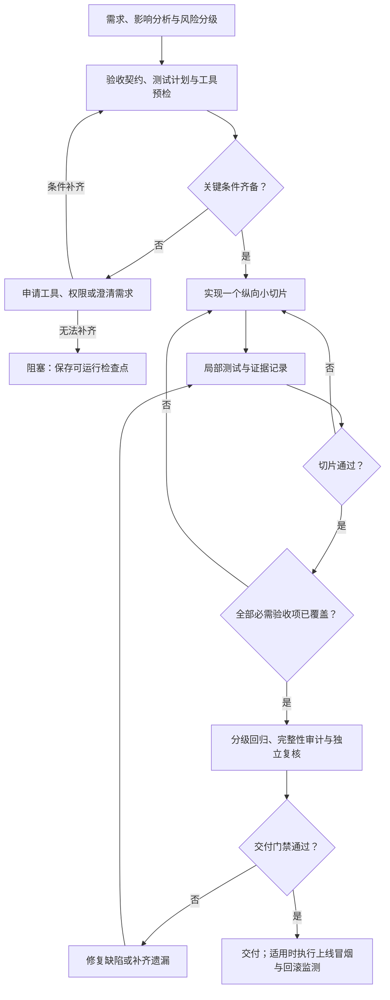

[toc]

## abstract

ai coding 开发任务的可靠化和规范化,有系统的方法，而且核心不是继续堆叠提示词，而是建立“验收契约+小步闭环+真实测试+证据门禁”。

最重要的原则是：**让“没做完、没验证、无法使用”的结果，不能被认定为完成。**模型能力较弱时，更应该把可靠性放在执行环境、任务拆分和自动检查上，而不是依赖模型自觉。

**资料核查截至2026年10月8日**；本会话无法可靠确认模型训练知识的截止日期。以下验收分级、文件结构和流程是我提出的工程方案，不是某个工具自带的标准，也不保证软件绝对无缺陷。配置示例未在本会话实际运行。

## 推荐的总体方案

建议建立以下六个组成部分：

| 组成部分           | 解决的问题                         | 最低要求                                       |
| ------------------ | ---------------------------------- | ---------------------------------------------- |
| **风险分级**       | 小改动过度测试，大改动验收不足     | 根据行为、数据和影响范围分级，不按代码行数分级 |
| **验收契约**       | AI自行解释“做完了”                 | 开工前写清验收项及预期结果                     |
| **文件化任务状态** | 做到一半遗忘、上下文丢失           | 明确已实现、已验证、未完成和阻塞项             |
| **纵向小切片**     | 只完成界面、接口或数据层中的一部分 | 每个切片尽量形成一个可运行的用户闭环           |
| **分层测试与证据** | 构建成功但用户无法使用             | 同时验证规则、交互、集成和必要的真实端到端链路 |
| **强制交付门禁**   | 缺测试、跳过测试仍然交付           | 缺少必要证据时，默认拒绝通过                   |

这与**执行环境工程(Harness Engineering)**的思路一致：提供清晰的知识入口、可执行约束和反馈循环，把关键规则落实为检查，而不是把全部希望寄托在一份越来越长的指令文件上。OpenAI的相关实践也强调短小的`AGENTS.md`作为索引，以及用自定义检查维护工程边界。

## 按风险划分验收等级

以下是**项目自定义的五档验收等级**。等级越高，原则上包含低等级要求；它们**不等同于OWASP ASVS的安全验证等级**。

| 等级                             | 典型改动                                                   | 必需验收范围                                                 |
| -------------------------------- | ---------------------------------------------------------- | ------------------------------------------------------------ |
| **A0：非运行时改动**             | 纯文档、注释，不影响生成结果或运行行为                     | 格式、链接、内容一致性；确认确实没有运行时影响               |
| **A1：局部表现微调**             | 单个页面文案、间距、颜色，不改变业务逻辑                   | 适用的静态检查与构建；受影响页面的浏览器检查；必要的视觉、键盘和布局检查 |
| **A2：局部行为改动、普通新功能** | 修改筛选规则、增加表单字段、引入独立的小功能               | A1+规则和组件测试+相关接口集成测试+**改动主路径的真实端到端测试**+相邻功能回归 |
| **A3：大调整、跨模块改动**       | 重构共享组件、调整多个页面流程、升级关键依赖、修改接口契约 | A2+全量既有快速测试+受影响模块回归+系统关键旅程+约定浏览器矩阵；涉及迁移时验证迁移与恢复 |
| **A4：重大新功能或高风险改动**   | 大型功能模块；鉴权、支付、批量写入、数据删除、重要迁移     | A3+发布级完整性审计+全量适用回归+异常与恢复测试+安全专项+约定性能预算+独立复核+干净环境部署验收+回滚演练 |

**分级规则必须明确：**

- **普通新功能至少A2，重大新功能A4。**不能因为“功能入口很小”就按微调处理。
- **取风险最高项，不取平均值。**修改三行鉴权代码，仍可能需要A4。
- 修改共享样式、公共组件、配置或依赖时，要扩大影响分析，不能只测改动文件。
- 实际实施中发现影响范围扩大，必须重新分级。
- **不能因工具缺失而自动降低等级。**工具缺失是阻塞，不是低风险。
- 不适用的专项可以标记`N/A`，但必须说明理由；“没有测试条件”不属于不适用。

安全专项建议从固定版本的**OWASP应用安全验证标准(ASVS)**中选择适用要求，尤其是鉴权、对象级访问控制、输入处理和敏感数据保护，而不是只执行一次依赖扫描就声称“安全验收完成”。

## 先定义“完成”，再让AI实现

### 开工条件：避免一边开发一边猜需求

**准备就绪定义(Definition of Ready，DoR)**至少包含：

- **目标与非目标**：本次必须交付什么，明确不做什么。
- **用户与权限**：谁可以使用、谁不可以使用。
- **可观察结果**：输入什么，系统应输出什么。
- **状态和异常行为**：等待、失败、重试、取消、刷新后分别怎样。
- **数据约束**：持久化、唯一性、一致性、兼容性要求。
- **验收等级与测试环境**：需要哪些测试，谁提供账号、数据库和外部服务。
- **未决问题**：哪些必须询问用户，哪些允许采用记录在案的默认方案。

**测试预言(Test Oracle)**指“判断结果正确与否的依据”。它应来自需求、协议或经过确认的样例，**不能仅从刚写出来的实现反向生成**，否则实现和测试可能一起理解错误。

### 完成条件：区分“写完”与“可交付”

建议采用下面的**完成定义(Definition of Done，DoD)**：

| 维度           | 判定要求                                       |
| -------------- | ---------------------------------------------- |
| **需求完整**   | 每个必需验收项都有对应实现和验证证据           |
| **行为完整**   | 主路径可用，必要的错误状态和恢复路径可用       |
| **数据完整**   | 按产品承诺验证持久化、权限和一致性             |
| **回归合格**   | 当前等级要求的回归全部执行且通过               |
| **工程可交付** | 干净环境能安装、构建、启动；必要配置和迁移齐全 |
| **证据有效**   | 证据对应最终源码和构建产物，而非修改前的版本   |
| **风险明确**   | 无阻断缺陷；其他已知问题有影响说明和批准记录   |

**以下情况一律不能算完成：**

- 页面有了，但提交按钮没有真实逻辑。
- 接口返回成功，但数据没有落库。
- 只有模拟接口测试，没有验证真实集成。
- 测试没有执行，却写“应该可以正常运行”。
- 为了通过测试，删除用例、放宽断言或取消原有门槛。
- 有重大未完事项，却藏在“后续优化”里。

## 把推进过程落到文件上，但不要制造文档负担

建议对A3、A4改动使用以下结构；A1可以合并为一份简短任务记录。

| 文件或位置                             | 用途                                                         |
| -------------------------------------- | ------------------------------------------------------------ |
| `AGENTS.md`                            | 简短的项目规则入口：运行命令、架构约束、验收政策、权限边界及文档索引 |
| `docs/changes/<change-id>/spec.md`     | 本次需求、非目标、验收项和关键决策                           |
| `docs/changes/<change-id>/plan.md`     | 影响分析、纵向切片、测试计划、工具需求和交付计划             |
| `docs/changes/<change-id>/progress.md` | 当前状态、已验证内容、未完成项、阻塞和下一步                 |
| CI制品中的验收报告                     | 测试结果、日志、截图、追踪文件、源码版本和部署记录           |

其中，`<change-id>`是本次改动的唯一标识，例如`task-csv-import`。

**不要让AI把所有规则、历史讨论和报告塞进`AGENTS.md`。**它应主要指向当前任务需要阅读的资料；在Codex中，该文件可以提供持久的仓库指导，其他编码工具是否自动读取则需要单独确认。

任务状态至少区分：

- **已计划**：明确了工作，但尚未完成。
- **已实现**：代码已写，不能等同于验证通过。
- **已验证**：所需验证已执行，有证据。
- **已验收**：由用户、指定评审人或授权门禁批准。
- **阻塞**：缺权限、环境、工具或关键需求，不能安全继续。

**模型可以更新工作记录，但不能仅凭自报状态生成权威的“通过”结论。**

## 设计真正闭环的执行链路



这里的关键是：**工具不足、功能缺失、测试失败都有明确出口，而不是最终都绕到“完成”。**

| 阶段         | AI必须做什么                                                 | 防止的半成品                         |
| ------------ | ------------------------------------------------------------ | ------------------------------------ |
| **预检**     | 检查技术栈、锁文件、启动方式、已有测试、用户未提交改动；运行适用基线 | 把原有问题当新问题，或者覆盖用户工作 |
| **规划**     | 建立“验收项—实现位置—测试—证据”的对应关系                    | 计划写了很多，但关键要求无人负责     |
| **切片实现** | 每次交付一个尽可能完整的用户行为                             | 先堆出所有界面，真实功能迟迟未接通   |
| **局部验证** | 修复缺陷时先复现，再修复并运行针对性测试                     | 凭直觉修改，无法证明问题已解决       |
| **分级验收** | 按风险扩大回归，检查真实集成和异常恢复                       | 局部通过，但其他页面或数据流程损坏   |
| **交付审计** | 核对入口、权限、配置、数据、文档、部署和未完成项             | 功能藏在代码里，用户找不到或启动不了 |

**弱模型尤其适合“一次一个有明确验收结果的切片”。**不要一次要求它同时设计架构、实现多个模块、迁移数据并自行批准验收。

高风险改动应增加独立复核；可以让另一模型协助发现问题，但**多模型意见一致不能替代真实测试和必要的人工判断**。

### 防止超时和中断留下尴尬状态

提前约定：

- 每完成一个切片，就更新进度和证据。
- 连续修复失败达到项目约定次数后，停止盲目尝试，整理复现信息并升级处理。
- 临近执行预算上限时，先保存检查点，不再开启大范围重构。
- 中断报告必须说明：**哪些已验证、哪些未验证、当前是否可运行、下一条具体操作是什么**。
- 未完成功能可以在开发阶段保持关闭，但**“关闭了残缺功能”不能被包装成已完成用户要求的交付**。

## Web UI测试怎么设计才完整

**测试应该围绕用户行为和可观察结果，而不是只验证组件内部变量。**Testing Library和Playwright的官方指导都强调接近真实使用方式，避免过度依赖实现细节。

建议建立下面的测试维度表，再按等级和适用性选择。

| 维度               | Web UI典型检查                                               | 主要测试层                       |
| ------------------ | ------------------------------------------------------------ | -------------------------------- |
| **用户主路径**     | 从真实入口进入、填写、提交、读取结果，必要时继续编辑或删除   | 组件测试+端到端测试              |
| **状态完整性**     | 加载中、空数据、校验错误、提交中、成功、失败、重试           | 组件测试+故障注入                |
| **输入与边界**     | 空值、最大长度、中文、特殊字符、日期、格式错误、大小限制     | 单元测试+接口测试                |
| **数据与一致性**   | 刷新后结果仍存在；重复提交不产生重复记录；失败不产生半写入   | 真实接口+数据库集成测试          |
| **权限与安全**     | 不只隐藏按钮，还要直接调用API验证拒绝；不同用户的数据隔离    | 服务端测试+真实接口测试          |
| **故障与恢复**     | 网络超时、服务错误、登录过期、响应乱序、重复点击             | 模拟测试+关键真实恢复测试        |
| **视觉与可访问性** | 小屏布局、长中文、键盘操作、焦点、标签、错误提示             | 浏览器检查+视觉对比+可访问性检查 |
| **发布与运行**     | 生产构建、深层路由刷新、静态资源、配置、迁移、健康检查、回滚 | 部署验收+上线冒烟                |

三条边界特别重要：

- **模拟测试与真实端到端测试应分开标注。**MSW适合构造网络行为，但模拟服务器响应不能证明真实服务器、数据库和权限逻辑正确。
- **代码覆盖率不是需求完整率。**需要同时检查关键验收项是否被验证，不能靠整体覆盖率数字掩盖关键路径遗漏。
- **自动化可访问性扫描不能证明完全符合可访问性要求。**仍需必要的键盘、焦点和人工评估。

对前后端应用，至少保留一条**不模拟本产品核心API、连接独立测试数据库**的真实关键旅程。若产品本来就是纯静态或本地存储应用，则按它承诺的存储模型验收，不必强行添加后端。

## 工具发现、选择与安装请求

### 工具选择：先补能力，不要先堆产品

**默认顺序：复用现有工具 → 补齐缺失能力 → 有充分理由才更换体系。**

| 能力                   | 推荐起点                                                 | 选择说明                                                     |
| ---------------------- | -------------------------------------------------------- | ------------------------------------------------------------ |
| 类型与静态检查         | 已有TypeScript检查、ESLint等                             | 类型检查和规范检查分开；不能相互代替。                       |
| 规则、组件与集成测试   | 保留已有框架；新Vite项目可考虑Vitest+对应Testing Library | 不应仅为AI开发就迁移整个测试体系。                           |
| 浏览器端到端与接口测试 | 新项目可优先评估Playwright Test                          | 可以统一部分浏览器和API验证；仍需后端自身测试。              |
| 网络异常模拟           | MSW或已有拦截机制                                        | 用于稳定构造超时、错误等场景，不替代真实集成。               |
| 可访问性与性能         | `@axe-core/playwright`；需要负载测试时使用k6             | k6应配置失败阈值，不能只收集漂亮的报告。                     |
| 安全检查               | 现有依赖审计、代码检查+ASVS适用要求                      | `npm audit`针对依赖风险，不能覆盖业务权限和全部应用安全问题。 |

**已有Cypress测试且能够满足需求时，通常应继续使用。**选择时应核查浏览器支持、调试方式和官方列出的约束，而不是根据营销对比直接迁移。

国内方案中，**MeterSphere**可作为团队接口测试与测试管理平台候选；小项目不必为了基本验收就引入整个平台。

浏览器CLI或MCP也可以帮助AI探索页面、复现问题，但建议把确认有效的流程沉淀为可重复运行的测试，**不要把一次临时操作等同于持续回归能力**。Playwright已提供相关编码代理接入方式。

### 安装前必须先探测

AI应先检查：

- 项目包管理器、锁文件和实际依赖版本。
- 测试工具是否存在、脚本是否存在、浏览器二进制能否启动。
- 后端、测试数据库、测试账号和服务健康情况。
- OS、系统依赖、权限、网络和制品下载条件。
- 报告目录是否可写。

**“包已经安装”不代表“工具可用”。**Playwright的包版本与浏览器二进制有对应关系，升级包后可能需要重新安装浏览器。

### 缺工具时，使用结构化申请

可以要求AI这样报告：

> **缺失能力**：真实浏览器验收无法执行。  
> **探测证据**：实际启动失败，错误表明缺少浏览器二进制。  
> **拟补齐方案**：使用项目已锁定的Playwright版本安装Chromium。  
> **变更范围**：说明项目依赖、浏览器缓存、系统包是否发生变化。  
> **权限与网络**：说明是否需要管理员权限、外部下载及可信代理。  
> **替代方案**：现有浏览器或独立CI是否满足本次要求。  
> **不安装的影响**：相关验收项保持阻塞，不能判定完成。  
> **请求授权**：仅在现有权限政策未覆盖时申请批准。

这样既避免擅自安装，也避免每个普通操作都询问用户。**可以预先授权项目内开发依赖；系统级安装、破坏性操作和敏感数据访问应另设边界。**

在已批准且项目固定依赖的前提下，Playwright支持`npx playwright install chromium`；需要系统依赖时支持`--with-deps`，但这可能涉及系统级权限。npm项目的CI可用`npm ci`按锁文件恢复依赖。

国内网络及跨平台注意事项：

- 优先使用可信代理或受控制品仓库，不随意更换为未知镜像。
- Playwright支持`HTTPS_PROXY`和`PLAYWRIGHT_DOWNLOAD_HOST`；Bash与PowerShell设置环境变量的语法不同。
- 不要为了下载成功而关闭TLS证书验证；企业CA应按官方方式配置。
- 固定文件编码、换行策略和中文字体；视觉基准尽量使用固定OS、浏览器和字体环境。截图可能因这些环境差异变化。

## 让门禁真正拒绝“不完整”

### 建议设置统一验收入口

例如由项目实现：

- `verify:quick`：快速静态检查和针对性测试。
- `verify:change`：依据本次等级执行变更验收。
- `verify:release`：发布级验收与完整性汇总。

**这些名称是建议接口，不是安装某个工具后自动拥有的能力。**需要项目脚本把检查串起来，并正确传播失败退出码。

汇总器应至少拒绝下面的情况：

| 情况                                         | 判定                                   |
| -------------------------------------------- | -------------------------------------- |
| 必需检查失败、取消或超时                     | 不通过                                 |
| 必需检查未运行、报告缺失                     | 不通过或阻塞                           |
| 必需测试组没有收集到测试                     | 不通过                                 |
| 关键验收项全部跳过                           | 不通过                                 |
| 测试重试才成功                               | 按不稳定测试政策处理，不能悄悄转为通过 |
| 报告对应旧源码或旧构建                       | 不通过                                 |
| 存在关键旅程不可用、越权、数据丢失等阻断问题 | 不通过                                 |
| 人工验收或必要发布演练未完成                 | 不能宣称已完成对应等级验收             |

尤其要防范**“CI绿色，但测试没跑”**：GitHub的必要状态检查可以接受`success`、`skipped`或`neutral`；依赖失败导致的任务跳过也可能形成漏洞。应设置始终执行的汇总任务，使用`always()`和`needs`，并主动校验每个必需任务确实成功以及报告存在。**仅加`always()`仍不够。**

同时要求：

- 必需脚本不存在时直接失败，不用`--if-present`掩盖。
- 不允许为了通过而新增大范围忽略、放宽超时或更新全部视觉基准。
- 检查和报告绑定源码版本、构建标识、工具版本及测试环境。
- 验收后又修改代码，应重新运行受影响检查，并满足最终发布要求。
- 例外必须有原因、负责人、批准和到期条件，不能变成永久豁免。

**门禁本身也要测试。**故意构造空测试、全部跳过、依赖任务失败、缺报告和旧版本报告，确认它确实拒绝交付。

## 综合案例：任务管理Web UI新增CSV批量导入

假设这是一个有真实API和数据库的Web应用。该功能涉及批量写入、权限和失败恢复，**按A4执行**。

先约定示例规则：

- CSV必需字段为`external_id`和`title`，接受UTF-8及UTF-8 BOM。
- 每次最多1000条、文件不超过1MiB。
- 同一工作区内`external_id`唯一。
- **整批原子提交**：任何记录非法，整批不写入。
- 网络不确定失败后，使用同一请求标识重试，不重复创建。
- 非目标：暂不支持Excel、自动猜测其他编码和部分成功导入。

这些数值和规则只是本案例的产品约定，不是行业统一要求。

| 验收项                    | 必须证明什么                                              | 主要证据                   |
| ------------------------- | --------------------------------------------------------- | -------------------------- |
| **AC-01：主路径**         | 上传、预览、提交后显示正确数量；刷新并重新登录后仍能读取  | 真实端到端+API或数据库核对 |
| **AC-02：输入边界**       | 中文、引号、换行、BOM正常；空文件、超限、缺字段被明确拒绝 | 解析规则测试+接口测试      |
| **AC-03：失败原子性**     | 包含非法行或提交中发生写入失败时，没有半批数据            | 数据库集成测试             |
| **AC-04：重试与重复点击** | 服务端已提交但响应丢失时，重试不会增加第二批数据          | 真实接口恢复测试           |
| **AC-05：权限**           | 无权限用户直接调用导入API也被拒绝，数据不变               | 服务端权限测试+真实API     |
| **AC-06：界面完整**       | 加载、校验错误、提交失败、重试、焦点与小屏布局可用        | 组件测试+浏览器验收        |
| **AC-07：发布完整**       | 生产构建可运行；迁移、性能预算、日志、部署和回滚要求满足  | 发布验收报告               |

`AC`表示**验收条件(Acceptance Criteria)**，后面的编号用于追踪，不代表测试执行顺序。

推荐切片：

- 先完成“合法文件上传—真实提交—重新读取”的纵向闭环。
- 再完成格式、边界和整批失败处理。
- 再完成幂等重试、权限与异常恢复。
- 最后执行全量适用回归和发布验收。

**不能先把导入弹窗、预览表格和成功提示做得很漂亮，就宣布功能完成。**

测试数据必须独立、可清理；验证新增数量时要核对操作前后差异，避免残留数据造成假通过。性能验收也应事先约定环境、数据规模、并发量及阈值，而不是事后凭“看起来很快”判断。

## 一个防止“假通过”的Playwright配置示例

以下只是浏览器验收配置，**不是完整验收体系**。假设独立验收环境已部署，并连接测试API和数据库；通过`ACCEPTANCE_BASE_URL`提供地址。

```typescript
import { defineConfig, devices } from '@playwright/test';

const baseURL = process.env.ACCEPTANCE_BASE_URL;

if (!baseURL) {
  throw new Error('缺少ACCEPTANCE_BASE_URL，拒绝运行验收');
}

export default defineConfig({
  testDir: './tests/e2e',
  forbidOnly: true,
  failOnFlakyTests: true,
  retries: 1,
  globalTimeout: 10 * 60_000,

  reporter: [
    ['list'],
    ['json', { outputFile: 'artifacts/e2e.json' }],
    ['html', {
      outputFolder: 'artifacts/e2e-report',
      open: 'never',
    }],
  ],

  use: {
    baseURL,
    trace: 'retain-on-failure',
    screenshot: 'only-on-failure',
  },

  projects: [
    { name: 'chromium', use: { ...devices['Desktop Chrome'] } },
  ],
});
```

关键配置含义：

| 字段                  | 含义和边界                                                   |
| --------------------- | ------------------------------------------------------------ |
| `ACCEPTANCE_BASE_URL` | 指向受控验收站点；是否连接测试数据源还需部署检查，变量本身不会自动保证安全 |
| `forbidOnly`          | 防止遗留`test.only`导致大部分测试漏跑；**不会禁止所有跳过测试** |
| `failOnFlakyTests`    | 重试才通过的测试仍导致失败；该选项从Playwright 1.52起提供    |
| `retries`             | 此处允许一次诊断重试，不代表允许不稳定测试通过               |
| `globalTimeout`       | 整次运行的时间上限；示例为10分钟，应按项目调整               |
| `reporter`与`trace`   | 提供机器报告、人工报告和失败追踪证据                         |
| `projects`            | 当前只有Chromium；A3、A4应补齐产品约定的浏览器矩阵           |

相关配置和追踪方式可由官方文档核查。**配置仍需配合汇总器检查必需用例、跳过状态、报告完整性和源码版本。**

## 可直接给编码AI的执行约束

下面这段适合作为项目规则的核心，再链接到详细验收政策。**它必须与真实脚本和门禁配套。**

> **目标**：交付可使用、可验证的改动，不只完成代码编写。  
> **开工前**：读取项目规则、需求和已有测试；检查工作区，保护用户已有修改；完成影响分析和验收分级。普通新功能至少A2，重大新功能或高风险改动A4。  
> **验收计划**：为每项必需验收条件指定预期结果、实现位置、测试方式和证据。关键需求不明确时先询问，不自行缩减范围。  
> **工具预检**：确认测试工具、浏览器、服务、账号和测试数据源实际可用。缺失时给出探测证据、安装方案、权限需求及不安装的影响。未经授权不得扩大权限。  
> **实现方式**：按纵向小切片推进；每个切片完成后运行针对性检查并更新进度。缺陷修复先复现，再修复和回归。  
> **禁止事项**：不得通过删除测试、放宽断言、跳过必需检查、静默降低等级或伪造结果换取通过。  
> **中断处理**：遇到阻塞或预算不足，保存可运行检查点，准确列出已验证内容、未完成项和下一步；不得宣称完成。  
> **结束前**：执行该等级全部必需验收，审计需求完整性、真实集成、配置与部署要求；报告必须对应最终版本。  
> **最终报告**：给出改动摘要、验收项对应关系、实际执行结果、证据位置、已知问题、运行方法及适用的回滚说明。未运行明确标记，不能写成通过。

## 落地顺序与持续改善

不必第一天建设复杂平台。建议依次落地：

- **先堵住假完成**：定义DoD，区分实现与验证，禁止未运行冒充通过。
- **再建立分级闭环**：采用A0—A4，保留关键真实旅程，增加缺工具申请与检查点。
- **最后强制执行**：统一验收入口、报告汇总、合并保护、发布验收和门禁自测。

持续记录**漏验收项、上线后逃逸缺陷、不稳定测试和阻塞原因**。每次严重缺陷应至少转化为一个回归用例；反复出现的流程问题再转化为检查，而不只是追加一句“以后注意”。

本次采用多轮定向核查：初轮覆盖AI执行指导、Web测试、CI和安全；随后沿着`Harness engineering`、`failOnFlakyTests`、`always()+needs`及浏览器下载配置等实际发现的线索补查。**没有进行工具运行测评，也尚未针对你的具体框架、数据库和部署方式定制验收脚本。**

**最终要建立的质量基线是：范围可以小，但必须闭环；测试可以分级，但不能缺证据；开发可以中断，但不能留下被误认为已完成的半成品。**
