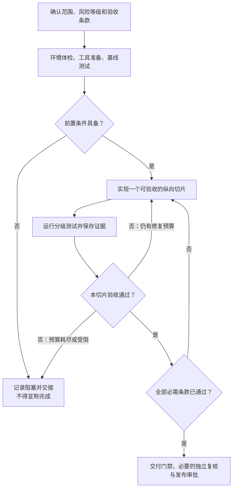

[toc]

## abstract

对于ai coding的工程化可靠性问题, 本文推荐建立一套“验收先行、风险分级、分段交付、证据驱动、外部门禁”的开发流程。

重点不是让AI多写几遍“我会认真测试”，而是做到：

- **遗漏可以被发现**：需求逐条编号，每条都有验收方式。
- **失败不能被掩盖**：未运行、被跳过、环境阻塞，都不算通过。
- **中断可以恢复**：下一轮AI能知道做到哪里、什么仍然失败、下一步怎么执行。
- **通过不能只靠自述**：由测试报告、真实浏览器操作、CI和必要的人工复核共同决定。
- **小改动轻量验证，大改动严格验证**：以风险和影响范围分级，不以代码行数分级。

> Anthropic公开的长任务工程实践，也记录了“一次做太多留下半成品”“看到已有进展就提前宣布完成”“单元测试通过但端到端不可用”等问题，并采用功能清单、增量推进、进度交接和浏览器验证加以改善。
>
> **资料核查日期：2026年10月8日。**本轮按你指定的a级进行一轮检索及官方文档阅读，未执行项目代码。

## 按风险划分验收等级

**风险决定验收下限；模型能力决定任务粒度与复核强度。模型较弱，不能成为降低验收标准的理由。**

建议采用以下五级，**高等级继承低等级中适用的检查**。

| 等级                     | 典型改动                                                     | 最低验收要求                                                 |
| ------------------------ | ------------------------------------------------------------ | ------------------------------------------------------------ |
| **L0：非运行行为改动**   | 普通文档、注释、说明文字                                     | 检查差异、链接及文档一致性；修改了安装命令，就应实际验证命令 |
| **L1：局部微调**         | 单页间距、局部文案、非共享样式                               | 受影响页面实际查看；相关交互、布局、键盘操作小验收；常规基础CI |
| **L2：局部行为修改**     | 已有功能的小修复、局部逻辑调整                               | 对应单元/组件测试；边界与错误路径；受影响模块回归；相关用户主路径冒烟测试 |
| **L3：新功能或跨层调整** | 独立新功能、前后端联动、共享组件或状态调整                   | 明确验收条款；真实后端端到端测试；持久化、异常恢复、权限边界；相关兼容性与可访问性检查；生产构建验证 |
| **L4：重大或高风险改动** | 大功能引入、鉴权/多租户核心调整、破坏性数据迁移、架构或部署链路大改 | 全量适用回归；支持范围内的浏览器验证；安全、性能、迁移与恢复专项；类生产验收；独立复核；明确发布和回滚审批 |

这里：

- **冒烟测试（Smoke Test）**：快速确认系统能启动、关键路径没有整体失效。
- **回归测试（Regression Test）**：确认改动没有破坏既有功能。
- **端到端测试（E2E）**：从用户操作出发，验证跨越界面、接口和数据层的业务结果。

### 必须设置的升级规则

- **新功能最低L3，大功能最低L4。**
- 改动只有几行，但涉及越权、数据丢失或不可逆操作，仍应L4。
- “改一个按钮样式”若实际改了全局CSS或基础组件，不能仍按单页L1处理。
- 影响范围无法确定、项目缺少可靠基线时，**先调查，必要时升级**。
- 开发中扩大范围，必须重新分级，不能沿用最初的小改动标签。
- 修改验收规则、测试过滤条件或CI门禁，必须独立审查，不能由实施AI自行放宽。

**L4不是无差别安装所有测试工具，而是对适用的高风险问题给出充分证据。**

## 先设计验收链路，再开始写代码

这个流程有两个关键点：**每个切片都能实际验收；最后还要做整体交付检查。**若最后的交付检查失败，仍不能标记为交付完成。

### 开工前必须明确的内容

| 内容             | 必须回答的问题                                               |
| ---------------- | ------------------------------------------------------------ |
| **范围与非目标** | 本次必须交付什么？哪些明确不做？有没有未经用户同意的删减？   |
| **影响范围**     | 涉及哪些页面、API、共享组件、数据库、权限和部署配置？        |
| **验收条款**     | 用户在什么前提下进行什么操作，应得到什么可观察结果？         |
| **测试计划**     | 哪些用单测、组件测试、真实E2E、人工检查？需要什么账号与数据？ |
| **执行条件**     | 工具是否安装？浏览器能否启动？后端、数据库、测试账号是否可用？ |
| **交付定义**     | 除代码外，是否需要配置说明、迁移脚本、部署文档、回滚办法？   |

**不要把“做了页面”“写了接口”当作验收条款。**条款应描述用户结果，例如：“创建任务后，换一个干净会话重新登录，仍能从服务端读取该任务。”

### 用少量文件保存项目事实

建议采用以下最小结构；其中`change-id`表示本次变更编号，`run-id`表示一次验证运行编号。

| 文件或位置                                 | 用途                                         |
| ------------------------------------------ | -------------------------------------------- |
| `AGENTS.md`                                | 稳定的执行规则、项目命令、禁止事项、验收等级 |
| `docs/changes/<change-id>/spec.md`         | 本次范围、风险、设计决定、非目标             |
| `docs/changes/<change-id>/acceptance.yaml` | 编号化验收条款、测试映射、是否必需           |
| `docs/changes/<change-id>/handoff.md`      | 当前进度、阻塞、最后验证版本、准确的下一步   |
| CI中的`artifacts/<run-id>/`                | 测试报告、日志、截图、浏览器追踪、构建信息   |

**L0/L1可以合并为一个PR检查表，不必制造文档负担。**较大的改动再分文件。`AGENTS.md`也只是文件约定，应确认所用AI工具实际读取了它，而不是假设文件存在就会生效。

每条验收至少包含：**编号、场景、预期结果、测试方式、是否必需、执行状态、证据位置**。状态应明确区分：

- `PASS`：有对应版本的有效证据，确认通过。
- `FAIL`：运行过，但不满足预期。
- `NOT_RUN`：尚未运行。
- `BLOCKED`：缺少环境、权限、工具或其他前置条件。
- `N/A`：经批准确认不适用，而不是“暂时不会测”。

### 对较弱模型的推进约束

**先拆完整范围，再逐片完成；不要先做一堆页面，最后才尝试串起来。**

例如“创建任务”的纵向切片，应包括：入口、表单、校验、API、持久化、结果展示及对应测试，而不是只完成表单外观。

建议约束：

- 同时只推进一个切片；先维持已有核心路径可用。
- 把精确命令、测试账号准备方式、数据清理方法写进项目脚本。
- 为测试、修复、交接预留预算，不在上下文即将耗尽时启动大改造。
- 连续若干轮修复没有进展时，升级给更强模型或人工，不能无限重试。
- 中断时保存工作和证据，记录可复现问题；**不得擅自重置用户已有修改**。

规划、实施和复核可以分角色，但不必一开始就搭建复杂多Agent系统。独立评估是有价值的补充，但评估模型本身也可能过于宽松，仍需要明确标准和实际运行证据。

## WebUI完整性验收示例：新增“创建任务”

假设本次约定为：成员可以创建任务，访客不能创建；任务保存到服务端；失败可以恢复；网络重试不能重复创建。按本方案属于**L3新功能**。

下表是**验收计划示例，不是已执行结果**。`AC`表示验收条款（Acceptance Criterion）。

| 编号                | 必须满足的结果                                               | 建议测试方式                       |
| ------------------- | ------------------------------------------------------------ | ---------------------------------- |
| **AC-01：主流程**   | 从真实入口打开表单，提交合法内容，列表出现正确任务           | 浏览器E2E，连接真实测试后端        |
| **AC-02：持久化**   | 新建干净会话并重新登录后，仍能读取该任务                     | 真实API读回＋新会话E2E             |
| **AC-03：输入边界** | 空白、超长、中文等输入按已确定规则处理；非法数据不能绕过前端直接入库 | 单元/组件测试＋直接API测试         |
| **AC-04：失败恢复** | 请求失败时不假报成功，保留输入；结果不明时能查询或安全重试   | 可控故障注入＋浏览器验证           |
| **AC-05：重复操作** | 连续点击、重复请求或网络重试，不产生违反约定的重复记录       | API幂等性/并发测试＋界面验证       |
| **AC-06：权限边界** | 访客即使直接调用接口也不能创建，数据不发生变化               | 不同角色的API集成测试              |
| **AC-07：可用性**   | 键盘可操作、焦点合理；小屏无关键遮挡；加载及错误状态可理解   | 浏览器检查＋可访问性扫描＋人工抽查 |

这张表体现的是**完整用户任务**，不是“点击按钮后有没有弹出成功提示”。

如果扩展成“批量导入任务、权限改造、旧数据迁移”，就应升级L4，并增加导入资源上限、数据一致性、部分失败策略、迁移兼容性和恢复演练。

### 测试设计中最容易缺失的部分

**建议至少审视以下维度，记录适用与不适用的原因：**

- **状态**：初始、空数据、加载中、成功、失败、重试、取消。
- **数据**：边界值、中文及特殊字符、刷新、重新登录、重复操作。
- **权限**：未登录、不同角色、直接访问URL、绕过界面的API请求。
- **交互**：键盘、焦点、窄屏、返回/前进、深链接。
- **集成**：真实接口、真实持久化、配置、部署后的路径和资源加载。

同时坚持以下规则：

- **测试用户可见行为，不要主要断言内部实现细节。**Playwright和Testing Library的官方指导均强调这一方向。
- **Mock用于控制局部场景，不能替代自有完整链路的验收。**本方案要求核心E2E连接真实测试后端；不受控的第三方服务，则优先使用沙箱或受控替身。
- **测试数据要隔离，等待应基于状态而非随意睡眠。**Playwright提供自动等待、可重试断言和测试隔离机制。
- **修复缺陷时，尽可能先让回归用例复现旧问题，再确认修复后通过。**
- **覆盖率只作辅助指标。**项目门禁应优先检查必需验收条款是否真实覆盖，而不是单看一个百分比。
- **截图不能证明业务正确；自动化通过也不替代必要的可用性检查。**

## 工具发现、选择与缺失工具安装

### 选择原则：优先复用，补齐缺口，不为“现代化”重复造体系

| 目的           | 建议方案                                                     | 使用边界                                                     |
| -------------- | ------------------------------------------------------------ | ------------------------------------------------------------ |
| 静态质量       | 复用项目已有类型检查、Lint、格式检查和构建命令               | 不要为本次任务无故更换整套规范                               |
| 单元与组件测试 | 优先已有框架；Vite相关新项目可考虑Vitest，组件行为可结合Testing Library | 安装前核对运行时和框架版本要求。                             |
| 浏览器E2E      | 无既有方案时，优先考虑Playwright                             | 支持Chromium、Firefox、WebKit；按项目承诺的支持范围选择，不必每次全跑。 |
| 可访问性       | axe-core扫描＋键盘和焦点人工检查                             | 自动扫描不能覆盖所有问题，`incomplete`结果需要人工判断。     |
| 安全专项       | 用OWASP WSTG组织适用测试，再按威胁选工具                     | 它是测试指南，不是“运行一次就安全”的扫描器。                 |
| 强制执行       | 项目脚本＋CI＋受保护的合并规则                               | 测试标准保存在仓库，避免仅依赖某个平台或AI对话               |

### 要求AI按这个顺序发现工具

1. **盘点**：读取项目说明、包管理器、锁文件、脚本、现有测试、CI配置和操作系统信息。
2. **识别缺口**：哪一条验收目前没有执行手段？不要先列几十种工具。
3. **有界检索**：只针对缺口查官方安装、系统要求、CI及已知限制，通常比较一两个候选即可。
4. **选择并说明**：考虑现有技术栈、维护成本、版本兼容、平台、网络、许可证和权限。
5. **请求批准后安装**：安装完检查版本，并实际运行一个最小用例。
6. **固化**：把命令和版本落入项目配置及锁文件，而不是只留在聊天记录中。

**不要用可能自动下载软件的命令进行“无副作用探测”。**例如，官方Vitest文档明确说明，`npx`在找不到对应命令时可能安装后执行。应先确认项目依赖，再运行工具。

### 缺失工具时，AI应该这样申请

下面是申请模板，不是本轮实际安装请求：

> 当前缺少浏览器E2E能力，导致AC-01、AC-02无法验收。  
> 建议增加与现有运行时兼容的明确版本`@playwright/test`，更新项目锁文件，并安装匹配的Chromium。  
> 实际申请将列明：**版本、执行命令、下载来源、文件变更、是否需要提权、预计资源占用和撤销方式**。  
> 若已有等效框架，则优先复用；也可在获授权的CI环境执行。若均不可用，相关条款保持`BLOCKED`，不标记通过。

浏览器安装与系统依赖安装要分开考虑：已有对应项目依赖时，`npx playwright install chromium`用于安装浏览器；Linux上采用`--with-deps`还会涉及系统依赖，应单独确认权限。

**环境适配也要进入计划：**

- **国内网络**：浏览器下载和npm包下载不是同一链路。Playwright支持`HTTPS_PROXY`及自定义浏览器制品源`PLAYWRIGHT_DOWNLOAD_HOST`；优先使用获批准的代理或受控制品库，不默认信任公共加速站。
- **跨平台**：统一运行时、编码和脚本约定；避免关键流程只有Linux能跑。视觉回归应固定操作系统、浏览器及字体环境，不要求不同系统的截图天然一致。Playwright也要求视觉比较注意环境一致性。
- **工具受阻**：可以继续不依赖它的工作，但不能把缺失的验收悄悄删除。

## 真正提高质量下限的是CI门禁

**提示词负责指导行为，CI负责阻止不合格变更被当作合格交付。**

建议一次性建设两个项目入口：

- `doctor`：检查环境、依赖、服务、权限和测试准备情况，默认不自动安装。
- `verify`：按风险等级选择检查，保存报告，输出明确状态。

例如可约定`npm run verify -- --level=L3`。**这是建议由项目实现的接口，不是现成通用命令**：`--`后面的参数传给项目脚本，`level`表示本次验收等级。

### 门禁至少检查这些事实

| 门禁           | 判定要求                                                     |
| -------------- | ------------------------------------------------------------ |
| **范围完整**   | 本次必需条款都有测试或批准的人工验收方式，没有私自删项       |
| **执行真实**   | 相关测试确实运行；不能零用例、全部跳过后仍显示通过           |
| **结果有效**   | 必需检查通过；未解决的失败、阻塞、未运行项不能冒充通过       |
| **版本一致**   | 证据对应当前提交和拟交付制品，而不是上一个版本               |
| **规则可信**   | 实施者不能单方面修改条款、降低断言、取消门禁后自证合格       |
| **交付可用**   | 干净环境能安装、构建、启动；需要的配置、文档和迁移步骤齐备   |
| **风险已处理** | 已知问题、例外、责任人和处理期限清楚；重大风险未解除则不放行 |

有一个容易忽略的细节：GitHub文档列出的必需检查可接受状态包括`successful`、`skipped`和`neutral`。因此，**“平台显示允许合并”不等于“该跑的验收真的跑过”**。建议设置始终执行的最终汇总门禁，核对预期检查集合及其执行结果，并保护门禁配置。

### 防止“重跑洗绿”和运行卡死

- 重试后通过要标记为**不稳定测试（Flaky Test）**，不能与首次稳定通过混为一谈。
- 核心路径的不稳定测试不能随意隔离；必须有替代验证及处理责任。
- 测试、安装、启动等待都应设超时；失败时保留日志和清理环境。
- CI应给测试报告生成和上传留出时间。Playwright官方建议设置测试运行总超时，并让外层CI超时更宽松。
- 原有失败应明确归属和处理，不能静默忽略；核心链路已经损坏时，应优先恢复基线。

### 交付不能只验证开发服务器

建议L3/L4至少验证生产构建；L4进一步验证拟发布的同一制品在类生产环境中的关键流程、配置、迁移和恢复。

对于npm项目，有锁文件时可使用`npm ci`做干净安装验证：锁文件与`package.json`不一致会报错，而不是自动改写锁文件。

交付报告至少包含：

**交付版本、完成条款、实际执行命令、测试结果、证据位置、未完成项、已知风险、启动/部署步骤及必要的回滚说明。**

必须区分：

- **已实现**：代码已经写出。
- **已验收**：该版本满足批准的验收条件。
- **已部署**：确实完成目标环境部署。

## 可直接复用的AI执行约定

可以将下面内容作为项目规则的骨架，再补充项目实际命令：

> **开发与验收协议**
>
> - 修改前先读取项目规则、当前差异、验收清单和交接记录，不覆盖用户已有工作。
> - 先确认范围、风险等级、影响范围、验收条款和测试计划；不得自行缩减必需范围。
> - 先运行环境体检及适用基线。缺少工具、账号、服务或权限时，明确申请或记录阻塞。
> - 每次完成一个可验收的纵向切片，不以空页面、占位接口、静态假数据冒充完整功能。
> - 新功能最低L3，大功能及高风险改动按L4；实际影响扩大时重新分级。
> - 只把实际执行且有对应版本证据的检查标记为通过；未运行、跳过和阻塞必须明确披露。
> - 不得为通过验收而私自删除测试、弱化断言、放宽阈值或批量接受新快照；合理变更也要说明并复核。
> - 遇到失败先定位和复现，再修复并重跑相关回归；遵守修复轮次和时间预算，禁止无限循环。
> - 长任务在阶段完成或受阻时报告真实进度；中断前记录当前版本、修改、失败证据及准确下一步。
> - 只有验收清单、质量门禁和交付检查均满足，才报告“已验收完成”；否则明确标记进行中或阻塞。

**最小落地顺序**：先建立验收清单和分级规则，再打通一个真实浏览器主流程，随后接入CI门禁，最后扩展故障恢复、安全、性能和发布专项。

归根结底，可靠的AI开发不是让AI承诺“全部做好”，而是让项目始终能回答：**还缺什么、怎样证明做对、现在能否交付、失败后如何接着做。**
