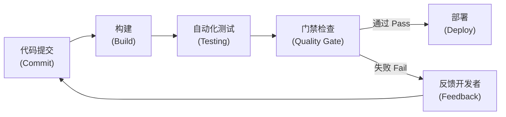
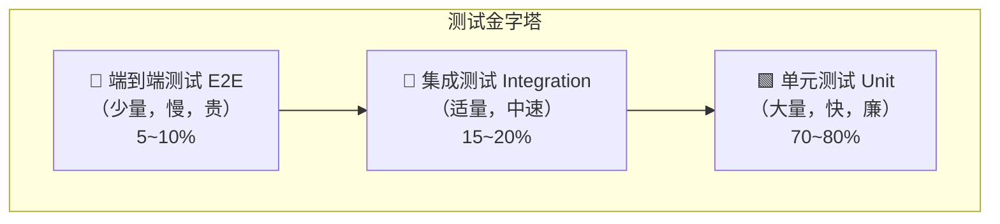
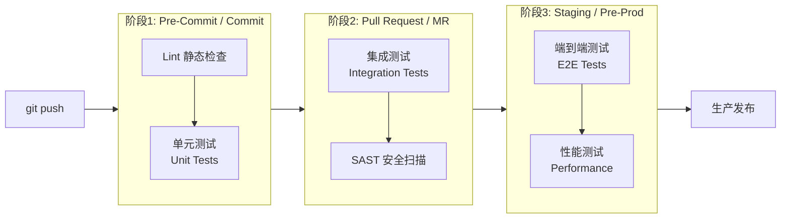
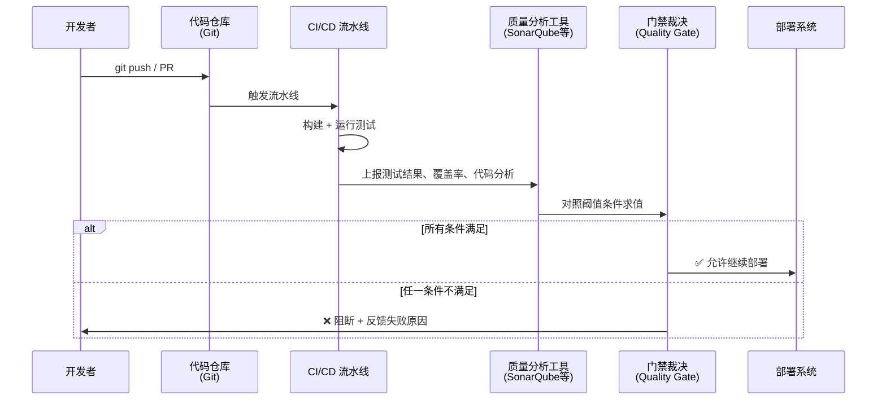
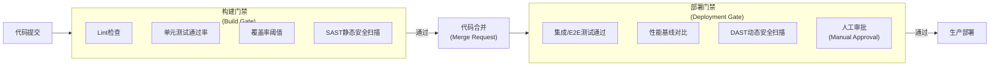
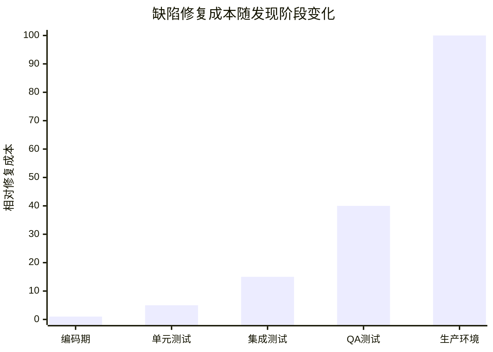

[toc]


---

## 软件开发中的门禁（Quality Gate）与测试（Testing）

> **知识截止日期：** 主要参考来源包括 SonarQube 官方文档（2025.1）、JetBrains 技术指南、Testkube、TotalShiftLeft DevOps Testing Strategy（2026）等，内容反映当前主流实践。

---

## 概念总览与关系定位

在现代软件工程中，**测试（Testing）** 和 **门禁（Quality Gate）** 是保障软件质量的两个互补机制：前者生产质量数据，后者消费并裁决这些数据。二者共同构成流水线（Pipeline）中的质量护栏体系。



**质量门禁（Quality Gate）** 是CI/CD流水线中的自动化决策节点，用于将代码变更与预定义的质量标准进行比对，充当阻止不合格代码流转到下一阶段的护栏。

**测试金字塔（Testing Pyramid）** 是一种基础性模型，通过结构化测试工作来优化质量、速度与可靠性，在敏捷和DevOps实践中扮演核心角色。

二者的本质关系是：

| 维度     | 测试（Testing）        | 门禁（Quality Gate）                 |
| -------- | ---------------------- | ------------------------------------ |
| 本质     | 执行检查并生成结果数据 | 对测试及静态分析结果做通过/失败裁决  |
| 时机     | 在各流水线阶段运行     | 在关键阶段节点（如合并、部署前）卡控 |
| 粒度     | 函数级、组件级、系统级 | 指标级（覆盖率、漏洞数等聚合度量）   |
| 失败后果 | 记录失败用例供分析     | **阻断流水线推进**                   |
| 实施者   | 开发/QA工程师编写      | DevOps/平台团队配置策略              |

---

## 测试体系（Testing）

### 测试金字塔模型

测试金字塔是一种基于范围、速度和成本来组织自动化测试的策略，它的核心建议是：**底层单元测试**验证独立函数和方法，**中层集成测试**验证组件间的交互，**顶层端到端测试**从用户视角确认完整工作流。



金字塔底部最宽，因为单元测试运行最快、维护成本最低；越向顶部越窄，因为端到端测试运行最慢、最脆弱、维护成本最高。**倒置金字塔**（端到端测试多于单元测试）会产生缓慢、脆弱的流水线，严重打击开发者信心。

### 三个测试层次详解

#### 单元测试（Unit Test）

单元测试运行快速、相互隔离，**由开发者自行编写和维护，在每次提交时触发运行**。

典型的单元测试验证内容包括：业务逻辑与算法、输入/输出行为、边界条件与异常处理、条件分支逻辑。

**什么时候必须写单元测试：**
- 核心业务逻辑（金额计算、权限判断、状态机）
- 有复杂边界条件的函数
- 容易回归的工具函数

**示例（Python + pytest）**：

```python
# 被测函数：计算商品折扣价
def calculate_discount(price: float, rate: float) -> float:
    if not (0.0 <= rate <= 1.0):
        raise ValueError(f"折扣率 {rate} 超出范围 [0, 1]")
    return round(price * (1 - rate), 2)

# 单元测试
def test_normal_discount():
    assert calculate_discount(100.0, 0.2) == 80.0

def test_zero_discount():
    assert calculate_discount(100.0, 0.0) == 100.0

def test_invalid_rate_raises():
    with pytest.raises(ValueError):
        calculate_discount(100.0, 1.5)
```

#### 集成测试（Integration Test）

集成测试处于金字塔中间层，**验证不同模块、服务或API能否正确协同工作**。

集成测试运行速度相对较慢，通常**由QA或DevOps团队负责，在合并到受保护分支时触发**。

**什么时候必须写集成测试：**
- 服务间HTTP接口调用
- 数据库读写操作（仓储层）
- 消息队列的生产/消费流程
- 第三方SDK集成

**示例（REST API集成测试，pytest + httpx）**：

场景：电商系统中订单服务调用库存服务扣减库存，验证两个服务协同正确性。

```python
import httpx

BASE_URL = "http://localhost:8080"

def test_create_order_deducts_inventory():
    # 前置：确认初始库存
    resp = httpx.get(f"{BASE_URL}/inventory/SKU-001")
    initial_stock = resp.json()["stock"]

    # 创建订单（触发库存扣减）
    order_resp = httpx.post(f"{BASE_URL}/orders", json={
        "sku": "SKU-001",
        "quantity": 2
    })
    assert order_resp.status_code == 201

    # 验证库存已正确减少
    resp_after = httpx.get(f"{BASE_URL}/inventory/SKU-001")
    assert resp_after.json()["stock"] == initial_stock - 2
```

#### 端到端测试（End-to-End Test，E2E）

E2E测试处于顶层，**模拟真实用户工作流来确保整个应用按预期运行**。

**应将E2E测试保留给那些无法在更低层级验证的关键用户旅程**，例如完整的注册-登录-下单-支付流程。

UI或端到端测试通常是最难可靠地自动化的，运行时间也最长，因此在测试套件中数量最少。

**推荐工具：** Playwright（现代化，支持多浏览器，开源）、Cypress、Selenium

**示例（Playwright + Python，关键用户旅程）**：

```python
from playwright.sync_api import sync_playwright

def test_user_checkout_journey():
    with sync_playwright() as p:
        browser = p.chromium.launch()
        page = browser.new_page()

        # 1. 登录
        page.goto("https://shop.example.com/login")
        page.fill("#email", "test@example.com")
        page.fill("#password", "password123")
        page.click("button[type=submit]")
        page.wait_for_url("**/dashboard")

        # 2. 加入购物车
        page.goto("https://shop.example.com/product/SKU-001")
        page.click("#add-to-cart")

        # 3. 结算并断言订单号
        page.goto("https://shop.example.com/checkout")
        page.click("#confirm-order")
        page.wait_for_selector(".order-success")
        assert page.locator(".order-id").is_visible()

        browser.close()
```

### 测试类型补充

除经典三层外，现代软件工程还引入了以下重要类型：

| 测试类型     | 英文名           | 目标                         | 典型工具                       |
| ------------ | ---------------- | ---------------------------- | ------------------------------ |
| **契约测试** | Contract Test    | 验证服务间接口契约不被破坏   | Pact                           |
| **性能测试** | Performance Test | 验证负载下的响应时间和吞吐量 | k6, Locust, JMeter             |
| **安全测试** | Security Test    | 检测漏洞、注入、敏感信息泄漏 | OWASP ZAP, Trivy, Snyk         |
| **变异测试** | Mutation Test    | 评估测试套件的真实有效性     | PITest (Java), mutmut (Python) |
| **混沌测试** | Chaos Test       | 验证系统在故障注入时的韧性   | Chaos Monkey, ChaosBlade       |

Spotify的测试方案中就包含了**契约测试**和**混沌测试**，并将可观测性与测试融合，跨越开发、预发和生产环境。

### 测试分层与流水线阶段的映射

推荐的测试分层结构为：单元测试占70~80%，集成测试占15~20%，E2E测试占5~10%，每层对应流水线的不同阶段，以保持流水线快速且故障易于定位。



---

## 门禁体系（Quality Gate）

### 核心定义

**门禁**通过回答一个核心问题来在组织中执行质量策略：**我的项目是否已准备好发布？**

门禁是对项目度量指标进行求值的布尔条件集合；每次代码分析完成后，系统基于所有条件是否满足，给出统一的 **Passed（通过）** 或 **Failed（失败）** 状态。

### 门禁的工作机制



每次提交都会触发CI/CD流程自动校验代码；若门禁发现问题，开发者立即收到反馈，可在合并之前处理问题。

### 门禁的检查维度

典型的门禁会集成到CI/CD工作流中，并评估测试结果、覆盖率阈值、安全扫描结果以及审批规则等多个指标。

| 检查维度       | 典型指标                          | 常见阈值（参考） |
| -------------- | --------------------------------- | ---------------- |
| **测试覆盖率** | 新代码行覆盖率                    | ≥ 80%            |
| **代码重复率** | 重复代码行比例                    | ≤ 3%             |
| **安全漏洞**   | 高危/严重漏洞数量                 | = 0              |
| **安全热点**   | Security Hotspots 审查率          | = 100%           |
| **可维护性**   | 圈复杂度（Cyclomatic Complexity） | ≤ 10/函数        |
| **可靠性**     | 新引入的Bugs数量                  | = 0              |
| **技术债务**   | 技术债务比率（Tech Debt Ratio）   | ≤ 5%             |

**注意：覆盖率只是其中一个条件**。常见误区是团队达到90%覆盖率但门禁仍失败，原因是忽略了安全或可靠性评级。覆盖率度量的是测试执行，而非代码的正确性或安全性——你完全可能拥有高覆盖率但代码中仍存在硬编码密钥或未校验的输入。

### SonarQube门禁实战

**SonarQube** 是当前最主流的代码质量与安全分析平台（社区版开源免费），内置门禁机制，与GitHub、GitLab、Jenkins等主流CI工具均有成熟集成。

SonarQube提供内置的 **"Sonar way"** 质量门禁，默认激活、只读，专注于新增代码，帮助团队在编写代码的过程中持续改进质量。

#### Sonar way 默认四项条件

Sonar way 质量门禁包含以下四个条件：
- 没有引入新问题（No new issues）
- 所有新的安全热点已审查（All new security hotspots reviewed）
- 新代码的测试覆盖率 ≥ 80%
- 新代码的重复率 ≤ 3%

#### 企业级门禁条件参考

在企业实践中，针对主干分支（main/master）推荐更严格的条件，而针对特性分支（feature branch）可适当放宽，允许迭代开发，同时维持基本质量标准。

主干/发布分支的参考配置：

| 条件                       | 评级/阈值 | 含义               |
| -------------------------- | --------- | ------------------ |
| Security Rating            | A级       | 无高危及严重漏洞   |
| Reliability Rating         | A级       | 零新增Bug          |
| Maintainability Rating     | A级       | 技术债务比 < 5%    |
| New Code Coverage          | ≥ 80%     | 新代码有充足测试   |
| New Duplications           | ≤ 3%      | 新代码不过度重复   |
| Security Hotspots Reviewed | 100%      | 所有热点已人工确认 |

#### GitLab CI集成SonarQube门禁示例

下面是一个贴近真实项目的 `.gitlab-ci.yml` 片段，展示如何在流水线中串联测试阶段与门禁阶段：

```yaml
stages:
  - test
  - sonar-analysis
  - quality-gate
  - deploy

# 阶段1：运行单元测试并生成覆盖率报告
unit-test:
  stage: test
  image: python:3.12
  script:
    - pip install -r requirements.txt
    - pytest --cov=src --cov-report=xml:coverage.xml --cov-report=term
  artifacts:
    reports:
      coverage_report:
        coverage_format: cobertura
        path: coverage.xml
    paths:
      - coverage.xml
    expire_in: 1 day

# 阶段2：上报分析结果到SonarQube
sonar-scan:
  stage: sonar-analysis
  image: sonarsource/sonar-scanner-cli:latest
  script:
    - sonar-scanner
        -Dsonar.projectKey=${CI_PROJECT_NAME}
        -Dsonar.sources=src
        -Dsonar.python.coverage.reportPaths=coverage.xml
        -Dsonar.host.url=${SONAR_HOST_URL}
        -Dsonar.token=${SONAR_TOKEN}
  needs: ["unit-test"]

# 阶段3：等待门禁裁决结果（阻断或放行）
quality-gate:
  stage: quality-gate
  image: curlimages/curl:latest
  script:
    # 轮询 SonarQube API 等待分析完成并获取门禁状态
    - |
      STATUS=$(curl -s -u "${SONAR_TOKEN}:" \
        "${SONAR_HOST_URL}/api/qualitygates/project_status?projectKey=${CI_PROJECT_NAME}" \
        | python3 -c "import sys,json; print(json.load(sys.stdin)['projectStatus']['status'])")
      echo "Quality Gate Status: $STATUS"
      if [ "$STATUS" != "OK" ]; then
        echo "Quality Gate FAILED. Blocking deployment."
        exit 1
      fi
  needs: ["sonar-scan"]
  allow_failure: false  # 必须阻断：门禁失败等于流水线失败

# 阶段4：仅在门禁通过后部署
deploy-staging:
  stage: deploy
  needs: ["quality-gate"]
  script:
    - ./scripts/deploy.sh staging
  environment:
    name: staging
  rules:
    - if: '$CI_COMMIT_BRANCH == "develop"'
```

各占位符/字段说明：

| 字段/变量                           | 含义                                                         |
| ----------------------------------- | ------------------------------------------------------------ |
| `CI_PROJECT_NAME`                   | GitLab CI内置变量，当前项目名，作为SonarQube的项目Key        |
| `SONAR_HOST_URL`                    | SonarQube服务地址，例如 `http://sonar.internal:9000`         |
| `SONAR_TOKEN`                       | SonarQube生成的认证Token，需在GitLab CI/CD变量中设置（Masked） |
| `sonar.sources`                     | 指定扫描的源码目录（相对于仓库根目录）                       |
| `sonar.python.coverage.reportPaths` | 指定覆盖率报告文件路径（不同语言对应不同参数名）             |
| `allow_failure: false`              | 门禁阶段失败时阻断整个流水线，**不可省略**                   |
| `needs`                             | DAG依赖声明，确保阶段按正确顺序执行                          |

### 门禁类型：构建门禁 vs 部署门禁

根据所处流水线位置，门禁可以分为两大类：



| 门禁类型     | 触发时机             | 典型检查项                        | 阻断效果           |
| ------------ | -------------------- | --------------------------------- | ------------------ |
| **构建门禁** | 每次提交/PR          | 静态分析、单元测试、SAST          | 阻止合并代码       |
| **部署门禁** | 合并到主干后、发布前 | E2E测试、性能测试、DAST、人工审批 | 阻止推送到生产环境 |

### 渐进式门禁引入策略

**从小处开始，逐步扩展**：从最基本的门禁开始，例如测试通过或达到基础覆盖率，然后在此基础上逐步建设。

推荐的分阶段落地路径：


- **Phase 1**：基础Lint与格式检查
- **Phase 2**：单元测试执行（暂不强制覆盖率要求）
- **Phase 3**：添加覆盖率阈值（初期从低值开始，逐步提高）
- **Phase 4**：引入安全扫描与漏洞检测


**保持阈值现实可行并随代码库成熟度持续演进**；过于激进的初始目标会打击团队积极性，而逐步提高标准才能形成持续改进的文化。

---

## 测试与门禁的综合实践

### Shift-Left（左移测试）

许多团队正在采用"左移（Shift-Left）"方法，将注意力集中在软件交付生命周期的更早阶段，以便在缺陷修复成本最低时就将其检测出来。

"左移"的含义是将测试和质量检查前移，越靠近代码编写的时刻介入，缺陷的发现和修复成本就越低。这是业界已高度共识的核心原则。



### 核心度量指标体系

高效团队通常追踪以下关键指标来持续改善：**缺陷逃逸率（Defect Escape Rate）**、**不稳定测试率（Flaky Test Rate）**、**流水线执行时间（Pipeline Duration）**，以及**平均修复时间（MTTR）**。

| 指标         | 英文术语            | 健康目标 | 说明                                   |
| ------------ | ------------------- | -------- | -------------------------------------- |
| 缺陷逃逸率   | Defect Escape Rate  | 趋近 0%  | 生产环境发现的缺陷中有多少未被测试拦截 |
| 不稳定测试率 | Flaky Test Rate     | < 1%     | 因环境问题随机失败的测试比例           |
| 流水线耗时   | Pipeline Duration   | < 15分钟 | 推荐的主干分支流水线反馈周期           |
| 代码覆盖率   | Code Coverage       | ≥ 80%    | 核心组件建议更高                       |
| 技术债务比率 | Tech Debt Ratio     | ≤ 5%     | 修复所有坏味道所需时间 / 开发总时间    |
| MTTR         | Mean Time to Repair | 越短越好 | 发现问题到修复上线的平均时间           |

### 常见工具选型参考

| 类别              | 工具                | 开源/免费 | 主要用途                      |
| ----------------- | ------------------- | --------- | ----------------------------- |
| 代码质量门禁      | SonarQube (社区版)  | ✅ 开源    | 静态分析、门禁、覆盖率聚合    |
| 单元测试 (Python) | pytest              | ✅         | 单元/集成测试                 |
| 单元测试 (Java)   | JUnit 5 + Mockito   | ✅         | 单元测试及Mock                |
| 单元测试 (JS/TS)  | Vitest / Jest       | ✅         | 前端单元测试                  |
| E2E测试           | Playwright          | ✅         | 多浏览器E2E测试               |
| API测试           | Postman / Bruno     | ✅         | 接口集成测试（Bruno完全开源） |
| 安全扫描(SAST)    | Semgrep             | ✅ 社区版  | 静态安全分析                  |
| 安全扫描(依赖)    | Trivy / Snyk        | ✅/部分    | 容器镜像及依赖漏洞扫描        |
| 性能测试          | k6                  | ✅         | 脚本化负载测试                |
| 契约测试          | Pact                | ✅         | 微服务契约测试                |
| CI/CD (国内友好)  | GitLab CI / Jenkins | ✅         | 可自托管，无网络访问限制      |

> **国内网络环境提示：** SonarQube社区版可完全自托管（Docker部署），无需访问境外服务。若使用GitHub Actions，拉取Action镜像可能受限，推荐优先使用自托管的GitLab CI或Jenkins；Trivy的漏洞数据库同步可通过配置镜像源解决。

### 综合示例：完整的质量保障流水线

以下是一个串联所有知识点的综合场景描述——一个Python微服务项目，采用GitLab CI实现完整的门禁+测试体系：

```yaml
# .gitlab-ci.yml 综合示例（Python 电商订单服务）
stages:
  - lint          # 静态检查
  - unit-test     # 单元测试（构建门禁的输入）
  - build         # 构建 Docker 镜像
  - integration   # 集成测试
  - security      # 安全扫描
  - quality-gate  # 门禁裁决（阻断节点）
  - e2e           # 端到端测试
  - deploy        # 部署

# ── 阶段1：Lint ──────────────────────────────
lint:
  stage: lint
  image: python:3.12
  script:
    - pip install ruff mypy
    - ruff check src/           # 代码风格检查
    - mypy src/ --ignore-missing-imports  # 类型检查
  allow_failure: false

# ── 阶段2：单元测试 ──────────────────────────
unit-test:
  stage: unit-test
  image: python:3.12
  script:
    - pip install -r requirements-dev.txt
    - pytest tests/unit/
        --cov=src
        --cov-report=xml:coverage.xml
        --junitxml=report.xml
  coverage: '/TOTAL.*\s(\d+%)$/'
  artifacts:
    reports:
      junit: report.xml
      coverage_report:
        coverage_format: cobertura
        path: coverage.xml
    paths: [coverage.xml]

# ── 阶段3：构建镜像 ──────────────────────────
build-image:
  stage: build
  image: docker:24
  services: [docker:24-dind]
  script:
    - docker build -t $CI_REGISTRY_IMAGE:$CI_COMMIT_SHA .
    - docker push $CI_REGISTRY_IMAGE:$CI_COMMIT_SHA
  needs: ["unit-test"]

# ── 阶段4：集成测试 ──────────────────────────
integration-test:
  stage: integration
  image: python:3.12
  services:
    - name: postgres:16
      alias: db
    - name: $CI_REGISTRY_IMAGE:$CI_COMMIT_SHA
      alias: app
  variables:
    DATABASE_URL: "postgresql://user:pass@db:5432/testdb"
    APP_URL: "http://app:8000"
  script:
    - pytest tests/integration/ --junitxml=integration-report.xml
  needs: ["build-image"]

# ── 阶段5：安全扫描 ──────────────────────────
trivy-scan:
  stage: security
  image: aquasec/trivy:latest
  script:
    # 扫描镜像漏洞，高危及以上直接失败
    - trivy image
        --exit-code 1
        --severity HIGH,CRITICAL
        --no-progress
        $CI_REGISTRY_IMAGE:$CI_COMMIT_SHA
  needs: ["build-image"]
  allow_failure: false

# ── 阶段6：质量门禁（核心阻断节点）───────────
quality-gate:
  stage: quality-gate
  image: sonarsource/sonar-scanner-cli:latest
  script:
    - sonar-scanner
        -Dsonar.projectKey=order-service
        -Dsonar.sources=src
        -Dsonar.python.coverage.reportPaths=coverage.xml
        -Dsonar.host.url=$SONAR_HOST_URL
        -Dsonar.token=$SONAR_TOKEN
        -Dsonar.qualitygate.wait=true   # 同步等待门禁结果，失败则退出非零
  needs: ["unit-test", "integration-test", "trivy-scan"]
  allow_failure: false   # 门禁失败必须阻断

# ── 阶段7：E2E测试（仅主干分支）─────────────
e2e-test:
  stage: e2e
  image: mcr.microsoft.com/playwright/python:v1.45.0
  script:
    - pip install pytest-playwright
    - playwright install chromium
    - pytest tests/e2e/ --junitxml=e2e-report.xml
  needs: ["quality-gate"]
  rules:
    - if: '$CI_COMMIT_BRANCH == "main"'

# ── 阶段8：部署（手动确认到生产）────────────
deploy-production:
  stage: deploy
  script: ./scripts/deploy.sh production
  needs: ["e2e-test"]
  when: manual          # 人工审批门禁
  environment:
    name: production
  rules:
    - if: '$CI_COMMIT_BRANCH == "main"'
```

这个示例将以下知识点完整串联：

- Lint检查作为最轻量级的早期检查
- 单元测试生成覆盖率报告，为门禁提供数据
- Docker镜像构建后立即进行Trivy安全扫描（构建门禁的一部分）
- 集成测试使用真实数据库服务（GitLab CI Services机制）
- SonarQube门禁聚合覆盖率、静态分析结果，通过 `-Dsonar.qualitygate.wait=true` 同步等待裁决
- E2E测试仅在主干分支运行，避免特性分支浪费资源
- 生产部署需要手动审批，形成最终的人工门禁

---

## 最佳实践总结

### 必须做

- **必须** 对业务核心逻辑编写单元测试，不允许无测试合并到主干
- **必须** 在CI流水线中设置 `allow_failure: false` 确保门禁真正阻断
- **必须** 对安全漏洞（高危及以上）设置零容忍阈值

### 推荐做

- **推荐** 遵循测试金字塔分布（70%单元 / 20%集成 / 10% E2E）
- **推荐** 实践"左移测试"——在开发生命周期尽早开始测试
- **推荐** 为主干分支设置更严格的门禁条件，为特性分支适当放宽
- **推荐** 自动化反馈闭环：门禁失败时，开发者应收到清晰、可操作的失败原因和修复指引
- **推荐** 将测试策略文档纳入版本控制，与代码一同维护——放在Wiki中的策略文档往往一个月内就会过时

### 可以考虑

- 对不同环境（dev / staging / prod）配置不同严格程度的门禁
- 通过缓存、制品管理和并行执行优化流水线速度，目标是将流水线耗时压缩50~70%
- 引入AI辅助测试生成，但需人工审查以防引入技术债务

### 避免做

- **避免** 倒置测试金字塔：过多E2E测试、极少单元测试，这会使流水线极其缓慢且脆弱
- **避免** 将覆盖率作为唯一质量指标，忽略安全和可维护性评级
- **避免** 因门禁在早期太严格而受到太多阻力，应采用渐进式引入
- **避免** 测试套件中大量不稳定（Flaky）测试的存在——应定期清理和合并重复或脆弱的测试用例
- **避免** 频繁绕过（bypass）门禁——即使是紧急热修复，也应有记录和审计