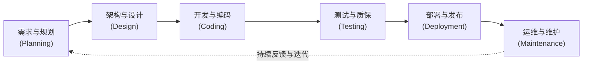

[toc]

---

## 软件项目开发的核心理论

软件项目开发的核心理论建立在 **软件开发生命周期 (Software Development Life Cycle, 简称 SDLC)** 之上。它是一套标准化的工程化流程，旨在帮助团队以可预测、高效且控制成本的方式，将一个业务概念转化为能够稳定运行的高质量软件产品。

现代软件开发早已从传统的线性 **瀑布模型 (Waterfall)** 演进到以 **敏捷开发 (Agile)** 和 **DevSecOps (开发、安全与运营一体化)** 为主导的迭代模式。根据近期的行业数据，超过90%的组织在不同程度上采用敏捷或混合模式。现代SDLC的核心理念是：**持续集成、快速反馈、测试左移 (Shift-Left Testing) 以及安全内建。**

### 公认的六大核心环节

无论采用何种开发流派，软件开发通常都必须包含以下六个公认的环节。在现代敏捷模式下，这六个环节并非一次性走完，而是以较短的周期（如两周的 Sprint 冲刺）不断循环迭代。

为了防止概念混淆，下面列出在各个环节中常常出现的核心工件(Artifacts)与角色配置：

| 核心工件 / 术语 | 英文缩写 / 全称                                | 含义与作用解释                                               | 对应环节   |
| :-------------- | :--------------------------------------------- | :----------------------------------------------------------- | :--------- |
| **PRD**         | Product Requirements Document                  | 产品需求文档。详细描述软件需要实现什么功能，面向什么用户，业务逻辑是什么。 | 需求规划   |
| **MVP**         | Minimum Viable Product                         | 最小可行性产品。包含核心功能的基础版本，用于最快投入市场验证想法。 | 需求规划   |
| **架构图**      | Architecture Diagram                           | 描述系统组件如何交互、数据如何流转的设计图纸，决定系统的扩展性。 | 架构设计   |
| **CI/CD**       | Continuous Integration / Continuous Deployment | 持续集成与持续部署。自动化构建、测试和发布代码的流水线工程实践。 | 开发与部署 |
| **单元测试**    | Unit Testing                                   | 针对代码中最小可测试单元（如单个函数）进行的正确性验证，通常由开发者自己编写。 | 开发与测试 |
| **SLA**         | Service Level Agreement                        | 服务等级协议。承诺系统可用性的指标（如 99.99%的正常运行时间）。 | 运维与维护 |

### 环节详述与现代最佳实践

**一、 需求分析与规划 (Planning & Requirement Analysis)**
将模糊的业务想法转化为明确的工程任务，确定系统边界、资源预算和时间表。
- **必须怎么做**：定义明确的验收标准 (Acceptance Criteria)，让所有人都知道“怎样才算做完了”。
- **推荐怎么做**：将大需求拆解为用户故事 (User Stories)，按优先级排序。
- **避免怎么做**：在没有业务方确认的情况下，技术团队凭主观臆测直接开始编码。

**二、 系统设计与架构 (System Design & Architecture)**
根据需求，规划技术栈、数据库模型、API接口以及系统的拓扑结构。
- **必须怎么做**：进行安全威胁建模 (Threat Modeling)，在设计阶段就考虑如何防范诸如SQL注入等常见攻击。
- **推荐怎么做**：采用微服务 (Microservices) 或模块化设计，做到高内聚、低耦合。
- **可以怎么做**：编写 API 契约文档（例如使用 OpenAPI/Swagger 规范），让前端和后端可以并行开发。

**三、 开发与编码 (Implementation / Coding)**
程序员根据设计文档，编写实际的源代码。这是耗时最长的环节。
- **必须怎么做**：使用版本控制系统（如 Git）管理代码，多人协作必须通过拉取请求 (Pull Request, PR) 进行合并。
- **推荐怎么做**：推行代码审查 (Code Review) 制度，不仅能发现潜在Bug，还能共享知识。
- **避免怎么做**：硬编码 (Hardcoding) 敏感信息，如将数据库密码直接写在代码文件中。

**四、 测试与质量保证 (Testing & Quality Assurance)**
验证软件是否满足需求，以及是否存在缺陷(Bug)。
- **必须怎么做**：建立自动化的测试流程。不能仅仅依赖人工点击测试。
- **推荐怎么做**：践行**测试左移**理念，即在开发早期就引入测试，开发人员需编写高覆盖率的单元测试。
- **避免怎么做**：将测试视为发布前的最后一道形式主义关卡，发现重大问题时为了赶进度而强行上线。

**五、 部署与发布 (Deployment & Release)**
将测试通过的代码推送到生产环境 (Production Environment)，让真实用户使用。
- **必须怎么做**：使用 CI/CD 流水线实现自动化构建和部署，消除人工部署可能带来的误差。
- **推荐怎么做**：采用蓝绿部署 (Blue-Green Deployment) 或灰度发布 (Canary Release)，小范围试错，降低发布风险。

**六、 运维与持续维护 (Maintenance & Operations)**
软件上线后的日常监控、问题修复、性能调优和技术支持。
- **必须怎么做**：建立完备的日志和监控告警机制（如 Prometheus + Grafana），做到在用户投诉前发现系统异常。
- **避免怎么做**：上线后“放任不管”，认为项目已经终结。

---

## 典型案例：电商平台“秒杀抢购”模块的开发

为了使上述抽象的生命周期直观易懂，我们通过一个极其考验系统健壮性的真实场景——开发一个**秒杀抢购系统**，来串联所有知识点。

1. **需求规划阶段**：
   - 业务痛点：常规购买流程在面对瞬间百万级流量时会导致数据库瘫痪。
   - 核心需求：允许10万名用户同时抢购100部特价手机，不超卖，系统不崩溃。产品经理产出PRD。

2. **设计阶段**：
   - 架构师介入。考虑到关系型数据库（如 MySQL）无法承受瞬间的高并发写请求，架构师设计了引入 **Redis** 内存数据库作为缓存拦截流量，并使用 **RabbitMQ** (消息队列) 进行异步削峰的方案。输出系统架构图与时序图。

3. **开发阶段**：
   - 前端工程师开发倒计时页面，并加入“防抖”逻辑（避免用户疯狂点击发送无效请求）。
   - 后端工程师用 Go 或 Java 实现接口，严格遵守设计中的“先扣减 Redis 库存，再发送队列消息”的逻辑。代码提交至 GitLab 并通过同事的代码审查。

4. **测试阶段**：
   - 除了常规的功能测试外，测试工程师重点使用 **JMeter** 或 **Locust** 等工具进行 **压测 (Load Testing)**，模拟10万并发请求轰炸接口，验证系统吞吐量和资源消耗，确认没有出现“卖出101部手机”的超卖Bug。

5. **部署阶段**：
   - 运维团队将应用程序打包为 Docker 镜像，通过 Kubernetes (K8s) 部署到云服务器。为了安全起见，仅向 10% 的用户开启灰度测试，观察无异常后，全量发布。

6. **运维阶段**：
   - 活动开始。监控大屏实时显示流量尖峰，触发了 K8s 的自动扩容机制 (HPA)，新增了5个后端服务节点。活动结束后，系统自动缩容，节约服务器成本。整个过程平稳落幕。

---

## 常见的混淆点与开发误区

在软件开发领域，一些关键概念常被初学者甚至部分从业者误解，导致项目走入歧途。

### 1. 敏捷开发等于“不需要计划”或“不要文档”
**误区表现**：团队不写任何需求文档和设计文档，直接开始写代码，遇到需求变更就随意修改，并美其名曰“我们在做敏捷”。
**事实剖析**：
- 敏捷宣言的核心是“*工作软件胜过详尽的文档*”，但这**绝对不代表零文档**。
- 敏捷提倡的是**适度文档**与**拥抱变化**。它要求团队有更高的规划能力，将长远大计划拆分为短期的、高精度的迭代计划 (Sprint Planning)。随意更改不仅不是敏捷，反而是工程灾难（这叫混乱开发）。

### 2. 质量和测试只是 QA（测试工程师）的责任
**误区表现**：开发人员写完代码不自测，直接扔给测试团队，认为“找Bug是QA的KPI”。
**事实剖析**：
- 现代软件工程极度强调 **质量是内建的 (Built-in Quality)**。
- 引入 **测试左移** 概念后，开发人员必须为自己的代码编写自动化单元测试。如果在测试阶段才发现架构性缺陷，修复成本可能是设计阶段发现的 100 倍。质量是整个团队（包括产品、开发、测试）的共同责任。

### 3. UI（用户界面）与 UX（用户体验）是一回事
**误区表现**：花费大量时间把界面做得非常炫酷、特效拉满，却忽略了用户完成一个任务需要点击多少次按钮。
**事实剖析**：
- **UI (User Interface)** 关注的是视觉层面的呈现（颜色、排版、组件外观）。
- **UX (User Experience)** 关注的是逻辑层面的感受（操作流是否顺畅、是否符合直觉、信息架构是否合理）。
- 一个产品可以看起来很丑（UI差）但是非常高效好用（UX好），例如诸多针对专业运维人员的命令行工具或者经典管理后台；反之亦然。

### 4. 交付速度优先，代码“技术债”以后再还
**误区表现**：为了赶项目的Deadline，开发时复制粘贴烂代码，不写注释，不做模块化设计，认为“先上线，以后有时间再重构”。
**事实剖析**：
- 这被称为累积 **技术债务 (Technical Debt)**。
- 现实往往是“以后等于绝不”。随着业务不断叠加，最初的烂代码会演变成“焦油坑”，导致后续添加任何新功能的成本呈指数级上升，最终可能迫使整个系统推倒重来。正确做法是在每个迭代中分配一定比例（如20%）的资源专门用于代码重构和偿还技术债。

### 5. 部署上线（上线日）意味着项目结束
**误区表现**：产品一经发布，开发团队就举行庆功宴并解散去投入下一个项目，没有预留专门的维护资源。
**事实剖析**：
- 软件项目最大的成本和挑战往往发生在 **Day 2 (第二天及以后的日常运营)**。
- 软件是动态的，依赖的操作系统的升级、第三方库爆出的安全漏洞 (CVE)、用户规模的增长，都会要求软件持续迭代。现代软件工程认为，没有监控和持续维护计划的软件，从上线第一天起就在加速走向死亡。