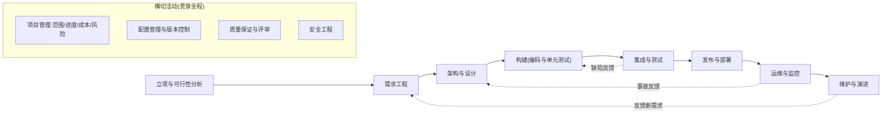
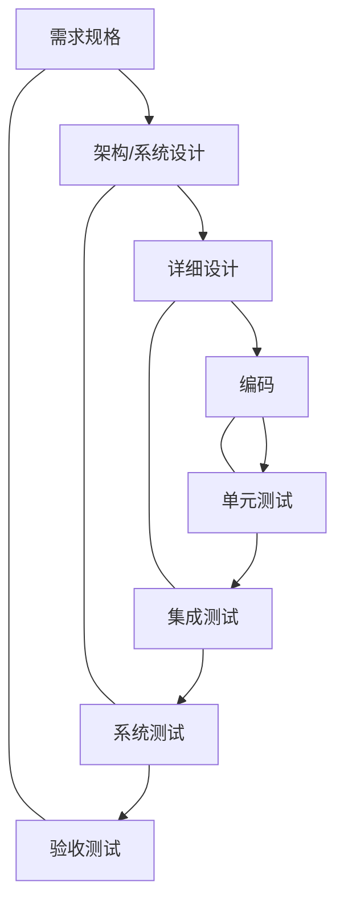
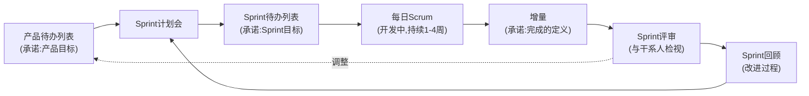
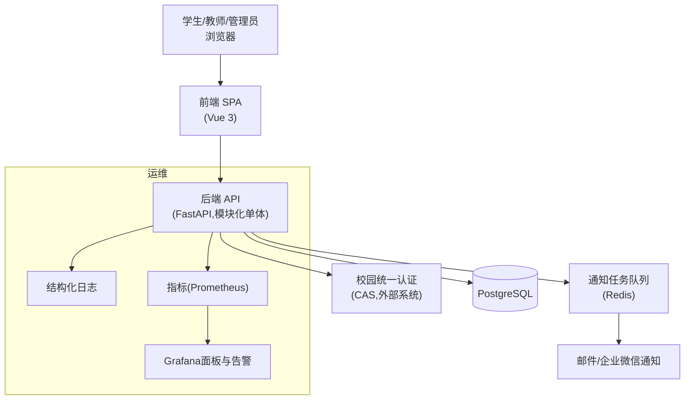
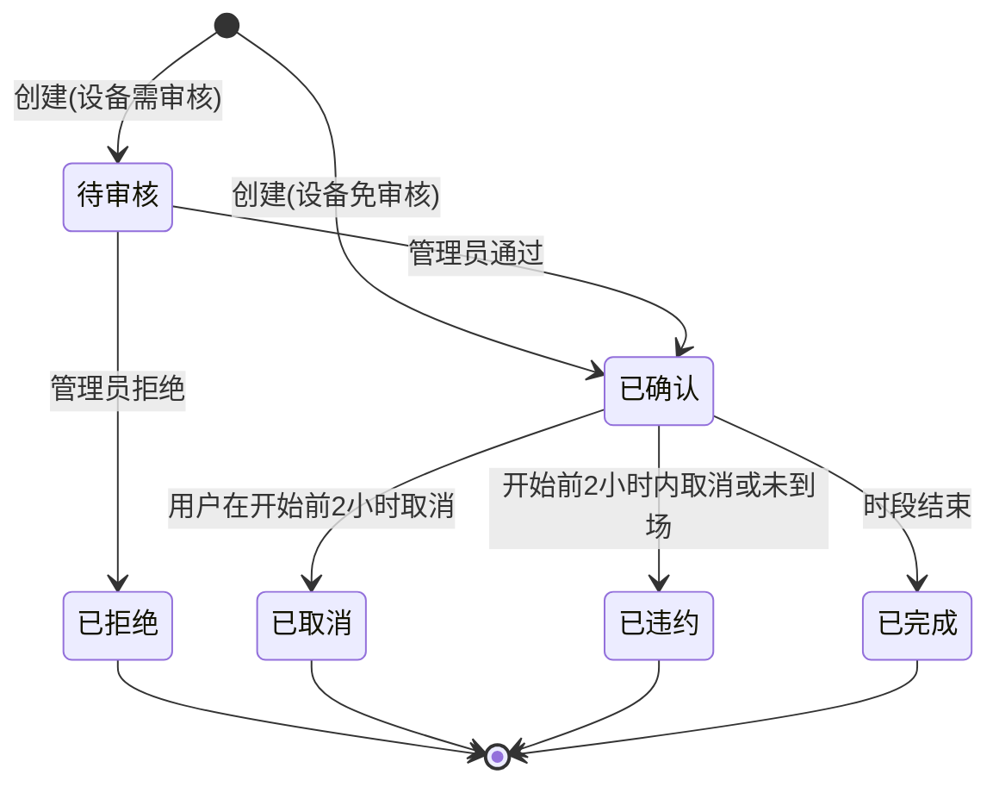
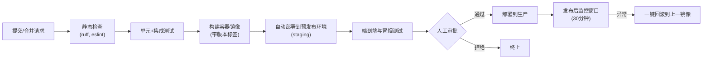

[toc]


## 理论地图

初学者常把"软件项目开发"理解为"写代码",但业界的共识是:**代码只是产物之一,项目开发是一个由多类过程组成的系统工程**。理解这个领域需要把三层知识叠在一起看:

| 层次                                                         | 回答的问题                                           | 代表性权威依据                                             | 关键词                                                       |
| ------------------------------------------------------------ | ---------------------------------------------------- | ---------------------------------------------------------- | ------------------------------------------------------------ |
| **软件工程知识体系**(Software Engineering Body of Knowledge) | "做软件需要哪些知识领域?"                            | IEEE *SWEBOK Guide v4.0*(2024)                             | 需求、架构、设计、构造、测试、运维、维护、配置管理、质量、安全…… |
| **生命周期过程**(Life Cycle Processes)                       | "一个软件从无到有再到退役,要经历哪些过程、产出什么?" | ISO/IEC/IEEE 12207:2017(国内对应GB/T 8566)                 | 协议过程、组织过程、技术管理过程、技术过程                   |
| **过程模型与方法论**(Process Models and Methods)             | "这些过程按什么节奏和顺序组织?"                      | 瀑布、V模型、迭代/增量、螺旋、RUP、Scrum、XP、看板、DevOps | 线性 vs 迭代、计划驱动 vs 敏捷                               |
| **项目管理**(Project Management)                             | "怎样在约束下把事做成?"                              | PMI *PMBOK Guide*(第7版)、PRINCE2                          | 范围、进度、成本、质量、风险、干系人                         |

**三者的关系**:知识体系告诉你"要会什么",生命周期过程告诉你"要做什么",过程模型告诉你"按什么节奏做",项目管理告诉你"怎样控制住"。本文的主线是第二层(公认环节),并穿插其他三层。

根据IEEE Computer Society发布的信息,[SWEBOK v4.0](https://www.computer.org/education/bodies-of-knowledge/software-engineering)于2024年10月发布,共**18个知识域**(Knowledge Areas, KA),相比v3新增了**软件架构、软件安全、软件工程运维**三个知识域,并将敏捷与DevOps实践融入多个知识域。这个变化本身就是一个信号:**架构、安全、运维已经被业界公认为软件开发的"基础环节"而非"高级话题"**。

---

## 公认的环节:软件项目的生命周期

### 总览

综合SWEBOK v4、ISO/IEC/IEEE 12207:2017与主流教材(如Sommerville *Software Engineering*、Pressman *Software Engineering: A Practitioner's Approach*),一个软件项目公认应具备的环节如下。注意:**这些环节是"必须存在的活动",而不是"必须按此顺序一次性走完的阶段"**——这是后文误区部分的核心。



图中虚线表示**反馈回路**:无论采用何种模型,后续环节发现的问题都会回流到前面的环节;下方四个横切活动不是某个阶段,而是**贯穿始终**的。

### 各环节详解

| 环节                                          | 核心目标                                  | 典型输入                   | 典型产出(制品)                                               | 关键角色                    |
| --------------------------------------------- | ----------------------------------------- | -------------------------- | ------------------------------------------------------------ | --------------------------- |
| **立项与可行性分析**(Inception / Feasibility) | 回答"为什么做、值不值得做、能不能做"      | 业务问题、机会、预算       | 项目章程(Project Charter)、可行性报告、初步范围、成功指标    | 发起人、产品经理、架构师    |
| **需求工程**(Requirements Engineering)        | 弄清"做什么"而不是"怎么做"                | 干系人访谈、现有系统、法规 | 需求规格(SRS)或产品待办列表(Product Backlog)、用户故事、验收标准、非功能需求、范围外清单 | 产品经理/业务分析师、干系人 |
| **架构与设计**(Architecture and Design)       | 决定"怎么做"的结构性决策与细节方案        | 需求、约束、质量属性       | 架构文档、架构决策记录(ADR)、接口契约(如OpenAPI)、数据模型、UI原型 | 架构师、技术负责人          |
| **构建**(Construction)                        | 把设计变成可运行、可验证的代码            | 设计、编码规范             | 源代码、单元测试、代码评审记录、构建脚本                     | 开发工程师                  |
| **集成与测试**(Integration and Testing)       | 证明系统满足需求且没有严重缺陷            | 代码、测试计划             | 测试用例、测试报告、缺陷清单                                 | 测试工程师、开发工程师      |
| **发布与部署**(Release and Deployment)        | 把经过验证的版本安全地交付到生产环境      | 构建产物、环境配置         | 发布说明(Release Notes)、部署脚本、回滚方案                  | 运维/平台工程师、发布经理   |
| **运维与监控**(Operations)                    | 让系统持续可用、可观测、可恢复            | 运行中的系统               | 监控面板、告警规则、事故报告(Postmortem)、SLO                | SRE/运维                    |
| **维护与演进**(Maintenance and Evolution)     | 修正缺陷、适应环境变化、增强功能,直至退役 | 变更请求、事故             | 补丁、新版本、迁移/退役计划                                  | 全体                        |

下面对最容易被初学者轻视、同时又最影响成败的几个环节做展开。

#### 需求工程:成败的分水岭

需求工程不是"把客户说的话记下来",而是一个包含五个子活动的工程过程(SWEBOK v4"软件需求"知识域的划分):

- **获取**(Elicitation):通过访谈、观察、原型、研讨会等手段,把干系人头脑里的隐性需要变成显性陈述。
- **分析**(Analysis):发现冲突、歧义、遗漏,区分**功能需求**(系统做什么)、**非功能需求/质量属性**(做得多好:性能、安全、可用性、可维护性等)和**约束**(必须用某数据库、必须接入统一认证、必须在某日期前上线)。
- **规格说明**(Specification):以可验证的形式写下来——传统上是软件需求规格说明书(SRS, Software Requirements Specification),敏捷语境下是用户故事(User Story)加验收标准(Acceptance Criteria)。
- **确认**(Validation):和干系人一起确认"写下来的确实是你要的"。
- **管理**(Management):需求会变,要有变更控制和可追溯性(需求到设计、代码、测试用例的追溯矩阵)。

**非功能需求的权威分类**可参考ISO/IEC 25010:2023的产品质量模型,它定义了九个质量特性:功能适合性、性能效率、兼容性、交互能力(原"易用性")、可靠性、安全性、可维护性、灵活性(原"可移植性")、以及2023版新增的**安全性(Safety,人身/财产安全)**。写非功能需求时按这九项逐一过一遍,是防止遗漏的实用办法。

**用户故事与验收标准的标准形式**:

- 用户故事:"作为`<角色>`,我希望`<能力>`,以便`<价值>`"。
- 验收标准常用Gherkin风格的"Given-When-Then":

```gherkin
Feature: 预约实验设备
  Scenario: 同一时段不可重复预约
    Given 设备"示波器-03"在2025-09-10 14:00-16:00已被用户甲预约成功
    When 用户乙尝试预约同一设备的2025-09-10 15:00-17:00时段
    Then 系统拒绝该预约
    And 提示"该时段与已有预约冲突"
```

各占位符含义:

| 占位符   | 含义                                  | 常见混淆                                     |
| -------- | ------------------------------------- | -------------------------------------------- |
| `<角色>` | 使用者的身份或画像,而非"用户"这种泛称 | 写成"作为系统"是典型错误,系统不是干系人      |
| `<能力>` | 用户想做的事,用业务语言而非技术语言   | 写成"我希望有一个按钮"是在描述方案而不是需求 |
| `<价值>` | 为什么要这个能力,用于判断优先级       | 省略后无法做取舍                             |
| `Given`  | 前置条件/初始状态                     | 不是操作步骤                                 |
| `When`   | 触发动作                              | 一个场景只应有一个主要动作                   |
| `Then`   | 可观察、可断言的结果                  | 写成"系统正确处理"是不可验证的               |

#### 架构与设计:架构是"难以改变的决策"

**架构**(Architecture)与**设计**(Design)的区别在于粒度与变更成本:架构关注系统级的结构性决策(模块划分、通信方式、数据存储策略、部署拓扑),一旦确定后改动代价高;设计关注模块内部的类、函数、算法,改动相对局部。SWEBOK v4把两者拆为独立知识域,正是因为这一区别。

现代实践中最值得初学者立刻采用的是**架构决策记录**(ADR, Architecture Decision Record):每个重要决策写一页纸,包含背景、备选方案、决定、后果。它成本极低,却能避免半年后"为什么当初选了这个"的追问。

#### 构建:不只是写代码

SWEBOK把编码称为"构造"(Construction),它包含:编码规范、单元测试、代码评审(Code Review)、版本控制、构建自动化。**"代码写完"和"构建完成"之间的差距,就是单元测试、评审和可重复构建**。

#### 测试与验证:V模型的对应关系

测试层次与需求/设计层次是一一对应的,这就是**V模型**(V-Model)的含义:



左臂自上而下是"分解",右臂自下而上是"验证",每一层测试的依据是对应左侧的制品。初学者常见问题是**只有右臂最底层(单元测试)或只有最顶层(手工点一点)**,中间层缺失。

**测试金字塔**(Test Pyramid)是现代实践的补充:底层大量快速的单元测试,中层适量的集成/API测试,顶层少量端到端测试。倒过来(大量端到端、极少单元)会导致测试慢、脆、难定位。

#### 发布、部署与运维:DevOps把它们变成了"基础环节"

传统观点把"上线"视为项目终点,现代观点则把**持续集成/持续交付**(CI/CD)和**可观测性**(Observability)视为开发的一部分。DORA(DevOps Research and Assessment)团队的研究给出了衡量交付能力的**四个关键指标**,据[DORA 2024报告的解读文章](https://octopus.com/devops/metrics/dora-metrics/)和[DX的摘要](https://getdx.com/blog/2024-dora-report/):

| 指标                                                         | 含义                           | 衡量的维度 |
| ------------------------------------------------------------ | ------------------------------ | ---------- |
| **部署频率**(Deployment Frequency)                           | 向生产环境成功部署的频率       | 吞吐       |
| **变更前置时间**(Lead Time for Changes)                      | 从代码提交到在生产运行的时间   | 吞吐       |
| **变更失败率**(Change Failure Rate)                          | 部署后导致降级或需要修复的比例 | 稳定性     |
| **失败部署恢复时间**(Failed Deployment Recovery Time,原MTTR) | 从失败到恢复服务的时间         | 稳定性     |

据这些解读,2024报告中精英团队按需部署、前置时间少于一天、变更失败率约5%。更重要的结论是:**吞吐和稳定性不是对立的**,高绩效团队两者同时领先;这直接反驳了"发布越频繁越不稳定"的直觉。该报告还有一个值得警惕的发现:AI工具提升了个人生产力,但在当年数据中与团队层面的交付吞吐和稳定性呈**负相关**——提示工具不能替代过程与工程纪律。

---

## 过程模型:环节如何被组织

### 主流模型对比

| 模型                                   | 节奏                      | 适用场景                                           | 主要风险             | 典型代表                              |
| -------------------------------------- | ------------------------- | -------------------------------------------------- | -------------------- | ------------------------------------- |
| **瀑布**(Waterfall)                    | 线性、阶段门禁            | 需求稳定、合规强、变更代价极高(航天、医疗器械固件) | 需求错误到后期才暴露 | Royce 1970(但他本人反对纯线性,见后文) |
| **V模型**                              | 线性但强调测试对应        | 安全关键系统、有强制验证要求的行业                 | 同瀑布               | 德国V-Modell XT、汽车行业             |
| **迭代/增量**(Iterative / Incremental) | 多轮循环,每轮交付可用子集 | 需求逐步明晰                                       | 架构被迭代"侵蚀"     | RUP、Boehm螺旋模型                    |
| **敏捷**(Agile)                        | 短周期(1-4周)、持续反馈   | 需求不确定、业务变化快                             | 被误用为"无纪律"     | Scrum、XP、看板                       |
| **DevOps / 持续交付**                  | 持续流动、按需发布        | 互联网服务、SaaS                                   | 需要自动化与文化基础 | DORA、*Continuous Delivery*           |

### Scrum的结构(2020版 *Scrum Guide*)

Scrum是当前最普及的敏捷框架,其结构极简,但每个要素都有明确定义:

- **三种责任**(Accountabilities):产品负责人(Product Owner)、Scrum Master、开发者(Developers)。
- **五个事件**(Events):Sprint(容器事件)、Sprint计划会、每日Scrum、Sprint评审、Sprint回顾。
- **三个制品及其承诺**(Artifacts and Commitments):产品待办列表对应**产品目标**(Product Goal);Sprint待办列表对应**Sprint目标**(Sprint Goal);增量(Increment)对应**完成的定义**(Definition of Done, DoD)。



**读图要点**:Sprint评审的输出会回流到产品待办列表(需求在每个周期都被重新排序),Sprint回顾的输出回流到下一次计划(过程本身也在迭代)。注意"增量"必须满足DoD才算存在——未达DoD的工作不能在评审中展示为"完成"。

### 瀑布的真相:Royce 1970年到底说了什么

这是软件工程史上最著名的误读。Royce在1970年的论文 *Managing the Development of Large Software Systems* 中确实画了那张著名的阶段图,但据[PM World Journal的分析](https://pmworldlibrary.net/wp-content/uploads/2018/07/pmwj72-Jul2018-Morgan-applying-1970-waterfall-lessons-umd-paper.pdf),他把这个纯线性模型称为"risky and invites failure",并提出了使其更迭代、更增量的修改建议。[ProjectManagement.com的文章](https://www.projectmanagement.com/blog-post/80348/the-waterfall-misconception--what-dr--royce-really-said-in-1970)总结其真正遗产是:**过程必须适应复杂度与不确定性,没有一种过程适合所有项目**。换言之,"瀑布模型"作为一个被推荐的模型,在它的"发明者"那里就已经是反面教材;后来几十年的管理者是在实践一个论文作者亲自否定的东西。

---

## 项目管理的基础理论

### 约束三角与质量

**项目管理三角**(范围 Scope、时间 Time、成本 Cost)的经典表述是:三者相互制约,改变其一必影响其余,而**质量**是三者共同作用的结果。实践中的推论:

- 当进度被砍而范围不变时,被牺牲的一定是质量(测试、评审、重构被跳过),这就是**技术债的主要来源**。
- 敏捷的做法是**固定时间和成本(团队规模),让范围浮动**——这正是Sprint定长、通过优先级决定做什么的原因。

### 估算与承诺

- **估算**(Estimate)是概率性的预测,**承诺**(Commitment)是一个决定。把估算直接当承诺是进度失控的首要原因。
- **Brooks定律**(*The Mythical Man-Month*,1975):向已经延期的软件项目增加人手,只会让它更延期——因为沟通成本按人数平方增长,新人需要培训,工作难以无损分割。"人月"不是可以互换的单位。
- 现代做法是**相对估算**(故事点)加**基于历史速率的预测**,而不是精确到人天的绝对估算。

### 风险管理

Boehm的螺旋模型把风险分析放在每一轮迭代的中心;实践上最简形式是**风险登记册**(Risk Register):每条风险记录描述、概率、影响、应对措施、责任人,**每周复查**。初学者最常犯的错误是立项时写一次,之后再也不看。

---

## 综合案例:高校实验室设备预约系统 LabBook

下面用一个贴近现实、规模适中的项目,把上述环节串起来。背景:某高校实验中心有约200台可预约设备,现状是用Excel和微信群登记,经常出现冲突与纠纷。中心希望在**一个学期(约14周)内**,由**一个4人小团队**(1名兼任产品负责人的管理员、2名开发、1名测试兼运维)上线一个预约系统。

### 立项与可行性

| 项目                 | 内容                                                         |
| -------------------- | ------------------------------------------------------------ |
| **问题陈述**         | 预约冲突多、无审计记录、管理员每周花约10小时人工协调         |
| **成功指标**         | 上线一个月后:预约冲突投诉降为0;管理员协调时间低于2小时/周;开学高峰期系统可用性99.5% |
| **干系人**           | 学生(主要用户)、教师(可代为预约)、实验室管理员(审核)、学校信息办(统一认证与服务器) |
| **约束**             | 必须接入校园统一身份认证(CAS);部署在校内服务器;预算仅为人力;14周 |
| **范围外**(明确不做) | 设备采购管理、费用结算、移动端原生App(用响应式网页替代)      |
| **初始风险**         | R1 统一认证对接接口文档不全;R2 开学第一周并发高峰;R3 团队无运维经验 |

**要点**:成功指标是可度量的业务结果,而不是"系统上线"。"范围外"清单与"范围内"同等重要,它是防止范围蔓延(Scope Creep)的第一道防线。

### 需求工程

产品待办列表(节选,按MoSCoW分级):

| 编号  | 用户故事                                         | 优先级 | 验收标准(摘要)                                            |
| ----- | ------------------------------------------------ | ------ | --------------------------------------------------------- |
| US-01 | 作为学生,我希望按时段预约设备,以便安排实验       | Must   | 同一设备同一时段只能有一个有效预约;预约成功发出通知       |
| US-02 | 作为管理员,我希望审核预约,以便控制高价值设备使用 | Must   | 标记为"需审核"的设备,预约状态为"待审核",管理员可通过/拒绝 |
| US-03 | 作为学生,我希望取消预约,以便释放资源             | Must   | 开始前2小时可取消;超过则记一次违约                        |
| US-04 | 作为管理员,我希望导出使用记录,以便统计           | Should | CSV导出,包含设备、用户、时段、状态                        |
| US-05 | 作为教师,我希望为课程批量预约,以便组织实验课     | Could  | 第二期再评估                                              |

非功能需求(按ISO/IEC 25010特性逐项检查后留下的关键条目):

- **性能效率**:开学首周峰值估计300并发用户,预约接口P95响应时间小于500毫秒。
- **可靠性**:工作日8:00-22:00可用性99.5%;每日备份数据库,恢复点目标(RPO)24小时。
- **安全性**:仅限校内统一认证用户;所有预约变更有审计日志;管理员操作需二次确认。
- **可维护性**:核心模块单元测试覆盖率不低于80%(作为门槛而非目标,见误区部分)。

### 架构与设计

**架构决策记录ADR-001(节选)**:

- 背景:4人团队、单校部署、200台设备、并发峰值数百。
- 备选:微服务架构;模块化单体;无服务器(校内不可用)。
- 决定:**模块化单体**,前后端分离。
- 后果:部署简单、团队认知负担低;若未来跨校推广需拆分,但当前无此需求(YAGNI原则)。



**读图要点**:统一认证是外部依赖,对应风险R1,应最早打通(迭代一就做);通知走异步队列,避免邮件服务慢拖累预约接口;可观测性从第一天就接入,而非上线后补。

核心领域对象是"预约"(Reservation),其状态机是整个系统最关键的设计:



**为什么状态机值得画**:US-01到US-03的验收标准全部能映射到这张图的转换上,测试用例可以直接按"每条转换"和"每条不允许的转换"来枚举,需求、设计、测试三者由此可追溯。

**接口契约**:用OpenAPI 3.x描述每个端点,前后端据此并行开发;前端用Mock Server,后端用契约测试,减少集成时的意外。

### 构建

团队约定(写入仓库的`CONTRIBUTING.md`):

- **分支策略**:主干开发(Trunk-Based Development),功能分支生命周期不超过2天,通过合并请求(Merge Request)合入`main`,至少1人评审。
- **提交信息**:遵循Conventional Commits(`feat:`、`fix:`、`docs:`等前缀),便于自动生成变更日志。
- **跨平台一致性**:团队有人用Windows、有人用macOS/Linux,仓库根目录放置`.gitattributes`与`.editorconfig`,统一换行符与缩进,避免脚本在Linux服务器上因CRLF无法执行:

```gitattributes
# 文本文件由Git按平台规范化,仓库内统一存为LF
* text=auto eol=lf
# Shell脚本与Dockerfile必须LF,否则在Linux上无法执行
*.sh text eol=lf
Dockerfile text eol=lf
# Windows批处理必须CRLF
*.bat text eol=crlf
*.cmd text eol=crlf
# 二进制文件不做转换
*.png binary
*.pdf binary
```

| 字段                  | 含义                                               |
| --------------------- | -------------------------------------------------- |
| `*`                   | 匹配所有路径的模式                                 |
| `text=auto`           | 让Git自动判断是否为文本文件;文本文件入库时统一为LF |
| `eol=lf` / `eol=crlf` | 检出到工作区时强制使用的换行符                     |
| `binary`              | 等价于`-text -diff`,不做换行转换也不做文本差异     |

- **依赖与网络**:国内环境下,`pip`配置清华或阿里镜像源,`npm`配置`registry.npmmirror.com`,Docker基础镜像从校内或国内镜像拉取;需要访问GitHub的脚本,在无代理时可通过gh-proxy类加速服务包裹链接(可用性随时间变化,使用前核实),有代理时在`*nix`下设置`HTTP_PROXY`/`HTTPS_PROXY`环境变量,Windows PowerShell下用`$env:HTTPS_PROXY`(注意在Markdown中要用内联代码保护,否则`$`会被当作公式)。
- **非ASCII字符**:数据库、HTTP响应、日志统一UTF-8;CSV导出(US-04)加入BOM以便Excel正确识别中文——这是国内项目极常见的"上线后才发现"的问题。

### 测试

按测试金字塔设计:

| 层次         | 内容                                           | 数量级 | 运行时机       |
| ------------ | ---------------------------------------------- | ------ | -------------- |
| 单元测试     | 状态机转换、时段重叠判定算法、取消规则         | 数百   | 每次提交       |
| 集成/API测试 | 每个OpenAPI端点、数据库约束、CAS回调           | 数十   | 每次合并请求   |
| 端到端测试   | "学生登录-预约-收到通知-管理员审核"主路径      | 个位数 | 每日与发布前   |
| 非功能测试   | 用k6或Locust做300并发压测;并发双重预约竞争测试 | 少量   | 迭代末、发布前 |

**最关键的一条测试**对应US-01的"同一时段只能有一个有效预约":单靠应用层检查在并发下会失效(两个请求同时通过检查),因此设计上在数据库层加排他约束(PostgreSQL的`EXCLUDE USING gist`时段范围约束),并写一个**并发测试**同时发起100个对同一时段的预约,断言恰好一个成功。这是"需求-设计-测试"闭环的典型体现:需求里一句话,决定了一个数据库约束和一个专门的测试。

### 发布与部署



**读图要点**:到预发布环境为止全自动,这是**持续交付**;生产部署前保留人工审批,是团队当前的选择,若去掉审批就是**持续部署**。回滚不是"出事再想",而是流水线的一部分;数据库迁移脚本必须**向前兼容**(先加列不删列),否则回滚应用而不回滚数据会出错。

环境区分:开发(本地Docker Compose)、预发布(与生产同构但数据脱敏)、生产(校内服务器)。配置通过环境变量注入,**代码库中不存任何密钥**。

### 运维与事故

上线后开学第一周(风险R2兑现),周一上午8:00预约开放瞬间并发达到估计值的两倍,预约接口P95飙到3秒,Grafana告警触发。团队按事故流程处理:

- 临时缓解:将通知任务队列的消费者增加到4个,并对预约列表接口加60秒缓存,20分钟内恢复。
- 根因分析(Postmortem,**无指责**原则):压测场景假设用户均匀到达,未模拟"整点开放"的瞬时尖峰;预约列表查询缺少索引。
- 改进项进入待办列表:增加整点尖峰压测场景;增加索引;考虑分批开放预约时段。

### 维护与演进

一个月后管理员提出新需求"高价值设备需两级审核"。它进入产品待办列表而不是直接改代码;评审时发现它会改动状态机(新增"待二级审核"状态),属于设计级变更,于是先更新ADR和状态图,再实现。版本从`1.0.0`升到`1.1.0`(语义化版本:新增向后兼容功能)。同时团队在"技术债登记"中记录:通知模块为了赶上线写了硬编码的邮件模板,计划在下一迭代重构。

### 项目回顾:环节如何互相支撑

| 环节 | 在本案例中起到的作用               | 若省略会发生什么                                           |
| ---- | ---------------------------------- | ---------------------------------------------------------- |
| 立项 | 明确"范围外"与可度量指标           | 做出移动App、费用结算等无人要的功能,且无法说明项目是否成功 |
| 需求 | 验收标准可直接转为测试             | 并发双重预约问题可能根本不被识别                           |
| 架构 | ADR避免过度设计;可观测性前置       | 微服务对4人团队是灾难;事故时无数据可查                     |
| 设计 | 状态机统一了需求、代码与测试的语言 | 状态散落在各处`if`里,"两级审核"变更将极难实现              |
| 构建 | 跨平台一致性、评审                 | 脚本在服务器上因CRLF报错;质量依赖个人                      |
| 测试 | 分层、并发测试                     | 上线后出现冲突投诉,项目核心价值落空                        |
| 部署 | 预发布环境、回滚                   | 直接在生产上试错                                           |
| 运维 | 告警、Postmortem                   | 高峰期瘫痪无人知晓,事故重复发生                            |
| 维护 | 变更走流程、技术债可见             | 系统逐渐腐化为"没人敢动"                                   |

---

## 经典失败案例:环节缺失的代价

以下案例均来自公开的官方调查或权威文献,是教科书级别的反面教材;细节以我记忆中的公开记录为准。

### Healthcare.gov(2013):测试与集成被压缩到最后

美国联邦医保交易网站于2013年10月1日上线即崩溃,首日几乎无人能完成注册。美国政府问责局(GAO)2014年的报告指出的主要问题包括:需求在上线前数月仍在变化;**端到端测试在上线前几周才开始**;负载测试假设的并发用户数远低于实际;政府机构自己承担了系统集成商的角色却缺乏相应能力,数十个承包商之间没有清晰的责任主体。**对应缺失的环节**:需求冻结与变更控制、集成测试、非功能测试(性能)、项目治理。

### Knight Capital(2012):部署过程的45分钟

2012年8月1日,美国做市商Knight Capital在45分钟内损失约4.4亿美元。据美国证监会(SEC)2013年的处罚文书:新交易代码被**手工部署到8台服务器中的7台**,遗漏的那台仍运行旧代码;新代码复用了一个旧功能的标志位,导致那台服务器上早已废弃的"Power Peg"测试逻辑被激活,疯狂下单;公司没有自动化部署校验,也没有有效的熔断机制。**对应缺失的环节**:自动化、可重复的部署;死代码清理(维护);发布后监控与回滚预案。这是"运维是基础环节"最有说服力的案例。

### Therac-25(1985-1987):安全关键系统的设计与验证

加拿大的放射治疗机Therac-25造成至少6起过量辐射事故。Leveson与Turner 1993年的调查论文指出:软件从前代机型复用,但前代机型有硬件联锁而Therac-25移除了硬件联锁,完全依赖软件;存在竞态条件(操作员快速输入时触发);厂商最初对事故报告反应是"不可能是软件问题"。**对应缺失的环节**:安全需求分析、复用时的重新验证、事故响应文化。

### Ariane 5首飞(1996):复用而不重新确认

欧洲阿丽亚娜5火箭首飞37秒后自毁。调查委员会报告:惯性参考系统软件直接复用自阿丽亚娜4,其中一段把64位浮点数转为16位整数的代码在阿丽亚娜5更高的水平速度下溢出;而这段代码在起飞后其实已无用途;相关异常处理策略是关机。**对应缺失的环节**:需求确认(新环境下的取值范围)、针对新系统的集成测试、设计评审(无用代码为何保留)。

**四个案例的共同点**:没有一个是"程序员不会写代码"造成的;全部是**需求、集成测试、部署、变更控制等环节被省略或走过场**造成的。这也是为什么业界把这些环节称为"基础"而不是"可选"。

---

## 常见混淆点与误区

### 概念辨析

| 容易混淆的概念                                               | 辨析要点                                                     |
| ------------------------------------------------------------ | ------------------------------------------------------------ |
| **验证**(Verification) vs **确认**(Validation)               | 验证回答"我们是否正确地构建了产品"(符合规格);确认回答"我们是否构建了正确的产品"(满足用户需要)。一个完全符合SRS的系统仍可能因SRS写错而无用。Boehm的经典表述:Verification是"building the product right",Validation是"building the right product"。 |
| **需求**(Requirement) vs **方案**(Solution)                  | "我需要一个导出按钮"是方案,"我需要把本月使用记录交给财务"才是需求。混淆两者会把需求阶段变成UI讨论,并丧失更优方案的空间。 |
| **功能需求** vs **非功能需求** vs **约束**                   | 功能需求说"做什么";非功能需求说"做得多好"(可度量的质量属性);约束说"必须在什么条件下做"(技术、法规、预算)。"必须用MySQL"是约束而不是非功能需求。 |
| **验收标准**(Acceptance Criteria) vs **完成的定义**(Definition of Done) | 验收标准针对**单个**待办项,回答"这个故事做对了吗";DoD针对**所有**增量,回答"任何工作达到了可发布质量吗"(如代码评审过、测试通过、文档更新)。前者每条故事不同,后者团队统一。 |
| **迭代**(Iterative) vs **增量**(Incremental)                 | 增量是"每次多交付一块可用功能";迭代是"每次对已有东西再精化一遍"。Scrum两者兼有,但很多团队只做增量(堆功能)不做迭代(不回头精化),导致产品越来越臃肿。 |
| **架构** vs **设计**                                         | 架构是难以改变的、影响全局的决策(模块边界、通信、数据);设计是模块内部的实现方案。"我们用了MVC"更多是设计模式级别,"单体还是微服务"是架构级别。 |
| **持续集成** vs **持续交付** vs **持续部署**                 | 持续集成(CI):每位开发者至少每天合入主干一次,每次合入自动构建与测试(Fowler的定义)。持续交付(Continuous Delivery):主干随时处于**可发布**状态,发布是业务决定。持续部署(Continuous Deployment):每次通过流水线的变更**自动**进入生产。三者是递进关系,"CD"这个缩写在不同文献中指后两者之一,阅读时要确认。 |
| **测试**(Testing) vs **质量保证**(QA) vs **质量控制**(QC)    | 测试是发现缺陷的具体活动;质量控制是检查产物是否达标(含测试、评审);质量保证是确保**过程**本身能产出质量(标准、审计、改进)。"测试团队等于QA"是常见的组织误解。 |
| **配置管理**(Configuration Management) vs **版本控制**(Version Control) | 版本控制是配置管理的工具之一;配置管理还包括配置项识别、基线、变更控制、状态记录、审计。Git不等于配置管理,Git也不等于GitHub(前者是工具,后者是托管平台,Gitee、GitLab、Gitea同理)。 |
| **项目**(Project) vs **产品**(Product)                       | 项目有明确起止,以交付为终点;产品持续演进,以价值为中心。把持续演进的产品按"项目"管理,会在上线后解散团队,把维护变成无人负责的"遗留系统"。 |
| **估算**(Estimate) vs **承诺**(Commitment)                   | 见前文。把开发者说的"大概两周"写进合同就是典型混淆。         |
| **最小可行产品**(MVP) vs **半成品**                          | MVP是**能验证核心假设的最小完整闭环**,质量不可省;半成品是功能不闭环、质量不达标的东西。"先上线再说"往往是后者。 |
| **技术债**(Technical Debt) vs **烂代码**                     | Cunningham提出的隐喻指"为了快速交付而有意做出的、将来要偿还的权衡";Fowler的四象限进一步区分了"鲁莽/审慎"与"有意/无意"。只有**审慎且有意**的才是健康的技术债,其他是质量问题。 |
| **开发环境** vs **测试环境** vs **预发布环境** vs **生产环境** | 开发环境供个人调试;测试环境供测试团队,数据可任意;预发布(Staging)应与生产**同构**,用于最终验证;生产环境服务真实用户。在测试环境通过不代表预发布会通过,跳过预发布直接上生产是Knight Capital式风险。 |

### 方法论层面的误区

- **"敏捷就是不写文档、不做计划"**。*Agile Manifesto* 的原文是"工作的软件**高于**详尽的文档",并明确说右侧项"也有价值"。敏捷反对的是无人阅读的文档和一次性做完的计划,不反对文档与计划本身。Scrum每个Sprint都有计划会,每天都有计划(每日Scrum)。
- **"Scrum就是敏捷"**。Scrum是敏捷的一种框架;XP贡献了测试驱动开发、结对编程、持续集成等工程实践;看板来自精益。只做Scrum的"仪式"而没有XP的工程实践,通常得到的是"快速交付低质量代码"。
- **"Sprint就是两周一次的小瀑布"**。如果Sprint内部是"前三天写需求、中间写代码、最后两天测试",那只是把瀑布压缩了,反馈周期并没有缩短。健康的Sprint是多条故事各自走完"需求-开发-测试"的小闭环。
- **"瀑布已死,任何项目都该敏捷"**。对需求确定、变更代价极高、法规要求完整文档和追溯的领域(医疗器械软件、航空、核电),计划驱动的模型仍是合理选择,Royce本人反对的是"**纯线性且无反馈**",而非"有计划"。
- **"DevOps是一个岗位/一个工具"**。DevOps是打通开发与运维的文化与实践体系;Jenkins或GitLab CI是工具,"DevOps工程师"岗位是组织的权宜之计。
- **"上线就是结束"**。按ISO/IEC/IEEE 12207的技术过程,运行(Operation)、维护(Maintenance)、退役(Disposal)都是生命周期的正式过程;经验上软件总成本的大半发生在交付之后。

### 工程实践层面的误区

- **"覆盖率80%等于质量好"**。覆盖率衡量的是"代码被执行过",不是"行为被断言过"。没有断言的测试可以达到100%覆盖。覆盖率适合作为**下限门槛**,不适合作为目标。
- **"自动化测试等于不需要测试设计"**。自动化只是执行手段,等价类划分、边界值、状态转换这些测试设计技术决定了测试的有效性。
- **"代码写完等于完成"**。按DoD,未评审、未测试、未部署到预发布的代码都不是"完成";这正是"开发说做完了,测试说没法测"的根源。
- **"先做功能,安全和性能以后再说"**。SWEBOK v4把安全列为独立知识域,ISO/IEC 25010把性能、安全列为质量特性,都说明它们是需求的一部分;事后补的成本通常是前期的数倍到数十倍(Boehm的经典观点,虽然具体倍数在不同研究中差异很大)。
- **"人多力量大"**。Brooks定律。
- **"复用过的代码不用再测"**。Ariane 5和Therac-25都是反例:**复用的是代码,变化的是环境**,验证必须针对新环境重做。
- **"工具选对了就成功了"**。DORA 2024的AI相关发现是最新的提醒:工具提升个人效率不自动转化为团队交付能力,过程与纪律才是基础。
- **忽视跨平台与本地化细节**:换行符(CRLF/LF)、路径分隔符、大小写敏感(Windows文件系统不区分大小写而Linux区分,导致`import` 在本机能跑、在服务器上找不到文件)、默认编码(Windows的GBK与Linux的UTF-8)、时区。这些问题在国内团队中因Windows开发机加Linux服务器的组合而尤为常见。

---

## 最佳实践清单

按强制程度分级,供团队直接采用:

| 等级             | 实践                                                         |
| ---------------- | ------------------------------------------------------------ |
| **必须**(Must)   | 使用版本控制并以主干为准;每条需求有可验证的验收标准;有明确的"范围外"清单;核心逻辑有自动化测试并在每次合入时运行;生产部署可重复、可回滚;密钥不入库;有事故记录与复盘 |
| **应该**(Should) | 用ADR记录架构决策;维护风险登记册并定期复查;区分预发布与生产环境;用DORA四指标度量交付;用`.gitattributes`与`.editorconfig`统一跨平台规范;非功能需求按ISO/IEC 25010逐项检查;技术债登记可见 |
| **可以**(May)    | 契约优先(OpenAPI)并行开发;主干开发配合功能开关;测试驱动开发;用Mermaid或PlantUML把图纳入版本控制;语义化版本与自动生成变更日志 |
| **避免**(Avoid)  | 把估算当承诺;向延期项目加人;跳过预发布直接上生产;以覆盖率为目标;Sprint内部小瀑布;复用代码不重新验证;文档与代码分离存放导致失效 |

### 免费、开源、跨平台的工具参考

| 环节           | 工具(均为免费或有免费层,国内可用性考虑在内)                  |
| -------------- | ------------------------------------------------------------ |
| 需求与任务管理 | 禅道(ZenTao,国产开源)、Gitea/GitLab自带Issue与看板、Jira免费层(需外网) |
| 版本控制与托管 | Git;自托管Gitea或GitLab CE;Gitee(国内)、GitHub(国内访问可能需镜像或代理) |
| 架构与文档     | Markdown加Mermaid、PlantUML、draw.io、ADR模板                |
| 接口契约       | OpenAPI、Swagger UI、Apifox(国产,有免费层)                   |
| 测试           | pytest、JUnit、Vitest;k6、Locust(负载);Playwright(端到端)    |
| CI/CD          | GitLab CI、Gitea Actions、Jenkins、GitHub Actions            |
| 部署           | Docker与Docker Compose;小规模无需Kubernetes                  |
| 可观测性       | Prometheus、Grafana、Loki;OpenTelemetry                      |
| 代码质量       | ruff/black(Python)、ESLint/Prettier、shellcheck与shfmt(Shell)、SonarQube社区版 |

---

## 国内外相关标准对照

| 国际标准                                 | 国内对应                                  | 说明                                     |
| ---------------------------------------- | ----------------------------------------- | ---------------------------------------- |
| ISO/IEC/IEEE 12207:2017 软件生存周期过程 | GB/T 8566(据我所知2022年版等同采用2017版) | 定义协议、组织、技术管理、技术四大过程组 |
| ISO/IEC/IEEE 15288 系统生存周期过程      | GB/T 22032                                | 系统级,与12207同构                       |
| ISO/IEC 25010 产品质量模型               | GB/T 25000.10                             | 非功能需求分类依据                       |
| ISO/IEC/IEEE 29148 需求工程              | GB/T 9385(需求规格说明)等                 | SRS编写规范                              |
| IEEE/ISO/IEC 29119 软件测试              | GB/T 38634                                | 测试过程与文档                           |

据[arc42对12207的概述](https://quality.arc42.org/standards/iso12207),ISO/IEC/IEEE 12207为软件生命周期过程建立了统一框架与通用语言;其技术过程覆盖业务或任务分析、干系人需求定义、系统/软件需求定义、架构定义、设计定义、实现、集成、验证、移交、确认、运行、维护、退役——这正是本文"公认环节"一节的标准依据。

---

## 小结

- **软件项目开发的基础理论**由四层构成:知识体系(SWEBOK)、生命周期过程(12207)、过程模型(瀑布到DevOps)、项目管理(约束三角、估算、风险)。
- **公认的环节**是立项、需求、架构与设计、构建、测试、发布部署、运维、维护,外加贯穿全程的项目管理、配置管理、质量保证与安全。它们是"必须存在的活动",而非"必须线性走完的阶段"。
- **典型案例**表明:失败几乎从不源于"不会写代码",而源于需求、集成测试、部署、变更控制等环节的缺失;LabBook案例则展示了环节之间如何用验收标准、状态机、ADR、流水线等制品相互追溯、相互支撑。
- **最常见的误区**集中在概念混淆(验证/确认、CI/CD、验收标准/DoD、架构/设计)、方法论误读(敏捷无文档、瀑布的原意、Sprint小瀑布)和工程实践(覆盖率崇拜、复用不验证、加人赶工、跨平台细节)。

