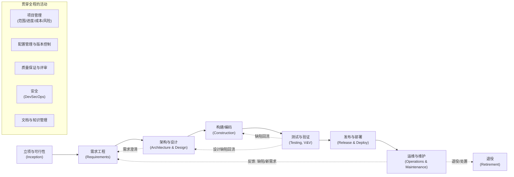
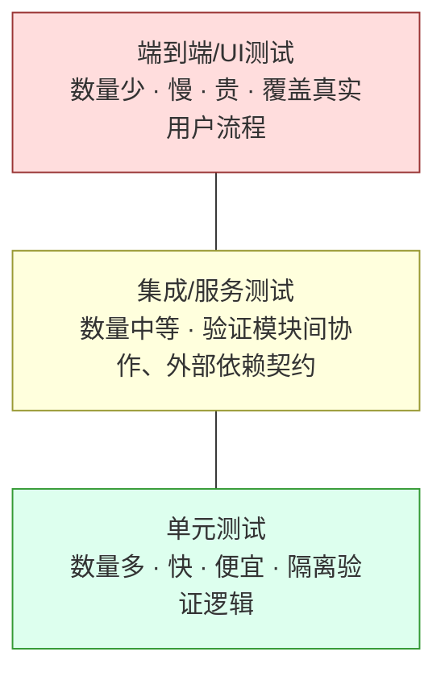
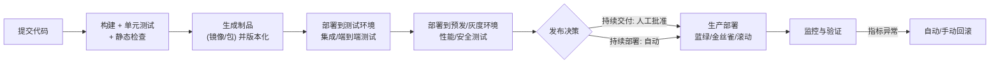
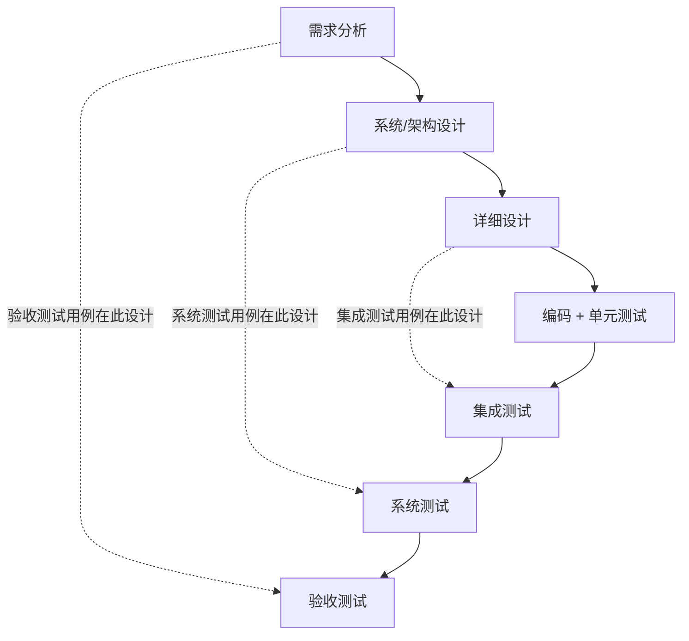
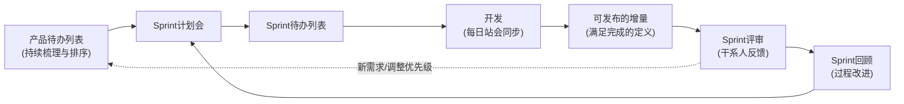
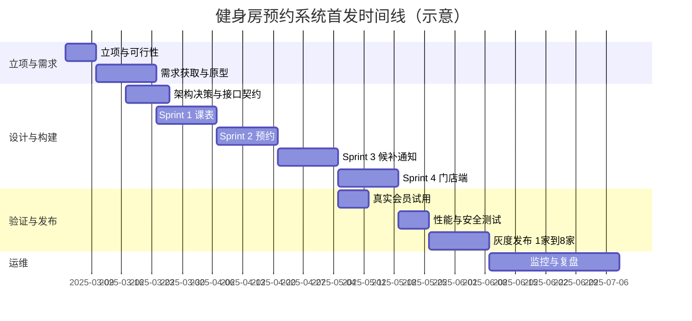

[toc]

## 什么是"软件项目开发"：先厘清三个相互交织的视角

初学者最容易把"软件开发"理解为"写代码"。实际上一个软件项目同时受三套理论支配，它们回答不同的问题：

| 视角                                 | 核心问题                                       | 代表知识体系                 | 典型角色               |
| ------------------------------------ | ---------------------------------------------- | ---------------------------- | ---------------------- |
| **软件工程**（Software Engineering） | 怎样**正确地构建**软件（技术活动的内容与顺序） | SWEBOK、ISO/IEC/IEEE 12207   | 架构师、开发、测试     |
| **项目管理**（Project Management）   | 怎样在**范围、进度、成本、质量**约束下按时交付 | PMBOK、PRINCE2、Scrum Guide  | 项目经理、Scrum Master |
| **产品管理**（Product Management）   | **做什么、为谁做、为什么做**才有价值           | 精益创业、用户研究、商业分析 | 产品经理、业务方       |

**关键认知**：一个项目失败，往往不是"代码没写好"，而是三套视角之间的脱节——例如技术上完美交付了一个没人要的功能（产品失败），或者需求正确但发布太晚（项目失败）。后文介绍的"环节"主要来自软件工程视角，但每个环节都会标注其与项目/产品视角的接口。

**SWEBOK v4.0**（IEEE计算机协会2024年发布）将软件工程公认的知识划分为**18个知识领域**（Knowledge Area, KA），其中直接对应开发环节的有：软件需求、软件架构（v4新增）、软件设计、软件构造、软件测试、软件工程运维（v4新增）、软件维护；贯穿性的有：软件配置管理、软件工程管理、软件工程过程、软件质量、软件安全（v4新增）、模型与方法、专业实践、经济学等。v4的一个重要信号是：**敏捷与DevOps已被整合进各知识领域，而不再被视为"另一种流派"**。

**ISO/IEC/IEEE 12207**则从过程角度把生命周期活动分为四大过程组：**协议过程**（采购/供应）、**组织项目使能过程**、**技术管理过程**（计划、评估、决策、风险、配置、信息、度量、质量保证）和**技术过程**（业务/任务分析、需求定义、架构定义、设计定义、实现、集成、验证、移交、确认、运行、维护、处置）。这套标准的价值在于它是**方法论中立**的：无论瀑布还是敏捷，这些过程都存在，只是组织方式不同。

---

## 公认应具备的环节：总览

下图给出一个现代软件项目的生命周期骨架。注意三点：环节之间**有回流箭头**（不是单向的）；底部的贯穿性活动**从第一天持续到最后一天**；整个循环在真实项目中会**重复多次**（迭代）。

各环节一览表（每个环节的"输出"就是下一环节的"输入"，这是追溯性的基础）：

| 环节             | 回答的问题                           | 关键输入                   | 关键输出（交付物）                                           | 主要责任人                    | 常用方法/工具                         |
| ---------------- | ------------------------------------ | -------------------------- | ------------------------------------------------------------ | ----------------------------- | ------------------------------------- |
| **立项与可行性** | 值不值得做？做得成吗？               | 业务问题、市场/用户痛点    | 项目章程、商业论证、初步范围与预算、风险清单                 | 发起人、产品经理、项目经理    | 商业画布、ROI估算、技术预研（Spike）  |
| **需求工程**     | 系统**要做什么**（而非怎么做）       | 干系人访谈、业务流程、法规 | 需求规格（SRS）或产品待办列表（Product Backlog）、验收标准、原型 | 产品经理/业务分析师、全员参与 | 用户故事、用例、事件风暴、原型工具    |
| **架构与设计**   | 系统**怎么做**才能满足需求与质量属性 | 需求、约束、质量属性       | 架构文档/ADR、接口契约（API）、数据模型、详细设计            | 架构师、资深开发              | C4模型、ADR、OpenAPI、ER图            |
| **构建/编码**    | 把设计变成可运行、可维护的代码       | 设计、编码规范             | 源码、单元测试、构建脚本、可部署制品                         | 开发工程师                    | Git、代码评审、CI、静态检查           |
| **测试与验证**   | 做对了吗？做的是对的东西吗？         | 代码、需求、验收标准       | 测试用例、测试报告、缺陷记录                                 | 测试工程师+开发               | 测试金字塔、自动化测试、探索性测试    |
| **发布与部署**   | 怎样安全地让用户用上                 | 制品、发布计划             | 已部署系统、发布说明、回滚预案                               | 运维/平台工程、开发           | CD流水线、灰度发布、特性开关          |
| **运维与维护**   | 系统持续健康并随需求演化             | 监控数据、用户反馈、事故   | 运行指标、修复补丁、新版本、事故复盘                         | SRE/运维、开发                | 可观测性、SLO、事后复盘（Postmortem） |

下面逐一展开。

---

## 环节详解

### 立项与可行性

这一环节常被初学者忽略，但它决定了项目的"方向正确性"。核心产出是**项目章程**（Project Charter）或**商业论证**（Business Case），至少应回答：

- **问题陈述**：解决谁的什么问题？当前痛点的量化证据是什么？
- **成功标准**：怎样算成功？（例如"上线3个月内线上预约占比达到60%"，而不是"上线一个预约系统"）
- **范围边界**：明确**做什么和不做什么**（Out of Scope 清单与 In Scope 同样重要）
- **可行性**：技术（能否做到）、经济（值不值）、运营（能否维持）、法律合规（如个人信息保护、等保要求）
- **主要风险与假设**：例如"假设第三方支付接口文档准确"——假设一旦不成立就是风险

**推荐做法**：对高不确定性的技术点先做**技术预研**（Spike，时间盒限定的小实验），用一两天的代码验证可行性，而不是在设计阶段纸上谈兵。

### 需求工程

需求工程（Requirements Engineering）是**整个生命周期中投资回报率最高、也是最常被做坏的环节**。它不是"写一份文档"，而是五个持续的子活动：

| 子活动                        | 内容                                   | 典型产出                         |
| ----------------------------- | -------------------------------------- | -------------------------------- |
| **获取**（Elicitation）       | 访谈、观察、工作坊、竞品分析、日志分析 | 原始需求记录、用户画像           |
| **分析**（Analysis）          | 消除冲突、区分优先级、识别隐含需求     | 需求优先级（如MoSCoW）、业务规则 |
| **规格说明**（Specification） | 用无歧义、可验证的方式写下来           | SRS / 用户故事 + 验收标准        |
| **确认**（Validation）        | 和干系人确认"这就是你要的"             | 评审记录、原型演示反馈           |
| **管理**（Management）        | 变更控制、追溯、基线                   | 需求追溯矩阵、变更记录           |

需求的三个层次和两大类别必须分清：

- **业务需求**（为什么做，组织目标）→ **用户需求**（用户要完成什么任务）→ **系统需求**（系统必须具备的具体行为）。层次之间要能追溯。
- **功能需求**（系统做什么）与**非功能需求/质量属性**（做得多好：性能、可用性、安全、可维护性、合规）。**非功能需求决定架构**，遗漏它们是架构返工的首要原因。

敏捷语境下最常用的规格形式是**用户故事**配**验收标准**。用户故事模板：

> 作为 `<角色>`，我希望 `<能力>`，以便 `<价值>`。

验收标准常用 Given/When/Then 格式：

> Given `<前置条件>`，When `<触发动作>`，Then `<可观察的结果>`。

占位符说明：

| 占位符           | 含义                                               | 辨析                                                         |
| ---------------- | -------------------------------------------------- | ------------------------------------------------------------ |
| `<角色>`         | 具体的用户类型（如"健身房前台"），而非泛泛的"用户" | 不同角色对同一功能的诉求可能冲突，必须具体                   |
| `<能力>`         | 用户想完成的事，用业务语言描述                     | 应描述"想做什么"，**不要**写成技术方案（如"我希望有一个Redis缓存"） |
| `<价值>`         | 做这件事的目的                                     | 这是最常被省略却最重要的部分；它让团队在实现时有权选择更好的方案 |
| `<前置条件>`     | 系统和数据的起始状态                               | 需要可构造、可复现                                           |
| `<触发动作>`     | 用户或外部系统的单个动作                           | 一个场景只描述一个动作                                       |
| `<可观察的结果>` | 可以被测试断言的结果                               | 避免"系统应快速响应"这种不可验证的描述，改为"在200ms内返回"  |

好的用户故事应满足 **INVEST** 原则：独立（Independent）、可协商（Negotiable）、有价值（Valuable）、可估算（Estimable）、小（Small）、可测试（Testable）。

**必须**：每条需求都有唯一标识、可验证的验收标准和明确的提出者。**应该**：用原型（低保真即可）而不是纯文字来确认交互类需求。**避免**：把需求文档当合同一次性"签字锁定"，然后拒绝一切变更——需求变化是常态，要管理变化而不是禁止变化。

### 架构与设计

架构与设计回答"怎么做"。两者的分界在实践中常引起困惑，可以这样理解：

- **架构**（Architecture）：**难以更改**的、影响全局的决策——系统拆分（单体还是微服务）、技术栈、数据存储选型、通信方式、部署拓扑、关键质量属性的实现策略。SWEBOK v4把它独立为一个知识领域，正说明其重要性。
- **详细设计**（Detailed Design）：模块内部的类/函数/数据结构/算法设计，变更代价局部可控。

国内传统教材中的"**概要设计**"大致对应架构+模块划分+接口定义，"**详细设计**"对应模块内部设计；敏捷团队通常不再写厚重的设计说明书，但**架构决策本身并没有消失**，只是以更轻量的形式记录。

**现代推荐的轻量产出**：

- **架构决策记录**（ADR, Architecture Decision Record）：每个重要决策一个短文档——背景、备选方案、决定、后果。它回答后来者最常问的"当初为什么这么设计"。
- **C4模型**图：系统上下文（Context）→ 容器（Container）→ 组件（Component）→ 代码（Code），四层逐级放大，按需绘制。
- **接口契约**：对外API用OpenAPI/Protobuf等机器可读格式定义，**先定契约再并行开发**（契约先行）。
- **数据模型**：实体关系与关键约束；数据库变更用迁移脚本纳入版本控制。

设计原则方面，初学者优先掌握**高内聚低耦合、关注点分离、依赖倒置、单一职责**；更重要的是理解**权衡**（Trade-off）——架构没有"最佳"，只有"在当前约束下最合适"。例如微服务带来独立部署与伸缩能力，但代价是分布式复杂性、运维成本和数据一致性难题；一个五人团队的初创产品通常**应该**从模块化单体开始。

### 构建/编码

"构建"（Construction）比"写代码"的范围大得多，SWEBOK把它定义为通过编码、验证、单元测试、集成测试和调试的组合来详细创建可工作的软件。现代构建环节的基本要素：

| 要素                        | 必须/应该 | 说明                                                         |
| --------------------------- | --------- | ------------------------------------------------------------ |
| **版本控制**                | 必须      | 所有源码、配置、基础设施定义、文档都进Git；提交粒度小、信息清晰 |
| **分支策略**                | 必须明确  | 小团队推荐**主干开发**（Trunk-Based Development）+ 短生命周期特性分支；GitFlow适合有明确版本发布节奏的产品 |
| **编码规范与自动格式化**    | 应该      | 用工具（如`prettier`、`black`、`gofmt`、`clang-format`）而非人力执行；配合`.editorconfig` |
| **代码评审**（Code Review） | 应该      | 通过Pull/Merge Request进行；评审关注设计、正确性、可读性，而非格式（格式交给工具） |
| **单元测试与开发者测试**    | 应该      | 开发者对自己的代码负责测试；TDD可以采用但不是强制            |
| **持续集成**（CI）          | 必须      | 每次推送自动构建+测试+静态检查，几分钟内反馈                 |
| **依赖管理与可复现构建**    | 必须      | 锁定依赖版本（`package-lock.json`、`poetry.lock`、`go.sum`等）；国内环境配置镜像源（npm、PyPI、Maven、Go proxy）并写入项目文档 |

提交信息推荐使用 **Conventional Commits** 格式：`type(scope): subject`，其中`type`为变更类型（`feat`新功能、`fix`修复、`docs`文档、`refactor`重构、`test`测试、`chore`杂项等），`scope`为可选的影响范围（模块名），`subject`为一句话描述。这使得变更日志和语义化版本号可以自动生成。

**跨平台注意**：团队同时使用Windows和Linux/macOS时，**必须**在仓库根目录提供`.gitattributes`（如`* text=auto eol=lf`）统一换行符，否则shell脚本在Linux上可能因CRLF而无法执行，diff也会被整文件污染；文件编码统一为UTF-8（无BOM）；避免在路径、文件名中依赖大小写不敏感的特性（Windows默认不区分，Linux区分）。

### 测试与验证

这一环节的理论基础是 **V&V**：

- **验证**（Verification）："我们是否**正确地构建了产品**"——代码是否符合设计与规格。
- **确认**（Validation）："我们是否**构建了正确的产品**"——产品是否满足用户真实需要。

一个系统可以完全通过验证却在确认上失败（完美实现了错误的需求）。

测试分层的经典指导是**测试金字塔**（源自Mike Cohn 2009年的*Succeeding with Agile*，Martin Fowler在"The Practical Test Pyramid"中做了实践化阐述）：

金字塔的核心主张是：**越靠下的测试越多、越快、越便宜**；上层测试只覆盖关键路径。反模式是"冰淇淋锥"——大量手工/UI测试、几乎没有单元测试，导致回归测试缓慢且脆弱。Fowler同时提醒：在现代前端框架下UI也可以单元测试，层次划分不必拘泥于名称；契约测试（Consumer-Driven Contract）是微服务间集成测试的有效替代。

**左移测试**（Shift-Left）的含义是把测试活动尽早前移——需求评审时就写验收标准、设计时就考虑可测性、编码时同步写测试——而不是等到"测试阶段"。

测试类型的完整视图（按目的划分，不同维度可交叉）：

| 维度   | 类型                                           | 说明                                             |
| ------ | ---------------------------------------------- | ------------------------------------------------ |
| 按层级 | 单元 / 集成 / 系统 / 验收                      | 对应V模型的各层                                  |
| 按目的 | 功能测试 / 性能与负载 / 安全 / 兼容性 / 可用性 | 非功能需求必须有对应的测试                       |
| 按方式 | 自动化 / 手工探索性测试                        | 探索性测试不是"随便点点"，而是有章程的学习型测试 |
| 按时机 | 冒烟 / 回归 / 验收 / 生产环境验证              | 冒烟测试用于快速判断构建是否可用                 |

**必须**：缺陷有记录、有严重度/优先级、有复现步骤。**应该**：把发现的每个生产缺陷转化为一条自动化回归测试。**避免**：以"测试通过率100%"作为质量目标——通过率只反映你写了哪些测试，不反映你没写哪些。

### 发布与部署

这是传统教材最薄弱、而现代实践（DevOps）变化最大的环节。三个密切相关却不同的概念：

| 概念                                            | 含义                                                       | 判定标准                           |
| ----------------------------------------------- | ---------------------------------------------------------- | ---------------------------------- |
| **持续集成**（Continuous Integration, CI）      | 代码频繁合入主干，每次合入自动构建与测试                   | 主干每天多次集成，构建失败立即修复 |
| **持续交付**（Continuous Delivery, CD）         | 每个通过流水线的版本**随时可以**发布到生产，但发布由人决策 | 发布是业务决定，不是技术难题       |
| **持续部署**（Continuous Deployment，也缩写CD） | 通过流水线的版本**自动**发布到生产，无人工审批             | 完全自动化                         |

缩写"CD"的歧义是常见混淆点，沟通时应说全称。

**现代发布技术**：

- **部署与发布解耦**：用**特性开关**（Feature Flag）把代码部署到生产但对用户不可见，再按人群逐步放量。"部署"是技术动作，"发布"是业务动作。
- **渐进式发布**：金丝雀（先放1%流量）、蓝绿（两套环境切换）、滚动（逐批替换实例）。
- **回滚预案是发布的一部分**：没有验证过的回滚方案等于没有。数据库变更要做到向前兼容（先加列不删列，分两步迁移）。
- **制品不可变**：同一个制品（如容器镜像）从测试环境一路晋升到生产，**不要**在不同环境重新构建。

衡量这一环节成熟度的行业标准是 **DORA四个关键指标**（DevOps Research and Assessment，Google旗下研究团队，年度《State of DevOps》报告）：

| 指标                                                         | 衡量                          | 维度   |
| ------------------------------------------------------------ | ----------------------------- | ------ |
| **部署频率**（Deployment Frequency）                         | 多久向生产部署一次            | 吞吐   |
| **变更前置时间**（Lead Time for Changes）                    | 从代码提交到在生产运行的时间  | 吞吐   |
| **变更失败率**（Change Failure Rate）                        | 部署导致生产故障/需回滚的比例 | 稳定性 |
| **失败部署恢复时间**（Failed Deployment Recovery Time，旧称MTTR） | 从失败到恢复的时间            | 稳定性 |

据DORA 2024报告，精英团队可按需部署、前置时间小于一天、变更失败率约5%；而低绩效团队一次变更可能需要一到六个月。这组数据的意义在于证明了**速度与稳定性不是对立的**——高绩效团队两者兼优。

### 运维与维护

软件交付上线不是终点，而是最长阶段的起点。按一般工程经验，**维护与演进阶段的成本通常占整个生命周期总成本的一半以上**（文献中常见60%–80%的估计，口径差异较大，仅作量级参考），这一事实应该反过来指导前面所有环节：**为可维护性而设计**。

ISO/IEC/IEEE 14764和12207把维护分为四类：

| 类型                     | 触发原因     | 例子                                    |
| ------------------------ | ------------ | --------------------------------------- |
| **纠正性**（Corrective） | 修复缺陷     | 修复下单时金额计算错误                  |
| **适应性**（Adaptive）   | 环境变化     | 升级到新的操作系统/数据库/第三方API版本 |
| **完善性**（Perfective） | 新需求或改进 | 增加导出报表功能、优化性能              |
| **预防性**（Preventive） | 降低未来风险 | 重构、偿还技术债、更新有漏洞的依赖      |

现代运维的核心实践：

- **可观测性**（Observability）三支柱：日志（Logs）、指标（Metrics）、链路追踪（Traces）。上线前就要定义"健康"的衡量方式。
- **SLI/SLO**：服务水平指标与目标（如"99.9%的请求在300ms内返回"）。SLO给"要不要为稳定性牺牲新功能速度"的争论提供了客观依据（错误预算）。
- **无指责事后复盘**（Blameless Postmortem）：每次事故产出时间线、根因、改进项，关注系统性原因而非追责个人。
- **退役/处置**（Disposal）：数据迁移、归档、合规销毁，这是12207明确列出的过程，常被遗忘。

### 贯穿全程的活动

这些活动不属于某一阶段，而是"背景进程"：

| 活动               | 关键内容                                                     | 常见失误                             |
| ------------------ | ------------------------------------------------------------ | ------------------------------------ |
| **项目管理**       | 范围/进度/成本/质量/风险/沟通；在敏捷中体现为待办列表、迭代计划、燃尽图、回顾会 | 只管进度不管风险；把估算当承诺       |
| **配置管理**       | 版本控制、基线、变更控制、构建与环境的可复现                 | 配置散落在个人电脑；"在我机器上能跑" |
| **质量保证（QA）** | 过程层面的保证：评审、规范、度量、审计；区别于QC（产品层面的检查，即测试） | 把QA等同于测试部门                   |
| **安全**           | 威胁建模、安全编码、依赖漏洞扫描、密钥管理、渗透测试；SWEBOK v4将其独立成知识领域 | 上线前才找安全团队"过一下"           |
| **文档**           | 面向不同读者（用户、运维、开发、决策者）的**恰当而非最多**的文档；README、ADR、API文档、运行手册 | 要么没有，要么写完就过时             |
| **沟通与团队**     | 干系人管理、信息透明、反馈闭环                               | 技术团队与业务方只在立项和验收时见面 |

---

## 过程模型：这些环节怎样组织

环节是"做什么"，过程模型是"按什么节奏和顺序做"。所有模型都包含上述环节，区别在于**一次做完还是多次迭代、每次做多少、反馈回路有多短**。

### 瀑布模型及其被误读的历史

教科书上的瀑布模型（Waterfall）是单向顺序：需求→设计→编码→测试→运维，每阶段完成并评审后才进入下一阶段。它常被归功于Winston Royce 1970年的论文"Managing the Development of Large Software Systems"。然而多个核实来源（Wikipedia、ProjectManagement.com、codemanship等）一致指出：**Royce在论文中给出单向顺序图后，紧接着指出这种做法"有风险并招致失败"，随后的图示加入了阶段间的反馈回流，并主张系统应至少完整经历两遍**（先做一个早期的试验版本）。换言之，被奉为"瀑布"的图恰恰是Royce用来批评的对象；"瀑布"一词也并非出自他的论文。这个模型后来通过美国国防部标准（DoD-STD-2167）被制度化，才成为"正统"。

瀑布的真正适用场景：需求稳定且清楚、变更代价极高、合规要求完整前置文档（如部分航空、医疗、政府采购项目）。即便如此，现代做法也会在内部加入迭代。

### V模型

V模型把瀑布"折"起来，强调**每个开发层级对应一个测试层级**，测试设计应在对应的开发阶段同步进行（这本身就是"左移"思想的早期形态）：

### 迭代、增量与螺旋

- **迭代**（Iterative）：同一功能**反复精化**（先做粗糙版本，再逐轮改进）。
- **增量**（Incremental）：系统**分块交付**，每次增加一块完整可用的功能。
- 实践中两者几乎总是结合使用（迭代增量开发），统一过程（RUP）和敏捷方法都属于此类。
- **螺旋模型**（Boehm，1988）：每一圈都以**风险分析**为驱动决定下一步，适合高风险、大型项目；它更像一种元模型。

### 敏捷方法族

敏捷（Agile）是2001年《敏捷软件开发宣言》确立的**价值观与原则**，不是某一个具体方法。宣言的四条价值观（左项高于右项，但右项亦有价值）：个体与互动高于流程与工具；可工作的软件高于详尽的文档；客户合作高于合同谈判；响应变化高于遵循计划。

常见的具体框架/方法：

| 方法                           | 核心机制                                                     | 适用                                  |
| ------------------------------ | ------------------------------------------------------------ | ------------------------------------- |
| **Scrum**                      | 固定时长的Sprint（1–4周）；三个角色（产品负责人、Scrum Master、开发者）；五个事件（Sprint、计划、每日站会、评审、回顾）；三个工件（产品待办、Sprint待办、增量）；**完成的定义**（Definition of Done） | 产品开发团队，需求持续演化            |
| **Kanban**                     | 可视化工作流、限制在制品（WIP）、度量流动时间；无固定迭代    | 运维、支持类、需求零散到达的工作      |
| **极限编程**（XP）             | 工程实践：TDD、结对编程、持续集成、重构、简单设计、小步发布  | 对代码质量要求高的团队；常与Scrum组合 |
| **规模化框架**（SAFe、LeSS等） | 多团队协调                                                   | 大型组织；争议较多，需谨慎            |

**关键澄清**：Sprint是**时间盒**（Time-box），到期必须结束，不能因为"还没做完"而延长；没做完的条目回到产品待办重新排序。每个Sprint的产出应是**潜在可发布的增量**，而不是"做了一半的一堆功能"。

### DevOps

DevOps不是一个岗位或工具链，而是一种**打通开发与运维、以自动化和度量为手段、以文化协作为基础**的实践体系（常概括为CALMS：Culture、Automation、Lean、Measurement、Sharing）。它把"发布与部署""运维与维护"两个环节从项目末尾的"别人的事"变成全团队持续关注的事。SWEBOK v4新增"软件工程运维"知识领域正是对这一趋势的确认。

### 如何选择过程模型

| 项目特征                                   | 倾向的模型                                          |
| ------------------------------------------ | --------------------------------------------------- |
| 需求稳定、合规要求完整前置文档、变更代价高 | 瀑布/V模型（内部仍建议迭代）                        |
| 需求不清、市场不确定、需要快速反馈         | Scrum/XP + 持续交付                                 |
| 需求零散、持续到达（运维、支持、内部工具） | Kanban                                              |
| 大型、高风险、多方集成                     | 螺旋/RUP思想 + 规模化敏捷                           |
| 外包、固定价格合同                         | 混合：里程碑式阶段门 + 内部迭代；合同中约定变更机制 |

**避免**的决策方式："别人都在用微服务/Scrum/某某工具，所以我们也用"。

---

## 典型案例

### 综合案例：连锁健身房会员预约系统

这是一个虚构但贴近现实的小型项目（约6人团队、3个月首发），用来把各环节串起来。

**背景**：某区域连锁健身房有8家门店，团课预约目前靠微信群接龙和前台手工登记，经常超订、漏记、纠纷。老板希望做一个会员端小程序 + 门店端管理后台。

**立项与可行性**（第1周）

- 问题陈述：每月因超订/漏记引发的投诉约40起，前台每天花2小时手工整理预约。
- 成功标准：上线3个月内，线上预约占比≥70%，预约相关投诉降至每月5起以下。
- 范围：首发包含"团课查看、预约/取消、候补、门店端排课与签到"；**明确不包含**私教预约、会员卡销售、财务对账（放入二期）。
- 可行性：技术上小程序 + 后端API + 关系数据库即可；经济上开发成本约等于前台6个月人力成本；合规上涉及会员手机号等个人信息，需遵循个人信息保护要求并做最小化采集。
- 关键风险：微信支付/登录接口变更；高峰期（周一早8点放课）并发预约冲突。
- 技术预研：用两天写一个原型验证"同一课程并发预约不超售"的实现（数据库行锁 vs 乐观锁）。

**需求工程**（第1–3周，之后持续）

示例用户故事：

> 作为**会员**，我希望**在课程名额满时加入候补并在有人取消时自动递补**，以便**不用反复刷新页面抢位**。

验收标准示例：

> Given 课程A名额已满且候补队列中有会员甲、乙（按加入顺序），When 已预约的会员丙取消预约，Then 会员甲自动获得名额并收到通知，乙仍在候补队列首位；若甲在30分钟内未确认则名额转给乙。

分析阶段发现的冲突：门店经理希望"VIP会员可以插队候补"，而产品认为这会引发公平性投诉。解决方式：记录为业务规则待老板决策，而不是让开发自行判断。

非功能需求（容易遗漏）：放课瞬间峰值并发约500人；预约操作P95响应≤500ms；系统每月可用性≥99.5%；个人信息脱敏展示；门店端兼容门店现有的旧款Windows平板浏览器。

**架构与设计**（第3–4周，之后随需调整）

- 架构决策ADR-001：采用模块化单体（一个后端服务，内部按"课程""预约""会员""通知"分模块）而非微服务。理由：团队6人、业务边界尚在探索、运维能力有限；后果：后续若预约模块需独立伸缩需做拆分，已通过模块边界降低成本。
- ADR-002：预约超售控制采用数据库乐观锁 + 唯一约束，预研验证在500并发下满足要求。
- 接口契约：用OpenAPI定义小程序端与后端的接口，前后端据此并行开发，用Mock服务联调。
- 数据模型：会员、课程、排课、预约、候补队列、通知记录；所有变更用迁移脚本管理。

**构建**（第4–10周，两周一个Sprint）

- 主干开发 + 短特性分支 + PR评审；CI在每次推送运行单元测试、静态检查、依赖漏洞扫描。
- `.gitattributes`统一LF，因为团队有Windows和macOS开发者，部署脚本是bash。
- 国内网络：`npm`、`pip`、Docker镜像均配置国内镜像源并写进`CONTRIBUTING.md`；CI服务器通过代理访问GitHub Actions市场。
- 每个Sprint结束演示可用增量：Sprint 1能看课表；Sprint 2能预约/取消；Sprint 3候补与通知；Sprint 4门店端排课与签到。

**测试与验证**（贯穿）

- 单元测试覆盖预约、候补递补、取消规则等核心逻辑（这是金字塔底部）。
- 集成测试覆盖"预约→取消→递补→通知"链路，微信接口用Stub替代。
- 端到端测试只覆盖"会员登录→预约→门店签到"的黄金路径。
- 性能测试：用压测工具模拟500并发抢同一课程，验证无超售且P95达标——这一条直接源于非功能需求。
- 确认（Validation）：Sprint 3后邀请两家门店的10位真实会员试用一周，发现"候补30分钟确认"在用户上班时段根本来不及，调整为"自动递补，无需确认，但可一键取消"。**这是验证通过但确认失败的典型例子**：功能按规格实现了，但规格不符合真实场景。

**发布与部署**（第11–12周）

- 制品为容器镜像，由CI统一构建并打上版本标签（语义化版本`MAJOR.MINOR.PATCH`：不兼容变更升MAJOR、向后兼容新功能升MINOR、修复升PATCH）。
- 首发采用灰度：先在1家门店开放，观察一周错误率与投诉；再扩展至3家；最后全部。
- 候补功能用特性开关控制，可在不重新部署的情况下关闭。
- 回滚预案：保留上一版本镜像；数据库迁移只增不删，保证旧版本可读新表结构。

**运维与维护**（上线后）

- 可观测性：预约成功率、放课时段P95延迟、通知送达率作为SLI；SLO为可用性99.5%。
- 上线第二周事故：周一8点放课时通知服务队列堆积导致递补通知延迟10分钟。事后复盘：根因是通知与预约同步调用，改为异步队列 + 限流；复盘产出的改进项进入待办。
- 二期需求（私教预约）在首发稳定后启动，重新进入需求环节。

### 经典真实案例：环节缺失的代价

以下案例均基于公开报道与官方调查报告（基于我自身知识，日期与数字为公认口径，细节可自行核对原始报告）。

**Knight Capital（2012年8月1日）——部署环节的失败**

美国做市商Knight Capital在部署新交易代码时，技术人员未将新代码复制到8台服务器中的1台。新代码复用了一个旧的标志位，而那台未更新的服务器上该标志触发了早已废弃的测试逻辑"Power Peg"，导致系统在约45分钟内发出数百万笔错误订单，损失约4.4亿美元，公司濒临破产。SEC的调查报告指出：**没有自动化部署与部署验证、没有第二人复核、没有可用的"kill switch"**。教训：部署是工程活动而非"复制文件"；死代码必须删除；发布必须有验证与回滚预案。

**Healthcare.gov（2013年10月1日）——集成与测试环节的失败**

美国医保在线投保平台上线当天几乎无人能完成注册。事后调查显示：由数十家承包商开发的组件直到上线前几周才开始集成；负载测试在上线前数日才进行，而且测试规模远低于实际访问量；缺乏单一负责整体的技术负责人。随后的"技术突击"（tech surge）引入了持续监控、每日站会、小步修复等做法，两个月后系统基本可用。教训：**大爆炸式集成**和**缺失的非功能测试**是大型项目最常见的死因；明确的整体责任人不可或缺。

**Ariane 5 首飞（1996年6月4日）——需求假设与复用验证的失败**

欧洲航天局Ariane 5火箭在发射后约37秒自毁。调查委员会报告指出：惯性参考系统软件直接复用自Ariane 4；其中一段将64位浮点数转换为16位整数的代码在Ariane 4的飞行包络内不会溢出，但Ariane 5的水平速度更大，导致溢出异常并关闭了主备两套惯性系统。该段代码在起飞后其实已无用途，只是出于Ariane 4的操作需要保留。教训：**复用不等于免测**；需求中的隐含假设（飞行轨迹参数范围）必须显式化并在新环境下重新验证。

**12306铁路购票系统（2012年春运前后）——非功能需求与架构演进**

据公开报道，12306上线初期在春运高峰因巨大并发访问频繁出现页面无法打开、排队失败等问题。后续数年通过引入内存数据网格处理余票查询与席位计算、前端流量分层削峰等架构改造，才逐步稳定。教训：对于峰值流量极端不均匀的系统，**非功能需求（峰值并发）必须在立项时就以数量级精确估计并驱动架构**，而不是在功能完成后"再优化"。

---

## 常见混淆点辨析

下表集中列出初学者（以及不少从业者）最常混淆的概念对。

| 容易混淆的概念                                               | 辨析                                                         |
| ------------------------------------------------------------ | ------------------------------------------------------------ |
| **验证**（Verification）vs **确认**（Validation）            | 验证：是否按规格正确构建（对照设计/需求文档）；确认：是否满足用户真实需要（对照真实场景）。测试大多属于验证；用户试用、验收属于确认 |
| **需求** vs **方案**                                         | 需求描述"要达到什么"，方案描述"怎么实现"。"我需要一个Redis缓存"是方案，背后的需求可能是"列表页要在300ms内打开" |
| **功能需求** vs **非功能需求**                               | 前者是系统做什么；后者是做得多好（性能、安全、可用性、可维护性、合规）。非功能需求驱动架构，且必须可度量 |
| **架构** vs **（详细）设计**                                 | 架构是难以逆转、影响全局的决策；详细设计是局部、可逆的决策。国内"概要设计"≈架构+模块划分，"详细设计"≈模块内部 |
| **迭代** vs **增量**                                         | 迭代：同一东西反复精化；增量：分块逐步加功能。实践中通常结合 |
| **CI** vs **持续交付** vs **持续部署**                       | CI是频繁合入并自动验证；持续交付是每个版本随时可发布（人决定）；持续部署是自动发布到生产。"CD"是有歧义的缩写 |
| **部署** vs **发布**                                         | 部署是把代码放到生产环境（技术动作）；发布是让用户可见（业务动作）。特性开关可以让两者分离 |
| **敏捷** vs **Scrum**                                        | 敏捷是价值观与原则；Scrum是实现敏捷的一个具体框架。"我们用Scrum所以我们是敏捷的"不成立，反之也不成立 |
| **Sprint** vs **迭代** vs **里程碑**                         | Sprint是Scrum中固定时长的时间盒；迭代是泛称；里程碑是项目管理中标志性的检查点（可能跨多个Sprint） |
| **项目** vs **产品**                                         | 项目有明确起止和交付物；产品是持续演进的。"项目思维"常导致上线即解散团队、无人维护 |
| **项目经理** vs **产品经理** vs **Scrum Master**             | 项目经理管进度/资源/风险；产品经理管"做什么、为什么"；Scrum Master是过程教练与障碍清除者，**不是**团队的上级或任务分配者 |
| **QA** vs **QC** vs **测试**                                 | QA（质量保证）是过程层面的预防（规范、评审、审计）；QC（质量控制）是产品层面的检查；测试是QC的主要手段。把QA部门等同于"测试部门"是误用 |
| **错误**（Error）vs **缺陷/故障**（Fault/Defect）vs **失效**（Failure） | 错误是人的失误；缺陷是错误在制品中留下的瑕疵；失效是缺陷被触发后系统行为偏离预期。有缺陷不一定失效 |
| **单元测试** vs **集成测试** vs **端到端测试**               | 按被测范围与是否接入真实依赖区分；边界有灰色地带（Fowler也承认命名的模糊），团队内统一定义即可 |
| **原型** vs **MVP**                                          | 原型（Prototype）用于验证想法或交互，通常会被丢弃；MVP（最小可行产品）是能交付给真实用户获取反馈的最小可用版本，是产品的一部分 |
| **维护** vs **运维**                                         | 维护是修改软件本身（修复、适应、完善、预防）；运维是保障软件运行（部署、监控、容量、故障响应）。DevOps/SRE把两者的边界模糊化但概念仍不同 |
| **技术债** vs **烂代码**                                     | 技术债是**有意识的**权衡（为了速度暂时采用次优方案并计划偿还）；烂代码是无意识的低质量。两者都要管理，但性质不同 |
| **估算** vs **承诺**                                         | 估算是带不确定性的预测；承诺是对交付日期的保证。把估算直接当承诺是进度失控的根源 |
| **版本号** vs **构建号**                                     | 语义化版本`MAJOR.MINOR.PATCH`表达兼容性语义；构建号/提交哈希标识具体制品。两者都需要 |
| **文档** vs **设计**                                         | 设计是思考与决策活动，文档只是记录。敏捷反对的是"为了文档而文档"，不是反对设计 |
| **DevOps** vs **运维岗位** vs **工具链**                     | DevOps是文化与实践；"DevOps工程师"岗位名称是行业的折中；买了Jenkins/GitLab不等于实施了DevOps |

---

## 常见误区与纠正

每条误区按"错误观念 → 为什么错 → 正确做法"组织，并用**必须/应该/可以/避免**标注实践指导。

**误区：瀑布就是"先把需求全部定死再动手"，这是Royce提出的正统方法**

如前所述，Royce的论文恰恰警告了单向顺序的风险并提出反馈回流与"至少做两遍"。**应该**理解：任何生命周期模型都需要反馈回路；**避免**把阶段门当成拒绝学习新信息的借口。

**误区：敏捷意味着不写文档、不做计划、不做设计**

敏捷宣言说的是"可工作的软件**高于**详尽的文档"，且明确"右项亦有价值"。Scrum有大量计划活动（产品待办梳理、Sprint计划、发布计划），只是计划的粒度随时间临近而变细（滚动式规划）。**必须**保留：ADR、API契约、运行手册、对外接口文档。**避免**：把"敏捷"当作不写注释、不做架构、随意改需求的挡箭牌。

**误区：需求是用户说的话，记下来就行**

用户说的是**愿望或方案**，需求工程的工作是找出背后的**问题与目标**。用户说"我要一个导出Excel按钮"，真实需求可能是"每周要向老板汇报数据"，更好的方案可能是自动发送周报。**应该**追问"为了什么"；**应该**用原型让用户看到而非想象；**避免**把需求文档签字当作免责手段。

**误区：需求必须在开始前全部确定；需求变更是客户不专业**

需求变更是认知深化的自然结果。**应该**建立变更管理机制（评估影响、重排优先级、调整范围或时间），而不是禁止变更。但要区分**合理的演化**与**范围蔓延**（Scope Creep，无控制的功能膨胀）——后者的解药是明确的范围边界和"不做清单"。

**误区：测试是开发完成后的一个阶段，是测试人员的事**

质量不可能在最后"测进去"。缺陷发现越晚修复代价越高（量级上可达数十倍）。**必须**：开发者为自己的代码写单元测试；**应该**：验收标准在开发前写好（左移）；**可以**：采用TDD/BDD；**避免**：开发与测试互相甩锅的组织结构。

**误区：代码写完、上线了，项目就结束了**

维护阶段占生命周期的大部分成本。**应该**在设计时就为可维护性与可观测性投资；**应该**保留团队延续性（产品思维而非项目思维）；**必须**定义上线后的责任人、监控与值班机制。

**误区：进度落后时加人就能赶上**

Brooks在《人月神话》中的定律：向已延期的项目加人只会让它更延期——新人需要培训、沟通路径按人数平方增长。**应该**：削减范围、延长时间或接受质量权衡，三者取其一并透明沟通；**避免**："加班+加人"的双重幻觉。

**误区：上了Jira/GitLab/钉钉项目就是敏捷/DevOps了**

工具只是放大器，放大的是既有的过程与文化。**应该**先明确要解决的问题（反馈太慢？集成太痛苦？）再选工具；**避免**让工具的默认流程绑架团队。

**误区：度量指标越多越好；用代码行数/提交数/工时衡量个人产出**

Goodhart定律：当指标成为目标，它就不再是好指标。代码行数奖励冗余，提交数奖励碎片化。DORA指标的设计初衷是衡量**团队与系统**的交付能力，DORA本身也强调不应与个人考核挂钩。**应该**使用少量、成组（吞吐+稳定）、面向团队的指标；**避免**单一指标与个人绩效挂钩。

**误区：架构要一次设计到位，为未来所有可能性做准备**

这导致过度设计（Over-engineering）和"镀金"（Gold Plating，加入无人要求的功能）。**应该**遵循"演进式架构"：为**已知的**质量属性设计，为**可能的**变化保留边界（模块化、接口抽象），而不是实现所有变化；**可以**用ADR记录"当前不做X"的理由，以便将来重新评估。

**误区：微服务/新技术是先进的，单体/旧技术是落后的**

技术选型是权衡，不是时尚。**应该**从团队规模、运维能力、业务边界清晰度出发；**避免**"简历驱动开发"。

**误区：非功能需求可以上线后再优化**

性能、安全、可用性大多由架构决定，后期修补代价极高（参见12306与Healthcare.gov）。**必须**在需求阶段把非功能需求量化并在测试阶段验证。

**误区：集成留到最后统一做**

大爆炸式集成几乎必然失败。**必须**持续集成（每日多次合入主干并自动验证）；接口契约先行并用Mock并行开发。

**误区：代码评审是找茬/走形式**

评审的价值在知识共享、设计讨论和早期缺陷发现。**应该**：小的PR（几百行以内）、及时评审（小时级）、关注设计与正确性、格式问题交给工具；**避免**：几千行的巨型PR、评审沦为"LGTM"橡皮章。

**误区：文档越多越好 / 根本不需要文档**

两个极端都错。文档的价值取决于**读者和时效**。**应该**维护"活文档"（随代码一起更新：README、ADR、API规范、运行手册）；**避免**写完即过时的厚重设计说明书。

**误区：跨平台只是"选个跨平台语言"的问题**

换行符（CRLF/LF）、路径分隔符、文件名大小写敏感性、默认编码（Windows下的GBK与UTF-8）、时区与本地化、shell差异（PowerShell vs bash）都会咬人。**必须**：`.gitattributes`统一换行、`.editorconfig`统一编码与缩进、CI在目标平台矩阵上运行；**应该**在国内环境下为依赖下载、容器镜像拉取配置镜像源并把配置方式写进项目文档，以免新成员第一天就被网络问题卡住。

---

## 最佳实践速查

**必须**：

- 每条需求有唯一标识、可验证的验收标准和追溯关系
- 所有源码、配置、基础设施定义、数据库迁移脚本纳入版本控制
- 持续集成：每次推送自动构建与测试，失败立即修复
- 非功能需求量化并有对应测试
- 发布有回滚预案，生产有监控与值班机制
- 跨平台团队统一换行符与编码

**应该**：

- 用ADR记录关键架构决策及其理由
- 接口契约先行，前后端/多团队并行开发
- 遵循测试金字塔，把每个生产缺陷转化为回归测试
- 小步提交、小PR、及时评审
- 部署与发布分离（特性开关、灰度）
- 定期无指责复盘，改进项进入待办

**可以**：

- 采用TDD/BDD、结对编程
- 用C4模型绘制架构视图
- 用DORA四指标跟踪团队交付能力
- 用技术预研（Spike）消除关键不确定性

**避免**：

- 把估算当承诺、用加人解决延期
- 大爆炸式集成与发布
- 用代码行数等单一指标考核个人
- 为"可能的未来"过度设计
- 以"敏捷"为名放弃设计与文档，或以"规范"为名拒绝一切变更

---

## 推荐阅读

| 著作                                                         | 覆盖主题                           |
| ------------------------------------------------------------ | ---------------------------------- |
| IEEE CS，*SWEBOK Guide v4.0*（2024，可免费下载）             | 软件工程公认知识体系的权威索引     |
| Ian Sommerville，*Software Engineering*（《软件工程》，第10版） | 教科书式的全面介绍，适合系统学习   |
| Frederick Brooks，*The Mythical Man-Month*（《人月神话》）   | 项目管理的经典洞见，Brooks定律出处 |
| Steve McConnell，*Code Complete*（《代码大全》）             | 软件构造环节的百科全书             |
| Karl Wiegers & Joy Beatty，*Software Requirements*（《软件需求》，第3版） | 需求工程最实用的专著               |
| Forsgren, Humble, Kim，*Accelerate*（《加速》）              | DORA指标与高绩效团队研究的理论基础 |
| Jez Humble & David Farley，*Continuous Delivery*（《持续交付》） | 发布与部署环节的奠基之作           |
| Gene Kim等，*The Phoenix Project*（《凤凰项目》）            | 以小说形式理解DevOps               |
| Google，*Site Reliability Engineering*（在线免费）           | 运维与可靠性工程                   |
| Ken Schwaber & Jeff Sutherland，*The Scrum Guide*（在线免费，有中文版） | Scrum的唯一权威定义，仅十几页      |
| Martin Fowler，"The Practical Test Pyramid"（martinfowler.com） | 测试分层实践                       |

