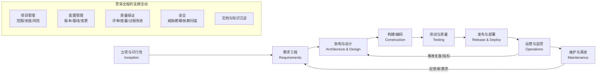
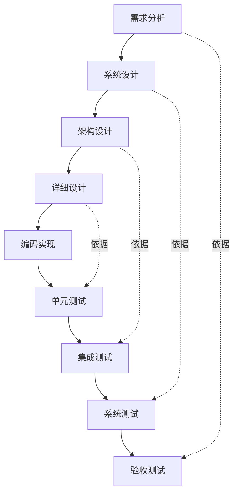
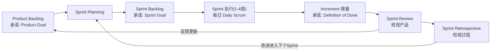
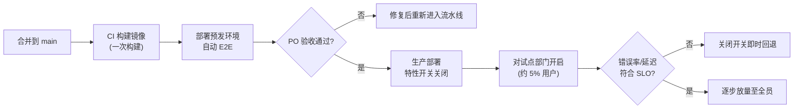

[toc]


## 全局视图：软件项目开发到底在管什么

**软件项目开发**指在有限的时间、成本和人力约束下，把模糊的业务诉求转化为**可运行、可验证、可维护**的软件，并持续交付价值的过程。它是三个学科的交集，初学者首先要把它们分清楚：

| 学科                                 | 关注的核心问题                                           | 代表性知识体系或标准                                | 典型角色                |
| ------------------------------------ | -------------------------------------------------------- | --------------------------------------------------- | ----------------------- |
| **软件工程**（Software Engineering） | 怎样**把软件做对、做好**（需求、设计、构建、测试、运维） | **SWEBOK v4**（IEEE CS）、ISO/IEC/IEEE 12207        | 架构师、开发、测试、SRE |
| **项目管理**（Project Management）   | 怎样**在约束内完成**（范围、进度、成本、风险、干系人）   | PMBOK（PMI）、PRINCE2                               | 项目经理、Scrum Master  |
| **产品管理**（Product Management）   | **做什么才有价值**（用户、市场、优先级）                 | 没有统一标准，常用 Lean Startup、Jobs-to-be-Done 等 | 产品经理、Product Owner |

**关键认知**：项目失败往往不是因为"代码写得不好"，而是**需求错了、范围失控、集成太晚、发布没有安全网**。所以下文讲的"环节"，指的是覆盖全生命周期的**工程活动加管理活动**。

## 公认的知识体系与标准

### SWEBOK v4：软件工程的"知识地图"

**SWEBOK**（Software Engineering Body of Knowledge，软件工程知识体系指南）由 IEEE 计算机学会发布，被视为软件工程领域**共识性知识**的权威汇总。v4.0（2024）共有 **18 个知识领域**（Knowledge Area，KA），比 2014 年的 v3 新增了**软件架构、软件工程运营、软件安全**三个领域，并把**敏捷与 DevOps 融入了多个知识领域**。（来源：computer.org、t2informatik、Wikipedia）

| 分组（为便于理解自行归类） | 知识领域（KA）                                               | 对应的开发环节   |
| -------------------------- | ------------------------------------------------------------ | ---------------- |
| **开发主线**               | 软件需求（Requirements）、**软件架构**（Architecture，v4 新增）、软件设计（Design）、软件构建（Construction）、软件测试（Testing） | 需求到测试       |
| **交付与演进**             | **软件工程运营**（Software Engineering Operations，v4 新增）、软件维护（Maintenance） | 部署、运维、维护 |
| **贯穿性支撑**             | 软件配置管理（SCM）、软件工程管理、软件工程过程、软件工程模型与方法、软件质量、**软件安全**（Security，v4 新增） | 全生命周期       |
| **职业与经济**             | 软件工程职业实践、软件工程经济学                             | 决策、伦理、成本 |
| **基础**                   | 计算基础、数学基础、工程基础                                 | 底层能力         |

**v4 的变化值得注意**：架构从"设计"中独立出来，运营（Ops）和安全被正式写进软件工程的核心知识。这说明业界共识已经从"交付即结束"转向**"开发与运营一体、安全内建"**。

### 其他权威框架速览

| 框架或标准                                        | 定位                           | 要点                                                         | 核实状态                         |
| ------------------------------------------------- | ------------------------------ | ------------------------------------------------------------ | -------------------------------- |
| **ISO/IEC/IEEE 12207:2017**（国内对应 GB/T 8566） | 软件**生命周期过程**的国际标准 | 把过程分为四组：**协议过程、组织级项目使能过程、技术管理过程、技术过程** | 未在本轮核实                     |
| **PMBOK 第 7 版**（PMI，2021）                    | 项目管理知识体系               | 从"五大过程组和十大知识领域"转向 **12 项原则和 8 个绩效域**，更兼容敏捷 | 未在本轮核实（可能已有更新版本） |
| **敏捷宣言**（2001）                              | 价值观                         | 4 条价值观、12 条原则                                        | 稳定知识                         |
| **Scrum Guide 2020**                              | 轻量敏捷框架                   | 给每个工件增加了"承诺"：Product Goal、Sprint Goal、Definition of Done | 本轮已核实                       |
| **DORA 指标**                                     | 软件**交付效能**度量           | 部署频率、变更前置时间、变更失败率、失败部署恢复时间，2024 年新增部署返工率 | 本轮已核实                       |
| **NIST SSDF（SP 800-218）**                       | 安全软件开发框架               | 四组实践：**PO**（组织准备）、**PS**（保护软件）、**PW**（生产安全的软件）、**RV**（响应漏洞） | 未在本轮核实                     |

## 公认应具备的核心环节

不同模型对阶段的叫法不同，但**活动本身是公认的**。下图把 8 个主线环节和 5 个贯穿性活动放在一起：



**怎么读这张图**：

- 主线箭头表示**逻辑上的依赖关系**，**不代表时间上必须一次走完**。在敏捷或迭代模式下，每 1 到 2 周就会把 B 到 F 走一遍小循环。
- 两条回流箭头是重点：**运营阶段的反馈会回到需求和设计**。软件是"活"的，交付只是开始。
- 下方子图里的活动**没有独立的阶段**，而是嵌入每个环节。比如安全不是"上线前扫一下"，而是从需求阶段就开始做威胁建模。

下面逐个环节说明**目的、关键活动、产出物和最佳实践**。

### 立项与可行性分析（Inception）

- **目的**：回答"**值不值得做、能不能做**"。
- **关键活动**：识别业务目标和干系人（Stakeholder）；做可行性分析，包括技术、经济（ROI）、法律合规（例如国内的《个人信息保护法》、等保 2.0）、运营几个方面；粗略估算规模；识别重大风险。
- **典型产出**：项目章程（Project Charter）或立项报告、商业论证（Business Case）、初始风险清单。
- **最佳实践**：
  - **必须**：写清**可度量的成功标准**。比如"报销审批平均周期从 7 天降到 2 天"，不能只写"提升效率"。
  - **推荐**：对技术不确定性高的点先做**概念验证**（PoC，Proof of Concept）。
  - **避免**：没有明确的"**不做什么**"（Out of Scope）就立项，这是后期范围蔓延的根源。

### 需求工程（Requirements Engineering）

- **目的**：搞清楚"**要解决什么问题、做到什么程度算完成**"。
- **关键活动**（对应 SWEBOK 的软件需求 KA）：需求**获取**（访谈、观察、问卷、竞品分析）、**分析**（建模、排优先级、处理冲突）、**规格说明**（写下来）、**确认**（和用户核对）、**需求管理**（变更控制、可追溯性）。
- **需求的分层**：

| 层次                                                         | 含义               | 例子（报销系统）                                         |
| ------------------------------------------------------------ | ------------------ | -------------------------------------------------------- |
| **业务需求**（Business Requirement）                         | 组织层面的目标     | 降低财务人工审核成本 30%                                 |
| **用户需求**（User Requirement）                             | 用户要完成的任务   | 员工能在手机上拍发票并提交报销                           |
| **功能需求**（Functional Requirement，FR）                   | 系统**必须做什么** | 系统自动识别发票的金额、税号和日期                       |
| **非功能需求**（Non-Functional Requirement，NFR），也叫质量属性 | 系统**做得多好**   | 识别耗时 P95 不超过 3 秒；可用性 99.9%；发票图片加密存储 |
| **约束**（Constraint）                                       | 不可协商的限制     | 必须对接现有金蝶/用友财务系统；数据存储在境内            |

- **常见表达形式**：
  - 传统形式：软件需求规格说明书（SRS），国内可参考 GB/T 8567 的文档规范。
  - 敏捷形式：**用户故事**（User Story）加**验收标准**（Acceptance Criteria），写法见后文案例。
  - 辅助手段：用例图、原型（Figma、墨刀、即时设计等）。
- **最佳实践**：
  - **必须**：NFR 要**量化**。"系统要快"不算需求，"P95 响应时间不超过 300ms@1000 QPS"才算。
  - **必须**：建立**需求变更流程**。变更本身不可怕，失控的变更才可怕。
  - **推荐**：用 **INVEST** 原则检验用户故事（Independent 独立、Negotiable 可协商、Valuable 有价值、Estimable 可估算、Small 足够小、Testable 可测试）。
  - **推荐**：用 **MoSCoW** 法排优先级（Must 必须有 / Should 应该有 / Could 可以有 / Won't 这次不做）。
  - **避免**：只和"领导"确认需求，不接触**真实的一线用户**。

### 架构与设计（Architecture & Design）

- **目的**：决定"**系统怎么组织、关键技术怎么选**"。
- **架构和设计的区别**（SWEBOK v4 把两者拆成了两个知识领域）：
  - **架构**：关注**难以更改的重大决策**，比如单体还是服务化、同步还是异步、数据库选型、部署拓扑。它主要由**非功能需求驱动**。
  - **设计**：在架构框架内的**模块级和类级**决策，比如接口、数据结构、设计模式。
- **典型产出**：
  - 架构图：推荐 **C4 模型**，分 Context / Container / Component / Code 四层。
  - **架构决策记录**（ADR，Architecture Decision Record）。
  - 接口契约（OpenAPI）、数据库 ER 图。
- **最佳实践**：
  - **必须**：重大决策写 **ADR**，记录"**为什么这样选、放弃了什么**"。半年后没人记得当初为什么选 MongoDB。
  - **推荐**：初创或中小项目先做**模块化单体**（Modular Monolith），等边界清晰、团队规模扩大后再考虑拆分微服务。
  - **推荐**：在设计阶段做**威胁建模**（例如 STRIDE），这是"安全左移"的起点。
  - **避免**：**简历驱动设计**，也就是为了用新技术而用新技术。

### 构建与编码（Construction）

- **目的**：把设计变成**可运行、可读、可测试**的代码。
- **关键实践**：
  - **版本控制**：Git 加托管平台（GitHub / GitLab / Gitee / 阿里云效 Codeup 等）。
  - **分支策略**：推荐**主干开发**（Trunk-Based Development）加短生命周期的特性分支；GitFlow 更适合有多版本并行维护需求的产品。
  - **代码评审**（Code Review）：通过 Pull Request / Merge Request 进行。
  - **编码规范与静态检查**：Linter 和 Formatter，比如 ESLint/Prettier、Ruff、gofmt；Shell 脚本用 shellcheck 和 shfmt。
  - **持续集成**（CI）：每次提交自动构建和测试。
- **最佳实践**：
  - **必须**：**所有代码和配置都纳入版本控制**，包括基础设施即代码（IaC）和数据库迁移脚本。
  - **必须**：**密钥不入库**。用环境变量或密钥管理服务，并在 CI 里接入 gitleaks 一类的扫描工具。
  - **推荐**：小步提交，**单个 PR 控制在几百行以内**，否则评审质量会急剧下降。
  - **跨平台注意**：Windows 和 Linux/macOS 的换行符不一样（CRLF 和 LF），会导致 Shell 脚本在 Linux 上报 `$'\r': command not found`。**推荐在仓库根目录放 `.gitattributes` 统一约定**，见后文案例。
  - **避免**：长期不合并的"巨型分支"，合并时就是灾难。

### 测试与质量保证（Testing & QA）

- **目的**：**发现缺陷、建立信心**，验证软件既"做对了"，也"做了对的东西"。
- **测试层次**（从下到上，数量递减，单个测试的成本递增）：

| 层次                                      | 测试对象                         | 谁来写     | 例子                                       |
| ----------------------------------------- | -------------------------------- | ---------- | ------------------------------------------ |
| **单元测试**（Unit）                      | 函数或类                         | 开发       | 报销金额超标的判断函数                     |
| **集成测试**（Integration）               | 模块之间、和数据库或外部服务之间 | 开发       | 报销服务调用 OCR 服务和数据库              |
| **系统测试 / 端到端测试**（System / E2E） | 整个系统                         | 测试或开发 | 用 Playwright 模拟员工从提交到审批的全流程 |
| **验收测试**（Acceptance，UAT）           | 是否满足业务需求                 | 用户或产品 | 财务部试用两周并签字确认                   |

- **专项测试**：性能测试（k6、JMeter）、安全测试（SAST、DAST、SCA 依赖扫描）、兼容性测试、可用性测试。
- **最佳实践**：
  - **必须**：自动化测试进入 CI，**测试不通过就不能合并**。
  - **推荐**：遵循**测试金字塔**，以大量快速的单元测试为基础，配少量关键路径的 E2E 测试。
  - **推荐**：缺陷修复时**先写一个能复现它的测试**，防止回归。
  - **避免**：把覆盖率当 KPI 硬压。覆盖率高只说明"代码被执行过"，**不代表断言有效**。

### 发布与部署（Release & Deployment）

- **目的**：**安全、可重复、可回滚**地把变更送到用户手里。
- **关键实践**：
  - **持续交付**（Continuous Delivery）：任何通过流水线的版本**随时可以**发布到生产。
  - **渐进式发布**：灰度/金丝雀（Canary）、蓝绿部署（Blue-Green）、**特性开关**（Feature Flag）。
  - **制品管理**：一次构建，多环境晋级（同一个镜像依次经过测试、预发、生产）。
- **最佳实践**：
  - **必须**：每次发布都有**回滚方案**，并且回滚方案**演练过**。
  - **必须**：**分阶段发布**。先放 1% 的流量或部分设备，观察指标后再扩大。2024 年的 CrowdStrike 事故是反面教材，见后文。
  - **推荐**：把"**部署**"（代码上线）和"**发布**"（功能对用户可见）用特性开关解耦。
  - **网络环境提示**：生产服务器在海外时，CI 直接用 GitHub Actions 一类的海外 Runner 即可；国内开发机拉取依赖时，可以配置 PyPI/npm 的国内镜像（清华 TUNA、npmmirror 等）或本地代理。**镜像只放在本地开发配置里，不要写死进生产构建**，避免环境不一致。

### 运营与监控（Operations）

- **目的**：保证系统**持续可用**，并且出了问题能**快速发现、快速恢复**（SWEBOK v4 新增的"软件工程运营"知识领域就对应这里）。
- **关键实践**：
  - **可观测性**（Observability）三支柱：日志（Logs）、指标（Metrics）、链路追踪（Traces），可以用 OpenTelemetry 统一采集。
  - **SLI / SLO / SLA**：

| 术语    | 全称                                  | 含义                             | 例子                       |
| ------- | ------------------------------------- | -------------------------------- | -------------------------- |
| **SLI** | Service Level Indicator，服务水平指标 | **实际测量**的指标               | 过去 30 天成功请求的占比   |
| **SLO** | Service Level Objective，服务水平目标 | 团队**内部承诺**的目标值         | 可用性不低于 99.9%         |
| **SLA** | Service Level Agreement，服务水平协议 | 对客户的**合同承诺**，违约要赔偿 | 低于 99.5% 返还 10% 服务费 |

  - 三者的关系是 **SLA 应该比 SLO 宽松**，给团队留缓冲。
  - **事故管理和复盘**：采用**无责复盘**（Blameless Postmortem），关注系统性原因而不是追究个人。
- **最佳实践**：
  - **必须**：告警要**可行动**（Actionable）。不需要人处理的就不该在半夜叫醒人。
  - **推荐**：用 **DORA 指标**度量交付效能，见后文。

### 维护与演进（Maintenance & Evolution）

- **四类维护**：
  - **纠正性**：修 bug。
  - **适应性**：适配新的操作系统、新法规。
  - **完善性**：新增功能、优化性能。
  - **预防性**：重构、偿还技术债。
- **关键事实**：在软件的全生命周期成本中，**维护通常占大头**（业界常引用的数字是 60% 以上，具体比例因研究而异）。所以**可维护性是投资而不是成本**。
- **技术债**（Technical Debt）：为了短期速度而做的次优设计决策，会产生"利息"，也就是后续每次修改都更慢。**推荐**把技术债显式登记进 Backlog，并在每个迭代预留固定比例（比如 15% 到 20%）的容量来偿还。

### 贯穿性活动小结

| 活动                | 必须做到的最低要求                                           |
| ------------------- | ------------------------------------------------------------ |
| **项目管理**        | 有可见的 Backlog 或计划、定期同步、风险清单                  |
| **配置管理**（SCM） | 代码、配置、IaC 都进 Git；发布打 Tag；可以复现任一历史版本   |
| **质量保证**（QA）  | 代码评审、自动化测试、DoD 清单                               |
| **安全**            | 依赖漏洞扫描（SCA）、密钥扫描、最小权限、安全编码培训        |
| **文档**            | README、ADR、API 文档、运维手册（Runbook）；"**代码即文档**"不能替代"**为什么**"的记录 |

国内常见的研发管理平台：**禅道**（开源）、**TAPD**（腾讯）、**云效**（阿里）、**PingCode**、**飞书项目**；国外常见的是 Jira、Linear、GitHub Projects、GitLab。选型时关注**是否开源或可私有化部署、是否和代码托管打通**。

## 软件过程模型：环节如何组织

**环节是"做什么"，过程模型是"按什么节奏和顺序做"**。这是初学者最容易混淆的一层。

### 主流模型对比

| 模型                                    | 核心思想                                     | 适用场景                                                     | 主要风险                           |
| --------------------------------------- | -------------------------------------------- | ------------------------------------------------------------ | ---------------------------------- |
| **瀑布**（Waterfall）                   | 阶段顺序推进，每个阶段有评审关口             | 需求极其稳定、强监管、合同固定总价（部分政务、军工、嵌入式项目） | 问题**暴露得太晚**；需求变更代价高 |
| **V 模型**（V-Model）                   | 瀑布的变体，**每个开发阶段对应一个测试阶段** | 安全关键系统（汽车 ISO 26262、医疗、航空）                   | 同瀑布，但测试设计前置             |
| **迭代增量**（Iterative & Incremental） | 分多轮交付，每轮完善或扩展                   | 大多数商业项目                                               | 需要良好的架构支撑扩展             |
| **螺旋**（Spiral，Boehm 1986）          | **风险驱动**，每圈先识别并化解最大风险       | 大型、高风险、技术新颖的项目                                 | 依赖风险评估能力，管理开销大       |
| **敏捷 / Scrum**                        | 固定周期（Sprint）、跨职能团队、持续反馈     | 需求不确定、需要快速试错的产品                               | 被误用为"不计划、不文档"           |
| **看板**（Kanban）                      | 可视化流动、**限制在制品**（WIP Limit）      | 运维、支持类工作，需求到达不均匀                             | 缺少节奏，容易失去目标感           |
| **DevOps / 持续交付**                   | 开发和运维一体，自动化流水线，高频小批量发布 | 互联网服务、SaaS                                             | 需要工程能力和文化的投入           |

### V 模型：把"验证"可视化



**讲解**：左边从需求往下一层层细化，右边从单元测试往上一层层集成。**虚线表示右侧每一层测试的依据来自左侧对应的那一层**，比如验收测试用例应该**在需求阶段就开始编写**。V 模型最有价值的思想就是**测试设计前置**，这一点在敏捷里同样适用，体现为验收标准先于编码，以及 TDD/BDD。

### Scrum：最流行的敏捷框架（依据 Scrum Guide 2020）



| 要素类型                                                | 名称                               | 解释                                                         |
| ------------------------------------------------------- | ---------------------------------- | ------------------------------------------------------------ |
| **三种职责**（Accountabilities，2020 版用它替代"角色"） | **Product Owner**                  | 对产品价值最大化负责，管理 Product Backlog 的排序            |
|                                                         | **Scrum Master**                   | 对 Scrum 的有效性负责，是教练和障碍清除者，**不是项目经理或任务分配者** |
|                                                         | **Developers**                     | 负责每个 Sprint 产出可用的增量，**泛指所有做事的人，包括测试、设计** |
| **五个事件**                                            | Sprint                             | 固定时长（不超过一个月）的容器，包含其他所有事件             |
|                                                         | Sprint Planning                    | 确定本 Sprint 为什么做（Sprint Goal）、做什么、怎么做        |
|                                                         | Daily Scrum                        | 不超过 15 分钟，**面向 Sprint Goal 调整计划**，不是向领导汇报 |
|                                                         | Sprint Review                      | 向干系人演示增量，收集反馈                                   |
|                                                         | Sprint Retrospective               | 改进团队的工作方式                                           |
| **三个工件和对应承诺**（2020 新增）                     | Product Backlog → **Product Goal** | 产品的长期目标                                               |
|                                                         | Sprint Backlog → **Sprint Goal**   | 本 Sprint 的唯一目标                                         |
|                                                         | Increment → **Definition of Done** | 增量达到可发布质量的正式标准                                 |

（2020 版为每个工件增加"承诺"，目的是提升透明度、让工件更聚焦，来源：scrum.org 官方博客）

### 如何选择过程模型

- **需求稳定吗？** 稳定且受强监管，选**瀑布或 V 模型**；不稳定，选**敏捷**。
- **技术风险高吗？** 高的话，先做 PoC，或者用**螺旋**模型的思路逐圈化解风险。
- **工作是"项目型"还是"流动型"？** 有明确目标的新功能开发适合 **Scrum**；运维工单、缺陷处理适合**看板**。
- **需要频繁上线吗？** 需要的话，无论用哪种模型，都**应该**叠加 **CI/CD 和 DevOps 实践**。

**现实中混合模式最常见**。比如合同和里程碑按阶段管理（外部看起来像瀑布），团队内部用两周迭代（Scrum），运维支持用看板，再用统一的 CI/CD 流水线支撑。

## 度量：怎么知道做得好不好（DORA 指标）

DORA（DevOps Research and Assessment，现属 Google Cloud）的研究是目前最有影响力的软件交付效能度量体系。最早的三个指标是部署频率、前置时间和恢复时间，后来加入变更失败率，**2024 年新增部署返工率**。（来源：Coralogix 的 DORA 指南、Octopus 的 DORA 报告解读）

| 指标                        | 英文                            | 含义                                     | 衡量的维度        |
| --------------------------- | ------------------------------- | ---------------------------------------- | ----------------- |
| **部署频率**                | Deployment Frequency            | 多久向生产成功部署一次                   | 吞吐量            |
| **变更前置时间**            | Change Lead Time                | 从**代码提交**到**运行在生产环境**的耗时 | 吞吐量            |
| **变更失败率**              | Change Fail Rate                | 部署后需要立即干预（回滚、热修复）的比例 | 稳定性            |
| **失败部署恢复时间**        | Failed Deployment Recovery Time | 从失败的部署中恢复所需的时间             | 吞吐量 / 恢复能力 |
| **部署返工率**（2024 新增） | Deployment Rework Rate          | 因生产事故而进行的**计划外部署**占比     | 稳定性            |

**DORA 研究的核心结论**：**速度和稳定性并不矛盾**，高效能团队两者兼得，关键在于**小批量、高频率、自动化**。

**使用注意**：

- **必须**用来改进系统，**避免**用来考核个人或在团队之间排名，否则会出现拆分部署刷频率、过早关闭事故等**指标造假**行为（Keploy 的文章也提到了这种模式）。这就是**古德哈特定律**（Goodhart's Law）："当一个指标变成目标，它就不再是好指标。"
- 关于 AI 辅助编程：DORA 2024 报告指出，AI 采用率提升与个人生产力感受的提升相关，**但同时与交付稳定性的下降相关**（大意如此，具体数字未在本轮核实）。启示是 **AI 生成代码更要坚持小批量和测试评审**，而不是放松它们。

## 综合案例：企业差旅报销系统（从 0 到上线的全流程）

下面用一个贴近现实的场景把前面所有知识点串起来。

**背景**：某制造企业有 800 名员工，目前报销靠"纸质发票加 Excel 加邮件逐级审批"，平均审批周期 7 天，财务每月花大量人工核对发票真伪和重复报销。公司决定自研一个**移动端报销系统**，由 6 人团队负责：1 名 PO、4 名开发（其中 1 人兼任测试自动化）、1 名兼职 Scrum Master。

### 立项：先写清楚成功标准

- **业务目标**：审批周期从 7 天降到 **2 天以内**；重复报销拦截率 **100%**；财务人工核对工时**减少 30%**。
- **范围内**：拍照识别发票、提交、多级审批、对接财务系统入账。
- **范围外**（明确写下来）：差旅预订、借款管理（放到二期）。
- **约束**：数据存储在境内；必须对接现有用友财务系统（接口文档质量未知，这是**头号技术风险**）。
- **风险应对**：第一周先做**财务接口 PoC**，2 天内打通"创建凭证"的接口。

### 需求：用户故事加验收标准

一条典型的用户故事：

- **作为**一名出差员工，**我想要**拍照上传发票并自动识别金额，**以便于**不用手工填写报销单。

验收标准用 BDD 的 Gherkin 语法编写。它**可以直接转成自动化测试**，正是 V 模型"测试设计前置"思想的现代实现：

```gherkin
Feature: 发票识别与重复报销拦截

  Scenario: 成功识别增值税电子发票
    Given 员工已登录报销系统
    When 员工上传一张清晰的增值税电子发票图片
    Then 系统在 3 秒内回填发票号码、金额、开票日期
    And 员工可以手动修正识别结果

  Scenario: 拦截重复报销
    Given 发票号码 "044001900111" 已在历史报销单中被报销
    When 员工再次上传同一张发票
    Then 系统提示 "该发票已于 2025-03-02 报销, 不可重复提交"
    And 报销单无法提交
```

Gherkin 关键字说明：

| 关键字     | 含义                           |
| ---------- | ------------------------------ |
| `Feature`  | 被描述的功能                   |
| `Scenario` | 一个具体的业务场景（测试用例） |
| `Given`    | **前置条件**（系统初始状态）   |
| `When`     | **触发动作**（用户操作或事件） |
| `Then`     | **期望结果**（可验证的断言）   |
| `And`      | 延续上一类步骤                 |

**非功能需求**同样量化：识别 P95 不超过 3 秒；月末高峰期 200 人同时在线提交时不报错；发票图片加密存储，保留 10 年（符合会计档案相关规定）。

### 架构设计：用 ADR 记录关键决策

团队面临的选择是"微服务还是单体"，最终的决策记录如下：

```markdown
# ADR-002: 采用模块化单体架构

## 状态
已接受 (2025-03-10)

## 背景
团队 4 名开发; 用户 800 人, 峰值并发约 200; 上线期限 3 个月。

## 决策
采用模块化单体 (报销/审批/发票/集成 四个模块, 模块间仅通过接口调用),
单一 PostgreSQL 数据库, 按模块划分 schema。

## 备选方案
- 微服务: 运维复杂度与团队规模不匹配, 放弃。
- 发票识别自研 OCR: 准确率与成本不占优, 改用云厂商 OCR 服务。

## 后果
- 正面: 部署简单, 本地开发调试方便。
- 负面: 若未来用户量增长 10 倍需重新评估; 模块边界须通过代码评审守护。
```

ADR 字段说明：**状态**（提议 / 已接受 / 已废弃 / 被取代）、**背景**（做决策时的约束和事实）、**决策**（选了什么）、**备选方案**（放弃了什么以及原因，**这是最有价值的部分**）、**后果**（正面和负面影响）。

同时做了一次 **STRIDE 威胁建模**，识别出"篡改发票金额"（Tampering）风险，于是设计成**服务端以 OCR 结果和税务查验结果为准，前端修改需要留痕**。

### 构建：仓库规范与 CI

团队成员的开发机既有 Windows 也有 macOS，所以在仓库根目录放了 `.gitattributes`，**统一换行符**：

```gitattributes
# 默认: 文本文件在仓库中统一为 LF
* text=auto eol=lf
# Windows 批处理脚本必须保持 CRLF
*.bat text eol=crlf
*.cmd text eol=crlf
# 二进制文件不做转换
*.png binary
*.jpg binary
```

CI 流水线（GitHub Actions 示例，生产在海外，直接使用官方 Runner）：

```yaml
name: ci
on:
  pull_request:
  push:
    branches: [main]

jobs:
  build-test:
    runs-on: ubuntu-latest
    steps:
      - uses: actions/checkout@v4
      - uses: actions/setup-python@v5
        with:
          python-version: "3.12"
      - name: 安装依赖
        run: pip install -r requirements.txt
      - name: 静态检查
        run: ruff check .
      - name: 密钥泄露扫描
        uses: gitleaks/gitleaks-action@v2
        env:
          GITHUB_TOKEN: ${{ secrets.GITHUB_TOKEN }}
      - name: 单元测试与集成测试
        run: pytest --cov=app --cov-fail-under=75
```

关键字段说明：

- `on`：触发条件。这里是**每个 PR** 和**推送到 main** 时触发。
- `runs-on`：运行环境。
- `steps`：按顺序执行的步骤。`uses` 引用现成的 Action，`run` 执行 Shell 命令。
- `--cov-fail-under=75`：覆盖率低于 75% 时流水线失败。它是**底线护栏而不是目标**。
- `secrets.GITHUB_TOKEN`：由平台注入的凭据，**不能把密钥写在 YAML 里**。

**团队的 Definition of Done**（每个用户故事都必须满足）：

- 代码经过至少 1 人评审并合并到 main。
- CI 全部通过，包括静态检查、密钥扫描和测试。
- 验收标准中的 Gherkin 场景已经自动化并且通过。
- API 文档（OpenAPI）已更新。
- 已部署到预发环境，PO 验证通过。

### 测试：金字塔分层

- **单元测试（约 300 个）**：金额超标规则、审批路由规则（比如"金额超过 5000 元需总监审批"）。
- **集成测试（约 40 个）**：报销模块与数据库、财务接口（用契约测试或 Mock 服务器模拟用友接口）。
- **E2E 测试（约 8 个）**：只覆盖核心路径，即"提交、审批、入账"和"重复报销拦截"。
- **性能测试**：用 k6 模拟月末 200 并发提交。
- **UAT**：财务部和两个业务部门试用 2 周。

### 发布：渐进式上线



**讲解**：

- 镜像**只构建一次**，预发和生产用的是**同一个制品**，避免出现"测试的和上线的不是同一个东西"。
- 生产部署时功能开关是**关闭**的（部署不等于发布），先对 IT 部门和一个试点部门开放。
- 如果指标异常，**关闭开关就是秒级回退**，比回滚部署快得多。

### 运营、复盘与度量

- **SLO**：工作时间可用性 99.9%；提交接口 P95 不超过 500ms。
- **一次真实事故**：上线后第三周，用友接口偶发超时，导致部分单据入账失败。团队按无责复盘的流程处理：
  - **时间线**：发现、止血（暂停自动入账）、修复。
  - **根因**：调用外部接口时没有重试和幂等设计。
  - **改进项**：引入消息队列异步入账加幂等键；增加"入账失败率"告警。
- **三个月后的 DORA 指标**：部署频率从"每月 1 次"提升到"每周 3 到 5 次"；变更前置时间约 1 天；变更失败率约 8%；失败部署恢复时间小于 1 小时（得益于特性开关）。
- **业务结果**：审批周期 1.6 天，达成立项时的成功标准，项目闭环。二期需求（借款管理）进入 Product Backlog。

**这个案例串起了**：可度量的立项目标、风险驱动的 PoC（螺旋模型思想）、用户故事和可执行的验收标准（V 模型思想加 BDD）、ADR、威胁建模、跨平台仓库规范、CI 和 DoD、测试金字塔、部署与发布解耦、SLO 和无责复盘、DORA 度量、反馈回到 Backlog（迭代闭环）。

## 典型真实案例：环节缺失的代价

下面这些都是业界广为引用的事故。细节依据我的训练知识，**未在本轮联网核实**，建议需要引用时再查阅原始资料。

| 事件                                     | 简述                                                         | 缺失或薄弱的环节                                             | 教训                                                         |
| ---------------------------------------- | ------------------------------------------------------------ | ------------------------------------------------------------ | ------------------------------------------------------------ |
| **阿丽亚娜 5 号火箭首飞失败**（1996）    | 复用了阿丽亚娜 4 号的惯性导航代码，64 位浮点数转 16 位整数时溢出，火箭起飞约 40 秒后自毁 | **需求与确认**：没有针对新火箭的飞行参数重新确认复用代码的假设 | **复用代码也要复用它的前提假设**，并重新验证                 |
| **Knight Capital**（2012）               | 部署新交易代码时，8 台服务器中有 1 台没有更新，旧的废弃功能被重新激活，约 45 分钟损失约 4.4 亿美元 | **部署与配置管理**：手工部署、废弃代码没有清理、缺少部署一致性校验和熔断开关 | 部署必须**自动化、可校验**；**删除死代码**；要有"紧急停止"开关 |
| **美国 HealthCare.gov 上线**（2013）     | 上线首日大面积崩溃，只有极少用户能完成注册                   | **集成测试与性能测试**太晚，多承包商之间缺乏统一集成，**大爆炸式上线** | 尽早持续集成；做负载测试；分阶段上线                         |
| **CrowdStrike 全球蓝屏**（2024 年 7 月） | 一次安全内容配置更新导致约 850 万台 Windows 设备蓝屏，航空、医院、银行大面积受影响 | **测试与发布**：内容更新缺少充分验证，并且**一次推送给全部客户**，没有分阶段灰度 | "只是配置"也是代码变更；**必须分阶段发布**并保留回退能力     |

## 常见混淆点辨析

### 验证与确认（Verification vs Validation）

|            | 验证（Verification）                                         | 确认（Validation）                               |
| ---------- | ------------------------------------------------------------ | ------------------------------------------------ |
| 回答的问题 | **我们把产品做对了吗**？（是否符合规格）                     | **我们做了对的产品吗**？（是否满足用户真实需要） |
| 手段       | 评审、静态分析、单元测试和集成测试                           | 用户验收测试、原型试用、A/B 测试                 |
| 案例       | 阿丽亚娜 5 号的代码"符合原规格"，验证没问题，但规格本身不适用于新火箭，**确认失败** |                                                  |

### 错误、缺陷、失效（Error / Fault / Defect / Failure）

- **错误**（Error）：**人**犯的错，比如误解了需求、写错了公式。
- **缺陷**（Fault / Defect / Bug）：错误在**代码或文档中留下的静态痕迹**。
- **失效**（Failure）：缺陷在**运行时被触发**，产生可以观察到的错误行为。
- **辨析**：一个缺陷可能永远不触发失效（代码路径从不执行）；测试的目的是**诱发失效从而发现缺陷**。

### 质量保证、质量控制和测试（QA vs QC vs Testing）

- **QA**（Quality Assurance）：**面向过程**，预防缺陷，比如制定评审制度、DoD、编码规范。
- **QC**（Quality Control）：**面向产品**，检出缺陷，比如测试、检查。
- **测试**：QC 的主要手段之一。
- **误区**：把测试团队叫"QA 团队"，等于暗示质量只是测试人员的事。**质量是整个团队的责任**。

### 验收标准与完成的定义（Acceptance Criteria vs Definition of Done）

|          | 验收标准                     | 完成的定义（DoD）                          |
| -------- | ---------------------------- | ------------------------------------------ |
| 作用范围 | **单个**用户故事特有         | **所有**工作项通用                         |
| 关注点   | 功能**是否正确**（业务行为） | 质量**是否达标**（评审、测试、文档、部署） |
| 例子     | "重复发票必须被拦截"         | "代码已评审、CI 通过、已部署到预发"        |

两者**必须同时满足**，故事才算完成。

### 持续集成、持续交付、持续部署（CI / CD / CD）

- **持续集成**（Continuous Integration）：开发者**频繁（至少每天）合并到主干**，每次自动构建和测试。
- **持续交付**（Continuous Delivery）：在 CI 的基础上，**任何版本都随时可以发布**，但上生产需要**人工批准**。
- **持续部署**（Continuous Deployment）：通过流水线后**自动发布到生产**，没有人工关口。
- **辨析**：只在 CI 服务器上"跑构建"，但分支一周才合并一次，**不算真正的持续集成**。

### 部署与发布（Deploy vs Release）

- **部署**：代码进入生产环境，是一个技术动作。
- **发布**：功能对用户可见，是一个业务决策。
- 两者用**特性开关**解耦，可以显著降低上线风险，见前文案例。

### 迭代与增量（Iterative vs Incremental）

- **增量**：一块一块地加功能。比如先做"提交"，再做"审批"。
- **迭代**：反复改进同一个东西。比如审批界面经过三轮用户反馈不断打磨。
- **敏捷两者兼用**："增量"保证每轮都有可用的成果，"迭代"保证越做越对。

### 原型、PoC 与 MVP

| 概念                    | 目的                             | 是否给真实用户使用 | 是否保留代码 |
| ----------------------- | -------------------------------- | ------------------ | ------------ |
| **PoC**（概念验证）     | 验证**技术可行性**               | 否                 | 通常丢弃     |
| **原型**（Prototype）   | 验证**交互和需求理解**           | 用于演示和测试     | 通常丢弃     |
| **MVP**（最小可行产品） | 用最小成本验证**市场和价值假设** | **是**             | 持续演进     |

**误区**：把 PoC 的"临时代码"直接当生产代码上线，从而埋下大量技术债。

### 其他高频混淆

- **敏捷与 Scrum**：敏捷是**价值观和原则**，Scrum 是实现敏捷的**一种框架**（同类还有看板、XP、SAFe 等）。
- **项目与产品**：项目有**明确的起止时间**，产品有**持续的生命周期**。现代实践倾向于"**以产品为中心**"组建长期稳定的团队。
- **版本控制与配置管理**：版本控制（Git）只是配置管理的**工具之一**。配置管理还包括基线管理、变更控制、发布管理和环境配置。
- **架构与设计**：见前文，区分标准是决策的**影响范围和变更代价**。
- **估算与承诺**：估算是**概率性的预测**（比如"大概率 3 到 5 周"），承诺是**交付保证**。把估算当承诺，会导致团队为了"保险"而虚报。

## 常见误区与纠正

| 误区                                       | 事实与纠正                                                   |
| ------------------------------------------ | ------------------------------------------------------------ |
| **"瀑布模型是 Royce 1970 年提出并推荐的"** | Royce 在论文中描绘了顺序模型，但**同时指出它风险很高、容易失败**，并建议加入迭代反馈、原型（"做两遍"）和客户参与。"瀑布"这个名字是后人起的。（未在本轮核实，可查阅 Royce 原文 *Managing the Development of Large Software Systems*） |
| **"敏捷就是不写文档、不做计划"**           | 敏捷宣言原文的意思是右侧项"**也有价值**"，只是**更看重**左侧项。敏捷团队**应该**有路线图、Sprint 计划、ADR 和必要的文档，**避免**的是没人读的冗长文档 |
| **"进度落后就加人"**                       | **布鲁克斯定律**（Brooks's Law，出自 ***人月神话*** *The Mythical Man-Month*）：向已经延期的项目加人，只会让它更延期，因为新人有培训成本，沟通路径随人数呈平方级增长。**推荐**先砍范围、清除障碍 |
| **"测试是开发完成后的一个阶段"**           | 测试活动**贯穿全程**：需求阶段写验收标准，设计阶段考虑可测性，编码阶段写单元测试，上线后做监控（也就是"生产环境中的测试"） |
| **"覆盖率 100% 就没有 bug"**               | 覆盖率只能证明代码**被执行过**，不能证明**断言正确**，也无法发现**遗漏的需求**。**推荐**关注关键路径的覆盖，配合变异测试（Mutation Testing）评估测试的有效性 |
| **"缺陷越晚修复成本就指数级增长 100 倍"**  | 方向大体正确（晚发现通常更贵），但广泛流传的"1:10:100"类精确倍数**证据基础比较薄弱**，部分来自几十年前的小样本研究（参见 Laurent Bossavit 的 ***The Leprechauns of Software Engineering***）。在 CI/CD 和小批量发布的条件下，"晚"的代价已经大大降低。**结论**：**尽早获得反馈**依然正确，但不要迷信具体数字 |
| **"DevOps 是一个岗位或一套工具"**          | DevOps 首先是**文化和协作方式**（共同对生产负责），其次才是自动化实践和工具。只招一个"DevOps 工程师"负责部署，往往只是换了个名字的运维部门 |
| **"安全是上线前做一次渗透测试"**           | 安全应该**内建**于每个环节（NIST SSDF 的思路）：需求阶段做威胁建模、编码阶段做 SAST 和依赖扫描、发布阶段做签名和 SBOM、运营阶段做漏洞响应 |
| **"一开始就上微服务才算现代架构"**         | 微服务是**用运维复杂度换团队自治和独立扩展**。团队小、领域边界不清时，**推荐模块化单体**，等有了真实的拆分动因再演进 |
| **"Velocity（速率）越高团队越好"**         | 故事点是团队**内部的相对估算单位**，不能跨团队比较，也不能当 KPI，否则会出现估算膨胀。**推荐**关注 DORA 指标和业务结果 |
| **"Scrum Master 就是项目经理"**            | Scrum Master 是**服务型领导**，负责教练和清除障碍，**不分配任务**；任务由 Developers 自组织认领 |
| **"Daily Scrum 是进度汇报会"**             | 它的目的是 Developers **面向 Sprint Goal 调整当天的计划**。变成向领导逐个汇报，就失去了意义 |
| **"有了 AI 编程助手，评审和测试可以减少"** | AI 提升了产出代码的**数量**，也提高了**批量变大**和引入隐性缺陷的风险。DORA 2024 观察到 AI 采用与交付稳定性下降相关（未在本轮核实具体数据）。**必须**保持小批量、自动化测试和人工评审 |

## 初学者落地清单

**必须做（任何规模的项目都应该具备）**：

- **书面化的目标和范围**，包括"不做什么"。
- **版本控制**：所有代码、配置、脚本都进 Git，并配好 `.gitattributes` 和 `.gitignore`。
- **需求带验收标准**，并且可测试。
- **代码评审**加 **CI 自动化测试**，失败就不能合并。
- **密钥不入库**，并且有依赖漏洞扫描。
- **可回滚的发布方案**和基本的监控告警。
- **重大技术决策写 ADR**。

**应该和推荐做**：

- 主干开发、小批量 PR、特性开关。
- 测试金字塔、BDD 风格的验收测试。
- 渐进式发布（灰度 / 金丝雀）。
- 定义 SLO，事故做无责复盘。
- 用 DORA 指标观察交付效能的趋势。
- 每个迭代预留偿还技术债的容量。

**可以做（视规模和成熟度而定）**：

- 威胁建模、SBOM（软件物料清单）、制品签名。
- 契约测试、混沌工程。
- 平台工程（内部开发者平台）。

**避免**：

- 大爆炸式集成和上线。
- 把指标当考核目标。
- 把 PoC 代码直接投产。
- 用加人解决进度问题。
- 照搬框架的仪式而丢掉背后的目的（"仪式化敏捷"，Cargo Cult）。

## 主要参考来源

- **本轮已联网查阅**：
  - IEEE Computer Society，*Software Engineering Body of Knowledge (SWEBOK)*：computer.org/education/bodies-of-knowledge/software-engineering
  - SFIA，*SFIA v9 and SWEBOK v4*：sfia-online.org
  - t2informatik，*What is SWEBOK*
  - Wikipedia，*Software Engineering Body of Knowledge*
  - Scrum.org，*Scrum Guide 2020 Update - Commitments*，以及 *Scrum Guide 2020 Updates* 专题页
  - Coralogix，*DORA Metrics Explained*；Octopus Deploy，*Understanding the 4 DORA metrics and top findings from 2024/25 DORA report*；Keploy，*DORA Metrics: Benchmarks, Tools & Strategies*
- **依据训练知识，建议自行查阅原文**：ISO/IEC/IEEE 12207:2017 与 GB/T 8566、NIST SP 800-218（SSDF）、PMI *PMBOK Guide*、*Manifesto for Agile Software Development*（agilemanifesto.org）、*The Scrum Guide*（scrumguides.org）、Royce（1970）原始论文、Brooks ***人月神话***、Google ***Site Reliability Engineering***、DORA 年度报告（dora.dev）。

