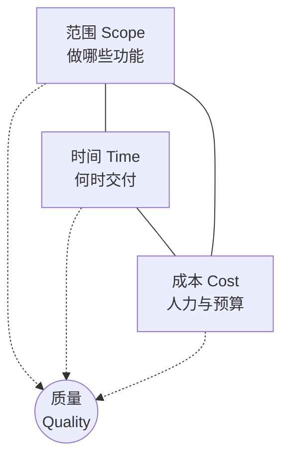
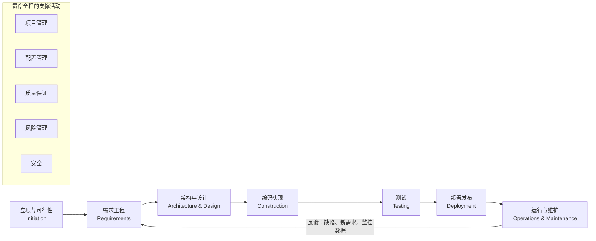
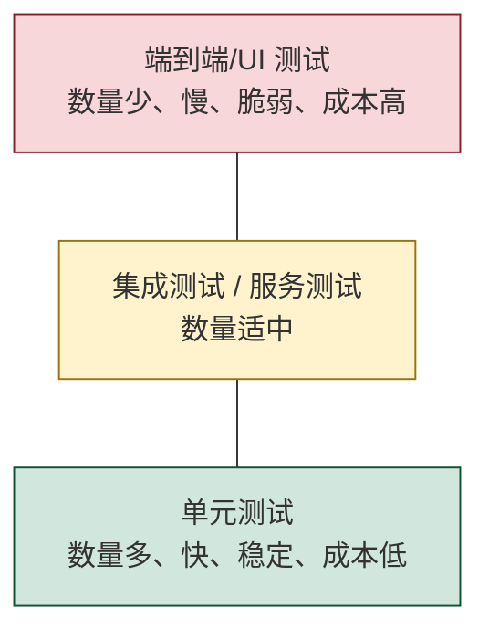
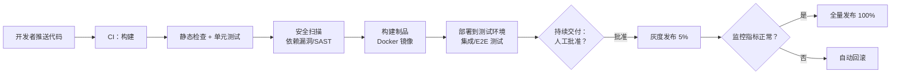
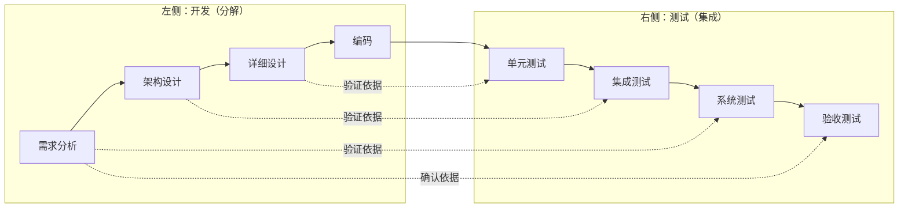
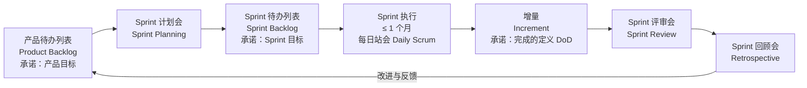
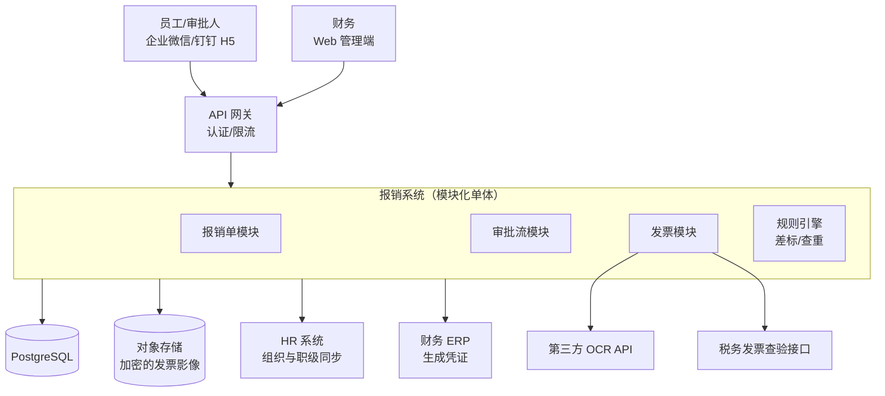
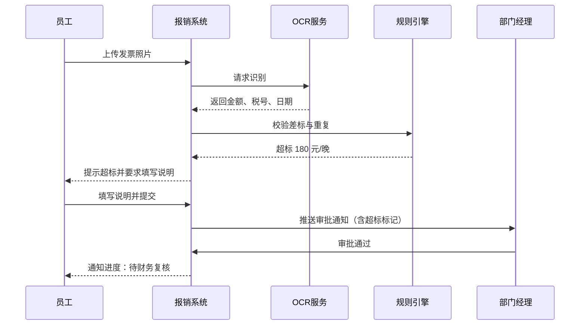
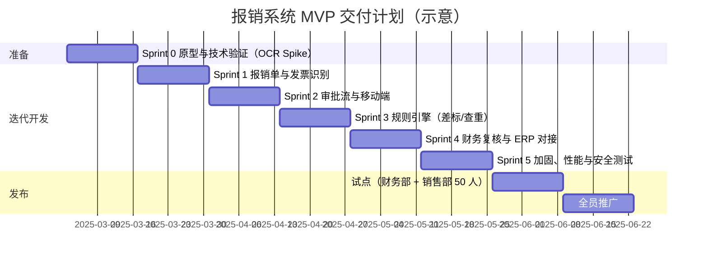
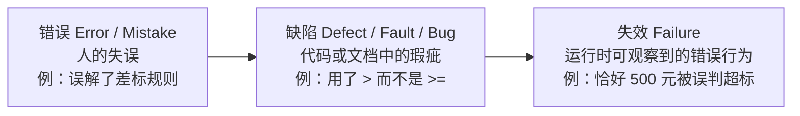

[toc]

## 基本概念

**软件工程（Software Engineering）**是把**系统化、规范化、可度量**的方法用于软件的开发、运行和维护。简单说，就是用工程的方法造软件，而不是靠个人灵感"写程序"。

它和"编程（Programming）"的区别可以这样理解：

- **编程**关心的是"让这段代码正确运行"；
- **软件工程**关心的是"让一个**多人协作、长期演进、要对用户负责**的系统，在**时间、成本、质量**的约束下持续交付价值"。

Google 工程师有一句流行的概括：**软件工程是"随时间累积的编程"（programming integrated over time）**。代码能用一周和能维护十年，需要的方法完全不同。

### 软件项目与软件产品

| 概念         | 英文       | 特征                                                   | 举例                              |
| ------------ | ---------- | ------------------------------------------------------ | --------------------------------- |
| **项目**     | Project    | **临时性**：有明确的开始、结束和目标                   | "6 个月内上线报销系统 1.0"        |
| **产品**     | Product    | **持续性**：生命周期可能长达数年，由多个项目或迭代组成 | "报销系统"本身，从 1.0 演进到 5.0 |
| **生命周期** | Life Cycle | 软件从构想到退役的全过程                               | 立项、开发、运行、维护、退役      |

### 项目管理"铁三角"

几乎所有项目决策都在三个约束之间权衡，**质量**则处在三角形的中心：



**图解**：三条边相互牵制，比如要提前交付（压缩时间），就只能增加成本（加人，但效果有限，见后文"布鲁克斯定律"）或者削减范围。**如果三者都不让步，被牺牲的一定是中心的质量**，这是很多项目失败的根源。**推荐做法：固定时间和成本，弹性调整范围**，这正是敏捷的核心思路。

---

## 公认的权威框架

"应该具备哪些环节"有两个最权威的参照系：

### SWEBOK v4：软件工程知识体系

***SWEBOK Guide*（Software Engineering Body of Knowledge，软件工程知识体系指南）**由 IEEE Computer Society 发布，汇集了学界和业界公认的共识性知识。**V4.0 于 2024 年发布，共 18 个知识域（Knowledge Area，KA）**。和 2014 年的 V3 相比，**新增了软件架构、软件安全、软件工程运维（Operations）三个知识域**，并把 **Agile 和 DevOps** 融入了多个知识域。

| 分组             | 知识域（中文/英文）                                   | 对应的开发环节 |
| ---------------- | ----------------------------------------------------- | -------------- |
| **生命周期主线** | 软件需求（Requirements）                              | 需求工程       |
|                  | **软件架构（Architecture）**（V4 新增）               | 架构设计       |
|                  | 软件设计（Design）                                    | 详细设计       |
|                  | 软件构造（Construction）                              | 编码实现       |
|                  | 软件测试（Testing）                                   | 测试           |
|                  | **软件工程运维（Engineering Operations）**（V4 新增） | 部署与运行     |
|                  | 软件维护（Maintenance）                               | 维护演进       |
| **贯穿性支撑**   | 软件配置管理（Configuration Management）              | 全程           |
|                  | 软件工程管理（Engineering Management）                | 全程           |
|                  | 软件工程过程（Process）                               | 全程           |
|                  | 软件工程模型与方法（Models and Methods）              | 全程           |
|                  | 软件质量（Quality）                                   | 全程           |
|                  | **软件安全（Security）**（V4 新增）                   | 全程           |
| **职业与经济**   | 职业实践（Professional Practice）                     | 伦理、团队协作 |
|                  | 软件工程经济学（Economics）                           | 立项决策、风险 |
| **基础**         | 计算基础、数学基础、工程基础                          | 前置知识       |

**要点**：SWEBOK 把运维和安全提升为独立知识域，说明**"开发完交出去就结束"的观念已经过时**，现代软件工程覆盖到上线后的运行。

### ISO/IEC/IEEE 12207：软件生命周期过程标准

> 本节依据训练知识，未在本轮联网核实。

**ISO/IEC/IEEE 12207:2017** 是国际通用的软件生命周期过程标准，中国国标 **GB/T 8566** 与之对应。它把过程分成四组：

| 过程组                                                  | 包含的主要过程                                               | 通俗解释                   |
| ------------------------------------------------------- | ------------------------------------------------------------ | -------------------------- |
| **协议过程**（Agreement）                               | 采购、供应                                                   | 甲乙方怎么签约、验收       |
| **组织项目使能过程**（Organizational Project-Enabling） | 生命周期模型管理、基础设施管理、人力资源管理、质量管理、知识管理 | 公司层面给项目提供的"土壤" |
| **技术管理过程**（Technical Management）                | 项目规划、项目评估与控制、决策管理、**风险管理**、**配置管理**、信息管理、度量、质量保证 | 项目经理和 QA 的日常       |
| **技术过程**（Technical）                               | 业务或使命分析、利益相关方需求定义、系统/软件需求定义、架构定义、设计定义、系统分析、实现、集成、**验证**、移交、**确认**、运行、维护、处置 | 工程师的主线工作           |

**辨析**：12207 定义的是**"要有哪些过程"**，**不规定顺序和模型**。瀑布或敏捷都可以满足 12207，区别只在于这些过程怎样排列、重复多少次。这一点是后面很多混淆的根源。

---

## 公认应具备的核心环节

综合 SWEBOK 和 12207，**软件开发生命周期（SDLC，Software Development Life Cycle）**公认的主线环节如下：



**图解**：主线是 7 个环节，但**最后一步指回需求**，表示软件是**持续演进的闭环**，而不是一次性的直线。下方的支撑活动**不是某个阶段，而是每个阶段都要做**。

下面逐个讲解。每个环节都按"**目标、输入、输出、关键活动、最佳实践**"的结构展开。

### 立项与可行性分析

**目标**：回答"**该不该做、值不值得做、能不能做成**"。

**可行性分析的四个维度**：

| 维度               | 英文        | 要回答的问题               | 示例                                             |
| ------------------ | ----------- | -------------------------- | ------------------------------------------------ |
| **技术可行性**     | Technical   | 现有技术和团队能力能否实现 | 团队没有人做过实时音视频，是否需要采购 SDK？     |
| **经济可行性**     | Economic    | 投入产出比（ROI）是否合理  | 投入 80 万，每年节省人力 50 万，约 1.6 年回本    |
| **运营可行性**     | Operational | 用户和组织是否愿意采用     | 财务部门是否接受线上审批替代纸质签字？           |
| **法律合规可行性** | Legal       | 是否符合法律法规           | 是否涉及《个人信息保护法》、等保 2.0、数据出境？ |

**主要输出**：项目章程（Project Charter）或立项报告，明确**业务目标、范围边界、关键干系人（Stakeholder）、初步预算和里程碑、主要风险**。

- **必须**：写清楚**业务目标和成功标准**，最好可量化（例如"报销平均处理周期从 7 天降到 2 天"）。
- **应该**：识别所有干系人，包括容易被遗漏的**运维、安全、法务、最终用户**。
- **避免**：没有成功标准就开工，否则项目永远"做不完"，也无法判断成败。

### 需求工程

**需求工程（Requirements Engineering）**是公认的**最关键、也最容易出问题**的环节。缺陷发现得越晚，修复成本越高，在需求阶段修正一个错误的成本，远低于上线后再修。

**需求的层次与分类**：

| 层次/类型      | 英文                                            | 含义                     | 示例                                        |
| -------------- | ----------------------------------------------- | ------------------------ | ------------------------------------------- |
| **业务需求**   | Business Requirement                            | 组织为什么要做这个系统   | 降低报销处理成本                            |
| **用户需求**   | User Requirement                                | 用户要用系统完成什么任务 | 员工能用手机拍发票提交报销                  |
| **功能需求**   | Functional Requirement                          | 系统**必须做什么**       | 系统自动识别发票金额和税号                  |
| **非功能需求** | Non-Functional Requirement（NFR），也叫质量属性 | 系统**做得怎么样**       | 识别响应 ≤ 3 秒；可用性 99.9%；数据加密存储 |
| **约束**       | Constraint                                      | 不可协商的限制条件       | 必须部署在指定云厂商；必须对接现有 SAP      |

**需求工程的五个活动**：

- **获取（Elicitation）**：访谈、问卷、观察用户工作现场、竞品分析、原型演示；
- **分析（Analysis）**：消除冲突、确定优先级、建模（用例图、领域模型）；
- **规格说明（Specification）**：写成文档，比如 SRS（软件需求规格说明书）、用户故事 + 验收标准；
- **确认（Validation）**：和干系人一起评审，确认"写下来的就是他们想要的"；
- **管理（Management）**：变更控制、需求追溯（Traceability）。

**敏捷中常用的需求写法：用户故事（User Story）**，格式如下：

- **作为** `<角色>`，**我想要** `<功能>`，**以便** `<业务价值>`。

字段解释：

| 占位符       | 含义                               | 常见错误                                   |
| ------------ | ---------------------------------- | ------------------------------------------ |
| `<角色>`     | 具体的用户类型，不是"用户"这种泛称 | 写成"作为系统"，这是技术任务而不是用户故事 |
| `<功能>`     | 用户想做的事，不涉及实现方式       | 写成"使用 Redis 缓存"，这是设计            |
| `<业务价值>` | 为什么需要它，是确定优先级的依据   | 省略不写，导致无法排优先级                 |

**好的用户故事符合 INVEST 原则**：Independent（独立）、Negotiable（可协商）、Valuable（有价值）、Estimable（可估算）、Small（足够小）、Testable（可测试）。

**验收标准（Acceptance Criteria）**常用 Gherkin 语法（Given/When/Then）来写，它既是需求，也能直接驱动自动化测试：

```gherkin
Feature: 差旅报销提交
  Scenario: 员工提交超出差标的住宿报销
    Given 员工"张三"的职级差标为每晚 500 元
    And 他提交了一张每晚 680 元的上海酒店发票
    When 他点击"提交报销"
    Then 系统应提示"超出差标 180 元/晚"
    And 要求填写超标说明后才能提交
    And 审批流应自动增加"部门总监"节点
```

| 关键字     | 含义                                 |
| ---------- | ------------------------------------ |
| `Feature`  | 功能特性，通常对应一个用户故事或史诗 |
| `Scenario` | 具体场景（一个测试用例）             |
| `Given`    | 前置条件（系统初始状态）             |
| `When`     | 触发动作                             |
| `Then`     | 期望结果（可验证的断言）             |
| `And`      | 延续上一个关键字的语义               |

- **必须**：**非功能需求要量化**。"系统要快"不是需求，"95% 的请求响应时间 ≤ 300ms"才是。
- **必须**：每条需求都要**可测试**，写不出验收标准的需求，就是没想清楚的需求。
- **应该**：用**原型（Prototype）**尽早让用户"看到"系统，原型的成本远低于返工。
- **应该**：建立**需求追溯矩阵**，让需求、设计、代码、测试用例相互对应。
- **避免**：把**解决方案当需求**。用户说"我要一个导出 Excel 的按钮"，背后的真实需求可能是"每月给老板汇报数据"，也许自动生成报表更好。

### 架构与设计

**软件架构（Software Architecture）**是系统的**高层结构**：由哪些组件构成、组件之间怎么交互、关键技术选型是什么。架构决定的是**难以更改的决策**。

**软件设计（Software Design）**是在架构框架内的**细化**：模块内部结构、类与接口、数据库表结构、算法。

| 层次         | 关注点                                                       | 典型产出                                | 更改成本 |
| ------------ | ------------------------------------------------------------ | --------------------------------------- | -------- |
| **架构**     | 质量属性（性能、可用性、安全、可扩展性）、技术选型、系统边界 | 架构图（如 C4 模型）、**ADR**、部署拓扑 | **高**   |
| **概要设计** | 模块划分、接口定义                                           | 模块图、API 规范（OpenAPI）             | 中       |
| **详细设计** | 类、函数、数据结构、算法                                     | 类图、时序图、数据库 ER 图              | 低       |

**架构驱动力**：架构主要由**非功能需求（质量属性）**驱动，而不是功能需求。同样是"在线点餐"，日均 100 单和日均 100 万单的架构完全不同，但功能清单可能一模一样。

**推荐实践：架构决策记录（ADR，Architecture Decision Record）**。用一份简短的 Markdown 文档记录"**为什么这样决定**"，存放在代码仓库的 `docs/adr/` 目录下。示例：

```markdown
# ADR-0003: 采用模块化单体而非微服务

## 状态
已接受（2025-03-10）

## 背景
团队 6 人，预计首年用户 5000 人，日均请求量低于 10 万。
需要在 4 个月内上线 MVP。

## 决策
采用模块化单体（Modular Monolith）架构，按业务域划分模块
（报销、审批、发票、组织），模块间仅通过明确定义的接口通信。

## 后果
- 正面：部署简单，运维成本低，本地开发调试方便。
- 负面：无法按模块独立扩容。
- 演进路径：若发票识别模块成为瓶颈，可优先将其拆分为独立服务。
```

| 字段   | 作用                                                         |
| ------ | ------------------------------------------------------------ |
| `状态` | 提议、已接受、已废弃、被取代，让读者知道这个决策是否仍有效   |
| `背景` | 决策时面临的约束和上下文，这是**最有价值**的部分，因为后人最难还原的就是当时的背景 |
| `决策` | 具体选择了什么                                               |
| `后果` | 正面和负面影响，诚实记录代价                                 |

**经典设计原则**：

- **高内聚、低耦合**（High Cohesion, Low Coupling）：模块内部紧密相关，模块之间依赖尽量少；
- **SOLID**：单一职责、开闭、里氏替换、接口隔离、依赖倒置；
- **KISS**（保持简单）、**YAGNI**（You Aren't Gonna Need It，不要为想象中的需求编码）、**DRY**（不要重复）。

- **必须**：在开工前明确**关键质量属性**及其优先级（比如"安全 > 可用性 > 性能"）。
- **应该**：用 ADR 记录重大决策，用 **C4 模型**（Context、Container、Component、Code 四层）画架构图。
- **避免**：**简历驱动开发**（为了学新技术而选型）、**过度设计**（6 人团队上 20 个微服务）。

### 编码实现

**软件构造（Software Construction）**不只是"写代码"，还包括**编码规范、版本控制、代码评审、单元测试、构建**。

**现代团队的标准实践**：

| 实践               | 说明                                                         | 推荐工具（优先开源/跨平台）                                  |
| ------------------ | ------------------------------------------------------------ | ------------------------------------------------------------ |
| **版本控制**       | 所有代码、配置、文档、基础设施定义都入库                     | Git；托管平台 GitHub、GitLab（可自建）、Gitea（轻量自建）、Gitee（国内） |
| **分支策略**       | 推荐**主干开发（Trunk-Based Development）**配合短生命周期分支；也可以用 GitHub Flow | Git                                                          |
| **代码评审**       | 通过 Pull Request / Merge Request 至少由一人评审后合入       | 平台内置                                                     |
| **编码规范自动化** | 用格式化工具和静态检查器代替人工争论                         | Prettier、ESLint、Black/Ruff、gofmt、ShellCheck、shfmt       |
| **提交规范**       | 结构化的提交信息，便于自动生成变更日志                       | Conventional Commits                                         |
| **单元测试**       | 开发者编写，和代码一起提交                                   | JUnit、pytest、Jest、Go test                                 |

**Conventional Commits 格式**：`<type>(<scope>): <description>`

| 占位符          | 含义                                                         | 示例                               |
| --------------- | ------------------------------------------------------------ | ---------------------------------- |
| `<type>`        | 变更类型：`feat`（新功能）、`fix`（缺陷修复）、`docs`、`refactor`、`test`、`chore` 等 | `feat`                             |
| `<scope>`       | 可选，影响的模块                                             | `invoice`                          |
| `<description>` | 简短的祈使句描述                                             | `support OCR for digital invoices` |

完整示例：`feat(invoice): support OCR for digital invoices`

**跨平台注意事项**：Windows 默认使用 `CRLF` 换行，Linux/macOS 使用 `LF`。如果 Shell 脚本被提交成 `CRLF`，在 Linux 上会报 `/bin/bash^M: bad interpreter` 错误。**推荐在仓库根目录放一个 `.gitattributes` 统一规则**，不依赖每个人本地的 `core.autocrlf` 配置：

```gitattributes
# 默认由 Git 自动判断文本文件并在仓库中统一存储为 LF
* text=auto eol=lf

# Windows 专用脚本保留 CRLF
*.bat text eol=crlf
*.cmd text eol=crlf
*.ps1 text eol=crlf

# 二进制文件不做转换
*.png binary
*.jpg binary
*.pdf binary
```

同时推荐配合 `.editorconfig` 统一缩进、编码（`UTF-8`）和换行风格，大多数编辑器都原生支持或有插件。

- **必须**：**所有变更都经过版本控制**，禁止直接在服务器上改代码。
- **必须**：**主干分支受保护**，只能通过评审后的合并请求进入。
- **应该**：分支生命周期**不超过 1 到 2 天**，以减少合并冲突。
- **应该**：把格式化和静态检查放进 `pre-commit` 钩子和 CI，让机器执行规范。
- **避免**：长期存在的功能分支（几周后合并会是一场灾难）、提交信息写 `update` 或 `fix bug`。

### 测试

测试的目的是**发现缺陷、评估质量、为发布决策提供信息**。注意，**测试只能证明缺陷存在，不能证明缺陷不存在**（Dijkstra 的名言）。

**测试层级**：

| 层级         | 英文                   | 测试对象                           | 谁来做          | 速度       |
| ------------ | ---------------------- | ---------------------------------- | --------------- | ---------- |
| **单元测试** | Unit Test              | 单个函数或类                       | 开发者          | 毫秒级     |
| **集成测试** | Integration Test       | 模块之间、和数据库或外部服务的交互 | 开发者/测试     | 秒级       |
| **系统测试** | System Test            | 完整系统的端到端行为               | 测试团队        | 分钟级     |
| **验收测试** | Acceptance Test（UAT） | 是否满足业务需求                   | 用户/产品负责人 | 人工或较慢 |

**测试金字塔（Test Pyramid）**：



**图解**：从上到下，数量应该越来越多。**反模式是"冰淇淋筒"**：大量人工和 UI 测试，几乎没有单元测试，结果是回归测试要几天、频繁误报、没人敢重构。

**按目的分类的测试**（和层级正交）：

- **功能测试**：功能是否正确；
- **非功能测试**：性能/压力测试（JMeter、k6、Locust）、安全测试（SAST/DAST、依赖漏洞扫描）、可用性测试、兼容性测试；
- **回归测试**（Regression）：修改后原有功能有没有被破坏，**必须自动化**。

- **必须**：**缺陷修复必须附带能复现该缺陷的测试**，防止复发。
- **必须**：回归测试自动化，并在每次合并时运行。
- **应该**：**测试左移（Shift-Left）**：测试人员从需求阶段就参与，评审验收标准；
- **应该**：**测试右移（Shift-Right）**：在生产环境通过监控、灰度、A/B 测试持续验证。
- **避免**：把**代码覆盖率当成目标**。100% 覆盖率但没有断言的测试毫无意义，覆盖率是"必要不充分"的参考指标。

### 部署发布

**目标**：把通过测试的软件**安全、可重复、可回滚**地交付到生产环境。

**CI/CD 流水线**：



**图解**：从推送到"构建制品"是**持续集成（CI）**；到"部署到测试环境"并随时可发布是**持续交付（Continuous Delivery）**；如果去掉人工批准、自动发布到生产，就是**持续部署（Continuous Deployment）**。**灰度发布加监控加自动回滚**，是避免大规模事故的关键防线（参见后文 CrowdStrike 案例）。

**常见发布策略**：

| 策略                          | 原理                                 | 优点           | 代价                           |
| ----------------------------- | ------------------------------------ | -------------- | ------------------------------ |
| **滚动发布**（Rolling）       | 逐批替换旧实例                       | 资源开销小     | 新旧版本会短暂共存             |
| **蓝绿部署**（Blue-Green）    | 准备一套完整新环境，一次性切流       | 回滚极快       | 资源翻倍                       |
| **金丝雀/灰度发布**（Canary） | 先放少量流量到新版本，观察后逐步扩大 | **风险最可控** | 需要流量控制和监控能力         |
| **特性开关**（Feature Flag）  | 代码已部署，但功能通过开关控制启用   | 部署与发布解耦 | 开关多了要治理，过期开关要清理 |

一个最小化的 GitHub Actions CI 示例（`.github/workflows/ci.yml`）：

```yaml
name: CI
on:
  pull_request:
    branches: [main]
  push:
    branches: [main]

jobs:
  test:
    runs-on: ubuntu-latest
    steps:
      - uses: actions/checkout@v4
      - uses: actions/setup-python@v5
        with:
          python-version: "3.12"
      - name: Install dependencies
        run: pip install -r requirements.txt
      - name: Lint
        run: ruff check .
      - name: Unit tests
        run: pytest --maxfail=1 -q
```

| 字段        | 含义                                                         |
| ----------- | ------------------------------------------------------------ |
| `on`        | 触发条件：向 `main` 发起 PR 或推送到 `main` 时运行           |
| `jobs.test` | 一个名为 `test` 的任务                                       |
| `runs-on`   | 运行环境（GitHub 托管的 Ubuntu 机器）                        |
| `steps`     | 顺序执行的步骤；`uses` 引用现成的 Action，`run` 执行 Shell 命令 |

**国内网络提示**：如果访问 GitHub 不稳定，可以使用本地代理（如 mihomo）。Linux/macOS 用 `export https_proxy=http://127.0.0.1:7890`，Windows PowerShell 用 `$env:HTTPS_PROXY="http://127.0.0.1:7890"`，端口以实际配置为准。也可以选择国内平台：Gitee、阿里云云效，或者自建 GitLab CE/Gitea 加 Jenkins。

- **必须**：**部署过程自动化、可重复**，同一个制品在各环境之间晋级，不在生产环境重新构建。
- **必须**：**有经过演练的回滚方案**。
- **应该**：**基础设施即代码（IaC）**：用 Terraform/OpenTofu、Ansible 管理环境，避免"雪花服务器"。
- **避免**：手工登录多台服务器逐台部署（Knight Capital 的教训）。

### 运行与维护

上线不是终点，而是**软件生命中最长的阶段**的开始。一般认为，维护成本占软件全生命周期成本的大头（常见说法是 60% 以上，具体比例因项目而异）。

**运维的核心**：

- **可观测性（Observability）**的三大支柱：**日志（Logs）、指标（Metrics）、链路追踪（Traces）**。开源方案有 Prometheus + Grafana、Loki、OpenTelemetry、Jaeger；
- **SLI / SLO / SLA**：

| 术语    | 全称                                  | 含义                             | 示例                           |
| ------- | ------------------------------------- | -------------------------------- | ------------------------------ |
| **SLI** | Service Level Indicator，服务水平指标 | 实际测量的数值                   | 过去 30 天成功请求占比 99.95%  |
| **SLO** | Service Level Objective，服务水平目标 | 团队内部设定的目标               | 成功率 ≥ 99.9%                 |
| **SLA** | Service Level Agreement，服务水平协议 | 对客户的**合同承诺**，违约要赔偿 | 可用性低于 99.5% 退还 10% 费用 |

**辨析**：SLO 通常比 SLA **更严格**，留出缓冲。

- **事故管理**：故障发生时快速止血，事后进行**无责复盘（Blameless Postmortem）**，关注系统性原因而不是追究个人。

**维护的四种类型**（ISO/IEC 14764 的经典分类）：

| 类型           | 英文       | 含义           | 示例                                   |
| -------------- | ---------- | -------------- | -------------------------------------- |
| **纠正性维护** | Corrective | 修复缺陷       | 修复金额四舍五入错误                   |
| **适应性维护** | Adaptive   | 适应环境变化   | 适配新的电子发票国家标准、升级操作系统 |
| **完善性维护** | Perfective | 改进功能或性能 | 增加批量提交、优化查询速度             |
| **预防性维护** | Preventive | 防患于未然     | 重构、升级有漏洞的依赖、偿还技术债     |

**常见误解**：很多人以为维护就是"修 bug"，实际上**大部分维护工作属于适应性和完善性**，也就是让软件继续创造价值。

**衡量交付效能：DORA 指标**。DORA（DevOps Research and Assessment）团队经过多年研究提出了四个关键指标，**有意让速度和稳定性相互制衡**：

| 指标                                                    | 衡量维度 | 含义                                                   |
| ------------------------------------------------------- | -------- | ------------------------------------------------------ |
| **部署频率**（Deployment Frequency）                    | 吞吐量   | 多久向生产环境部署一次                                 |
| **变更前置时间**（Change Lead Time）                    | 吞吐量   | 从代码提交到在生产环境运行所需的时间                   |
| **变更失败率**（Change Fail Rate）                      | 稳定性   | 导致故障、需要修复的部署占比                           |
| **失败部署恢复时间**（Failed Deployment Recovery Time） | 吞吐量   | 部署失败后恢复服务所需的时间（旧称 MTTR/恢复服务时间） |

**2024 年的新变化**：DORA 新增了第五个指标**部署返工率（Deployment Rework Rate）**，并把指标重新归为"**交付吞吐量**"（前置时间、部署频率、恢复时间）和"**交付不稳定性**"（变更失败率、返工率）两类。

- **必须**：上线前就把监控和告警配置好，而不是出了事故才补。
- **应该**：定义 SLO，并用**错误预算（Error Budget）**平衡发布速度和稳定性。
- **避免**：把 DORA 指标用于**团队间排名或个人考核**。一旦指标成为目标，就会被"刷数据"（古德哈特定律）。

### 退役（处置）

12207 中还有一个经常被忽视的环节：**处置（Disposal）**。系统下线时需要**数据迁移或归档、按合规要求销毁敏感数据、通知用户、停掉相关基础设施和账号**。遗留的"僵尸系统"往往是安全漏洞的温床。

---

## 贯穿全程的支撑活动

| 活动         | 英文                            | 核心内容                                                     | 常用工具（开源/国内优先）                                    |
| ------------ | ------------------------------- | ------------------------------------------------------------ | ------------------------------------------------------------ |
| **项目管理** | Project Management              | 计划、估算、跟踪、沟通、干系人管理                           | 禅道（ZenTao，国产开源）、OpenProject、Plane、Jira、飞书项目 |
| **配置管理** | Configuration Management（SCM） | **对所有工作产物（代码、配置、文档、环境、依赖版本）进行标识、控制变更、记录状态、审计** | Git、制品仓库（Harbor、Nexus）、锁文件                       |
| **质量保证** | Quality Assurance               | 确保**过程**正确执行：评审、审计、度量、改进                 | SonarQube（代码质量）、评审制度                              |
| **风险管理** | Risk Management                 | 识别、分析、应对、监控风险                                   | 风险登记册                                                   |
| **安全**     | Security                        | **安全左移**：威胁建模、安全编码、依赖漏洞扫描、渗透测试（DevSecOps） | OWASP 系列、Trivy、Dependabot/Renovate                       |
| **文档**     | Documentation                   | 只写"必要且会被维护"的文档：README、ADR、API 文档、运维手册  | Markdown、MkDocs、OpenAPI                                    |

**风险管理示例**：

| 风险                             | 概率 | 影响 | 应对策略                                           | 类型            |
| -------------------------------- | ---- | ---- | -------------------------------------------------- | --------------- |
| 发票 OCR 第三方服务识别率不达标  | 中   | 高   | 第 1 个迭代就做技术验证（Spike），并准备备选供应商 | **减轻**        |
| 财务部门核心用户无暇参与需求评审 | 高   | 高   | 立项时由副总裁签字确认每周 2 小时的参与承诺        | **减轻**        |
| 云服务商区域性故障               | 低   | 高   | 购买跨可用区部署                                   | **减轻**        |
| 发票数据泄露导致合规罚款         | 低   | 极高 | 加密存储，并购买网络安全保险                       | **减轻 + 转移** |

风险应对的四种基本策略：**规避（Avoid）、减轻（Mitigate）、转移（Transfer）、接受（Accept）**。

---

## 过程模型

前面讲的环节是"**做什么**"，过程模型回答的是"**按什么顺序、多少次去做**"。

### 主流过程模型对比

| 模型                                    | 核心思想                                                   | 适用场景                                                     | 主要风险                     |
| --------------------------------------- | ---------------------------------------------------------- | ------------------------------------------------------------ | ---------------------------- |
| **瀑布模型**（Waterfall）               | 阶段顺序推进，前一阶段完成后进入下一阶段                   | 需求极其稳定、强监管、合同固定（如部分航天、军工、政府采购） | 问题发现晚，需求变化时代价大 |
| **V 模型**（V-Model）                   | 瀑布的变体，每个开发阶段对应一个测试阶段                   | 安全攸关系统（汽车 ISO 26262、医疗器械）                     | 同瀑布                       |
| **迭代增量**（Iterative & Incremental） | 分多次交付，每次交付一部分可用功能                         | 大多数商业项目                                               | 需要良好的架构支持增量演进   |
| **螺旋模型**（Spiral，Boehm 1986）      | 每一圈都包含"定目标、**风险分析**、开发、评审"，以风险驱动 | 大型高风险项目                                               | 依赖风险评估能力，管理成本高 |
| **敏捷**（Agile）：Scrum、Kanban、XP    | 短周期迭代、拥抱变化、持续交付可工作的软件                 | 需求不确定、需要快速试错的产品                               | "伪敏捷"：只有形式没有实质   |
| **DevOps**                              | 打通开发和运维，自动化加度量加文化                         | 持续运行的在线服务                                           | 被当成"买工具"或"设岗位"     |

**V 模型示意**：



**图解**：左侧自上而下逐层分解，右侧自下而上逐层集成，**虚线表示每层测试的依据来自左侧对应的开发阶段**。V 模型的价值在于明确告诉我们：**测试用例应该在对应的开发阶段就设计好**，而不是等编码完成后再想。

### 关于瀑布模型的历史误读

通常认为瀑布模型的源头是 **Winston Royce 1970 年的论文 *Managing the Development of Large Software Systems***。但读过原文的人指出，这篇论文**更像是在批评、并呼吁更迭代的方法，而不是认可后来人们熟知的那种僵化线性流程**。Royce 在论文中画出线性流程图后，紧接着指出这种做法"有风险、容易失败"，并提出加入反馈回路、"做两次"（先做一个试验版）、让客户参与等改进。

**启示**：不要把"瀑布 vs 敏捷"理解成"错误 vs 正确"。**任何模型都包含需求、设计、实现、测试**，区别在于**批次大小和反馈速度**。

### Scrum 框架速览（依据 Scrum Guide 2020）



**Scrum 的构成**（按 Scrum Guide 2020）：

| 类别             | 元素                                                         | 说明                                                        |
| ---------------- | ------------------------------------------------------------ | ----------------------------------------------------------- |
| **角色（问责）** | 产品负责人（Product Owner）                                  | 对产品价值负责，管理产品待办列表的优先级                    |
|                  | Scrum Master                                                 | 对 Scrum 的有效性负责，是教练和障碍清除者，**不是项目经理** |
|                  | 开发者（Developers）                                         | 2020 版统一称为 Developers，包括测试、设计等所有做增量的人  |
| **事件**         | Sprint、Sprint 计划会、每日站会、Sprint 评审会、Sprint 回顾会 | Sprint 是容纳其他事件的容器                                 |
| **工件与承诺**   | 产品待办列表 → **产品目标**（Product Goal）                  | **2020 版新增**的承诺，是团队的长期目标                     |
|                  | Sprint 待办列表 → **Sprint 目标**（Sprint Goal）             | 本次 Sprint 唯一的目标                                      |
|                  | 增量 → **完成的定义**（Definition of Done，DoD）             | 增量必须满足的质量标准                                      |

**2020 版要点**：每个工件都要有对应的承诺，Scrum.org 明确表示**使用 Scrum 就必须为每个工件提供承诺**，只是透明化的方式可以因情境而异。

---

## 综合案例：从零交付一个"企业差旅报销系统"

下面用一个贴近现实的完整案例，把前面的所有环节串起来。

**背景**：某 800 人规模的制造企业，差旅报销依赖纸质单据和 Excel。员工要粘贴发票、找 3 层领导签字，财务人工核对差标。**平均报销周期 9 天**，财务部有 4 人专职处理报销，**每月约 3% 的单据存在超标或重复报销**。

### 立项

- **业务目标**：报销周期从 9 天降到 2 天；财务处理人力从 4 人降到 2 人；超标或重复报销率降到 0.5% 以下。
- **可行性**：
  - 技术：团队熟悉 Java/Spring Boot 和 Vue；发票 OCR 计划采购成熟 API，**这是最大的技术不确定性**；
  - 经济：预算 90 万，预计每年节省人力和差错损失约 70 万；
  - 运营：财务总监强力支持，但部分高管习惯纸质签字，需要移动端审批体验足够好；
  - 合规：涉及员工身份信息和发票数据，需要满足《个人信息保护法》和公司数据分级要求。
- **过程模型选择**：需求部分清晰（审批流）、部分不确定（OCR 效果、用户习惯），所以**选择 Scrum，两周一个 Sprint，计划 4 个月交付 MVP**。

### 需求

- **干系人**：员工（提交）、部门经理和总监（审批）、财务（复核、打款）、IT 运维、信息安全部、HR（职级和差标数据源）；
- **关键用户故事**（产品待办列表的前几条）：
  1. 作为**出差员工**，我想用手机拍发票自动识别金额，以便减少手工录入；
  2. 作为**财务专员**，我想让系统自动标出超标和重复发票，以便只处理异常单据；
  3. 作为**部门经理**，我想在企业微信或钉钉里一键审批，以便出差时也能及时处理；
- **非功能需求（量化）**：
  - 性能：OCR 识别 P95 ≤ 3 秒；页面 P95 ≤ 500ms；
  - 可用性：工作日 8:00 到 22:00 可用性 ≥ 99.5%；
  - 安全：发票影像加密存储；所有审批操作留审计日志并保存 5 年；
  - 兼容：支持 iOS/Android 最近 3 个大版本，桌面端支持 Chrome/Edge 最新版。
- **原型确认**：第 0 个 Sprint 用 Figma 做可点击原型，让 5 名一线员工和 2 名财务试用，发现"**员工最在意的不是识别，而是查看报销进度**"，于是新增"进度追踪"故事并提高其优先级。

### 架构与设计



**图解**：采用**模块化单体**（参见前文 ADR-0003），四个业务模块之间通过接口通信。和外部系统（OCR、税务查验、HR、ERP）的集成是**风险最高的部分**，所以在架构中通过"防腐层（Anti-Corruption Layer）"隔离，外部接口变化时不会污染核心业务逻辑。

**提交报销的关键交互时序**：



### 实现与测试

- **Git 主干开发**：`main` 分支受保护，PR 要求 1 人评审并通过 CI；
- **测试策略按金字塔分配**：
  - 单元测试：规则引擎（差标计算、查重算法）是核心业务逻辑，要求分支覆盖率 ≥ 90%；
  - 集成测试：用 Testcontainers 启动真实的 PostgreSQL；用 WireMock 模拟 OCR 和税务接口，**包括超时、限流、返回乱码等异常场景**；
  - E2E 测试：只覆盖 5 条核心路径（提交、审批、驳回、复核、打款）；
  - 性能测试：用 k6 模拟月底 800 人集中提交的高峰；
- **完成的定义（DoD）**：代码已评审；单元和集成测试通过；没有新增高危漏洞；API 文档已更新；产品负责人已在测试环境验收。

### Sprint 计划示意



**图解**：**Sprint 0 先做 OCR 技术验证**，因为它是最大的技术风险，应该尽早暴露（螺旋模型"风险驱动"思想在敏捷中的运用）。**发布采用试点加全员两步走**，这就是业务层面的"灰度发布"。

### 部署与运维

- 用 GitLab CI 构建 Docker 镜像，推送到 Harbor 制品库；同一个镜像依次晋级到测试、预发布、生产环境；
- 新的规则引擎版本通过**特性开关**先对试点部门启用；
- 监控：Prometheus 采集 OCR 调用耗时和失败率，Grafana 看板；**OCR 失败率 > 5% 时告警，并自动降级为"手工录入"**；
- SLO：工作时段可用性 99.5%，以此计算每月错误预算。

### 维护与演进

上线 3 个月后的工作分布：

| 维护工作                                  | 类型   |
| ----------------------------------------- | ------ |
| 修复部分航空行程单识别错误                | 纠正性 |
| 适配全面推行的全电发票（数电票）格式      | 适应性 |
| 新增"差旅申请与报销关联"功能              | 完善性 |
| 升级存在 CVE 漏洞的依赖库、重构审批流模块 | 预防性 |

**成果复盘**：报销周期降到 2.3 天，接近目标；财务人力降到 2.5 人；超标率降到 0.4%。复盘发现最大的偏差来自"**HR 系统职级数据不准确**"，而这一点在立项时没有被识别为风险。**教训：外部数据源的质量也是需求和风险的一部分。**

---

## 典型事故案例：环节缺失的代价

> 本节事实依据训练知识中的公开报道，未在本轮联网核实，具体数字请以官方调查报告为准。

| 案例               | 时间               | 事件概要                                                     | 薄弱环节                                                     | 教训                                                         |
| ------------------ | ------------------ | ------------------------------------------------------------ | ------------------------------------------------------------ | ------------------------------------------------------------ |
| **Knight Capital** | 2012 年 8 月       | 美国做市商手工部署新交易代码时，**8 台服务器中有 1 台漏部署**。新代码**复用了一个旧功能开关**，结果在那台服务器上激活了早已废弃的"Power Peg"老代码，约 45 分钟内产生大量错误交易，**亏损约 4.4 亿美元**，公司随后被收购 | **配置管理、部署自动化**                                     | 部署必须自动化并校验一致性；**废弃代码要删除**；**不要复用旧开关**；要有紧急停止开关 |
| **HealthCare.gov** | 2013 年 10 月      | 美国医保交易网站上线当天大面积崩溃，首日只有极少数人完成注册 | **需求冻结过晚、端到端集成测试不足、多承包商之间缺少整体集成负责人、未做真实负载的性能测试** | 非功能需求（容量）必须量化并验证；系统集成要有明确的责任人；**不能用发布日期压缩测试** |
| **CrowdStrike**    | 2024 年 7 月 19 日 | 安全软件推送的一个内容配置更新触发 Windows 内核级驱动崩溃，全球约 850 万台 Windows 设备蓝屏，航空、医院、银行等大面积受影响 | **内容更新的校验缺陷，并且没有对该类更新做分批（灰度）发布** | **任何变更（包括"只是配置/数据"）都要测试并灰度发布**；内核级等高权限组件要更严格 |
| **Ariane 5 首飞**  | 1996 年 6 月       | 火箭起飞约 40 秒后自毁，原因之一是**复用了 Ariane 4 的惯性参考系统软件**，一次 64 位浮点数到 16 位整数的转换溢出，而在 Ariane 5 更大的飞行参数下这个转换不再安全 | **需求与复用：没有针对新环境重新确认（Validation）**         | **复用代码必须在新环境下重新验证需求假设**；"以前没出过问题"不等于"在新条件下正确" |

**共同规律**：这些事故**几乎都不是单点技术难题，而是"公认环节"被省略、被压缩，或者被错误地认为"不需要"**。

---

## 常见混淆点辨析

### 验证与确认

这是软件工程中**最经典的一对混淆概念**，Boehm 给过一个简洁的区分：

| 概念     | 英文         | Boehm 的经典表述                     | 回答的问题                     | 典型活动                               |
| -------- | ------------ | ------------------------------------ | ------------------------------ | -------------------------------------- |
| **验证** | Verification | *Are we building the product right?* | **产品是否符合规格说明**       | 代码评审、单元测试、集成测试、静态分析 |
| **确认** | Validation   | *Are we building the right product?* | **产品是否满足用户的真实需要** | 用户验收测试、原型评审、Beta 测试      |

**示例**：报销系统完全按需求文档实现了"打印报销单"，所有测试都通过了，**验证通过**。但用户其实早就不想打印了，他们想要的是全程无纸化，所以**确认失败**。Ariane 5 正是"代码对旧规格是正确的，但不适合新用途"的确认失败。

### 错误、缺陷、失效

> 依据 IEEE/ISTQB 术语体系的训练知识。



**图解**：**人犯错（Error）**，在产物中留下**缺陷（Defect）**；缺陷在特定条件下被执行，表现为**失效（Failure）**。**有缺陷不一定会失效**（那段代码可能永远不会被执行到），这就是为什么测试无法证明"没有缺陷"。

### 测试、质量保证、质量控制、调试

| 概念         | 英文                  | 关注对象 | 本质                                                       |
| ------------ | --------------------- | -------- | ---------------------------------------------------------- |
| **质量保证** | QA，Quality Assurance | **过程** | 预防：确保开发过程能产出高质量产品（评审制度、规范、审计） |
| **质量控制** | QC，Quality Control   | **产品** | 检测：检查产品是否达标                                     |
| **测试**     | Testing               | 产品     | QC 的主要手段：执行软件以发现失效                          |
| **调试**     | Debugging             | 代码     | 定位并修复导致失效的缺陷，**是开发活动，不是测试活动**     |

**常见误用**：国内常把"测试工程师"叫作"QA"，这个习惯可以接受，但要明白真正的 QA 范围远大于测试。

### SDLC、过程模型、方法论、框架

| 概念              | 含义                                       | 举例                               |
| ----------------- | ------------------------------------------ | ---------------------------------- |
| **SDLC 生命周期** | 软件从生到死要经历的**活动集合**           | 需求、设计、实现、测试、部署、维护 |
| **过程模型**      | 这些活动的**组织方式**（顺序、迭代、重叠） | 瀑布、迭代、螺旋                   |
| **价值观/理念**   | 指导原则                                   | 敏捷宣言（4 条价值观 + 12 条原则） |
| **框架/方法**     | 具体可执行的规则集                         | Scrum、Kanban、XP、SAFe            |

**关键辨析**：**敏捷不是一种方法，而是一组价值观**；Scrum 是实现敏捷的一种框架。说"我们用敏捷"其实并不精确。"敏捷"本身也**并不取消需求、设计、测试**，只是让它们以小批量、高频率的方式循环进行。

### 持续集成、持续交付、持续部署

| 术语         | 缩写             | 自动化到哪一步                       | 生产发布             |
| ------------ | ---------------- | ------------------------------------ | -------------------- |
| 持续集成     | CI               | 每次提交自动构建加测试，频繁合入主干 | 不涉及               |
| **持续交付** | CD（Delivery）   | 每次变更都**可以随时**发布到生产     | **人工决定**何时发布 |
| **持续部署** | CD（Deployment） | 通过所有检查后**自动**发布到生产     | **无人工干预**       |

注意两个"CD"不是同一个意思。另外，**CI 本质上是一种实践（频繁合入主干），而不是"装了 Jenkins"**。如果每个人在功能分支上独自开发两周，就算每次推送都触发流水线，也算不上真正的持续集成。

### 部署与发布

- **部署（Deploy）**：把代码放到生产环境的技术动作；
- **发布（Release）**：让用户能用上功能的业务动作。

借助**特性开关**，两者可以**解耦**：代码周一就部署了，周五市场活动时再打开开关发布。

### 需求与设计

- **需求**描述"**做什么、为什么**"（What/Why）；
- **设计**描述"**怎么做**"（How）。

"用户登录后要在 2 秒内看到首页"是需求；"用 Redis 缓存首页数据"是设计。**把设计写进需求，会过早锁定方案，限制更优解。**

### 架构与设计

**所有架构都是设计，但不是所有设计都是架构**。架构是那些**重要的、难以更改的、影响全局质量属性**的设计决策。判断标准：**改起来是否需要伤筋动骨**。

### 原型、MVP、PoC

| 概念             | 英文                        | 目的                             | 是否给真实用户用 | 结局                           |
| ---------------- | --------------------------- | -------------------------------- | ---------------- | ------------------------------ |
| **概念验证**     | PoC，Proof of Concept       | 验证**技术**是否可行             | 否               | 通常丢弃                       |
| **原型**         | Prototype                   | 验证**需求和交互**是否正确       | 演示和试用       | **通常应该丢弃**（抛弃型原型） |
| **最小可行产品** | MVP，Minimum Viable Product | 用最少功能验证**市场和业务价值** | **是**           | 持续演进                       |

**常见陷阱**：把为演示赶出来的原型代码直接当作生产代码继续堆功能，技术债会从第一天开始累积。

### 完成的定义与验收标准

| 概念                  | 适用范围                                 | 示例                             |
| --------------------- | ---------------------------------------- | -------------------------------- |
| **完成的定义（DoD）** | **所有**待办项都要满足的**通用**质量标准 | 代码已评审、测试通过、文档已更新 |
| **验收标准（AC）**    | **某一个**用户故事特有的业务条件         | "超出差标时必须填写说明"         |

一个故事算"完成"，必须**同时**满足 DoD 和它自己的 AC。

### 版本控制与配置管理

**版本控制（Git）只是配置管理的一个工具**。配置管理还包括：**依赖版本锁定**（`package-lock.json`、`poetry.lock`）、**环境配置**、**制品版本**、**基础设施定义**、**变更审批和审计**。Knight Capital 事故中代码本身在版本库里，**出问题的是"哪台服务器上运行哪个版本"这件事没有受控**。

### 估算与承诺

- **估算**是**带不确定性的预测**，应该给出范围（例如"6 到 10 周，80% 置信度"）；
- **承诺**是对外的约定。

把开发者的估算直接当作 deadline，会导致估算被"加水"，或者质量被牺牲。另外，**故事点（Story Point）衡量的是相对规模，不能跨团队比较，也不能换算成工时考核个人**。

---

## 常见误区

| 误区                                              | 为什么错                                                     | 正确认识                                                     |
| ------------------------------------------------- | ------------------------------------------------------------ | ------------------------------------------------------------ |
| **"进度落后就加人"**                              | **布鲁克斯定律**（*人月神话*，Brooks 1975）：向进度落后的项目加人，只会让它更落后。新人需要培训，沟通路径随人数呈平方级增长（n 人约有 n(n-1)/2 条） | 优先**削减范围**；如果确需加人，要尽早加，并分配边界清晰、相对独立的任务 |
| **"敏捷就是不写文档、不做计划"**                  | 敏捷宣言说的是"工作的软件**高于**详尽的文档"，**右边的项也有价值** | 写**刚好够用、会被维护**的文档（README、ADR、API 文档）；计划以滚动方式频繁调整 |
| **"每天开站会、用看板就是敏捷"**                  | 这是**货物崇拜（Cargo Cult）**，只有仪式，没有短反馈、可工作的增量和持续改进 | 检验标准：**每个 Sprint 是否交付了可工作、可演示的增量**？回顾会的改进项落实了吗？ |
| **"瀑布已死，过时了"**                            | 强监管、合同固定、安全攸关领域依然需要**阶段评审和完整文档** | **根据需求的不确定性和风险选择模型**，很多组织采用混合模式   |
| **"测试是测试人员的事，最后阶段做"**              | 晚发现的缺陷修复成本最高；质量是**构建**出来的，不是**测**出来的 | **全员质量**：开发者写单元测试，测试人员从需求阶段参与（左移） |
| **"代码覆盖率 100% 就没 bug 了"**                 | 覆盖率只说明代码**被执行过**，不说明**结果被正确断言**；也无法发现缺失的需求 | 覆盖率作为**发现未测区域**的参考；关注**变异测试**等更有效的指标 |
| **"DevOps 就是招个 DevOps 工程师、买套 CI 工具"** | DevOps 首先是**文化和协作方式**：开发对运行负责，共享目标，自动化，度量，分享 | 从价值流出发消除等待和交接；用 DORA 指标衡量改进             |
| **"一上来就微服务、K8s"**                         | 分布式系统会带来网络故障、数据一致性、可观测性、运维成本等大量额外复杂度 | **小团队优先考虑模块化单体**，在明确的扩展性或组织需求出现后再拆分 |
| **"需求文档签字后就不能变"**                      | 用户在看到软件之前往往说不清自己要什么，市场也在变           | 建立**变更控制流程**评估影响；用短迭代降低变更代价           |
| **"上线就结束了"**                                | 维护通常是生命周期中最长、成本最高的阶段                     | 上线前就规划监控、告警、值班、运维手册和技术债偿还           |
| **"配置或数据变更不算代码变更，不用测"**          | CrowdStrike、Knight Capital 都是"非核心代码"变更引发的灾难   | **所有生产变更**都走统一的测试、评审和灰度流程               |
| **"银弹：某个新工具或 AI 就能解决所有问题"**      | Brooks 的 *No Silver Bullet*（1986）：软件的**本质复杂性**（理解问题本身）无法靠工具消除 | AI 编码助手能显著加速"写代码"，但需求理解、架构权衡、验证与确认仍然需要人的判断；**AI 生成的代码同样要评审和测试** |
| **"过早优化"**                                    | Knuth：过早优化是万恶之源                                    | 先确保正确和清晰，**基于性能测试和监控数据**定位瓶颈再优化   |
| **"指标越好看越好"**                              | **古德哈特定律**：指标一旦成为目标，就不再是好指标           | 指标用于**团队自我改进**，不用于排名和惩罚；多个指标相互制衡 |

---

## 最佳实践速查清单

### 必须（Must）

- **明确可量化的业务目标和成功标准**后再开工；
- **每条需求都可测试**，非功能需求必须量化；
- **所有代码、配置、基础设施定义都进入版本控制**，主干分支受保护；
- **所有合入主干的变更都经过评审和自动化测试**；
- **部署自动化、可重复、可回滚**；
- **上线前配置好监控和告警**；
- **安全贯穿全程**：依赖漏洞扫描、敏感数据加密、最小权限原则；
- **缺陷修复附带回归测试**。

### 应该/推荐（Should）

- **根据不确定性选择过程模型**，需求不确定时优先选择短迭代；
- **最大的风险最先处理**（Sprint 0 做技术验证）；
- 用 **ADR** 记录架构决策，用 **C4 模型**画架构图；
- 遵循**测试金字塔**，单元测试为主、E2E 测试为辅；
- 采用**主干开发**加短生命周期分支；
- **灰度发布**加**特性开关**，所有生产变更都能小范围试错；
- 用 **DORA 指标**和 **SLO** 驱动持续改进；
- 事故后做**无责复盘**。

### 可以（May）

- 用 **BDD（Gherkin）**把验收标准变成可执行测试；
- 用**基础设施即代码**（Terraform/OpenTofu、Ansible）管理环境；
- 用 **AI 编码助手**提升编码和测试编写效率（前提是严格评审）；
- 在合适的规模和成熟度下尝试**持续部署**。

### 避免（Avoid）

- **没有成功标准就开工**、**把解决方案当需求**；
- **为了学新技术而选型**、**小团队过度设计**；
- **长期存在的功能分支**、**手工部署多台服务器**；
- **用发布日期压缩测试**；
- **进度落后就盲目加人**；
- **把指标用于个人考核或团队排名**；
- **认为配置或数据变更不需要测试和灰度**。

---

## 推荐延伸阅读

| 类型     | 资料                                                         | 说明                    |
| -------- | ------------------------------------------------------------ | ----------------------- |
| 知识体系 | ***SWEBOK Guide V4.0***（IEEE Computer Society，可免费下载） | 最权威的知识地图        |
| 经典     | ***人月神话*（*The Mythical Man-Month*）**，Fred Brooks      | 布鲁克斯定律、没有银弹  |
| 需求     | ***软件需求*（*Software Requirements*）**，Karl Wiegers      | 需求工程实战经典        |
| 架构     | ***软件架构实践*（*Software Architecture in Practice*）**，Bass 等 | 质量属性驱动的架构      |
| 敏捷     | ***Scrum Guide 2020***（scrumguides.org，有官方中文版）      | 只有十几页，必读        |
| DevOps   | ***Accelerate*（*加速*）**，Forsgren、Humble、Kim            | DORA 研究的理论基础     |
| 工程实践 | ***Software Engineering at Google***                         | 规模化软件工程实践      |
| 运维     | ***SRE: Google 运维解密***                                   | SLO、错误预算、无责复盘 |

