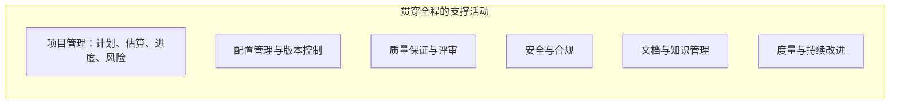
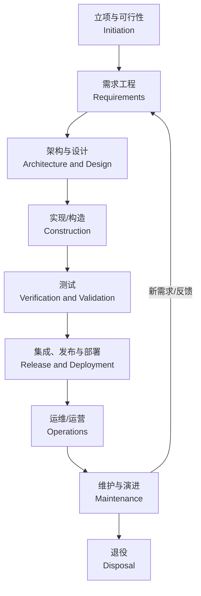
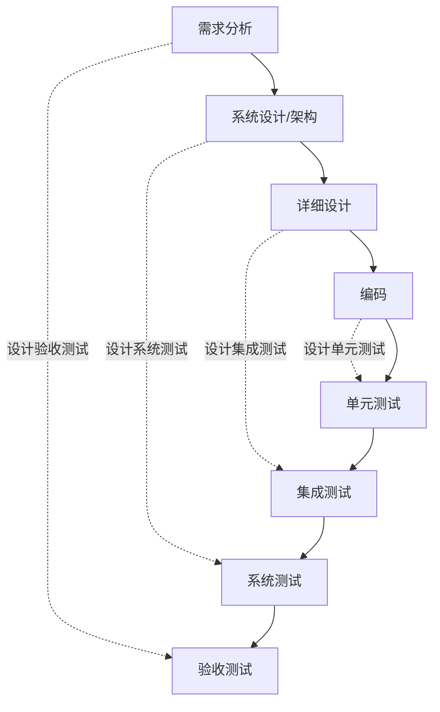
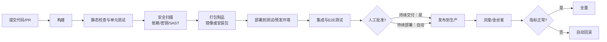
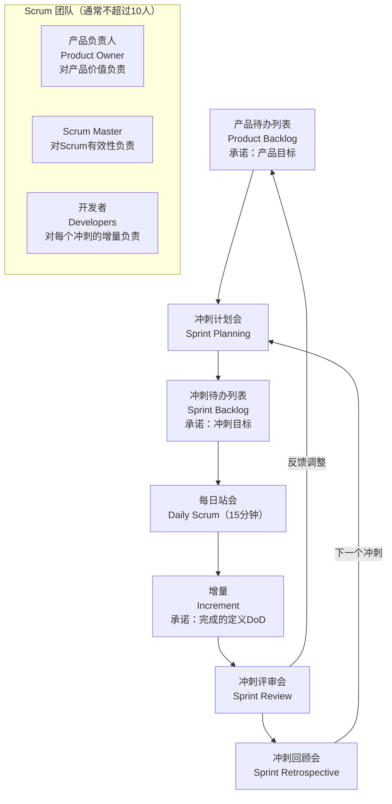
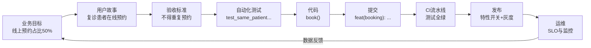
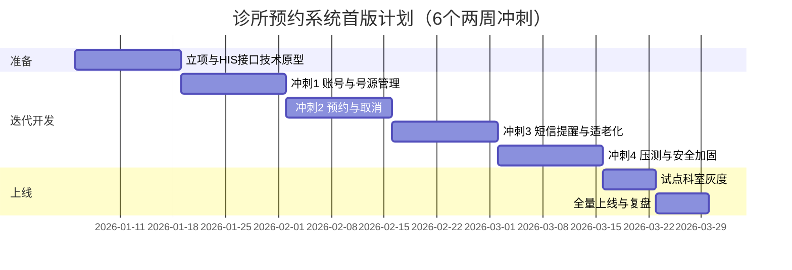
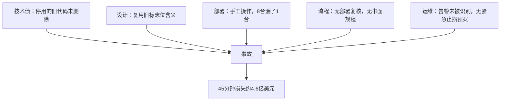

[toc]


## 建立整体认知

### 软件工程与软件项目

**软件工程（Software Engineering）**是"用系统化、规范化、可度量的方法来开发、运行和维护软件"的学科。IEEE 计算机学会发布的 ***SWEBOK Guide***（*Software Engineering Body of Knowledge*，软件工程知识体系指南）被视为这个领域的共识性知识框架。[官方页面](https://www.computer.org/education/bodies-of-knowledge/software-engineering)说明，它**反映了软件工程理论与实践互动中形成的、被普遍接受的共识知识，共有 18 个知识域（Knowledge Areas, KA）**。

**软件项目（Software Project）**是为了交付特定软件成果而开展的**临时性工作**，有明确的目标、范围、时间和资源约束。注意区分：

- **项目（Project）**：有开始、有结束，例如"6 个月内上线诊所预约系统 1.0"。
- **产品（Product）**：没有固定终点，持续演进，例如"预约系统"本身会运营很多年。
- 现代团队越来越多地采用**"产品思维"**：一个产品的生命周期里会经历多个项目或迭代。

### 软件生命周期、过程模型与方法论

三个层次的概念最容易被混在一起，先区分清楚：

| 概念             | 英文                       | 回答的问题                                   | 示例                                           |
| ---------------- | -------------------------- | -------------------------------------------- | ---------------------------------------------- |
| **软件生命周期** | Software Life Cycle / SDLC | 软件从构想到退役**要经历哪些活动**           | 需求、设计、实现、测试、部署、运维、维护、退役 |
| **过程模型**     | Process Model              | 这些活动**按什么顺序、什么节奏**组织         | 瀑布、V 模型、增量、螺旋、迭代                 |
| **方法论/框架**  | Methodology / Framework    | 团队**具体怎么协作**，有哪些角色、会议、工件 | Scrum、Kanban、XP、SAFe                        |
| **工程实践**     | Practice                   | 某个活动**用什么技术手段做好**               | 代码评审、TDD、CI/CD、ADR                      |

**要点**：环节（做什么）基本稳定，模型和方法（怎么排、怎么协作）可以选。"敏捷项目不需要需求分析"是典型误解：**敏捷改变的是需求分析的节奏和粒度，不是取消它**。

### 权威框架怎么划分"环节"

**SWEBOK v4.0（2024）**：据 [t2informatik 的介绍](https://t2informatik.de/en/smartpedia/swebok/)，和 2014 年的 v3.0 相比，v4.0 **新增了软件架构、软件安全、软件工程运营（Operations）3 个知识域**，在已有知识域中融入了敏捷和 DevOps 等现代实践，并把 AI、机器学习、IoT 等技术纳入各知识域。18 个知识域可以归为四组：

| 分组         | 知识域                                                       |
| ------------ | ------------------------------------------------------------ |
| 生命周期主线 | 需求（Requirements）、**架构（Architecture，新增）**、设计（Design）、构造（Construction）、测试（Testing）、**运营（Operations，新增）**、维护（Maintenance） |
| 贯穿性管理   | 配置管理（Configuration Management）、工程管理（Engineering Management）、过程（Process）、模型与方法（Models and Methods）、质量（Quality）、**安全（Security，新增）** |
| 职业与经济   | 职业实践（Professional Practice）、工程经济学（Economics）   |
| 基础         | 计算基础、数学基础、工程基础                                 |

**ISO/IEC/IEEE 12207:2017**（软件生命周期过程国际标准；我国对应的国家标准为 GB/T 8566，据我所知现行版本等同采用 12207:2017，请以标准化网站为准）把过程分为四组：

- **协议过程（Agreement）**：采购与供应，也就是甲乙方的合同关系。
- **组织级项目使能过程（Organizational Project-Enabling）**：生命周期模型管理、基础设施、人力资源、质量管理等。
- **技术管理过程（Technical Management）**：项目规划、评估与控制、决策、风险、配置、信息、度量、质量保证。
- **技术过程（Technical）**：业务或使命分析、干系人需求定义、系统/软件需求定义、架构定义、设计定义、实现、集成、验证、移交、确认、运行、维护、**处置（Disposal，退役）**。

两个框架都表明，**软件项目 = 一条技术主线 + 一组贯穿全程的管理和支撑活动**。很多初学者只看到"写代码"，忽略了主线两端（立项、运维、退役）和贯穿性活动（配置管理、质量、安全、风险）。

## 公认应具备的环节总览








**读图说明**：上方是**技术主线**，从左到右是逻辑上的先后依赖，不等于时间上必须一次走完。"维护与演进"指回"需求"的箭头表示，现代软件是**循环演进**的：上线后的用户反馈和监控数据会变成下一轮需求。下方子图里的活动**不是一个阶段**，而是在每个阶段都要做的事。例如配置管理从第一份需求文档就开始了，而不是写代码时才开始。

| 环节             | 核心目的                         | 关键活动                                                | 典型产出物                                            | 主要责任方             | 质量门禁（通过标准示例）           |
| ---------------- | -------------------------------- | ------------------------------------------------------- | ----------------------------------------------------- | ---------------------- | ---------------------------------- |
| **立项与可行性** | 判断**值不值得做、能不能做**     | 商业论证、可行性分析（技术/经济/法律/运营）、干系人识别 | 项目章程、商业论证、初步路线图                        | 发起人、产品负责人     | 目标可度量，预算和关键风险得到批准 |
| **需求工程**     | 弄清**做什么**以及做到什么程度   | 获取、分析、规格化、确认、需求管理                      | 需求规格说明（SRS）或产品待办列表、用户故事、验收标准 | 产品经理/业务分析师    | 需求可测试、无歧义、经干系人确认   |
| **架构与设计**   | 决定**怎么做**，满足质量属性     | 架构风格选择、模块划分、接口与数据设计、技术选型        | 架构图（如 C4）、ADR、接口契约、数据模型              | 架构师、技术负责人     | 关键质量属性有方案，重大决策有记录 |
| **实现/构造**    | 把设计变成**可运行的代码**       | 编码、单元测试、代码评审、版本控制                      | 源代码、单元测试、提交历史                            | 开发者                 | 评审通过、测试通过、符合编码规范   |
| **测试**         | **发现缺陷**、提供质量信息       | 单元、集成、系统、验收、性能、安全测试                  | 测试计划、用例、缺陷报告、测试报告                    | 全团队（含测试工程师） | 达到退出准则，无未处理的严重缺陷   |
| **发布与部署**   | 安全、可重复地**交付到用户手中** | 构建、打包、环境配置、灰度、回滚预案                    | 制品（Artifact）、发布说明、部署脚本                  | 开发 + 运维/平台团队   | 流水线全绿、回滚已演练             |
| **运维/运营**    | 让系统**稳定可用**               | 监控告警、容量管理、事故响应、复盘                      | SLO、运行手册（Runbook）、事后复盘报告                | SRE/运维 + 开发        | SLO 达标、事故闭环                 |
| **维护与演进**   | 让系统**持续满足需求**           | 改正、适应、完善、预防性维护                            | 补丁版本、重构、技术债清单                            | 开发团队               | 变更可追溯、回归测试通过           |
| **退役**         | **有序下线**                     | 数据迁移/归档、用户通知、资源回收                       | 退役计划、数据处置记录                                | 产品 + 运维 + 法务     | 数据按法规处置，依赖方已迁移       |

下面逐个环节讲清楚"必须、应该、可以、避免"。

## 立项与可行性分析

### 要回答的问题

立项是整个项目里**杠杆最大**的环节：方向错了，执行越好浪费越大。至少要回答以下问题：

- **为什么做**：要解决什么业务问题，不做会怎样？
- **做成什么样算成功**：目标必须**可度量**。
- **能不能做**：可行性分析的四个维度——**技术可行性**（团队能否驾驭相关技术）、**经济可行性**（投入产出比）、**法律/合规可行性**（例如是否涉及《个人信息保护法》、等级保护）、**运营可行性**（上线后有没有人用、有没有人维护）。
- **谁关心**：识别**干系人（Stakeholder）**，包括出钱的、使用的、维护的、监管的。

### 目标怎么写：SMART 原则

常用 **SMART** 原则检查目标质量：

| 字母           | 含义       | 反例                                       | 正例                                       |
| -------------- | ---------- | ------------------------------------------ | ------------------------------------------ |
| **S**pecific   | 具体       | "提升患者体验"                             | "患者能在线自助预约门诊号源"               |
| **M**easurable | 可度量     | "减少排队"                                 | "现场排队挂号人数占比从 70% 降到 30% 以下" |
| **A**chievable | 可实现     | "3 周上线全功能 HIS"                       | "3 个月上线预约 MVP"                       |
| **R**elevant   | 与业务相关 | "使用最新微服务架构"（这是手段，不是目标） | "降低前台挂号人力成本"                     |
| **T**ime-bound | 有时限     | "尽快"                                     | "2026 年 Q2 末上线"                        |

### 最佳实践

- **必须**：书面化项目目标、范围边界（**明确写出不做什么**）、主要干系人和关键风险。
- **应该**：做一个**MVP（Minimum Viable Product，最小可行产品）**规划，用最小成本验证核心假设。
- **可以**：用"商业模式画布"或"精益画布"快速梳理价值主张。
- **避免**：把"使用某种技术"当成项目目标；不和真实用户沟通就立项。

## 需求工程

需求是缺陷的"上游污染源"。业界普遍的经验是：**缺陷发现得越晚，修复成本越高**。需求阶段漏掉的问题，到上线后才发现，修复代价可能是早期的数十倍（具体倍数因研究而异，不必迷信某个数字，但趋势被广泛认可）。

### 需求的分类

| 类别           | 英文                                  | 含义             | 示例（诊所预约系统）                     |
| -------------- | ------------------------------------- | ---------------- | ---------------------------------------- |
| **业务需求**   | Business Requirement                  | 组织层面的目标   | 降低前台挂号人力成本                     |
| **用户需求**   | User Requirement                      | 用户要完成的任务 | 患者能在手机上预约医生号源               |
| **功能需求**   | Functional Requirement                | 系统**做什么**   | 同一患者在同一时段只能预约一次           |
| **非功能需求** | Non-Functional Requirement / 质量属性 | 系统**做得怎样** | 早 8 点放号高峰时 P95 响应时间 ≤ 800ms   |
| **约束**       | Constraint                            | 不可协商的限制   | 患者数据必须存储在境内；必须对接现有 HIS |

**非功能需求最常被遗漏**。它包括性能、可用性、安全性、可维护性、可移植性、合规性等（可以参考 ISO/IEC 25010 质量模型）。它往往决定架构，后期补救的代价最大。

### 需求工程的活动

需求工程的主要活动依次为：

- **获取（Elicitation）**：访谈、观察、问卷、工作坊、竞品分析、原型。
- **分析（Analysis）**：消除矛盾、确定优先级、建模（用例图、流程图、领域模型）。
- **规格化（Specification）**：写成可评审的形式，例如 SRS 文档或用户故事加验收标准。
- **确认（Validation）**：和干系人一起评审，回答"写下来的是不是他们真正要的"。
- **需求管理（Management）**：变更控制、版本化、**可追溯性（Traceability）**。

### 用户故事与验收标准

敏捷团队最常用的需求表达形式是**用户故事（User Story）**：

- 英文模板：`As a <role>, I want <capability>, so that <benefit>.`
- 中文模板：`作为 <角色>，我希望 <能力>，以便 <价值>。`

| 占位符                    | 含义     | 填写要点                                                     |
| ------------------------- | -------- | ------------------------------------------------------------ |
| `<role>` / `<角色>`       | 谁在使用 | 要具体，例如"复诊患者"比"用户"好                             |
| `<capability>` / `<能力>` | 想做什么 | 描述**意图**，不描述界面实现，例如写"预约号源"而不是"点击蓝色按钮" |
| `<benefit>` / `<价值>`    | 为什么要 | 最常被省略，但它是取舍优先级的依据                           |

好故事的检查标准是 **INVEST**：**I**ndependent（独立）、**N**egotiable（可协商）、**V**aluable（有价值）、**E**stimable（可估算）、**S**mall（足够小）、**T**estable（可测试）。

故事本身不够精确，需要配上**验收标准（Acceptance Criteria）**，常用 **Gherkin** 格式（行为驱动开发 BDD 的描述语言）：

```gherkin
Feature: 门诊预约
  Scenario: 同一患者不能重复预约同一时段
    Given 患者 "P001" 已预约医生 "D01" 周一 09:00 的号源
    When 患者 "P001" 再次预约医生 "D01" 周一 09:00 的号源
    Then 系统拒绝该预约
    And 提示 "您已预约该时段，请勿重复预约"
```

| 关键字     | 含义                               |
| ---------- | ---------------------------------- |
| `Feature`  | 所属功能                           |
| `Scenario` | 一个具体场景（一条验收标准）       |
| `Given`    | **前置条件**：系统初始处于什么状态 |
| `When`     | **触发动作**：用户或系统做了什么   |
| `Then`     | **预期结果**：可观察、可验证的结果 |
| `And`      | 接续上一类步骤                     |

### 优先级：MoSCoW

| 级别                       | 含义             | 示例               |
| -------------------------- | ---------------- | ------------------ |
| **M**ust have              | 没有它就不能上线 | 预约、取消预约     |
| **S**hould have            | 重要，但可以稍后 | 预约前一天短信提醒 |
| **C**ould have             | 有更好           | 医生评分           |
| **W**on't have (this time) | 本期明确不做     | 在线问诊视频       |

### 最佳实践

- **必须**：每条需求都**可测试**（能写出验收标准）；非功能需求要量化。
- **必须**：建立需求变更流程。敏捷团队里由产品负责人（PO）管理待办列表，就是一种变更控制。
- **应该**：使用原型（低保真线框图即可）尽早和用户确认；维护**需求到测试的可追溯关系**。
- **可以**：在复杂领域使用领域驱动设计（DDD）的事件风暴（Event Storming）工作坊。
- **避免**：用"系统要好用""要快"这类不可验证的描述；把解决方案当需求（"要用 Redis"）；需求只存在于某个人的脑子里或聊天记录里。

## 架构与设计

### 架构和设计的区别

- **架构（Architecture）**：**难以改变的重大决策**，比如系统拆成哪几部分、它们如何通信、数据放在哪里、选用什么关键技术。它由**质量属性**驱动（性能、可用性、安全、可演进性）。
- **设计（Design）**：在架构约束下，模块内部的结构，比如类、接口、数据结构、算法。

一句话区分：**架构决定"改起来贵不贵"，设计决定"写起来顺不顺"**。SWEBOK v4 把"软件架构"从"软件设计"中独立出来成为新知识域，也说明了这种区分的重要性。

### 表达架构：C4 模型

C4 模型由 Simon Brown 提出，用四层逐级放大的图描述架构，它的流行源于简单易懂：

| 层级 | 名称                      | 回答的问题                                        | 受众                      |
| ---- | ------------------------- | ------------------------------------------------- | ------------------------- |
| L1   | **Context（系统上下文）** | 系统和哪些人、哪些外部系统交互                    | 所有人，包括业务方        |
| L2   | **Container（容器）**     | 系统由哪些可部署单元组成（Web 应用、API、数据库） | 技术团队、运维            |
| L3   | **Component（组件）**     | 一个容器内部有哪些主要组件                        | 开发者                    |
| L4   | **Code（代码）**          | 类、接口                                          | 通常由 IDE 生成，按需使用 |

这里的"容器"指**可独立运行或部署的单元**，不专指 Docker 容器。这是一个常见的混淆点。

### 记录决策：ADR

**ADR（Architecture Decision Record，架构决策记录）**用一页短文记录一个重要决策。常见模板来自 Michael Nygard：

| 字段           | 含义     | 填写要点                                                     |
| -------------- | -------- | ------------------------------------------------------------ |
| `Title`        | 决策标题 | 以动词开头，例如"采用模块化单体架构"                         |
| `Status`       | 状态     | `Proposed`、`Accepted`、`Deprecated`、`Superseded by ADR-xxx` |
| `Context`      | 背景     | 当时的约束和要解决的问题，**这是最有价值的部分**             |
| `Decision`     | 决策内容 | 明确写"我们将……"                                             |
| `Consequences` | 后果     | 正面和负面影响都要写，包括接受了哪些代价                     |

ADR 应该和代码一起放进仓库（例如 `docs/adr/0001-modular-monolith.md`）。这样半年后新同事问"为什么不用微服务"，可以直接看文档。

### 最佳实践

- **必须**：识别**架构关键需求**（主要是非功能需求）并给出应对方案；重大决策要书面记录。
- **应该**：设计遵循**高内聚、低耦合**；先定义接口契约（例如 OpenAPI），前后端并行开发。
- **应该**：小团队和新产品**优先考虑模块化单体（Modular Monolith）**，在规模和组织结构确实需要时再拆微服务。
- **可以**：做架构评审，比如轻量化的 ATAM（架构权衡分析方法）。
- **避免**：简历驱动的技术选型；"大设计前置"（BDUF），在信息不足时设计所有细节；也避免完全不设计，"边写边想"导致结构混乱。

## 实现（构造）

### 包含哪些工作

SWEBOK 把这个环节叫**构造（Construction）**，强调它不只是"敲代码"，还包括：

- 编码规范与静态检查（lint、格式化）
- 单元测试（开发者负责）
- **代码评审（Code Review）**
- **版本控制与分支策略**
- 构建与依赖管理

### 版本控制与提交规范

现代团队推荐**主干开发（Trunk-Based Development）**或短生命周期的特性分支：分支存活时间以小时到几天计，频繁合入主干，减少合并冲突。提交信息常用 **Conventional Commits** 规范：

- 格式：`<type>[optional scope]: <description>`
- 示例：`feat(booking): 禁止同一患者重复预约同一时段`

| 字段               | 含义           | 常见取值                                                     |
| ------------------ | -------------- | ------------------------------------------------------------ |
| `<type>`           | 变更类型       | `feat`（新功能）、`fix`（修复）、`docs`、`refactor`、`test`、`chore` |
| `[optional scope]` | 影响范围，可选 | 模块名，例如 `booking`、`auth`                               |
| `<description>`    | 简短描述       | 说明做了什么，不写"改了点东西"                               |

规范化的提交信息可以用来自动生成变更日志（CHANGELOG）和语义化版本号（SemVer）。

### 跨平台注意：换行符

团队成员同时使用 Windows 和 macOS/Linux 时，`CRLF` 和 `LF` 换行符的差异会让 diff 充满噪音，甚至导致 Shell 脚本在 Linux 上报 `bad interpreter` 而无法运行。**推荐在仓库根目录放一个 `.gitattributes`，以仓库配置为准**，不依赖每个人本地的 `core.autocrlf` 设置：

```gitattributes
# 默认：文本文件在仓库中统一以 LF 存储，检出时也用 LF
* text=auto eol=lf
# Windows 批处理脚本必须保持 CRLF
*.bat text eol=crlf
*.cmd text eol=crlf
# 二进制文件不做转换
*.png binary
*.jpg binary
```

配合 `.editorconfig` 统一缩进和编码（`charset = utf-8`），可以避免中文注释乱码。

### 代码评审

- **必须**：主干受保护，合并前至少一人评审，CI 必须通过。
- **应该**：PR（Pull Request）保持小而聚焦，经验上几百行以内评审质量较高；评审关注正确性、可读性、安全性和测试，**格式问题交给自动化工具**。
- **避免**：评审变成"橡皮图章"；也避免把评审当成个人批判。

## 测试

### 验证与确认

测试领域最基础的一对概念是：

- **验证（Verification）**："**我们是否正确地构建了产品？**"（Are we building the product right?）检查产出是否符合规格。
- **确认（Validation）**："**我们是否构建了正确的产品？**"（Are we building the right product?）检查产品是否满足用户真实需要。

一个系统可以 100% 通过验证（完全符合规格），但确认失败（规格本身就错了）。下文的 Ariane 5 就是这种情况。

### V 模型：开发阶段与测试层级的对应



**读图说明**：左侧自上而下是逐步细化的开发活动，右侧自下而上是逐级扩大的测试活动，虚线表示**每个开发阶段都应同步设计对应层级的测试**。V 模型最重要的启示是**测试设计要左移**：在需求阶段就写验收标准，而不是等编码结束才想怎么测。即使不采用 V 模型的阶段划分，这个对应关系依然有效。

### 测试层级与测试金字塔

| 层级                  | 测什么                        | 速度       | 数量建议                 | 典型工具                      |
| --------------------- | ----------------------------- | ---------- | ------------------------ | ----------------------------- |
| **单元测试**          | 函数、类的逻辑                | 毫秒级     | **最多**                 | pytest、JUnit、Vitest         |
| **集成测试**          | 模块间、模块与数据库/外部服务 | 秒级       | 中等                     | Testcontainers、契约测试 Pact |
| **端到端测试（E2E）** | 完整用户流程                  | 秒到分钟级 | **最少，只覆盖关键路径** | Playwright、Cypress           |
| **非功能测试**        | 性能、安全、可用性            | 视情况     | 按风险选择               | k6、JMeter、OWASP ZAP         |

**测试金字塔**（Mike Cohn 提出）的原则是：底层的快速测试多，顶层的慢速测试少。反模式是"冰淇淋筒"：大量手工和 E2E 测试，单元测试很少，结果是反馈慢、测试脆弱。

### 错误、缺陷与失效

ISTQB 术语体系区分了三个词：

- **错误（Error / Mistake）**：人犯的错，比如误解了需求。
- **缺陷（Defect / Fault / Bug）**：错误留在工作产品（代码、文档）里的结果。
- **失效（Failure）**：缺陷在运行时被触发，表现为系统行为偏离预期。

缺陷不一定导致失效（代码可能永远不会被执行到）；失效也可能由环境引起，而不是缺陷。

### 最佳实践

- **必须**：自动化回归测试并纳入 CI；严重缺陷有明确的上线阻断标准。
- **应该**：测试从需求阶段开始（测试左移）；同时在生产环境做监控和灰度（测试右移）。
- **可以**：采用 TDD（测试驱动开发）或 BDD。
- **避免**：把覆盖率当作质量目标，100% 覆盖率不代表没有缺陷；把质量的全部责任推给测试团队。

## 集成、发布与部署

### CI、持续交付与持续部署

| 术语         | 英文                       | 含义                                                   | 是否自动上线生产 |
| ------------ | -------------------------- | ------------------------------------------------------ | ---------------- |
| **持续集成** | Continuous Integration, CI | 开发者频繁（至少每天）合入主干，每次合入自动构建和测试 | 否               |
| **持续交付** | Continuous Delivery, CD    | 主干**随时处于可发布状态**，发布到生产由人决定（一键） | **人工批准**     |
| **持续部署** | Continuous Deployment, CD  | 通过全部检查的变更**自动**发布到生产                   | **自动**         |

两个 CD 缩写相同但含义不同，是高频混淆点。



**读图说明**：流水线的核心理念是"**一次构建，多处部署**"。同一个制品从测试环境一路晋级到生产，不在每个环境重新构建，避免出现"测试的和上线的不是同一个东西"。灰度发布加自动回滚把发布风险控制在小范围内。

### 部署与发布的区别

- **部署（Deploy）**：把新版本代码放到生产环境运行，是技术动作。
- **发布（Release）**：让用户能使用新功能，是业务动作。
- 二者可以通过**特性开关（Feature Flag）**解耦：代码早已部署，但功能对用户关闭，择机开启或只对部分用户开启。

### DORA 指标：衡量交付效能

Google 的 DORA（DevOps Research and Assessment）项目做了十余年研究。按 [Google Cloud 官方博客](https://cloud.google.com/blog/products/devops-sre/announcing-the-2024-dora-report)的说法，**DORA 四个关键指标于 2013 年提出，已成为衡量软件交付效能的行业标准**。

| 指标                 | 英文（2024 版命名）             | 衡量        | 含义                                   |
| -------------------- | ------------------------------- | ----------- | -------------------------------------- |
| **部署频率**         | Deployment Frequency            | 吞吐        | 多久向生产部署一次                     |
| **变更前置时间**     | Change Lead Time                | 吞吐        | 代码提交到运行在生产的时间             |
| **变更失败率**       | Change Fail Rate                | 稳定性      | 导致故障、需要修复或回滚的部署比例     |
| **失败部署恢复时间** | Failed Deployment Recovery Time | 稳定性/吞吐 | 失败部署后恢复服务的时间               |
| **返工率**           | Rework Rate（2024 新增）        | 稳定性      | 计划外的、为修复生产问题而做的部署比例 |

据 [RedMonk 对 2024 报告的解读](https://redmonk.com/rstephens/2024/11/26/dora2024/)，该年报告重新审视了吞吐和稳定性的划分：**恢复时间被重新看作吞吐指标，并新增返工率作为稳定性因素**。[DX 的总结](https://getdx.com/blog/2024-dora-report/)指出，2024 年报告中**吞吐和质量指标呈现彼此独立变化的趋势，整体交付效能较上一年略有下降**。

DORA 研究最重要的结论是：**速度和稳定性并不矛盾**，高绩效团队往往两者兼得。实现手段是小批量、自动化和快速反馈。

### 最佳实践

- **必须**：构建和部署**脚本化、可重复**，不依赖某个人的手工操作；每次发布都有回滚预案。
- **应该**：小批量频繁发布；使用灰度、蓝绿或金丝雀发布；基础设施即代码（IaC）。
- **避免**：手工登录服务器逐台部署（下文 Knight Capital 案例的根源之一）；周五晚上做大版本发布；生产配置和代码分开管理却没有版本控制。

## 运维与运营

### SLI、SLO 与 SLA

上线不是终点，而是**价值兑现的起点**。SWEBOK v4 新增"软件工程运营"知识域，正是因为 DevOps 让开发和运维的边界变得模糊。Google SRE 体系的三个核心概念：

| 术语    | 英文                                  | 含义                             | 示例                              |
| ------- | ------------------------------------- | -------------------------------- | --------------------------------- |
| **SLI** | Service Level Indicator，服务水平指标 | **测量值**                       | 预约接口成功率、P95 延迟          |
| **SLO** | Service Level Objective，服务水平目标 | 团队**内部目标**                 | 30 天内预约接口成功率 ≥ 99.9%     |
| **SLA** | Service Level Agreement，服务水平协议 | 对客户的**合同承诺**，违约有赔偿 | 月可用性低于 99.5% 退还服务费 10% |

关系上，**SLI 是度量，SLO 是目标，SLA 是承诺**。SLO 通常比 SLA 更严格，留出缓冲。SLO 还引出**错误预算（Error Budget）**：99.9% 的目标意味着 30 天约有 43 分钟的"可失败额度"。额度还有剩余时可以加快发布，耗尽时冻结功能发布、优先保障稳定性。这让"发布速度和稳定性"的争论有了量化依据。

### 事故响应与复盘

- **必须**：关键服务有监控告警和值班机制；事故有分级标准和响应流程。
- **应该**：事故后写**无责复盘（Blameless Postmortem）**：分析系统和流程为什么允许错误发生，而不是追究"谁犯了错"；复盘行动项要跟踪到关闭。
- **可以**：建设可观测性（Observability）三支柱：**指标（Metrics）、日志（Logs）、链路追踪（Traces）**，OpenTelemetry 是目前主流的开放标准。

## 维护、演进与退役

### 维护的四种类型

ISO/IEC 14764 把维护分为四类：

| 类型           | 英文       | 触发原因         | 示例                                   |
| -------------- | ---------- | ---------------- | -------------------------------------- |
| **改正性维护** | Corrective | 修复已发现的缺陷 | 修复重复预约漏洞                       |
| **适应性维护** | Adaptive   | 适应环境变化     | 适配新版微信小程序基础库、操作系统升级 |
| **完善性维护** | Perfective | 增强功能或性能   | 新增候补排队功能                       |
| **预防性维护** | Preventive | 预防未来问题     | 重构、升级有漏洞风险的依赖             |

**维护通常占软件全生命周期成本的大头**（文献常引用 60% 以上，具体比例因研究而异）。"开发完就结束"的预算模式会让系统迅速腐化。

### 技术债

**技术债（Technical Debt）**由 Ward Cunningham 提出：为了短期速度做出的次优技术选择，会像债务一样产生"利息"，表现为后续每次修改都更慢。技术债**不一定是坏事**，有意识、有记录、有偿还计划的技术债是合理的商业决策。坏的是**无意识、不记录、不偿还**。

### 退役

退役最容易被遗忘，ISO/IEC/IEEE 12207 把它列为正式的技术过程（Disposal）。退役时要考虑：

- 数据迁移、归档或按法规销毁（个人信息尤其要注意）；
- 通知用户和依赖方，给出迁移窗口；
- 回收服务器、域名、证书、第三方账号，避免安全隐患和成本泄漏。

## 贯穿全程的项目管理

### 铁三角与范围

项目管理的经典模型是**铁三角（Iron Triangle）**：**范围、时间、成本**相互制约，质量处在中心。

- 传统项目通常**固定范围**，然后估算时间和成本。
- 敏捷项目通常**固定时间和成本**（固定的迭代周期和团队规模），**调整范围**，按优先级交付。

### 工作分解与估算

- **WBS（Work Breakdown Structure，工作分解结构）**：把项目逐层分解为可管理、可估算、可分配的工作包。敏捷中对应的是 史诗（Epic）→ 特性（Feature）→ 用户故事（Story）→ 任务（Task）。
- **估算方法**：专家判断、类比估算、三点估算（`(乐观 + 4 × 最可能 + 悲观) / 6`）、敏捷中的故事点（Story Point）和计划扑克（Planning Poker）。
- **不确定性锥（Cone of Uncertainty）**：Barry Boehm 提出、Steve McConnell 推广。项目初期的估算误差可能达到 0.25 倍到 4 倍，随着需求和设计逐步明确，误差才会收敛。**结论：早期估算应该给区间，不给单点数字，并随项目推进持续修正**。

### 风险管理

风险管理的流程依次为：**识别 → 分析（概率 × 影响）→ 应对 → 监控**。常见的四种应对策略：

| 策略                 | 含义               | 示例                               |
| -------------------- | ------------------ | ---------------------------------- |
| **规避（Avoid）**    | 改变计划，消除风险 | 不采用团队完全陌生的新框架         |
| **减轻（Mitigate）** | 降低概率或影响     | 先做技术原型（Spike）验证 HIS 接口 |
| **转移（Transfer）** | 让第三方承担       | 使用云厂商托管数据库，购买保险     |
| **接受（Accept）**   | 有意识地承担       | 接受首版不支持多院区               |

### 布鲁克斯定律

Fred Brooks 在 ***《人月神话》*** （*The Mythical Man-Month*，1975）中提出：**向一个已经延期的软件项目增加人手，只会让它更加延期**。原因有三：新人需要培训，沟通路径随人数按 `n(n-1)/2` 增长，很多任务无法再拆分。

### 质量保证与配置管理

- **质量保证（QA, Quality Assurance）**：**面向过程**，预防缺陷，比如制定规范、评审流程、过程审计。
- **质量控制（QC, Quality Control）**：**面向产品**，发现缺陷，比如测试、检查。
- **配置管理（SCM, Software Configuration Management）**：识别、控制、记录所有**配置项**的版本和变更。配置项不只是代码，还包括需求文档、设计、测试用例、构建脚本、环境配置、第三方依赖版本。Git 只是配置管理的工具之一，不等于配置管理本身。

## 过程模型与方法论：怎么组织这些环节

### 主流模型对比

| 模型                    | 核心思想                                     | 优点                             | 缺点                         | 适用场景                                           |
| ----------------------- | -------------------------------------------- | -------------------------------- | ---------------------------- | -------------------------------------------------- |
| **瀑布**                | 阶段顺序推进，前一阶段完成后进入下一阶段     | 结构清晰，文档完整，易于合同管理 | 反馈晚，变更代价高           | 需求非常稳定、强监管或固定价格合同                 |
| **V 模型**              | 瀑布加测试对应                               | 强调验证和确认，可追溯性好       | 依然反馈晚                   | 汽车电子（参见 ISO 26262）、医疗器械等安全关键领域 |
| **增量**                | 把系统分成多个增量逐个交付                   | 早交付部分价值                   | 需要良好的整体架构           | 功能边界清晰的中大型系统                           |
| **迭代**                | 反复循环完整的开发周期，逐步完善             | 尽早获得反馈                     | 需要控制迭代范围             | 需求不确定                                         |
| **螺旋（Boehm, 1986）** | 每轮迭代以**风险分析**驱动                   | 风险显性化                       | 管理复杂，依赖风险评估能力   | 大型、高风险项目                                   |
| **Scrum**               | 固定时长的冲刺，经验主义（透明、检视、调适） | 快速反馈，自组织                 | 需要组织文化支持，容易走形式 | 复杂产品开发                                       |
| **Kanban**              | 可视化工作流，限制在制品（WIP）              | 灵活，适合持续流入的工作         | 缺乏节奏感，需要自律         | 运维、支持、持续交付团队                           |
| **DevOps**              | 打通开发与运维，自动化加度量加文化           | 交付快且稳                       | 需要工具链和文化投入         | 互联网服务、SaaS                                   |

**选择原则**：**需求和技术的不确定性越高，越需要短反馈周期**（迭代/敏捷）；**合规和安全要求越高，越需要严格的文档和可追溯性**（V 模型）。两者并不冲突，现实中很多团队在敏捷框架内保留了严格的验证和文档要求。

### Scrum（2020 版）结构

Scrum 是使用最广的敏捷框架。2020 版指南的关键变化：据 [Scrum.org 的介绍](https://www.scrum.org/scrum-guide-2020)，2020 版指南在 **一个 Scrum 团队内定义了三种"职责"（Accountabilities）**；[Agile Academy 的解读](https://www.agile-academy.com/en/scrum-master/scrum-guide-2020/)指出，此举旨在**消除"团队中的团队"概念**，避免产品负责人和开发团队之间形成"我们和他们"的对立。另一个变化是**给三个工件各加了一个"承诺"（Commitment）**，例如产品待办列表的承诺是**产品目标（Product Goal）**。



**读图说明**：整个流程发生在一个**冲刺（Sprint，最长 1 个月，常见 2 周）**之内。冲刺本身也是 Scrum 的五个事件之一，另外四个是计划会、每日站会、评审会和回顾会。三种工件各自对应一个承诺，帮助团队聚焦：

| 工件                            | 承诺                                      | 承诺的作用                   |
| ------------------------------- | ----------------------------------------- | ---------------------------- |
| 产品待办列表（Product Backlog） | **产品目标（Product Goal）**              | 产品长期要达到的状态         |
| 冲刺待办列表（Sprint Backlog）  | **冲刺目标（Sprint Goal）**               | 本冲刺唯一的目标             |
| 增量（Increment）               | **完成的定义（Definition of Done, DoD）** | 增量达到可发布质量的统一标准 |

Scrum 指南特意用"职责"而不是"职位"，**Scrum Master 不是项目经理，也不是团队的上级**。

## 典型案例

案例按"正面综合案例 → 反面案例"排列。综合案例把前面所有环节串起来；两个反面案例各自揭示不同环节失守的后果。

### 综合正面案例：社区诊所在线预约系统

**背景**：某城市一家社区卫生服务中心有 20 名医生，日门诊量约 800 人次。每天早上 7 点前，挂号窗口就排起长队，老年患者意见很大。中心委托一个 5 人小团队（1 名产品负责人、3 名开发、1 名测试/运维）开发微信小程序预约系统，预算有限，要求 3 个月上线首版。

#### 立项阶段

- **业务目标（SMART）**：上线 3 个月内，线上预约占比达到 50%，早 8 点前现场排队人数下降 50%。
- **范围**：做在线预约、取消、号源管理、短信提醒；**明确不做**在线支付、在线问诊（降低合规复杂度）。
- **可行性**：技术上团队熟悉 Python 和小程序；合规上涉及患者个人信息，需要遵守《个人信息保护法》，数据存储在境内，并评估等级保护要求；运营上前台人员需要培训。
- **关键风险**：HIS 系统接口文档不全（概率高、影响大），对策是第一周做技术原型验证接口。

#### 需求阶段

产品负责人和前台护士、5 位不同年龄的患者开了访谈工作坊，梳理出用户故事。其中一条：

- **故事**：作为复诊患者，我希望在手机上预约指定医生的号源，以便不必一早到窗口排队。
- **验收标准**：用前文的 Gherkin 场景描述"同一患者不能重复预约同一时段"，另有"号源已满时拒绝预约"等场景。
- **非功能需求**：早 8 点放号高峰按 500 并发设计，P95 响应时间 ≤ 800ms；患者手机号加密存储；界面支持大字号（适老化）。
- **MoSCoW**：预约、取消属于 Must；短信提醒属于 Should；医生评分属于 Won't。

#### 架构阶段

团队写下第一条 ADR：

- **Title**：采用模块化单体架构。
- **Status**：Accepted。
- **Context**：团队 5 人，3 个月工期，日活预计几千；运维人力只有 0.5 人。
- **Decision**：采用单个 Python Web 应用，内部按"预约、号源、用户、通知"划分模块，模块之间只通过明确定义的接口调用；数据库用 PostgreSQL。
- **Consequences**：部署和运维简单，开发快；代价是单点扩展受限。如果将来扩展到多院区，可以按模块边界拆分。

#### 实现与测试阶段

开发者先把验收标准转写成自动化测试（测试先行），再实现业务规则。以下代码已在沙箱中运行，2 个测试全部通过：

```python
# booking.py —— 预约领域规则
from dataclasses import dataclass, field
from datetime import datetime


class DuplicateBookingError(Exception):
    """同一患者在同一时段重复预约时抛出。"""


class SlotFullError(Exception):
    """号源已满时抛出。"""


@dataclass
class Slot:
    doctor_id: str
    start: datetime
    capacity: int
    booked_patients: set[str] = field(default_factory=set)


def book(slot: Slot, patient_id: str) -> None:
    if patient_id in slot.booked_patients:
        raise DuplicateBookingError(patient_id)
    if len(slot.booked_patients) >= slot.capacity:
        raise SlotFullError(slot.doctor_id)
    slot.booked_patients.add(patient_id)
```

```python
# test_booking.py —— 与 Gherkin 验收标准一一对应
from datetime import datetime

import pytest

from booking import DuplicateBookingError, Slot, SlotFullError, book


def make_slot(capacity: int = 2) -> Slot:
    return Slot(doctor_id="D01", start=datetime(2026, 3, 2, 9, 0), capacity=capacity)


def test_same_patient_cannot_book_same_slot_twice():
    # Given 患者 P001 已预约 D01 医生周一 9:00 时段
    slot = make_slot()
    book(slot, "P001")
    # When 再次预约同一时段 / Then 拒绝
    with pytest.raises(DuplicateBookingError):
        book(slot, "P001")
    assert slot.booked_patients == {"P001"}


def test_slot_full_rejects_new_patient():
    slot = make_slot(capacity=1)
    book(slot, "P001")
    with pytest.raises(SlotFullError):
        book(slot, "P002")
```

**要注意**：这只是**单元级**的规则验证。真实系统里，高并发下两个请求可能同时通过 `if` 检查，形成竞态条件。所以还需要在**数据库层**加唯一约束（例如对 `(slot_id, patient_id)` 建唯一索引），并用**集成测试和压测**验证。这正说明了测试金字塔各层**各司其职、不能互相替代**。

提交信息写作 `feat(booking): 禁止同一患者重复预约同一时段`，PR 经另一位开发者评审后合入主干。

#### 持续集成

团队在 GitHub 上托管代码。国内团队也可以选择 Gitee（Gitee Go）、阿里云云效，或自建 GitLab CE、Gitea/Forgejo，流水线写法类似。最小的 CI 配置如下：

```yaml
# .github/workflows/ci.yml
name: ci
on:
  push:
    branches: [main]
  pull_request:
jobs:
  test:
    runs-on: ubuntu-latest
    steps:
      - uses: actions/checkout@v4
      - uses: actions/setup-python@v5
        with:
          python-version: "3.12"
      - run: pip install pytest
      - run: pytest -q
```

| 字段        | 含义                                                |
| ----------- | --------------------------------------------------- |
| `name`      | 工作流名称                                          |
| `on`        | 触发条件：推送到 `main` 分支或有 PR 时触发          |
| `jobs.test` | 名为 `test` 的作业                                  |
| `runs-on`   | 运行环境（GitHub 托管的 Ubuntu 机器）               |
| `steps`     | 依次执行：检出代码、安装 Python、安装依赖、运行测试 |
| `uses`      | 引用现成的 Action，`@v4` 是版本                     |
| `run`       | 执行 Shell 命令                                     |

**国内网络提示**：国内访问 GitHub 可能不稳定，可以通过本地代理（如 mihomo，默认混合端口常为 `7890`）加速：

- **Git 本身**（跨平台通用）：`git config --global http.proxy http://127.0.0.1:7890`
- **Linux/macOS 终端**：`export https_proxy=http://127.0.0.1:7890`
- **Windows PowerShell**：`$env:HTTPS_PROXY="http://127.0.0.1:7890"`

没有代理时，可以考虑公共 GitHub 加速镜像，但这类服务可用性变化频繁，本轮未能联网核实，请使用前自行验证。生产环境部署在海外服务器时，CI/CD 本身访问 GitHub 一般不受影响。

#### 部署与运维

- 采用**持续交付**：主干随时可以发布，每周二上午由产品负责人一键发布（避开周五）。
- 新的"候补排队"功能用**特性开关**先部署、默认关闭，只对 1 个科室开放试用。
- **SLO**：工作日 7:00–18:00 预约接口成功率 ≥ 99.9%，P95 ≤ 800ms。
- 上线第 2 周发生一次短信通道故障，团队写了无责复盘，行动项是"增加备用短信供应商，并对短信发送失败率设置告警"。

#### 维护与演进

上线 3 个月后，线上预约占比达到 58%。根据数据和反馈：

- **完善性维护**：加入家属代预约功能（老年患者需要）。
- **适应性维护**：适配小程序基础库升级。
- **预防性维护**：每季度升级依赖并处理安全告警。

#### 环节串联：可追溯链



**读图说明**：这条链就是**可追溯性**的具体体现。任何一行代码都能回答"为哪个需求而写、被哪个测试保护、在哪次发布上线"；任何一个业务目标都能用线上数据检验是否达成。审计、排查故障、评估变更影响时，这条链的价值会充分显现。

#### 项目节奏



**读图说明**：第一个两周不写业务代码，专门做立项和风险最高的 HIS 接口原型，这是"风险驱动"的螺旋模型思想。中间每个冲刺都产出可演示的增量。专门安排了压测与安全加固冲刺，是为了落实非功能需求。上线采用试点科室灰度，降低风险。这个计划**融合了**多种过程模型的思想，现实中很常见。

### 反面案例一：HealthCare.gov 上线失败（2013，美国）

**背景**：HealthCare.gov 是美国《平价医疗法案》配套的联邦医保交易网站，2013 年 10 月 1 日上线，要对接国税局、社保等多个联邦机构系统和保险公司。

**事件经过（据公开报道和美国政府问责局 GAO 的后续审查）**：

- 上线首日访问量远超预期，系统大面积崩溃，据报道首日只有极少数用户（常被引用的数字是个位数）完成注册。
- 项目由数十家承包商分别负责不同部分，**由政府机构自己担任系统集成方**，但缺乏足够的集成能力和统一的技术领导。
- **需求后期仍在变更**。据报道，临近上线时才决定要求用户必须先注册账户才能浏览保险方案，导致注册模块瞬间成为瓶颈。
- **端到端集成测试严重不足**，据报道只在上线前很短时间内才进行，已经发现的问题没有被正视。
- 此后政府组织"技术突击队"抢修，指定单一总集成商，系统到当年年底才基本可用。这次事件也直接推动了 2014 年美国数字服务（USDS）的成立。

**按环节复盘**：

| 失守环节      | 具体表现                         | 正确做法                                          |
| ------------- | -------------------------------- | ------------------------------------------------- |
| 立项/项目管理 | 政治上线日期不可动，范围也不肯砍 | 铁三角必须有一边可调，日期固定就应该砍范围（MVP） |
| 需求管理      | 后期重大变更，缺少变更影响评估   | 建立变更控制，评估变更对架构和测试的影响          |
| 架构          | 非功能需求（并发、容量）准备不足 | 把容量规划作为架构关键需求，尽早压测              |
| 集成与测试    | 多方分头开发，端到端测试太晚     | 持续集成，尽早联调，测试左移                      |
| 治理          | 没有强有力的集成责任方           | 明确单一的技术负责方和决策链                      |
| 发布          | 一次性全国全量上线               | 分州、分批灰度上线                                |

**教训**：**每个模块单独做对了，不等于系统能工作**。集成、非功能需求和项目治理恰恰是"每个承包商都不负责"的地带。

### 反面案例二：Knight Capital 部署事故（2012，美国）

**背景**：Knight Capital 是美国最大的股票做市商之一。2012 年 8 月 1 日，为配合纽交所新推出的零售流动性计划（RLP），公司要向 8 台交易服务器部署新代码。

**事件经过（据美国 SEC 2013 年发布的处罚令和公开报道）**：

- 新代码**复用了一个旧的功能标志位**。这个标志位以前控制着一段早已停用、但**从未删除**的旧代码（称为 "Power Peg"）。
- 技术人员**手工部署**时，漏掉了 8 台服务器中的 1 台。
- 开盘后，带有 RLP 标志的订单到达那台旧服务器，**激活了休眠多年的旧逻辑**，疯狂发出不受控的订单。
- 开盘前系统曾自动发出大量告警邮件，但没有被识别为严重问题。
- 约 45 分钟内公司损失约 4.6 亿美元，濒临破产，随后被收购；SEC 另处以罚款。



**读图说明**：这是典型的**"瑞士奶酪模型"**：每一层防御都有洞，当这些洞恰好对齐时，事故就发生了。任何一层守住，事故都可能避免或被大幅缩小。

| 失守环节       | 正确做法                                                   |
| -------------- | ---------------------------------------------------------- |
| 维护（技术债） | **预防性维护**：删除死代码，不保留"以后可能有用"的停用逻辑 |
| 设计           | 不复用标志位含义；用新的、语义明确的特性开关               |
| 配置管理/部署  | **自动化、可重复的部署**；部署后自动校验所有节点版本一致   |
| 质量保证       | 部署有书面规程和复核；关键变更双人确认                     |
| 运维           | 告警分级、有人值守；有一键止损的"熔断开关"                 |

**教训**：**部署和运维不是"写完代码以后的杂事"，而是工程的一部分**。这也是 SWEBOK v4 把运营单列为知识域、DORA 把变更失败率作为核心指标的现实原因。

### 补充：Ariane 5 首飞失败（1996）

这个案例只简要说明"验证与确认"的区别。Ariane 5 火箭复用了 Ariane 4 上久经考验的惯性参考系统软件。由于 Ariane 5 的飞行轨迹不同，水平速度值更大，一个 64 位浮点数转换为 16 位整数时溢出，导致导航系统失效，火箭起飞约 40 秒后自毁。这段代码对 Ariane 4 的需求**验证**完全正确，但在新环境下**确认**失败：没有人重新检查它的前提假设是否依然成立。**教训：复用代码必须同时复用并重新审视它的需求假设**。

## 常见混淆点辨析

| 混淆对                          | 区别                                                         | 一句话记忆                                     |
| ------------------------------- | ------------------------------------------------------------ | ---------------------------------------------- |
| **SDLC 与过程模型**             | 前者是"有哪些活动"，后者是"活动怎么编排"                     | 环节是菜，模型是菜谱                           |
| **验证与确认**                  | 验证：符合规格吗？确认：满足真实需要吗？                     | 把东西做对，与做对的东西                       |
| **需求与设计**                  | 需求说"做什么"（What），设计说"怎么做"（How）                | "要用 Redis"不是需求                           |
| **架构与设计**                  | 架构是难以改变的重大决策；设计是局部结构                     | 架构决定改起来贵不贵                           |
| **验收标准与完成的定义（DoD）** | 验收标准**针对单个故事**（重复预约要拒绝）；DoD **适用于所有工作项**（代码已评审、测试通过、文档已更新） | 验收标准管"做的对不对"，DoD 管"做的够不够规范" |
| **QA、QC 与测试**               | QA 面向过程，预防缺陷；QC 面向产品，发现缺陷；测试是 QC 的主要手段 | QA 修路，QC 查车                               |
| **持续交付与持续部署**          | 前者上线需人工批准，后者自动上线                             | 都叫 CD，差一个人工按钮                        |
| **部署与发布**                  | 部署是技术动作，发布是业务动作，可用特性开关解耦             | 代码上线不等于功能上线                         |
| **错误、缺陷与失效**            | 人犯错，留下缺陷，运行时触发失效                             | 原因、病灶、症状                               |
| **SLI、SLO 与 SLA**             | 指标、内部目标、合同承诺                                     | 量、定、签                                     |
| **敏捷与 Scrum**                | 敏捷是价值观和原则（宣言）；Scrum 是实现敏捷的一个框架       | Scrum 是敏捷的一种，不是全部                   |
| **Scrum Master 与项目经理**     | SM 是服务型领导，对 Scrum 有效性负责，不分派任务             | SM 是教练，不是包工头                          |
| **项目与产品**                  | 项目有终点，产品持续演进                                     | 项目结束了，产品还活着                         |
| **维护与运维**                  | 维护是改软件本身；运维是让软件稳定运行                       | 一个改代码，一个保运行                         |
| **配置管理与版本控制**          | 版本控制是配置管理的工具和子集                               | Git 不等于 SCM 全部                            |
| **C4 的"容器"与 Docker 容器**   | C4 的容器指可独立部署和运行的单元                            | 数据库也是一个 C4 容器                         |

## 常见误区

### 关于过程模型

**误区一："瀑布模型是 Royce 在 1970 年提出并推荐的。"**

事实上，Winston Royce 在 1970 年的论文 ***Managing the Development of Large Software Systems*** 里确实画了阶段顺序推进的图，但他紧接着指出这种做法**有风险、容易导致失败**。他提出的改进包括：在早期就做程序设计、完整记录设计、"**把它做两遍**"（先做试验性版本）、计划和控制测试、让客户参与。"瀑布"这个名字也不是他起的。后来的标准化文件只截取了那张顺序图，造成了长期误读。

**误区二："敏捷就是不写文档、不做计划。"**

《敏捷宣言》说的是"**可工作的软件高于详尽的文档**"，并明确表示右边的东西**也有价值**，只是左边更重要。敏捷有大量计划活动：冲刺计划、发布规划、待办列表梳理，只是计划**更频繁、粒度更小、随时调整**。正确做法是写"**刚好够用**"的文档，比如 ADR、接口契约、运行手册、README。

**误区三："用了 Jira/禅道、开了站会，就是敏捷了。"**

这种现象叫"货物崇拜式敏捷"。仪式只是手段，核心是**经验主义的反馈循环**：每个冲刺都交付可用增量，根据真实反馈调整方向。如果冲刺评审从不邀请真实用户，回顾会的改进项从不落实，那只是"每两周一次的小瀑布"。

**误区四："瀑布已经过时，敏捷适合一切。"**

在需求高度稳定、强监管（航空、医疗器械、汽车功能安全）、固定价格合同的场景下，阶段化和强文档仍然有合理性。**模型的选择取决于不确定性和风险特征，而不是潮流**。

### 关于需求与设计

**误区五："需求是在项目开始时一次性确定的。"**

需求会随着用户对产品的理解而演化，这是常态。关键是**管理变更**，而不是拒绝变更或放任变更。

**误区六："一开始就上微服务，为将来做好准备。"**

微服务带来分布式系统的全部复杂性：网络故障、数据一致性、可观测性、运维成本。小团队和新产品通常应该**从模块化单体开始**，在团队规模、独立部署需求和扩展瓶颈出现时再按边界拆分。这也是诊所案例 ADR 的依据。

### 关于实现与测试

**误区七："代码写完、自测通过，就算完成了。"**

"完成"应该由**完成的定义（DoD）**界定，通常包括：代码已评审、自动化测试通过、已合入主干、文档已更新、已部署到预发环境。最好的定义是"**已在生产环境为用户产生价值**"。

**误区八："测试是测试人员的事，测试是最后一个阶段。"**

质量是**构建进去的，不是测试出来的**。开发者负责单元测试，产品负责人参与定义验收标准，运维负责生产监控。测试活动应该贯穿始终（左移加右移）。

**误区九："测试覆盖率 100% 就没有 bug。"**

覆盖率只说明代码被执行过，不说明断言是否正确，也覆盖不到需求遗漏和并发竞态（比如诊所案例中提到的问题）。覆盖率**适合作为发现盲区的工具，不适合作为考核 KPI**。

### 关于项目管理

**误区十："进度落后，加人就行。"**

见布鲁克斯定律。更有效的手段通常是**缩减范围**、消除阻塞、减少并行任务。

**误区十一："估算就是承诺。"**

估算是带不确定性的预测，承诺是业务决策。把估算当承诺会导致团队虚报估算，或者靠加班、牺牲质量来"兑现"。**应该给出区间估算，并随项目推进不断更新**。

**误区十二："用速度（Velocity）比较团队绩效。"**

故事点是团队内部的相对尺度，不同团队之间不可比。一旦把它作为 KPI，就会出现"点数通胀"，这是**古德哈特定律**的典型表现：一个指标一旦成为目标，就不再是好的指标。度量交付效能更推荐看 DORA 指标这类**结果性指标**，并且同时看吞吐和稳定性。

### 关于上线之后

**误区十三："上线就是项目的终点。"**

上线是价值验证的起点。维护通常占全生命周期成本的大部分，运维和数据反馈决定产品能否成功。

**误区十四："开发和运维是两拨人的事。"**

DevOps 的核心是"**谁构建，谁运行**"（You build it, you run it）的责任共担。Knight Capital 的部署事故、HealthCare.gov 的容量崩溃，都发生在开发和运维的"三不管"地带。

### 关于新趋势

**误区十五："引入 AI 编码助手，交付效能自然提升。"**

[DX 对 DORA 2024 报告的总结](https://getdx.com/blog/2024-dora-report/)指出，**DORA 研究连续第二年发现，AI 工具的采用与软件交付效能下降相关**。可能的原因是 AI 让单次变更的代码量变大，违背了"小批量"原则；生成代码也带来了评审和质量的新负担。AI 能提升个人的编码效率，但**需求、架构、评审、测试、部署这些环节一个都不能省**，甚至需要加强。据我所知，2025 年 DORA 报告进一步聚焦 AI 辅助开发，提出了配套的能力模型。本轮没有核实细节，建议自行查阅 dora.dev。

## 最佳实践速查清单

**必须做**：

- 书面化**可度量的项目目标**和**范围边界**（包括"不做什么"）。
- 每条需求**可测试**，非功能需求**量化**。
- 所有工作产品纳入**版本控制**，包括代码、文档、配置和基础设施。
- 主干受保护：**代码评审加 CI 通过**才能合入。
- 构建和部署**自动化、可重复**，每次发布都有**回滚预案**。
- 关键服务有**监控告警**和**事故响应流程**。
- 重大技术决策用 **ADR** 记录。

**应该做**：

- 用短迭代（1–2 周）获得反馈，**小批量频繁交付**。
- 测试左移（需求阶段写验收标准）和右移（灰度、监控）。
- 维护需求、测试、代码、发布之间的**可追溯链**。
- 用 **DORA 指标**和 **SLO** 驱动改进，而不是用工时或代码行数。
- 事故后做**无责复盘**并跟踪行动项。
- 新产品**从模块化单体起步**。
- 跨平台团队提交 `.gitattributes` 和 `.editorconfig`。

**可以做**：

- TDD/BDD、结对编程、事件风暴。
- 特性开关、金丝雀发布、混沌工程（成熟后再引入）。
- 内部开发者平台（IDP）。

**避免做**：

- 把技术手段当业务目标，或者做简历驱动的技术选型。
- 进度落后时加人或砍测试。
- 手工部署、配置漂移、保留死代码。
- 把覆盖率、故事点速度当作考核 KPI。
- 只有仪式没有反馈的"伪敏捷"。
- 一次性全量上线高风险系统。

## 工具生态参考

工具只是实践的载体，**先有流程共识，再选工具**。下表优先列出免费、开源、跨平台的方案，并兼顾国内选项：

| 用途           | 开源/免费方案                                 | 国内方案                       | 说明                                     |
| -------------- | --------------------------------------------- | ------------------------------ | ---------------------------------------- |
| 代码托管与 CI  | GitLab CE、Gitea、Forgejo（均可自建）         | Gitee、阿里云云效              | GitHub 国内访问可能需要代理              |
| 项目与需求管理 | OpenProject、Taiga                            | 禅道（开源版）、TAPD、飞书项目 | 禅道对 Scrum 和传统模式都有支持          |
| 架构图         | Structurizr（C4）、PlantUML、Mermaid、draw.io | —                              | Mermaid 可以直接写进 Markdown 和代码仓库 |
| 测试           | pytest、JUnit、Playwright、k6                 | —                              | Playwright 跨平台，支持主流浏览器        |
| 可观测性       | Prometheus、Grafana、OpenTelemetry            | 各大云厂商的可观测性服务       | OpenTelemetry 是厂商中立的标准           |

具体产品的功能、许可证和价格变化较快，选型前请以官网的最新信息为准。

## 延伸阅读与依据

**本轮联网核实的来源**：

- IEEE Computer Society，[SWEBOK Guide 官方页面](https://www.computer.org/education/bodies-of-knowledge/software-engineering)，以及 [t2informatik 对 SWEBOK v4 的介绍](https://t2informatik.de/en/smartpedia/swebok/)
- Ken Schwaber 和 Jeff Sutherland，[***The Scrum Guide*** (2020)](https://scrumguides.org/docs/scrumguide/v2020/2020-Scrum-Guide-US.pdf)；[Scrum.org 关于 2020 版更新的说明](https://www.scrum.org/scrum-guide-2020)
- Google Cloud，[2024 DORA 报告发布说明](https://cloud.google.com/blog/products/devops-sre/announcing-the-2024-dora-report)；[DX 的解读](https://getdx.com/blog/2024-dora-report/)；[RedMonk 的解读](https://redmonk.com/rstephens/2024/11/26/dora2024/)

**经典文献（来自模型知识，建议读原著）**：

- Fred Brooks，***《人月神话》***（*The Mythical Man-Month*）
- Winston Royce，***Managing the Development of Large Software Systems***（1970）
- Google，***Site Reliability Engineering***（SRE 书，官网免费在线阅读）
- Nicole Forsgren 等，***Accelerate***（DORA 研究的理论基础）
- ISO/IEC/IEEE 12207（软件生命周期过程）、ISO/IEC 25010（质量模型）、ISO/IEC 14764（维护）；国内对应标准见 GB/T 8566 等

