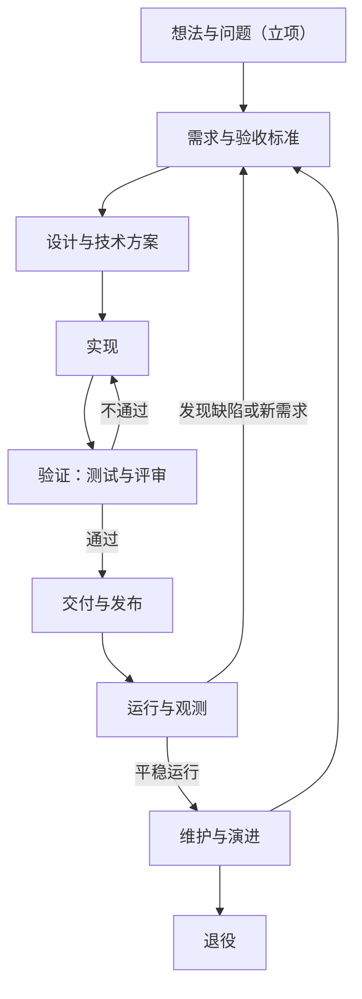
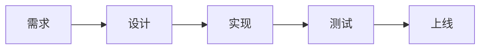
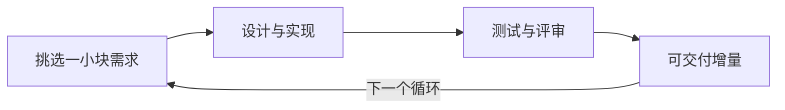
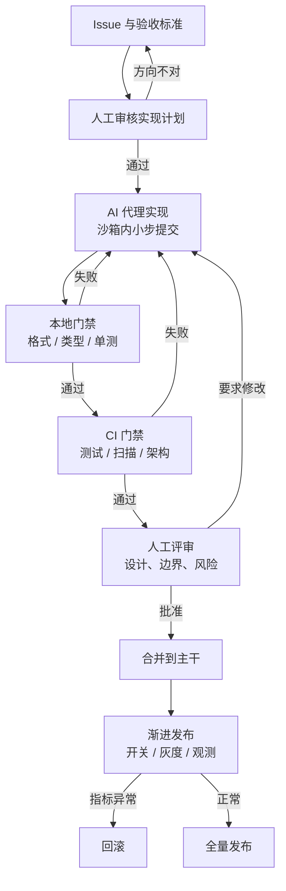

[toc]

## 先建立一个正确的起点

初学者最容易把软件工程理解成"写代码"。实际上，代码只是中间产物。软件工程要交付的是三样东西：

- **能运行的东西**：用户真的能用它完成一件事。
- **能被验证的东西**：出问题时能判断是哪里坏了，改动能证明没有弄坏别处。
- **能被继续维护的东西**：半年后换一个人（或换一个 AI）接手，仍然改得动。

由此可以解释三个常见误解：

- **"需求清楚了再写代码"不够**：需求必须清楚到能写成**可判定的验收条件**，否则"做完"永远靠感觉。
- **"测试是测试人员的事"不够**：测试是"完成"的定义的一部分；没有测试的改动，只能算草稿。
- **"流程是给大公司用的"不够**：流程的本质是**降低返工**。一个人写小工具也需要，只是可以更轻。

后面所有内容都围绕一个具体例子展开：**给一个待办事项应用加"按标签筛选"功能**。它足够小，能看清全流程；又足够真实，会碰到需求、设计、实现、验证、交付、运行、维护七个环节。立项与退役在两端，分别决定"值不值得做"和"怎么安全停掉"，同样不能跳过。

## 一次完整的生命周期长什么样

先把全貌看清楚。软件不是"写完就结束"，而是一个会反复回到起点的回路：

图中的关键不是九个方框，而是三条回路：**验证不通过回到实现**（几分钟到几小时）、**运行发现问题回到需求**（几天到几个月）、**维护阶段决定继续演进还是退役**（几个月到几年）。流程设计的好坏，很大程度上取决于这几条回路有多短、信息有多准。

| 阶段 | 一句话说明 | 主要产出 | 初学者常见错误 |
| --- | --- | --- | --- |
| **立项** | 判断值不值得做、什么情况下停 | 目标、成功指标、退出条件（一页纸） | 先写代码再想为什么做，做完发现没人用 |
| **需求** | 明确"为谁解决什么问题、什么算解决" | 需求说明、验收条件、非目标 | 只写"加个筛选"，不写筛选什么、空结果怎么办 |
| **设计** | 决定改哪里、怎么改、影响谁 | 方案、接口约定、必要的决策记录 | 直接开写，改到一半发现要动数据结构 |
| **实现** | 把方案变成代码 | 代码、单元测试、提交记录 | 一次改十几个文件，出问题无法定位 |
| **验证** | 证明"确实做到了，且没弄坏别的" | 测试结果、评审意见、检查报告 | 只测顺利路径，不测空数据和报错 |
| **交付** | 让用户真正用上 | 构建产物、发布记录、回滚方案 | 直接改生产环境，出问题退不回去 |
| **运行** | 观察真实表现 | 监控指标、告警、日志 | 上线后不看，等用户投诉 |
| **维护** | 修缺陷、还技术债、准备下线 | 修复、重构、迁移方案 | 只加功能不清理，越改越慢 |
| **退役** | 让系统安全停止，数据和依赖处理干净 | 退役方案、数据归档、依赖清理记录 | 只关服务器，留下没人维护的账号和定时任务 |

对一个初学者来说，最值得先记住的是：**每个阶段都要有"产出物"**。没有产出物的阶段等于没发生——"我想过了"不是设计，"我测过了"不是验证。

## 端到端流程：每个阶段的门槛

上面那张表回答"每个阶段做什么"，这张表回答"什么时候可以进入下一阶段"。**门槛的作用是减少返工，不是增加签字**；小项目可以合并阶段，但产物和判断标准不能凭空消失。

| 阶段 | 进入前要有 | 离开前要有（退出标准） | 谁负责 | 详见 |
| --- | --- | --- | --- | --- |
| **立项** | 一个真实存在的问题 | 明确做/不做、成功指标、退出条件 | 产品 + 技术负责人 | 治理指南·立项与计划 |
| **需求** | 方向已确认 | 验收条件可判定，非目标已写 | 产品负责人 | 治理指南·需求与设计 |
| **设计** | 验收条件已评审 | 影响面、兼容性、回滚与测试点明确 | 技术负责人 | 治理指南·需求与设计 |
| **实现** | 方案已评审 | 本地门禁通过，改动可独立回滚 | 开发者（可含 AI） | 治理指南·代码与仓库 |
| **验证** | 可构建，改动已完成 | 每条验收条款有证据，问题已登记 | 评审者 + 独立验证者 | 测试验收指南 |
| **交付** | 验证通过，回滚方案就绪 | 指标正常或已回滚，有发布记录 | 发布负责人 | 治理指南·CI/CD 与发布 |
| **运行** | 已上线且有观测 | SLO 达成，事故与改进项闭环 | 值班负责人 | 治理指南·可靠性工程 |
| **维护** | 系统仍在使用 | 变更仍可小步验证，技术债有账 | 模块负责人 | 治理指南·可维护性 |
| **退役** | 有替代方案或终止决定 | 无流量、无依赖、无残留凭据 | 系统负责人 | 治理指南·结项与退役 |

一个常被忽略的判断方法是：**如果下一阶段的接手者还要再问一遍"要做什么、怎么算完成"，说明上一阶段其实没结束**。

### 按项目规模裁剪

流程不是越完整越好，而是**保留能降低返工的部分**。裁剪结果最好写下来，避免每次临场争论。

| 环节 | 个人小工具 | 团队项目 |
| --- | --- | --- |
| **立项** | 三句话：给谁、解决什么、什么情况下放弃 | 一页纸说明 + 立项评审 |
| **需求** | Issue 里的验收条件 + 非目标 | 规格文件 + 优先级 + 范围基线 |
| **设计** | 关键决策写三句话 | 设计说明 + ADR + 接口契约 |
| **验证** | 核心路径手测 + 少量自动测试 | 分层测试 + 评审 + 用户验收 |
| **运行** | 出错能看日志、能回退 | 监控告警 + runbook + SLO |
| **退役** | 删除前备份数据 | 下线清单 + 数据归档 + 依赖清理 |

### 三份文档怎么配合

| 你想搞清楚 | 看哪份 | 典型章节 |
| --- | --- | --- |
| 生命周期为什么这样分，人工时代和 AI 时代差在哪 | 本文 | 生命周期、人工时代与 AI 时代三节 |
| 每个阶段要做什么、产物是什么、门禁怎么设 | `软件工程@开发流程和项目治理指南.md` | 端到端流程、立项与计划、需求与设计、结项与退役 |
| 这次改动怎么验、证据怎么留、怎么防"假完成" | `ai coding@工程质量约束方案@测试和验收指南.md` | 验收等级、门禁分层、证据与交付报告 |

三份文档的详略不同，但阶段口径一致：**本文给直觉，治理指南给规则，测试验收指南给执行**。

## 经典人工开发时期：三种典型组织方式

人工时代的核心约束很朴素：**写代码很贵，人手是瓶颈**。流程的演化，基本就是在回答"怎样让人少返工"。

### 瀑布：用阶段门禁控制风险

瀑布模型（Waterfall）把阶段排成一条直线：需求做完做设计，设计做完做实现，实现做完做测试，测试通过再上线。它的历史源头通常追溯到 Winston Royce 1970 年的论文《Managing the Development of Large Software Systems》——有趣的是，Royce 本人并不主张"一次走完"，他在文中就指出了纯线性流程的风险。

瀑布真正的价值不是"线性"，而是**阶段门禁**（Phase Gate）：每个阶段结束时必须交付并评审，不通过不进入下一阶段。对需求稳定、变更代价极高的项目（航天、医疗设备、大型基础设施），这种做法仍然合理。

它的问题也很清楚：**反馈来得太晚**。等到测试阶段才发现需求理解错了，返工成本已经是设计阶段的数倍。

### 迭代与敏捷：用短周期降低不确定性

敏捷（Agile）不是一套具体流程，而是一组价值观，2001 年的《敏捷宣言》把它概括为"个体与互动、可工作的软件、客户合作、响应变化"优先于对应的右侧项。落到执行层，最常见的是以 1～4 周为周期的迭代（Sprint）：每个周期都走一遍"挑选需求→实现→验证→可交付增量"。

它解决的是瀑布最大的问题：**让反馈变短**。需求不必一次想全，先做最有价值的一小块，用真实反馈修正下一步。

代价是：迭代容易变成"每两周交付一次混乱"。要让它成立，必须有稳定的验收标准、自动化测试和可持续的节奏。

### 持续交付与 DevOps：把"发布"变成日常

持续集成（Continuous Integration，CI）要求开发者频繁把改动合回主干，并每次都自动构建与测试；持续交付（Continuous Delivery，CD）进一步要求"任何通过检查的版本都能随时发布"。这一套在 2010 年前后随《Continuous Delivery》一书普及，后来与 DevOps 文化合流。

它带来的观念变化是根本性的：**发布不再是项目末期的一次大冒险，而是日常操作**。前提是构建、测试、部署全部自动化，并且有回滚能力。

把两种节奏放在一起看，差别不在"有没有阶段"，而在**回路在多长的时间尺度上闭合**。

瀑布把验证压到最后，需求理解错了要等到测试阶段才暴露：

迭代把验证放进每个周期，每一圈都会闭合一次反馈：

这两种节奏各有代价：瀑布用更长的回路换前期确定性，迭代用更短的回路换纠错速度。

### 人工时代的角色与产物

| 角色 | 主要关注 | 典型产物 |
| --- | --- | --- |
| 产品/需求 | 做什么、给谁做、优先级 | 需求文档、验收条件、路线图 |
| 设计与架构 | 怎么拆、依赖谁、以后怎么改 | 设计文档、接口约定、架构图 |
| 开发 | 实现、单元测试、代码质量 | 代码、提交、单元测试 |
| 测试/QA | 覆盖场景、发现缺陷 | 测试用例、缺陷单、测试报告 |
| 运维/平台 | 部署、稳定性、容量 | 流水线、监控、运行手册 |
| 评审者 | 设计合理性与风险 | 评审意见、批准记录 |

人工时代有几个隐含假设，值得单独记住，因为 AI 时代恰恰是它们失效了：

- **实现是瓶颈**：所以流程重点在"如何让开发更快、返工更少"。
- **文档给人读**：所以规范靠培训、评审、口头约定传递。
- **质量靠人的经验**：所以"资深工程师"的价值极高。
- **变更昂贵**：所以强调一次做对、前期评审、长期分支。

## AI 开发时期：什么变了，什么没变

AI 编码工具（对话式助手、IDE 补全、能自己读写文件的编码代理）并没有发明新的软件工程，它改变的是**各环节的成本结构**。变化可以归纳为五点。

### 变化一：实现变便宜，验证变贵

过去"写出来"最花时间，现在生成代码可能只要几分钟。但**判断这段代码对不对**的成本没有同步下降：评审要看懂，测试要设计，边界要想到，安全要检查。

于是瓶颈从"写"转移到"验"。这也解释了为什么很多团队引入 AI 后个人产出上升、交付质量却没有同步改善：下游的评审与测试容量没有扩容。DORA 2025 年的研究把 AI 描述为组织能力的**放大器**——基础扎实的团队收益更大，基础薄弱的团队问题暴露得更快。

### 变化二：角色合并，但责任不能合并

一个人加上 AI，可以同时承担需求、实现、测试的部分工作，角色边界变模糊了。但有一条不能模糊：**谁批准合并，谁对结果负责**。

初学者最容易犯的错，是让 AI 既写实现、又改验收条件、再自己宣布通过。这三件事必须分开，至少要做到"实现与验收不由同一个主体完成"。

### 变化三：上下文成为新的生产资料

人工时代，项目知识存在于老员工脑子里和零散文档里。AI 时代，这些知识必须写成**机器可读、位置固定**的文件，否则代理只能猜：

- `AGENTS.md`：项目约定、命令、边界、完成定义。
- 规格文件（`specs/`）：这次要做什么、验收条件、非目标。
- 架构决策记录（`docs/adr/`）：当初为什么这样设计。

一句话概括：**能把规矩写进仓库的，不要留在对话里**。对话会消失，仓库不会。

### 变化四：约束从"口头规范"变成"机器可执行门禁"

人工时代说"提交前跑测试"，靠自觉；AI 时代必须变成钩子、CI 和分支保护。因为代理不会"不好意思"，它只会按可执行的约束行事：

- 规范写在文档里，是**提示**；
- 检查写进 CI，是**约束**；
- 权限配在平台上，是**边界**。

三者缺一，规则就会在某个深夜被绕过。

### 变化五：小批量更重要，而不是更不重要

AI 几分钟能生成上千行代码，但人的评审带宽没变。变更越大，评审越像"扫一眼"，缺陷越容易漏过。所以 AI 时代反而要更严格地拆小：一个 PR 做一件事，几百行以内，能独立验证、能独立回滚。

### AI 参与后的一次变更长什么样

与人工时代相比，这张图多了三个**卡点**，而不是多了一个阶段：

- **计划审核点**：在写代码之前拦住方向性错误，这是最便宜的干预时机。
- **机器门禁**：代理无法用"我觉得没问题"绕过，只能让检查变绿。
- **人工合并**：最终责任仍然落在人身上。

## 共同点：五条不变的原则

工具会换，这五条不会：

| 原则 | 人工时代的载体 | AI 时代的载体 |
| --- | --- | --- |
| **先定义"做完"** | 需求文档、验收测试 | 编号化验收条款 + 规格文件 |
| **控制变更影响面** | 模块划分、设计评审 | 架构约束测试、依赖规则自动检查 |
| **验证而不是相信** | 测试、代码评审 | 同一套测试 + 独立验证者 + 证据留存 |
| **小步交付、可回滚** | 小版本、灰度发布 | 小 PR、特性开关、渐进发布 |
| **留下可维护的痕迹** | 设计文档、注释、交接 | ADR、`AGENTS.md`、提交历史与变更日志 |

可以看出：**AI 没有替代任何一条原则，只是换了执行方式**。初学者如果只学工具不学这五条，换一个工具就会重新归零。

## 不同点：一张对照表

| 维度 | 人工开发时期 | AI 开发时期 |
| --- | --- | --- |
| **主要瓶颈** | 实现速度与人力 | 验证、评审与判断力 |
| **代码成本** | 高，写之前要想清楚 | 低，写完必须更严格地验 |
| **需求表达** | 文档给人读，可含糊 | 验收条件给人和机器共同读，必须可判定 |
| **规范传递** | 培训、口头、评审习惯 | 仓库内规则文件 + 钩子 + CI |
| **角色** | 分工明确 | 角色合并，但责任边界更清晰 |
| **评审重点** | 设计、可读性、风格 | 设计、真实性（API/依赖是否存在）、测试有效性 |
| **测试** | 人工设计为主 | 人工定标准，AI 生成候选，变异测试抽查有效性 |
| **文档** | 项目末期集中补 | 随变更持续写，且被工具读取 |
| **节奏** | 里程碑、版本 | 持续小批量，随时可发布 |
| **度量** | 进度、缺陷数、工时 | 交付吞吐 + 稳定性 + 返工率，避免"AI 生成行数" |
| **典型风险** | 需求理解错、集成晚 | 看似完成、测试被改绿、依赖幻觉、范围失控 |
| **人的价值** | 写得更快更好 | 定义问题、判断取舍、承担责任 |

一个容易被忽略的差别是**失败的样子变了**。人工时代最常见的是"做不完"或"做错了"；AI 时代最常见的则是"看起来做完了"——页面在、接口通、测试绿，但用户点下去没反应，或者错误路径直接崩。所以验收方式必须从"看代码"转向"看证据"。

## 初学者常见误区

**两代通用的四个**：

- 跳过验收标准直接写代码，最后靠"感觉差不多"收尾。
- 一次改太多文件，出问题无法定位，也无法回滚。
- 用覆盖率当质量证明，却没人检查断言是否真的会失败。
- 只加功能不还技术债，半年后没人敢动。

**AI 时代新增的四个**：

- 把"AI 说完成了"当作完成，不去看实际执行的命令与结果。
- 让 AI 顺手重构无关代码，变更范围失控。
- 为了让测试变绿，改测试、加跳过、放宽断言。
- 直接采纳 AI 推荐的依赖，不核实包是否真实存在、是否被投毒。

## 从今天开始的最小学习路径

不需要先学完所有方法论，按下面四周练一遍，就能建立完整的直觉。每一周都围绕同一个例子（给待办应用加"标签筛选"）做增量。

| 周 | 练什么 | 具体动作 | 判断自己做到了 |
| --- | --- | --- | --- |
| 第 1 周 | 把需求写成可判定的条件 | 写 5 条验收条件（含空结果、超长标签、取消筛选）+ 2 条非目标 | 别人能照着你的条件判断"过或不过" |
| 第 2 周 | 小步实现与自动验证 | 拆成 3 个小提交；给每条验收条件写一个测试；本地一条命令跑完 | 改坏一处，测试能立刻指出是哪条 |
| 第 3 周 | 让改动可评审、可回滚 | 写一份三句话的方案说明；用特性开关控制新功能；准备回滚步骤 | 关闭开关即可退回旧行为 |
| 第 4 周 | 接入 AI 且不被它带偏 | 让 AI 先出计划再写代码；规定它不能改测试；用独立会话复核 | 能说出这次改动"证明了什么、没证明什么" |

**自检清单**（能做到就打勾）：

- 我能把一句模糊需求拆成三条以上可判定的验收条件。
- 我知道这次改动可能影响哪些已有功能，并至少验证了其中两条。
- 我的提交小到可以单独回滚。
- 我能区分"代码写了"和"功能被验证过"。
- 我知道上线后看哪个指标判断是否正常。
- 我能说出这个项目什么情况下该停、什么情况下该退役。
- 我知道上线后由谁接手、按哪份手册操作。

## 术语表

| 术语 | 中文 | 一句话解释 |
| --- | --- | --- |
| Requirement | 需求 | 要解决的问题与约束 |
| Acceptance Criteria | 验收条件 | 判断"是否做完"的可检验条款 |
| Spec | 规格 | 把需求、验收条件、非目标写成的文档 |
| ADR | 架构决策记录 | 记录"为什么这样设计"的短文档 |
| Code Review | 代码评审 | 合并前由他人检查设计与风险 |
| CI | 持续集成 | 频繁合入主干并自动构建测试 |
| CD | 持续交付/部署 | 通过检查的版本随时可发布 |
| Quality Gate | 质量门禁 | 不达标就阻断合并或发布的检查集合 |
| Regression | 回归 | 改动后重新验证旧功能没被弄坏 |
| Feature Flag | 特性开关 | 用配置控制功能是否对用户可见 |
| Canary | 金丝雀发布 | 先对小部分用户开放，观察后再放量 |
| Rollback | 回滚 | 退回上一个可用版本 |
| Technical Debt | 技术债 | 为求快留下的隐患，会在以后产生"利息" |
| Trunk-Based | 主干开发 | 短分支、频繁合入主干 |
| DoD | 完成定义 | 团队约定的"算完成"的清单 |
| Milestone | 里程碑 | 一个可验证的增量节点，不是日历上的日期 |
| Scope Creep | 范围蔓延 | 不断"顺便加一点"，导致工期与质量失控 |
| UAT | 用户验收测试 | 真实用户用自己的数据完成核心任务 |
| Handover | 移交 | 让接手者能独立部署、回滚和处理常见故障 |
| Decommission | 退役 | 让系统安全停止，并清理数据、依赖与凭据 |

## 延伸阅读

本仓库另有两份更深入的文档，可作为本指南的下一站：

- `软件工程@开发流程和项目治理指南.md`：从立项、需求、设计、评审、测试、发布、可靠性、安全到结项与退役的完整治理体系，并给出端到端阶段门禁与裁剪建议。
- `ai coding@工程质量约束方案@测试和验收指南.md`：专门讲 AI 参与时如何用分级验收、门禁与证据防止"假完成"。

**说明**：本文是概念性入门材料，方法论部分依据公开的经典文献（Royce 1970 年的瀑布论文、2001 年《敏捷宣言》、《Continuous Delivery》、《Accelerate》与 DORA 研究），未引入新的实证数据；涉及 AI 的结论以本仓库两份合并稿的口径为准。工具与产品更新很快，具体用法请查官方文档。

