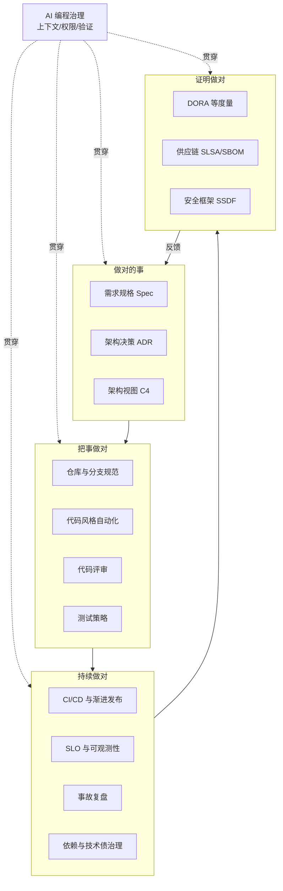
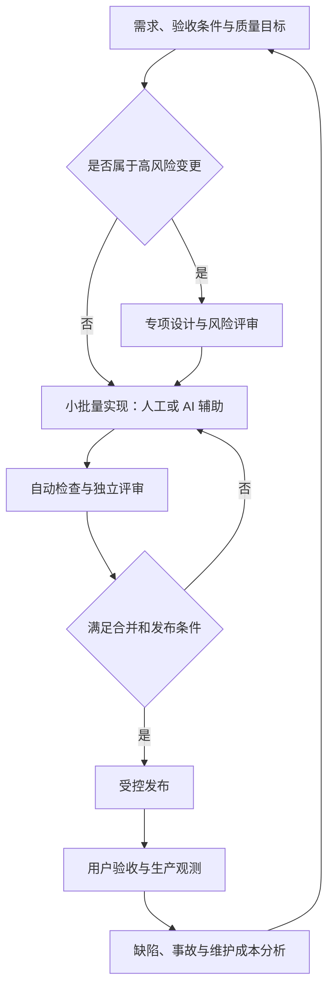
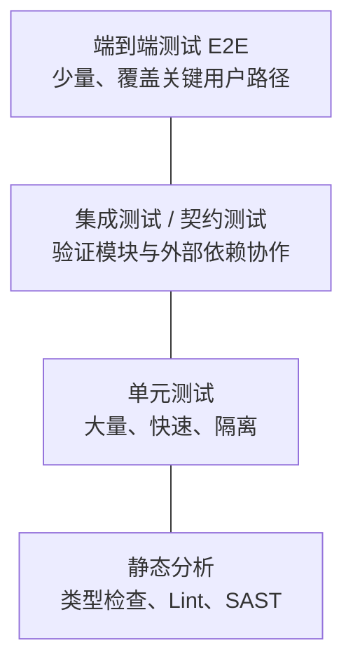
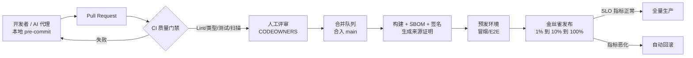
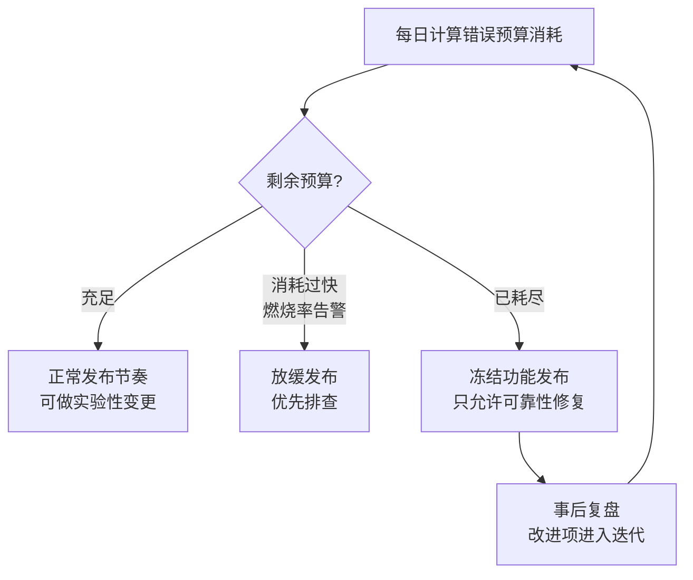
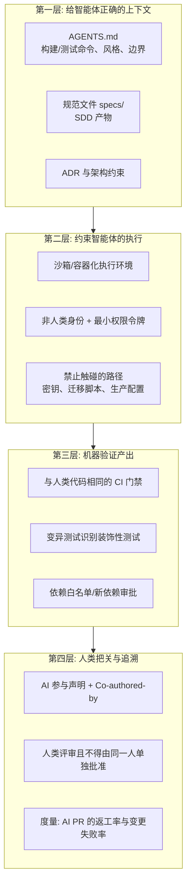
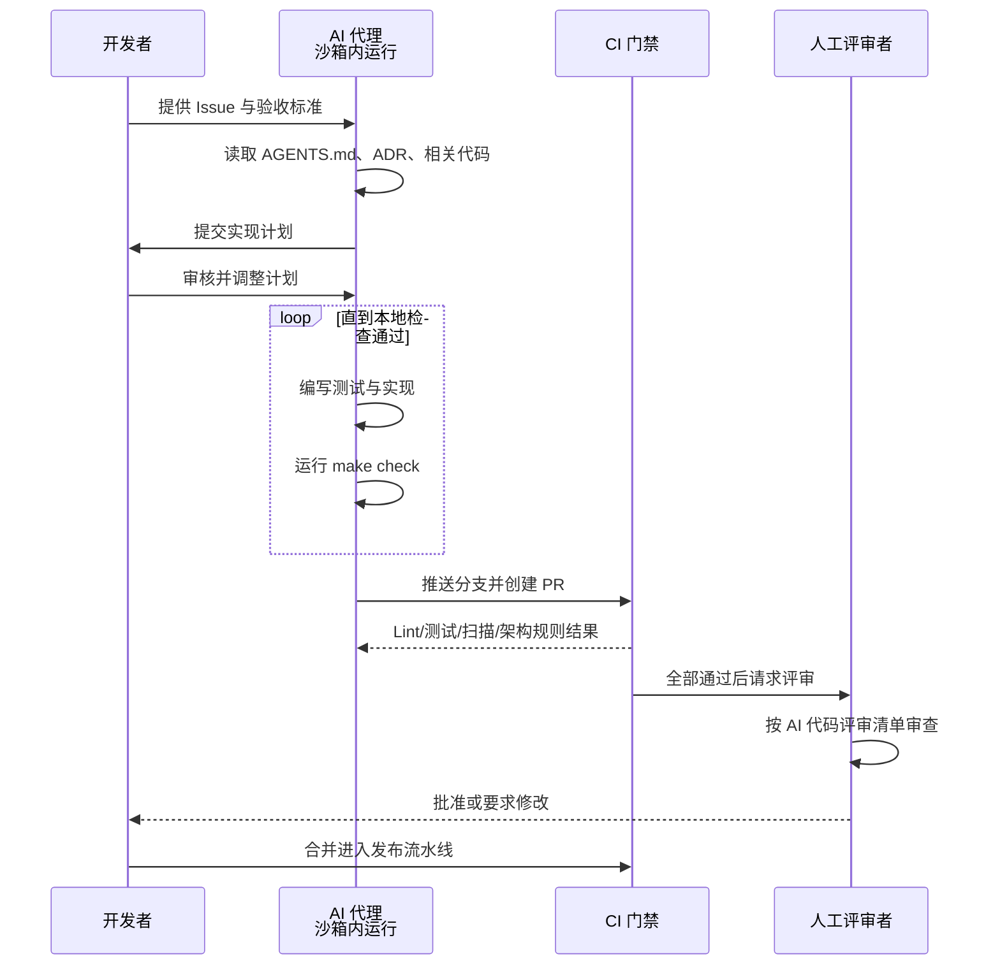

[toc]

## 摘要：治理要回答什么

**中大型项目治理的核心，是让重要变更做到目标明确、责任明确、约束可执行、结果可验证、故障可恢复、后续可维护。** AI 辅助编码应被纳入这套体系，而不是另开一条"生成后直接上线"的通道。DORA 2025 报告把 AI 描述为组织既有能力的**放大器**：工具收益取决于测试、流程、平台和协作等基础能力，而不取决于代码生成速度。

本文面向通用业务软件，按"全景图—端到端流程—理论基石—立项、计划与项目节奏—需求与设计—代码与仓库—评审—测试—交付—可靠性—安全与供应链—可维护性—结项、移交与退役—AI 专项—综合示例—环境配置—度量与路线图"展开。文中的**必须**表示建议设为项目底线或门禁，不代表所有行业的法定义务；医疗、航空等安全关键软件还需要专项规范。

三个容易混淆的判断先放在前面：

- **规范性不等于格式统一**：还包括需求、接口、权限、发布和责任的一致性。
- **可靠性不等于测试通过**：还需要运行观测、故障处理和恢复能力。
- **可维护性不等于代码看起来漂亮**：应关注修改影响范围、理解成本、测试成本和人员交接成本。

## 总览：软件项目治理的全景图

项目治理（Project Governance）本质上要回答四个问题：**做对的事**（需求与架构）、**把事做对**（规范与质量门禁）、**持续做对**（可靠性与可维护性）、**证明做对**（度量、审计与供应链可信）。AI 编程不改变这四个问题，它改变的是**速度和风险的分布**：代码生成得更快，验证就成了瓶颈。



四个阶段从左到右推进，度量结果再反馈到需求与架构，形成闭环。AI 编程治理不是独立的一环，而是**贯穿所有阶段的横切关注点**：写规格时 AI 可以起草，写代码时 AI 负责生成，评审时 AI 辅助筛查，运维时 AI 帮忙分析告警。每个阶段都要回答同样三个问题：AI 能拿到什么上下文、拥有什么权限、它的产出由谁验证。

**贯穿全文的三条总原则**：

1. **能自动化的规范必须自动化**：靠人记住的规范迟早会失效，要把规范写进工具（格式化器、Lint、CI 门禁、分支保护）。
2. **小批量、快反馈**（Small Batches）：每次变更越小，评审越容易、回滚越便宜、定位问题越快。这条在 AI 时代更加重要。
3. **可追溯**（Traceability）：任何一行线上代码都应能追溯到需求、决策、评审人、构建来源。

### 四条治理主线

四个治理目标可以映射为四条主线，并以"一次代码变更的生命周期"为主轴组织：

| 目标 | 核心问题 | 对应主线 |
| --- | --- | --- |
| **规范性**（conformance） | 代码、提交、文档、接口是否遵循统一约定 | 仓库治理、编码规范、自动化检查 |
| **可靠性**（reliability） | 系统在生产环境是否稳定、可恢复 | 测试策略、渐进式交付、SRE 实践 |
| **可维护性**（maintainability） | 一年后、换一批人后还能不能改 | 架构约束、技术债管理、文档即代码 |
| **交付质量**（delivery quality） | 交付物是否正确、安全、可追溯 | 质量门禁、供应链安全、度量反馈 |

### 治理的三层结构

同一套治理可以从"理论—规范—执行"三层来理解。理解这个分层，有助于避免"只买工具、不改流程"的常见失败：

| 层级 | 回答什么 | 主要产物 | 典型失效表现 |
| --- | --- | --- | --- |
| **理论层** | 我们追求的"质量和效能"到底指什么 | 质量模型、交付效能指标、架构与组织原则 | 团队在"代码质量"这类模糊词上反复争论 |
| **规范层** | 把"好"写成团队可以遵守的规则 | 仓库骨架、ADR、`AGENTS.md`、评审与 DoD 规则 | 规则只存在于口头和老员工记忆里 |
| **执行层** | 让规则自动生效 | 本地钩子、CI 门禁、运行期治理 | 规范写在文档里，实际上没人执行 |

**执行层是最关键的一层**：不能自动执行的规范，在中大型项目里迟早会被遗忘。

### 按风险配置控制强度

不是所有变更都值得走同一套流程。建议按下表分级，并保留例外机制：

| 风险级别 | 典型变更 | 建议控制 |
| --- | --- | --- |
| **低** | 普通说明文档、文案调整 | 自动检查与简化评审 |
| **中** | 不改变安全边界的常规业务功能 | 验收条件、相关测试、独立代码评审 |
| **高** | 鉴权、租户隔离、数据迁移、并发一致性、构建发布与 AI 权限配置 | 专项设计、领域负责人评审、故障场景测试、发布与恢复预案 |

**风险看影响和可逆性，不看修改了多少行。**一行权限判断可能比几百行界面代码更重要。

NIST SSDF 本身也强调按业务、风险、资源和适用性裁剪实践，而不是机械执行统一清单。配套的**例外机制**要求：任何绕过门禁的决定，都记录原因、影响、补偿措施、批准人和到期时间。紧急修复可以有快速通道，但事后应补齐评审，不能让"紧急"成为常态。



这张闭环图的关键不是"每个阶段都有人签字"，而是**每个重要判断都有责任人，每项重要约束都有执行机制，每个结果都有证据**。闭环按每个小批量变更运行，而不是项目结束时集中检查一次。

### 左移、右移与纵深防御

- **左移**（Shift-left）：问题越早发现成本越低，因此把测试、安全、规范检查尽量推向编码阶段（编辑器、pre-commit）。
- **右移**（Shift-right）：有些问题只在生产暴露，因此需要灰度、可观测性和快速恢复能力兜底。
- **纵深防御**（Defense in Depth）：不依赖任何单一关卡。编辑器提示、提交钩子、CI 门禁、评审、部署前检查、运行时监控，每一层都可能漏，叠加后漏网概率极低。这对 AI 代码尤其重要。

## 端到端流程：从立项到退役

前面的全景图回答"治理包含哪些方面"，这一节回答"这些方面按什么顺序发生"。下表把全文涉及的阶段排成一条主线，每行是一个**阶段门禁**：满足退出标准才进入下一阶段，不满足则回到本阶段或上一阶段。**门禁的目的是减少返工，不是增加签字。**

| 阶段 | 准入条件 | 主要活动 | 关键产物 | 退出标准 | 责任角色 | 详见 |
| --- | --- | --- | --- | --- | --- | --- |
| **立项** | 有一个待解决的问题或机会 | 可行性、成本、替代方案、退出条件 | 一页纸立项说明 | 明确做/不做/先验证，且有负责人和成功指标 | 产品负责人 + 技术负责人 | 立项、计划与项目节奏 |
| **需求** | 方向已确认 | 来源梳理、优先级、验收条件、非目标 | 规格（目标、非目标、验收条款、质量要求） | 验收条件可判定，范围基线与变更规则已定 | 产品负责人 | 需求与设计治理 |
| **设计** | 需求与验收条件已评审 | 方案对比、架构与数据设计、接口与兼容性、交互设计 | 设计说明、ADR、接口契约、原型 | 影响面、兼容性、回滚与测试点已明确 | 技术负责人 | 需求与设计治理 |
| **实现** | 设计与任务拆分已评审 | 小批量编码、单测、提交与自检 | 代码、单测、提交记录、变更说明 | 本地门禁通过，变更可独立评审与回滚 | 开发者（可含 AI 代理） | 代码与仓库规范 |
| **验证** | 实现完成且可构建 | 分层测试、评审、安全与性能检查、用户验收 | 测试报告、评审记录、验收签收 | 验收条款逐条有证据，遗留问题已登记 | 评审者 + 独立验证者 | 测试策略；测试验收指南 |
| **交付** | 验证通过，发布方案就绪 | 构建签名、灰度发布、观测与回滚准备 | 发布记录、SBOM 与来源证明、回滚方案 | 指标正常，或已按预案回滚 | 发布负责人 | CI/CD 与发布 |
| **运行** | 已上线并有观测 | 告警响应、容量与成本、备份恢复、补丁 | 运行手册、值班记录、SLO 报告 | SLO 达成，事故与改进项闭环 | 运维/值班负责人 | 可靠性工程 |
| **维护** | 系统在用 | 缺陷修复、依赖升级、技术债偿还、小增量 | 修复与重构记录、技术债清单 | 变更仍可小步验证，维护成本可接受 | 模块负责人 | 可维护性与可持续性、结项与退役 |
| **退役** | 有替代方案或业务终止决定 | 数据迁移与归档、下游通知、依赖清理、只读期 | 退役方案与完成记录 | 无流量、无依赖、无残留凭据与定时任务 | 系统负责人 | 结项、移交与退役 |

这张表有三个使用要点：

- **阶段可以合并，产物不能凭空消失**。个人项目可以把立项并入需求，把运行并入维护，但仍要有一句话说明"为谁解决什么、什么算成功"。
- **准入条件比退出标准更容易被跳过**。最常见的失败是带着未评审的需求进入设计，或带着未验证的改动进入发布；门禁应优先卡住这两个入口。
- **每个阶段都要有人对"放行"负责**。角色可以兼任，但不能出现"大家都参与，因此没人负责"。

### 流程裁剪：三种规模的最小集

同一套流程不应等量用在所有项目上。裁剪的原则是**保留能降低返工的产物和门禁，去掉只增加仪式感的部分**；裁剪结果要写下来，不能靠临场决定。

| 环节 | 个人工具/脚本 | 小团队业务系统 | 中大型多团队 |
| --- | --- | --- | --- |
| **立项** | 一句话目标与放弃条件 | 一页纸立项说明 | 立项评审 + 成本与替代方案 |
| **需求** | 验收条件 + 非目标（可写在 Issue 里） | 规格文件 + 优先级 + 范围基线 | 规格评审 + 需求追溯 + 变更控制 |
| **设计** | 关键决策写三句话 | 设计说明 + ADR | 架构评审 + C4 + 接口契约 + 交互稿 |
| **实现** | 小提交 + 本地检查 | 分支保护 + PR 模板 | CODEOWNERS + 架构适应度函数 |
| **验证** | 关键路径手测 + 少量自动测试 | 分层测试 + 评审 + 覆盖率门禁 | 全量门禁 + 独立验证 + UAT |
| **交付** | 备份旧版本即可回退 | 自动化部署 + 灰度/开关 | 签名制品 + 渐进发布 + 发布审批 |
| **运行** | 出错能看日志 | 基础监控 + 告警 + runbook | SLO/错误预算 + 值班 + 恢复演练 |
| **退役** | 删除前备份数据 | 下线清单 + 通知使用方 | 迁移方案 + 归档 + 合规审计 |

### 流程是否真的走完：四个判据

1. **产物存在且可复核**：不是"讨论过了"，而是有文件、有链接、有记录。
2. **门禁有证据**：通过的依据是命令输出、报告、签收记录，而不是参与者的印象。
3. **回路有负责人和时限**：验证失败回到实现、线上问题回到需求、维护决策回到立项，每条回路都要有人跟到底。
4. **下一阶段能据此开工**：接手者不需要再问一遍"到底要做什么、怎么算完成"。

### 与其他两份文档的分工

- 本文负责**治理规则与完整流程**：每个阶段该有哪些控制、门禁和产物。
- `软件工程@开发流程入门指南@简化版.md` 负责**概念与直觉**：生命周期为什么这样分、人工时代与 AI 时代的差别。
- `ai coding@工程质量约束方案@测试和验收指南.md` 负责**单次变更的验收执行**：分级、门禁脚本、证据与反"做一半"。

三份文档的详略不同，但阶段口径一致；出现冲突时，以本文的治理要求和测试验收指南的可执行门禁为准。

## 理论基石：需要知道的核心概念

工具会过时，理论不会。下表是理解所有实践"为什么这么做"的根基：

| 理论/模型 | 核心观点 | 对项目治理的指导意义 |
| --- | --- | --- |
| **软件工程与生命周期** | 不只是把程序写出来，还要考虑长期修改、规模和协作成本 | 构建、测试、文档、升级、运行和退役都纳入交付范围 |
| **需求工程与质量属性** | "功能正确"只是质量的一部分，性能、可靠性、安全性、可维护性也要明确 | 可验收需求、质量目标、风险清单 |
| **模块化与信息隐藏** | 把容易变化的实现封装起来，减少一次修改波及的范围 | 模块边界、稳定接口、依赖方向、自动架构检查 |
| **康威定律**（Conway's Law） | 系统结构会映射组织的沟通结构 | 模块边界应与团队边界对齐，否则跨团队协作成本会转化为架构腐化 |
| ***Team Topologies*** | 四类团队（流对齐、平台、赋能、复杂子系统）+ 三种交互模式，核心变量是认知负荷 | 中大型项目用**平台团队**沉淀 CI 模板、脚手架、AI 规则库，降低流对齐团队的认知负荷 |
| **ISO/IEC 25010:2023 质量模型** | 产品质量分为功能适合性、性能效率、兼容性、交互能力、可靠性、安全性、可维护性、灵活性、安全保障（Safety）等特性 | 把"质量"拆成可验收的非功能需求，避免"质量好"这类空话 |
| **技术债**（Technical Debt）与 Lehman 演化定律 | 为求快而做的妥协会持续产生"利息"；持续使用的软件必须持续变更，变更又会推高复杂度 | 技术债要**显式登记**（Issue 标签、ADR 后果段），并预留固定的偿还容量 |
| **破窗理论与童子军法则**（Boy Scout Rule） | 一处未修的坏代码会降低整个团队的质量标准 | 每次触碰代码都让它比来时更干净一点，把清理纳入日常而非"有空再做" |
| **精益与小批量** | 优化整个交付过程，而不是让每个人同时开工更多任务 | 限制在制品、缩小变更、缩短反馈周期 |
| **DORA 指标** | 用交付吞吐和稳定性衡量软件交付效能 | 团队级效能的事实标准，详见下文 |
| **SPACE / DevEx** | 开发者生产力是多维的：满意度、绩效、活动、协作、效率与心流 | 防止只看"代码行数、PR（Pull Request，合并请求）数"这类会被 AI 轻易刷高的指标 |
| **SRE**（Site Reliability Engineering，站点可靠性工程） | 用 SLI（服务水平指标）、SLO（服务水平目标）与错误预算平衡发布速度和稳定性 | 让"能不能发布"有客观依据，而不是靠拍脑袋 |
| **分布式系统与局部失败** | 超时不等于操作没成功；重试可能产生重复副作用 | 幂等、超时、有限重试、去重、补偿与一致性设计 |
| **风险驱动治理** | 不同风险需要不同强度的控制，任何一道防线都可能失效 | 风险分级、最小权限、多层验证、例外管理 |

### 质量模型：ISO/IEC 25010 的正确用法

ISO/IEC 25010 是软件产品质量的国际标准模型。2023 版定义了九个产品质量特性；2011 版为八个（使用"可用性"和"可移植性"的表述），两版术语存在差异，引用时应对准所用版本。

与本话题最相关的是**可维护性**（Maintainability）及其子特性，这是"可持续性"的标准化定义：

| 子特性 | 英文 | 含义 | 工程上对应的可度量信号 |
| --- | --- | --- | --- |
| **模块化** | Modularity | 修改一个组件对其他组件影响最小 | 模块间依赖图、循环依赖数、变更波及范围 |
| **可复用性** | Reusability | 资产可在多个系统中复用 | 共享库抽取、重复代码率 |
| **可分析性** | Analysability | 能有效评估变更影响、诊断缺陷 | 日志与追踪覆盖、代码复杂度 |
| **可修改性** | Modifiability | 修改不引入副作用 | 变更失败率、回归缺陷数 |
| **可测试性** | Testability | 能验证变更行为符合预期 | 测试覆盖率、测试执行时长 |

需要说明一个事实：ISO 25010 本身并不提供评估或改进质量特性的方法，从业者无法直接按标准操作。因此**ISO 25010 的正确用法是"词汇表 + 检查清单"**，具体度量要靠 SonarQube 这类工具或团队自定义指标。

在 AI 编码时代，这个模型的价值反而更高：维护安全性和可维护性，是防止"AI 垃圾代码"（AI slop）侵蚀系统的第一道关口。

### 交付效能：DORA 指标与 AI 能力模型

DORA（DevOps Research and Assessment，现属 Google Cloud）是持续十余年的软件交付效能研究。其指标已经从经典四项扩展为五项：

| 指标 | 含义 | 归属 |
| --- | --- | --- |
| **部署频率**（Deployment Frequency） | 多久向生产环境成功部署一次 | 吞吐 |
| **变更前置时间**（Change Lead Time） | 从代码提交到在生产运行所需的时间，不是从需求提出算起 | 吞吐 |
| **部署返工率**（Deployment Rework Rate） | 因生产事故而发生的非计划部署占比 | 吞吐 |
| **变更失败率**（Change Failure Rate） | 部署后需要立即干预的部署占比 | 稳定性 |
| **失败部署恢复时间**（Failed Deployment Recovery Time） | 从需要干预的失败部署中恢复所需时间 | 稳定性 |

关于"返工率"的归属，不同解读存在分歧：一种按官方新版分组归入吞吐，一种按"反映质量代价"归入稳定性。分组口径不影响使用，但**登记指标时应固定口径**，避免跨期比较失真。

**关键认知**：DORA 多年研究的一贯结论是**吞吐和稳定性并不矛盾**，高效能团队两者兼得。*Accelerate* 一书及其后的研究用十年数据支撑了这一点：高频小步交付的团队反而更稳定。DORA 2025 还放弃了"低/中/高/精英"的四档聚类，改为基于八项度量的七种原型（具体定义以官方报告为准）。

**2025 年的新变化**（已检索）：DORA 首次发布 [*State of AI-assisted Software Development* 报告](https://cloud.google.com/blog/products/ai-machine-learning/announcing-the-2025-dora-report)，数据来自近 5000 名技术从业者的问卷和 100 多小时定性研究。核心结论是 [AI 的主要角色是放大器](https://dora.dev/research/publications/)：它会放大高效能组织的优势，也会放大困境组织的功能失调。

- **吞吐量上升但稳定性下降**：AI 采用与交付吞吐量正相关，但持续与更高的不稳定性相关，表现为更多变更失败、更多返工和更长的问题解决周期。
- **信任悖论**：超过 80% 的用户报告 AI 带来显著生产力提升，同时约 30% 的人对其生成的代码几乎没有信任。创建阶段省下的时间，经常被重新分配到审计和验证上。
- **收益来源**：最大的回报并非来自 AI 工具本身，而来自对内部平台质量、工作流清晰度和团队对齐的战略性关注。

第三方分析 [Faros AI](https://www.faros.ai/blog/key-takeaways-from-the-dora-report-2025) 把"个人产出上升、组织指标持平"的现象称为 **AI 生产力悖论**。DORA 同期提出的 **AI 能力模型**（AI Capabilities Model）列出七项配套能力：明确的 AI 立场、健康的数据生态、AI 可访问的内部数据、强大的版本控制实践、小批量工作、以用户为中心、高质量的内部平台。其中"小批量"被特别强调——它比以往任何时候都更重要。

**其他实证信号**（数据来源见文末参考资料，均需按原文核对口径）：

- **安全没有随能力同步提升**：Veracode 2026 年的测试显示，约 44% 的 AI 代码生成任务产生已知安全缺陷；同期整体安全通过率维持在约 55%。按弱点类型看，弱加密、SQL 注入的通过率较高，跨站脚本与日志注入很低——模型对"经典"漏洞防御较好，对上下文相关的注入类漏洞几乎不设防。
- **AI 合著的 PR 问题更多**：CodeRabbit 的统计显示，AI 合著 PR 中的问题数量约为纯人工 PR 的 1.7 倍。
- **重复代码上升**：GitClear 分析约 6.23 亿次代码变更后指出，重复代码块比 AI 工具普及前多约 81%，而重构（移动）代码减少。
- **主观感受可能有偏差**：METR 的随机对照试验曾报告资深开发者在熟悉的大型代码库中使用 AI 后变慢，而他们自认为变快；METR 在 2026 年 2 月的后续说明中又指出，参与者选择与时间测量等问题使当时的提效幅度难以可靠估计。**结论：不要套用固定的"AI 提效百分比"，应在自己的任务类型和质量标准下建立基线与对照。**

### 度量的使用边界

- DORA 指标应主要用于**同一应用或服务的持续改进**，不用于个人排名，也不脱离上下文横向比较完全不同的系统。
- 指标要能反映"代价"：只看吞吐会激励粗放发布，必须同时看变更失败率与返工率。
- 指标要防"刷分"：代码行数、PR 数量、AI 生成比例都可以被轻易推高，不能单独充当绩效结论。

### 组织与架构原则（简述）

以下属于稳定的经典理论，仅列要点供查阅：

- **康威定律与逆康威操作**：划分模块或服务时先考虑团队边界，必要时反向调整组织结构以得到期望的架构。
- **认知负荷与团队拓扑**：单个团队能维护的系统复杂度有上限，超过上限的项目应拆分为流对齐团队、平台团队等。
- **依赖规则与整洁/六边形架构**：业务核心不依赖框架与外部 I/O，依赖方向永远指向内层。这是可测试性与可修改性的架构基础。
- **模块化单体优先**：没有明确的独立部署、扩缩容或团队自治需求时，优先评估模块化单体。微服务会引入服务间通信与运行管理成本，是一项需要权衡的架构选择，不是"大项目认证"。

## 立项、计划与项目节奏

工程治理常从"需求已经确定"开始讲，但项目最常见的失败发生在更早：做了一件不该做的事，或者用不可能的时间承诺了它。这一节补齐项目前期的三个动作——**判断值不值得做、估算要做多久、跟踪做到哪了**。

### 立项与可行性：先判断值不值得做

立项不是写一份长报告，而是回答四个问题并把答案留下来：

1. **谁的问题**：哪类用户在什么场景下遇到什么困难，现在怎么绕过去的。
2. **不做的后果**：如果维持现状，损失是什么；这决定了投入上限。
3. **最便宜的替代方案**：采购、开源、人工流程、只做一半，是否已经够用。
4. **什么情况下停**：预设退出条件（时间、成本、指标），避免"已经投入这么多"继续追加。

一页纸就够，建议包含：问题与目标、非目标、成功指标、成本估算（开发、验证、运行、维护）、期限、负责人、退出条件。**小项目可以只写三句话**，但"成功指标"和"退出条件"不能省——它们是后续判断"做完了没有"和"该不该继续"的依据。

成本估算最容易漏掉两项：**验证成本**（评审、测试、验收的时间）和**运行维护成本**（值班、升级、容量）。AI 降低了编码成本，但没有降低这两项，反而因为变更变多而上升。

自建、采购、开源的取舍，按四个维度比较：与核心业务的贴合度、总拥有成本、退出成本（数据能否带走）、合规与安全责任。**核心差异化能力自建，通用能力优先采购或复用**；任何选择都要记录理由，必要时写成 ADR。

### 估算与排期：给不确定性留位置

估算的目标不是"算准到天"，而是**让范围、代价和风险同时可见**。可用的做法：

- **拆到可验证的小块**：单个任务不超过半天到两天；拆不开说明设计还没想清楚。
- **相对估算**：用故事点或 T 恤码比较任务大小，比绝对工时更稳定；需要对外承诺时再换算成区间。
- **三点估算**：给出乐观、最可能、悲观三个值，用区间而不是单点承诺。
- **单独估算验证成本**：测试、评审、UAT 通常占开发时间的 30%～50%，高风险变更更高。
- **保留缓冲**：在关键路径上留 20%～30% 的缓冲，并说明缓冲用于吸收哪类不确定性，而不是"以防万一"。

排期的单位应是**可验证的增量**，不是"完成 60%"。里程碑的定义要写成"某类用户能完成某件事，且有证据"，例如"退款功能对 10% 灰度用户开放，错误率低于基线"。

跟踪进度时看三件事，而不是只看工时消耗：

| 观察项 | 健康信号 | 危险信号 |
| --- | --- | --- |
| **完成定义** | 里程碑按 DoD 逐条满足 | 大量任务"基本完成"但未验收 |
| **范围变化** | 变更走记录并重新估算 | 范围持续扩大但期限不变 |
| **风险与阻塞** | 前五项风险有负责人和应对 | 风险只在口头提及，无人跟进 |

### 风险登记与变更控制

**风险登记册**不需要复杂工具，一张表即可：风险描述、触发信号、影响、应对措施、负责人、复查日期。只登记前五到十项真正可能改变结果的风险，避免变成清单表演。常见类别包括：需求理解偏差、外部依赖不可用、数据迁移失败、关键人员离开、合规时限、AI 产出不可靠。

**范围基线**在需求阶段确定，之后的变化按变更处理：记录原因、影响（工期、成本、质量）、批准人，并重新估算。**允许换，不允许悄悄加**——"顺便再做一个小功能"是范围蔓延最常见的入口。紧急变更可以走快速通道，但要在事后补齐评审与记录。

项目节奏上，小批量交付比长周期里程碑更可靠：每个迭代结束时都应该有一个**可运行、可验收**的增量，而不是一堆完成度百分比。迭代内的计划可以调整，但**验收标准和范围基线不能由执行者单方面修改**。

## 需求与设计治理：先把"做对的事"写下来

中大型项目最昂贵的错误是**做了不该做的东西**。在 AI 编程场景下，这个风险被放大了：AI 会"自信地"填补需求空白。

### 需求从哪里来：来源、优先级与范围基线

规格写得再好，也只能保证"把选中的事做对"，不能保证"选对了事"。需求通常来自四类来源，处理方式不同：

| 来源 | 典型形式 | 需要先回答的问题 |
| --- | --- | --- |
| **用户问题** | 访谈、工单、行为数据、流失原因 | 问题出现的频率和影响面有多大，用户现在怎么绕过 |
| **业务目标** | 收入、转化、合规、成本 | 哪个指标会变化，变化多少才算成功 |
| **运行反馈** | 缺陷、告警、事故复盘、支持请求 | 是修根因还是补症状，是否值得现在做 |
| **技术与依赖** | 版本停止维护、漏洞、容量瓶颈 | 最晚什么时候必须做，拖延的代价是什么 |

排序不要只凭声音大小。一个够用的判断顺序是：**先看是否必须做（合规、安全、阻断性缺陷），再比较价值与代价，最后看依赖关系**。价值可以用受影响用户数 × 影响程度 × 发生频率粗略估计；代价要包含开发、验证、运行和维护四部分。RICE（触达 × 影响 × 置信度 ÷ 投入）和 Kano 模型可用于团队讨论，但**不要用打分替代判断**，分数只用来暴露分歧。

范围基线在需求评审时确定：这一版做什么、明确不做什么、什么条件下可以调整。**非目标要写得和目的一样具体**，否则"顺便做一下"会不断发生。需求变更走记录并重新估算，不允许执行者单方面扩大范围。

### 责任、需求与完成定义

**先明确谁对结果负责，再明确怎样实现。**建议为每个重要服务、模块和交付项指定负责人及替补；产品验收、技术决策、安全风险接受和生产发布的权限应清楚。一个人可以兼任多个角色，但不能出现"大家都参与，因此没人负责"。

需求至少说明六项内容：

- **目标与非目标**（Non-goals）：解决什么问题，明确暂时不解决什么。
- **业务规则**：状态变化、权限边界、异常情况。
- **质量要求**：负载、数据规模、延迟、可用性、恢复要求等。
- **验收条件**：通过什么观察或测试判定完成。
- **约束与风险**：兼容性、外部依赖、预算和交付限制。
- **关联记录**：需求记录、变更请求、测试报告与发布记录相互关联，不必为每个小任务维护冗长文档。

验收条件**推荐**写成可测试的形式，例如 Given-When-Then，或 EARS 句式（Easy Approach to Requirements Syntax，简易需求语法："当 <触发条件> 时，系统应 <响应>"）。这样它可以直接转成测试，也能直接交给 AI 当作完成标准。**避免**"优化用户体验""提升性能"这类不可验证的描述。

团队级的**完成定义**（Definition of Done，DoD）是治理的"契约"，**推荐**写进 `CONTRIBUTING.md`。一个中大型项目的典型 DoD：

- 功能满足验收条件；代码通过格式化与静态检查（本地与 CI 一致）。
- 新增或修改的逻辑有对应自动化测试，CI 全绿。
- 覆盖率不低于基线（例如整体 80%、新增代码 90%，以差异覆盖率为准）。
- 无新增高危或严重级别的安全告警，或已记录例外与到期日。
- 文档与 `CHANGELOG`（可自动生成）已更新；涉及架构变更时有 ADR。
- 至少一名 `CODEOWNERS` 批准；AI 生成的代码经过人类逐行评审。
- 可观测性就绪：关键路径有日志、指标、追踪；有回滚方案。

> **"代码写完""AI 说完成""在我电脑上能运行"都不应单独作为完成标准。**

### 规格先行与规格驱动开发

每个非平凡功能都要有书面规格。规格驱动开发（Spec-Driven Development，SDD）把这件事制度化：它颠倒了传统工作流，把规范视为事实来源，把代码视为生成或验证的次级产物。其现实动因很直接——**AI 智能体擅长写代码，却很不擅长猜你想要什么**。

按规范与代码的绑定强度，SDD 可分为三级：

| 等级 | 含义 | 适用场景 |
| --- | --- | --- |
| **spec-first**（规范先行） | 写代码前先写规范，规范是起点，之后可能与代码分离 | 大多数业务功能开发的最低要求 |
| **spec-anchored**（规范锚定） | 规范与代码持续保持同步，变更先改规范再改代码 | 核心领域模型、对外 API、多团队协作的接口 |
| **spec-as-source**（规范即源码） | 代码完全由规范生成，人不直接编辑代码 | 仍属前沿探索，不建议中大型项目全面采用 |

**推荐工具：GitHub Spec Kit**。它是 MIT 许可的 CLI 与模板集，把 specify-plan-tasks-implement 工作流叠加在已有编码智能体之上（Copilot、Claude Code、Cursor、Gemini CLI 等），产物是仓库内的 markdown 文件，不依赖特定厂商服务。据 2026 年的资料，Spec Kit 已发布 v1.0.x 并持续迭代（版本号与日期请以仓库发布页为准）。

Spec Kit 各阶段及其治理意义：

| 阶段 | 产物 | 治理意义 |
| --- | --- | --- |
| `constitution` | 项目级不可妥协原则（如"所有公共 API 必须有契约测试"） | 相当于团队"宪法"，只写一次，所有功能继承 |
| `specify` | 功能规范：用户故事、验收标准、非目标 | 评审的第一道关：**先评审意图，再评审代码** |
| `plan` | 技术方案：受影响模块、数据变更、顺序 | 对应轻量级设计评审 |
| `tasks` | 原子任务清单 | 让 AI 每次只做一件可验证的小事，便于小 PR |
| `implement` | 代码 | 智能体执行 |
| `converge` | 差异报告 | 防止"规范漂移"——代码做了，规范没跟上 |

替代方案的适用边界：OpenSpec（半活性、带增量标记）适合存量项目的迭代变更；BMAD-METHOD（多角色智能体）适合框架繁重的企业级规划；AWS Kiro 把 SDD 内建到 IDE 但绑定 AWS 生态。对国内团队，纯 markdown 文件、无需额外服务的方案是最包容的起点。

**避免**两种极端：把 SDD 当成瀑布式的大文档（规范应与功能同粒度、与代码同仓库、随 PR 一起评审）；以及在小缺陷修复和探索性原型上照搬全套流程（可简化为"Issue 描述 + 验收标准"）。

### 架构决策记录（ADR）

**ADR**（Architecture Decision Record）是一份记录"为什么这样设计"的短文档。代码只能告诉你"是什么"，ADR 告诉你"为什么"。中大型项目最常见的维护灾难之一是：半年后没人知道当初为什么选了某个消息队列，于是既不敢改也不敢删。

**哪些决策需要 ADR**：只包含影响系统结构、关键质量属性或难以逆转的选择，例如选数据库、选框架、定 API 风格、认证方案、部署策略、引入重量级依赖。次要或操作性变更不必写 ADR。

经典模板（Michael Nygard 格式的扩展版）：

```markdown
# ADR-0007: 订单服务采用 PostgreSQL 而非 MongoDB

- 状态: Accepted
- 日期: 2026-03-02
- 决策者: @alice, @bob
- 取代: 无

## 背景
订单数据有强事务需求（扣库存与创建订单需原子），团队已有 PG 运维经验，
当前日订单约 4 万，预计年内到 30 万。

## 决策
采用 PostgreSQL 16，使用 JSONB 存放扩展属性，事务与迁移由 Flyway 管理。

## 备选方案
- MongoDB：文档模型灵活，但多文档事务的运维经验不足，回滚演练成本高。

## 后果
- 正面：事务语义清晰，运维与备份流程可复用现有体系。
- 负面：模式变更需迁移脚本，引入 Flyway 管理（登记技术债 #312）。
```

| 字段 | 含义与要点 | 常见误区 |
| --- | --- | --- |
| **编号与标题** | 单调递增编号，标题直接写出决策本身，而不是写问题 | 编号复用，导致历史指向错乱 |
| **状态** | `Proposed`、`Accepted`、`Deprecated`、`Superseded`。**ADR 不修改，只追加**：推翻旧决策时新建一份并标注"取代 ADR-xxxx" | 被替代时直接删文件或改写历史 |
| **背景** | 做决策时的约束和动因，尽量给出数字、期限、团队能力 | 只写结论不写背景，后人无法判断前提是否仍成立 |
| **决策** | 用肯定句写出选择了什么，主动语态 | 一份 ADR 混入多个决策 |
| **备选方案** | 考虑过但没选的方案及原因 | 缺失，导致后人重复讨论同一选项 |
| **后果** | 正面和负面影响都要写。负面后果往往就是技术债的登记处 | 只写好处，ADR 失去可信度 |

**关键实践**：

- 存放在 `docs/adr/` 或 `architecture/decisions/`，和代码同仓库，走同样的 PR 评审流程（文档即代码）。
- 决策变更时新建 ADR 并引用旧 ADR，得到可审计的决策日志，而不是被改写的故事。
- 在 PR 描述中链接相关 ADR：实现或取代某个决策时，把关联显式化。
- 从小开始：对"新增一个依赖、改核心配置、引入系统级权衡"的 PR，写三句话的 ADR 即可，不必一上手就追求完整模板。
- 遗留系统也应有 ADR：资料可得时，基于已知的过去决策回溯生成。

**AI 场景下的价值**：在 `AGENTS.md` 中写明"修改架构前先阅读 `docs/adr/`"，并要求代理在违反 ADR 时停下来询问，可以显著减少代理"重新发明"已被否决方案的情况。

### 架构可视化与文档体系

- **C4 模型**（Simon Brown）：用 Context（系统上下文，系统与外部用户、外部系统的关系）、Container（容器，可独立部署运行的单元，如 Web 应用、数据库）、Component（组件，容器内部模块）、Code（代码，一般由 IDE 生成，不必手绘）四个层级描述架构。
- **辨析**：C4 的 Container 与 Docker 容器是两个概念，初学者容易混淆。
- **推荐**：中大型项目至少维护 Context 和 Container 两层，用 Mermaid、PlantUML 或 Structurizr DSL 以文本形式写进仓库，便于 diff 和评审。
- **arc42**：一套完整的架构文档模板，适合需要正式交付架构文档的项目。
- **Diátaxis**：把文档分为教程（学习导向）、操作指南（任务导向）、参考（信息导向）、解释（理解导向）四类，避免把四种内容混在一篇里，能显著降低"文档找不到"的问题。
- **文档即代码**（Docs as Code）：文档用 Markdown 写在仓库中，随 PR 评审、随 CI 构建（MkDocs、Docusaurus、VitePress、Sphinx），可用 `markdownlint`、`vale` 检查，避免 Wiki 与代码脱节。

### 从架构到详细设计

架构决策回答"系统由哪些部分组成、依赖方向如何"，但编码前还需要一层**详细设计**，否则实现者只能边写边猜。详细设计不必是完整 UML，按风险覆盖以下内容即可：

- **数据模型**：实体、关系、约束、索引、迁移方式；数据一旦写错，回滚代码也救不回来。
- **接口契约**：输入输出、错误码、超时与重试语义、幂等要求、版本兼容策略。
- **状态与流程**：关键状态机、并发与顺序假设、失败后的补偿路径。
- **权限矩阵**：谁能读、谁能写、跨租户边界在哪里；这是最容易被"顺手实现"遗漏的部分。
- **交互与界面**：主流程原型、空态/加载态/错误态、可访问性要求。原型评审的成本远低于返工。

设计产物的粒度与风险匹配：低风险改动写一段方案说明即可，高风险改动才需要完整设计文档和评审。**设计的退出标准不是"图画完了"，而是影响面、兼容性、回滚方式和测试点都已经明确**。

### 架构演进与接口兼容

架构治理首先是**控制变更传播范围**，而不是选择最复杂的技术栈。建议重点落实：

- **围绕业务能力划分模块**，明确公开接口与内部实现，记录数据所有权，避免多个模块随意修改彼此的数据。
- **规定依赖方向**，对循环依赖、越层调用建立自动检查（见后文架构适应度函数）。
- **记录重要决策的理由**，而不只记录最终结构。
- **把接口、消息和数据库结构的兼容性纳入评审。**
- **领域驱动设计**（Domain-Driven Design，DDD）可以帮助统一业务语言和划分模型边界，但不必一开始采用全部模式，更不能把 DDD 等同于微服务。

**跨团队、跨服务的接口应先定义契约再实现**：HTTP API 用 OpenAPI，异步消息用 AsyncAPI，RPC 用 Protobuf。契约文件进入仓库后，可以生成客户端代码和 Mock，并在 CI 中做破坏性变更检测（例如 `buf breaking`、`oasdiff`）。

对不兼容变更，推荐**扩展—迁移—收缩**（Expand–Migrate–Contract）：先支持新旧两种方式，再迁移使用方，最后移除旧方式。不要假设所有客户端和服务能同时升级。

## 代码与仓库规范：把规范交给工具

### 仓库骨架：治理文件的标准位置

一个治理良好的中大型仓库，根目录应包含一组"约定俗成"的文件，它们各自面向不同读者（人、CI、AI 代理、平台）：

| 文件/目录 | 读者 | 用途 | 必要性 |
| --- | --- | --- | --- |
| `README.md` | 人 | 项目概述、快速开始 | 必须 |
| `CONTRIBUTING.md` | 贡献者 | 贡献流程、分支与提交规则、DoD | 必须 |
| `CODEOWNERS` | 平台（GitHub/GitLab） | 路径到负责人的映射，自动指派评审 | 中大型必须 |
| `LICENSE` | 人、法务、扫描工具 | 许可证 | 必须 |
| `SECURITY.md` | 人、安全研究者 | 漏洞披露渠道 | 推荐 |
| `CHANGELOG.md` | 人 | 版本变更记录（可自动生成） | 推荐 |
| `.editorconfig` | 编辑器 | 缩进、换行、编码的跨编辑器统一 | 必须 |
| `.gitattributes` | Git | 换行规范化、二进制标记、diff 策略 | 跨平台必须 |
| `.pre-commit-config.yaml` | 本地钩子框架 | 提交前自动格式化与检查 | 推荐 |
| `Makefile` 或 `justfile` | 人、CI、AI 代理 | 构建与测试命令的唯一定义处 | 推荐 |
| `AGENTS.md` | AI 编码代理 | 构建与测试命令、约定、边界 | AI 协作项目必须 |
| `docs/adr/` | 人、AI | 架构决策记录 | 中大型必须 |
| `.github/workflows/` 或 `.gitlab-ci.yml` | CI | 流水线定义 | 必须 |
| `.github/PULL_REQUEST_TEMPLATE.md` | 人 | PR 描述模板 | 推荐 |

### 分支策略与分支保护

| 策略 | 做法 | 适用 | 风险 |
| --- | --- | --- | --- |
| **主干开发**（Trunk-Based Development） | 所有人向 `main` 合并短生命周期分支（理想情况不超过 1～2 天），未完成功能用特性开关隐藏 | **推荐用于持续交付的服务端和 Web 项目**，也是 DORA 研究支持的实践 | 依赖完善的自动化测试和特性开关 |
| **GitHub Flow** | 从 `main` 拉特性分支，通过 PR 合并后即可部署 | 中小团队、单一线上版本的项目 | 分支容易拖长 |
| **GitFlow** | `develop`、`release`、`hotfix` 多条长期分支 | 需要同时维护多个发布版本的产品（客户端、私有化交付、长期支持的 SDK） | 合并冲突多、反馈慢，**不推荐用于 SaaS 服务** |

**推荐方案**：服务端项目采用**主干开发 + 短分支 PR + 特性开关**；需要维护多个历史版本时，在主干开发基础上加 `release/x.y` 分支，修复通过 cherry-pick 回移植。

无论采用哪种策略，**必须**对 `main` 及发布分支启用分支保护或规则集（GitHub Rulesets、GitLab Protected Branches）：

- 禁止直接推送 `main`；禁止强推。
- 要求 PR 至少 1～2 人批准，并要求 CI 状态检查通过。
- **推荐**要求分支与 `main` 保持同步，或启用合并队列（Merge Queue）；**推荐**要求提交签名。
- **对 AI 智能体账号尤其要收紧**：代理只能开 PR，不能合并，也不能修改 CI 配置。

### 提交规范与语义化版本

**Conventional Commits 1.0.0** 是使用最广泛的提交信息规范，它让提交历史可以被机器解析，从而自动生成变更日志和版本号：

```bash
<type>[optional scope][!]: <description>

[optional body]

[optional footer(s)]
```

| 占位符 | 含义 | 示例 |
| --- | --- | --- |
| `type` | 变更类型：`feat`（新功能）、`fix`（缺陷修复）是规范定义的核心类型；`docs`、`refactor`、`test`、`chore`、`ci`、`perf`、`build` 是社区惯例 | `feat` |
| `scope` | 可选，影响范围（模块名） | `feat(order):` |
| `!` | 可选，表示**破坏性变更**（Breaking Change） | `feat(api)!:` |
| `description` | 简短的祈使句摘要，不加句号 | `support partial refund` |
| `body` | 可选，解释动机和实现要点 | 多行文本 |
| `footer` | 可选，形如 `Token: value`。`BREAKING CHANGE: ...` 描述破坏性变更；`Refs: #123` 关联 Issue；`Co-authored-by:` 标注合著者（也可用于标注 AI 参与） | `Refs: #482` |

一个完整示例：

```bash
git commit -m "feat(order)!: support partial refund" \
  -m "Refund amount is now validated against captured amount." \
  -m "BREAKING CHANGE: RefundRequest.amount is required." \
  -m "Refs: #482"
```

**语义化版本（SemVer 2.0.0）**的格式为 `MAJOR.MINOR.PATCH`：**MAJOR** 表示不兼容的 API 变更，**MINOR** 表示向后兼容的新功能，**PATCH** 表示向后兼容的缺陷修复。它与 Conventional Commits 一一对应：`fix` 对应 PATCH，`feat` 对应 MINOR，`!` 或 `BREAKING CHANGE` 对应 MAJOR。

**推荐工具链**：`commitlint`（校验提交信息）+ `release-please` 或 `semantic-release`（自动生成版本号和 `CHANGELOG.md`）；JS monorepo 可用 `changesets`，只需 changelog 时可用 `git-cliff`。

对 AI 代理，把提交格式写进 `AGENTS.md` 能让它遵守，但**仍需 `commitlint` 作为硬门禁**：自然语言指令是提示，钩子和 CI 才是约束。

### 自动化代码风格与本地门禁

原则是**"格式化零争论，静态检查有分级"**：格式化工具的输出就是标准，不在评审中讨论缩进与括号；静态检查分"阻断"与"警告"两级。

| 语言/领域 | 格式化 | 静态检查 | 说明 |
| --- | --- | --- | --- |
| Python | `ruff format`（或 `black`） | `ruff check`、`mypy`/`pyright` | ruff 一体化，速度快 |
| JavaScript/TypeScript | `prettier` 或 `biome` | `eslint` 或 `biome`、`tsc --noEmit` | biome 为 Rust 实现的一体化方案 |
| Go | `gofmt`/`goimports` | `golangci-lint` | 格式化是语言内置标准 |
| Rust | `rustfmt` | `clippy` | 同上 |
| Java/Kotlin | `spotless` | `checkstyle`、`detekt`、`errorprone` | |
| Shell | `shfmt` | `shellcheck` | 脚本类项目必须 |
| YAML/JSON/Markdown | `prettier` | `yamllint`、`markdownlint` | CI 配置与文档也要检查 |
| Dockerfile | 无 | `hadolint` | |
| 密钥泄露 | 无 | `gitleaks`、`trufflehog`、`detect-secrets` | **必须**，AI 生成代码尤其容易把示例密钥写进去 |

在格式化与 Lint 之外，还有三类检查值得进入 CI：

| 检查类型 | 工具举例 | 作用 |
| --- | --- | --- |
| 静态安全分析（SAST） | `semgrep`、`CodeQL`、`bandit`、`gosec` | 发现注入、越权等代码级风险 |
| 类型检查 | `tsc --noEmit`、`mypy`/`pyright` | 在编译期拦截一类错误 |
| 架构约束测试 | `ArchUnit`（Java）、`import-linter`（Python）、`dependency-cruiser`（JS/TS） | 把分层规则写成可运行的测试 |

`pre-commit` 框架可以统一管理这些钩子（跨语言、跨平台、版本锁定）。示例（`rev` 只是示例版本，使用前请执行 `pre-commit autoupdate`）：

```yaml
repos:
  - repo: https://github.com/pre-commit/pre-commit-hooks
    rev: v5.0.0
    hooks:
      - id: trailing-whitespace
      - id: end-of-file-fixer
      - id: mixed-line-ending
        args: ["--fix=lf"]
      - id: check-yaml
      - id: check-added-large-files
        args: ["--maxkb=512"]
  - repo: https://github.com/gitleaks/gitleaks
    rev: v8.21.2
    hooks:
      - id: gitleaks
  - repo: https://github.com/astral-sh/ruff-pre-commit
    rev: v0.8.0
    hooks:
      - id: ruff
        args: ["--fix"]
      - id: ruff-format
  - repo: https://github.com/shellcheck-py/shellcheck-py
    rev: v0.10.0.1
    hooks:
      - id: shellcheck
```

- **必须**：本地钩子只是"快速反馈"，**CI 中必须再跑一遍同样的检查**，因为本地钩子可以被 `--no-verify` 跳过。
- **避免**：本地钩子太慢（超过 10 秒左右）会让开发者绕过它，重型检查放到 CI。
- **国内网络**：`pre-commit install` 会从 GitHub 拉取钩子仓库。无代理时可设置 `PRE_COMMIT_HOME` 缓存目录，由一台能访问的机器预热后分发，或在 `repo:` 中使用镜像地址。

**架构适应度函数**（Architecture Fitness Function，出自 *Building Evolutionary Architectures*）值得单独强调：它把"展示层不得直接依赖数据访问层"这类规则写成可运行的测试。**这对约束 AI 生成代码尤其有效**：AI 不一定读懂了架构，但 CI 会拦下违规的代码。

### 跨平台一致性：换行、编码与可执行权限

Windows 与 *nix 混合协作时，最常见的问题是 `CRLF` 和 `LF` 混用。Git 在 Windows 上默认 `core.autocrlf=true`，在 *nix 上不做转换，同一文件在不同机器上可能被改写为 `CRLF`，导致 Shell 脚本报 `/bin/bash^M: bad interpreter`、Dockerfile 构建失败、diff 全文件变红。

**必须**在仓库中用 `.gitattributes` 固化规则，而不是依赖每个人本机的配置：

```bash
# .gitattributes
* text=auto eol=lf
*.sh  text eol=lf
*.py  text eol=lf
Dockerfile text eol=lf
Makefile  text eol=lf
*.ps1 text eol=crlf
*.bat text eol=crlf
*.cmd text eol=crlf
*.png binary
*.jpg binary
*.woff2 binary
```

| 规则 | 含义 |
| --- | --- |
| `text=auto` | 由 Git 自动判断是否为文本文件，文本文件在仓库中统一存为 `LF` |
| `eol=lf` / `eol=crlf` | 检出到工作区时使用的换行符；仓库内始终存 `LF` |
| `binary` | 不做换行转换，也不做文本 diff |

配套的 `.editorconfig` 在编辑器层面统一写入行为（`.editorconfig` 管"写入时"，`.gitattributes` 管"提交与检出时"，两者缺一不可）：

```ini
root = true

[*]
charset = utf-8
end_of_line = lf
insert_final_newline = true
trim_trailing_whitespace = true
indent_style = space
indent_size = 2

[*.{ps1,bat,cmd}]
end_of_line = crlf

[*.{py,go}]
indent_size = 4

[Makefile]
indent_style = tab
```

其他跨平台注意事项：

- **编码**：源码与文档统一使用无 BOM 的 UTF-8。Windows PowerShell 5.1 读取无 BOM 文件时可能按系统代码页解析中文，推荐使用 PowerShell 7+。
- **中文输出**：代理执行的命令输出若含中文，在非 UTF-8 代码页的终端会乱码并被误读。可在 `AGENTS.md` 中注明"Windows 下先执行 `chcp 65001` 或使用 PowerShell 7+/Windows Terminal"；CI 在 Windows runner 上运行 Python 时可设置 `PYTHONIOENCODING=utf-8`，PowerShell 脚本开头可设置 `[Console]::OutputEncoding = [System.Text.Encoding]::UTF8`。
- **可执行权限**：Windows 上提交的脚本没有 `+x`，可用 `git update-index --chmod=+x scripts/deploy.sh` 修正。
- **文件名大小写**：Windows 和 macOS 默认不区分大小写，Linux 区分，**避免**只靠大小写区分的文件名。
- **中文路径显示**：设置 `git config --global core.quotepath false`，`git status` 才不会把中文路径显示成八进制转义。
- **测试快照**：包含中文的快照文件要确认工具不做平台相关转义，否则会产生跨平台差异。

### 代码所有权

`CODEOWNERS` 把路径映射到负责人或团队，平台自动指派评审，并作为分支保护的"必需批准者"。语法与 `.gitignore` 类似，**后面的规则优先级更高**：

```gitignore
# 默认由平台团队兜底
*                           @acme/core-maintainers

# 支付模块需要支付团队与安全团队双重批准
/services/billing/          @acme/billing-team @acme/security

# 共享内核需两个团队共同审批
/libs/shared-kernel/        @acme/billing-team @acme/payment-team

# 基础设施与 CI 配置
/.github/workflows/         @acme/platform
/infra/                     @acme/platform

# AI 代理规范文件的变更需要架构组审核
/AGENTS.md                  @acme/architects
/docs/adr/                  @acme/architects
```

两点容易忽略：

- **`AGENTS.md` 本身应纳入严格的所有权控制**：它是 AI 代理的"系统提示"，被恶意或疏忽修改会影响所有后续代理行为。
- **`CODEOWNERS` 文件本身不等于强制门禁**：还要配合必需评审、分支保护或规则集，并限制绕过权限。

## 代码评审：质量的人工防线

代码评审是唯一能判断"这段代码是否解决了正确的问题"的关卡，也是最容易被 AI 产量压垮的关卡。

### 评审标准与关注点优先级

Google 公开的 *Engineering Practices* 文档给出的核心标准是：**只要变更确实改善了系统整体的代码健康度，即使不完美也应批准**。评审追求的是持续改进，不是完美；评审人也不应因为个人偏好而阻塞。

| 优先级 | 关注点 | 说明 |
| --- | --- | --- |
| 最高 | **设计与正确性** | 是否解决了正确的问题、边界条件、并发、错误处理 |
| 高 | **安全与数据** | 输入校验、权限、敏感信息、SQL 与命令注入 |
| 高 | **测试** | 测试是否覆盖行为（而非实现细节）、是否真的会在缺陷存在时失败 |
| 中 | **可读性与命名** | 半年后的维护者（或 AI）能否读懂 |
| 低 | **风格** | 应全部交给格式化器和 Lint，人工评审不在此花时间 |

### 实践要点

- **必须**：PR 要小。经验上几百行（约 200～400 行）以内评审质量最高，超过千行基本只能"扫一眼"。AI 可以在几分钟内生成上千行代码，但人类评审带宽没有变，大 PR 会直接导致"橡皮图章式"评审，这正是稳定性下降的来源之一。
- **推荐**：PR 描述包含动机与关联 Issue、变更摘要、测试方式、风险与回滚方案、是否由 AI 生成或辅助。
- **推荐**：评审意见分级，例如 `nit:`（可改可不改）、`question:`、`blocking:`，减少沟通歧义。
- **推荐**：设定评审时效（例如一个工作日内首次响应）。评审等待是前置时间的主要来源之一，评审响应慢会迫使作者开更多并行分支，反过来破坏主干开发。
- **避免**：AI 评审机器人代替人工批准。AI 评审适合做"第一遍筛查"，**合并责任必须由人承担**，AI 批准也不应计入分支保护的"必需批准数"。

### AI 时代的评审规则

实证数据说明不能对 AI 代码放松评审：AI 生成的代码在安全缺陷率、重复代码率上均高于人工代码，而使用者容易产生"虚假的安全感"，把不安全的方案评为安全（数据见前文交付效能一节的实证信号）。

**推荐**的评审策略：

- **AI 代码与人类代码适用同一标准**，且**生成该代码的人不得仅凭"看过一眼"就单独批准**。
- **PR 必须声明 AI 参与程度**（模板复选框或 `Co-authored-by` 页脚），这既是透明度，也便于事后度量。
- **优先审查 AI 的典型弱点**：重复逻辑（应抽取而非复制）、缺失的错误处理、过度宽泛的异常捕获、未验证的输入、看起来合理但不存在的 API、未经批准的新依赖。
- **读不懂的代码不应合并**。"AI 写的所以我不太懂"不是批准理由。
- **AI 评审助手只作第一道筛子**（如开源的 `pr-agent`），人再聚焦设计与逻辑。

### PR 模板

把治理要求固化到 `.github/PULL_REQUEST_TEMPLATE.md`（GitLab 为 `.gitlab/merge_request_templates/`）：

```markdown
## 变更说明
<!-- 关联规范/任务：specs/0012-partial-refund/spec.md，关联 Issue #482 -->

## 变更类型
- [ ] feat  - [ ] fix  - [ ] refactor  - [ ] docs  - [ ] chore

## AI 参与声明
- [ ] 无 AI 参与
- [ ] AI 辅助（补全/建议），人工逐行审阅
- [ ] AI 智能体生成主要代码，人工审阅并运行全部测试

## 自检清单
- [ ] 新增/修改逻辑有对应测试，CI 通过
- [ ] 未引入新依赖，或已在说明中列出并给出理由
- [ ] 涉及架构决策的变更已附 ADR
- [ ] 对外接口变更已更新契约与文档
- [ ] 已说明风险与回滚方式
```

## 测试策略：让质量可验证

### 测试分层



从下往上，测试成本和运行时间递增、数量递减。经典的**测试金字塔**（Mike Cohn）强调单元测试为主；Kent C. Dodds 的**测试奖杯**（Testing Trophy）把静态分析放在底座，并强调集成测试性价比最高，更适合前端和 Web 应用。两者并不冲突，**核心原则一致：用最便宜的手段尽早发现最多的问题；测试越接近用户使用方式，信心越高，越慢越脆弱，数量越少**。

| 层级 | 验证什么 | 代表工具 | 治理要点 |
| --- | --- | --- | --- |
| **单元测试** | 业务规则、边界条件、状态转换 | `pytest`、`vitest`、`JUnit`、Go testing | 毫秒级、无外部依赖 |
| **集成测试** | 模块与数据库、消息队列等真实依赖的交互 | `Testcontainers` | 用容器起真实依赖，避免 mock 失真 |
| **契约测试** | 服务间接口兼容性（消费者驱动） | `Pact`、OpenAPI schema 校验 | 微服务与多团队场景必备 |
| **端到端测试** | 少量关键用户旅程是否贯通 | `Playwright`、`Cypress` | 只覆盖核心路径，避免脆弱 |
| **属性测试** | 不变量在随机输入下成立 | `Hypothesis`、`fast-check`、`QuickCheck` | 对解析器、算法类代码极有效 |
| **变异测试** | 测试本身是否有效 | `mutmut`、`Stryker`、`PIT` | 识别"代码执行了但断言没约束行为"的伪测试 |
| **快照/视觉回归** | UI 意外变化 | Playwright 截图对比 | 需固定渲染环境 |
| **模糊测试** | 解析器、协议处理中的崩溃与安全缺陷 | Go 原生 fuzz、libFuzzer、OSS-Fuzz | 适合安全敏感组件 |
| **专项验证** | 性能、安全、迁移、故障恢复 | 压测与故障注入工具 | 按系统性质裁剪 |

### 测试有效性：比覆盖率更重要的事

- **必须**：缺陷修复先写一个能复现缺陷的失败测试，再修复（回归测试）。
- **应该**：覆盖率作为**下限门禁**，例如新代码不低于 80%，且使用**变更行覆盖率**而非全局覆盖率——全局阈值会被存量代码稀释。
- **避免**：把全局覆盖率卡在很高的数字（如 95%），这会催生无意义测试；把不稳定的 E2E 测试设为硬门禁，这会让大家习惯于"重跑一次直到变绿"。
- **认知**：覆盖率只说明哪些代码被执行过，不证明业务判断正确；**不存在适用于所有系统的理想覆盖率**。
- **优先覆盖失败路径**：越权、超时、重试、重复消息、部分成功、并发冲突。
- **不要只断言"没有报错"**：还应验证数据和副作用是否正确。
- **治理不稳定测试**：记录责任人、原因和处理期限，不要靠反复重跑。

**变异测试值得特别强调**：AI 很擅长写"让测试通过"的代码，也会写出"永远通过"的测试（断言太弱、Mock 掉了被测逻辑本身，甚至修改测试去迁就实现）。变异测试通过修改源码（如把 `<` 改成 `<=`）检验测试能否察觉，是识别"假测试"最有效的工具之一。同时要规定：**AI 不得在未说明理由的情况下修改或删除已有测试**。

### 用户验收：从"技术通过"到"用户能用"

内部测试证明"系统按规格工作"，用户验收（UAT）证明"用户能用自己的数据完成自己的任务"，两者不能互相替代。AI 生成的功能尤其容易在真实数据、真实权限和真实网络条件下露出问题。

UAT 的最小做法：

- **参与者和环境**：由真实业务用户在有代表性的数据与权限下操作，不使用开发者的管理员账号和造好的数据。
- **用例来源**：直接取自验收条款，覆盖主流程和至少一条失败路径（权限不足、数据为空、外部依赖超时）。
- **判定标准**：每条用例有明确的通过条件和签收人；发现的问题分级，阻断级问题修复后重跑，非阻断问题登记并约定处理时间。
- **记录**：保留测试数据、操作步骤、结果截图或日志，作为发布决策的证据。

小项目可以简化成"请一位真实用户独立完成三个核心任务，过程中不提示"，这比再写一份测试报告更有价值。**避免**把 UAT 做成演示会：演示只能证明顺利路径存在，不能证明用户能独立完成。

## CI/CD 与发布：让交付可重复、可回滚

### 流水线全景



- **左半段（PR 到合入）**是"左移"的质量门禁，CI 失败会直接打回开发者或 AI 代理。
- **中段**一次构建产出不可变制品（**构建一次，到处部署**），同时生成 SBOM 和签名。
- **右半段**是"右移"的生产验证，通过金丝雀发布小流量试水，用 SLO 指标决定继续放量还是回滚。

### 分阶段门禁设计

门禁的价值在于**快速失败**：廉价检查先跑，昂贵的测试只在廉价检查通过后运行。这既节省 CI 资源，也让 AI 代理的自我纠错循环更短——**智能体的迭代循环越短，自我纠错越有效**。

| 阶段 | 检查内容 | 目标时长 | 阻断策略 |
| --- | --- | --- | --- |
| 阶段 1 快速检查 | 格式化、Lint、类型检查、密钥扫描 | 约 2 分钟内 | 全部硬阻断 |
| 阶段 2 测试 | 单元测试 + 集成测试（Testcontainers）、变更行覆盖率 | 数分钟 | 测试失败与覆盖率不达标硬阻断 |
| 阶段 3 安全与架构 | SAST、依赖漏洞扫描、许可证检查、架构约束测试 | 数分钟 | 高危硬阻断，中低危登记 Issue 并设到期日 |
| 阶段 4 构建与签名 | 可复现构建、SBOM、Sigstore 签名、SLSA 来源证明 | 数分钟 | 构建失败阻断合并 |
| 阶段 5 部署前验证 | E2E、性能基线、冒烟测试 | 视项目 | 失败阻断发布，不阻断合并 |

**门禁工具**：SonarQube（社区版免费，可自托管）提供"新代码质量门禁"（新代码覆盖率、重复率、可靠性/安全/可维护性评级），把 ISO 25010 的词汇落为具体阈值。

**AI 产出的额外门禁**（详见后文 AI 专项）：新依赖审批、变异测试抽样、重复代码检查。

### 流水线示例

```yaml
name: ci
on:
  pull_request:
  push:
    branches: [main]
permissions:
  contents: read
concurrency:
  group: ci-${{ github.ref }}
  cancel-in-progress: true
jobs:
  verify:
    runs-on: ubuntu-latest
    timeout-minutes: 20
    steps:
      - uses: actions/checkout@v4
      - uses: actions/setup-python@v5
        with:
          python-version: "3.12"
      - name: Install
        run: pip install -r requirements-dev.txt
      - name: Lint and format check
        run: |
          ruff check .
          ruff format --check .
      - name: Type check
        run: mypy src
      - name: Test with coverage gate
        run: pytest --cov=src --cov-fail-under=80
      - name: Secret scan
        uses: gitleaks/gitleaks-action@v2
        env:
          GITHUB_TOKEN: ${{ secrets.GITHUB_TOKEN }}
      - name: Dependency vulnerability scan
        uses: google/osv-scanner-action/osv-scanner-action@v2
        with:
          scan-args: |-
            --recursive
            ./
```

| 字段 | 治理意义 |
| --- | --- |
| `permissions: contents: read` | **最小权限**：`GITHUB_TOKEN` 默认只读，需要写权限的 job 单独提升 |
| `concurrency` | 同一分支只保留最新一次运行，节省资源 |
| `timeout-minutes` | 防止卡死的任务无限占用 Runner |
| `--cov-fail-under=80` | 覆盖率下限门禁 |
| `uses: xxx@v4` | 示例用标签便于阅读。**生产中推荐固定到完整 commit SHA**（标签可被篡改），并用 Renovate 或 Dependabot 自动更新 |

> 注意：`gitleaks-action` 在组织账户下使用可能需要许可证密钥，`osv-scanner-action` 的具体用法也请以各自 README 为准。

### 特性开关与渐进式交付

- **特性开关**（Feature Flag）把"部署"和"发布"解耦：代码可以先合入主干并部署，功能对用户关闭，之后按用户群逐步打开。CNCF 项目 **OpenFeature** 提供了厂商中立的 SDK 标准；开源后端有 Flagd、Unleash、Flagsmith 等。
- **必须**：每个开关都要有负责人和清理期限。**过期开关是常见的技术债来源**。
- **渐进式交付**：金丝雀、蓝绿部署。Kubernetes 生态可用 Argo Rollouts、Flagger，根据指标自动推进或回滚。
- **数据库变更**：采用"扩展、迁移、收缩"（Expand-Migrate-Contract）模式，保证新旧版本代码都能同时工作，回滚时不会因为表结构不兼容而失败。迁移应作为独立风险处理，**不能假设回退代码就能恢复数据**。
- **基础设施即代码与 GitOps**：Terraform/OpenTofu、Pulumi 管理云资源，Argo CD、Flux 让集群状态与 Git 仓库一致。生产在海外、开发在国内时，GitOps 的拉取模式（集群主动从 Git 拉取）通常比推送模式更不受网络波动影响。

### 发布能力的四项要求

把交付要求概括为一句话：**可部署、可观察、可止损、可恢复**。

- **可部署**：自动化部署并留存发布记录，明确发布了什么版本和配置。
- **可观察**：发布后能立刻看到关键指标是否异常。
- **可止损**：提前定义继续、暂停和回退的判定条件，回滚是"重新部署上一个不可变版本"，而不是"反向改代码"。
- **可恢复**：有可操作的运行手册，说明如何定位、止损和恢复。

容器化部署还应遵循**十二要素应用**（12-Factor App）的基本规范：配置通过环境变量注入、进程无状态、日志作为事件流输出、开发与生产环境对等。基础设施同样按代码管理（Terraform/OpenTofu、Pulumi），其变更走 PR 与评审。

## 可靠性工程：用 SLO 管理风险

### 核心概念辨析

| 术语 | 含义 | 示例 |
| --- | --- | --- |
| **SLI**（服务水平指标） | 被度量的指标本身，通常是"好事件数 / 总事件数" | 返回 2xx 且耗时小于 300ms 的请求占比 |
| **SLO**（服务水平目标） | 团队内部对 SLI 设定的目标值 | 28 天滚动窗口内 SLI 不低于 99.9% |
| **SLA**（服务水平协议） | 对客户的**合同承诺**，违约要赔偿 | 月可用性低于 99.5% 退还 10% 费用 |
| **错误预算**（Error Budget） | 1 减去 SLO，即允许的"不可靠额度" | 99.9% 对应 28 天约 40 分钟 |

**辨析**：SLA 一般要比 SLO 宽松，内部目标要严于对外承诺，留出缓冲。

**计算口径必须先定后算**。例如以请求成功率衡量可用性，四周内有 100 万次纳入统计的请求，SLO 为 99.9%，则错误预算是 1000 次失败请求。**必须先定义分母、成功条件和统计窗口，不能事后改变口径。**

一条容易被忽略的边界：**可用性的错误预算不应被解释为"允许一定比例的越权、串租户或数据损坏"**。数据完整性与权限隔离需要独立要求，不参与可用性预算的折算。

### 错误预算决策流程



错误预算把"稳定性和速度之争"变成了数据驱动的规则。预算充足时鼓励快速迭代；预算耗尽时，团队按事先约定的策略冻结功能发布。关键在于**事先约定**：写成书面的错误预算政策，由研发和业务双方认可，避免出事后临时争论。

### 日常运维：值班、容量与补丁

SLO 和复盘解决"出事之后怎么办"，日常运维解决"如何让事少出、出了能快速接住"。四项基础工作：

- **值班与告警分级**：明确谁在什么时段响应，按影响分级（如 P0 全站不可用、P1 核心功能受损、P2 局部降级、P3 咨询类），每级定义响应时限与升级路径。告警必须可行动，否则会被静音。
- **容量与成本**：跟踪关键资源的趋势（请求量、存储、连接数、队列积压）和费用趋势，设提前告警阈值，而不是等打满。容量规划要结合发布计划和季节峰值。
- **备份与恢复演练**：备份成功率不等于可恢复。按业务要求定期演练（例如每季度一次，重大架构变更后加一次），记录实际恢复耗时与数据损失，验证是否满足 RPO（恢复点目标）与 RTO（恢复时间目标）。
- **补丁与依赖更新**：设固定的更新窗口（如每月一次），安全高危按风险单独缩短时限；更新前后都要有回归验证，避免"为了安全把系统升坏"。

**生产变更管理**：所有生产变更（含配置、数据修复、手工操作）走同一套门禁与记录；紧急通道可以简化审批，但必须留下操作人、时间、影响范围和回滚方式，并在事后补齐评审。发布冻结窗口（如大促、财报期）要提前公布，冻结期内只接受阻断级修复。

### 可观测性

- **推荐**统一采用 **OpenTelemetry**（OTel，CNCF 项目）采集追踪（Traces）、指标（Metrics）、日志（Logs），避免被单一厂商锁定。后端可选 Prometheus + Grafana、Jaeger/Tempo、Loki 这套开源组合，或云厂商托管服务。
- **结构化日志**（JSON）并携带 `trace_id`，让日志可与追踪关联。
- **关键业务指标**（如"订单创建成功率"）与技术指标同等重要，应由业务代码主动上报。
- **告警原则**：基于 SLO 的**燃烧率告警**（Burn Rate Alert），而不是"CPU 超过 80%"这类原因型告警。只对"需要人立刻行动"的情况发通知。

### 事故管理与恢复

- **Runbook**：每个告警都应链接到一份"收到此告警后做什么"的操作手册，放在仓库 `docs/runbooks/`。
- **无责复盘**（Blameless Postmortem）**必须**包含：时间线、影响范围、根因（往往不止一个）、改进项（有负责人和期限）。复盘关注系统和流程的缺陷，不追究个人。**无责不等于没有责任，而是不把分析停留在责怪某个人。**
- **混沌工程**：在受控条件下注入故障（Chaos Mesh、Litmus），验证系统的韧性假设，属于"可以"而非"必须"。
- **恢复验证**：演练不仅要恢复数据，还要验证恢复后的数据一致性和对外服务状态；备份策略与演练频率见上一节。

## 安全与软件供应链：证明交付物可信

### 框架对照

| 框架 | 发布方 | 定位 | 一句话理解 |
| --- | --- | --- | --- |
| **SSDF**（Secure Software Development Framework，NIST SP 800-218） | 美国 NIST | 安全开发**流程**框架 | 四组实践：PO（组织准备）、PS（保护软件）、PW（生产安全的软件）、RV（响应漏洞）。另有 SP 800-218A 补充 AI 模型开发 |
| **SLSA** | OpenSSF | 构建**制品完整性**分级 | 证明"这个制品确实由这份源码、在这个可信构建平台上构建" |
| **OpenSSF Scorecard** | OpenSSF | 仓库安全**体检** | 自动检查分支保护、代码评审、依赖固定、Token 权限、危险工作流等十几项 |
| **SBOM**（Software Bill of Materials，软件物料清单） | 格式标准为 SPDX、CycloneDX | 软件**物料清单** | 列出制品中所有组件及版本，漏洞出现时能快速定位受影响范围 |
| **VEX**（Vulnerability Exploitability eXchange） | CISA 等推动 | 漏洞**可利用性**声明 | 说明某个 CVE 在你的产品中是否真的可被利用，减少无效告警 |
| **OWASP ASVS** | OWASP | 应用安全**验证标准** | Web 应用安全需求清单，用于验证具体控制是否到位 |
| **OWASP SAMM** | OWASP | 组织安全**成熟度模型** | 用于规划安全实践的改进路线，与 ASVS 用途不同，不能互相替代 |

### 安全控制面

安全不是上线前扫描一次，而是覆盖整个生命周期。建议至少建立以下控制：

| 控制面 | 基线要求 |
| --- | --- |
| **身份与权限** | 最小权限；开发、测试、生产权限分离；重要操作可审计 |
| **数据与秘密** | 不把密码、令牌、生产敏感数据放进仓库、提示词或普通日志 |
| **应用安全** | 明确鉴权、输入处理、会话、租户隔离要求并验证（可对照 OWASP ASVS） |
| **第三方依赖** | 核对来源、版本、维护状态和许可证；维护锁定信息与升级机制 |
| **构建发布** | 保护流水线和发布凭据；记录源码、工具链、依赖与制品之间的关系 |
| **漏洞响应** | 有接收入口、分级、修复时限、例外审批和回归机制 |

### SBOM、来源证明与签名是三种证据

- **SBOM**：制品里包含哪些组件和依赖。
- **来源证明**（Provenance）：制品从哪些源码、经过什么过程产生。
- **签名与验证**：确认声明或制品来自受信任主体，并检查完整性。

**SBOM 不等于没有漏洞，来源证明和签名也不等于业务代码正确。**它们提供的是不同维度的证据，需要组合使用。

### SLSA 分级与落地

SLSA 的构建轨道（Build Track）分为 L0 到 L3：

| 构建级别 | 要求 | 实践含义 |
| --- | --- | --- |
| **L0** | 无 | 本地手工构建 |
| **L1** | 生成来源证明（Provenance） | 制品附带"谁、何时、用什么构建"的元数据 |
| **L2** | 托管构建平台 + 已签名的来源证明 | 在 CI 平台上构建，证明经过签名、不可伪造 |
| **L3** | 加固的构建平台 | 构建之间相互隔离，签名密钥不能被用户构建脚本访问 |

SLSA 社区已发布 v1.2（状态与新增的源码轨道定义请查阅 slsa.dev）；来源证明文档底层的密码学证明框架是 in-toto。**落地建议**：GitHub 用户可以用 `actions/attest-build-provenance` 生成来源证明，配合 **Sigstore/cosign** 做无密钥签名，用 **Syft** 生成 SBOM，用 **Grype、Trivy 或 OSV-Scanner** 扫描漏洞。这些工具都是开源、跨平台的。

### 依赖治理

- **必须**：提交锁文件（`package-lock.json`、`pnpm-lock.yaml`、`poetry.lock`、`uv.lock`、`go.sum`、`Cargo.lock`），保证构建可复现；CI 使用冻结安装（`npm ci`、`uv sync --frozen`）。
- **必须**：开启自动依赖更新（**Renovate** 功能最丰富，也支持 Gitee、GitLab 等平台；GitHub 原生有 **Dependabot**）。**推荐**按周设合并窗口，小版本分组更新。
- **必须**：CI 中运行依赖漏洞扫描（`osv-scanner`、`trivy`、`grype`），高危阻断。
- **推荐**：引入新依赖前做评估：维护活跃度、许可证、Scorecard 分数、传递依赖数量。
- **许可证合规**：用 `license-checker`、ScanCode 或 FOSSA 建立禁止清单（例如 GPL 进入闭源商业产品）。
- **AI 场景特别提醒**：AI 可能"幻觉"出不存在的包名，攻击者会抢注这些名字投毒（社区称为 **slopsquatting**）。**AI 引入的新依赖必须人工核实**，CI 应检查锁文件差异并打上"待人工确认"标记。

**恶意包的防御思路不同于传统 SCA**：基于 CVE 的扫描会漏掉尚无 CVE 的恶意包，典型案例如 xz-utils 后门（攻击者用两年时间建立信任，然后在构建脚本中埋入后门）。因此除了漏洞扫描，还应关注行为分析类工具（如 Socket）与 OpenSSF 的恶意包数据源，并在新增依赖时人工复核。

**渐进路线**：先用 SBOM 优先模式（Syft + Grype）获得可见性，再加恶意包检测与阻断，当构建流水线本身成为信任边界时，再叠加 Sigstore 签名与 SLSA 来源证明。对使用 AI 较多的团队，还可以把包、容器镜像、AI 模型、MCP 定义集中到单一受治理的私有仓库，并为每个 AI 代理分配**非人类身份**（独立服务账号与最小权限令牌），使其提交与操作可审计、可撤销。

### CI 自身的供应链加固

CI 流水线是攻击者的高价值目标。建议措施：

- **把第三方 Action 固定到 commit SHA，而不是可变标签**（标签可被仓库维护者移动，指向恶意版本）。
- 在构建 runner 上做网络出口监控，检测数据外泄。
- 运行时检测 runner 内未授权的文件或进程活动。
- 关键发布流水线生成 SLSA Build L3 证明。

```yaml
# 避免：tag 可被移动
- uses: actions/checkout@v4
# 推荐：SHA 不可变，用注释保留可读版本号，Renovate 可自动更新
- uses: actions/checkout@11bd71901bbe5b1630ceea73d27597364c9af683 # v4.2.2
```

上面示例中的 SHA 仅作格式示意，请以实际发布为准。

### Scorecard 的适用边界

Scorecard 有助于聚合和概括仓库安全实践，但会丢失对开发者需求或公司策略重要的细节。例如一个功能完备但更新不频繁的组件，会因"没有活动"被错误地评为低分。因此 **Scorecard 分数应作为参考信号，而非唯一准入标准**。

### 合规动向

欧盟 **《网络弹性法案》**（Cyber Resilience Act，CRA）对在欧盟销售的含数字元素产品提出漏洞处理和 SBOM 等要求，其中的漏洞报告义务与全面义务分阶段适用，时间表请以官方文本为准。面向欧盟用户的项目需要提前评估。国内项目可以关注**中国信通院**的 DevOps 能力成熟度系列标准，以及开源合规方面的 **OpenChain**（ISO/IEC 5230 许可证合规、ISO/IEC 18974 安全保障）。

## 可维护性与可持续性：让项目活得久

### 文档：保存难以从代码推导的信息

- **文档即代码**：文档放进仓库，和代码一起评审，用 MkDocs、Docusaurus 或 VitePress 发布。
- **必备文件清单**：`README.md`（是什么、怎么跑起来）、`CONTRIBUTING.md`（怎么贡献）、`CHANGELOG.md`、`SECURITY.md`（漏洞报告渠道）、`LICENSE`、`CODEOWNERS`、`docs/adr/`，以及 AI 时代的 `AGENTS.md`。
- **按 Diátaxis 分类**：教程、操作指南、参考、解释四类内容分开写，避免一篇文档什么都讲。
- **最小信息集合**：系统边界与架构、重要决策理由、接口与数据契约、组件负责人清单、运行手册。**关键是跟随变更更新、减少重复副本，并验证文档中的操作确实可用。**

### 架构约束与演进

- **依赖方向**：无论采用六边形架构、整洁架构还是简单分层，核心规则是依赖指向稳定的抽象，业务核心不依赖框架与基础设施。
- **架构适应度函数**：把这条规则写成 CI 中可运行的测试（`import-linter`、`dependency-cruiser`、`ArchUnit`），这是约束人和 AI 的最有效机制。
- **弃用策略**：公开 API 先标记 `@deprecated` 并给出迁移路径，至少保留一个 MINOR 版本周期，再在下一个 MAJOR 版本中移除。
- **一键开发环境**：用 Dev Container（`.devcontainer/`）、Nix 或 `mise` 固定工具链版本，新成员和 AI 代理都能在几分钟内获得一致环境。这也是 AI 代理在沙箱中可靠运行测试的前提。

### 技术债管理

- **显式登记**：在 Issue 系统中建立 `tech-debt` 标签，每条记录包含位置、问题、影响（阻碍了什么）、建议方案、估算、负责人与复查时间。
- **固定预算**：每个迭代预留一定比例（常见 10%～20%）的容量用于重构与升级。
- **避免**：只用代码里的 `TODO` 注释——它们不可见、不可排序、不会被追踪；也不要笼统写"以后重构"。
- **覆盖范围**：依赖升级、废弃接口、无用代码与配置清理，以及系统退役计划。

### 度量可维护性

- **圈复杂度与认知复杂度**（SonarQube 可计算）：对新增代码设阈值。
- **代码所有权与热点分析**：用 `code-maat` 或 CodeScene 找出"改动频繁且复杂度高"的热点文件，它们是重构的最高优先级。
- **重复率**：AI 编码显著推高重复代码，应把重复率纳入质量门禁的观察指标（`jscpd` 或 SonarQube）。

## 结项、移交与退役：把流程收尾

大多数流程文档在"上线"处结束，但项目真正的成本往往在之后：没人接手的系统、没人敢关的旧服务、没人知道密码的遗留账号。收尾不是形式，它决定了前面的投入能否保留下来。

### 项目结项：确认交付、结算成本、留下结论

结项的条件不是"代码合并了"，而是：

- **交付物齐全**：制品与版本、部署与回滚手册、运行手册、接口与架构文档、已知限制清单。
- **验收完成**：验收条款逐条有证据，用户验收已签收，遗留问题已登记并约定责任人与时间。
- **成本结算**：实际投入与预算的差异、运行与维护的预估成本，作为下一个项目估算的输入。
- **项目级复盘**：与事故复盘不同，项目复盘看的是目标是否成立、估算偏差来自哪里、哪些流程环节产生了返工。结论要沉淀为可复用的规则、模板或检查项。

**避免**把结项做成"发个邮件宣布完成"。没有书面结论的项目，下一次会以同样的方式再失败一次。

### 移交：让接手的人能独立运行

移交的对象可能是运维团队、另一个开发团队、客户或未来的自己。合格的移交标准只有一条：**接手者在没有原作者口头帮助的情况下，能完成一次部署、一次回滚和一次常见故障处理**。

移交清单至少包括：

| 类别 | 内容 |
| --- | --- |
| **访问与权限** | 仓库、CI/CD、云平台、监控、日志、域名与证书、第三方账号；移交后回收原作者权限 |
| **运行知识** | 架构图、关键依赖、SLO 与告警含义、runbook、已知故障与规避方法 |
| **变更知识** | ADR、接口契约、数据模型、发布与迁移流程 |
| **支持约定** | 支持渠道、响应时限、升级路径、维护窗口 |
| **培训** | 一次走查式讲解 + 一次由接手者主导的演练 |

移交不是"把文档发过去"，而是**验证对方能照着做**。演练中暴露的文档缺陷，应在移交结束前修完。

### 退役：下线比上线更容易被忽略

退役的触发条件通常有三类：被新系统替代、业务终止、维护成本超过收益。退役方案要回答：

1. **数据怎么办**：迁移、归档还是删除；保留多久，谁能访问，如何满足合规要求。
2. **依赖方怎么办**：通知下游系统和使用者，给出迁移窗口与最终停服时间；对外 API 要有弃用期。
3. **怎么证明真的停了**：流量归零、定时任务停用、集成账号与令牌吊销、域名与证书释放、监控与告警清理、备份保留策略更新。

最容易漏的是**隐性依赖**：定时脚本、报表任务、共享数据库账号、手工导入导出、别人代码里硬编码的地址。退役前做一次依赖排查（日志、网关、DNS、数据库连接记录），并保留一个只读期作为缓冲。

退役完成后更新架构图、服务目录和技术债清单；**不要留下"看起来还在运行、实际没人维护"的僵尸系统**，它是安全与成本的共同隐患。

## AI 编程治理：重点专题

### 为什么需要专项治理

前文的实证结论可以概括为一句：**AI 提高吞吐，但不自动提高稳定性；节省的时间被转移到验证环节。**因此治理的核心不是"让 AI 写更多代码"，而是**让验证能力跟上生成速度**，并把 AI 纳入原有的工程纪律。

AI 还有若干特有失败模式，需要在制度上单独覆盖：

- **幻觉依赖与 slopsquatting**：引用不存在的包名，被攻击者抢注投毒。
- **上下文缺失导致重复造轮子**：不知道项目已有的工具函数、错误类、约定，于是另写一套。
- **测试作弊**：为让测试通过而修改断言、跳过测试、硬编码期望值。
- **削弱门禁**：顺手改掉 CI 阈值、删除失败的测试、放宽类型检查。
- **许可证污染**：生成代码可能接近受限许可证的开源实现。
- **密钥与敏感信息泄露**：把 `.env` 内容、示例密钥写进代码或提交信息。
- **代码膨胀与过度防御**：冗余的 `try/except`、重复注释、不必要的抽象。

### 五条治理原则

1. **人对合并负责**：无论代码谁写的，批准合并的人对它负全责。
2. **上下文工程优于提示词技巧**：把项目约定写进仓库里的机器可读文件，而不是每次在对话里重复。
3. **规格先行**：先让 AI 产出规格和计划，人工审核后再写代码，避免"氛围编程"（Vibe Coding）产出不可维护的代码。
4. **最小权限 + 沙箱**：AI 代理在隔离环境中运行，危险操作需要人工确认。
5. **验证闭环**：AI 必须能自己运行测试、Lint 和类型检查，并把实际结果作为完成标准。

### 治理分层模型



四层各解决一类风险：**第一层**解决"智能体不知道规矩"，**第二层**解决"智能体越权"，**第三层**解决"产出质量不可信"，**第四层**解决"责任不清与无法改进"。缺任何一层，其余三层都会被绕过。

### 上下文工程：`AGENTS.md`

[`AGENTS.md`](https://github.com/agentsmd/agents.md) 是一种简单、开放的格式，用来指导编码代理，相当于**写给 AI 代理的 README**：在一个固定、可预期的位置提供项目上下文和指令。该规范于 2025 年 8 月正式化为开放规范，2025 年 12 月捐赠给 Linux 基金会的 Agentic AI Foundation；[官网](https://agents.md/)称已有超过 6 万个开源项目在使用。

各工具的约定文件对照：

| 文件 | 适用工具 | 说明 |
| --- | --- | --- |
| `AGENTS.md` | Codex、Cursor、Copilot 代理、Gemini CLI 等众多工具 | **推荐作为单一事实来源** |
| `CLAUDE.md` | Claude Code | 可用一行 `@AGENTS.md` 引用，避免重复维护 |
| `.github/copilot-instructions.md` | GitHub Copilot | 仓库级指令 |
| `.cursor/rules/` | Cursor | 支持按路径匹配的规则，旧的 `.cursorrules` 已弃用 |

**推荐做法**：以 `AGENTS.md` 为主，其他工具专用文件只写差异部分或引用它。Monorepo 可以在子目录放置嵌套的 `AGENTS.md`，就近覆盖。

**应该写什么、不该写什么**：

| 应该包含 | 不应包含 |
| --- | --- |
| 构建命令、测试命令、架构规则和安全边界 | 临时性的功能需求（应留在任务提示中） |
| 未被自动化工具强制执行的约定 | 每条 ESLint 或格式化规则（工具已经有了） |
| 带精确参数的构建与测试流程、与默认不同的风格规则、代理绝不能触碰的文件 | 长的可复用流程（更适合放在 Skills 或工作流文件中） |
| 指向 ADR、`CONTRIBUTING.md` 等已有文档的链接 | 与其他文档冲突的说法（冲突指令应被移除，而不是留给代理解释） |

**编写要点**：

- **保持精简**：单体式文件会在每次调用时把所有规则载入上下文。从单文件开始，膨胀后拆到子目录；等价文件的目标长度通常在 200 行以内，更长的文件消耗更多上下文并降低遵循度。
- **写可执行的事实**：给出带精确参数的命令、明确的禁止事项、与默认值不同的风格规则。
- **单一来源**：构建命令只在 `Makefile` 或 `justfile` 里定义一次，`AGENTS.md` 引用它，避免漂移。
- **避免**空泛口号（如"写高质量代码"），上下文窗口是稀缺资源。

一个面向中大型项目的示例：

```markdown
# AGENTS.md

## 项目概览
订单服务（Python 3.12 + FastAPI + PostgreSQL 16），服务位于 services/，共享领域模型位于 libs/shared-kernel。
架构说明见 docs/architecture.md，历史决策见 docs/adr/，修改架构相关代码前必须先阅读相关 ADR。

## 环境与命令（唯一定义在 Makefile）
- 安装依赖: `make install`
- 全量检查: `make check`（ruff format --check、ruff、pyright、import-linter）
- 单元测试: `make test`
- 集成测试: `make test-integration`（需要 Docker，使用 Testcontainers）
- 完成任务的标准: `make check && make test` 全部通过

## 代码约定
- 分层: api -> service -> repository，禁止 api 直接访问 repository（CI 由 import-linter 检查）
- 领域层（services/*/domain）不得导入 sqlalchemy、fastapi、kafka 等基础设施包
- 金额一律使用 Decimal，禁止 float
- 新增公开函数必须有类型注解与 docstring

## 测试约定
- 修复缺陷先写失败的回归测试
- 测试断言必须验证行为，不要只断言"不抛异常"
- 禁止为了让测试通过而修改或删除已有测试；确需修改时在 PR 描述中说明理由

## 安全与边界
- 禁止读取或输出 .env、secrets/ 下的任何内容
- 不得修改 migrations/ 下已合并的文件，新迁移用 `make migration name=...` 生成
- 新增第三方依赖前须在 PR 描述中说明理由，并确认包名真实存在
- 不得修改 .github/workflows/ 与生产配置

## 提交与 PR
- 提交信息遵循 Conventional Commits，scope 取值为 api / web / shared / infra / docs
- 单个 PR 控制在 400 行变更以内，超出请拆分
- PR 描述需包含: 动机、变更摘要、测试方式、AI 参与说明
```

**最关键的一条原则**：**安全保证必须通过权限、钩子、CI 或基础设施强制执行，而不是只依赖自然语言指令。**`AGENTS.md` 里写"不要提交密钥"是提示，`gitleaks` 在 CI 阻断才是治理。常见规则的对应关系：

| 自然语言规则 | 必须对应的工具层控制 |
| --- | --- |
| "必须运行测试" | 必需 CI 检查 + 分支保护 |
| "不得绕过评审" | 受保护分支、规则集、限制绕过权限 |
| "不得访问生产数据" | 凭据与网络访问限制 |
| "不得跨模块访问内部实现" | 依赖检查或架构测试 |
| "不得提交密钥" | `gitleaks` 硬门禁 + 密钥管理服务注入 |

**非 ASCII 与编码**：`AGENTS.md` 用中文编写完全可行，主流模型理解无障碍。但命令输出若含中文，在非 UTF-8 代码页的终端可能乱码并被代理误读，建议在"环境与命令"段注明终端要求，并保持文件为 UTF-8 无 BOM。

**`SKILL.md` 与 Agent Skills**：当可复用的操作过程（如"如何添加一个数据库迁移"）长到不适合常驻上下文时，可以打包成按需加载的技能文件。这是解决"`AGENTS.md` 越写越长"的方向之一，Spec Kit 也提供技能安装模式以替代斜杠命令。

### 规格驱动开发

规格驱动开发在 AI 场景中的地位特殊：代理会"自信地"填补需求空白，规范是唯一能判断产出是否偏离的对照物。落地时把握三条：规范与功能同粒度、与代码同仓库、随 PR 一起评审；**先评审意图，再评审代码**；任务拆到可独立验证，AI 每次只做一件小事。三级严格度（spec-first、spec-anchored、spec-as-source）与工具流程见前文的需求与设计章节。

### AI 代理参与一次变更的标准流程



流程里有四个治理动作：**计划审核点**在 AI 写代码之前拦截方向性错误，这是成本最低的干预时机；**本地验证循环**让 AI 依据 `AGENTS.md` 中的命令自我修正，减少无效 PR；**CI 门禁**是 AI 无法绕过的硬约束；**人工评审**是最终责任人。

### 权限与安全

[OWASP LLM 应用 Top 10（2025 版）](https://www.gravitee.io/blog/owasp-top-10-for-llm-applications-2025-a-practical-guide) 记录了 LLM 系统特有的风险；[OWASP 智能体应用 Top 10](https://www.promptfoo.dev/docs/red-team/owasp-agentic-ai/) 中的 ASI03"身份与权限滥用"对应 LLM Top 10 中的 LLM06"过度代理"（Excessive Agency）。对 AI 编程影响最大的风险如下：

| 风险 | 在 AI 编程中的表现 | 治理措施 |
| --- | --- | --- |
| **提示词注入**（Prompt Injection） | 依赖包 README、Issue 评论、网页中藏有恶意指令，诱导代理执行命令或泄露密钥 | 代理在容器或沙箱中运行；网络出口白名单；不处理不可信来源的自动化任务；把 Issue、网页、代码注释和工具输出视为待分析内容而非指令 |
| **过度代理**（Excessive Agency） | 代理有生产凭据、能强推分支、能改 CI 配置 | 最小权限 Token；危险命令需人工确认；CI 配置与迁移文件由 `CODEOWNERS` 保护 |
| **供应链** | 幻觉包名、引入未审查的 MCP 服务器或插件 | 依赖白名单、人工核实新依赖、MCP 服务器纳入准入审查 |
| **敏感信息泄露** | 代理把 `.env` 内容写进日志或提交 | 密钥不放进工作目录（用密钥管理服务注入）；`gitleaks` 门禁 |
| **不当输出处理** | 生成的代码直接拼接 SQL 或 Shell 命令 | SAST（Semgrep、CodeQL）进入 CI |
| **任务范围失控** | 顺手重构无关代码、扩大变更范围 | 明确目标、非目标、允许修改范围与审批条件；小 PR |
| **成本与并行失控** | 长时间运行、并行任务互相踩踏 | 设置时间、资源与费用预算；隔离并行任务的分支与工作区 |

**执行约束的三项落地**：

- **沙箱**：代理在容器或隔离开发环境（如 Dev Container）中运行，无法访问生产凭据，网络出口受控。
- **身份**：代理使用专用账号，令牌只有开 PR 权限；每条提交可追溯到"哪个代理、由谁触发"。
- **路径边界**：除 `AGENTS.md` 声明外，用 `CODEOWNERS` 让敏感目录的变更必须经过安全或平台团队审批，形成双重保险。

**MCP**（Model Context Protocol，模型上下文协议）让代理能连接外部工具和数据源，同时扩大了攻击面。**推荐**维护团队级的 MCP 服务器白名单，只授予只读权限，凭据按服务器隔离。

**一条结构性红线**：**不要让 AI 既修改验收条件、又生成实现、再独立批准合并。**另一个模型的审查可以补充人工工作，但不能替代真实测试与责任人的判断。

### AI 任务结束时应提交的交付物

要求代理在任务结束时报告：

> 变更摘要、影响范围、**实际执行**的验证及结果、未完成验证、剩余风险。

这里强调的是实际执行：**"建议运行某测试"与"该测试已经通过"必须区分**。"AI 说完成"不能作为完成证据。

### AI 生成代码的评审清单

1. **需求一致性**：是否只做了要求的事？AI 常常"顺手"重构无关代码，扩大变更范围。
2. **真实性**：调用的 API、配置项、依赖包是否真实存在？版本是否匹配？
3. **测试有效性**：测试是否会在缺陷存在时失败？有没有被修改的已有测试？
4. **重复与抽象**：是否复制了已有的工具函数，而不是复用它？
5. **错误处理**：有没有吞掉异常、空 `catch`、或只覆盖正常路径？
6. **安全**：输入校验、权限检查、密钥处理。
7. **可维护性**：半年后不借助 AI 的人能否看懂？

### AI 时代的度量

- **避免**：用代码行数、PR 数量、AI 代码采纳率衡量效能。这些指标很容易被 AI 推高，却和价值无关。
- **推荐**：继续看 **DORA 指标**（尤其变更失败率和返工率，它们能反映 AI 代码的质量代价），配合开发者体验调研（SPACE/DevEx），并追踪**评审等待时间**。AI 提高生成速度后，评审往往成为新的瓶颈。
- **可以**：在 PR 模板或提交页脚（如 `Co-authored-by` 或自定义的 `AI-Assisted: yes`）标记 AI 参与程度，把 DORA 指标按"AI 参与/非参与"分组。若 AI PR 的返工率或变更失败率显著更高，说明前三层治理有漏洞，需要定向加固（通常是 `AGENTS.md` 缺少某条规则，或某类测试缺失）。

### Vibe coding 的适用边界

Vibe coding（凭感觉对话式编程、不细看代码）适合一次性脚本、原型验证、个人工具；**不适合**需要长期维护、多人协作、有安全与合规要求的中大型项目。SDD 是光谱的另一端：在生成任何代码之前写下需求、技术计划和验收标准。中大型项目应以 SDD 为默认工作方式，把 vibe coding 限制在探索阶段，且探索产物不直接进入主干。

### 国内工具生态

国内主流的 AI 编程工具包括阿里的**通义灵码**（Lingma）与 Qwen Code、字节的 **Trae**、腾讯的 **CodeBuddy**、百度的**文心快码**（Comate），以及 Kimi、智谱 GLM 等厂商提供的编码模型和 CLI 工具。代码托管与 DevOps 方面有 **Gitee**、**极狐 GitLab**、**阿里云云效**、腾讯 **CNB**（云原生构建）等。产品更新很快，具体能力与合规条款请以官网为准。

**选型提醒**：

- 企业代码涉及数据合规时，优先选择支持私有化部署或明确不将数据用于训练的方案。
- 跨工具协作时坚持用 `AGENTS.md` 这类开放格式，避免规则被锁定在单一工具里。
- 部分海外工具对中文路径和中文提交信息支持不完善，可以统一用英文提交信息、PR 描述用中文。
- **先确定需要哪些控制，再选择承载它们的工具**：开源自建 CI 可评估 Jenkins；一体化流程可评估 GitLab CI/CD；国内也有云效 Codeup/Flow 提供代码检测与流水线卡点。它们只是能力示例，不是排名。

## 综合示例

以下两个案例串起前文的知识点：案例一展示**一次功能从需求到复盘的全流程**，案例二展示**一个高风险设计在细节上如何被约束和验证**。

### 案例一：部分退款功能的完整交付

**场景**：一家跨境电商的订单服务团队（8 人，Python 技术栈，代码托管在 GitHub，生产部署在海外 Kubernetes 集群），需要支持"部分退款"。

1. **需求与规格**：产品经理创建 Issue #482。开发者用 Spec Kit 风格的流程，让 AI 起草 `specs/partial-refund/spec.md`，验收标准用 EARS 句式写成"当退款金额大于已扣款金额时，系统应拒绝请求并返回 422"。团队评审后定稿。
2. **架构决策**：退款需要调用第三方支付网关的异步回调，团队决定引入 Outbox 模式保证一致性，写下 `docs/adr/0012-outbox-for-refund.md`，在后果段登记"需要新增后台投递进程（运维成本）"。
3. **AI 实现**：AI 代理在 Dev Container 沙箱中读取 `AGENTS.md` 和 ADR-0012，先提交实现计划（评审时去掉了 AI 擅自加上的"顺便重构支付模块"），然后先写失败的测试，再写实现，循环运行 `make check` 直到全部通过。
4. **规范与门禁**：提交信息是 `feat(order)!: support partial refund`，`!` 表示 `RefundRequest.amount` 变为必填字段。本地 pre-commit 拦下一次行尾空格问题。CI 中 `import-linter` 发现 AI 在 api 层直接调用了 repository，PR 被打回，AI 根据错误信息修正。
5. **评审**：`CODEOWNERS` 自动请求支付团队评审。评审者按 AI 代码评审清单发现：金额比较用了 `float`（违反 `AGENTS.md` 约定），且有一个 Mock 把被测逻辑本身 Mock 掉了。变异测试 `mutmut` 也报告了存活的变异体。修正后批准合并。
6. **构建与供应链**：合入 `main` 后，构建流水线产出容器镜像，生成 SBOM，用 `cosign` 签名并附上 SLSA 来源证明。`release-please` 因为有 `!`，自动建议把版本号升为 `3.0.0` 并更新 `CHANGELOG.md`。
7. **发布**：功能默认由 OpenFeature 开关关闭。部署后先对 1% 的商户开启，观察退款接口的 SLO（成功率 99.9%、P95 延迟小于 300ms）。燃烧率正常，三天后全量开启。
8. **运维与复盘**：一周后支付网关回调超时，导致少量退款状态卡住，消耗了 30% 的月度错误预算。团队做了无责复盘，改进项是"回调超时增加对账任务"，同时补充到 `AGENTS.md`："外部回调必须配套对账机制"。**治理闭环就此完成：一次事故的经验沉淀为人和 AI 都会遵守的规则。**

### 案例二：让订单接口能够安全重试

**场景**：多租户订单系统中，订单与库存保存在同一关系型数据库。需要允许客户端在网络超时后重试创建订单，AI 参与实现和测试编写。

**第一步是确定契约，而不是先让 AI 写代码。**验收条件应包括：

- 同一租户、同一业务请求重试，不重复创建订单和扣减库存。
- 相同幂等键配合不同请求内容，明确拒绝。
- 并发请求也满足上述约束。
- 不同租户之间不能读取或复用彼此的结果。
- 明确幂等键的保留窗口和过期行为。

这里的**幂等**（Idempotency）指重试不会产生额外的业务副作用；**客户端收到超时，不能作为服务端未完成操作的证据**。涉及的数据：

| 字段 | 含义与约束 |
| --- | --- |
| `tenant_id` | 租户标识，来自可信认证上下文，不能直接相信客户端声明 |
| `idempotency_key` | 客户端为一次业务意图生成、重试时保持不变的键 |
| `request_hash` | 按约定规范化后的请求内容摘要，用来识别"同键不同内容" |
| `order_id` | 已创建订单的标识，用来复用已完成结果 |

**设计要约束真正的副作用**：

- 对 `tenant_id` 与 `idempotency_key` 的组合建立数据库唯一约束。
- 在同一事务内完成幂等记录、订单创建与库存变更。
- 库存扣减使用能处理并发的数据库操作，不能"先查询，再无条件扣减"。
- 并发撞键时不重复执行业务：等待已提交结果，或返回契约约定的处理中状态。
- **不能只依靠进程内缓存去重。**

如果需要发送订单事件，可以把事件记录与订单写入同一事务，再异步投递，即**事务发件箱**（Transactional Outbox）。它解决数据库写入与消息发送的双写问题，但消费者仍应能处理重复投递。

**适用边界**：如果订单与库存跨数据库，上述本地事务方案不能直接照搬，需要另外设计一致性或补偿方案。

**测试必须覆盖最危险的情况**：

| 场景 | 应验证的结果 |
| --- | --- |
| 相同键和内容连续重试 | 一个订单，一次库存扣减 |
| 相同键、不同内容 | 拒绝，不改变已有结果 |
| 多个并发相同请求 | 不重复产生业务副作用 |
| 不同租户使用相同键 | 相互隔离，不返回其他租户的数据 |
| 写入过程中失败 | 事务结果保持一致 |
| 事件投递后处理器重启 | 重复投递不造成重复下游操作 |

AI 可以生成候选实现和测试，但**负责人应审核事务边界、唯一约束、租户来源和测试断言**，CI 负责提供实际运行结果。发布还要考虑新旧版本共存：不能让同一次幂等重试落到不支持该契约的旧处理器上。出现问题时按预案停用入口或止损，**而不是直接删除新表、假定数据会自动恢复**。

这个例子说明：**可靠结果来自契约、架构约束、测试和发布控制的配合，而不只是更好的提示词。**

### 配套文件示例

一个服务端项目的仓库骨架：

```
order-platform/
├── AGENTS.md                 # 智能体入口（200 行以内）
├── CLAUDE.md                 # 内容仅一行: @AGENTS.md
├── .gitattributes            # 换行与二进制规则
├── .editorconfig
├── .pre-commit-config.yaml
├── CODEOWNERS
├── Makefile                  # 构建/测试命令的唯一定义处
├── docs/
│   ├── adr/                  # ADR-0012-outbox-for-refund.md ...
│   ├── architecture/         # C4 模型, Structurizr DSL
│   ├── runbooks/
│   └── postmortems/
├── specs/                    # SDD 产物, 每个功能一个目录
│   ├── 0012-partial-refund/
│   │   ├── spec.md
│   │   ├── plan.md
│   │   └── tasks.md
│   └── 0015-idempotent-orders/
├── services/
│   ├── order/                # 订单团队所有
│   └── payment/              # 支付团队所有
├── libs/
│   └── shared-kernel/        # 共享领域模型, 需两个团队共同审批
├── tests/
│   ├── architecture/         # import-linter 规则
│   └── contracts/            # Pact 契约
└── .github/
    ├── workflows/ci.yml
    └── PULL_REQUEST_TEMPLATE.md
```

这棵目录树体现几个原则：命令收口到 `Makefile`，规范与决策可追溯（`specs/`、`docs/adr/`），架构约束与契约可执行（`tests/architecture/`、`tests/contracts/`），团队边界与代码边界对齐。

`CODEOWNERS` 示例：

```gitignore
*                           @org/platform-team

services/order/             @org/order-team
services/payment/           @org/payment-team

# 共享内核需两个团队共同审批
libs/shared-kernel/         @org/order-team @org/payment-team

# 敏感目录需安全团队
**/migrations/              @org/order-team @org/security-team
.github/workflows/          @org/platform-team @org/security-team
/AGENTS.md                  @org/architects
/docs/adr/                  @org/architects
```

CI 骨架（体现阶段划分、SHA 固定、供应链三类产物）：

```yaml
name: ci
on:
  pull_request:
  push:
    branches: [main]

permissions:
  contents: read
  id-token: write        # Sigstore 无密钥签名需要
  packages: write

jobs:
  quick-check:
    runs-on: ubuntu-latest
    steps:
      - uses: actions/checkout@<pinned-sha>          # v4
      - uses: astral-sh/setup-uv@<pinned-sha>
      - run: uv sync --frozen
      - run: make check                               # 格式/lint/类型/架构约束
      - uses: gitleaks/gitleaks-action@<pinned-sha>   # 密钥扫描

  test:
    needs: quick-check
    runs-on: ubuntu-latest
    services:
      postgres: { image: "postgres:16", env: { POSTGRES_PASSWORD: test } }
    steps:
      - uses: actions/checkout@<pinned-sha>
      - uses: astral-sh/setup-uv@<pinned-sha>
      - run: uv sync --frozen
      - run: make test
      - run: make test-integration                    # Testcontainers 起 PostgreSQL/Kafka
      - run: make coverage-diff THRESHOLD=80          # 变更行覆盖率

  security:
    needs: quick-check
    runs-on: ubuntu-latest
    steps:
      - uses: actions/checkout@<pinned-sha>
      - uses: returntocorp/semgrep-action@<pinned-sha>
      - uses: google/osv-scanner-action@<pinned-sha>  # 依赖漏洞
      - run: |
          # 新增依赖检测: 锁文件新增包需人工确认
          git diff origin/main -- uv.lock | grep '^+name' && \
            echo "::warning::检测到新增依赖，需要 deps-approved 标签" || true

  build-and-attest:
    if: github.ref == 'refs/heads/main'
    needs: [test, security]
    runs-on: ubuntu-latest
    steps:
      - uses: actions/checkout@<pinned-sha>
      - uses: docker/build-push-action@<pinned-sha>
        id: build
        with:
          push: true
          tags: ghcr.io/org/order-platform:${{ github.sha }}
      - uses: anchore/sbom-action@<pinned-sha>        # 生成 CycloneDX SBOM
        with:
          image: ghcr.io/org/order-platform:${{ github.sha }}
          format: cyclonedx-json
      - uses: anchore/scan-action@<pinned-sha>        # Grype 漏洞扫描, 高危阻断
        with: { fail-build: true, severity-cutoff: high }
      - uses: sigstore/cosign-installer@<pinned-sha>
      - run: cosign sign --yes ghcr.io/org/order-platform@${{ steps.build.outputs.digest }}
      - uses: actions/attest-build-provenance@<pinned-sha>   # SLSA 来源证明
        with:
          subject-name: ghcr.io/org/order-platform
          subject-digest: ${{ steps.build.outputs.digest }}
```

`<pinned-sha>` 应替换为各 Action 实际的 commit SHA，并在注释中保留版本号；`permissions.id-token: write` 是 Sigstore 无密钥签名（keyless）所需。分支保护要求 `quick-check`、`test`、`security` 三项全部通过，`build-and-attest` 只在 `main` 上运行。

## 国内网络与多平台环境配置

开发机在国内、生产在海外是常见组合。下面的脚本统一配置 Git 设置、可选代理和国内镜像，适用于 Linux、macOS、WSL 与 Git Bash（已通过 `bash -n` 语法检查；建议在本地补跑一次 `shellcheck dev-setup.sh`）：

```bash
#!/usr/bin/env bash
# dev-setup.sh: 统一开发机 Git 与网络配置（Linux/macOS/WSL/Git Bash）
# 用法: ./dev-setup.sh [-p http://127.0.0.1:7890] [-m] [-h]
#   -p URL  为 Git 与当前 shell 设置代理（例如本地 mihomo 的 mixed-port）
#   -m      为 pip/npm/Go 切换国内镜像
set -euo pipefail

proxy=""
use_mirror=0

usage() { sed -n '2,5p' "$0"; }

while getopts ":p:mh" opt; do
  case "$opt" in
    p) proxy="$OPTARG" ;;
    m) use_mirror=1 ;;
    h) usage; exit 0 ;;
    *) usage; exit 1 ;;
  esac
done

# 换行与中文路径：仓库内以 .gitattributes 为准，这里只做本机兜底
git config --global core.autocrlf input
git config --global core.quotepath false
git config --global init.defaultBranch main
git config --global pull.rebase true

if [[ -n "$proxy" ]]; then
  git config --global http.https://github.com.proxy "$proxy"
  echo "已为 github.com 设置 Git 代理: $proxy"
  echo "当前 shell 可执行: export HTTPS_PROXY=$proxy HTTP_PROXY=$proxy"
fi

if [[ "$use_mirror" -eq 1 ]]; then
  if command -v pip >/dev/null 2>&1; then
    pip config set global.index-url https://mirrors.tuna.tsinghua.edu.cn/pypi/web/simple
  fi
  if command -v npm >/dev/null 2>&1; then
    npm config set registry https://registry.npmmirror.com
  fi
  if command -v go >/dev/null 2>&1; then
    go env -w GOPROXY=https://goproxy.cn,direct
  fi
  echo "镜像配置完成"
fi
```

| 参数或配置 | 说明 |
| --- | --- |
| `-p URL` | 代理地址。mihomo 默认的 mixed-port 一般是 `7890`，以实际配置为准 |
| `-m` | 切换为清华 PyPI 镜像、npmmirror、goproxy.cn |
| `http.https://github.com.proxy` | **只对 github.com 走代理**，Gitee 等国内仓库仍然直连 |
| `core.autocrlf input` | 提交时把 `CRLF` 转成 `LF`，检出时不转换。Windows 原生 Git 用户如果使用 CRLF 编辑器，也可设为 `true`，但**仓库内的 `.gitattributes` 优先级更高** |

Windows 原生 PowerShell 的等价写法：

```powershell
# 当前会话临时代理
$env:HTTPS_PROXY = "http://127.0.0.1:7890"
$env:HTTP_PROXY  = "http://127.0.0.1:7890"
$env:NO_PROXY    = "localhost,127.0.0.1"
# Git 设置（与 bash 版一致）
git config --global core.autocrlf true
git config --global core.quotepath false
git config --global http.https://github.com.proxy "http://127.0.0.1:7890"
```

补充要点：

- **代理属于个人环境**，不要写进仓库内的任何配置文件；取消时用 `git config --global --unset http.proxy`（或对应的 `https.proxy`）。
- **镜像与锁文件一致性**：使用镜像源时，确保锁文件里记录的下载地址不会被改写成镜像地址提交到仓库，否则海外生产环境构建时会去访问国内镜像。镜像只应改变下载入口，**完整性哈希必须与官方源一致**。
- **Docker 的代理要单独配**：Linux 下在 `/etc/systemd/system/docker.service.d/http-proxy.conf`，Windows/macOS 的 Docker Desktop 在设置界面配置；容器内构建时的代理需通过 `--build-arg` 传入。
- **CI 侧**：生产在海外时，Runner 也放在海外（如 GitHub 托管 Runner），就不存在网络问题，也**不应**使用国内镜像，以保持与生产一致。只有自建的国内 Runner 才需要配镜像。
- **无代理时的加速**：GitHub Release 文件可以用 gh-proxy 这类"前缀包裹原链接"的服务下载。这类服务可用性经常变化，**只建议用于下载公开的 Release 文件，不要用于推送代码或传递凭据**；需要校验签名的生产制品必须从官方源获取并校验哈希。

## 度量：治理是否有效

### 交付绩效

按前文的 DORA 五项指标建立项目级仪表盘，并与 AI 引入前后的基线对比。三条使用纪律：

- **纵向比较**：只用于同一应用或服务的持续改进，不做个人排名，不跨系统横比。
- **成对阅读**：吞吐指标必须与变更失败率、返工率一起看，否则会激励粗放发布。
- **固定口径**：指标定义、统计窗口、数据来源写清楚，不随季度调整。
- **项目级补充**：估算偏差、范围变更率、UAT 缺陷密度、结项遗留项数量。它们不用于排名，用于改进下一个项目的立项与排期。

### 业务与体验层面的结果

| 维度 | 观察什么 |
| --- | --- |
| **业务结果** | 交付是否真的解决了用户问题 |
| **质量与可靠性** | 线上缺陷、SLO 达成、数据正确性、恢复表现 |
| **可维护性** | 修改影响范围、评审等待时间、新人接手难度 |
| **开发体验** | 反馈速度、协作质量、认知负担、倦怠程度 |
| **AI 实际收益** | 把评审、返工、运行费用计入后的端到端成本 |

**避免**用单一活动量指标下结论：代码行数、PR 数量、AI 生成比例都可以被轻易推高。SPACE 研究强调开发者生产力不能被一个活动指标概括。

### 一句话检查

> **当原作者离开、AI 输出有误、依赖出现漏洞或生产发生故障时，团队是否仍能理解系统、验证变更、控制影响并继续交付？**

## 落地路线图：分阶段推进

| 阶段 | 目标 | 必做事项 |
| --- | --- | --- |
| **第一阶段：基线**（约 2 周） | 让规范自动化 | `.gitattributes`、`.editorconfig`、格式化与 Lint、pre-commit、CI 基础门禁、分支保护、`CODEOWNERS`、PR 模板、锁文件入库 |
| **第二阶段：质量**（约 1～2 个月） | 让质量可验证 | 测试分层与变更行覆盖率门禁、Conventional Commits 加自动发版、ADR 制度、Renovate、密钥与漏洞扫描、SBOM 生成 |
| **第三阶段：AI 就绪** | 让 AI 安全可控地参与 | `AGENTS.md`、Dev Container、架构适应度函数、AI 代码评审清单、代理权限与沙箱策略、规格驱动流程 |
| **第四阶段：可靠与可信** | 让交付可度量可证明 | SLO 与错误预算政策、OpenTelemetry、无责复盘、DORA 度量、镜像签名、SLSA L2 及以上、Scorecard 自评 |

**顺序是刻意的**：第三阶段放在第一、二阶段之后。根据 DORA 的放大器结论，在工程基础不牢的项目里铺开 AI 代理，放大的是混乱。

若按风险优先级重排，落地顺序更接近下面这条主线（阶段划分可按团队规模裁剪，表中不是工期承诺）：

1. **建立可信基线**：明确负责人、统一构建与测试入口、保护主分支、控制 AI 权限。结果：能说明变更由谁负责、如何验证。
2. **补齐高风险路径**：核心业务回归、鉴权与数据隔离测试、依赖与秘密检查、迁移与恢复预案。结果：最危险的失败模式有防线。
3. **形成运行反馈**：SLO、发布观测、事故复盘、恢复演练。结果：线上问题能推动工程改进。
4. **降低长期成本**：ADR、依赖升级、技术债清理、模板与自动化检查。结果：维护不再依赖少数人的记忆。
5. **扩大 AI 与平台化应用**：评估端到端收益，复用成熟流程，持续裁剪低价值控制。结果：扩大产出而不放大失控风险。

项目级推进时，优先补两张清单：**立项一页纸**与**结项/退役清单**。它们成本最低，却能分别避免"做错方向"和"留下没人维护的系统"这两类最昂贵的浪费。

## 速查：必须、推荐、避免

### 必须

- 所有规范尽量通过工具和 CI 强制执行；`main` 分支开启保护，合并前必须通过 CI 和人工评审。
- 提交锁文件；仓库内维护 `.gitattributes`；密钥永远不进仓库。
- 缺陷修复附带回归测试；人对 AI 代码的合并负全责。
- AI 代理在最小权限的隔离环境中运行，只能开 PR、不能合并。
- 生产发布具备回滚方案；数据库迁移按独立风险处理。
- 高风险发布前有用户验收或等价证据；系统退役前有数据归档与依赖清理。

### 推荐

- 主干开发 + 小 PR + 特性开关；Conventional Commits + SemVer + 自动发版。
- ADR 记录关键决策；C4 图以文本形式放在仓库里；文档按 Diátaxis 分类。
- 以 `AGENTS.md` 作为 AI 上下文的单一事实来源；中大型功能采用规格驱动开发。
- 架构适应度函数进入 CI；变更行覆盖率作为门禁。
- 用 SLO 和错误预算管理发布节奏；用 OpenTelemetry 统一可观测性。
- 构建产出 SBOM、签名和来源证明；依赖自动更新。
- 立项写一页纸（目标、非目标、成功指标、退出条件）；移交以"接手者能独立部署与回滚"为验收标准。

### 避免

- 长期分支和巨型 PR；人工评审纠结代码风格。
- 把覆盖率当目标；用代码行数或 AI 采纳率衡量效能。
- 让 AI 在没有测试和规格的情况下大面积改代码；AI 引入的依赖不经核实就合并。
- CI Action 只固定到可变标签；给代理生产凭据。
- 同一人既定义验收条件、又生成实现、再单独批准合并。
- 把 vibe coding 的探索产物直接合入主干；过早微服务化。
- 只估算开发工时，不算验证与运维成本；用"已上线"代替"已验收"；下线只关服务器，不清理依赖与凭据。

## 待确认事项与核实状态

以下内容在合并前各稿中标注为未经核实或口径不一，使用时应以官方原文为准：

- **DORA 2025 的具体数字与模型细节**：报告结论（AI 是放大器、吞吐上升与稳定性下降并存）有多个来源支持；"七种原型""八项度量"等细分口径、以及"返工率"归入吞吐还是稳定性，需要按官方报告核对。
- **ISO/IEC 25010:2023 的特性名称**：本文按九特性表述，2011 版为八特性且使用"可用性""可移植性"。两版术语差异未逐条核对，引用时请对准所用版本。
- **AI 代码质量的实证数字**（Veracode、CodeRabbit、GitClear、METR）：均来自第三方报告或博客转述，样本、时间窗和口径不同，只应作为方向性信号，不宜当作精确结论。
- **SLSA v1.2 的状态与源码轨道定义**、**CRA 的义务生效时间表**：变化较快，务必查阅 slsa.dev 与欧盟官方文本。
- **工具版本与用法**：`gitleaks-action` 在组织账户下可能需要许可证；`osv-scanner-action`、`anchore/*`、`actions/attest-build-provenance` 的当前主版本与参数应以各自 README 为准；Spec Kit 的版本号与发布日期以仓库发布页为准。
- **文档首部元信息**：本仓库现有文档统一以 `[toc]` 开头，不使用 frontmatter，本文沿用该约定。若需按规范补充 `---` 包裹的元信息块，需先确认字段口径（标题、日期、标签等）。

## 主要参考来源

- DORA：[2025 报告发布公告（Google Cloud）](https://cloud.google.com/blog/products/ai-machine-learning/announcing-the-2025-dora-report)、[DORA 出版物页](https://dora.dev/research/publications/)、[Google Research 条目](https://research.google/pubs/dora-2025-state-of-ai-assisted-software-development-report/)、[Faros AI 解读](https://www.faros.ai/blog/key-takeaways-from-the-dora-report-2025)
- AGENTS.md：[GitHub 仓库](https://github.com/agentsmd/agents.md)、[官网](https://agents.md/)、[Harness 博客](https://www.harness.io/blog/the-agent-native-repo-why-agents-md-is-the-new-standard)
- 规格驱动开发：[Microsoft for Developers](https://developer.microsoft.com/blog/spec-driven-development-spec-kit/)、[Tessl](https://tessl.io/blog/a-look-at-spec-kit-githubs-spec-driven-software-development-toolkit)、[Medium 综述](https://medium.com/@dilsh7/spec-driven-development-github-spec-kit-dd5227b7abe3)
- SLSA：[slsa.dev 博客](https://slsa.dev/blog)、[JFrog 介绍](https://jfrog.com/learn/grc/slsa-framework/)
- OWASP：[LLM Top 10 2025 实践指南（Gravitee）](https://www.gravitee.io/blog/owasp-top-10-for-llm-applications-2025-a-practical-guide)、[智能体应用 Top 10（Promptfoo）](https://www.promptfoo.dev/docs/red-team/owasp-agentic-ai/)
- 工程实践基础：*Software Engineering at Google*、*Accelerate*、*Site Reliability Engineering* 与 *The Site Reliability Workbook*、*Building Evolutionary Architectures*、*Team Topologies*、IEEE SWEBOK、NIST SSDF（SP 800-218）、OWASP ASVS 与 SAMM

**知识截止说明**：从检索结果推算，检索时间点大约在 2026 年下半年。Conventional Commits、SemVer、SRE、ADR、C4、Team Topologies、测试策略等方法论比较稳定；工具版本、AI 产品功能和合规时间表变化较快，使用前请再查官方文档确认。

