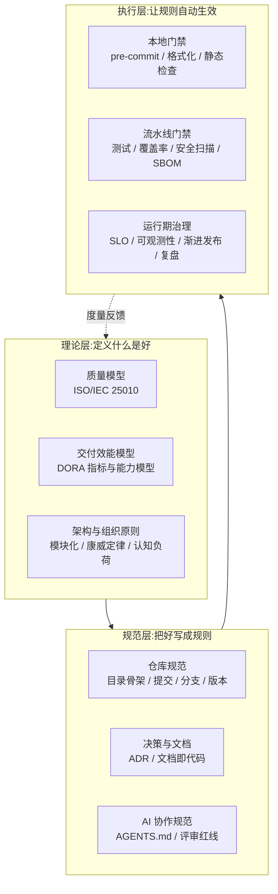
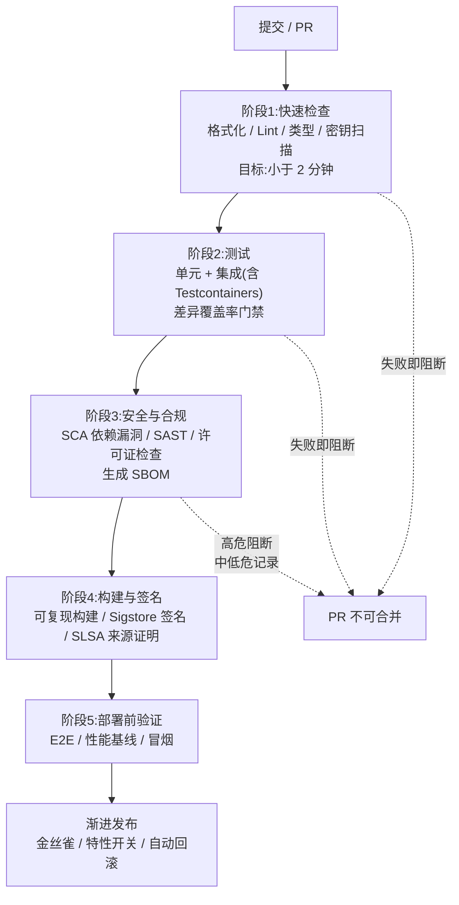

[toc]


## 总览:项目治理的三层模型

中大型项目的"治理"(governance)不是单一工具或流程,而是三层相互支撑的体系。理解这个分层有助于避免"只买工具不改流程"的常见失败。



- **理论层**回答"我们追求的质量和效能到底指什么",它提供统一的词汇,避免团队在"代码质量"这种模糊词上争论。
- **规范层**把理论转化为团队可以遵守的书面规则,放在仓库里与代码一起版本化。
- **执行层**用工具把规则变成自动门禁(gate),这是最关键的一层:**不能自动执行的规范,在中大型项目里迟早会被遗忘**。

下面按此分层逐一展开。

---

## 理论基础:用标准词汇定义质量与效能

### 质量模型:ISO/IEC 25010

ISO/IEC 25010是软件产品质量的国际标准模型。它从ISO 9126演进而来,在2023版中定义了九个产品质量特性:功能适合性、性能效率、兼容性、交互能力、可靠性、安全性、可维护性、灵活性和安全性(safety)。2011版曾将模型扩展为八个特性,新增安全性和兼容性,并把"功能性"细化为"功能适合性"、"效率"细化为"性能效率"。

与本话题最相关的是**可维护性(Maintainability)**及其子特性,这是"可持续性"的标准化定义:

| 子特性       | 英文          | 含义                           | 工程上对应的可度量信号                 |
| ------------ | ------------- | ------------------------------ | -------------------------------------- |
| **模块化**   | Modularity    | 修改一个组件对其他组件影响最小 | 模块间依赖图、循环依赖数、变更波及范围 |
| **可复用性** | Reusability   | 资产可在多个系统中复用         | 共享库抽取、重复代码率                 |
| **可分析性** | Analysability | 能有效评估变更影响、诊断缺陷   | 日志/追踪覆盖、代码复杂度              |
| **可修改性** | Modifiability | 修改不引入副作用               | 变更失败率、回归缺陷数                 |
| **可测试性** | Testability   | 能验证变更行为符合预期         | 测试覆盖率、测试执行时长               |

模块化评估系统组件能否在对其他组件影响最小的情况下被修改;可复用性关注资产在多个系统中被利用的潜力;可分析性评估对计划变更的影响评估效果和系统对缺陷的可诊断性;可修改性考察在不损害质量的前提下修改系统的难易程度。

需要注意一个重要事实:ISO 25010与其早期版本一样,并没有提供评估或改进质量特性的方法,这使得从业者无法直接使用它;不过这个缺陷可以通过软件度量来弥补。所以**ISO 25010的正确用法是"词汇表+检查清单"**,而非直接的度量工具,具体的度量要靠SonarQube这类工具或团队自定义指标。

在AI编码时代这个模型的价值反而更高:在AI时代维护安全性和可维护性对于防止"AI slop"(AI垃圾代码)、确保大量生成代码保持有效和高效至关重要。

### 交付效能模型:DORA指标与AI能力模型

DORA(DevOps Research and Assessment)是Google主导的、持续十余年的软件交付效能研究。其经典的**四个关键指标**(部署频率、变更前置时间、变更失败率、服务恢复时间)已是行业通用语言。2025年报告聚焦AI辅助开发,结论对本话题极为关键:

- **AI是放大器而非修复器**。报告揭示的核心洞见是:AI并不能修复一个团队,它只会放大已有的东西。强团队用AI变得更好更高效,挣扎中的团队会发现AI只会凸显并加剧已有问题。最大的回报并非来自AI工具本身,而是来自对内部平台质量、工作流清晰度和团队对齐的战略性关注。
- **吞吐量上升但稳定性下降**。AI采用与软件交付吞吐量明确正相关,团队确实用AI更快地编写和交付代码;但这种加速是有代价的:AI采用也持续与更高的不稳定性相关,导致更多变更失败、更多返工以及更长的问题解决周期。
- **信任悖论**。虽然超过80%的用户报告AI带来显著生产力提升,但仍有30%的人对其生成的代码几乎没有信任。AI成功加速了初始代码生成并降低了启动新任务的摩擦,但创建阶段节省的时间经常被重新分配到审计和验证上。

报告提出的**AI能力模型(AI Capabilities Model)**包含七项能力:明确的AI立场、健康的数据生态、AI可访问的内部数据、强大的版本控制实践、小批量工作、以用户为中心、高质量的内部平台。其中"小批量"被特别强调:这一敏捷原则比以往任何时候都更重要。把大而复杂的问题拆成小的可管理块能改善流动、降低认知负荷,并在AI加速的环境中让代码评审过程显著更有效。

**治理启示**:DORA四指标应作为项目级仪表盘的核心,AI引入前后对比"变更失败率"和"返工率"的变化,是判断AI治理是否有效的最直接证据。

### 架构与组织原则(简述)

以下原则本轮未检索,属于稳定的经典理论,仅列要点供查阅:

- **康威定律(Conway's Law)**:系统结构会复制组织的沟通结构。中大型项目划分模块/服务时,应先考虑团队边界,反向利用该定律(所谓"逆康威操作")。
- **认知负荷(Cognitive Load)与团队拓扑(Team Topologies)**:单个团队能维护的系统复杂度有上限,超过上限的项目应拆分为流对齐团队、平台团队等。
- **依赖规则与整洁架构/六边形架构**:业务核心不依赖框架与外部I/O,依赖方向永远指向内层;这是可测试性与可修改性的架构基础。
- **技术债(Technical Debt)管理**:技术债应显式登记(issue标签或专门清单)并纳入迭代预算,而非口头存在。

---

## 仓库与代码规范治理

### 仓库骨架:治理文件的标准位置

一个治理良好的中大型仓库,根目录应包含一组"约定俗成"的文件,它们各自面向不同读者(人、CI、AI代理、平台)。下表是推荐骨架:

| 文件/目录                                | 读者                | 用途                             | 必要性         |
| ---------------------------------------- | ------------------- | -------------------------------- | -------------- |
| `README.md`                              | 人                  | 项目概述、快速开始               | 必须           |
| `CONTRIBUTING.md`                        | 人(贡献者)          | 贡献流程、分支/提交/评审规则     | 必须           |
| `CODEOWNERS`                             | 平台(GitHub/GitLab) | 路径到负责人的映射,自动指派评审  | 中大型必须     |
| `LICENSE`                                | 人/法务/扫描工具    | 许可证                           | 必须           |
| `SECURITY.md`                            | 人/安全研究者       | 漏洞披露渠道                     | 推荐           |
| `CHANGELOG.md`                           | 人                  | 版本变更记录(可自动生成)         | 推荐           |
| `.editorconfig`                          | 编辑器              | 缩进、换行、编码的跨编辑器统一   | 必须           |
| `.gitattributes`                         | Git                 | 换行规范化、二进制标记、diff策略 | 跨平台必须     |
| `.pre-commit-config.yaml`                | 本地钩子框架        | 提交前自动格式化与检查           | 推荐           |
| `AGENTS.md`                              | AI编码代理          | 构建/测试命令、约定、边界        | AI协作项目必须 |
| `docs/adr/`                              | 人/AI               | 架构决策记录                     | 中大型必须     |
| `.github/workflows/` 或 `.gitlab-ci.yml` | CI                  | 流水线定义                       | 必须           |
| `.github/PULL_REQUEST_TEMPLATE.md`       | 人                  | PR描述模板                       | 推荐           |

### 跨平台一致性:换行与编码

这是国内开发者在Windows与Linux/macOS混用场景下最高频的"隐性事故源"。Git在Windows上默认`core.autocrlf=true`,在*nix上默认不转换,同一文件在不同机器上可能被改写为CRLF,导致shell脚本报`\r: command not found`、Dockerfile构建失败、diff全文件变红。

**必须**在仓库中用`.gitattributes`固化规则,而不是依赖每个开发者的本地配置:

```gitattributes
# 默认:所有文本文件在仓库内统一存为 LF
* text=auto eol=lf

# 明确声明必须为 LF 的文件(脚本在 CRLF 下会直接失效)
*.sh      text eol=lf
*.py      text eol=lf
Dockerfile text eol=lf
Makefile  text eol=lf

# Windows 专用脚本保持 CRLF
*.bat     text eol=crlf
*.ps1     text eol=crlf

# 二进制文件不做任何转换
*.png     binary
*.jpg     binary
*.woff2   binary
```

字段说明:

| 字段                  | 含义                                                |
| --------------------- | --------------------------------------------------- |
| `text=auto`           | 由Git自动判断是否为文本文件,是则做换行规范化        |
| `eol=lf` / `eol=crlf` | 检出(checkout)到工作区时使用的换行符;仓库内始终存LF |
| `binary`              | 等价于`-text -diff`,不做换行转换也不做文本diff      |

配合`.editorconfig`在编辑器层面统一(`end_of_line = lf`、`charset = utf-8`、`insert_final_newline = true`)。两者缺一不可:`.editorconfig`管"写入时",`.gitattributes`管"提交与检出时"。

### 代码格式化与静态检查:本地门禁

原则是**"格式化零争论,静态检查有分级"**:格式化工具的输出就是标准,不在评审中讨论缩进与括号;静态检查分"阻断"与"警告"两级。

| 语言/领域             | 格式化                           | 静态检查/Lint                        | 说明                                        |
| --------------------- | -------------------------------- | ------------------------------------ | ------------------------------------------- |
| Python                | `ruff format`(或`black`)         | `ruff check`、`mypy`/`pyright`       | ruff一体化,速度快                           |
| JavaScript/TypeScript | `prettier` 或 `biome`            | `eslint` 或 `biome`、`tsc --noEmit`  | biome为Rust实现的新兴一体化方案             |
| Go                    | `gofmt`/`goimports`              | `golangci-lint`                      | 格式化是语言内置标准                        |
| Rust                  | `rustfmt`                        | `clippy`                             | 同上                                        |
| Java/Kotlin           | `spotless`(含google-java-format) | `checkstyle`、`detekt`、`errorprone` |                                             |
| Shell                 | `shfmt`                          | `shellcheck`                         | 脚本类项目必须                              |
| YAML/JSON/Markdown    | `prettier`                       | `yamllint`、`markdownlint`           | CI配置与文档也要检查                        |
| Dockerfile            | —                                | `hadolint`                           |                                             |
| 密钥泄露              | —                                | `gitleaks`、`detect-secrets`         | **必须**,AI生成代码尤其容易把示例密钥写进去 |

**推荐**用`pre-commit`框架统一管理这些钩子(跨语言、跨平台、钩子版本锁定)。示例:

```yaml
# .pre-commit-config.yaml
repos:
  - repo: https://github.com/pre-commit/pre-commit-hooks
    rev: v5.0.0
    hooks:
      - id: end-of-file-fixer
      - id: trailing-whitespace
      - id: mixed-line-ending
        args: ["--fix=lf"]
      - id: check-added-large-files
        args: ["--maxkb=1024"]
  - repo: https://github.com/astral-sh/ruff-pre-commit
    rev: v0.8.0
    hooks:
      - id: ruff
        args: ["--fix"]
      - id: ruff-format
  - repo: https://github.com/gitleaks/gitleaks
    rev: v8.21.0
    hooks:
      - id: gitleaks
  - repo: https://github.com/shellcheck-py/shellcheck-py
    rev: v0.10.0.1
    hooks:
      - id: shellcheck
```

说明:`rev`应锁定到具体tag(上面的版本号仅为示例,请以各仓库最新发布为准);国内网络下`pre-commit install`会从GitHub拉取钩子仓库,若无代理,可设置`PRE_COMMIT_HOME`缓存目录并由一台能访问的机器预热后分发,或在`repo:`中使用镜像地址。**避免**只在本地跑pre-commit而CI不跑:本地钩子可被`--no-verify`跳过,CI必须重复执行同样的检查作为最终门禁。

### 提交规范:Conventional Commits与语义化版本

> 本小节内容本轮未能联网核实,依据为Conventional Commits 1.0.0规范与SemVer 2.0.0规范的公开文本,属于长期稳定内容。

**Conventional Commits**是一种提交信息的轻量约定,格式为:

`<type>[optional scope][!]: <description>`

后接可选的正文和页脚。各占位符含义:

| 占位符                  | 含义                                                         | 示例                                 |
| ----------------------- | ------------------------------------------------------------ | ------------------------------------ |
| `type`                  | 变更类型。`feat`表示新功能(对应SemVer的MINOR),`fix`表示缺陷修复(对应PATCH);其他常用类型有`docs`、`refactor`、`test`、`chore`、`ci`、`perf`、`build` | `feat`、`fix`                        |
| `scope`                 | 可选,受影响的模块或子系统,用括号包裹                         | `(auth)`、`(billing-api)`            |
| `!`                     | 可选,紧跟在type/scope后,表示**破坏性变更**(对应MAJOR)        | `feat(api)!:`                        |
| `description`           | 一句话简述,祈使语气,不加句号                                 | `add refresh token rotation`         |
| 页脚 `BREAKING CHANGE:` | 与`!`等价的另一种破坏性变更声明方式,需说明迁移方法           | `BREAKING CHANGE: /v1/login removed` |
| 页脚 `Refs:`/`Closes:`  | 关联issue                                                    | `Closes: #123`                       |

一个完整例子:

```gitcommit
feat(billing)!: switch invoice numbering to per-tenant sequences

Previously invoice numbers were global, which leaked tenant volume
information. Each tenant now has an isolated sequence starting at 1.

BREAKING CHANGE: existing integrations that parse invoice numbers as
globally unique must switch to the (tenant_id, invoice_no) pair.
Refs: ADR-0012
Closes: #482
```

**语义化版本(SemVer)** `MAJOR.MINOR.PATCH`:MAJOR为不兼容变更,MINOR为向后兼容的新功能,PATCH为向后兼容的修复。两者组合后,**版本号与变更日志可以完全自动化生成**:工具如`semantic-release`、`release-please`(Google)、`changesets`(多包monorepo)、`git-cliff`(Rust,仅生成changelog)会解析提交历史,自动决定版本号、生成`CHANGELOG.md`、打tag并发布。

用`commitlint`(JS生态)或`commitizen`/`cz`(Python生态)在pre-commit的`commit-msg`阶段校验格式。对于AI代理,把提交格式写进`AGENTS.md`即可让其遵守,但**仍需commitlint作为硬门禁**。

### 分支策略与分支保护

> 本小节本轮未联网核实,属稳定实践。

| 策略                                  | 适用                                              | 特点                                                         |
| ------------------------------------- | ------------------------------------------------- | ------------------------------------------------------------ |
| **主干开发(Trunk-Based Development)** | 持续交付团队、有完善CI与特性开关                  | 短生命周期分支(小于1-2天),频繁合入`main`;DORA研究长期支持此策略与高效能相关 |
| **GitHub Flow**                       | 大多数Web/SaaS项目                                | 功能分支 + PR + 合入即部署,实质是主干开发的PR化              |
| **GitFlow**                           | 需要并行维护多个发布版本的产品(如客户端软件、SDK) | `develop`/`release`/`hotfix`分支体系,复杂度高,持续交付场景下**不推荐** |

无论采用哪种,**必须**对`main`(及发布分支)启用分支保护:禁止直接推送、要求PR、要求CI状态通过、要求至少一名CODEOWNERS批准、合并前必须与基线同步(或启用合并队列)。这些是AI代理时代的底线——代理可能被授予推送权限,分支保护是防止其绕过评审的最后一道机械屏障。

---

## 决策与文档治理

### 架构决策记录(ADR)

ADR是中大型项目最具性价比的文档实践。架构决策记录是一份捕获重要架构决策及其上下文和后果的文档;架构决策是一个解决重大需求的软件设计选择。它的核心价值在于保存"为什么":没有ADR,团队经常重复争论、丢失机构知识,或难以理解系统为何如此设计。ADR通过让决策显式、可追溯、易于访问来解决这个问题。

**哪些决策需要ADR**:只包含那些影响系统结构、关键质量属性或难以逆转的选择。典型如:选数据库、选框架、定API风格、认证方案、部署策略、引入重量级依赖。次要或操作性变更并不总是需要ADR。

**模板与字段**(Michael Nygard格式的扩展版):

| 字段                      | 含义                          | 要点                                                         |
| ------------------------- | ----------------------------- | ------------------------------------------------------------ |
| `ADR-NNNN` 与标题         | 四位递增编号 + 决策的简短陈述 | 编号永不复用                                                 |
| `Status`                  | 状态                          | 常见状态包括"Proposed"(提议)、"Accepted"(已接受)、"Deprecated"(已废弃)和"Superseded"(已被取代)。显式状态标记帮助团队成员理解哪些架构决策是活跃的、在考虑中的或已被新决策替换 |
| `Date`                    | 决策日期                      | ISO格式                                                      |
| `Context`                 | 问题、约束、各方力量          | 要具体:在相关处包含数字、截止日期、团队能力和技术需求        |
| `Decision`                | 决定本身                      | 用主动语态:"我们将使用X"而不是"X应被考虑"                    |
| `Alternatives Considered` | 被否决的备选及理由            | 这是未来重新评估的依据                                       |
| `Consequences`            | 正面/负面后果、风险           | 最有价值的部分通常是后果,这里是ADR变得诚实的地方             |

**关键实践**:

- 把ADR保存在版本控制中,一旦被接受就不可变;如果决策变了,团队创建一个新ADR取代旧的,这样得到的是可审计的决策日志而不是被改写的故事。当一个决策被取代时,新ADR应引用旧ADR并解释为何需要改变。
- 常见做法是把ADR存放在仓库内的指定目录,如`docs/adr/`或`architecture/decisions/`。
- 在PR描述中链接ADR:如果一个变更实现或取代了某个决策,就把这种关联显式化。
- 在工作负载开始时启动ADR并在其整个生命周期内维护;对于遗留系统也应启动ADR,如果资料可得,应基于已知的过去决策回溯生成。
- 对于下一个新增依赖、改变核心配置或引入系统级权衡的PR,写一份三句话的架构决策记录——从小开始,不要一上来追求完美模板。

**与AI编码的关系**:ADR对AI代理同样是高价值上下文。在`AGENTS.md`中指向`docs/adr/`,并要求代理在引入新依赖或改变架构前先读相关ADR、在违反ADR时停下来询问,可以显著减少代理"重新发明"已被否决方案的情况。

### 文档即代码与文档分类

- **文档即代码(Docs-as-Code)**:文档用Markdown/AsciiDoc写在仓库中,随PR评审、随CI构建(MkDocs、Docusaurus、VitePress、Sphinx),避免Wiki与代码脱节。
- **Diátaxis框架**(本轮未检索,稳定实践):把文档分为教程(tutorials)、操作指南(how-to)、参考(reference)、解释(explanation)四象限,避免一篇文档什么都讲。
- **C4模型**:用上下文(Context)、容器(Container)、组件(Component)、代码(Code)四层画架构图,配合Mermaid的`C4Context`语法或Structurizr实现图即代码。

---

## 变更与评审治理

### 小批量与PR规范

> 本小节关于Google评审实践的内容本轮未能联网核实,依据为Google公开的 *eng-practices* 文档,属稳定内容。

Google的代码评审指南核心原则:**小变更(small CLs)**——评审更快、更彻底,缺陷更少,合并冲突更少,回滚更容易。经验阈值是单PR变更行数控制在几百行以内,超过则拆分。评审者的标准是"CL整体上提升了代码库健康度就应批准",而非追求完美。

结合DORA 2025的"小批量"能力,**AI辅助开发时期应更严格执行小PR**:AI可以在几分钟内生成上千行代码,但人类评审带宽没有变,大PR会直接导致"橡皮图章式"评审,这正是稳定性下降的来源之一。

**PR模板**应至少包含:变更目的与关联issue、变更类型(对应Conventional Commits type)、测试方式、是否包含破坏性变更/数据迁移、关联ADR、**AI参与程度声明**(见后文)。

### 完成的定义(Definition of Done)

团队级的DoD是治理的"契约",**推荐**写进`CONTRIBUTING.md`。一个中大型项目的典型DoD:

- 代码通过格式化与静态检查(本地与CI一致)
- 新增/修改逻辑有对应的自动化测试,CI全绿
- 覆盖率不低于基线(例如整体80%,新增代码90%,以差异覆盖率为准)
- 无新增高危/严重级别的安全扫描告警,或已记录例外与到期日
- 文档与`CHANGELOG`(自动生成)已更新;涉及架构变更有ADR
- 至少一名CODEOWNER批准;AI生成的代码经过人类逐行评审
- 可观测性就绪:关键路径有日志/指标/追踪;有回滚方案

### CODEOWNERS

`CODEOWNERS`文件把路径映射到负责人或团队,平台自动指派评审并作为分支保护的"必需批准者"。示例:

```gitignore
# 默认所有人
*                       @acme/core-maintainers
# 支付模块需要支付团队和安全团队双重批准
/services/billing/      @acme/billing-team @acme/security
# 基础设施与 CI 配置
/.github/workflows/     @acme/platform
/infra/                 @acme/platform
# AI 代理规范文件的变更需要架构组审核
/AGENTS.md              @acme/architects
/docs/adr/              @acme/architects
```

语法与`.gitignore`类似,**后面的规则优先级更高**。注意`AGENTS.md`本身应纳入严格的所有权控制:它是AI代理的"系统提示",被恶意或疏忽修改会影响所有后续代理行为。

---

## 质量保障:测试策略与流水线门禁

### 测试分层

| 层级           | 目标                                  | 比例建议            | 工具举例                           |
| -------------- | ------------------------------------- | ------------------- | ---------------------------------- |
| **单元测试**   | 函数/类级逻辑                         | 最多、最快          | pytest、vitest、JUnit、Go testing  |
| **集成测试**   | 模块与数据库/消息队列等真实依赖的交互 | 中等                | Testcontainers(用Docker起真实依赖) |
| **契约测试**   | 服务间API约定(消费者驱动)             | 微服务场景必须      | Pact、OpenAPI schema校验           |
| **端到端测试** | 关键用户路径                          | 最少,只覆盖核心流程 | Playwright、Cypress                |
| **变异测试**   | 检验测试本身的有效性                  | 核心模块定期跑      | mutmut、Stryker、PIT               |
| **属性测试**   | 用随机输入发现边界缺陷                | 算法/解析器类代码   | Hypothesis、fast-check             |

**变异测试(mutation testing)值得特别强调**:AI生成的测试经常是"为了覆盖率而覆盖"(断言薄弱甚至只断言不抛异常),覆盖率数字漂亮但不能捕获缺陷。变异测试通过修改源代码检验测试能否察觉,是识别"假测试"的有效手段。

### 流水线分阶段门禁



设计要点:

- **快失败在前**:格式化、Lint、密钥扫描几秒到两分钟内给反馈,避免开发者等待十分钟才知道少了个分号。
- **门禁分级**:格式、测试、高危漏洞是硬阻断;中低危漏洞、复杂度告警记录为issue并设到期日。
- **质量门禁工具**:SonarQube(社区版免费,可自托管)或其云服务提供"新代码质量门禁"(新代码覆盖率、重复率、可靠性/安全/可维护性评级),把ISO 25010的词汇落为具体阈值。
- **缓存与国内网络**:生产部署在海外的情况下,CI通常跑在GitHub Actions等海外runner上,依赖拉取不成问题;但若有国内自托管runner,**必须**配置包管理器镜像(npm用`registry.npmmirror.com`、pip用清华/阿里镜像、Go用`GOPROXY=https://goproxy.cn,direct`、Docker用国内镜像加速),并确保锁文件(lockfile)中的完整性哈希不受镜像影响(镜像只改URL不改内容时哈希一致)。

---

## 依赖与供应链安全治理

这是近年最快演进、也最常被中小团队忽视的治理领域。传统基于CVE的SCA会漏掉零日恶意包——Socket报告在2025年上半年检测到与单一朝鲜黑客行动相关的1700多个恶意包,其中大多数没有CVE。xz-utils后门是典型案例——"Jia Tan"用两年时间耐心建立信任,然后在SSH认证链中插入后门。这类攻击最难防御,因为攻击者控制提交权限,可以把代码藏在测试夹具和构建脚本里。

### 核心概念与工具栈

| 概念           | 全称/说明                                              | 代表工具(优先开源)                                           | 治理动作                                                     |
| -------------- | ------------------------------------------------------ | ------------------------------------------------------------ | ------------------------------------------------------------ |
| **锁文件**     | 固定依赖的精确版本与哈希                               | `package-lock.json`/`pnpm-lock.yaml`、`uv.lock`/`poetry.lock`、`go.sum`、`Cargo.lock` | **必须**提交到仓库;CI用"冻结安装"(`npm ci`、`uv sync --frozen`) |
| **SBOM**       | 软件物料清单(Software Bill of Materials)               | Syft(生成)、格式为CycloneDX或SPDX                            | 每次构建生成并随制品归档                                     |
| **SCA**        | 软件成分分析(依赖漏洞扫描)                             | Grype、Trivy、OSV-Scanner、Dependabot                        | CI阶段3阻断高危                                              |
| **恶意包检测** | 行为分析而非CVE匹配                                    | Socket、OSV-Scanner(接入OpenSSF恶意包源)                     | 新增依赖时检查                                               |
| **SLSA**       | 供应链等级(Supply-chain Levels for Software Artifacts) | GitHub官方的`slsa-github-generator`、Sigstore                | SLSA框架定义了L1到L3的来源证明等级,L2增加签名的来源证明,L3要求构建隔离和经验证的真实性 |
| **制品签名**   | 证明制品出自可信构建                                   | Sigstore(`cosign`、Fulcio、Rekor)                            | 容器镜像与发布包签名                                         |
| **Scorecard**  | 仓库安全健康度评分                                     | OpenSSF Scorecard                                            | 评估自身仓库与候选依赖                                       |
| **自动更新**   | 依赖版本自动PR                                         | Renovate(推荐,配置灵活)、Dependabot                          | 每周合并窗口,分组小版本                                      |
| **许可证合规** | 避免引入不兼容许可证                                   | `license-checker`、ScanCode、FOSSA                           | 禁止清单(如GPL进商业闭源代码)                                |

推荐路径是先用SBOM优先模式(Syft + Grype)获得可见性,再加Socket或OSV-Scanner阻断恶意包,当构建流水线本身成为信任边界时再叠加Sigstore + SLSA来源证明。

CycloneDX是OWASP维护的SBOM格式,SPDX是Linux基金会的SBOM格式并已被采纳为ISO/IEC 5962:2021;SLSA是OpenSSF的来源证明框架,定义了构建完整性等级;in-toto是SLSA来源证明文档底层的密码学证明框架。

### CI本身的供应链加固

CI流水线是攻击者的高价值目标。建议措施包括:在构建runner上做网络出口监控以检测数据外泄、按GitHub的Actions安全加固指南把GitHub Actions哈希固定到具体提交SHA、运行时检测runner内未授权的文件或进程活动,以及生成SLSA Build L3证明。

实践上最重要的一条是**把第三方Action固定到commit SHA而非tag**:

```yaml
# 避免:tag 可被仓库维护者移动,指向恶意版本
- uses: actions/checkout@v4
# 推荐:SHA 不可变,并用注释保留可读版本号,Renovate 可自动更新
- uses: actions/checkout@11bd71901bbe5b1630ceea73d27597364c9af683 # v4.2.2
```

(上面的SHA仅为示意,请以实际发布为准。)

### Scorecard的适用边界

Scorecard可能有助于聚合或概括,但会丢失对开发者需求或公司策略重要的细节或细微差别。例如,一个功能完备的组件不会频繁更新,在Scorecard指标下该组件会因为没有活动或维护而被错误地给予较低分数。所以**Scorecard分数应作为参考信号而非唯一准入标准**。另据OpenSSF 2026年3月通讯,OpenSSF Scorecard已起草2026路线图及OSPS Baseline一致性提案;2026秋季Security Slam围绕OpenSSF开源项目安全基线(OSPS Baseline)组织,包括供应链卫生和CRA(欧盟网络弹性法案)就绪目标——对于面向欧洲市场的产品,OSPS Baseline与CRA是值得跟进的合规线索。

### 国内网络环境下的实践提示

- **GitHub资源加速**:无代理时,对GitHub release文件可用`https://gh-proxy.com/`前缀包裹原始URL(请自行核实当前可用性,此类服务可能变动);Go模块用`goproxy.cn`;pip/npm/Docker用国内镜像。
- **代理设置分平台**:
  - *nix(bash/zsh):`export HTTPS_PROXY=http://127.0.0.1:7890 HTTP_PROXY=http://127.0.0.1:7890`(端口以mihomo等本地代理实际配置为准);Git单独设置`git config --global http.proxy http://127.0.0.1:7890`。
  - Windows PowerShell:`$env:HTTPS_PROXY = "http://127.0.0.1:7890"`;CMD:`set HTTPS_PROXY=http://127.0.0.1:7890`。注意PowerShell中`$env:`是环境变量前缀语法。
  - Docker守护进程的代理需要单独配置(Linux下`/etc/systemd/system/docker.service.d/http-proxy.conf`,Windows/macOS Docker Desktop在设置界面配置),容器内构建时的代理需通过`--build-arg`传入。
- **镜像与锁文件一致性**:使用镜像源时确保锁文件中记录的`resolved`URL不会被改写为镜像地址提交到仓库(pnpm/npm有相关配置),否则海外生产环境构建时会去访问国内镜像。

---

## 可靠性与运行期治理

> 本节本轮未专项检索,依据为Google SRE书籍、OpenTelemetry项目等公开稳定资料。

| 实践                                 | 要点                                                         |
| ------------------------------------ | ------------------------------------------------------------ |
| **SLI/SLO与错误预算**                | 定义服务水平指标(如可用性、P99延迟)与目标;错误预算耗尽时冻结功能发布、优先修稳定性。这把"速度与稳定"的权衡变成可量化的规则,正对应DORA 2025指出的AI引入后稳定性下降问题 |
| **可观测性三支柱**                   | 日志(结构化JSON)、指标(Prometheus格式)、追踪(OpenTelemetry标准)。OpenTelemetry是CNCF厂商中立标准,**推荐**从项目初期接入,后端可选Grafana栈、SigNoz(开源)等 |
| **十二要素应用**                     | 配置通过环境变量注入、无状态进程、日志作为事件流、开发/生产环境对等。是容器化部署的基础规范 |
| **渐进交付**                         | 特性开关(OpenFeature标准、Unleash开源)、金丝雀发布、蓝绿部署;**任何发布都必须有分钟级回滚方案** |
| **无指责复盘(Blameless Postmortem)** | 每个生产事故产出复盘文档:时间线、根因、影响、行动项(带负责人与到期日),放入仓库`docs/postmortems/` |
| **基础设施即代码**                   | Terraform/OpenTofu、Pulumi;基础设施变更同样走PR与评审        |

---

## AI编码治理:核心专题

这是本话题区别于传统治理的部分。总体原则可概括为一句话:**AI生成的代码在治理上与人写的代码享有完全相同的义务,且因其产量大、信任度低,需要额外的上下文供给与验证机制**。

### 为什么需要专门治理

前文DORA 2025的数据已说明:AI提高吞吐但降低稳定性,30%的开发者不信任AI代码,节省的时间转移到了验证环节。此外有一些AI特有的风险模式(基于本轮未检索的公开讨论与我的知识,属于行业共识):

- **幻觉依赖(hallucinated packages)与"slopsquatting"**:模型可能引用不存在的包名,攻击者抢注这些名字发布恶意包。治理手段:新增依赖必须经人工核实+恶意包检测。
- **上下文缺失导致的重复造轮子**:代理不知道项目已有的工具函数、错误类、约定,于是另写一套。治理手段:`AGENTS.md`+ADR提供上下文。
- **测试作弊**:代理为让测试通过而修改测试断言、跳过测试、硬编码期望值。治理手段:评审时测试文件变更单独审视;变异测试;CI中禁止`skip`标记的新增。
- **许可证污染**:生成代码可能接近某些受限许可证的开源代码。治理手段:企业级工具的引用过滤;对核心算法代码保持人工主导。
- **密钥与敏感信息**:代理可能把`.env`内容、示例密钥写入代码或提交信息。治理手段:gitleaks硬门禁。
- **代码膨胀与过度防御**:AI倾向生成冗余的try/except、重复的注释、不必要的抽象,侵蚀可维护性。治理手段:评审关注"删除什么"而不仅是"新增什么";复杂度门禁。

### AGENTS.md:为AI代理提供的仓库级规范

AGENTS.md约定为治理提示提供了标准化的仓库级位置:即AI编码代理在软件项目内工作时的指令、约束和操作规程。给AI代理的Markdown指令文件的概念由多个厂商专有约定推广(特别是Anthropic的CLAUDE.md),但AGENTS.md标准本身于2025年8月由OpenAI主导、Google、Cursor和Factory参与协作而正式化为开放规范;2025年12月该规范被捐赠给Linux基金会的Agentic AI Foundation。截至2025年12月,已有超过60000个开源项目采用该格式,超过二十种AI编码工具支持它。

**格式特点**:纯Markdown,无必需标题,无强制YAML前置元数据,无自定义语法,无构建步骤,无厂商SDK。官方指导是添加能帮助代理有效工作的章节;常见选择包括项目概述、构建与测试命令、代码风格指南、测试说明和安全注意事项。

**应该写什么、不该写什么**:

| 应该包含                                                     | 不应包含                                                     |
| ------------------------------------------------------------ | ------------------------------------------------------------ |
| 构建命令、测试命令、架构规则和安全边界是高价值指令           | 临时性的功能需求应留在任务提示中                             |
| 未被自动化工具强制执行的约定                                 | 不要重复每条ESLint或格式化规则                               |
| 带精确参数的构建命令、测试流程、与默认不同的代码风格规则、架构约束以及边界(代理绝不能触碰的文件) | 长的可复用流程通常更适合放在Skills或工作流文件中             |
| 指向ADR、CONTRIBUTING等已有文档的链接                        | 与其他文档冲突的说法——冲突的指令应被移除,而不是留给代理去解释 |

**最关键的一条原则**:安全保证应通过权限、钩子、CI或基础设施来强制执行,而不是只依赖自然语言指令。也就是说,`AGENTS.md`里写"不要提交密钥"是提示,gitleaks在CI阻断才是治理。

**各工具的差异**:AGENTS.md是通用层,各工具有自己的扩展。AGENTS.md被20多种代理读取(通用),用于构建/测试命令、代码风格、项目结构、边界——这些无论哪个代理在编辑代码都适用的内容;不应用于代理专属的工具调用或模型专属的调优。嵌套文件可以提供更具体的指导,但各编码工具的支持和优先级有所不同。Claude Code的`CLAUDE.md`支持`@import`引用其他文件、支持分层(用户级/项目级/子目录级)和`CLAUDE.local.md`本地覆盖、支持钩子(hooks);Codex支持嵌套AGENTS.md(最近的文件优先);Copilot使用`.github/copilot-instructions.md`。**推荐做法**是以`AGENTS.md`为唯一事实来源,其他工具专属文件只做一行引用(如`CLAUDE.md`内写`@AGENTS.md`),避免多份规范漂移。

**非ASCII字符提示**:AGENTS.md用中文编写完全可行,主流模型理解无障碍。但代理执行的命令输出若含中文,在Windows旧版终端(非UTF-8代码页)可能乱码并被代理误读;建议在`AGENTS.md`的环境说明中注明"Windows下先执行`chcp 65001`或使用PowerShell 7+/Windows Terminal",并保持文件本身为UTF-8无BOM编码。

### AI协作的治理规则(推荐写入CONTRIBUTING.md)

- **必须**:AI生成的代码经过与人写代码相同的评审、测试与门禁;PR中声明AI参与程度(例如"AI生成,人工逐行评审"/"AI辅助补全"/"无AI");新增依赖必须人工核实其存在、维护状态与许可证。
- **应该**:以"规格先行"的方式使用代理——先让代理输出计划或设计草案,人确认后再实现;代理的每次任务限定在一个小PR的范围;评审时对测试文件变更、配置文件变更、依赖清单变更三类"高杠杆文件"单独审视。
- **可以**:用AI做第一轮评审(发现明显问题、总结变更),但**AI评审不能替代人类批准**,也不应计入分支保护的"必需批准者";用AI生成ADR草稿、变更日志摘要、测试用例骨架。
- **避免**:让代理拥有直接推送`main`的权限;在没有测试的遗留模块上让代理做大规模重构;把整个仓库作为上下文一次性让代理"优化";用AI生成的覆盖率数字作为质量证据而不做变异测试抽查。

---

## 综合示例:一个中型SaaS项目的治理骨架

设想一个名为`acme-billing`的多租户计费平台:Python(FastAPI)后端、TypeScript(Next.js)前端、PostgreSQL、部署在海外云的Kubernetes上,团队12人,开发者在国内,大量使用AI编码代理。以下骨架把前文的知识点串联起来。

### 仓库结构

- `AGENTS.md` —— AI代理规范(根级,通用)
- `CLAUDE.md` —— 仅一行`@AGENTS.md`引用
- `CONTRIBUTING.md` —— 贡献流程、DoD、AI协作规则
- `CODEOWNERS`、`SECURITY.md`、`LICENSE`、`README.md`
- `.editorconfig`、`.gitattributes`、`.pre-commit-config.yaml`
- `docs/adr/` —— `0001-record-architecture-decisions.md`、`0012-per-tenant-invoice-sequences.md`……
- `docs/postmortems/`
- `services/api/`(Python)、`apps/web/`(TypeScript)、`packages/shared-types/`
- `apps/web/AGENTS.md` —— 前端子目录的嵌套规范
- `infra/`(Terraform)、`.github/workflows/`

### AGENTS.md示例

```markdown
# acme-billing

多租户 SaaS 计费平台。后端 Python 3.12 + FastAPI(`services/api`),
前端 Next.js 15 + TypeScript(`apps/web`),共享类型在 `packages/shared-types`。
数据库 PostgreSQL 16,迁移用 Alembic。

## 环境与命令
- 依赖管理:后端 `uv`,前端 `pnpm 9`。首次执行 `make bootstrap`。
- 后端测试:`uv run pytest services/api -q`(需要 Docker,Testcontainers 会拉起 PostgreSQL)
- 前端测试:`pnpm --filter web test`;类型检查:`pnpm --filter web type:check`
- 全量检查(提交前必须通过):`make check`(等价于 pre-commit run --all-files + 两端测试)
- Windows 开发者:请在 PowerShell 7+ 中执行,并先运行 `chcp 65001` 保证中文输出正常。

## 架构约束
- 业务规则只能放在 `services/api/app/domain/`,该目录禁止 import FastAPI、SQLAlchemy。
- 引入任何新第三方依赖前,先阅读 `docs/adr/`;如需新依赖,停止并说明理由,由人决定。
- 发票编号规则见 ADR-0012,不要改回全局序列。
- 所有对外 API 必须在 `services/api/openapi/` 的规范中先声明,再实现。

## 代码约定(未被 linter 覆盖的部分)
- 使用 `app/core/errors.py` 中已有的错误类,不要新建平行的异常体系。
- 金额一律用 `Decimal` 与最小货币单位整数,禁止 float。
- 测试文件与被测模块同名,放在同级 `tests/` 下;不要用 `pytest.mark.skip` 绕过失败。

## 提交与 PR
- 提交信息遵循 Conventional Commits,scope 取值:`api`、`web`、`shared`、`infra`、`docs`。
- 每个 PR 只做一件事,控制在 400 行以内;超过请拆分并先提交计划。
- PR 描述需说明 AI 参与程度。

## 边界(绝不触碰)
- `infra/prod/`、`.github/workflows/release.yml`、任何 `.env*` 文件。
- 不要修改 `docs/adr/` 下已 Accepted 的文件;新决策新建文件。
```

这个文件体现了前述所有原则:只写工具没覆盖的约定、给出精确命令、指向ADR、声明硬边界、考虑Windows中文环境。而"不要提交`.env`"这条同时由CI里的gitleaks强制执行。

### ADR示例(对应AGENTS.md中引用的ADR-0012)

```markdown
# ADR-0012: 发票编号改为按租户独立序列

## Status
Accepted(取代 ADR-0004 中的全局序列方案)

## Date
2026-03-02

## Context
全局递增的发票号让任何租户都能通过自己相邻两张发票的号差估算平台总开票量,
已有两个企业客户在安全问卷中提出此问题。当前日开票约 4 万张,预计年内到 30 万。
约束:发票号在租户内必须连续无间断(税务要求);迁移不能停机。

## Decision
我们将为每个租户维护独立序列,发票唯一键改为 (tenant_id, invoice_no)。
序列由 PostgreSQL 行级锁保护的计数表实现,不使用数据库 SEQUENCE 对象
(SEQUENCE 在事务回滚时会产生间断)。

## Alternatives Considered
### 全局序列 + 对外展示随机不透明 ID
- Pros:改动最小
- Cons:税务要求对外展示的发票号本身连续,不透明 ID 不满足
### 每租户一个 PostgreSQL SEQUENCE
- Pros:实现简单
- Cons:回滚产生间断,违反连续性要求;10 万租户时 SEQUENCE 对象数量不可控

## Consequences
- 正面:消除信息泄露;租户内连续性有保证。
- 负面:高并发开票的单一租户会在计数表上串行化,预估单租户上限约 200 张/秒,
  当前最大租户峰值 12 张/秒,留有余量;需监控该锁等待时间。
- 需要 API 破坏性变更(v2),见 PR #482。
```

### CI工作流骨架

```yaml
# .github/workflows/ci.yml(节选,仅示意阶段划分)
name: ci
on:
  pull_request:
  push:
    branches: [main]
jobs:
  fast-checks:
    runs-on: ubuntu-latest
    steps:
      - uses: actions/checkout@<pinned-sha> # v4
      - uses: pre-commit/action@<pinned-sha> # v3
  test-api:
    needs: fast-checks
    runs-on: ubuntu-latest
    services:
      postgres: { image: "postgres:16", env: { POSTGRES_PASSWORD: test } }
    steps:
      - uses: actions/checkout@<pinned-sha>
      - uses: astral-sh/setup-uv@<pinned-sha>
      - run: uv sync --frozen
      - run: uv run pytest services/api --cov --cov-fail-under=80
  supply-chain:
    needs: fast-checks
    runs-on: ubuntu-latest
    steps:
      - uses: actions/checkout@<pinned-sha>
      - uses: anchore/sbom-action@<pinned-sha>      # 生成 SBOM(Syft)
      - uses: anchore/scan-action@<pinned-sha>      # 漏洞扫描(Grype),高危阻断
        with: { fail-build: true, severity-cutoff: high }
  build-sign:
    needs: [test-api, supply-chain]
    if: github.ref == 'refs/heads/main'
    permissions: { id-token: write, contents: read, packages: write }
    runs-on: ubuntu-latest
    steps:
      - uses: actions/checkout@<pinned-sha>
      - run: docker build -t ghcr.io/acme/billing-api:${{ github.sha }} services/api
      - uses: sigstore/cosign-installer@<pinned-sha>
      - run: cosign sign --yes ghcr.io/acme/billing-api:${{ github.sha }}
```

`<pinned-sha>`应替换为各Action实际的commit SHA并在注释中保留版本号;`permissions.id-token: write`是Sigstore无密钥签名(keyless)所需。分支保护要求`fast-checks`、`test-api`、`supply-chain`三项全部通过。

---

## 治理清单:必须、应该、可以、避免

| 级别     | 事项                                                         |
| -------- | ------------------------------------------------------------ |
| **必须** | 锁文件入库并冻结安装;`.gitattributes`统一LF;分支保护+CODEOWNERS;密钥扫描硬门禁;CI与本地检查一致;AI代码同等评审;ADR记录不可逆决策;生产发布有回滚方案 |
| **应该** | Conventional Commits+自动版本/变更日志;pre-commit框架;差异覆盖率门禁;SBOM生成与SCA扫描;Action固定SHA;`AGENTS.md`作为单一AI规范源;DORA四指标仪表盘;SLO与错误预算;小PR(数百行内) |
| **可以** | SLSA L3来源证明与Sigstore签名;变异测试抽查;OpenSSF Scorecard自评;契约测试;OpenTelemetry全链路;Renovate自动依赖更新;C4架构图即代码 |
| **避免** | GitFlow用于持续交付产品;只写规范不做门禁;AI评审替代人类批准;代理直推`main`;覆盖率数字作为唯一质量证据;多份AI规范文件各说各话;Scorecard分数作为唯一准入标准 |

